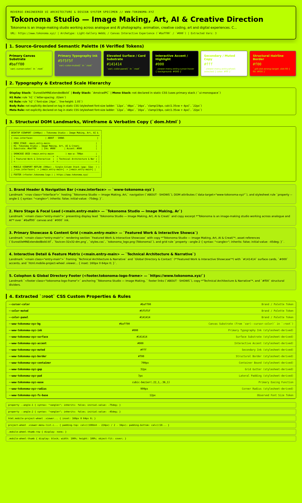
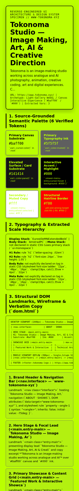

# UI Design System & Master Generation Blueprint: www-tokonoma-xyz

> **Tokonoma Studio — Image Making, Art, AI & Creative Direction** (https://www.tokonoma.xyz/) — Tokonoma is an image-making studio working across analogue and AI photography, animation, creative coding, art and digital experiences. C...



---

## 1. Executive Visual Persona & Design Archetype

- **Brand Essence & Persona**: **Tokonoma Studio — Image Making, Art, AI & Creative Direction** (`https://www.tokonoma.xyz/`). Tokonoma is an image-making studio working across analogue and AI photography, animation, creative coding, art and digital experiences. C...
- **Visual Archetype**: **Light-Gallery WebGL / Canvas Interactive Experience (`#baff00` / `#000`)**.
- **Anti-AI-Slop Differentiators**:
  - **Source-Grounded Chromatic Polarity**: Anchors the viewport in `#baff00` (`var(--cursor-color)` in `:root`) paired with `#000` primary typography and `#000` accents.
  - **Extracted Typographic Hierarchy**: Pairs `EurostileMNExtendedBold` for display copy (`Tokonoma Studio — Image Making, Art,`) with `AmstradPC` and not declared in static CSS (uses primary stack / `ui-monospace`).
  - **Calibrated Spatial Grid & Motion**: Combines `700px` container bounds (`gap: 32px`, padding `7px`) with `cubic-bezier(.22,1,.36,1)` easing and HTML5 `<canvas>` Interactive Viewport Surface.

---

## 2. Spatial Architecture & Modular Grid Mathematics



### Viewport Allocation & Container Geometry
- **Captured Viewport Dimensions**: Desktop `1440×2400px` (`assets/desktop.png`, capped at 2400px multi-section capture), Mobile `390×2400px` (`assets/mobile.png`, capped at 2400px multi-section capture).
- **Master Container Bounds**: `700px` extracted from `www-tokonoma-xyz` stylesheet.
- **Canvas Lateral Padding & Spacing**: `7px` lateral canvas padding with `32px` grid gap.
- **Border Radius Scale**: `999px`, `50%`.

### Responsive Breakpoint Architecture
- **Desktop Layout**: Multi-column CSS Grid / Flexbox layout at `1440px` (`max-width: 700px`, `gap: 32px`).
- **Mobile Layout**: Single-column vertical stack at `390px` viewport width with `7px` horizontal padding.
- **Extracted CSS Media Queries**: `@media (max-width: 700px), (hover: none) and (pointer: coarse) a...`, `@media (max-width: 1100px), (hover: none) and (pointer: coarse)`, `@media (prefers-reduced-motion: reduce) and (min-width: 1101px)...`, `@media (prefers-reduced-motion: reduce)`.

---

## 3. Color System, Materiality & Atmospheric Lighting

### Semantic Palette & Source Grounding
| Semantic Role | Ground-Truth Value | Extracted CSS Source / Selector |
|---|---|---|
| **Primary Canvas Substrate** | `#baff00` | `var(--cursor-color)` in `:root` |
| **Primary Typography Ink** | `#5f5f5f` | `var(--color-muted)` in `:root` |
| **Elevated Surface / Card Substrate** | `#141414` | `var(--color-panel)` in `:root` |
| **Interactive Accent / Highlight** | `#000` | `.viewer-menu-entry.cursor-hover { background: #000 }` |
| **Secondary / Muted Copy** | `#fff` | `.viewer-menu-entry.wheel-selected { color: #fff }` |
| **Structural Hairline Border** | `#f00` | `.pill-slot.wrong-target .slot-fill { fill: #f00 }` |

### Sanitized Root CSS Variables (`ui-ux.md` Ground Truth)
| Variable Name | Extracted Value | Semantic Role |
|---|---|---|
| `--cursor-color` | `#baff00` | Brand / Palette Token |
| `--color-muted` | `#5f5f5f` | Brand / Palette Token |
| `--color-panel` | `#141414` | Brand / Palette Token |
| `--www-tokonoma-xyz-bg` | `#baff00` | Canvas Substrate (from `var(--cursor-color)` in `:root`) |
| `--www-tokonoma-xyz-ink` | `#000` | Primary Typography Ink (stylesheet-derived) |
| `--www-tokonoma-xyz-surface` | `#141414` | Surface Substrate (stylesheet-derived) |
| `--www-tokonoma-xyz-accent` | `#000` | Interactive Accent (stylesheet-derived) |
| `--www-tokonoma-xyz-muted` | `#fff` | Secondary Ink (stylesheet-derived) |
| `--www-tokonoma-xyz-border` | `#f00` | Structural Border (stylesheet-derived) |
| `--www-tokonoma-xyz-container` | `700px` | Container Bound (stylesheet-derived) |
| `--www-tokonoma-xyz-gap` | `32px` | Grid Gutter (stylesheet-derived) |
| `--www-tokonoma-xyz-pad` | `7px` | Lateral Padding (stylesheet-derived) |
| `--www-tokonoma-xyz-ease` | `cubic-bezier(.22,1,.36,1)` | Primary Easing Function |
| `--www-tokonoma-xyz-radius` | `999px` | Corner Radius (stylesheet-derived) |
| `--www-tokonoma-xyz-fs-base` | `12px` | Observed Font Size Token |

---

## 4. Typographic Scale & Editorial Hierarchy

### Font Family Stacks
- **Display Typography**: `EurostileMNExtendedBold`.
- **Primary Body Stack**: `AmstradPC`.
- **Technical / Metadata Stack**: not declared in static CSS (uses primary stack / `ui-monospace`).

### Typographic Scale & Rules (Extracted from Stylesheet & Variables)
- **Hero Display (`H1`)**: rule `h1` (`letter-spacing: .02em`).
- **Section Heading (`H2`)**: rule `h2` (`font-size: 24px`, `line-height: 1.05`).
- **Body Copy**: not explicitly declared on tag in static CSS (stylesheet font-size ladder: `12px`, `48px`, `16px`, `clamp(19px, calc(1.35vw + 4px)`, `22px`).
- **Metadata & Navigation Labels**: not explicitly declared on tag in static CSS (stylesheet font-size ladder: `12px`, `48px`, `16px`, `clamp(19px, calc(1.35vw + 4px)`, `22px`).

---

## 5. Choreographed Motion & Interaction Physics

### Primary Easing Curves
- **Extracted Timing Functions**: `cubic-bezier(.22,1,.36,1)`, `cubic-bezier(.65,0,.35,1)`, `cubic-bezier(.55,0,.15,1)`.

### Per-Element Transition & Choreography Rules
- **Selector `.mobile-wheel-thumb-track`**: `transition: transform .34s cubic-bezier(.22,1,.36,1)` extracted from `www-tokonoma-xyz` stylesheet.
- **Selector `.mobile-wheel-thumb-frame`**: `transition: opacity .22s ease` extracted from `www-tokonoma-xyz` stylesheet.
- **Selector `bile-project-wheel .mobile-wheel-...`**: `transition: background-color .3s linear` extracted from `www-tokonoma-xyz` stylesheet.
- **Extracted Easing Curve (`cubic-bezier(.22,1,.36,1)`)**: Governs interactive state transitions across `<nav.interface>` and `<main.entry-main>`.
- **Runtime Interaction Engine**: Integrates HTML5 `<canvas>` Interactive Viewport Surface with `prefers-reduced-motion: reduce` fallback guards.

---

## 6. Component Wireframe & Structural DOM Map

### Visual Layout Schematic (Grounded in `dom.html` — `1440px` Desktop & `390px` Mobile Reflow)
```
┌────────────────────────────────────────────────────────────────────────┐
│ DESKTOP VIEWPORT (1440px) — Tokonoma Studio — Image Making, Art, AI &  │
│ ====================================================================== │
│ [ <nav.interface>          | ABOUT · SHOWS                          ]  │
│ ---------------------------------------------------------------------- │
│ | HERO STAGE: <main.entry-main>                                    |   │
│ | H1: Tokonoma Studio — Image Making, Art, AI & Creati             |   │
│ | Substrate: #baff00    | Ink: #000       | Accent: #000           |   │
│ ---------------------------------------------------------------------- │
│ | SHOWCASE GRID (<main.entry-main>         ) max-w: 700px          |   │
│ | +------------------------------+  +------------------------------+ | │
│ | | Featured Work & Interactive  |  | Technical Architecture & Nar | | │
│ | +------------------------------+  +------------------------------+ | │
│ ---------------------------------------------------------------------- │
│ | MOBILE VIEWPORT REFLOW (390px) — Single-Column Stack (gap: 32px  ) | │
│ | [<nav.interface>] -> [<main.entry-main>] -> [<main.entry-main>] |    │
│ ---------------------------------------------------------------------- │
│ [ FOOTER (<footer.tokonoma-logo-) | https://www.tokonoma.xyz/          │
└────────────────────────────────────────────────────────────────────────┘
```

### Granular DOM Region Breakdown
1. **Brand Header & Navigation Bar (<nav.interface> — `www-tokonoma-xyz`)**:
   - Landmark `<nav class="interface">` hosting `Tokonoma Studio — Image Making, Art,` navigation (`ABOUT · SHOWS`), DOM attributes (`data-target="www-tokonoma-xyz"`), and stylesheet rule `property --angle-1 { syntax: "<angle>"; inherits: false; initial-value: -75deg; }`.
2. **Hero Stage & Focal Lead (<main.entry-main> — `Tokonoma Studio — Image Making, Ar`)**:
   - Landmark `<main class="entry-main">` presenting display lead `Tokonoma Studio — Image Making, Art, AI & Creati` and copy excerpt *"Tokonoma is an image-making studio working across analogue and AI"* over `#baff00` canvas and `#000` ink.
3. **Primary Showcase & Content Grid (<main.entry-main> — `Featured Work & Interactive Showca`)**:
   - Landmark `<main class="entry-main">` rendering section `Featured Work & Interactive Showcase` with copy *"Tokonoma Studio — Image Making, Art, AI & Creati"*, asset references (`EurostileMNExtendedBold.ttf`, `favicon-32x32-dm.png`, `styles.css`, `tokonoma_logo.png (Tokonoma)`), and grid rule `property --angle-2 { syntax: "<angle>"; inherits: false; initial-value: -45deg; }`.
4. **Interactive Detail & Feature Matrix (<main.entry-main> — `Technical Architecture & Narrative`)**:
   - Landmark `<main class="entry-main">` framing `Technical Architecture & Narrative` and `Global Directory & Contact` (*"Featured Work & Interactive Showcase"*) with `#141414` surface cards, `#000` accents, and `html.mobile-project-wheel .viewer... { inset: 160px 0 64px 0; }`.
5. **Colophon & Global Directory Footer (<footer.tokonoma-logo-frame> — `https://www.tokonoma.xyz/`)**:
   - Landmark `<footer class="tokonoma-logo-frame">` anchoring `Tokonoma Studio — Image Making, ` footer links (`ABOUT · SHOWS`), copy *"Technical Architecture & Narrative"*, and `#f00` structural dividers.

---

## 7. Master Zero-Shot AI Generation Prompt

```markdown
# Master Zero-Shot Frontend Generation Prompt: www-tokonoma-xyz (Tokonoma Studio — Image Making, Art, AI & Creative Direction)

You are a principal frontend architect and design systems engineer. Build a complete, production-ready web application replicating the exact design system, DOM landmarks, typographic hierarchy, color tokens, and motion physics of `www-tokonoma-xyz` (**Tokonoma Studio — Image Making, Art, AI & Creative Direction** — `https://www.tokonoma.xyz/`).

### 1. Visual Archetype & Anti-AI-Slop Mandates
- **Archetype**: Light-Gallery WebGL / Canvas Interactive Experience (`#baff00` / `#000`).
- **Identity & Domain Context**: Tokonoma is an image-making studio working across analogue and AI photography, animation, creative coding, art and digital experiences. C...
- **Primary Substrate**: `#baff00` (`var(--cursor-color)` in `:root`), **Primary Ink**: `#000`, **Accent / Highlight**: `#000`.
- **Site-Specific Differentiators**:
  - **Source-Grounded Chromatic Polarity**: Anchors the viewport in `#baff00` (`var(--cursor-color)` in `:root`) paired with `#000` primary typography and `#000` accents.
  - **Extracted Typographic Hierarchy**: Pairs `EurostileMNExtendedBold` for display copy (`Tokonoma Studio — Image Making, Art,`) with `AmstradPC` and not declared in static CSS (uses primary stack / `ui-monospace`).
  - **Calibrated Spatial Grid & Motion**: Combines `700px` container bounds (`gap: 32px`, padding `7px`) with `cubic-bezier(.22,1,.36,1)` easing and HTML5 `<canvas>` Interactive Viewport Surface.

### 2. Ground-Truth CSS Variables (`:root` Token Contract)
Declare and consume these exact custom properties extracted from `www-tokonoma-xyz` in your global stylesheet:

:root {
  /* Tokonoma Studio — Image Making, Art, AI & Creative Direction (www-tokonoma-xyz) — Ground-Truth Extracted CSS Variables */
  --cursor-color: #baff00; /* Brand / Palette Token (www-tokonoma-xyz) */
  --color-muted: #5f5f5f; /* Brand / Palette Token (www-tokonoma-xyz) */
  --color-panel: #141414; /* Brand / Palette Token (www-tokonoma-xyz) */
  --www-tokonoma-xyz-bg: #baff00; /* Canvas Substrate (from `var(--cursor-color)` in `:root`) (www-tokonoma-xyz) */
  --www-tokonoma-xyz-ink: #000; /* Primary Typography Ink (stylesheet-derived) (www-tokonoma-xyz) */
  --www-tokonoma-xyz-surface: #141414; /* Surface Substrate (stylesheet-derived) (www-tokonoma-xyz) */
  --www-tokonoma-xyz-accent: #000; /* Interactive Accent (stylesheet-derived) (www-tokonoma-xyz) */
  --www-tokonoma-xyz-muted: #fff; /* Secondary Ink (stylesheet-derived) (www-tokonoma-xyz) */
  --www-tokonoma-xyz-border: #f00; /* Structural Border (stylesheet-derived) (www-tokonoma-xyz) */
  --www-tokonoma-xyz-container: 700px; /* Container Bound (stylesheet-derived) (www-tokonoma-xyz) */
  --www-tokonoma-xyz-gap: 32px; /* Grid Gutter (stylesheet-derived) (www-tokonoma-xyz) */
  --www-tokonoma-xyz-pad: 7px; /* Lateral Padding (stylesheet-derived) (www-tokonoma-xyz) */
  --www-tokonoma-xyz-ease: cubic-bezier(.22,1,.36,1); /* Primary Easing Function (www-tokonoma-xyz) */
  --www-tokonoma-xyz-radius: 999px; /* Corner Radius (stylesheet-derived) (www-tokonoma-xyz) */
  --www-tokonoma-xyz-fs-base: 12px; /* Observed Font Size Token (www-tokonoma-xyz) */
}

### 3. Semantic Color & Materiality Contract
Map every surface, ink, and border strictly to these source-grounded tokens:
- **Primary Canvas Substrate**: `#baff00` — grounded in `var(--cursor-color)` in `:root`
- **Primary Typography Ink**: `#5f5f5f` — grounded in `var(--color-muted)` in `:root`
- **Elevated Surface / Card Substrate**: `#141414` — grounded in `var(--color-panel)` in `:root`
- **Interactive Accent / Highlight**: `#000` — grounded in `.viewer-menu-entry.cursor-hover { background: #000 }`
- **Secondary / Muted Copy**: `#fff` — grounded in `.viewer-menu-entry.wheel-selected { color: #fff }`
- **Structural Hairline Border**: `#f00` — grounded in `.pill-slot.wrong-target .slot-fill { fill: #f00 }`

### 4. Spatial Grid, Container Bounds & Responsive Breakpoints
- **Desktop Viewport Reference**: `1440×2400px` (capped at 2400px multi-section capture, `1440px` standard desktop width).
- **Mobile Viewport Reference**: `390×2400px` (capped at 2400px multi-section capture, `390px` standard mobile width).
- **Container Max-Width**: `700px` extracted from `www-tokonoma-xyz` stylesheet
- **Padding & Gutters**: `7px` lateral canvas padding with `32px` grid gap
- **Desktop Grid**: Multi-column CSS Grid / Flexbox layout at `1440px` (`max-width: 700px`, `gap: 32px`)
- **Mobile Adaptation**: Single-column vertical stack at `390px` viewport width with `7px` horizontal padding
- **Media Queries**: `@media (max-width: 700px), (hover: none) and (pointer: coarse) a...`, `@media (max-width: 1100px), (hover: none) and (pointer: coarse)`, `@media (prefers-reduced-motion: reduce) and (min-width: 1101px)...`, `@media (prefers-reduced-motion: reduce)`
- **Corner Radii**: `999px`, `50%`

### 5. Typography & Editorial Scale Contract
- **Display Font Stack**: `EurostileMNExtendedBold`
- **Body Font Stack**: `AmstradPC`
- **Monospace / Technical Font Stack**: not declared in static CSS (uses primary stack / `ui-monospace`)
- **H1 Display Rule**: rule `h1` (`letter-spacing: .02em`)
- **H2 Section Rule**: rule `h2` (`font-size: 24px`, `line-height: 1.05`)
- **Body Copy Rule**: not explicitly declared on tag in static CSS (stylesheet font-size ladder: `12px`, `48px`, `16px`, `clamp(19px, calc(1.35vw + 4px)`, `22px`)
- **Metadata & Index Rule**: not explicitly declared on tag in static CSS (stylesheet font-size ladder: `12px`, `48px`, `16px`, `clamp(19px, calc(1.35vw + 4px)`, `22px`)

### 6. Component Hierarchy, Verbatim Copy & Real DOM Landmarks
Scaffold `www-tokonoma-xyz` (`Tokonoma Studio — Image Making, Art, AI & Creative Direction`) with these exact structural regions, extracted copy, and CSS rules from `dom.html`:
1. **Brand Header & Navigation Bar (<nav.interface> — `www-tokonoma-xyz`)**:
   - DOM & Selectors: Landmark `<nav class="interface">` hosting `Tokonoma Studio — Image Making, Art,` navigation (`ABOUT · SHOWS`), DOM attributes (`data-target="www-tokonoma-xyz"`), and stylesheet rule `property --angle-1 { syntax: "<angle>"; inherits: false; initial-value: -75deg; }`.
   - Responsive Contract: Header `Brand Header & Navigation Bar (<nav.interface> — `www-tokonoma-xyz`)` (`www-tokonoma-xyz`) adapts across `@media (max-width: 700px), (hover: none) and (pointer: coarse) a...`, `@media (max-width: 1100px), (hover: none) and (pointer: coarse)`, `@media (prefers-reduced-motion: reduce) and (min-width: 1101px)...`, `@media (prefers-reduced-motion: reduce)` with `cubic-bezier(.22,1,.36,1)`, `cubic-bezier(.65,0,.35,1)`, `cubic-bezier(.55,0,.15,1)` transitions and links `ABOUT · SHOWS`.
2. **Hero Stage & Focal Lead (<main.entry-main> — `Tokonoma Studio — Image Making, Ar`)**:
   - DOM & Selectors: Landmark `<main class="entry-main">` presenting display lead `Tokonoma Studio — Image Making, Art, AI & Creati` and copy excerpt *"Tokonoma is an image-making studio working across analogue and AI"* over `#baff00` canvas and `#000` ink.
   - Responsive Contract: Hero stage (`1440×2400px` desktop / `390×2400px` mobile) sets `#baff00` background with `#000` headline `Tokonoma Studio — Image Making, Art, AI & Creati`.
3. **Primary Showcase & Content Grid (<main.entry-main> — `Featured Work & Interactive Showca`)**:
   - DOM & Selectors: Landmark `<main class="entry-main">` rendering section `Featured Work & Interactive Showcase` with copy *"Tokonoma Studio — Image Making, Art, AI & Creati"*, asset references (`EurostileMNExtendedBold.ttf`, `favicon-32x32-dm.png`, `styles.css`, `tokonoma_logo.png (Tokonoma)`), and grid rule `property --angle-2 { syntax: "<angle>"; inherits: false; initial-value: -45deg; }`.
   - Responsive Contract: Showcase grid `Primary Showcase & Content Grid (<main.entry-main> — `Featured Work & Interactive Showca`)` applies Multi-column CSS Grid / Flexbox layout at `1440px` (`max-width: 700px`, `gap: 32px`) on desktop and Single-column vertical stack at `390px` viewport width with `7px` horizontal padding on mobile.
4. **Interactive Detail & Feature Matrix (<main.entry-main> — `Technical Architecture & Narrative`)**:
   - DOM & Selectors: Landmark `<main class="entry-main">` framing `Technical Architecture & Narrative` and `Global Directory & Contact` (*"Featured Work & Interactive Showcase"*) with `#141414` surface cards, `#000` accents, and `html.mobile-project-wheel .viewer... { inset: 160px 0 64px 0; }`.
   - Responsive Contract: Detail module `Interactive Detail & Feature Matrix (<main.entry-main> — `Technical Architecture & Narrative`)` uses `999px`, `50%` radii, `#000` highlights, and assets (EurostileMNExtendedBold.ttf, favicon-32x32-dm.png, styles.css).
5. **Colophon & Global Directory Footer (<footer.tokonoma-logo-frame> — `https://www.tokonoma.xyz/`)**:
   - DOM & Selectors: Landmark `<footer class="tokonoma-logo-frame">` anchoring `Tokonoma Studio — Image Making, ` footer links (`ABOUT · SHOWS`), copy *"Technical Architecture & Narrative"*, and `#f00` structural dividers.
   - Responsive Contract: Footer `Colophon & Global Directory Footer (<footer.tokonoma-logo-frame> — `https://www.tokonoma.xyz/`)` aligns to `700px` extracted from `www-tokonoma-xyz` stylesheet with `7px` lateral canvas padding with `32px` grid gap and attributes (www-tokonoma-xyz).

#### Verbatim DOM Copy Excerpts (`dom.html`)
- Lead Copy: *"Tokonoma is an image-making studio working across analogue and AI photography, animation, creative coding, art and digital experiences. C..."*

### 7. Motion, Extracted Stylesheet Rules & Interaction Choreography
- **Primary Easing Functions**: `cubic-bezier(.22,1,.36,1)`, `cubic-bezier(.65,0,.35,1)`, `cubic-bezier(.55,0,.15,1)`
- **Extracted Stylesheet Rules (`www-tokonoma-xyz`)**:
- `property --angle-1 { syntax: "<angle>"; inherits: false; initial-value: -75deg; }`
- `property --angle-2 { syntax: "<angle>"; inherits: false; initial-value: -45deg; }`
- `html.mobile-project-wheel .viewer... { inset: 160px 0 64px 0; }`
- `project-wheel .viewer-menu-list.c... { padding-top: calc((100dvh - 224px) / 2 - 34px); padding-bottom: calc((10... }`
- `.mobile-wheel-thumb-row { display: none; }`
- **Per-Selector Transition Rules**:
- **Selector `.mobile-wheel-thumb-track`**: `transition: transform .34s cubic-bezier(.22,1,.36,1)` extracted from `www-tokonoma-xyz` stylesheet.
- **Selector `.mobile-wheel-thumb-frame`**: `transition: opacity .22s ease` extracted from `www-tokonoma-xyz` stylesheet.
- **Selector `bile-project-wheel .mobile-wheel-...`**: `transition: background-color .3s linear` extracted from `www-tokonoma-xyz` stylesheet.
- **Extracted Easing Curve (`cubic-bezier(.22,1,.36,1)`)**: Governs interactive state transitions across `<nav.interface>` and `<main.entry-main>`.
- **Runtime Interaction Engine**: Integrates HTML5 `<canvas>` Interactive Viewport Surface with `prefers-reduced-motion: reduce` fallback guards.

### 8. Technical Deliverables
- Implement in Next.js (App Router) with TypeScript and Tailwind CSS consuming the `:root` custom properties defined above for `www-tokonoma-xyz`.
- Reproduce both the `1440px` desktop architecture and `390px` mobile breakpoint transitions, preserving semantic HTML5 landmarks (`<header>`, `<nav>`, `<main>`, `<section>`, `<footer>`) and `prefers-reduced-motion` accessibility guards.
```
