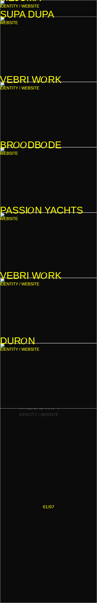

# UI Design System & Master Generation Blueprint: www-tomdekoning-work

> **tomdekoning.work — Building brands that turn heads** (https://www.tomdekoning.work/) — Freelance creative director in the Netherlands. Strategy, (web)design & development for brands that want to stand out. 8+ years experienc...


---

## 1. Executive Visual Persona & Design Archetype

- **Brand Essence & Persona**: **tomdekoning.work — Building brands that turn heads** (`https://www.tomdekoning.work/`). Freelance creative director in the Netherlands. Strategy, (web)design & development for brands that want to stand out. 8+ years experienc...
- **Visual Archetype**: **Dark-Substrate WebGL / Canvas Interactive Experience (`#0b0b0b` / `#0000`)**.
- **Anti-AI-Slop Differentiators**:
  - **Source-Grounded Chromatic Polarity**: Anchors the viewport in `#0b0b0b` (`var(--black)` in `:root`) paired with `#ff0` primary typography and `#0000` accents.
  - **Extracted Typographic Hierarchy**: Pairs `Ppneuemontreal` for display copy (`t o mdek o ning .w o rk`) with `Playfair Display` and not declared in static CSS (uses primary stack / `ui-monospace`).
  - **Calibrated Spatial Grid & Motion**: Combines `940px` container bounds (`gap: 16px`, padding `9px`) with `cubic-bezier(.645,.045,.355,1)` easing and Lenis Smooth Scroll (`data-lenis`), GSAP Timeline & ScrollTrigger.

---

## 2. Spatial Architecture & Modular Grid Mathematics



### Viewport Allocation & Container Geometry
- **Captured Viewport Dimensions**: Desktop `1440×4751px` (`assets/desktop.png`, full-page scroll capture), Mobile `390×2400px` (`assets/mobile.png`, capped at 2400px multi-section capture).
- **Master Container Bounds**: `940px` extracted from `www-tomdekoning-work` stylesheet.
- **Canvas Lateral Padding & Spacing**: `9px` lateral canvas padding with `16px` grid gap.
- **Border Radius Scale**: `3px`, `100%`, `50%`, `.125rem`.

### Responsive Breakpoint Architecture
- **Desktop Layout**: Multi-column CSS Grid / Flexbox layout at `1440px` (`max-width: 940px`, `gap: 16px`).
- **Mobile Layout**: Single-column vertical stack at `390px` viewport width with `9px` horizontal padding.
- **Extracted CSS Media Queries**: `@media screen and (max-width: 991px)`, `@media screen and (max-width: 767px)`, `@media screen and (max-width: 479px)`, `@media (min-width: 768px)`.

---

## 3. Color System, Materiality & Atmospheric Lighting

### Semantic Palette & Source Grounding
| Semantic Role | Ground-Truth Value | Extracted CSS Source / Selector |
|---|---|---|
| **Primary Canvas Substrate** | `#0b0b0b` | `var(--black)` in `:root` |
| **Primary Typography Ink** | `#e7e1d7` | `var(--sand)` in `:root` |
| **Elevated Surface / Card Substrate** | `#f34213` | `var(--orange)` in `:root` |
| **Interactive Accent / Highlight** | `#0000` | `a { background-color: #0000 }` |
| **Secondary / Muted Copy** | `#000` | `mark { color: #000 }` |
| **Structural Hairline Border** | `#ff0` | `mark { background: #ff0 }` |

### Sanitized Root CSS Variables (`ui-ux.md` Ground Truth)
| Variable Name | Extracted Value | Semantic Role |
|---|---|---|
| `--w-backdrop-animation` | `initial` | Motion / Easing Token |
| `--black` | `#0b0b0b` | Canvas / Surface Token |
| `--sand` | `#e7e1d7` | Color / Atmospheric Token |
| `--orange` | `#f34213` | Color / Atmospheric Token |
| `--white` | `white` | Canvas / Surface Token |
| `--button-097-color` | `#E7E1D7` | Brand / Palette Token |
| `--button-097-color-background` | `#F34213` | Canvas / Surface Token |
| `--button-097-hover-color` | `#0B0B0B` | Brand / Palette Token |
| `--button-097-hover-color-background` | `#E7E1D7` | Canvas / Surface Token |
| `--button-097-color-focus` | `#E7E1D7` | Brand / Palette Token |
| `--button-097-border-radius` | `0.5em` | Elevation / Border Token |
| `--button-097-dot-border-radius` | `0.25em` | Elevation / Border Token |
| `--button-097-padding-right` | `0.75em` | Layout / Spatial Grid Token |
| `--button-097-padding-left` | `1em` | Layout / Spatial Grid Token |
| `--button-097-gap` | `0.375em` | Layout / Spatial Grid Token |
| `--button-097-dot-size` | `0.5em` | Layout / Spatial Grid Token |

---

## 4. Typographic Scale & Editorial Hierarchy

### Font Family Stacks
- **Display Typography**: `Ppneuemontreal`.
- **Primary Body Stack**: `Playfair Display`.
- **Technical / Metadata Stack**: not declared in static CSS (uses primary stack / `ui-monospace`).

### Typographic Scale & Rules (Extracted from Stylesheet & Variables)
- **Hero Display (`H1`)**: rule `h1` (`font-size: 2em`).
- **Section Heading (`H2`)**: rule `h2` (`font-size: 32px`, `line-height: 36px`).
- **Body Copy**: rule `body` (`font-size: 14px`, `line-height: 20px`).
- **Metadata & Navigation Labels**: rule `small` (`font-size: 80%`).

---

## 5. Choreographed Motion & Interaction Physics

### Primary Easing Curves
- **Extracted Timing Functions**: `cubic-bezier(.645,.045,.355,1)`, `cubic-bezier(0.32,0.72,0,1)`.

### Per-Element Transition & Choreography Rules
- **Selector `.lenis.lenis-autoToggle`**: `transition: 1ms` extracted from `www-tomdekoning-work` stylesheet.
- **Selector `.w-webflow-badge > img`**: `transition: unset` extracted from `www-tomdekoning-work` stylesheet.
- **Selector `.w-slider-dot`**: `transition: background-color .1s, color .1s` extracted from `www-tomdekoning-work` stylesheet.
- **Extracted Easing Curve (`cubic-bezier(.645,.045,.355,1)`)**: Governs interactive state transitions across `<nav.navbar>` and `<section.wf-playfairdisplay-n6-active>`.
- **Runtime Interaction Engine**: Integrates Lenis Smooth Scroll (`data-lenis`), GSAP Timeline & ScrollTrigger, Three.js / WebGL Canvas Pipeline, Locomotive Scroll Parallax with `prefers-reduced-motion: reduce` fallback guards.

---

## 6. Component Wireframe & Structural DOM Map

### Visual Layout Schematic (Grounded in `dom.html` — `1440px` Desktop & `390px` Mobile Reflow)
```
┌────────────────────────────────────────────────────────────────────────┐
│ DESKTOP VIEWPORT (1440px) — tomdekoning.work — Building brands that tu │
│ ====================================================================== │
│ [ <nav.navbar>             | MENU                                   ]  │
│ ---------------------------------------------------------------------- │
│ | HERO STAGE: <section.w-mod-ix>                                   |   │
│ | H1: t o mdek o ning .w o rk                                      |   │
│ | Substrate: #0b0b0b    | Ink: #ff0       | Accent: #0000          |   │
│ ---------------------------------------------------------------------- │
│ | SHOWCASE GRID (<section.wf-playfairdispla) max-w: 940px          |   │
│ | +------------------------------+  +------------------------------+ | │
│ | | I b u i l d b r a n d s t h  |  | W o r k                      | | │
│ | +------------------------------+  +------------------------------+ | │
│ ---------------------------------------------------------------------- │
│ | MOBILE VIEWPORT REFLOW (390px) — Single-Column Stack (gap: 16px  ) | │
│ | [<nav.navbar>] -> [<section.w-mod-ix>] -> [<section.wf-playfa] |     │
│ ---------------------------------------------------------------------- │
│ [ FOOTER (<footer.wf-playfairdis) | https://www.tomdekoning.work/      │
└────────────────────────────────────────────────────────────────────────┘
```

### Granular DOM Region Breakdown
1. **Brand Header & Navigation Bar (<nav.navbar> — `www-tomdekoning-work`)**:
   - Landmark `<nav class="navbar">` hosting `tomdekoning.work — Building brands t` navigation (`MENU`), DOM attributes (`data-wf-domain="www.tomdekoning.work"`, `data-wf-page="6a981ab95ec4bc0363c7f6b9"`, `data-wf-site="6947d4a42871d2972031e9ab"`, `data-scroll-orientation="vertical"`), and stylesheet rule `html.lenis body { height:auto }`.
2. **Hero Stage & Focal Lead (<section.w-mod-ix> — `t o mdek o ning .w o rk`)**:
   - Landmark `<section class="w-mod-ix">` presenting display lead `t o mdek o ning .w o rk` and copy excerpt *"A B O U T A B O U T"* over `#0b0b0b` canvas and `#ff0` ink.
3. **Primary Showcase & Content Grid (<section.wf-playfairdisplay-n6-active> — `I b u i l d b r a n d s t h a t t `)**:
   - Landmark `<section class="wf-playfairdisplay-n6-active">` rendering section `I b u i l d b r a n d s t h a t t u r n h e a d s...` with copy *"C O N T A C T C O N T A C T"*, asset references (`cdn.prod.website-files.com`, `tdk-work.webflow.shared.09be52ab1...`, `fonts.googleapis.com`, `fonts.gstatic.com`), and grid rule `.lenis-stopped { overflow:clip }`.
4. **Interactive Detail & Feature Matrix (<section.wf-playfairdisplay-n5-active> — `W o r k`)**:
   - Landmark `<section class="wf-playfairdisplay-n5-active">` framing `W o r k` and `Mejuma` (*"I kill average brands and rebuild them, stronger, sharper, unforg"*) with `#f34213` surface cards, `#0000` accents, and `.lenis.lenis-smooth iframe { pointer-events:none }`.
5. **Colophon & Global Directory Footer (<footer.wf-playfairdisplay-n3-active> — `https://www.tomdekoning.work/`)**:
   - Landmark `<footer class="wf-playfairdisplay-n3-active">` anchoring `tomdekoning.work — Building bran` footer links (`MENU`), copy *"Click here View work"*, and `#ff0` structural dividers.

---

## 7. Master Zero-Shot AI Generation Prompt

```markdown
# Master Zero-Shot Frontend Generation Prompt: www-tomdekoning-work (tomdekoning.work — Building brands that turn heads)

You are a principal frontend architect and design systems engineer. Build a complete, production-ready web application replicating the exact design system, DOM landmarks, typographic hierarchy, color tokens, and motion physics of `www-tomdekoning-work` (**tomdekoning.work — Building brands that turn heads** — `https://www.tomdekoning.work/`).

### 1. Visual Archetype & Anti-AI-Slop Mandates
- **Archetype**: Dark-Substrate WebGL / Canvas Interactive Experience (`#0b0b0b` / `#0000`).
- **Identity & Domain Context**: Freelance creative director in the Netherlands. Strategy, (web)design & development for brands that want to stand out. 8+ years experienc...
- **Primary Substrate**: `#0b0b0b` (`var(--black)` in `:root`), **Primary Ink**: `#ff0`, **Accent / Highlight**: `#0000`.
- **Site-Specific Differentiators**:
  - **Source-Grounded Chromatic Polarity**: Anchors the viewport in `#0b0b0b` (`var(--black)` in `:root`) paired with `#ff0` primary typography and `#0000` accents.
  - **Extracted Typographic Hierarchy**: Pairs `Ppneuemontreal` for display copy (`t o mdek o ning .w o rk`) with `Playfair Display` and not declared in static CSS (uses primary stack / `ui-monospace`).
  - **Calibrated Spatial Grid & Motion**: Combines `940px` container bounds (`gap: 16px`, padding `9px`) with `cubic-bezier(.645,.045,.355,1)` easing and Lenis Smooth Scroll (`data-lenis`), GSAP Timeline & ScrollTrigger.

### 2. Ground-Truth CSS Variables (`:root` Token Contract)
Declare and consume these exact custom properties extracted from `www-tomdekoning-work` in your global stylesheet:

:root {
  /* tomdekoning.work — Building brands that turn heads (www-tomdekoning-work) — Ground-Truth Extracted CSS Variables */
  --w-backdrop-animation: initial; /* Motion / Easing Token (www-tomdekoning-work) */
  --black: #0b0b0b; /* Canvas / Surface Token (www-tomdekoning-work) */
  --sand: #e7e1d7; /* Color / Atmospheric Token (www-tomdekoning-work) */
  --orange: #f34213; /* Color / Atmospheric Token (www-tomdekoning-work) */
  --white: white; /* Canvas / Surface Token (www-tomdekoning-work) */
  --button-097-color: #E7E1D7; /* Brand / Palette Token (www-tomdekoning-work) */
  --button-097-color-background: #F34213; /* Canvas / Surface Token (www-tomdekoning-work) */
  --button-097-hover-color: #0B0B0B; /* Brand / Palette Token (www-tomdekoning-work) */
  --button-097-hover-color-background: #E7E1D7; /* Canvas / Surface Token (www-tomdekoning-work) */
  --button-097-color-focus: #E7E1D7; /* Brand / Palette Token (www-tomdekoning-work) */
  --button-097-border-radius: 0.5em; /* Elevation / Border Token (www-tomdekoning-work) */
  --button-097-dot-border-radius: 0.25em; /* Elevation / Border Token (www-tomdekoning-work) */
  --button-097-padding-right: 0.75em; /* Layout / Spatial Grid Token (www-tomdekoning-work) */
  --button-097-padding-left: 1em; /* Layout / Spatial Grid Token (www-tomdekoning-work) */
  --button-097-gap: 0.375em; /* Layout / Spatial Grid Token (www-tomdekoning-work) */
  --button-097-dot-size: 0.5em; /* Layout / Spatial Grid Token (www-tomdekoning-work) */
}

### 3. Semantic Color & Materiality Contract
Map every surface, ink, and border strictly to these source-grounded tokens:
- **Primary Canvas Substrate**: `#0b0b0b` — grounded in `var(--black)` in `:root`
- **Primary Typography Ink**: `#e7e1d7` — grounded in `var(--sand)` in `:root`
- **Elevated Surface / Card Substrate**: `#f34213` — grounded in `var(--orange)` in `:root`
- **Interactive Accent / Highlight**: `#0000` — grounded in `a { background-color: #0000 }`
- **Secondary / Muted Copy**: `#000` — grounded in `mark { color: #000 }`
- **Structural Hairline Border**: `#ff0` — grounded in `mark { background: #ff0 }`

### 4. Spatial Grid, Container Bounds & Responsive Breakpoints
- **Desktop Viewport Reference**: `1440×4751px` (full-page scroll capture, `1440px` standard desktop width).
- **Mobile Viewport Reference**: `390×2400px` (capped at 2400px multi-section capture, `390px` standard mobile width).
- **Container Max-Width**: `940px` extracted from `www-tomdekoning-work` stylesheet
- **Padding & Gutters**: `9px` lateral canvas padding with `16px` grid gap
- **Desktop Grid**: Multi-column CSS Grid / Flexbox layout at `1440px` (`max-width: 940px`, `gap: 16px`)
- **Mobile Adaptation**: Single-column vertical stack at `390px` viewport width with `9px` horizontal padding
- **Media Queries**: `@media screen and (max-width: 991px)`, `@media screen and (max-width: 767px)`, `@media screen and (max-width: 479px)`, `@media (min-width: 768px)`
- **Corner Radii**: `3px`, `100%`, `50%`, `.125rem`

### 5. Typography & Editorial Scale Contract
- **Display Font Stack**: `Ppneuemontreal`
- **Body Font Stack**: `Playfair Display`
- **Monospace / Technical Font Stack**: not declared in static CSS (uses primary stack / `ui-monospace`)
- **H1 Display Rule**: rule `h1` (`font-size: 2em`)
- **H2 Section Rule**: rule `h2` (`font-size: 32px`, `line-height: 36px`)
- **Body Copy Rule**: rule `body` (`font-size: 14px`, `line-height: 20px`)
- **Metadata & Index Rule**: rule `small` (`font-size: 80%`)

### 6. Component Hierarchy, Verbatim Copy & Real DOM Landmarks
Scaffold `www-tomdekoning-work` (`tomdekoning.work — Building brands that turn heads`) with these exact structural regions, extracted copy, and CSS rules from `dom.html`:
1. **Brand Header & Navigation Bar (<nav.navbar> — `www-tomdekoning-work`)**:
   - DOM & Selectors: Landmark `<nav class="navbar">` hosting `tomdekoning.work — Building brands t` navigation (`MENU`), DOM attributes (`data-wf-domain="www.tomdekoning.work"`, `data-wf-page="6a981ab95ec4bc0363c7f6b9"`, `data-wf-site="6947d4a42871d2972031e9ab"`, `data-scroll-orientation="vertical"`), and stylesheet rule `html.lenis body { height:auto }`.
   - Responsive Contract: Header `Brand Header & Navigation Bar (<nav.navbar> — `www-tomdekoning-work`)` (`www-tomdekoning-work`) adapts across `@media screen and (max-width: 991px)`, `@media screen and (max-width: 767px)`, `@media screen and (max-width: 479px)`, `@media (min-width: 768px)` with `cubic-bezier(.645,.045,.355,1)`, `cubic-bezier(0.32,0.72,0,1)` transitions and links `MENU`.
2. **Hero Stage & Focal Lead (<section.w-mod-ix> — `t o mdek o ning .w o rk`)**:
   - DOM & Selectors: Landmark `<section class="w-mod-ix">` presenting display lead `t o mdek o ning .w o rk` and copy excerpt *"A B O U T A B O U T"* over `#0b0b0b` canvas and `#ff0` ink.
   - Responsive Contract: Hero stage (`1440×4751px` desktop / `390×2400px` mobile) sets `#0b0b0b` background with `#ff0` headline `t o mdek o ning .w o rk`.
3. **Primary Showcase & Content Grid (<section.wf-playfairdisplay-n6-active> — `I b u i l d b r a n d s t h a t t `)**:
   - DOM & Selectors: Landmark `<section class="wf-playfairdisplay-n6-active">` rendering section `I b u i l d b r a n d s t h a t t u r n h e a d s...` with copy *"C O N T A C T C O N T A C T"*, asset references (`cdn.prod.website-files.com`, `tdk-work.webflow.shared.09be52ab1...`, `fonts.googleapis.com`, `fonts.gstatic.com`), and grid rule `.lenis-stopped { overflow:clip }`.
   - Responsive Contract: Showcase grid `Primary Showcase & Content Grid (<section.wf-playfairdisplay-n6-active> — `I b u i l d b r a n d s t h a t t `)` applies Multi-column CSS Grid / Flexbox layout at `1440px` (`max-width: 940px`, `gap: 16px`) on desktop and Single-column vertical stack at `390px` viewport width with `9px` horizontal padding on mobile.
4. **Interactive Detail & Feature Matrix (<section.wf-playfairdisplay-n5-active> — `W o r k`)**:
   - DOM & Selectors: Landmark `<section class="wf-playfairdisplay-n5-active">` framing `W o r k` and `Mejuma` (*"I kill average brands and rebuild them, stronger, sharper, unforg"*) with `#f34213` surface cards, `#0000` accents, and `.lenis.lenis-smooth iframe { pointer-events:none }`.
   - Responsive Contract: Detail module `Interactive Detail & Feature Matrix (<section.wf-playfairdisplay-n5-active> — `W o r k`)` uses `3px`, `100%`, `50%`, `.125rem` radii, `#0000` highlights, and assets (cdn.prod.website-files.com, tdk-work.webflow.shared.09be52ab1..., fonts.googleapis.com).
5. **Colophon & Global Directory Footer (<footer.wf-playfairdisplay-n3-active> — `https://www.tomdekoning.work/`)**:
   - DOM & Selectors: Landmark `<footer class="wf-playfairdisplay-n3-active">` anchoring `tomdekoning.work — Building bran` footer links (`MENU`), copy *"Click here View work"*, and `#ff0` structural dividers.
   - Responsive Contract: Footer `Colophon & Global Directory Footer (<footer.wf-playfairdisplay-n3-active> — `https://www.tomdekoning.work/`)` aligns to `940px` extracted from `www-tomdekoning-work` stylesheet with `9px` lateral canvas padding with `16px` grid gap and attributes (data-wf-domain="www.tomdekoning.work", data-wf-page="6a981ab95ec4bc0363c7f6b9", data-wf-site="6947d4a42871d2972031e9ab").

#### Verbatim DOM Copy Excerpts (`dom.html`)
- Copy Excerpt 1: *"A B O U T A B O U T"*
- Copy Excerpt 2: *"C O N T A C T C O N T A C T"*
- Copy Excerpt 3: *"I kill average brands and rebuild them, stronger, sharper, unforgettable."*
- Copy Excerpt 4: *"Click here View work"*

### 7. Motion, Extracted Stylesheet Rules & Interaction Choreography
- **Primary Easing Functions**: `cubic-bezier(.645,.045,.355,1)`, `cubic-bezier(0.32,0.72,0,1)`
- **Extracted Stylesheet Rules (`www-tomdekoning-work`)**:
- `html.lenis body { height:auto }`
- `.lenis-stopped { overflow:clip }`
- `.lenis.lenis-smooth iframe { pointer-events:none }`
- `.lenis.lenis-autoToggle { transition-behavior:allow-discrete;transition-duration:1ms;transition-pr... }`
- `html { -webkit-text-size-adjust: 100%; -ms-text-size-adjust: 100%; font-family:... }`
- **Per-Selector Transition Rules**:
- **Selector `.lenis.lenis-autoToggle`**: `transition: 1ms` extracted from `www-tomdekoning-work` stylesheet.
- **Selector `.w-webflow-badge > img`**: `transition: unset` extracted from `www-tomdekoning-work` stylesheet.
- **Selector `.w-slider-dot`**: `transition: background-color .1s, color .1s` extracted from `www-tomdekoning-work` stylesheet.
- **Extracted Easing Curve (`cubic-bezier(.645,.045,.355,1)`)**: Governs interactive state transitions across `<nav.navbar>` and `<section.wf-playfairdisplay-n6-active>`.
- **Runtime Interaction Engine**: Integrates Lenis Smooth Scroll (`data-lenis`), GSAP Timeline & ScrollTrigger, Three.js / WebGL Canvas Pipeline, Locomotive Scroll Parallax with `prefers-reduced-motion: reduce` fallback guards.

### 8. Technical Deliverables
- Implement in Next.js (App Router) with TypeScript and Tailwind CSS consuming the `:root` custom properties defined above for `www-tomdekoning-work`.
- Reproduce both the `1440px` desktop architecture and `390px` mobile breakpoint transitions, preserving semantic HTML5 landmarks (`<header>`, `<nav>`, `<main>`, `<section>`, `<footer>`) and `prefers-reduced-motion` accessibility guards.
```
