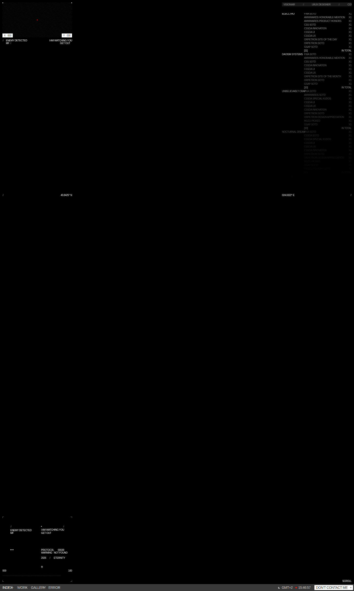
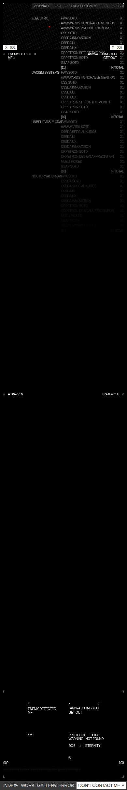

# UI Design System & Master Generation Blueprint: www-unbelievablycrap-com

> **Liubomyr Ulytskyi - Digital Designer** (https://www.unbelievablycrap.com/) — Liubomyr Ulytskyi — Digital Designer, award-winning UI/UX Designer, art director, conceptualist.



---

## 1. Executive Visual Persona & Design Archetype

- **Brand Essence & Persona**: **Liubomyr Ulytskyi - Digital Designer** (`https://www.unbelievablycrap.com/`). Liubomyr Ulytskyi — Digital Designer, award-winning UI/UX Designer, art director, conceptualist.
- **Visual Archetype**: **Dark-Substrate WebGL / Canvas Interactive Experience (`#000000` / `#afafaf`)**.
- **Anti-AI-Slop Differentiators**:
  - **Source-Grounded Chromatic Polarity**: Anchors the viewport in `#000000` (`var(--about-ground)` in `:root`) paired with `#ffffff` primary typography and `#afafaf` accents.
  - **Extracted Typographic Hierarchy**: Pairs `PP Supply Sans` for display copy (`find your way out of here`) with `PP Supply Mono` and `PP Supply Mono`.
  - **Calibrated Spatial Grid & Motion**: Combines `720px` container bounds (`gap: 6px`, padding `6px`) with `cubic-bezier(.4,0,.2,1)` easing and GSAP Timeline & ScrollTrigger, Three.js / WebGL Canvas Pipeline.

---

## 2. Spatial Architecture & Modular Grid Mathematics



### Viewport Allocation & Container Geometry
- **Captured Viewport Dimensions**: Desktop `1440×2400px` (`assets/desktop.png`, capped at 2400px multi-section capture), Mobile `390×2400px` (`assets/mobile.png`, capped at 2400px multi-section capture).
- **Master Container Bounds**: `720px` extracted from `www-unbelievablycrap-com` stylesheet.
- **Canvas Lateral Padding & Spacing**: `6px` lateral canvas padding with `6px` grid gap.
- **Border Radius Scale**: `0px` (sharp unrounded corners).

### Responsive Breakpoint Architecture
- **Desktop Layout**: Multi-column CSS Grid / Flexbox layout at `1440px` (`max-width: 720px`, `gap: 6px`).
- **Mobile Layout**: Single-column vertical stack at `390px` viewport width with `6px` horizontal padding.
- **Extracted CSS Media Queries**: `@media (prefers-reduced-motion: reduce)`, `@media (max-width:720px)`, `@media (max-width: 860px)`, `@media (max-width: 720px)`.

---

## 3. Color System, Materiality & Atmospheric Lighting

### Semantic Palette & Source Grounding
| Semantic Role | Ground-Truth Value | Extracted CSS Source / Selector |
|---|---|---|
| **Primary Canvas Substrate** | `#000000` | `var(--about-ground)` in `:root` |
| **Primary Typography Ink** | `#C8C8C8` | `var(--about-ink)` in `:root` |
| **Elevated Surface / Card Substrate** | `#ffffff` | `var(--c-white)` in `:root` |
| **Interactive Accent / Highlight** | `#afafaf` | `var(--c-fog)` in `:root` |
| **Secondary / Muted Copy** | `#6e6e6e` | `var(--c-slate)` in `:root` |
| **Structural Hairline Border** | `#636363` | `var(--c-label)` in `:root` |
| **Variable Token (`--c-fade`)** | `#c3c3c3` | `var(--c-fade)` in `:root` |
| **Variable Token (`--c-ink`)** | `#393939` | `var(--c-ink)` in `:root` |

### Sanitized Root CSS Variables (`ui-ux.md` Ground Truth)
| Variable Name | Extracted Value | Semantic Role |
|---|---|---|
| `--about-ground` | `#000000` | Color / Atmospheric Token |
| `--about-ink` | `#C8C8C8` | Typography Ink Token |
| `--about-dim` | `rgba(200,200,200,.5)` | Color / Atmospheric Token |
| `--grain-blend` | `lighten` | Design System Custom Token |
| `--grain-opacity` | `.06` | Design System Custom Token |
| `--grain-brightness` | `100%` | Dimension / Scale Token |
| `--grain-contrast` | `50%` | Dimension / Scale Token |
| `--grain-size` | `1em` | Layout / Spatial Grid Token |
| `--font-main` | `'PP Supply Sans','Neue Haas Grotesk Text','Inter',-apple-system,` | Typography / Scale Token |
| `--font-mono` | `'PP Supply Mono',ui-monospace,'SF Mono','Roboto Mono',monospace` | Typography / Scale Token |
| `--c-white` | `#ffffff` | Canvas / Surface Token |
| `--c-fog` | `#afafaf` | Color / Atmospheric Token |
| `--c-slate` | `#6e6e6e` | Color / Atmospheric Token |
| `--c-label` | `#636363` | Color / Atmospheric Token |
| `--c-fade` | `#c3c3c3` | Color / Atmospheric Token |
| `--c-ink` | `#393939` | Typography Ink Token |

---

## 4. Typographic Scale & Editorial Hierarchy

### Font Family Stacks
- **Display Typography**: `PP Supply Sans`.
- **Primary Body Stack**: `PP Supply Mono`.
- **Technical / Metadata Stack**: `PP Supply Mono`.

### Typographic Scale & Rules (Extracted from Stylesheet & Variables)
- **Hero Display (`H1`)**: not explicitly declared on tag in static CSS (stylesheet font-size ladder: `var(--ui-10)`, `var(--hud-size)`, `12vw`, `clamp(2.75rem, 6.7vw, 8rem)`, `64px`).
- **Section Heading (`H2`)**: not explicitly declared on tag in static CSS (stylesheet font-size ladder: `var(--ui-10)`, `var(--hud-size)`, `12vw`, `clamp(2.75rem, 6.7vw, 8rem)`, `64px`).
- **Body Copy**: rule `p` (`font-size: var(--ui-10)`, `line-height: 10px`, `letter-spacing: -0.4px`).
- **Metadata & Navigation Labels**: CSS variables `--font-mono: 'PP Supply Mono',ui-monospace,'SF Mono','Roboto Mono',monospace`, `--c-label: #636363`.

---

## 5. Choreographed Motion & Interaction Physics

### Primary Easing Curves
- **Extracted Timing Functions**: `cubic-bezier(.4,0,.2,1)`, `cubic-bezier(.22,.61,.36,1)`, `cubic-bezier(0.625,0.05,0,1)`.

### Per-Element Transition & Choreography Rules
- **Selector `media (prefers-reduced-motion: re...`**: `transition: none` extracted from `www-unbelievablycrap-com` stylesheet.
- **Selector `.hud`**: `transition: opacity .28s linear` extracted from `www-unbelievablycrap-com` stylesheet.
- **Selector `.bar`**: `transition: transform var(--bar-out, 420ms) cubic-bezier(.4,0,.2,1)` extracted from `www-unbelievablycrap-com` stylesheet.
- **Extracted Easing Curve (`cubic-bezier(.4,0,.2,1)`)**: Governs interactive state transitions across `<nav.ftr__nav>` and `<main.gate__bg>`.
- **Runtime Interaction Engine**: Integrates GSAP Timeline & ScrollTrigger, Three.js / WebGL Canvas Pipeline, Barba.js Page Transition Router with `prefers-reduced-motion: reduce` fallback guards.

---

## 6. Component Wireframe & Structural DOM Map

### Visual Layout Schematic (Grounded in `dom.html` — `1440px` Desktop & `390px` Mobile Reflow)
```
┌────────────────────────────────────────────────────────────────────────┐
│ DESKTOP VIEWPORT (1440px) — Liubomyr Ulytskyi - Digital Designer       │
│ ====================================================================== │
│ [ <nav.ftr__nav>           | index · work · gallery · 404           ]  │
│ ---------------------------------------------------------------------- │
│ | HERO STAGE: <main.gate>                                          |   │
│ | H1: find your way out of here                                    |   │
│ | Substrate: #000000    | Ink: #ffffff    | Accent: #afafaf        |   │
│ ---------------------------------------------------------------------- │
│ | SHOWCASE GRID (<main.gate__bg>           ) max-w: 720px          |   │
│ | +------------------------------+  +------------------------------+ | │
│ | | the crap experience is best  |  | CASE FILE: THE MAN BEHIND TH | | │
│ | +------------------------------+  +------------------------------+ | │
│ ---------------------------------------------------------------------- │
│ | MOBILE VIEWPORT REFLOW (390px) — Single-Column Stack (gap: 6px   ) | │
│ | [<nav.ftr__nav>] -> [<main.gate>] -> [<main.gate__bg>] |             │
│ ---------------------------------------------------------------------- │
│ [ FOOTER (<footer.bar>          ) | https://www.unbelievablycrap.com/  │
└────────────────────────────────────────────────────────────────────────┘
```

### Granular DOM Region Breakdown
1. **Brand Header & Navigation Bar (<nav.ftr__nav> — `www-unbelievablycrap-com`)**:
   - Landmark `<nav class="ftr__nav">` hosting `Liubomyr Ulytskyi - Digital Designer` navigation (`index · work · gallery · 404`), DOM attributes (`data-err-src="ERR_ART"`, `data-err-src="ERR_CARD"`, `data-mesh-var="FIGURE_LITE"`, `data-mesh-var="LOGO_MESH"`), and stylesheet rule `.about__figure canvas { position: absolute; inset: 0; display: block; width: 100%; height: 100%; }`.
2. **Hero Stage & Focal Lead (<main.gate> — `find your way out of here`)**:
   - Landmark `<main class="gate">` presenting display lead `find your way out of here` and copy excerpt *"the crap experience is best viewed with a desktop"* over `#000000` canvas and `#ffffff` ink.
3. **Primary Showcase & Content Grid (<main.gate__bg> — `the crap experience is best viewed`)**:
   - Landmark `<main class="gate__bg">` rendering section `the crap experience is best viewed with a deskto` with copy *"CASE FILE: THE MAN BEHIND THE IMAGE"*, asset references (`favicon.ico`, `favicon-32x32.png`, `favicon-16x16.png`, `apple-touch-icon.png`), and grid rule `.about__stage { position: absolute; inset: 0; z-index: 3; overflow: hidden; cursor: defa... }`.
4. **Interactive Detail & Feature Matrix (<main.gate__logo> — `CASE FILE: THE MAN BEHIND THE IMAG`)**:
   - Landmark `<main class="gate__logo">` framing `CASE FILE: THE MAN BEHIND THE IMAGE` and `The first mistake was assuming Liubomyr was look` (*"The first mistake was assuming Liubomyr was looking for something"*) with `#ffffff` surface cards, `#afafaf` accents, and `.about__column { transition: none; }`.
5. **Colophon & Global Directory Footer (<footer.bar> — `https://www.unbelievablycrap.com/`)**:
   - Landmark `<footer class="bar">` anchoring `Liubomyr Ulytskyi - Digital Desi` footer links (`index · work · gallery · 404`), copy *"He was 0looking for what 3was hiding."*, and `#636363` structural dividers.

---

## 7. Master Zero-Shot AI Generation Prompt

```markdown
# Master Zero-Shot Frontend Generation Prompt: www-unbelievablycrap-com (Liubomyr Ulytskyi - Digital Designer)

You are a principal frontend architect and design systems engineer. Build a complete, production-ready web application replicating the exact design system, DOM landmarks, typographic hierarchy, color tokens, and motion physics of `www-unbelievablycrap-com` (**Liubomyr Ulytskyi - Digital Designer** — `https://www.unbelievablycrap.com/`).

### 1. Visual Archetype & Anti-AI-Slop Mandates
- **Archetype**: Dark-Substrate WebGL / Canvas Interactive Experience (`#000000` / `#afafaf`).
- **Identity & Domain Context**: Liubomyr Ulytskyi — Digital Designer, award-winning UI/UX Designer, art director, conceptualist.
- **Primary Substrate**: `#000000` (`var(--about-ground)` in `:root`), **Primary Ink**: `#ffffff`, **Accent / Highlight**: `#afafaf`.
- **Site-Specific Differentiators**:
  - **Source-Grounded Chromatic Polarity**: Anchors the viewport in `#000000` (`var(--about-ground)` in `:root`) paired with `#ffffff` primary typography and `#afafaf` accents.
  - **Extracted Typographic Hierarchy**: Pairs `PP Supply Sans` for display copy (`find your way out of here`) with `PP Supply Mono` and `PP Supply Mono`.
  - **Calibrated Spatial Grid & Motion**: Combines `720px` container bounds (`gap: 6px`, padding `6px`) with `cubic-bezier(.4,0,.2,1)` easing and GSAP Timeline & ScrollTrigger, Three.js / WebGL Canvas Pipeline.

### 2. Ground-Truth CSS Variables (`:root` Token Contract)
Declare and consume these exact custom properties extracted from `www-unbelievablycrap-com` in your global stylesheet:

:root {
  /* Liubomyr Ulytskyi - Digital Designer (www-unbelievablycrap-com) — Ground-Truth Extracted CSS Variables */
  --about-ground: #000000; /* Color / Atmospheric Token (www-unbelievablycrap-com) */
  --about-ink: #C8C8C8; /* Typography Ink Token (www-unbelievablycrap-com) */
  --about-dim: rgba(200,200,200,.5); /* Color / Atmospheric Token (www-unbelievablycrap-com) */
  --grain-blend: lighten; /* Design System Custom Token (www-unbelievablycrap-com) */
  --grain-opacity: .06; /* Design System Custom Token (www-unbelievablycrap-com) */
  --grain-brightness: 100%; /* Dimension / Scale Token (www-unbelievablycrap-com) */
  --grain-contrast: 50%; /* Dimension / Scale Token (www-unbelievablycrap-com) */
  --grain-size: 1em; /* Layout / Spatial Grid Token (www-unbelievablycrap-com) */
  --font-main: 'PP Supply Sans','Neue Haas Grotesk Text','Inter',-apple-system,; /* Typography / Scale Token (www-unbelievablycrap-com) */
  --font-mono: 'PP Supply Mono',ui-monospace,'SF Mono','Roboto Mono',monospace; /* Typography / Scale Token (www-unbelievablycrap-com) */
  --c-white: #ffffff; /* Canvas / Surface Token (www-unbelievablycrap-com) */
  --c-fog: #afafaf; /* Color / Atmospheric Token (www-unbelievablycrap-com) */
  --c-slate: #6e6e6e; /* Color / Atmospheric Token (www-unbelievablycrap-com) */
  --c-label: #636363; /* Color / Atmospheric Token (www-unbelievablycrap-com) */
  --c-fade: #c3c3c3; /* Color / Atmospheric Token (www-unbelievablycrap-com) */
  --c-ink: #393939; /* Typography Ink Token (www-unbelievablycrap-com) */
}

### 3. Semantic Color & Materiality Contract
Map every surface, ink, and border strictly to these source-grounded tokens:
- **Primary Canvas Substrate**: `#000000` — grounded in `var(--about-ground)` in `:root`
- **Primary Typography Ink**: `#C8C8C8` — grounded in `var(--about-ink)` in `:root`
- **Elevated Surface / Card Substrate**: `#ffffff` — grounded in `var(--c-white)` in `:root`
- **Interactive Accent / Highlight**: `#afafaf` — grounded in `var(--c-fog)` in `:root`
- **Secondary / Muted Copy**: `#6e6e6e` — grounded in `var(--c-slate)` in `:root`
- **Structural Hairline Border**: `#636363` — grounded in `var(--c-label)` in `:root`
- **Variable Token (`--c-fade`)**: `#c3c3c3` — grounded in `var(--c-fade)` in `:root`
- **Variable Token (`--c-ink`)**: `#393939` — grounded in `var(--c-ink)` in `:root`

### 4. Spatial Grid, Container Bounds & Responsive Breakpoints
- **Desktop Viewport Reference**: `1440×2400px` (capped at 2400px multi-section capture, `1440px` standard desktop width).
- **Mobile Viewport Reference**: `390×2400px` (capped at 2400px multi-section capture, `390px` standard mobile width).
- **Container Max-Width**: `720px` extracted from `www-unbelievablycrap-com` stylesheet
- **Padding & Gutters**: `6px` lateral canvas padding with `6px` grid gap
- **Desktop Grid**: Multi-column CSS Grid / Flexbox layout at `1440px` (`max-width: 720px`, `gap: 6px`)
- **Mobile Adaptation**: Single-column vertical stack at `390px` viewport width with `6px` horizontal padding
- **Media Queries**: `@media (prefers-reduced-motion: reduce)`, `@media (max-width:720px)`, `@media (max-width: 860px)`, `@media (max-width: 720px)`
- **Corner Radii**: `0px` (sharp unrounded corners)

### 5. Typography & Editorial Scale Contract
- **Display Font Stack**: `PP Supply Sans`
- **Body Font Stack**: `PP Supply Mono`
- **Monospace / Technical Font Stack**: `PP Supply Mono`
- **H1 Display Rule**: not explicitly declared on tag in static CSS (stylesheet font-size ladder: `var(--ui-10)`, `var(--hud-size)`, `12vw`, `clamp(2.75rem, 6.7vw, 8rem)`, `64px`)
- **H2 Section Rule**: not explicitly declared on tag in static CSS (stylesheet font-size ladder: `var(--ui-10)`, `var(--hud-size)`, `12vw`, `clamp(2.75rem, 6.7vw, 8rem)`, `64px`)
- **Body Copy Rule**: rule `p` (`font-size: var(--ui-10)`, `line-height: 10px`, `letter-spacing: -0.4px`)
- **Metadata & Index Rule**: CSS variables `--font-mono: 'PP Supply Mono',ui-monospace,'SF Mono','Roboto Mono',monospace`, `--c-label: #636363`

### 6. Component Hierarchy, Verbatim Copy & Real DOM Landmarks
Scaffold `www-unbelievablycrap-com` (`Liubomyr Ulytskyi - Digital Designer`) with these exact structural regions, extracted copy, and CSS rules from `dom.html`:
1. **Brand Header & Navigation Bar (<nav.ftr__nav> — `www-unbelievablycrap-com`)**:
   - DOM & Selectors: Landmark `<nav class="ftr__nav">` hosting `Liubomyr Ulytskyi - Digital Designer` navigation (`index · work · gallery · 404`), DOM attributes (`data-err-src="ERR_ART"`, `data-err-src="ERR_CARD"`, `data-mesh-var="FIGURE_LITE"`, `data-mesh-var="LOGO_MESH"`), and stylesheet rule `.about__figure canvas { position: absolute; inset: 0; display: block; width: 100%; height: 100%; }`.
   - Responsive Contract: Header `Brand Header & Navigation Bar (<nav.ftr__nav> — `www-unbelievablycrap-com`)` (`www-unbelievablycrap-com`) adapts across `@media (prefers-reduced-motion: reduce)`, `@media (max-width:720px)`, `@media (max-width: 860px)`, `@media (max-width: 720px)` with `cubic-bezier(.4,0,.2,1)`, `cubic-bezier(.22,.61,.36,1)`, `cubic-bezier(0.625,0.05,0,1)` transitions and links `index · work · gallery · 404`.
2. **Hero Stage & Focal Lead (<main.gate> — `find your way out of here`)**:
   - DOM & Selectors: Landmark `<main class="gate">` presenting display lead `find your way out of here` and copy excerpt *"the crap experience is best viewed with a desktop"* over `#000000` canvas and `#ffffff` ink.
   - Responsive Contract: Hero stage (`1440×2400px` desktop / `390×2400px` mobile) sets `#000000` background with `#ffffff` headline `find your way out of here`.
3. **Primary Showcase & Content Grid (<main.gate__bg> — `the crap experience is best viewed`)**:
   - DOM & Selectors: Landmark `<main class="gate__bg">` rendering section `the crap experience is best viewed with a deskto` with copy *"CASE FILE: THE MAN BEHIND THE IMAGE"*, asset references (`favicon.ico`, `favicon-32x32.png`, `favicon-16x16.png`, `apple-touch-icon.png`), and grid rule `.about__stage { position: absolute; inset: 0; z-index: 3; overflow: hidden; cursor: defa... }`.
   - Responsive Contract: Showcase grid `Primary Showcase & Content Grid (<main.gate__bg> — `the crap experience is best viewed`)` applies Multi-column CSS Grid / Flexbox layout at `1440px` (`max-width: 720px`, `gap: 6px`) on desktop and Single-column vertical stack at `390px` viewport width with `6px` horizontal padding on mobile.
4. **Interactive Detail & Feature Matrix (<main.gate__logo> — `CASE FILE: THE MAN BEHIND THE IMAG`)**:
   - DOM & Selectors: Landmark `<main class="gate__logo">` framing `CASE FILE: THE MAN BEHIND THE IMAGE` and `The first mistake was assuming Liubomyr was look` (*"The first mistake was assuming Liubomyr was looking for something"*) with `#ffffff` surface cards, `#afafaf` accents, and `.about__column { transition: none; }`.
   - Responsive Contract: Detail module `Interactive Detail & Feature Matrix (<main.gate__logo> — `CASE FILE: THE MAN BEHIND THE IMAG`)` uses `0px` (sharp unrounded corners) radii, `#afafaf` highlights, and assets (favicon.ico, favicon-32x32.png, favicon-16x16.png).
5. **Colophon & Global Directory Footer (<footer.bar> — `https://www.unbelievablycrap.com/`)**:
   - DOM & Selectors: Landmark `<footer class="bar">` anchoring `Liubomyr Ulytskyi - Digital Desi` footer links (`index · work · gallery · 404`), copy *"He was 0looking for what 3was hiding."*, and `#636363` structural dividers.
   - Responsive Contract: Footer `Colophon & Global Directory Footer (<footer.bar> — `https://www.unbelievablycrap.com/`)` aligns to `720px` extracted from `www-unbelievablycrap-com` stylesheet with `6px` lateral canvas padding with `6px` grid gap and attributes (data-err-src="ERR_ART", data-err-src="ERR_CARD", data-mesh-var="FIGURE_LITE").

#### Verbatim DOM Copy Excerpts (`dom.html`)
- Copy Excerpt 1: *"the crap experience is best viewed with a desktop"*
- Copy Excerpt 2: *"CASE FILE: THE MAN BEHIND THE IMAGE"*
- Copy Excerpt 3: *"The first mistake was assuming Liubomyr was looking for something."*
- Copy Excerpt 4: *"He was 0looking for what 3was hiding."*

### 7. Motion, Extracted Stylesheet Rules & Interaction Choreography
- **Primary Easing Functions**: `cubic-bezier(.4,0,.2,1)`, `cubic-bezier(.22,.61,.36,1)`, `cubic-bezier(0.625,0.05,0,1)`
- **Extracted Stylesheet Rules (`www-unbelievablycrap-com`)**:
- `.about__figure canvas { position: absolute; inset: 0; display: block; width: 100%; height: 100%; }`
- `.about__stage { position: absolute; inset: 0; z-index: 3; overflow: hidden; cursor: defa... }`
- `.about__column { transition: none; }`
- `.mask-body { left: 0; width: 100%; transform: translateY(-50%); }`
- `.about__fx { z-index: 2; }`
- **Per-Selector Transition Rules**:
- **Selector `media (prefers-reduced-motion: re...`**: `transition: none` extracted from `www-unbelievablycrap-com` stylesheet.
- **Selector `.hud`**: `transition: opacity .28s linear` extracted from `www-unbelievablycrap-com` stylesheet.
- **Selector `.bar`**: `transition: transform var(--bar-out, 420ms) cubic-bezier(.4,0,.2,1)` extracted from `www-unbelievablycrap-com` stylesheet.
- **Extracted Easing Curve (`cubic-bezier(.4,0,.2,1)`)**: Governs interactive state transitions across `<nav.ftr__nav>` and `<main.gate__bg>`.
- **Runtime Interaction Engine**: Integrates GSAP Timeline & ScrollTrigger, Three.js / WebGL Canvas Pipeline, Barba.js Page Transition Router with `prefers-reduced-motion: reduce` fallback guards.

### 8. Technical Deliverables
- Implement in Next.js (App Router) with TypeScript and Tailwind CSS consuming the `:root` custom properties defined above for `www-unbelievablycrap-com`.
- Reproduce both the `1440px` desktop architecture and `390px` mobile breakpoint transitions, preserving semantic HTML5 landmarks (`<header>`, `<nav>`, `<main>`, `<section>`, `<footer>`) and `prefers-reduced-motion` accessibility guards.
```
