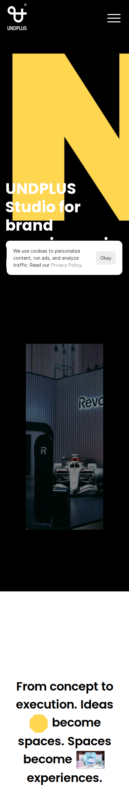

# UI Design System & Master Generation Blueprint: www-undplus-com

> **UNDPLUS — Brand Architecture & Spatial Design Studio** (https://www.undplus.com) — Studio for brand architecture, spatial design and live experiences. We build trade fair booths, brand spaces and installations from Berli...


---

## 1. Executive Visual Persona & Design Archetype

- **Brand Essence & Persona**: **UNDPLUS — Brand Architecture & Spatial Design Studio** (`https://www.undplus.com`). Studio for brand architecture, spatial design and live experiences. We build trade fair booths, brand spaces and installations from Berli...
- **Capture Provenance**: Live browser capture (`tier1_fast`, HTTP `200`, captured `2026-11-23`).
- **Visual Archetype**: **Light-Substrate Editorial & Modular Grid System (`#ffffff` canvas, `#000000` ink, `#ca9df1` accent)**.
- **Anti-AI-Slop Differentiators**:
  - **Live-Computed Chromatic Polarity**: Anchors the viewport in `#ffffff` (live computed `body` `background-color` (`computed_styles.json`)) paired with `#000000` primary typography and `#ca9df1` accents.
  - **Grounded Typographic Hierarchy**: Pairs `Poppins Bold` for display copy (`UNDPLUS Studio for brand experiences`) with `Poppins SemiBold` and not declared in live computed styles (uses primary stack / `ui-monospace`).
  - **Calibrated Spatial Grid & Motion**: Combines `1501px` container bounds (`gap: 10px`, padding `30px`) with `cubic-bezier(0.25,0.1,0.25,1)` easing and Framer Motion Layout Physics.

---

## 2. Spatial Architecture & Modular Grid Mathematics



### Viewport Allocation & Container Geometry
- **Captured Viewport Dimensions**: Desktop `1440×2400px` (`assets/desktop.png`, clamped at 2400px live multi-section capture), Mobile `390×2400px` (`assets/mobile.png`, clamped at 2400px live multi-section capture).
- **Master Container Bounds**: `1501px` (non-`@media` desktop container stylesheet rule).
- **Canvas Lateral Padding & Spacing**: `30px` lateral canvas padding with `10px` grid gap.
- **Border Radius Scale**: `8px`, `15px`, `0px`, `999px`.

### Responsive Breakpoint Architecture
- **Desktop Layout**: Multi-column CSS Grid / Flexbox layout at `1440px` (`max-width: 1501px`, `gap: 10px`).
- **Mobile Layout**: Single-column vertical stack at `390px` viewport width with `30px` horizontal padding.
- **Extracted CSS Media Queries**: `@media (min-width: 1200px)`, `@media (min-width: 810px) and (max-width: 1199.98px)`, `@media (max-width: 809.98px)`, `@media (max-width:809.98px)`.

---

## 3. Color System, Materiality & Atmospheric Lighting

### Semantic Palette & Source Grounding
| Semantic Role | Ground-Truth Value | Extracted Live / CSS Source |
|---|---|---|
| **Primary Canvas Substrate** | `#ffffff` | live computed `body` `background-color` (`computed_styles.json`) |
| **Primary Typography Ink** | `#000000` | live computed `body` `color` (`computed_styles.json`) |
| **Elevated Surface / Card Substrate** | `#ffd650` | `.framer-AYmJg .framer-esf7s4 { background-color: #ffd650 }` |
| **Interactive Accent / Highlight** | `#ca9df1` | `r-styles-preset-5qir1a.rich-tex... { color: #ca9df1 }` |
| **Secondary / Muted Copy** | `#0099ff` | `.framer-AYmJg .framer-1dooqsd { color: #0099ff }` |
| **Structural Hairline Border** | `#0099ff` | hairline divider derived from `.framer-AYmJg .framer-1dooqsd { color: #0099ff }` |
| **Variable Token (`--token-fb37ef9f-b04f-4314-9731-cff242a9823b`)** | `#93d4f2` | `var(--token-fb37ef9f-b04f-4314-9731-cff242a9823b)` in `:root` |
| **Variable Token (`--token-86e11354-2bd9-45a6-a3ed-8f01f856a058`)** | `#0daa75` | `var(--token-86e11354-2bd9-45a6-a3ed-8f01f856a058)` in `:root` |
| **Variable Token (`--token-d07c03e8-e9f2-468d-8b3a-4c5f89f3e77a`)** | `#f3c6b1` | `var(--token-d07c03e8-e9f2-468d-8b3a-4c5f89f3e77a)` in `:root` |
| **Variable Token (`--token-54b8b414-a4ad-4bad-a655-869fc0cbd561`)** | `#f08fc7` | `var(--token-54b8b414-a4ad-4bad-a655-869fc0cbd561)` in `:root` |

### Sanitized Root CSS Variables (`ui-ux.md` Ground Truth)
| Variable Name | Extracted Value | Semantic Role |
|---|---|---|
| `--token-832a9c22-d657-4637-89aa-cbcc712eb257` | `#ca9df1` | Color / Atmospheric Token |
| `--token-d9ed1eb8-0c54-4136-bf85-5e5373c04bfa` | `#ffd650` | Color / Atmospheric Token |
| `--token-fb37ef9f-b04f-4314-9731-cff242a9823b` | `#93d4f2` | Color / Atmospheric Token |
| `--token-86e11354-2bd9-45a6-a3ed-8f01f856a058` | `#0daa75` | Color / Atmospheric Token |
| `--token-d07c03e8-e9f2-468d-8b3a-4c5f89f3e77a` | `#f3c6b1` | Color / Atmospheric Token |
| `--token-54b8b414-a4ad-4bad-a655-869fc0cbd561` | `#f08fc7` | Color / Atmospheric Token |
| `--text-decoration-skip-ink` | `var(--framer-text-decoration-skip-ink)` | Typography Ink Token |
| `--text-underline-offset` | `var(--framer-text-decoration-offset)` | Typography Ink Token |
| `--font-family` | `var(--framer-font-family)` | Typography / Scale Token |
| `--font-style` | `var(--framer-font-style)` | Typography / Scale Token |
| `--font-weight` | `var(--framer-font-weight)` | Typography / Scale Token |
| `--text-color` | `var(--framer-text-color)` | Typography Ink Token |
| `--letter-spacing` | `var(--framer-letter-spacing)` | Typography / Scale Token |
| `--font-size` | `var(--framer-font-size)` | Typography / Scale Token |
| `--text-transform` | `var(--framer-text-transform)` | Typography Ink Token |
| `--line-height` | `var(--framer-line-height)` | Typography / Scale Token |

---

## 4. Typographic Scale & Editorial Hierarchy

### Font Family Stacks
- **Display Typography**: `Poppins Bold`.
- **Primary Body Stack**: `Poppins SemiBold`.
- **Technical / Metadata Stack**: not declared in live computed styles (uses primary stack / `ui-monospace`).

### Typographic Scale & Rules (Live Computed & Stylesheet Grounded)
- **Hero Display (`H1`)**: live computed `h1` (`font-size: 52px`, `line-height: 62.4px`, `font-weight: 700`); rule `h1` (`font-size: 108px`, `line-height: 1.1em`, `letter-spacing: 0em`, `font-weight: 700`).
- **Section Heading (`H2`)**: live computed `h2` (`font-size: 64px`, `line-height: 76.8px`, `font-weight: 600`).
- **Body Copy**: live computed `body` (`font-size: 12px`, `line-height: normal`, `font-weight: 400`); rule `p` (`font-size: 13px`, `line-height: 1.6em`, `letter-spacing: 0em`, `font-weight: 400`).
- **Metadata & Navigation Labels**: live computed `nav/a` (`font-size: 52px`, `line-height: 62.4px`, `font-weight: 500`); CSS variables `--letter-spacing: var(--framer-letter-spacing)`.

---

## 5. Choreographed Motion & Interaction Physics

### Primary Easing Curves
- **Extracted Timing Functions**: `cubic-bezier(0.25,0.1,0.25,1)`.

### Per-Element Transition & Choreography Rules
- **Selector `#__framer-editorbar-label`**: `transition: opacity 0.4s ease-out` extracted from `www-undplus-com` stylesheet.
- **Selector `style]`**: `transition: opacity 0.15s` extracted from `www-undplus-com` stylesheet.
- **Selector `style]`**: `transition: color 0.2s ease` extracted from `www-undplus-com` stylesheet.
- **Standard CSS Easing (`cubic-bezier(0.25,0.1,0.25,1)`)**: Default timing curve (no custom `cubic-bezier()` declared in captured CSS).
- **Runtime Interaction Engine**: Integrates Framer Motion Layout Physics with `prefers-reduced-motion: reduce` fallback guards.

---

## 6. Component Wireframe & Structural DOM Map

### Visual Layout Schematic — Desktop (`1440px`, Grounded in `dom.html` & Landmark Bounding Boxes)
```
┌────────────────────────────────────────────────────────────────────────┐
│ DESKTOP VIEWPORT (1440px) — UNDPLUS — Brand Architecture & Spatial Des │
│ ====================================================================== │
│ [ <header.framer-dYpKI> (1440px)      | Brand Architecture · Retail  ] │
│ ---------------------------------------------------------------------- │
│ | HERO STAGE: <section.framer-ap504g> (w=1440px)                     | │
│ | H1: UNDPLUS Studio for brand experiences in real life...           | │
│ | Substrate: #ffffff | Ink: #000000 | Accent: #ca9df1                | │
│ ---------------------------------------------------------------------- │
│ | SHOWCASE GRID (<section.framer-AYmJg>) max-w: 1501px               | │
│ | +------------------------------+  +------------------------------+ | │
│ | | or just the degree you need. |  | brand experiences in real li | | │
│ | +------------------------------+  +------------------------------+ | │
│ ---------------------------------------------------------------------- │
│ | DETAIL MODULE (<section.framer-3gfgd>) — brand experiences in      | │
│ ---------------------------------------------------------------------- │
│ [ FOOTER (<footer.framer-LFW7G) | https://www.undplus.com              │
└────────────────────────────────────────────────────────────────────────┘
```

### Visual Layout Schematic — Mobile Reflow (`390px`)
```
┌────────────────────────────────────────────────────────────────────────┐
│ MOBILE VIEWPORT REFLOW (390px) — Single-Column Stack (gap: 10px)       │
│ ====================================================================== │
│ [ HEADER BAR (<header.framer-dYpKI>   ) | Compact Menu (390px)         │
│ ---------------------------------------------------------------------- │
│ | HERO STAGE (<section.framer-ap504g>) — 390px Vertical Lead         | │
│ | H1: UNDPLUS Studio for brand experiences in real life...           | │
│ ---------------------------------------------------------------------- │
│ | SHOWCASE STACK (<section.framer-AYmJg>) — 1-Col Stack              | │
│ | [ Item 1: or just the degree you need.                           ] | │
│ | [ Item 2: brand experiences in real life b r a n d e x p e       ] | │
│ ---------------------------------------------------------------------- │
│ | DETAIL STACK (<section.framer-3gfgd>) — 1-Col (brand experiences ) | │
│ ---------------------------------------------------------------------- │
│ [ FOOTER (<footer.framer-LFW7G) | Stacked 390px Colophon               │
└────────────────────────────────────────────────────────────────────────┘
```

### Granular DOM Region Breakdown
1. **Brand Header & Navigation Bar (<header.framer-dYpKI> — `www-undplus-com`)**:
   - Landmark `<header class="framer-dYpKI">` (`1440px`) hosting `UNDPLUS — Brand Architecture & Spati` navigation (`Brand Architecture · Retail & Hospitality · Workplace & New Work · More projects`), DOM attributes (`data-redirect-timezone="1"`, `data-framer-generated-canonical`, `data-framer-font-css`, `data-framer-breakpoint-css`), and stylesheet rule `.hidden-72rtr7 { display:none!important }`.
2. **Hero Stage & Focal Lead (<section.framer-ap504g> — `UNDPLUS Studio for brand experienc`)**:
   - Landmark `<section class="framer-ap504g">` presenting display lead `UNDPLUS Studio for brand experiences in real life...` and copy excerpt *"or just the degree you need."* over `#ffffff` canvas and `#000000` ink.
3. **Primary Showcase & Content Grid (<section.framer-AYmJg> — `or just the degree you need.`)**:
   - Landmark `<section class="framer-AYmJg">` rendering section `or just the degree you need.` with copy *"brand experiences in real life b r a n d e x p e r i e n c e s i "*, asset references (`cXo2Pf7EWgS5at03i8N3qhgZg.svg`, `S6PCFl3VKfoljDTPsWBO3MD8eps.svg`, `gtm.js`, `script`), and grid rule `.hidden-pfdayg { display:none!important }`.
4. **Interactive Detail & Feature Matrix (<section.framer-3gfgd> — `brand experiences in real life b r`)**:
   - Landmark `<section class="framer-3gfgd">` framing `brand experiences in real life b r a n d e x p e` and `brand experiences in real life` (*"brand experiences in real life"*) with `#ffd650` surface cards, `#ca9df1` accents, and `.hidden-9alzb1 { display:none!important }`.
5. **Colophon & Global Directory Footer (<footer.framer-LFW7G> — `https://www.undplus.com`)**:
   - Landmark `<footer class="framer-LFW7G">` anchoring `UNDPLUS — Brand Architecture & S` footer links (`Brand Architecture · Retail & Hospitality · Workplace & New Work · More projects`), copy *"b r a n d e x p e r i e n c e s i n r e a l l i f e"*, and `#0099ff` structural dividers.

---

## 7. Master Zero-Shot AI Generation Prompt

```markdown
# Master Zero-Shot Frontend Generation Prompt: www-undplus-com (UNDPLUS — Brand Architecture & Spatial Design Studio)

You are a principal frontend architect and design systems engineer. Build a complete, production-ready web application replicating the exact design system, DOM landmarks, typographic hierarchy, color tokens, and motion physics of `www-undplus-com` (**UNDPLUS — Brand Architecture & Spatial Design Studio** — `https://www.undplus.com`).

### 1. Visual Archetype & Anti-AI-Slop Mandates
- **Archetype**: Light-Substrate Editorial & Modular Grid System (`#ffffff` canvas, `#000000` ink, `#ca9df1` accent).
- **Identity & Domain Context**: Studio for brand architecture, spatial design and live experiences. We build trade fair booths, brand spaces and installations from Berli...
- **Primary Substrate**: `#ffffff` (live computed `body` `background-color` (`computed_styles.json`)), **Primary Ink**: `#000000`, **Accent / Highlight**: `#ca9df1`.
- **Site-Specific Differentiators**:
  - **Live-Computed Chromatic Polarity**: Anchors the viewport in `#ffffff` (live computed `body` `background-color` (`computed_styles.json`)) paired with `#000000` primary typography and `#ca9df1` accents.
  - **Grounded Typographic Hierarchy**: Pairs `Poppins Bold` for display copy (`UNDPLUS Studio for brand experiences`) with `Poppins SemiBold` and not declared in live computed styles (uses primary stack / `ui-monospace`).
  - **Calibrated Spatial Grid & Motion**: Combines `1501px` container bounds (`gap: 10px`, padding `30px`) with `cubic-bezier(0.25,0.1,0.25,1)` easing and Framer Motion Layout Physics.

### 2. Ground-Truth CSS Variables (`:root` Token Contract)
Declare and consume these exact custom properties extracted from `www-undplus-com` in your global stylesheet:

:root {
  /* UNDPLUS — Brand Architecture & Spatial Design Studio (www-undplus-com) — Live-Grounded CSS Variables */
  --token-832a9c22-d657-4637-89aa-cbcc712eb257: #ca9df1; /* Color / Atmospheric Token (www-undplus-com) */
  --token-d9ed1eb8-0c54-4136-bf85-5e5373c04bfa: #ffd650; /* Color / Atmospheric Token (www-undplus-com) */
  --token-fb37ef9f-b04f-4314-9731-cff242a9823b: #93d4f2; /* Color / Atmospheric Token (www-undplus-com) */
  --token-86e11354-2bd9-45a6-a3ed-8f01f856a058: #0daa75; /* Color / Atmospheric Token (www-undplus-com) */
  --token-d07c03e8-e9f2-468d-8b3a-4c5f89f3e77a: #f3c6b1; /* Color / Atmospheric Token (www-undplus-com) */
  --token-54b8b414-a4ad-4bad-a655-869fc0cbd561: #f08fc7; /* Color / Atmospheric Token (www-undplus-com) */
  --text-decoration-skip-ink: var(--framer-text-decoration-skip-ink); /* Typography Ink Token (www-undplus-com) */
  --text-underline-offset: var(--framer-text-decoration-offset); /* Typography Ink Token (www-undplus-com) */
  --font-family: var(--framer-font-family); /* Typography / Scale Token (www-undplus-com) */
  --font-style: var(--framer-font-style); /* Typography / Scale Token (www-undplus-com) */
  --font-weight: var(--framer-font-weight); /* Typography / Scale Token (www-undplus-com) */
  --text-color: var(--framer-text-color); /* Typography Ink Token (www-undplus-com) */
  --letter-spacing: var(--framer-letter-spacing); /* Typography / Scale Token (www-undplus-com) */
  --font-size: var(--framer-font-size); /* Typography / Scale Token (www-undplus-com) */
  --text-transform: var(--framer-text-transform); /* Typography Ink Token (www-undplus-com) */
  --line-height: var(--framer-line-height); /* Typography / Scale Token (www-undplus-com) */
}

### 3. Semantic Color & Materiality Contract
Map every surface, ink, and border strictly to these source-grounded tokens:
- **Primary Canvas Substrate**: `#ffffff` — grounded in live computed `body` `background-color` (`computed_styles.json`)
- **Primary Typography Ink**: `#000000` — grounded in live computed `body` `color` (`computed_styles.json`)
- **Elevated Surface / Card Substrate**: `#ffd650` — grounded in `.framer-AYmJg .framer-esf7s4 { background-color: #ffd650 }`
- **Interactive Accent / Highlight**: `#ca9df1` — grounded in `r-styles-preset-5qir1a.rich-tex... { color: #ca9df1 }`
- **Secondary / Muted Copy**: `#0099ff` — grounded in `.framer-AYmJg .framer-1dooqsd { color: #0099ff }`
- **Structural Hairline Border**: `#0099ff` — grounded in hairline divider derived from `.framer-AYmJg .framer-1dooqsd { color: #0099ff }`
- **Variable Token (`--token-fb37ef9f-b04f-4314-9731-cff242a9823b`)**: `#93d4f2` — grounded in `var(--token-fb37ef9f-b04f-4314-9731-cff242a9823b)` in `:root`
- **Variable Token (`--token-86e11354-2bd9-45a6-a3ed-8f01f856a058`)**: `#0daa75` — grounded in `var(--token-86e11354-2bd9-45a6-a3ed-8f01f856a058)` in `:root`
- **Variable Token (`--token-d07c03e8-e9f2-468d-8b3a-4c5f89f3e77a`)**: `#f3c6b1` — grounded in `var(--token-d07c03e8-e9f2-468d-8b3a-4c5f89f3e77a)` in `:root`
- **Variable Token (`--token-54b8b414-a4ad-4bad-a655-869fc0cbd561`)**: `#f08fc7` — grounded in `var(--token-54b8b414-a4ad-4bad-a655-869fc0cbd561)` in `:root`

### 4. Spatial Grid, Container Bounds & Responsive Breakpoints
- **Desktop Viewport Reference**: `1440×2400px` (clamped at 2400px live multi-section capture, `1440px` standard desktop width).
- **Mobile Viewport Reference**: `390×2400px` (clamped at 2400px live multi-section capture, `390px` standard mobile width).
- **Container Max-Width**: `1501px` (non-`@media` desktop container stylesheet rule)
- **Padding & Gutters**: `30px` lateral canvas padding with `10px` grid gap
- **Desktop Grid**: Multi-column CSS Grid / Flexbox layout at `1440px` (`max-width: 1501px`, `gap: 10px`)
- **Mobile Adaptation**: Single-column vertical stack at `390px` viewport width with `30px` horizontal padding
- **Media Queries**: `@media (min-width: 1200px)`, `@media (min-width: 810px) and (max-width: 1199.98px)`, `@media (max-width: 809.98px)`, `@media (max-width:809.98px)`
- **Corner Radii**: `8px`, `15px`, `0px`, `999px`

### 5. Typography & Editorial Scale Contract
- **Display Font Stack**: `Poppins Bold`
- **Body Font Stack**: `Poppins SemiBold`
- **Monospace / Technical Font Stack**: not declared in live computed styles (uses primary stack / `ui-monospace`)
- **H1 Display Rule**: live computed `h1` (`font-size: 52px`, `line-height: 62.4px`, `font-weight: 700`); rule `h1` (`font-size: 108px`, `line-height: 1.1em`, `letter-spacing: 0em`, `font-weight: 700`)
- **H2 Section Rule**: live computed `h2` (`font-size: 64px`, `line-height: 76.8px`, `font-weight: 600`)
- **Body Copy Rule**: live computed `body` (`font-size: 12px`, `line-height: normal`, `font-weight: 400`); rule `p` (`font-size: 13px`, `line-height: 1.6em`, `letter-spacing: 0em`, `font-weight: 400`)
- **Metadata & Index Rule**: live computed `nav/a` (`font-size: 52px`, `line-height: 62.4px`, `font-weight: 500`); CSS variables `--letter-spacing: var(--framer-letter-spacing)`

### 6. Component Hierarchy, Verbatim Copy & Real DOM Landmarks
Scaffold `www-undplus-com` (`UNDPLUS — Brand Architecture & Spatial Design Studio`) with these exact structural regions, extracted copy, and CSS rules from `dom.html`:
1. **Brand Header & Navigation Bar (<header.framer-dYpKI> — `www-undplus-com`)**:
   - DOM & Selectors: Landmark `<header class="framer-dYpKI">` (`1440px`) hosting `UNDPLUS — Brand Architecture & Spati` navigation (`Brand Architecture · Retail & Hospitality · Workplace & New Work · More projects`), DOM attributes (`data-redirect-timezone="1"`, `data-framer-generated-canonical`, `data-framer-font-css`, `data-framer-breakpoint-css`), and stylesheet rule `.hidden-72rtr7 { display:none!important }`.
   - Responsive Contract: Header `Brand Header & Navigation Bar (<header.framer-dYpKI> — `www-undplus-com`)` (`www-undplus-com`) adapts across `@media (min-width: 1200px)`, `@media (min-width: 810px) and (max-width: 1199.98px)`, `@media (max-width: 809.98px)`, `@media (max-width:809.98px)` with `cubic-bezier(0.25,0.1,0.25,1)` transitions and links `Brand Architecture · Retail & Hospitality · Workplace & New Work · More projects`.
2. **Hero Stage & Focal Lead (<section.framer-ap504g> — `UNDPLUS Studio for brand experienc`)**:
   - DOM & Selectors: Landmark `<section class="framer-ap504g">` presenting display lead `UNDPLUS Studio for brand experiences in real life...` and copy excerpt *"or just the degree you need."* over `#ffffff` canvas and `#000000` ink.
   - Responsive Contract: Hero stage (`1440×2400px` desktop / `390×2400px` mobile) sets `#ffffff` background with `#000000` headline `UNDPLUS Studio for brand experiences in real life...`.
3. **Primary Showcase & Content Grid (<section.framer-AYmJg> — `or just the degree you need.`)**:
   - DOM & Selectors: Landmark `<section class="framer-AYmJg">` rendering section `or just the degree you need.` with copy *"brand experiences in real life b r a n d e x p e r i e n c e s i "*, asset references (`cXo2Pf7EWgS5at03i8N3qhgZg.svg`, `S6PCFl3VKfoljDTPsWBO3MD8eps.svg`, `gtm.js`, `script`), and grid rule `.hidden-pfdayg { display:none!important }`.
   - Responsive Contract: Showcase grid `Primary Showcase & Content Grid (<section.framer-AYmJg> — `or just the degree you need.`)` applies Multi-column CSS Grid / Flexbox layout at `1440px` (`max-width: 1501px`, `gap: 10px`) on desktop and Single-column vertical stack at `390px` viewport width with `30px` horizontal padding on mobile.
4. **Interactive Detail & Feature Matrix (<section.framer-3gfgd> — `brand experiences in real life b r`)**:
   - DOM & Selectors: Landmark `<section class="framer-3gfgd">` framing `brand experiences in real life b r a n d e x p e` and `brand experiences in real life` (*"brand experiences in real life"*) with `#ffd650` surface cards, `#ca9df1` accents, and `.hidden-9alzb1 { display:none!important }`.
   - Responsive Contract: Detail module `Interactive Detail & Feature Matrix (<section.framer-3gfgd> — `brand experiences in real life b r`)` uses `8px`, `15px`, `0px`, `999px` radii, `#ca9df1` highlights, and assets (cXo2Pf7EWgS5at03i8N3qhgZg.svg, S6PCFl3VKfoljDTPsWBO3MD8eps.svg, gtm.js).
5. **Colophon & Global Directory Footer (<footer.framer-LFW7G> — `https://www.undplus.com`)**:
   - DOM & Selectors: Landmark `<footer class="framer-LFW7G">` anchoring `UNDPLUS — Brand Architecture & S` footer links (`Brand Architecture · Retail & Hospitality · Workplace & New Work · More projects`), copy *"b r a n d e x p e r i e n c e s i n r e a l l i f e"*, and `#0099ff` structural dividers.
   - Responsive Contract: Footer `Colophon & Global Directory Footer (<footer.framer-LFW7G> — `https://www.undplus.com`)` aligns to `1501px` (non-`@media` desktop container stylesheet rule) with `30px` lateral canvas padding with `10px` grid gap and attributes (data-redirect-timezone="1", data-framer-generated-canonical, data-framer-font-css).

#### Verbatim DOM Copy Excerpts (`dom.html`)
- Copy Excerpt 1: *"or just the degree you need."*
- Copy Excerpt 2: *"brand experiences in real life b r a n d e x p e r i e n c e s i n r e a l l i f e"*
- Copy Excerpt 3: *"brand experiences in real life"*
- Copy Excerpt 4: *"b r a n d e x p e r i e n c e s i n r e a l l i f e"*

### 7. Motion, Extracted Stylesheet Rules & Interaction Choreography
- **Primary Easing Functions**: `cubic-bezier(0.25,0.1,0.25,1)`
- **Extracted Stylesheet Rules (`www-undplus-com`)**:
- `.hidden-72rtr7 { display:none!important }`
- `.hidden-pfdayg { display:none!important }`
- `.hidden-9alzb1 { display:none!important }`
- `.hidden-qnm5oj { display:none!important }`
- `.hidden-1v2l7ut { display:none!important }`
- **Per-Selector Transition Rules**:
- **Selector `#__framer-editorbar-label`**: `transition: opacity 0.4s ease-out` extracted from `www-undplus-com` stylesheet.
- **Selector `style]`**: `transition: opacity 0.15s` extracted from `www-undplus-com` stylesheet.
- **Selector `style]`**: `transition: color 0.2s ease` extracted from `www-undplus-com` stylesheet.
- **Standard CSS Easing (`cubic-bezier(0.25,0.1,0.25,1)`)**: Default timing curve (no custom `cubic-bezier()` declared in captured CSS).
- **Runtime Interaction Engine**: Integrates Framer Motion Layout Physics with `prefers-reduced-motion: reduce` fallback guards.

### 8. Technical Deliverables
- Implement in Next.js (App Router) with TypeScript and Tailwind CSS consuming the `:root` custom properties defined above for `www-undplus-com`.
- Reproduce both the `1440px` desktop architecture and `390px` mobile breakpoint transitions, preserving semantic HTML5 landmarks (`<header>`, `<nav>`, `<main>`, `<section>`, `<footer>`) and `prefers-reduced-motion` accessibility guards.
```
