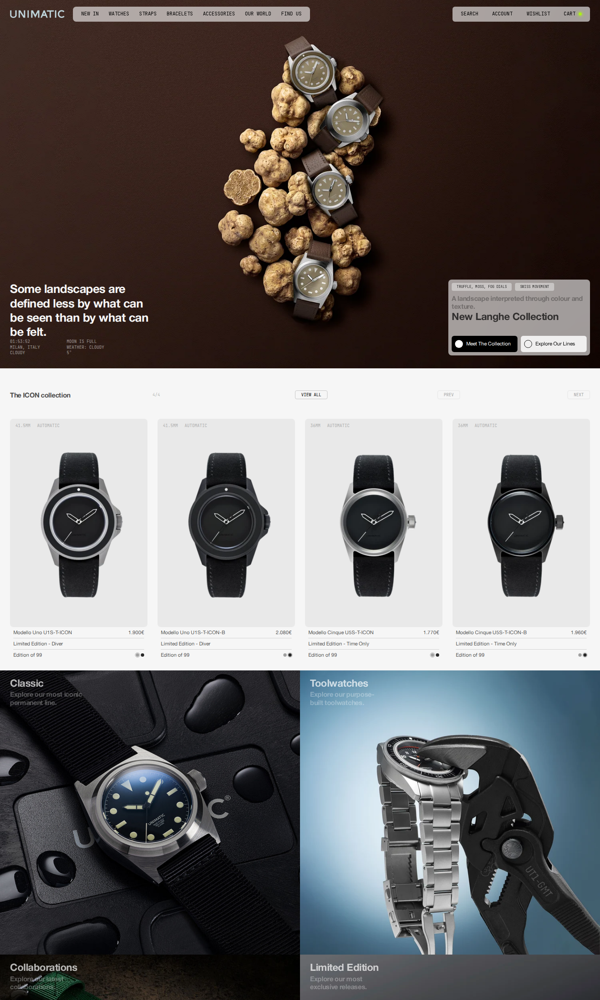
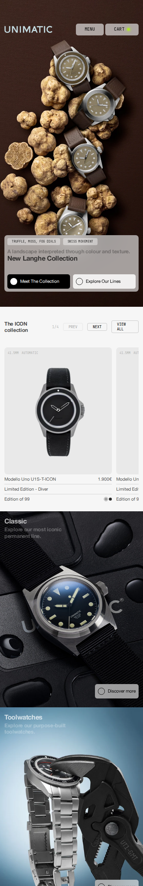

# UI Design System & Master Generation Blueprint: www-unimaticwatches-com

> **UNIMATIC Watches** (https://www.unimaticwatches.com/?srsltid=AfmBOor1S-k1GXW2WUlgmQd-YbKuDQWHeKBxyRjTFNyURmTvXoeNJXHD) — Discover UNIMATIC watches, an independent Italian watch brand creating minimalist, functional watches made in Italy. Explore our Classic...



---

## 1. Executive Visual Persona & Design Archetype

- **Brand Essence & Persona**: **UNIMATIC Watches** (`https://www.unimaticwatches.com/?srsltid=AfmBOor1S-k1GXW2WUlgmQd-YbKuDQWHeKBxyRjTFNyURmTvXoeNJXHD`). Discover UNIMATIC watches, an independent Italian watch brand creating minimalist, functional watches made in Italy. Explore our Classic...
- **Capture Provenance**: Live browser capture (`tier1_fast`, HTTP `200`, captured `2026-11-23`).
- **Visual Archetype**: **Light-Substrate Editorial & Modular Grid System (`#f6f6f6` canvas, `#000000` ink, `#afff00` accent)**.
- **Anti-AI-Slop Differentiators**:
  - **Live-Computed Chromatic Polarity**: Anchors the viewport in `#f6f6f6` (live computed `body` `background-color` (`computed_styles.json`)) paired with `#000000` primary typography and `#afff00` accents.
  - **Grounded Typographic Hierarchy**: Pairs `Helvetica Neue` for display copy (`New Langhe Collection`) with `Helvetica Neue` and `JetBrains Mono`.
  - **Calibrated Spatial Grid & Motion**: Combines `1200px` container bounds (`gap: 24px`, padding `var(--page-margin)`) with `cubic-bezier(.4,0,.2,1)` easing and Three.js / WebGL Canvas Pipeline, Barba.js Page Transition Router.

---

## 2. Spatial Architecture & Modular Grid Mathematics



### Viewport Allocation & Container Geometry
- **Captured Viewport Dimensions**: Desktop `1440×2400px` (`assets/desktop.png`, clamped at 2400px live multi-section capture), Mobile `390×2400px` (`assets/mobile.png`, clamped at 2400px live multi-section capture).
- **Master Container Bounds**: `1200px` (non-`@media` desktop container stylesheet rule).
- **Canvas Lateral Padding & Spacing**: `var(--page-margin)` lateral canvas padding with `24px` grid gap.
- **Border Radius Scale**: `var(--radius-sm)`, `var(--radius-lg)`, `4px`, `var(--radius-md)`.

### Responsive Breakpoint Architecture
- **Desktop Layout**: Multi-column CSS Grid / Flexbox layout at `1440px` (`max-width: 1200px`, `gap: 24px`).
- **Mobile Layout**: Single-column vertical stack at `390px` viewport width with `var(--page-margin)` horizontal padding.
- **Extracted CSS Media Queries**: `@media (min-width:768px)`, `@media (prefers-reduced-motion:reduce)`, `@media (max-width:767px)`, `@media (max-width:1099px)`.

---

## 3. Color System, Materiality & Atmospheric Lighting

### Semantic Palette & Source Grounding
| Semantic Role | Ground-Truth Value | Extracted Live / CSS Source |
|---|---|---|
| **Primary Canvas Substrate** | `#f6f6f6` | live computed `body` `background-color` (`computed_styles.json`) |
| **Primary Typography Ink** | `#000000` | live computed `main` `color` (`computed_styles.json`) |
| **Elevated Surface / Card Substrate** | `#ffffff` | `.b2b-terms { background-color: white }` (`#ffffff`) |
| **Interactive Accent / Highlight** | `#afff00` | `var(--color-accent)` in `:root` |
| **Secondary / Muted Copy** | `#222222` | `var(--color-tag-ink)` in `:root` |
| **Structural Hairline Border** | `#ffffff` | `on.loading>.loading-overlay__sp... { stroke: #ffffff }` |

### Sanitized Root CSS Variables (`ui-ux.md` Ground Truth)
| Variable Name | Extracted Value | Semantic Role |
|---|---|---|
| `--space-1` | `.4rem` | Layout / Spatial Grid Token |
| `--space-2` | `.8rem` | Layout / Spatial Grid Token |
| `--space-2-5` | `1rem` | Layout / Spatial Grid Token |
| `--space-3` | `1.2rem` | Layout / Spatial Grid Token |
| `--space-4` | `1.6rem` | Layout / Spatial Grid Token |
| `--space-5` | `2.4rem` | Layout / Spatial Grid Token |
| `--space-6` | `3.2rem` | Layout / Spatial Grid Token |
| `--color-tag-ink` | `#222` | Typography Ink Token |
| `--editorial-sticky-top` | `6.4rem` | Dimension / Scale Token |
| `--drawer-top-base` | `calc(var(--space-4) + var(--space-2-5) * 2 + 1.6rem + var(--space-2))` | Dimension / Scale Token |
| `--drawer-top` | `var(--drawer-top-base)` | Design System Custom Token |
| `--drawer-width` | `33rem` | Layout / Spatial Grid Token |
| `--sticky-top` | `calc(var(--drawer-top-base) + var(--space-6))` | Design System Custom Token |
| `--color-bg` | `#F6F6F6` | Canvas / Surface Token |
| `--color-ink` | `#000000` | Typography Ink Token |
| `--color-accent` | `#AFFF00` | Brand / Palette Token |

---

## 4. Typographic Scale & Editorial Hierarchy

### Font Family Stacks
- **Display Typography**: `Helvetica Neue`.
- **Primary Body Stack**: `Helvetica Neue`.
- **Technical / Metadata Stack**: `JetBrains Mono`.

### Typographic Scale & Rules (Live Computed & Stylesheet Grounded)
- **Hero Display (`H1`)**: live computed `h1` (`font-size: 24px`, `line-height: 29.304px`, `font-weight: 700`, `letter-spacing: -0.48px`).
- **Section Heading (`H2`)**: live computed `h3 (primary section heading)` (`font-size: 28.08px`, `line-height: 34.2857px`, `font-weight: 700`, `letter-spacing: -0.48px`); CSS variables `--fs-subtitle: 1.6rem`; rule `h2` (`font-size: 120%`, `font-weight: bold`).
- **Body Copy**: live computed `body` (`font-size: 12px`, `line-height: 14.652px`, `font-weight: 400`); CSS variables `--fs-body: 1.2rem`; rule `p` (`line-height: 2.8rem`).
- **Metadata & Navigation Labels**: live computed `nav/a` (`font-size: 12px`, `line-height: 14.652px`, `font-weight: 400`); CSS variables `--font-mono: "JetBrains Mono", ui-monospace, "SFMono-Regular", Menlo, monospace`, `--fs-mono: 1.2rem`, `--lh-mono: 1.32`; rule `small` (`font-size: var(--fs-eyebrow)`, `line-height: var(--lh-mono)`).

---

## 5. Choreographed Motion & Interaction Physics

### Primary Easing Curves
- **Extracted Timing Functions**: `cubic-bezier(.4,0,.2,1)`, `cubic-bezier(1,0,0,1)`, `cubic-bezier(0.64,0,0.78,0)`.

### Per-Element Transition & Choreography Rules
- **Selector `.slider__ctrl`**: `transition: background-color var(--transition),color var(--transition)` extracted from `www-unimaticwatches-com` stylesheet.
- **Selector `.drawer`**: `transition: opacity var(--transition),transform var(--transition),display...` extracted from `www-unimaticwatches-com` stylesheet.
- **Selector `body:after`**: `transition: opacity var(--transition)` extracted from `www-unimaticwatches-com` stylesheet.
- **Extracted Easing Curve (`cubic-bezier(.4,0,.2,1)`)**: Governs interactive state transitions across `<header.shopify-section>` and `<section.product-carousel-section>`.
- **Runtime Interaction Engine**: Integrates Three.js / WebGL Canvas Pipeline, Barba.js Page Transition Router with `prefers-reduced-motion: reduce` fallback guards.

---

## 6. Component Wireframe & Structural DOM Map

### Visual Layout Schematic — Desktop (`1440px`, Grounded in `dom.html` & Landmark Bounding Boxes)
```
┌────────────────────────────────────────────────────────────────────────┐
│ DESKTOP VIEWPORT (1440px) — UNIMATIC Watches                           │
│ ====================================================================== │
│ [ <header.shopify-sectio (1440x0px)   | New in · Bracelets           ] │
│ ---------------------------------------------------------------------- │
│ | HERO STAGE: <section.shopify-section> (w=1440px)                   | │
│ | H1: New Langhe Collection                                          | │
│ | Substrate: #f6f6f6 | Ink: #000000 | Accent: #afff00                | │
│ ---------------------------------------------------------------------- │
│ | SHOWCASE GRID (<section.product-carousel-) max-w: 1200px           | │
│ | +------------------------------+  +------------------------------+ | │
│ | | Some landscapes are defined  |  | The ICON collection          | | │
│ | +------------------------------+  +------------------------------+ | │
│ ---------------------------------------------------------------------- │
│ | DETAIL MODULE (<article.product-card>) — Waterproof checked        | │
│ ---------------------------------------------------------------------- │
│ [ FOOTER (<footer.shopify-sect) | https://www.unimaticwatches.com/?sr  │
└────────────────────────────────────────────────────────────────────────┘
```

### Visual Layout Schematic — Mobile Reflow (`390px`)
```
┌────────────────────────────────────────────────────────────────────────┐
│ MOBILE VIEWPORT REFLOW (390px) — Single-Column Stack (gap: 24px)       │
│ ====================================================================== │
│ [ HEADER BAR (<header.shopify-section>) | Compact Menu (390px)         │
│ ---------------------------------------------------------------------- │
│ | HERO STAGE (<section.shopify-section) — 390px Vertical Lead        | │
│ | H1: New Langhe Collection                                          | │
│ ---------------------------------------------------------------------- │
│ | SHOWCASE STACK (<section.product-carou) — 1-Col Stack              | │
│ | [ Item 1: Some landscapes are defined less by what can be s...   ] | │
│ | [ Item 2: The ICON collection                                    ] | │
│ ---------------------------------------------------------------------- │
│ | DETAIL STACK (<article.product-card>) — 1-Col (Waterproof checked) | │
│ ---------------------------------------------------------------------- │
│ [ FOOTER (<footer.shopify-sect) | Stacked 390px Colophon               │
└────────────────────────────────────────────────────────────────────────┘
```

### Granular DOM Region Breakdown
1. **Brand Header & Navigation Bar (<header.shopify-section> — `www-unimaticwatches-com`)**:
   - Landmark `<header class="shopify-section shopify-section-group-header-group">` (`1440x0px`) hosting `UNIMATIC Watches` navigation (`New in · Bracelets`), DOM attributes (`data-source-attribution="shopify.exit_intersti..."`, `data-shopify`, `data-shop-id="104415822154"`, `data-venmo-supported="false"`), and stylesheet rule `after { box-sizing:border-box }`.
2. **Hero Stage & Focal Lead (<section.shopify-section> — `New Langhe Collection`)**:
   - Landmark `<section class="shopify-section hero">` presenting display lead `New Langhe Collection` and copy excerpt *"Truffle, Moss, Fog Dials"* over `#f6f6f6` canvas and `#000000` ink.
3. **Primary Showcase & Content Grid (<section.product-carousel-section> — `Some landscapes are defined less b`)**:
   - Landmark `<section class="shopify-section product-carousel-section">` rendering section `Some landscapes are defined less by what can be s...` with copy *"A landscape interpreted through colour and texture."*, asset references (`596128728859448`, `fbevents.js`, `clarity.js`, `zg18q6f8jj`), and grid rule `html { font-size:10px;-webkit-text-size-adjust:100%;text-size-adjust:100% }`.
4. **Interactive Detail & Feature Matrix (<article.product-card> — `The ICON collection`)**:
   - Landmark `<article class="product-card">` framing `The ICON collection` and `Waterproof checked` (*"Meet The Collection"*) with `#ffffff` surface cards, `#afff00` accents, and `button { font:inherit;color:inherit;background:none;border:0;padding:0;cursor:poi... }`.
5. **Colophon & Global Directory Footer (<footer.shopify-section> — `https://www.unimaticwatches.com/?srsltid=AfmBOor1S-k1GXW2WUlgmQd-YbKuDQWHeKBxyRjTFNyURmTvXoeNJXHD`)**:
   - Landmark `<footer class="shopify-section shopify-section-group-footer-group">` anchoring `UNIMATIC Watches` footer links (`New in · Bracelets`), copy *"Limited Edition - Diver"*, and `#ffffff` structural dividers.

---

## 7. Master Zero-Shot AI Generation Prompt

```markdown
# Master Zero-Shot Frontend Generation Prompt: www-unimaticwatches-com (UNIMATIC Watches)

You are a principal frontend architect and design systems engineer. Build a complete, production-ready web application replicating the exact design system, DOM landmarks, typographic hierarchy, color tokens, and motion physics of `www-unimaticwatches-com` (**UNIMATIC Watches** — `https://www.unimaticwatches.com/?srsltid=AfmBOor1S-k1GXW2WUlgmQd-YbKuDQWHeKBxyRjTFNyURmTvXoeNJXHD`).

### 1. Visual Archetype & Anti-AI-Slop Mandates
- **Archetype**: Light-Substrate Editorial & Modular Grid System (`#f6f6f6` canvas, `#000000` ink, `#afff00` accent).
- **Identity & Domain Context**: Discover UNIMATIC watches, an independent Italian watch brand creating minimalist, functional watches made in Italy. Explore our Classic...
- **Primary Substrate**: `#f6f6f6` (live computed `body` `background-color` (`computed_styles.json`)), **Primary Ink**: `#000000`, **Accent / Highlight**: `#afff00`.
- **Site-Specific Differentiators**:
  - **Live-Computed Chromatic Polarity**: Anchors the viewport in `#f6f6f6` (live computed `body` `background-color` (`computed_styles.json`)) paired with `#000000` primary typography and `#afff00` accents.
  - **Grounded Typographic Hierarchy**: Pairs `Helvetica Neue` for display copy (`New Langhe Collection`) with `Helvetica Neue` and `JetBrains Mono`.
  - **Calibrated Spatial Grid & Motion**: Combines `1200px` container bounds (`gap: 24px`, padding `var(--page-margin)`) with `cubic-bezier(.4,0,.2,1)` easing and Three.js / WebGL Canvas Pipeline, Barba.js Page Transition Router.

### 2. Ground-Truth CSS Variables (`:root` Token Contract)
Declare and consume these exact custom properties extracted from `www-unimaticwatches-com` in your global stylesheet:

:root {
  /* UNIMATIC Watches (www-unimaticwatches-com) — Live-Grounded CSS Variables */
  --space-1: .4rem; /* Layout / Spatial Grid Token (www-unimaticwatches-com) */
  --space-2: .8rem; /* Layout / Spatial Grid Token (www-unimaticwatches-com) */
  --space-2-5: 1rem; /* Layout / Spatial Grid Token (www-unimaticwatches-com) */
  --space-3: 1.2rem; /* Layout / Spatial Grid Token (www-unimaticwatches-com) */
  --space-4: 1.6rem; /* Layout / Spatial Grid Token (www-unimaticwatches-com) */
  --space-5: 2.4rem; /* Layout / Spatial Grid Token (www-unimaticwatches-com) */
  --space-6: 3.2rem; /* Layout / Spatial Grid Token (www-unimaticwatches-com) */
  --color-tag-ink: #222; /* Typography Ink Token (www-unimaticwatches-com) */
  --editorial-sticky-top: 6.4rem; /* Dimension / Scale Token (www-unimaticwatches-com) */
  --drawer-top-base: calc(var(--space-4) + var(--space-2-5) * 2 + 1.6rem + var(--space-2)); /* Dimension / Scale Token (www-unimaticwatches-com) */
  --drawer-top: var(--drawer-top-base); /* Design System Custom Token (www-unimaticwatches-com) */
  --drawer-width: 33rem; /* Layout / Spatial Grid Token (www-unimaticwatches-com) */
  --sticky-top: calc(var(--drawer-top-base) + var(--space-6)); /* Design System Custom Token (www-unimaticwatches-com) */
  --color-bg: #F6F6F6; /* Canvas / Surface Token (www-unimaticwatches-com) */
  --color-ink: #000000; /* Typography Ink Token (www-unimaticwatches-com) */
  --color-accent: #AFFF00; /* Brand / Palette Token (www-unimaticwatches-com) */
}

### 3. Semantic Color & Materiality Contract
Map every surface, ink, and border strictly to these source-grounded tokens:
- **Primary Canvas Substrate**: `#f6f6f6` — grounded in live computed `body` `background-color` (`computed_styles.json`)
- **Primary Typography Ink**: `#000000` — grounded in live computed `main` `color` (`computed_styles.json`)
- **Elevated Surface / Card Substrate**: `#ffffff` — grounded in `.b2b-terms { background-color: white }` (`#ffffff`)
- **Interactive Accent / Highlight**: `#afff00` — grounded in `var(--color-accent)` in `:root`
- **Secondary / Muted Copy**: `#222222` — grounded in `var(--color-tag-ink)` in `:root`
- **Structural Hairline Border**: `#ffffff` — grounded in `on.loading>.loading-overlay__sp... { stroke: #ffffff }`

### 4. Spatial Grid, Container Bounds & Responsive Breakpoints
- **Desktop Viewport Reference**: `1440×2400px` (clamped at 2400px live multi-section capture, `1440px` standard desktop width).
- **Mobile Viewport Reference**: `390×2400px` (clamped at 2400px live multi-section capture, `390px` standard mobile width).
- **Container Max-Width**: `1200px` (non-`@media` desktop container stylesheet rule)
- **Padding & Gutters**: `var(--page-margin)` lateral canvas padding with `24px` grid gap
- **Desktop Grid**: Multi-column CSS Grid / Flexbox layout at `1440px` (`max-width: 1200px`, `gap: 24px`)
- **Mobile Adaptation**: Single-column vertical stack at `390px` viewport width with `var(--page-margin)` horizontal padding
- **Media Queries**: `@media (min-width:768px)`, `@media (prefers-reduced-motion:reduce)`, `@media (max-width:767px)`, `@media (max-width:1099px)`
- **Corner Radii**: `var(--radius-sm)`, `var(--radius-lg)`, `4px`, `var(--radius-md)`

### 5. Typography & Editorial Scale Contract
- **Display Font Stack**: `Helvetica Neue`
- **Body Font Stack**: `Helvetica Neue`
- **Monospace / Technical Font Stack**: `JetBrains Mono`
- **H1 Display Rule**: live computed `h1` (`font-size: 24px`, `line-height: 29.304px`, `font-weight: 700`, `letter-spacing: -0.48px`)
- **H2 Section Rule**: live computed `h3 (primary section heading)` (`font-size: 28.08px`, `line-height: 34.2857px`, `font-weight: 700`, `letter-spacing: -0.48px`); CSS variables `--fs-subtitle: 1.6rem`; rule `h2` (`font-size: 120%`, `font-weight: bold`)
- **Body Copy Rule**: live computed `body` (`font-size: 12px`, `line-height: 14.652px`, `font-weight: 400`); CSS variables `--fs-body: 1.2rem`; rule `p` (`line-height: 2.8rem`)
- **Metadata & Index Rule**: live computed `nav/a` (`font-size: 12px`, `line-height: 14.652px`, `font-weight: 400`); CSS variables `--font-mono: "JetBrains Mono", ui-monospace, "SFMono-Regular", Menlo, monospace`, `--fs-mono: 1.2rem`, `--lh-mono: 1.32`; rule `small` (`font-size: var(--fs-eyebrow)`, `line-height: var(--lh-mono)`)

### 6. Component Hierarchy, Verbatim Copy & Real DOM Landmarks
Scaffold `www-unimaticwatches-com` (`UNIMATIC Watches`) with these exact structural regions, extracted copy, and CSS rules from `dom.html`:
1. **Brand Header & Navigation Bar (<header.shopify-section> — `www-unimaticwatches-com`)**:
   - DOM & Selectors: Landmark `<header class="shopify-section shopify-section-group-header-group">` (`1440x0px`) hosting `UNIMATIC Watches` navigation (`New in · Bracelets`), DOM attributes (`data-source-attribution="shopify.exit_intersti..."`, `data-shopify`, `data-shop-id="104415822154"`, `data-venmo-supported="false"`), and stylesheet rule `after { box-sizing:border-box }`.
   - Responsive Contract: Header `Brand Header & Navigation Bar (<header.shopify-section> — `www-unimaticwatches-com`)` (`www-unimaticwatches-com`) adapts across `@media (min-width:768px)`, `@media (prefers-reduced-motion:reduce)`, `@media (max-width:767px)`, `@media (max-width:1099px)` with `cubic-bezier(.4,0,.2,1)`, `cubic-bezier(1,0,0,1)`, `cubic-bezier(0.64,0,0.78,0)` transitions and links `New in · Bracelets`.
2. **Hero Stage & Focal Lead (<section.shopify-section> — `New Langhe Collection`)**:
   - DOM & Selectors: Landmark `<section class="shopify-section hero">` presenting display lead `New Langhe Collection` and copy excerpt *"Truffle, Moss, Fog Dials"* over `#f6f6f6` canvas and `#000000` ink.
   - Responsive Contract: Hero stage (`1440×2400px` desktop / `390×2400px` mobile) sets `#f6f6f6` background with `#000000` headline `New Langhe Collection`.
3. **Primary Showcase & Content Grid (<section.product-carousel-section> — `Some landscapes are defined less b`)**:
   - DOM & Selectors: Landmark `<section class="shopify-section product-carousel-section">` rendering section `Some landscapes are defined less by what can be s...` with copy *"A landscape interpreted through colour and texture."*, asset references (`596128728859448`, `fbevents.js`, `clarity.js`, `zg18q6f8jj`), and grid rule `html { font-size:10px;-webkit-text-size-adjust:100%;text-size-adjust:100% }`.
   - Responsive Contract: Showcase grid `Primary Showcase & Content Grid (<section.product-carousel-section> — `Some landscapes are defined less b`)` applies Multi-column CSS Grid / Flexbox layout at `1440px` (`max-width: 1200px`, `gap: 24px`) on desktop and Single-column vertical stack at `390px` viewport width with `var(--page-margin)` horizontal padding on mobile.
4. **Interactive Detail & Feature Matrix (<article.product-card> — `The ICON collection`)**:
   - DOM & Selectors: Landmark `<article class="product-card">` framing `The ICON collection` and `Waterproof checked` (*"Meet The Collection"*) with `#ffffff` surface cards, `#afff00` accents, and `button { font:inherit;color:inherit;background:none;border:0;padding:0;cursor:poi... }`.
   - Responsive Contract: Detail module `Interactive Detail & Feature Matrix (<article.product-card> — `The ICON collection`)` uses `var(--radius-sm)`, `var(--radius-lg)`, `4px`, `var(--radius-md)` radii, `#afff00` highlights, and assets (596128728859448, fbevents.js, clarity.js).
5. **Colophon & Global Directory Footer (<footer.shopify-section> — `https://www.unimaticwatches.com/?srsltid=AfmBOor1S-k1GXW2WUlgmQd-YbKuDQWHeKBxyRjTFNyURmTvXoeNJXHD`)**:
   - DOM & Selectors: Landmark `<footer class="shopify-section shopify-section-group-footer-group">` anchoring `UNIMATIC Watches` footer links (`New in · Bracelets`), copy *"Limited Edition - Diver"*, and `#ffffff` structural dividers.
   - Responsive Contract: Footer `Colophon & Global Directory Footer (<footer.shopify-section> — `https://www.unimaticwatches.com/?srsltid=AfmBOor1S-k1GXW2WUlgmQd-YbKuDQWHeKBxyRjTFNyURmTvXoeNJXHD`)` aligns to `1200px` (non-`@media` desktop container stylesheet rule) with `var(--page-margin)` lateral canvas padding with `24px` grid gap and attributes (data-source-attribution="shopify.exit_intersti...", data-shopify, data-shop-id="104415822154").

#### Verbatim DOM Copy Excerpts (`dom.html`)
- Copy Excerpt 1: *"Truffle, Moss, Fog Dials"*
- Copy Excerpt 2: *"A landscape interpreted through colour and texture."*
- Copy Excerpt 3: *"Meet The Collection"*
- Copy Excerpt 4: *"Limited Edition - Diver"*

### 7. Motion, Extracted Stylesheet Rules & Interaction Choreography
- **Primary Easing Functions**: `cubic-bezier(.4,0,.2,1)`, `cubic-bezier(1,0,0,1)`, `cubic-bezier(0.64,0,0.78,0)`
- **Extracted Stylesheet Rules (`www-unimaticwatches-com`)**:
- `after { box-sizing:border-box }`
- `html { font-size:10px;-webkit-text-size-adjust:100%;text-size-adjust:100% }`
- `button { font:inherit;color:inherit;background:none;border:0;padding:0;cursor:poi... }`
- `svg { display:block;max-width:100% }`
- `video-background { display:block }`
- **Per-Selector Transition Rules**:
- **Selector `.slider__ctrl`**: `transition: background-color var(--transition),color var(--transition)` extracted from `www-unimaticwatches-com` stylesheet.
- **Selector `.drawer`**: `transition: opacity var(--transition),transform var(--transition),display...` extracted from `www-unimaticwatches-com` stylesheet.
- **Selector `body:after`**: `transition: opacity var(--transition)` extracted from `www-unimaticwatches-com` stylesheet.
- **Extracted Easing Curve (`cubic-bezier(.4,0,.2,1)`)**: Governs interactive state transitions across `<header.shopify-section>` and `<section.product-carousel-section>`.
- **Runtime Interaction Engine**: Integrates Three.js / WebGL Canvas Pipeline, Barba.js Page Transition Router with `prefers-reduced-motion: reduce` fallback guards.

### 8. Technical Deliverables
- Implement in Next.js (App Router) with TypeScript and Tailwind CSS consuming the `:root` custom properties defined above for `www-unimaticwatches-com`.
- Reproduce both the `1440px` desktop architecture and `390px` mobile breakpoint transitions, preserving semantic HTML5 landmarks (`<header>`, `<nav>`, `<main>`, `<section>`, `<footer>`) and `prefers-reduced-motion` accessibility guards.
```
