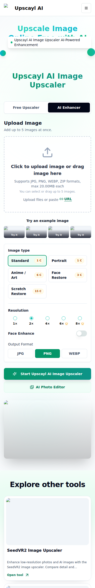

# UI Design System & Master Generation Blueprint: www-upscayl-app

> **Upscale Image Online Free – Upscale to 8K with AI · Upscayl** (https://www.upscayl.app) — Enhance blurry, pixelated, or low-resolution photos online with AI-powered upscaling. Choose an enhancement mode, preview the result, and...


---

## 1. Executive Visual Persona & Design Archetype

- **Brand Essence & Persona**: **Upscale Image Online Free – Upscale to 8K with AI · Upscayl** (`https://www.upscayl.app`). Enhance blurry, pixelated, or low-resolution photos online with AI-powered upscaling. Choose an enhancement mode, preview the result, and...
- **Visual Archetype**: **Light-Substrate Editorial & Modular Grid System (`#fff` canvas, `#9ca3af` ink, `#f59e0b` accent)**.
- **Anti-AI-Slop Differentiators**:
  - **Source-Grounded Chromatic Polarity**: Anchors the viewport in `#fff` (`var(--normal-bg)` in `:root`) paired with `#9ca3af` primary typography and `#f59e0b` accents.
  - **Extracted Typographic Hierarchy**: Pairs `Inter` for display copy (`Upscale Image Online Free with AI`) with `Inter Fallback` and `SFMono-Regular`.
  - **Calibrated Spatial Grid & Motion**: Combines `1200px` container bounds (`gap: .25rem`, padding `2rem`) with `cubic-bezier(0,0,.2,1)` easing.

---

## 2. Spatial Architecture & Modular Grid Mathematics



### Viewport Allocation & Container Geometry
- **Captured Viewport Dimensions**: Desktop `1440×13515px` (`assets/desktop.png`, full-page scroll capture), Mobile `390×2400px` (`assets/mobile.png`, capped at 2400px multi-section capture).
- **Master Container Bounds**: `1200px` extracted from `www-upscayl-app` stylesheet.
- **Canvas Lateral Padding & Spacing**: `2rem` lateral canvas padding with `.25rem` grid gap.
- **Border Radius Scale**: `.25rem`, `1rem`, `1.5rem`, `1.75rem`.

### Responsive Breakpoint Architecture
- **Desktop Layout**: Multi-column CSS Grid / Flexbox layout at `1440px` (`max-width: 1200px`, `gap: .25rem`).
- **Mobile Layout**: Single-column vertical stack at `390px` viewport width with `2rem` horizontal padding.
- **Extracted CSS Media Queries**: `@media (min-width:1200px)`, `@media (prefers-reduced-motion:reduce)`, `@media (min-width:1024px)`, `@media (min-width:375px)`.

---

## 3. Color System, Materiality & Atmospheric Lighting

### Semantic Palette & Source Grounding
| Semantic Role | Ground-Truth Value | Extracted CSS Source / Selector |
|---|---|---|
| **Primary Canvas Substrate** | `#fff` | `var(--normal-bg)` in `:root` |
| **Primary Typography Ink** | `#e5e7eb` | `:before { border: #e5e7eb }` |
| **Elevated Surface / Card Substrate** | `#9ca3af` | `textarea::placeholder { color: #9ca3af }` |
| **Interactive Accent / Highlight** | `#f59e0b` | `.fill-amber-500 { fill: #f59e0b }` |
| **Secondary / Muted Copy** | `#facc15` | `.fill-yellow-400 { fill: #facc15 }` |
| **Structural Hairline Border** | `#6ee7b7` | `.decoration-emerald-300 { color: #6ee7b7 }` |

### Sanitized Root CSS Variables (`ui-ux.md` Ground Truth)
| Variable Name | Extracted Value | Semantic Role |
|---|---|---|
| `--sidebar-background` | `var(--background)` | Canvas / Surface Token |
| `--sidebar-foreground` | `var(--foreground)` | Typography Ink Token |
| `--sidebar-primary` | `var(--primary)` | Brand / Palette Token |
| `--sidebar-primary-foreground` | `var(--primary-foreground)` | Typography Ink Token |
| `--sidebar-accent` | `var(--background)` | Brand / Palette Token |
| `--sidebar-accent-foreground` | `var(--primary)` | Typography Ink Token |
| `--sidebar-border` | `var(--border)` | Elevation / Border Token |
| `--sidebar-ring` | `var(--ring)` | Elevation / Border Token |
| `--background` | `0 0% 100%` | Canvas / Surface Token |
| `--foreground` | `20 14.3% 4.1%` | Typography Ink Token |
| `--card` | `0 0% 100%` | Dimension / Scale Token |
| `--card-foreground` | `20 14.3% 4.1%` | Typography Ink Token |
| `--popover` | `0 0% 100%` | Dimension / Scale Token |
| `--popover-foreground` | `20 14.3% 4.1%` | Typography Ink Token |
| `--primary` | `175 82% 42%` | Brand / Palette Token |
| `--primary-foreground` | `0 0% 100%` | Typography Ink Token |

---

## 4. Typographic Scale & Editorial Hierarchy

### Font Family Stacks
- **Display Typography**: `Inter`.
- **Primary Body Stack**: `Inter Fallback`.
- **Technical / Metadata Stack**: `SFMono-Regular`.

### Typographic Scale & Rules (Extracted from Stylesheet & Variables)
- **Hero Display (`H1`)**: not explicitly declared on tag in static CSS (stylesheet font-size ladder: `1em`, `80%`, `75%`, `100%`, `1.5rem`).
- **Section Heading (`H2`)**: rule `h2` (`font-size: 1.875rem!important`).
- **Body Copy**: rule `p` (`font-size: .875rem!important`, `line-height: 1.25rem!important`).
- **Metadata & Navigation Labels**: not explicitly declared on tag in static CSS (stylesheet font-size ladder: `1em`, `80%`, `75%`, `100%`, `1.5rem`).

---

## 5. Choreographed Motion & Interaction Physics

### Primary Easing Curves
- **Extracted Timing Functions**: `cubic-bezier(0,0,.2,1)`, `cubic-bezier(.4,0,.6,1)`, `cubic-bezier(.4,0,.2,1)`.

### Per-Element Transition & Choreography Rules
- **Selector `.transition`**: `transition: cubic-bezier(0,0,.2,1)` extracted from `www-upscayl-app` stylesheet.
- **Selector `.transition-\[grid-template-rows\]`**: `transition: cubic-bezier(0,0,.2,1)` extracted from `www-upscayl-app` stylesheet.
- **Selector `.transition-\[left\2c right\2c wi...`**: `transition: cubic-bezier(0,0,.2,1)` extracted from `www-upscayl-app` stylesheet.
- **Extracted Easing Curve (`cubic-bezier(0,0,.2,1)`)**: Governs interactive state transitions across `<header.relative>` and `<section.py-12>`.
- **State & Hover Choreography**: Opacity and transform transitions on `<section.relative>` and `<section.py-12>` interactive targets.

---

## 6. Component Wireframe & Structural DOM Map

### Visual Layout Schematic (Grounded in `dom.html` — `1440px` Desktop & `390px` Mobile Reflow)
```
┌────────────────────────────────────────────────────────────────────────┐
│ DESKTOP VIEWPORT (1440px) — Upscale Image Online Free – Upscale to 8K  │
│ ====================================================================== │
│ [ <header.relative>        | AI Photo Editor · Image Enhancer · AI  ]  │
│ ---------------------------------------------------------------------- │
│ | HERO STAGE: <section.relative>                                   |   │
│ | H1: Upscale Image Online Free with AI                            |   │
│ | Substrate: #fff       | Ink: #9ca3af    | Accent: #f59e0b        |   │
│ ---------------------------------------------------------------------- │
│ | SHOWCASE GRID (<section.py-12>           ) max-w: 1200px         |   │
│ | +------------------------------+  +------------------------------+ | │
│ | | Upscayl AI Image Upscaler    |  | Explore other tools          | | │
│ | +------------------------------+  +------------------------------+ | │
│ ---------------------------------------------------------------------- │
│ | MOBILE VIEWPORT REFLOW (390px) — Single-Column Stack (gap: .25rem) | │
│ | [<header.relative>] -> [<section.relative>] -> [<section.py-12>] |   │
│ ---------------------------------------------------------------------- │
│ [ FOOTER (<footer.antialiased>  ) | https://www.upscayl.app            │
└────────────────────────────────────────────────────────────────────────┘
```

### Granular DOM Region Breakdown
1. **Brand Header & Navigation Bar (<header.relative> — `www-upscayl-app`)**:
   - Landmark `<header class="relative z-50">` hosting `Upscale Image Online Free – Upscale ` navigation (`AI Photo Editor · Image Enhancer · AI Image Tools · Pricing · API`), DOM attributes (`data-precedence="next"`, `data-precedence="next"`, `data-precedence="next"`, `data-nimg="1"`), and stylesheet rule `before { box-sizing:border-box;border:0 solid e5e7eb }`.
2. **Hero Stage & Focal Lead (<section.relative> — `Upscale Image Online Free with AI`)**:
   - Landmark `<section class="relative py-8">` presenting display lead `Upscale Image Online Free with AI` and copy excerpt *"Upscale Image Online Free with AI"* over `#fff` canvas and `#9ca3af` ink.
3. **Primary Showcase & Content Grid (<section.py-12> — `Upscayl AI Image Upscaler`)**:
   - Landmark `<section class="py-12 bg-gradient-to-b">` rendering section `Upscayl AI Image Upscaler` with copy *"The ultimate Upscayl AI Image Upscaler for crystal-clear 4K image"*, asset references (`5544ee6471eef55b.css`, `46fac02034242723.css`, `c50624e23d0abf09.css`, `webpack-c03deb5affb2ddad.js`), and grid rule `body { margin:0;line-height:inherit }`.
4. **Interactive Detail & Feature Matrix (<section.relative> — `Explore other tools`)**:
   - Landmark `<section class="relative overflow-hidden">` framing `Explore other tools` and `Upscayl AI Image Upscaler Features` (*"Enhance blurry, pixelated, or low-resolution photos online with A"*) with `#9ca3af` surface cards, `#f59e0b` accents, and `strong { font-weight:bolder }`.
5. **Colophon & Global Directory Footer (<footer.antialiased> — `https://www.upscayl.app`)**:
   - Landmark `<footer class="antialiased">` anchoring `Upscale Image Online Free – Upsc` footer links (`AI Photo Editor · Image Enhancer · AI Image Tools · Pricing · API`), copy *"Try Upscayl AI Image Upscaler for Free"*, and `#6ee7b7` structural dividers.

---

## 7. Master Zero-Shot AI Generation Prompt

```markdown
# Master Zero-Shot Frontend Generation Prompt: www-upscayl-app (Upscale Image Online Free – Upscale to 8K with AI · Upscayl)

You are a principal frontend architect and design systems engineer. Build a complete, production-ready web application replicating the exact design system, DOM landmarks, typographic hierarchy, color tokens, and motion physics of `www-upscayl-app` (**Upscale Image Online Free – Upscale to 8K with AI · Upscayl** — `https://www.upscayl.app`).

### 1. Visual Archetype & Anti-AI-Slop Mandates
- **Archetype**: Light-Substrate Editorial & Modular Grid System (`#fff` canvas, `#9ca3af` ink, `#f59e0b` accent).
- **Identity & Domain Context**: Enhance blurry, pixelated, or low-resolution photos online with AI-powered upscaling. Choose an enhancement mode, preview the result, and...
- **Primary Substrate**: `#fff` (`var(--normal-bg)` in `:root`), **Primary Ink**: `#9ca3af`, **Accent / Highlight**: `#f59e0b`.
- **Site-Specific Differentiators**:
  - **Source-Grounded Chromatic Polarity**: Anchors the viewport in `#fff` (`var(--normal-bg)` in `:root`) paired with `#9ca3af` primary typography and `#f59e0b` accents.
  - **Extracted Typographic Hierarchy**: Pairs `Inter` for display copy (`Upscale Image Online Free with AI`) with `Inter Fallback` and `SFMono-Regular`.
  - **Calibrated Spatial Grid & Motion**: Combines `1200px` container bounds (`gap: .25rem`, padding `2rem`) with `cubic-bezier(0,0,.2,1)` easing.

### 2. Ground-Truth CSS Variables (`:root` Token Contract)
Declare and consume these exact custom properties extracted from `www-upscayl-app` in your global stylesheet:

:root {
  /* Upscale Image Online Free – Upscale to 8K with AI · Upscayl (www-upscayl-app) — Ground-Truth Extracted CSS Variables */
  --sidebar-background: var(--background); /* Canvas / Surface Token (www-upscayl-app) */
  --sidebar-foreground: var(--foreground); /* Typography Ink Token (www-upscayl-app) */
  --sidebar-primary: var(--primary); /* Brand / Palette Token (www-upscayl-app) */
  --sidebar-primary-foreground: var(--primary-foreground); /* Typography Ink Token (www-upscayl-app) */
  --sidebar-accent: var(--background); /* Brand / Palette Token (www-upscayl-app) */
  --sidebar-accent-foreground: var(--primary); /* Typography Ink Token (www-upscayl-app) */
  --sidebar-border: var(--border); /* Elevation / Border Token (www-upscayl-app) */
  --sidebar-ring: var(--ring); /* Elevation / Border Token (www-upscayl-app) */
  --background: 0 0% 100%; /* Canvas / Surface Token (www-upscayl-app) */
  --foreground: 20 14.3% 4.1%; /* Typography Ink Token (www-upscayl-app) */
  --card: 0 0% 100%; /* Dimension / Scale Token (www-upscayl-app) */
  --card-foreground: 20 14.3% 4.1%; /* Typography Ink Token (www-upscayl-app) */
  --popover: 0 0% 100%; /* Dimension / Scale Token (www-upscayl-app) */
  --popover-foreground: 20 14.3% 4.1%; /* Typography Ink Token (www-upscayl-app) */
  --primary: 175 82% 42%; /* Brand / Palette Token (www-upscayl-app) */
  --primary-foreground: 0 0% 100%; /* Typography Ink Token (www-upscayl-app) */
}

### 3. Semantic Color & Materiality Contract
Map every surface, ink, and border strictly to these source-grounded tokens:
- **Primary Canvas Substrate**: `#fff` — grounded in `var(--normal-bg)` in `:root`
- **Primary Typography Ink**: `#e5e7eb` — grounded in `:before { border: #e5e7eb }`
- **Elevated Surface / Card Substrate**: `#9ca3af` — grounded in `textarea::placeholder { color: #9ca3af }`
- **Interactive Accent / Highlight**: `#f59e0b` — grounded in `.fill-amber-500 { fill: #f59e0b }`
- **Secondary / Muted Copy**: `#facc15` — grounded in `.fill-yellow-400 { fill: #facc15 }`
- **Structural Hairline Border**: `#6ee7b7` — grounded in `.decoration-emerald-300 { color: #6ee7b7 }`

### 4. Spatial Grid, Container Bounds & Responsive Breakpoints
- **Desktop Viewport Reference**: `1440×13515px` (full-page scroll capture, `1440px` standard desktop width).
- **Mobile Viewport Reference**: `390×2400px` (capped at 2400px multi-section capture, `390px` standard mobile width).
- **Container Max-Width**: `1200px` extracted from `www-upscayl-app` stylesheet
- **Padding & Gutters**: `2rem` lateral canvas padding with `.25rem` grid gap
- **Desktop Grid**: Multi-column CSS Grid / Flexbox layout at `1440px` (`max-width: 1200px`, `gap: .25rem`)
- **Mobile Adaptation**: Single-column vertical stack at `390px` viewport width with `2rem` horizontal padding
- **Media Queries**: `@media (min-width:1200px)`, `@media (prefers-reduced-motion:reduce)`, `@media (min-width:1024px)`, `@media (min-width:375px)`
- **Corner Radii**: `.25rem`, `1rem`, `1.5rem`, `1.75rem`

### 5. Typography & Editorial Scale Contract
- **Display Font Stack**: `Inter`
- **Body Font Stack**: `Inter Fallback`
- **Monospace / Technical Font Stack**: `SFMono-Regular`
- **H1 Display Rule**: not explicitly declared on tag in static CSS (stylesheet font-size ladder: `1em`, `80%`, `75%`, `100%`, `1.5rem`)
- **H2 Section Rule**: rule `h2` (`font-size: 1.875rem!important`)
- **Body Copy Rule**: rule `p` (`font-size: .875rem!important`, `line-height: 1.25rem!important`)
- **Metadata & Index Rule**: not explicitly declared on tag in static CSS (stylesheet font-size ladder: `1em`, `80%`, `75%`, `100%`, `1.5rem`)

### 6. Component Hierarchy, Verbatim Copy & Real DOM Landmarks
Scaffold `www-upscayl-app` (`Upscale Image Online Free – Upscale to 8K with AI · Upscayl`) with these exact structural regions, extracted copy, and CSS rules from `dom.html`:
1. **Brand Header & Navigation Bar (<header.relative> — `www-upscayl-app`)**:
   - DOM & Selectors: Landmark `<header class="relative z-50">` hosting `Upscale Image Online Free – Upscale ` navigation (`AI Photo Editor · Image Enhancer · AI Image Tools · Pricing · API`), DOM attributes (`data-precedence="next"`, `data-precedence="next"`, `data-precedence="next"`, `data-nimg="1"`), and stylesheet rule `before { box-sizing:border-box;border:0 solid e5e7eb }`.
   - Responsive Contract: Header `Brand Header & Navigation Bar (<header.relative> — `www-upscayl-app`)` (`www-upscayl-app`) adapts across `@media (min-width:1200px)`, `@media (prefers-reduced-motion:reduce)`, `@media (min-width:1024px)`, `@media (min-width:375px)` with `cubic-bezier(0,0,.2,1)`, `cubic-bezier(.4,0,.6,1)`, `cubic-bezier(.4,0,.2,1)` transitions and links `AI Photo Editor · Image Enhancer · AI Image Tools · Pricing · API`.
2. **Hero Stage & Focal Lead (<section.relative> — `Upscale Image Online Free with AI`)**:
   - DOM & Selectors: Landmark `<section class="relative py-8">` presenting display lead `Upscale Image Online Free with AI` and copy excerpt *"Upscale Image Online Free with AI"* over `#fff` canvas and `#9ca3af` ink.
   - Responsive Contract: Hero stage (`1440×13515px` desktop / `390×2400px` mobile) sets `#fff` background with `#9ca3af` headline `Upscale Image Online Free with AI`.
3. **Primary Showcase & Content Grid (<section.py-12> — `Upscayl AI Image Upscaler`)**:
   - DOM & Selectors: Landmark `<section class="py-12 bg-gradient-to-b">` rendering section `Upscayl AI Image Upscaler` with copy *"The ultimate Upscayl AI Image Upscaler for crystal-clear 4K image"*, asset references (`5544ee6471eef55b.css`, `46fac02034242723.css`, `c50624e23d0abf09.css`, `webpack-c03deb5affb2ddad.js`), and grid rule `body { margin:0;line-height:inherit }`.
   - Responsive Contract: Showcase grid `Primary Showcase & Content Grid (<section.py-12> — `Upscayl AI Image Upscaler`)` applies Multi-column CSS Grid / Flexbox layout at `1440px` (`max-width: 1200px`, `gap: .25rem`) on desktop and Single-column vertical stack at `390px` viewport width with `2rem` horizontal padding on mobile.
4. **Interactive Detail & Feature Matrix (<section.relative> — `Explore other tools`)**:
   - DOM & Selectors: Landmark `<section class="relative overflow-hidden">` framing `Explore other tools` and `Upscayl AI Image Upscaler Features` (*"Enhance blurry, pixelated, or low-resolution photos online with A"*) with `#9ca3af` surface cards, `#f59e0b` accents, and `strong { font-weight:bolder }`.
   - Responsive Contract: Detail module `Interactive Detail & Feature Matrix (<section.relative> — `Explore other tools`)` uses `.25rem`, `1rem`, `1.5rem`, `1.75rem` radii, `#f59e0b` highlights, and assets (5544ee6471eef55b.css, 46fac02034242723.css, c50624e23d0abf09.css).
5. **Colophon & Global Directory Footer (<footer.antialiased> — `https://www.upscayl.app`)**:
   - DOM & Selectors: Landmark `<footer class="antialiased">` anchoring `Upscale Image Online Free – Upsc` footer links (`AI Photo Editor · Image Enhancer · AI Image Tools · Pricing · API`), copy *"Try Upscayl AI Image Upscaler for Free"*, and `#6ee7b7` structural dividers.
   - Responsive Contract: Footer `Colophon & Global Directory Footer (<footer.antialiased> — `https://www.upscayl.app`)` aligns to `1200px` extracted from `www-upscayl-app` stylesheet with `2rem` lateral canvas padding with `.25rem` grid gap and attributes (data-precedence="next", data-precedence="next", data-precedence="next").

#### Verbatim DOM Copy Excerpts (`dom.html`)
- Copy Excerpt 1: *"Upscale Image Online Free with AI"*
- Copy Excerpt 2: *"The ultimate Upscayl AI Image Upscaler for crystal-clear 4K images."*
- Copy Excerpt 3: *"Enhance blurry, pixelated, or low-resolution photos online with AI-powered upscali..."*
- Copy Excerpt 4: *"Try Upscayl AI Image Upscaler for Free"*

### 7. Motion, Extracted Stylesheet Rules & Interaction Choreography
- **Primary Easing Functions**: `cubic-bezier(0,0,.2,1)`, `cubic-bezier(.4,0,.6,1)`, `cubic-bezier(.4,0,.2,1)`
- **Extracted Stylesheet Rules (`www-upscayl-app`)**:
- `before { box-sizing:border-box;border:0 solid e5e7eb }`
- `body { margin:0;line-height:inherit }`
- `strong { font-weight:bolder }`
- `small { font-size:80% }`
- `sup { font-size:75%;line-height:0;position:relative;vertical-align:baseline }`
- **Per-Selector Transition Rules**:
- **Selector `.transition`**: `transition: cubic-bezier(0,0,.2,1)` extracted from `www-upscayl-app` stylesheet.
- **Selector `.transition-\[grid-template-rows\]`**: `transition: cubic-bezier(0,0,.2,1)` extracted from `www-upscayl-app` stylesheet.
- **Selector `.transition-\[left\2c right\2c wi...`**: `transition: cubic-bezier(0,0,.2,1)` extracted from `www-upscayl-app` stylesheet.
- **Extracted Easing Curve (`cubic-bezier(0,0,.2,1)`)**: Governs interactive state transitions across `<header.relative>` and `<section.py-12>`.
- **State & Hover Choreography**: Opacity and transform transitions on `<section.relative>` and `<section.py-12>` interactive targets.

### 8. Technical Deliverables
- Implement in Next.js (App Router) with TypeScript and Tailwind CSS consuming the `:root` custom properties defined above for `www-upscayl-app`.
- Reproduce both the `1440px` desktop architecture and `390px` mobile breakpoint transitions, preserving semantic HTML5 landmarks (`<header>`, `<nav>`, `<main>`, `<section>`, `<footer>`) and `prefers-reduced-motion` accessibility guards.
```
