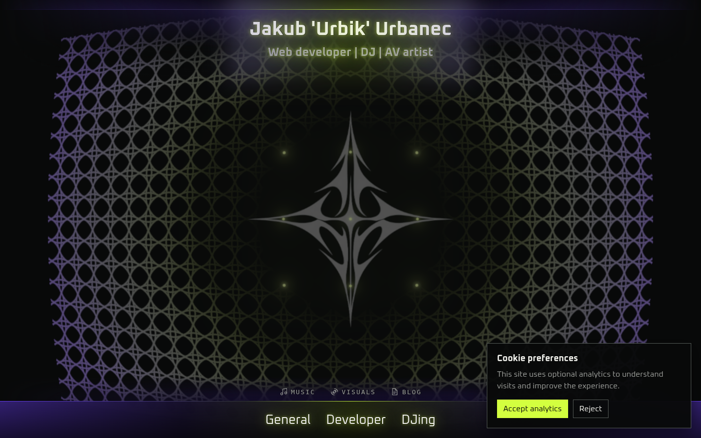
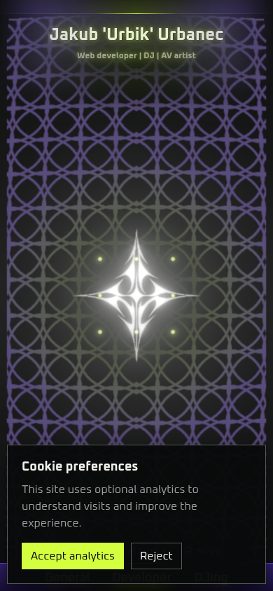

# UI Design System & Master Generation Blueprint: www-urbik-eu

> **Jakub 'Urbik' Urbanec · Web Developer · DJ · AV artist** (https://www.urbik.eu/) — Senior web developer and DJ with alias Urbik created this personal portfolio



---

## 1. Executive Visual Persona & Design Archetype

- **Brand Essence & Persona**: **Jakub 'Urbik' Urbanec · Web Developer · DJ · AV artist** (`https://www.urbik.eu/`). Senior web developer and DJ with alias Urbik created this personal portfolio
- **Visual Archetype**: **Dark-Substrate WebGL / Canvas Interactive Experience (`#080909` / `#131515`)**.
- **Anti-AI-Slop Differentiators**:
  - **Source-Grounded Chromatic Polarity**: Anchors the viewport in `#080909` (`var(--ds-color-bg)` in `:root`) paired with `#f1f1ec` primary typography and `#131515` accents.
  - **Extracted Typographic Hierarchy**: Pairs `Oxanium` for display copy (`Jakub 'Urbik' Urbanec`) with `clamp(32px` and not declared in static CSS (uses primary stack / `ui-monospace`).
  - **Calibrated Spatial Grid & Motion**: Combines `920px` container bounds (`gap: var(--ds-space-6)`, padding `20px`) with `cubic-bezier(0.4,-0.3,0.7,0.1)` easing and Three.js / WebGL Canvas Pipeline.

---

## 2. Spatial Architecture & Modular Grid Mathematics



### Viewport Allocation & Container Geometry
- **Captured Viewport Dimensions**: Desktop `1440×2400px` (`assets/desktop.png`, capped at 2400px multi-section capture), Mobile `390×2400px` (`assets/mobile.png`, capped at 2400px multi-section capture).
- **Master Container Bounds**: `920px` extracted from `www-urbik-eu` stylesheet.
- **Canvas Lateral Padding & Spacing**: `20px` lateral canvas padding with `var(--ds-space-6)` grid gap.
- **Border Radius Scale**: `var(--ds-layout-radius-full)`, `1px`, `var(--ds-layout-radius-none)`, `50%`.

### Responsive Breakpoint Architecture
- **Desktop Layout**: Multi-column CSS Grid / Flexbox layout at `1440px` (`max-width: 920px`, `gap: var(--ds-space-6)`).
- **Mobile Layout**: Single-column vertical stack at `390px` viewport width with `20px` horizontal padding.
- **Extracted CSS Media Queries**: `@media screen and (max-width: 920px)`, `@media (prefers-reduced-motion: reduce)`, `@media screen and (max-width: 1200px)`, `@media screen and (max-width: 800px)`.

---

## 3. Color System, Materiality & Atmospheric Lighting

### Semantic Palette & Source Grounding
| Semantic Role | Ground-Truth Value | Extracted CSS Source / Selector |
|---|---|---|
| **Primary Canvas Substrate** | `#080909` | `var(--ds-color-bg)` in `:root` |
| **Primary Typography Ink** | `#101212` | `var(--ds-color-bg-soft)` in `:root` |
| **Elevated Surface / Card Substrate** | `#0b0d0d` | `var(--ds-color-bg-deep)` in `:root` |
| **Interactive Accent / Highlight** | `#131515` | `var(--ds-color-card)` in `:root` |
| **Secondary / Muted Copy** | `#181b1b` | `var(--ds-color-card-hover)` in `:root` |
| **Structural Hairline Border** | `#f1f1ec` | `var(--ds-color-text)` in `:root` |
| **Variable Token (`--ds-color-text-soft`)** | `#9d9f9b` | `var(--ds-color-text-soft)` in `:root` |
| **Variable Token (`--ds-color-text-faint`)** | `#676b68` | `var(--ds-color-text-faint)` in `:root` |
| **Variable Token (`--ds-color-line`)** | `#303432` | `var(--ds-color-line)` in `:root` |

### Sanitized Root CSS Variables (`ui-ux.md` Ground Truth)
| Variable Name | Extracted Value | Semantic Role |
|---|---|---|
| `--reveal-hold` | `calc(100svh / 3)` | Dimension / Scale Token |
| `--reveal-peek-max` | `50svh` | Dimension / Scale Token |
| `--reveal-gap` | `var(--ds-space-6)` | Layout / Spatial Grid Token |
| `--menu-row-height` | `76px` | Layout / Spatial Grid Token |
| `--menu-height` | `var(--menu-row-height)` | Layout / Spatial Grid Token |
| `--ds-color-bg` | `#080909` | Canvas / Surface Token |
| `--ds-color-bg-rgb` | `8 9 9` | Canvas / Surface Token |
| `--ds-color-bg-soft` | `#101212` | Canvas / Surface Token |
| `--ds-color-bg-deep` | `#0b0d0d` | Canvas / Surface Token |
| `--ds-color-card` | `#131515` | Brand / Palette Token |
| `--ds-color-card-hover` | `#181b1b` | Brand / Palette Token |
| `--ds-color-text` | `#f1f1ec` | Typography Ink Token |
| `--ds-color-text-rgb` | `241 241 236` | Typography Ink Token |
| `--ds-color-text-soft` | `#9d9f9b` | Typography Ink Token |
| `--ds-color-text-faint` | `#676b68` | Typography Ink Token |
| `--ds-color-line` | `#303432` | Brand / Palette Token |

---

## 4. Typographic Scale & Editorial Hierarchy

### Font Family Stacks
- **Display Typography**: `Oxanium`.
- **Primary Body Stack**: `clamp(32px`.
- **Technical / Metadata Stack**: not declared in static CSS (uses primary stack / `ui-monospace`).

### Typographic Scale & Rules (Extracted from Stylesheet & Variables)
- **Hero Display (`H1`)**: CSS variables `--ds-text-4xl: 19px`, `--ds-text-5xl: 24px`, `--ds-text-display: clamp(32px, 8vw, 72px)`.
- **Section Heading (`H2`)**: CSS variables `--ds-text-2xl: 16px`, `--ds-text-3xl: 18px`, `--ds-text-h2: clamp(26px, 4vw, 48px)`; rule `h2` (`font-size: 18px`).
- **Body Copy**: CSS variables `--ds-text-base: 13px`, `--ds-leading-body: 1.6`; rule `p` (`line-height: 1.5`).
- **Metadata & Navigation Labels**: CSS variables `--ds-font-mono: ui-monospace, SFMono-Regular, Menlo, monospace`, `--ds-text-xs: 10px`, `--ds-text-sm: 11px`; rule `small` (`font-size: 0.55rem`).

---

## 5. Choreographed Motion & Interaction Physics

### Primary Easing Curves
- **Extracted Timing Functions**: `cubic-bezier(0.4,-0.3,0.7,0.1)`, `cubic-bezier(0.34,1.56,0.64,1)`.

### Per-Element Transition & Choreography Rules
- **Selector `#eraser-overlay`**: `transition: opacity 2.5s ease-in-out` extracted from `www-urbik-eu` stylesheet.
- **Selector `.header`**: `transition: all 1s ease` extracted from `www-urbik-eu` stylesheet.
- **Selector `.header__close`**: `transition: transform 0.18s cubic-bezier(0.4,-0.3,0.7,0.1), opacity 0.1...` extracted from `www-urbik-eu` stylesheet.
- **Extracted Easing Curve (`cubic-bezier(0.4,-0.3,0.7,0.1)`)**: Governs interactive state transitions across `<header.header>` and `<article.content__child>`.
- **Runtime Interaction Engine**: Integrates Three.js / WebGL Canvas Pipeline with `prefers-reduced-motion: reduce` fallback guards.

---

## 6. Component Wireframe & Structural DOM Map

### Visual Layout Schematic (Grounded in `dom.html` — `1440px` Desktop & `390px` Mobile Reflow)
```
┌────────────────────────────────────────────────────────────────────────┐
│ DESKTOP VIEWPORT (1440px) — Jakub 'Urbik' Urbanec · Web Developer · DJ │
│ ====================================================================== │
│ [ <header.header>          | General · Developer · DJing            ]  │
│ ---------------------------------------------------------------------- │
│ | HERO STAGE: <section.content__content>                           |   │
│ | H1: Jakub 'Urbik' Urbanec                                        |   │
│ | Substrate: #080909    | Ink: #f1f1ec    | Accent: #131515        |   │
│ ---------------------------------------------------------------------- │
│ | SHOWCASE GRID (<article.content__child>  ) max-w: 920px          |   │
│ | +------------------------------+  +------------------------------+ | │
│ | | Web developer · DJ · AV arti |  | Developer, DJ and explorer o | | │
│ | +------------------------------+  +------------------------------+ | │
│ ---------------------------------------------------------------------- │
│ | MOBILE VIEWPORT REFLOW (390px) — Single-Column Stack (gap: var(--) | │
│ | [<header.header>] -> [<section.content__] -> [<article.content__] |  │
│ ---------------------------------------------------------------------- │
│ [ FOOTER (<footer.header--intro>) | https://www.urbik.eu/              │
└────────────────────────────────────────────────────────────────────────┘
```

### Granular DOM Region Breakdown
1. **Brand Header & Navigation Bar (<header.header> — `www-urbik-eu`)**:
   - Landmark `<header class="header header--intro">` hosting `Jakub 'Urbik' Urbanec · Web Develope` navigation (`General · Developer · DJing`), DOM attributes (`data-engine="three.js r186"`, `data-util="music"`, `data-util="visuals"`, `data-util="blog"`), and stylesheet rule `eraser-app { top: 25px; }`.
2. **Hero Stage & Focal Lead (<section.content__content> — `Jakub 'Urbik' Urbanec`)**:
   - Landmark `<section class="content__content">` presenting display lead `Jakub 'Urbik' Urbanec` and copy excerpt *"Hello, I’m Jakub Urbanec — a Prague-based web developer and DJ pe"* over `#080909` canvas and `#f1f1ec` ink.
3. **Primary Showcase & Content Grid (<article.content__child> — `Web developer · DJ · AV artist`)**:
   - Landmark `<article class="content__child content__child--basic">` rendering section `Web developer · DJ · AV artist` with copy *"I have spent more than a decade working with the web, primarily o"*, asset references (`apple-touch-icon.png`, `favicon-96x96.png`, `favicon.ico`, `oxanium.woff2`), and grid rule `eraser-app canvas { display: block; }`.
4. **Interactive Detail & Feature Matrix (<section.ds-article__section> — `Developer, DJ and explorer of digi`)**:
   - Landmark `<section class="ds-article__section">` framing `Developer, DJ and explorer of digital things` and `Three important parts of my life` (*"Outside software development, music is a major part of my life. I"*) with `#0b0d0d` surface cards, `#131515` accents, and `video-bg .video { position: fixed; top: 0; left: 0; width: 100%; height: 100%; object-fit:... }`.
5. **Colophon & Global Directory Footer (<footer.header--intro> — `https://www.urbik.eu/`)**:
   - Landmark `<footer class="header--intro">` anchoring `Jakub 'Urbik' Urbanec · Web Deve` footer links (`General · Developer · DJing`), copy *"Urbik / Dark Atmo Breaks"*, and `#f1f1ec` structural dividers.

---

## 7. Master Zero-Shot AI Generation Prompt

```markdown
# Master Zero-Shot Frontend Generation Prompt: www-urbik-eu (Jakub 'Urbik' Urbanec · Web Developer · DJ · AV artist)

You are a principal frontend architect and design systems engineer. Build a complete, production-ready web application replicating the exact design system, DOM landmarks, typographic hierarchy, color tokens, and motion physics of `www-urbik-eu` (**Jakub 'Urbik' Urbanec · Web Developer · DJ · AV artist** — `https://www.urbik.eu/`).

### 1. Visual Archetype & Anti-AI-Slop Mandates
- **Archetype**: Dark-Substrate WebGL / Canvas Interactive Experience (`#080909` / `#131515`).
- **Identity & Domain Context**: Senior web developer and DJ with alias Urbik created this personal portfolio
- **Primary Substrate**: `#080909` (`var(--ds-color-bg)` in `:root`), **Primary Ink**: `#f1f1ec`, **Accent / Highlight**: `#131515`.
- **Site-Specific Differentiators**:
  - **Source-Grounded Chromatic Polarity**: Anchors the viewport in `#080909` (`var(--ds-color-bg)` in `:root`) paired with `#f1f1ec` primary typography and `#131515` accents.
  - **Extracted Typographic Hierarchy**: Pairs `Oxanium` for display copy (`Jakub 'Urbik' Urbanec`) with `clamp(32px` and not declared in static CSS (uses primary stack / `ui-monospace`).
  - **Calibrated Spatial Grid & Motion**: Combines `920px` container bounds (`gap: var(--ds-space-6)`, padding `20px`) with `cubic-bezier(0.4,-0.3,0.7,0.1)` easing and Three.js / WebGL Canvas Pipeline.

### 2. Ground-Truth CSS Variables (`:root` Token Contract)
Declare and consume these exact custom properties extracted from `www-urbik-eu` in your global stylesheet:

:root {
  /* Jakub 'Urbik' Urbanec · Web Developer · DJ · AV artist (www-urbik-eu) — Ground-Truth Extracted CSS Variables */
  --reveal-hold: calc(100svh / 3); /* Dimension / Scale Token (www-urbik-eu) */
  --reveal-peek-max: 50svh; /* Dimension / Scale Token (www-urbik-eu) */
  --reveal-gap: var(--ds-space-6); /* Layout / Spatial Grid Token (www-urbik-eu) */
  --menu-row-height: 76px; /* Layout / Spatial Grid Token (www-urbik-eu) */
  --menu-height: var(--menu-row-height); /* Layout / Spatial Grid Token (www-urbik-eu) */
  --ds-color-bg: #080909; /* Canvas / Surface Token (www-urbik-eu) */
  --ds-color-bg-rgb: 8 9 9; /* Canvas / Surface Token (www-urbik-eu) */
  --ds-color-bg-soft: #101212; /* Canvas / Surface Token (www-urbik-eu) */
  --ds-color-bg-deep: #0b0d0d; /* Canvas / Surface Token (www-urbik-eu) */
  --ds-color-card: #131515; /* Brand / Palette Token (www-urbik-eu) */
  --ds-color-card-hover: #181b1b; /* Brand / Palette Token (www-urbik-eu) */
  --ds-color-text: #f1f1ec; /* Typography Ink Token (www-urbik-eu) */
  --ds-color-text-rgb: 241 241 236; /* Typography Ink Token (www-urbik-eu) */
  --ds-color-text-soft: #9d9f9b; /* Typography Ink Token (www-urbik-eu) */
  --ds-color-text-faint: #676b68; /* Typography Ink Token (www-urbik-eu) */
  --ds-color-line: #303432; /* Brand / Palette Token (www-urbik-eu) */
}

### 3. Semantic Color & Materiality Contract
Map every surface, ink, and border strictly to these source-grounded tokens:
- **Primary Canvas Substrate**: `#080909` — grounded in `var(--ds-color-bg)` in `:root`
- **Primary Typography Ink**: `#101212` — grounded in `var(--ds-color-bg-soft)` in `:root`
- **Elevated Surface / Card Substrate**: `#0b0d0d` — grounded in `var(--ds-color-bg-deep)` in `:root`
- **Interactive Accent / Highlight**: `#131515` — grounded in `var(--ds-color-card)` in `:root`
- **Secondary / Muted Copy**: `#181b1b` — grounded in `var(--ds-color-card-hover)` in `:root`
- **Structural Hairline Border**: `#f1f1ec` — grounded in `var(--ds-color-text)` in `:root`
- **Variable Token (`--ds-color-text-soft`)**: `#9d9f9b` — grounded in `var(--ds-color-text-soft)` in `:root`
- **Variable Token (`--ds-color-text-faint`)**: `#676b68` — grounded in `var(--ds-color-text-faint)` in `:root`
- **Variable Token (`--ds-color-line`)**: `#303432` — grounded in `var(--ds-color-line)` in `:root`

### 4. Spatial Grid, Container Bounds & Responsive Breakpoints
- **Desktop Viewport Reference**: `1440×2400px` (capped at 2400px multi-section capture, `1440px` standard desktop width).
- **Mobile Viewport Reference**: `390×2400px` (capped at 2400px multi-section capture, `390px` standard mobile width).
- **Container Max-Width**: `920px` extracted from `www-urbik-eu` stylesheet
- **Padding & Gutters**: `20px` lateral canvas padding with `var(--ds-space-6)` grid gap
- **Desktop Grid**: Multi-column CSS Grid / Flexbox layout at `1440px` (`max-width: 920px`, `gap: var(--ds-space-6)`)
- **Mobile Adaptation**: Single-column vertical stack at `390px` viewport width with `20px` horizontal padding
- **Media Queries**: `@media screen and (max-width: 920px)`, `@media (prefers-reduced-motion: reduce)`, `@media screen and (max-width: 1200px)`, `@media screen and (max-width: 800px)`
- **Corner Radii**: `var(--ds-layout-radius-full)`, `1px`, `var(--ds-layout-radius-none)`, `50%`

### 5. Typography & Editorial Scale Contract
- **Display Font Stack**: `Oxanium`
- **Body Font Stack**: `clamp(32px`
- **Monospace / Technical Font Stack**: not declared in static CSS (uses primary stack / `ui-monospace`)
- **H1 Display Rule**: CSS variables `--ds-text-4xl: 19px`, `--ds-text-5xl: 24px`, `--ds-text-display: clamp(32px, 8vw, 72px)`
- **H2 Section Rule**: CSS variables `--ds-text-2xl: 16px`, `--ds-text-3xl: 18px`, `--ds-text-h2: clamp(26px, 4vw, 48px)`; rule `h2` (`font-size: 18px`)
- **Body Copy Rule**: CSS variables `--ds-text-base: 13px`, `--ds-leading-body: 1.6`; rule `p` (`line-height: 1.5`)
- **Metadata & Index Rule**: CSS variables `--ds-font-mono: ui-monospace, SFMono-Regular, Menlo, monospace`, `--ds-text-xs: 10px`, `--ds-text-sm: 11px`; rule `small` (`font-size: 0.55rem`)

### 6. Component Hierarchy, Verbatim Copy & Real DOM Landmarks
Scaffold `www-urbik-eu` (`Jakub 'Urbik' Urbanec · Web Developer · DJ · AV artist`) with these exact structural regions, extracted copy, and CSS rules from `dom.html`:
1. **Brand Header & Navigation Bar (<header.header> — `www-urbik-eu`)**:
   - DOM & Selectors: Landmark `<header class="header header--intro">` hosting `Jakub 'Urbik' Urbanec · Web Develope` navigation (`General · Developer · DJing`), DOM attributes (`data-engine="three.js r186"`, `data-util="music"`, `data-util="visuals"`, `data-util="blog"`), and stylesheet rule `eraser-app { top: 25px; }`.
   - Responsive Contract: Header `Brand Header & Navigation Bar (<header.header> — `www-urbik-eu`)` (`www-urbik-eu`) adapts across `@media screen and (max-width: 920px)`, `@media (prefers-reduced-motion: reduce)`, `@media screen and (max-width: 1200px)`, `@media screen and (max-width: 800px)` with `cubic-bezier(0.4,-0.3,0.7,0.1)`, `cubic-bezier(0.34,1.56,0.64,1)` transitions and links `General · Developer · DJing`.
2. **Hero Stage & Focal Lead (<section.content__content> — `Jakub 'Urbik' Urbanec`)**:
   - DOM & Selectors: Landmark `<section class="content__content">` presenting display lead `Jakub 'Urbik' Urbanec` and copy excerpt *"Hello, I’m Jakub Urbanec — a Prague-based web developer and DJ pe"* over `#080909` canvas and `#f1f1ec` ink.
   - Responsive Contract: Hero stage (`1440×2400px` desktop / `390×2400px` mobile) sets `#080909` background with `#f1f1ec` headline `Jakub 'Urbik' Urbanec`.
3. **Primary Showcase & Content Grid (<article.content__child> — `Web developer · DJ · AV artist`)**:
   - DOM & Selectors: Landmark `<article class="content__child content__child--basic">` rendering section `Web developer · DJ · AV artist` with copy *"I have spent more than a decade working with the web, primarily o"*, asset references (`apple-touch-icon.png`, `favicon-96x96.png`, `favicon.ico`, `oxanium.woff2`), and grid rule `eraser-app canvas { display: block; }`.
   - Responsive Contract: Showcase grid `Primary Showcase & Content Grid (<article.content__child> — `Web developer · DJ · AV artist`)` applies Multi-column CSS Grid / Flexbox layout at `1440px` (`max-width: 920px`, `gap: var(--ds-space-6)`) on desktop and Single-column vertical stack at `390px` viewport width with `20px` horizontal padding on mobile.
4. **Interactive Detail & Feature Matrix (<section.ds-article__section> — `Developer, DJ and explorer of digi`)**:
   - DOM & Selectors: Landmark `<section class="ds-article__section">` framing `Developer, DJ and explorer of digital things` and `Three important parts of my life` (*"Outside software development, music is a major part of my life. I"*) with `#0b0d0d` surface cards, `#131515` accents, and `video-bg .video { position: fixed; top: 0; left: 0; width: 100%; height: 100%; object-fit:... }`.
   - Responsive Contract: Detail module `Interactive Detail & Feature Matrix (<section.ds-article__section> — `Developer, DJ and explorer of digi`)` uses `var(--ds-layout-radius-full)`, `1px`, `var(--ds-layout-radius-none)`, `50%` radii, `#131515` highlights, and assets (apple-touch-icon.png, favicon-96x96.png, favicon.ico).
5. **Colophon & Global Directory Footer (<footer.header--intro> — `https://www.urbik.eu/`)**:
   - DOM & Selectors: Landmark `<footer class="header--intro">` anchoring `Jakub 'Urbik' Urbanec · Web Deve` footer links (`General · Developer · DJing`), copy *"Urbik / Dark Atmo Breaks"*, and `#f1f1ec` structural dividers.
   - Responsive Contract: Footer `Colophon & Global Directory Footer (<footer.header--intro> — `https://www.urbik.eu/`)` aligns to `920px` extracted from `www-urbik-eu` stylesheet with `20px` lateral canvas padding with `var(--ds-space-6)` grid gap and attributes (data-engine="three.js r186", data-util="music", data-util="visuals").

#### Verbatim DOM Copy Excerpts (`dom.html`)
- Copy Excerpt 1: *"Hello, I’m Jakub Urbanec — a Prague-based web developer and DJ performing under th..."*
- Copy Excerpt 2: *"I have spent more than a decade working with the web, primarily on front-end appli..."*
- Copy Excerpt 3: *"Outside software development, music is a major part of my life. I have been collec..."*
- Copy Excerpt 4: *"Urbik / Dark Atmo Breaks"*

### 7. Motion, Extracted Stylesheet Rules & Interaction Choreography
- **Primary Easing Functions**: `cubic-bezier(0.4,-0.3,0.7,0.1)`, `cubic-bezier(0.34,1.56,0.64,1)`
- **Extracted Stylesheet Rules (`www-urbik-eu`)**:
- `eraser-app { top: 25px; }`
- `eraser-app canvas { display: block; }`
- `video-bg .video { position: fixed; top: 0; left: 0; width: 100%; height: 100%; object-fit:... }`
- `.header::after { mask-image: linear-gradient( 90deg, transparent 0%, black 35%, black 65%... }`
- `.header__close { transition: none; }`
- **Per-Selector Transition Rules**:
- **Selector `#eraser-overlay`**: `transition: opacity 2.5s ease-in-out` extracted from `www-urbik-eu` stylesheet.
- **Selector `.header`**: `transition: all 1s ease` extracted from `www-urbik-eu` stylesheet.
- **Selector `.header__close`**: `transition: transform 0.18s cubic-bezier(0.4,-0.3,0.7,0.1), opacity 0.1...` extracted from `www-urbik-eu` stylesheet.
- **Extracted Easing Curve (`cubic-bezier(0.4,-0.3,0.7,0.1)`)**: Governs interactive state transitions across `<header.header>` and `<article.content__child>`.
- **Runtime Interaction Engine**: Integrates Three.js / WebGL Canvas Pipeline with `prefers-reduced-motion: reduce` fallback guards.

### 8. Technical Deliverables
- Implement in Next.js (App Router) with TypeScript and Tailwind CSS consuming the `:root` custom properties defined above for `www-urbik-eu`.
- Reproduce both the `1440px` desktop architecture and `390px` mobile breakpoint transitions, preserving semantic HTML5 landmarks (`<header>`, `<nav>`, `<main>`, `<section>`, `<footer>`) and `prefers-reduced-motion` accessibility guards.
```
