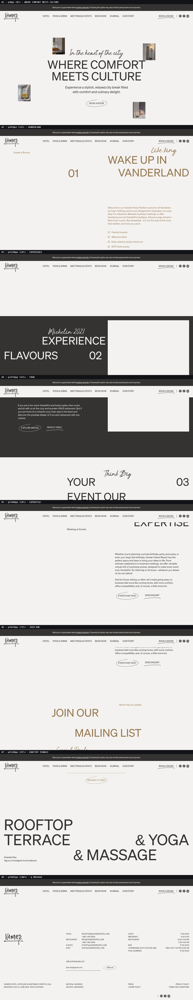
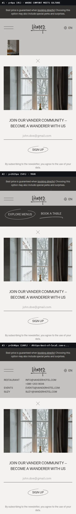

# UI Design System & Master Generation Blueprint: www-vanderhotel-com

> **Hotel & Restaurant Ljubljana · Vander Urbani Resort** (https://www.vanderhotel.com) — This Design Hotel offers 20 beautiful rooms. For the foodies we have our HAUS & À la carte restaurant or for a glass of champagne we sugg...





---

## 1. Executive Visual Persona & Design Archetype

- **Brand Essence & Persona**: **Hotel & Restaurant Ljubljana · Vander Urbani Resort** (`https://www.vanderhotel.com`). This Design Hotel offers 20 beautiful rooms. For the foodies we have our HAUS & À la carte restaurant or for a glass of champagne we sugg...
- **Capture Provenance**: Live browser capture (`tier1_fast`, HTTP `200`, captured `2026-11-24`).
- **Visual Archetype**: **Light-Substrate Editorial & Modular Grid System (`#f4f2f1` canvas, `#353230` ink, `#0082f3` accent)**.
- **Anti-AI-Slop Differentiators**:
  - **Live-Computed Chromatic Polarity**: Anchors the viewport in `#f4f2f1` (live computed `body` `background-color` (`computed_styles.json`)) paired with `#353230` primary typography and `#0082f3` accents.
  - **Grounded Typographic Hierarchy**: Uses `Sohne Buch` across display (`WHERE COMFORT MEETS CULTURE`) and body copy.
  - **Calibrated Spatial Grid & Motion**: Combines `1260px` container bounds (`gap: 24px`, padding `1.25rem`) with `cubic-bezier(0.25,0.1,0.25,1)` easing and GSAP Timeline & ScrollTrigger, Three.js / WebGL Canvas Pipeline.

---

## 2. Spatial Architecture & Modular Grid Mathematics

### Viewport Allocation & Container Geometry
- **Captured Journey Filmstrips**: Desktop `1280×6624px` (`assets/desktop-journey.webp`, `8` keyframes up to `y=5895px` / doc `6795px`), Mobile `390×2616px` (`assets/mobile-journey.webp`, `3` keyframes).
- **Master Container Bounds**: `1260px` (non-`@media` desktop container stylesheet rule).
- **Canvas Lateral Padding & Spacing**: `1.25rem` lateral canvas padding with `24px` grid gap.
- **Border Radius Scale**: `3px`, `100%`, `50%`, `.25rem`.

### Responsive Breakpoint Architecture
- **Desktop Layout**: Multi-column CSS Grid / Flexbox layout at `1440px` (`max-width: 1260px`, `gap: 24px`).
- **Mobile Layout**: Single-column vertical stack at `390px` viewport width with `1.25rem` horizontal padding.
- **Extracted CSS Media Queries**: `@media screen and (max-width:991px)`, `@media screen and (max-width:767px)`, `@media screen and (max-width:479px)`, `@media (min-width:768px)`.

---

## 3. Color System, Materiality & Atmospheric Lighting

### Semantic Palette & Source Grounding
| Semantic Role | Ground-Truth Value | Extracted Live / CSS Source |
|---|---|---|
| **Primary Canvas Substrate** | `#f4f2f1` | live computed `body` `background-color` (`computed_styles.json`) |
| **Primary Typography Ink** | `#353230` | live computed `h1` `color` (`computed_styles.json`) |
| **Elevated Surface / Card Substrate** | `#ffffff` | `.image-overlay { background-color: white }` (`#ffffff`) |
| **Interactive Accent / Highlight** | `#0082f3` | `.w-dropdown-link.w--current { color: #0082f3 }` |
| **Secondary / Muted Copy** | `#999999` | `.w-select::placeholder { color: #999999 }` |
| **Structural Hairline Border** | `#ffffff` | `.form_input.is-white { border-bottom-color: #ffffff }` |
| **Variable Token (`--main-light-color`)** | `#f3f5fb` | `var(--main-light-color)` in `:root` |

### Sanitized Root CSS Variables (`ui-ux.md` Ground Truth)
| Variable Name | Extracted Value | Semantic Role |
|---|---|---|
| `--main-light-color` | `#F3F5FB` | Canvas / Surface Token |
| `--main-dark-color` | `#353230` | Canvas / Surface Token |
| `--main-active-color` | `#353230` | Brand / Palette Token |
| `--color-scheme-1--background-primary` | `var(--_primitives---colors--white)` | Canvas / Surface Token |
| `--_typography---font-styles--body` | `"Sohne Buch",Arial,sans-serif` | Typography / Scale Token |
| `--color-scheme-1--text-primary` | `var(--_primitives---colors--dark)` | Typography Ink Token |
| `--_typography---font-styles--heading` | `"Sohne Buch",Arial,sans-serif` | Typography Ink Token |
| `--_primitives---colors--neutral-darkest` | `black` | Canvas / Surface Token |
| `--_primitives---colors--white` | `#f4f2f1` | Canvas / Surface Token |
| `--color-scheme-1--text-secondary` | `var(--_primitives---colors--brown)` | Typography Ink Token |
| `--color-scheme-1--background-secondary` | `var(--_primitives---colors--dark)` | Canvas / Surface Token |
| `--color-scheme-1--text-white` | `var(--_primitives---colors--white)` | Canvas / Surface Token |
| `--color-scheme-1--background-brown` | `var(--_primitives---colors--brown)` | Canvas / Surface Token |
| `--_ui-styles---stroke--border-width` | `1px` | Layout / Spatial Grid Token |
| `--color-scheme-1--border` | `var(--_primitives---colors--brown)` | Brand / Palette Token |
| `--_ui-styles---radius--medium` | `0px` | Elevation / Border Token |

---

## 4. Typographic Scale & Editorial Hierarchy

### Font Family Stacks
- **Display Typography**: `Sohne Buch`.
- **Primary Body Stack**: `Sohne Buch`.
- **Technical / Metadata Stack**: not declared in live computed styles (uses primary stack / `ui-monospace`).

### Typographic Scale & Rules (Live Computed & Stylesheet Grounded)
- **Hero Display (`H1`)**: live computed `h1` (`font-size: 112px`, `line-height: 134.4px`, `font-weight: 400`).
- **Section Heading (`H2`)**: live computed `h2` (`font-size: 112px`, `line-height: 112px`, `font-weight: 400`); rule `h2` (`font-size: 2.5rem`).
- **Body Copy**: live computed `body` (`font-size: 16px`, `line-height: 24px`, `font-weight: 400`); CSS variables `--_typography---font-styles--body: "Sohne Buch",Arial,sans-serif`.
- **Metadata & Navigation Labels**: live computed `nav/a` (`font-size: 16px`, `line-height: 24px`, `font-weight: 400`); CSS variables `--_ui-styles---radius--small: 0px`.

---

## 5. Choreographed Motion & Interaction Physics

### Primary Easing Curves
- **Extracted Timing Functions**: `cubic-bezier(0.25,0.1,0.25,1)`.

### Per-Element Transition & Choreography Rules
- **Selector `.button`**: `transition: transform .3s` extracted from `www-vanderhotel-com` stylesheet.
- **Selector `.secondary-button`**: `transition: transform .3s` extracted from `www-vanderhotel-com` stylesheet.
- **Selector `.button-brown`**: `transition: transform .3s` extracted from `www-vanderhotel-com` stylesheet.
- **Standard CSS Easing (`cubic-bezier(0.25,0.1,0.25,1)`)**: Default timing curve (no custom `cubic-bezier()` declared in captured CSS).
- **Runtime Interaction Engine**: Integrates GSAP Timeline & ScrollTrigger, Three.js / WebGL Canvas Pipeline, Swiper Touch Carousel Engine with `prefers-reduced-motion: reduce` fallback guards.
### Measured Runtime Scroll & Interaction Telemetry (`behavioral_journey_v2`)
- **Scroll Driver Mode**: `native` (max document height `6795px`, deepest scrollY reached `5895px` across `8` desktop keyframes).
- **Detected Scroll / Motion Libraries**: `GSAP/ScrollTrigger`.
- **Hover Physics (`primary_cta` · `BOOK A ROOM`)**: `transform`: `none` -> `matrix(0.9, 0, 0, 0.9,...` (`transition-duration: 0.3s`, `timing: ease`).
- **Route Transition Architecture**: First internal navigation (`/journal`) measured as `MPA` in `2043ms`.

---

## 6. Component Wireframe & Structural DOM Map

### Visual Layout Schematic — Desktop (`1440px`, Grounded in `dom.html` & Landmark Bounding Boxes)
```
┌────────────────────────────────────────────────────────────────────────┐
│ DESKTOP VIEWPORT (1440px) — Hotel & Restaurant Ljubljana · Vander Urba │
│ ====================================================================== │
│ [ <header.navbar> (1440x135px)        | Hotel · Food & Drink · meeti ] │
│ ---------------------------------------------------------------------- │
│ | HERO STAGE: <section.section-hero> (w=1440px)                      | │
│ | H1: WHERE COMFORT MEETS CULTURE                                    | │
│ | Substrate: #f4f2f1 | Ink: #353230 | Accent: #0082f3                | │
│ ---------------------------------------------------------------------- │
│ | SHOWCASE GRID (<section.section-wake-up>) max-w: 1260px            | │
│ | +------------------------------+  +------------------------------+ | │
│ | | where comfort meets culture  |  | mailing list                 | | │
│ | +------------------------------+  +------------------------------+ | │
│ ---------------------------------------------------------------------- │
│ | DETAIL MODULE (<section.section-experienc) — rooftop terrace       | │
│ ---------------------------------------------------------------------- │
│ [ FOOTER (<footer.footer>     ) | https://www.vanderhotel.com          │
└────────────────────────────────────────────────────────────────────────┘
```

### Visual Layout Schematic — Mobile Reflow (`390px`)
```
┌────────────────────────────────────────────────────────────────────────┐
│ MOBILE VIEWPORT REFLOW (390px) — Single-Column Stack (gap: 24px)       │
│ ====================================================================== │
│ [ HEADER BAR (<header.navbar>         ) | Compact Menu (390px)         │
│ ---------------------------------------------------------------------- │
│ | HERO STAGE (<section.section-hero>) — 390px Vertical Lead          | │
│ | H1: WHERE COMFORT MEETS CULTURE                                    | │
│ ---------------------------------------------------------------------- │
│ | SHOWCASE STACK (<section.section-wake-) — 1-Col Stack              | │
│ | [ Item 1: where comfort meets culture                            ] | │
│ | [ Item 2: mailing list                                           ] | │
│ ---------------------------------------------------------------------- │
│ | DETAIL STACK (<section.section-experie) — 1-Col (rooftop terrace)  | │
│ ---------------------------------------------------------------------- │
│ [ FOOTER (<footer.footer>     ) | Stacked 390px Colophon               │
└────────────────────────────────────────────────────────────────────────┘
```

### Granular DOM Region Breakdown
1. **Brand Header & Navigation Bar (<header.navbar> — `www-vanderhotel-com`)**:
   - Landmark `<header class="navbar">` (`1440x135px`) hosting `Hotel & Restaurant Ljubljana · Vande` navigation (`Hotel · Food & Drink · meetings & Events · book now · journal`), DOM attributes (`data-wf-domain="www.vanderhotel.com"`, `data-wf-page="67f3b8c25d374ee9920d88c8"`, `data-wf-site="67f3b8c25d374ee9920d885b"`, `data-w-id="792db6bb-fe71-b745-03..."`), and stylesheet rule `img { max-width:100%;display:inline-block }`.
2. **Hero Stage & Focal Lead (<section.section-hero> — `WHERE COMFORT MEETS CULTURE`)**:
   - Landmark `<section class="section-hero">` presenting display lead `WHERE COMFORT MEETS CULTURE` and copy excerpt *"Experience a stylish, relaxed city break filled with comfort and "* over `#f4f2f1` canvas and `#353230` ink.
3. **Primary Showcase & Content Grid (<section.section-wake-up> — `where comfort meets culture`)**:
   - Landmark `<section class="section-wake-up">` rendering section `where comfort meets culture` with copy *"Welcome to our Vander Hotel. Perfect rooms for all Vanderers by h"*, asset references (`cdn.prod.website-files.com`, `vander-hotel.webflow.shared.087c8...`, `vander-hotel.webflow.67f3b8c25d37...`, `1910953583635711`), and grid rule `label { margin-bottom:.25rem;font-weight:500 }`.
4. **Interactive Detail & Feature Matrix (<section.section-experience> — `mailing list`)**:
   - Landmark `<section class="section-experience">` framing `mailing list` and `rooftop terrace` (*"Early check-in & late check-out"*) with `#ffffff` surface cards, `#0082f3` accents, and `figure { margin-top:3rem;margin-bottom:3rem }`.
5. **Colophon & Global Directory Footer (<footer.footer> — `https://www.vanderhotel.com`)**:
   - Landmark `<footer class="footer">` anchoring `Hotel & Restaurant Ljubljana · V` footer links (`Hotel · Food & Drink · meetings & Events · book now · journal`), copy *"If you are in for some VanderFul and funky tastes, then come"*, and `#ffffff` structural dividers.
### Full Vertical Scroll Sequence (Desktop `1440×900` Keyframes)
- **Step 01** (`y=0px`, `0%`): Active landmark `WHERE COMFORT MEETS CULTURE` · sticky/fixed elements: `2`
- **Step 02** (`y=850px`, `14%`): Active landmark `VANDERLAND` · sticky/fixed elements: `2`
- **Step 03** (`y=1700px`, `29%`): Active landmark `EXPERIENCE` · sticky/fixed elements: `2`
- **Step 04** (`y=2550px`, `43%`): Active landmark `YOUR` · sticky/fixed elements: `2`
- **Step 05** (`y=3400px`, `58%`): Active landmark `EXPERTISE` · sticky/fixed elements: `2`
- **Step 06** (`y=4250px`, `72%`): Active landmark `JOIN OUR` · sticky/fixed elements: `2`
- **Step 07** (`y=5100px`, `87%`): Active landmark `ROOFTOP TERRACE` · sticky/fixed elements: `2`
- **Step 08** (`y=5895px`, `100%`): Active landmark `& MASSAGE` · sticky/fixed elements: `2`

### Multi-Page Internal Route Map
- **Listing Route (`/journal`)**: `https://www.vanderhotel.com/journal` — H1: `WHAT’S UP IN VANDER`, scrollHeight `3444px`, transition `MPA` (`2043ms`)
- **Other Route (`/hotel`)**: `https://www.vanderhotel.com/hotel` — H1: `CHIC VANDER ROOMS AND ROMANTIC RIVERSIDE ROOMS`, scrollHeight `9577px`, transition `direct` (`1487ms`)
- **Other Route (`/food-drink`)**: `https://www.vanderhotel.com/food-drink` — H1: `Food & Drinks in Ljubljana · Vander Urbani Resort`, scrollHeight `9489px`, transition `direct` (`1634ms`)

---

## 7. Master Zero-Shot AI Generation Prompt

```markdown
# Master Zero-Shot Frontend Generation Prompt: www-vanderhotel-com (Hotel & Restaurant Ljubljana · Vander Urbani Resort)

You are a principal frontend architect and design systems engineer. Build a complete, production-ready web application replicating the exact design system, DOM landmarks, typographic hierarchy, color tokens, and motion physics of `www-vanderhotel-com` (**Hotel & Restaurant Ljubljana · Vander Urbani Resort** — `https://www.vanderhotel.com`).

### 1. Visual Archetype & Anti-AI-Slop Mandates
- **Archetype**: Light-Substrate Editorial & Modular Grid System (`#f4f2f1` canvas, `#353230` ink, `#0082f3` accent).
- **Identity & Domain Context**: This Design Hotel offers 20 beautiful rooms. For the foodies we have our HAUS & À la carte restaurant or for a glass of champagne we sugg...
- **Primary Substrate**: `#f4f2f1` (live computed `body` `background-color` (`computed_styles.json`)), **Primary Ink**: `#353230`, **Accent / Highlight**: `#0082f3`.
- **Site-Specific Differentiators**:
  - **Live-Computed Chromatic Polarity**: Anchors the viewport in `#f4f2f1` (live computed `body` `background-color` (`computed_styles.json`)) paired with `#353230` primary typography and `#0082f3` accents.
  - **Grounded Typographic Hierarchy**: Uses `Sohne Buch` across display (`WHERE COMFORT MEETS CULTURE`) and body copy.
  - **Calibrated Spatial Grid & Motion**: Combines `1260px` container bounds (`gap: 24px`, padding `1.25rem`) with `cubic-bezier(0.25,0.1,0.25,1)` easing and GSAP Timeline & ScrollTrigger, Three.js / WebGL Canvas Pipeline.

### 2. Ground-Truth CSS Variables (`:root` Token Contract)
Declare and consume these exact custom properties extracted from `www-vanderhotel-com` in your global stylesheet:

:root {
  /* Hotel & Restaurant Ljubljana · Vander Urbani Resort (www-vanderhotel-com) — Live-Grounded CSS Variables */
  --main-light-color: #F3F5FB; /* Canvas / Surface Token (www-vanderhotel-com) */
  --main-dark-color: #353230; /* Canvas / Surface Token (www-vanderhotel-com) */
  --main-active-color: #353230; /* Brand / Palette Token (www-vanderhotel-com) */
  --color-scheme-1--background-primary: var(--_primitives---colors--white); /* Canvas / Surface Token (www-vanderhotel-com) */
  --_typography---font-styles--body: "Sohne Buch",Arial,sans-serif; /* Typography / Scale Token (www-vanderhotel-com) */
  --color-scheme-1--text-primary: var(--_primitives---colors--dark); /* Typography Ink Token (www-vanderhotel-com) */
  --_typography---font-styles--heading: "Sohne Buch",Arial,sans-serif; /* Typography Ink Token (www-vanderhotel-com) */
  --_primitives---colors--neutral-darkest: black; /* Canvas / Surface Token (www-vanderhotel-com) */
  --_primitives---colors--white: #f4f2f1; /* Canvas / Surface Token (www-vanderhotel-com) */
  --color-scheme-1--text-secondary: var(--_primitives---colors--brown); /* Typography Ink Token (www-vanderhotel-com) */
  --color-scheme-1--background-secondary: var(--_primitives---colors--dark); /* Canvas / Surface Token (www-vanderhotel-com) */
  --color-scheme-1--text-white: var(--_primitives---colors--white); /* Canvas / Surface Token (www-vanderhotel-com) */
  --color-scheme-1--background-brown: var(--_primitives---colors--brown); /* Canvas / Surface Token (www-vanderhotel-com) */
  --_ui-styles---stroke--border-width: 1px; /* Layout / Spatial Grid Token (www-vanderhotel-com) */
  --color-scheme-1--border: var(--_primitives---colors--brown); /* Brand / Palette Token (www-vanderhotel-com) */
  --_ui-styles---radius--medium: 0px; /* Elevation / Border Token (www-vanderhotel-com) */
}

### 3. Semantic Color & Materiality Contract
Map every surface, ink, and border strictly to these source-grounded tokens:
- **Primary Canvas Substrate**: `#f4f2f1` — grounded in live computed `body` `background-color` (`computed_styles.json`)
- **Primary Typography Ink**: `#353230` — grounded in live computed `h1` `color` (`computed_styles.json`)
- **Elevated Surface / Card Substrate**: `#ffffff` — grounded in `.image-overlay { background-color: white }` (`#ffffff`)
- **Interactive Accent / Highlight**: `#0082f3` — grounded in `.w-dropdown-link.w--current { color: #0082f3 }`
- **Secondary / Muted Copy**: `#999999` — grounded in `.w-select::placeholder { color: #999999 }`
- **Structural Hairline Border**: `#ffffff` — grounded in `.form_input.is-white { border-bottom-color: #ffffff }`
- **Variable Token (`--main-light-color`)**: `#f3f5fb` — grounded in `var(--main-light-color)` in `:root`

### 4. Spatial Grid, Container Bounds & Responsive Breakpoints
- **Desktop Viewport Reference**: `1280×6624px` (multi-frame vertical journey filmstrip (6624px), `1440px` standard desktop width).
- **Mobile Viewport Reference**: `390×2616px` (multi-frame vertical journey filmstrip (2616px), `390px` standard mobile width).
- **Container Max-Width**: `1260px` (non-`@media` desktop container stylesheet rule)
- **Padding & Gutters**: `1.25rem` lateral canvas padding with `24px` grid gap
- **Desktop Grid**: Multi-column CSS Grid / Flexbox layout at `1440px` (`max-width: 1260px`, `gap: 24px`)
- **Mobile Adaptation**: Single-column vertical stack at `390px` viewport width with `1.25rem` horizontal padding
- **Media Queries**: `@media screen and (max-width:991px)`, `@media screen and (max-width:767px)`, `@media screen and (max-width:479px)`, `@media (min-width:768px)`
- **Corner Radii**: `3px`, `100%`, `50%`, `.25rem`

### 5. Typography & Editorial Scale Contract
- **Display Font Stack**: `Sohne Buch`
- **Body Font Stack**: `Sohne Buch`
- **Monospace / Technical Font Stack**: not declared in live computed styles (uses primary stack / `ui-monospace`)
- **H1 Display Rule**: live computed `h1` (`font-size: 112px`, `line-height: 134.4px`, `font-weight: 400`)
- **H2 Section Rule**: live computed `h2` (`font-size: 112px`, `line-height: 112px`, `font-weight: 400`); rule `h2` (`font-size: 2.5rem`)
- **Body Copy Rule**: live computed `body` (`font-size: 16px`, `line-height: 24px`, `font-weight: 400`); CSS variables `--_typography---font-styles--body: "Sohne Buch",Arial,sans-serif`
- **Metadata & Index Rule**: live computed `nav/a` (`font-size: 16px`, `line-height: 24px`, `font-weight: 400`); CSS variables `--_ui-styles---radius--small: 0px`

### 6. Component Hierarchy, Verbatim Copy & Real DOM Landmarks
Scaffold `www-vanderhotel-com` (`Hotel & Restaurant Ljubljana · Vander Urbani Resort`) with these exact structural regions, extracted copy, and CSS rules from `dom.html`:
1. **Brand Header & Navigation Bar (<header.navbar> — `www-vanderhotel-com`)**:
   - DOM & Selectors: Landmark `<header class="navbar">` (`1440x135px`) hosting `Hotel & Restaurant Ljubljana · Vande` navigation (`Hotel · Food & Drink · meetings & Events · book now · journal`), DOM attributes (`data-wf-domain="www.vanderhotel.com"`, `data-wf-page="67f3b8c25d374ee9920d88c8"`, `data-wf-site="67f3b8c25d374ee9920d885b"`, `data-w-id="792db6bb-fe71-b745-03..."`), and stylesheet rule `img { max-width:100%;display:inline-block }`.
   - Responsive Contract: Header `Brand Header & Navigation Bar (<header.navbar> — `www-vanderhotel-com`)` (`www-vanderhotel-com`) adapts across `@media screen and (max-width:991px)`, `@media screen and (max-width:767px)`, `@media screen and (max-width:479px)`, `@media (min-width:768px)` with `cubic-bezier(0.25,0.1,0.25,1)` transitions and links `Hotel · Food & Drink · meetings & Events · book now · journal`.
2. **Hero Stage & Focal Lead (<section.section-hero> — `WHERE COMFORT MEETS CULTURE`)**:
   - DOM & Selectors: Landmark `<section class="section-hero">` presenting display lead `WHERE COMFORT MEETS CULTURE` and copy excerpt *"Experience a stylish, relaxed city break filled with comfort and "* over `#f4f2f1` canvas and `#353230` ink.
   - Responsive Contract: Hero stage (`1280×6624px` desktop / `390×2616px` mobile) sets `#f4f2f1` background with `#353230` headline `WHERE COMFORT MEETS CULTURE`.
3. **Primary Showcase & Content Grid (<section.section-wake-up> — `where comfort meets culture`)**:
   - DOM & Selectors: Landmark `<section class="section-wake-up">` rendering section `where comfort meets culture` with copy *"Welcome to our Vander Hotel. Perfect rooms for all Vanderers by h"*, asset references (`cdn.prod.website-files.com`, `vander-hotel.webflow.shared.087c8...`, `vander-hotel.webflow.67f3b8c25d37...`, `1910953583635711`), and grid rule `label { margin-bottom:.25rem;font-weight:500 }`.
   - Responsive Contract: Showcase grid `Primary Showcase & Content Grid (<section.section-wake-up> — `where comfort meets culture`)` applies Multi-column CSS Grid / Flexbox layout at `1440px` (`max-width: 1260px`, `gap: 24px`) on desktop and Single-column vertical stack at `390px` viewport width with `1.25rem` horizontal padding on mobile.
4. **Interactive Detail & Feature Matrix (<section.section-experience> — `mailing list`)**:
   - DOM & Selectors: Landmark `<section class="section-experience">` framing `mailing list` and `rooftop terrace` (*"Early check-in & late check-out"*) with `#ffffff` surface cards, `#0082f3` accents, and `figure { margin-top:3rem;margin-bottom:3rem }`.
   - Responsive Contract: Detail module `Interactive Detail & Feature Matrix (<section.section-experience> — `mailing list`)` uses `3px`, `100%`, `50%`, `.25rem` radii, `#0082f3` highlights, and assets (cdn.prod.website-files.com, vander-hotel.webflow.shared.087c8..., vander-hotel.webflow.67f3b8c25d37...).
5. **Colophon & Global Directory Footer (<footer.footer> — `https://www.vanderhotel.com`)**:
   - DOM & Selectors: Landmark `<footer class="footer">` anchoring `Hotel & Restaurant Ljubljana · V` footer links (`Hotel · Food & Drink · meetings & Events · book now · journal`), copy *"If you are in for some VanderFul and funky tastes, then come"*, and `#ffffff` structural dividers.
   - Responsive Contract: Footer `Colophon & Global Directory Footer (<footer.footer> — `https://www.vanderhotel.com`)` aligns to `1260px` (non-`@media` desktop container stylesheet rule) with `1.25rem` lateral canvas padding with `24px` grid gap and attributes (data-wf-domain="www.vanderhotel.com", data-wf-page="67f3b8c25d374ee9920d88c8", data-wf-site="67f3b8c25d374ee9920d885b").

#### Verbatim DOM Copy Excerpts (`dom.html`)
- Copy Excerpt 1: *"Experience a stylish, relaxed city break filled with comfort and culinary delight."*
- Copy Excerpt 2: *"Welcome to our Vander Hotel. Perfect rooms for all Vanderers by heart. Softness al..."*
- Copy Excerpt 3: *"Early check-in & late check-out"*
- Copy Excerpt 4: *"If you are in for some VanderFul and funky tastes, then come and sit with us at th..."*

### 7. Motion, Extracted Stylesheet Rules & Interaction Choreography
- **Primary Easing Functions**: `cubic-bezier(0.25,0.1,0.25,1)`
- **Extracted Stylesheet Rules (`www-vanderhotel-com`)**:
- `img { max-width:100%;display:inline-block }`
- `label { margin-bottom:.25rem;font-weight:500 }`
- `figure { margin-top:3rem;margin-bottom:3rem }`
- `figcaption { text-align:center;margin-top:.25rem }`
- `.w-layout-vflex { flex-direction:column;align-items:flex-start;display:flex }`
- **Per-Selector Transition Rules**:
- **Selector `.button`**: `transition: transform .3s` extracted from `www-vanderhotel-com` stylesheet.
- **Selector `.secondary-button`**: `transition: transform .3s` extracted from `www-vanderhotel-com` stylesheet.
- **Selector `.button-brown`**: `transition: transform .3s` extracted from `www-vanderhotel-com` stylesheet.
- **Standard CSS Easing (`cubic-bezier(0.25,0.1,0.25,1)`)**: Default timing curve (no custom `cubic-bezier()` declared in captured CSS).
- **Runtime Interaction Engine**: Integrates GSAP Timeline & ScrollTrigger, Three.js / WebGL Canvas Pipeline, Swiper Touch Carousel Engine with `prefers-reduced-motion: reduce` fallback guards.
### 7b. Full-Page Scroll Choreography, Interactive States & Multi-Page Routes
- **Scroll Mechanics**: Implement `native` vertical progression up to `6795px` across 8 distinct viewport chapters using GSAP/ScrollTrigger.
- **Vertical Chapter Sequence**: WHERE COMFORT MEETS CULTURE (0%) -> VANDERLAND (14%) -> EXPERIENCE (29%) -> YOUR (43%) -> EXPERTISE (58%) -> JOIN OUR (72%) -> ROOFTOP TERRACE (87%) -> & MASSAGE (100%).
- **Hover Micro-Interaction (`primary_cta`)**: Animate `transform` with `0.3s ease`.
- **Multi-Page Routes**: Scaffold internal routes `/journal` (listing, MPA), `/hotel` (other, direct), `/food-drink` (other, direct) sharing the global header/footer shell and design tokens.

### 8. Technical Deliverables
- Implement in Next.js (App Router) with TypeScript and Tailwind CSS consuming the `:root` custom properties defined above for `www-vanderhotel-com`.
- Reproduce both the `1440px` desktop architecture and `390px` mobile breakpoint transitions, preserving semantic HTML5 landmarks (`<header>`, `<nav>`, `<main>`, `<section>`, `<footer>`) and `prefers-reduced-motion` accessibility guards.
```
---

## 8. Full-Page Scroll Journey, Interactive States & Subpage Inventory

### Desktop Scroll Keyframes (`1440×900` WebP)
| Step | Scroll Y | Progress | Active Landmark / Section | Sticky/Fixed | Visual Asset |
| :---: | :---: | :---: | :--- | :---: | :--- |
| `#01` | `0px` | `0%` | WHERE COMFORT MEETS CULTURE | `2` | [desktop-step-01.webp](assets/desktop-step-01.webp) |
| `#02` | `850px` | `14%` | VANDERLAND | `2` | [desktop-step-02.webp](assets/desktop-step-02.webp) |
| `#03` | `1700px` | `29%` | EXPERIENCE | `2` | [desktop-step-03.webp](assets/desktop-step-03.webp) |
| `#04` | `2550px` | `43%` | YOUR | `2` | [desktop-step-04.webp](assets/desktop-step-04.webp) |
| `#05` | `3400px` | `58%` | EXPERTISE | `2` | [desktop-step-05.webp](assets/desktop-step-05.webp) |
| `#06` | `4250px` | `72%` | JOIN OUR | `2` | [desktop-step-06.webp](assets/desktop-step-06.webp) |
| `#07` | `5100px` | `87%` | ROOFTOP TERRACE | `2` | [desktop-step-07.webp](assets/desktop-step-07.webp) |
| `#08` | `5895px` | `100%` | & MASSAGE | `2` | [desktop-step-08.webp](assets/desktop-step-08.webp) |

### Mobile Condensed Keyframes (`390×844` WebP)
| Step | Scroll Y | Progress | Active Landmark | Visual Asset |
| :---: | :---: | :---: | :--- | :--- |
| `#01` | `0px` | `0%` | WHERE COMFORT MEETS CULTURE | [mobile-step-01.webp](assets/mobile-step-01.webp) |
| `#02` | `2823px` | `50%` | YOUR | [mobile-step-02.webp](assets/mobile-step-02.webp) |
| `#03` | `5646px` | `100%` | #https-best-of-local.com-voting-voting-tr... | [mobile-step-03.webp](assets/mobile-step-03.webp) |

### Internal Subpage Filmstrips (`1080px` Wide WebP)
| # | Template | Route URL | H1 / Title | Scroll Height | Transition | Filmstrip Asset |
| :-: | :---: | :--- | :--- | :---: | :---: | :--- |
| `1` | `listing` | `https://www.vanderhotel.com/journal` | WHAT’S UP IN VANDER | `3444px` | `MPA` (`2043ms`) | [subpage-01-journal.webp](assets/subpage-01-journal.webp) |
| `2` | `other` | `https://www.vanderhotel.com/hotel` | CHIC VANDER ROOMS AND ROMANTIC RIVERS... | `9577px` | `direct` (`1487ms`) | [subpage-02-hotel.webp](assets/subpage-02-hotel.webp) |
| `3` | `other` | `https://www.vanderhotel.com/food-drink` | Food & Drinks in Ljubljana · Vander U... | `9489px` | `direct` (`1634ms`) | [subpage-03-food-drink.webp](assets/subpage-03-food-drink.webp) |

