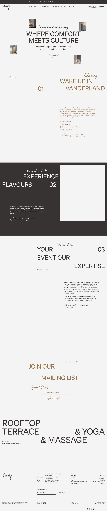
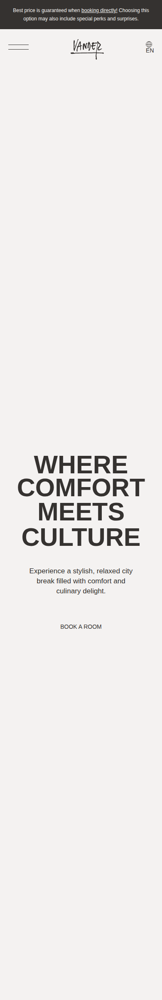

# UI Design System & Master Generation Blueprint: www-vanderhotel-com

> **Hotel & Restaurant Ljubljana · Vander Urbani Resort** (https://www.vanderhotel.com) — This Design Hotel offers 20 beautiful rooms. For the foodies we have our HAUS & À la carte restaurant or for a glass of champagne we sugg...



---

## 1. Executive Visual Persona & Design Archetype

- **Brand Essence & Persona**: **Hotel & Restaurant Ljubljana · Vander Urbani Resort** (`https://www.vanderhotel.com`). This Design Hotel offers 20 beautiful rooms. For the foodies we have our HAUS & À la carte restaurant or for a glass of champagne we sugg...
- **Visual Archetype**: **Light-Substrate Editorial & Modular Grid System (`#f4f2f1` canvas, `#353230` ink, `#F3F5FB` accent)**.
- **Anti-AI-Slop Differentiators**:
  - **Source-Grounded Chromatic Polarity**: Anchors the viewport in `#f4f2f1` (`var(--_primitives---colors--white)` in `:root`) paired with `#353230` primary typography and `#F3F5FB` accents.
  - **Extracted Typographic Hierarchy**: Pairs `Sohne Buch` for display copy (`where comfort meets culture`) with `Arial` and not declared in static CSS (uses primary stack / `ui-monospace`).
  - **Calibrated Spatial Grid & Motion**: Combines `25rem` container bounds (`gap: 1.5rem`, padding `1.25rem`) with `cubic-bezier(0.25,0.1,0.25,1)` easing and GSAP Timeline & ScrollTrigger, Three.js / WebGL Canvas Pipeline.

---

## 2. Spatial Architecture & Modular Grid Mathematics



### Viewport Allocation & Container Geometry
- **Captured Viewport Dimensions**: Desktop `1440×6795px` (`assets/desktop.png`, full-page scroll capture), Mobile `390×2400px` (`assets/mobile.png`, capped at 2400px multi-section capture).
- **Master Container Bounds**: `25rem` extracted from `www-vanderhotel-com` stylesheet.
- **Canvas Lateral Padding & Spacing**: `1.25rem` lateral canvas padding with `1.5rem` grid gap.
- **Border Radius Scale**: `50%`, `3px`, `100%`, `24px`.

### Responsive Breakpoint Architecture
- **Desktop Layout**: Multi-column CSS Grid / Flexbox layout at `1440px` (`max-width: 25rem`, `gap: 1.5rem`).
- **Mobile Layout**: Single-column vertical stack at `390px` viewport width with `1.25rem` horizontal padding.
- **Extracted CSS Media Queries**: `@media screen and (-ms-high-contrast:none)`, `@media screen and (max-width:991px)`, `@media screen and (max-width:767px)`, `@media screen and (max-width:479px)`.

---

## 3. Color System, Materiality & Atmospheric Lighting

### Semantic Palette & Source Grounding
| Semantic Role | Ground-Truth Value | Extracted CSS Source / Selector |
|---|---|---|
| **Primary Canvas Substrate** | `#f4f2f1` | `var(--_primitives---colors--white)` in `:root` |
| **Primary Typography Ink** | `#353230` | `var(--_primitives---colors--dark)` in `:root` |
| **Elevated Surface / Card Substrate** | `#967850` | `var(--_primitives---colors--brown)` in `:root` |
| **Interactive Accent / Highlight** | `#F3F5FB` | `var(--main-light-color)` in `:root` |
| **Secondary / Muted Copy** | `#ccc` | `.datepicker-dropdown { border: #ccc }` |
| **Structural Hairline Border** | `#39f` | `.datepicker-top-right { color: #39f }` |

### Sanitized Root CSS Variables (`ui-ux.md` Ground Truth)
| Variable Name | Extracted Value | Semantic Role |
|---|---|---|
| `--color-scheme-1--background-primary` | `var(--_primitives---colors--white)` | Canvas / Surface Token |
| `--_typography---font-styles--body` | `"Sohne Buch",Arial,sans-serif` | Typography / Scale Token |
| `--color-scheme-1--text-primary` | `var(--_primitives---colors--dark)` | Typography Ink Token |
| `--_typography---font-styles--heading` | `"Sohne Buch",Arial,sans-serif` | Typography Ink Token |
| `--_primitives---colors--neutral-darkest` | `black` | Canvas / Surface Token |
| `--_primitives---colors--white` | `#f4f2f1` | Canvas / Surface Token |
| `--color-scheme-1--text-secondary` | `var(--_primitives---colors--brown)` | Typography Ink Token |
| `--color-scheme-1--background-secondary` | `var(--_primitives---colors--dark)` | Canvas / Surface Token |
| `--color-scheme-1--text-white` | `var(--_primitives---colors--white)` | Canvas / Surface Token |
| `--color-scheme-1--background-brown` | `var(--_primitives---colors--brown)` | Canvas / Surface Token |
| `--_ui-styles---stroke--border-width` | `1px` | Layout / Spatial Grid Token |
| `--color-scheme-1--border` | `var(--_primitives---colors--brown)` | Brand / Palette Token |
| `--_ui-styles---radius--medium` | `0px` | Elevation / Border Token |
| `--color-scheme-1--foreground` | `var(--_primitives---colors--white)` | Typography Ink Token |
| `--_ui-styles---radius--small` | `0px` | Elevation / Border Token |
| `--_ui-styles---radius--large` | `0px` | Elevation / Border Token |

---

## 4. Typographic Scale & Editorial Hierarchy

### Font Family Stacks
- **Display Typography**: `Sohne Buch`.
- **Primary Body Stack**: `Arial`.
- **Technical / Metadata Stack**: not declared in static CSS (uses primary stack / `ui-monospace`).

### Typographic Scale & Rules (Extracted from Stylesheet & Variables)
- **Hero Display (`H1`)**: not explicitly declared on tag in static CSS (stylesheet font-size ladder: `12px`, `18px`, `1rem`, `7rem`, `5rem`).
- **Section Heading (`H2`)**: rule `h2` (`font-size: 2.5rem`).
- **Body Copy**: CSS variables `--_typography---font-styles--body: "Sohne Buch",Arial,sans-serif`.
- **Metadata & Navigation Labels**: CSS variables `--_ui-styles---radius--small: 0px`.

---

## 5. Choreographed Motion & Interaction Physics

### Primary Easing Curves
- **Extracted Timing Functions**: `cubic-bezier(0.25,0.1,0.25,1)`.

### Per-Element Transition & Choreography Rules
- **Selector `.splide__pagination__page`**: `transition: transform .2s linear` extracted from `www-vanderhotel-com` stylesheet.
- **Selector `.button`**: `transition: transform .3s` extracted from `www-vanderhotel-com` stylesheet.
- **Selector `.secondary-button`**: `transition: transform .3s` extracted from `www-vanderhotel-com` stylesheet.
- **Standard CSS Easing (`cubic-bezier(0.25,0.1,0.25,1)`)**: Default timing curve (no custom `cubic-bezier()` declared in static CSS).
- **Runtime Interaction Engine**: Integrates GSAP Timeline & ScrollTrigger, Three.js / WebGL Canvas Pipeline, Swiper Touch Carousel Engine with `prefers-reduced-motion: reduce` fallback guards.

---

## 6. Component Wireframe & Structural DOM Map

### Visual Layout Schematic (Grounded in `dom.html` — `1440px` Desktop & `390px` Mobile Reflow)
```
┌────────────────────────────────────────────────────────────────────────┐
│ DESKTOP VIEWPORT (1440px) — Hotel & Restaurant Ljubljana · Vander Urba │
│ ====================================================================== │
│ [ <header.navbar>          | Hotel · Food & Drink · meetings & Even ]  │
│ ---------------------------------------------------------------------- │
│ | HERO STAGE: <section.section-2>                                  |   │
│ | H1: where comfort meets culture                                  |   │
│ | Substrate: #f4f2f1    | Ink: #353230    | Accent: #F3F5FB        |   │
│ ---------------------------------------------------------------------- │
│ | SHOWCASE GRID (<section.section-hero>    ) max-w: 25rem          |   │
│ | +------------------------------+  +------------------------------+ | │
│ | | wake up in                   |  | vanderland                   | | │
│ | +------------------------------+  +------------------------------+ | │
│ ---------------------------------------------------------------------- │
│ | MOBILE VIEWPORT REFLOW (390px) — Single-Column Stack (gap: 1.5rem) | │
│ | [<header.navbar>] -> [<section.section-2] -> [<section.section-h] |  │
│ ---------------------------------------------------------------------- │
│ [ FOOTER (<footer.footer>       ) | https://www.vanderhotel.com        │
└────────────────────────────────────────────────────────────────────────┘
```

### Granular DOM Region Breakdown
1. **Brand Header & Navigation Bar (<header.navbar> — `www-vanderhotel-com`)**:
   - Landmark `<header class="navbar">` hosting `Hotel & Restaurant Ljubljana · Vande` navigation (`Hotel · Food & Drink · meetings & Events · book now · journal`), DOM attributes (`data-wf-domain="www.vanderhotel.com"`, `data-wf-page="67f3b8c25d374ee9920d88c8"`, `data-wf-site="67f3b8c25d374ee9920d885b"`, `data-w-id="792db6bb-fe71-b745-03..."`), and stylesheet rule `.datepicker-container::after { border: 5px solid transparent; content: " "; display: block; height: 0;... }`.
2. **Hero Stage & Focal Lead (<section.section-2> — `where comfort meets culture`)**:
   - Landmark `<section class="section-2">` presenting display lead `where comfort meets culture` and copy excerpt *"Best price is guaranteed when booking directly! Choosing this opt"* over `#f4f2f1` canvas and `#353230` ink.
3. **Primary Showcase & Content Grid (<section.section-hero> — `wake up in`)**:
   - Landmark `<section class="section-hero">` rendering section `wake up in` with copy *"Our team is ready to help you plan your perfect stay. Feel free t"*, asset references (`cdn.prod.website-files.com`, `vander-hotel.webflow.shared.087c8...`, `vander-hotel.webflow.67f3b8c25d37...`, `1910953583635711`), and grid rule `.datepicker-inline { position: static; }`.
4. **Interactive Detail & Feature Matrix (<section.section-wake-up> — `vanderland`)**:
   - Landmark `<section class="section-wake-up">` framing `vanderland` and `experience` (*"Book online instead"*) with `#967850` surface cards, `#F3F5FB` accents, and `.datepicker-top-right { border-top-color: 39f; }`.
5. **Colophon & Global Directory Footer (<footer.footer> — `https://www.vanderhotel.com`)**:
   - Landmark `<footer class="footer">` anchoring `Hotel & Restaurant Ljubljana · V` footer links (`Hotel · Food & Drink · meetings & Events · book now · journal`), copy *"Experience a stylish, relaxed city break filled with comfort"*, and `#39f` structural dividers.

---

## 7. Master Zero-Shot AI Generation Prompt

```markdown
# Master Zero-Shot Frontend Generation Prompt: www-vanderhotel-com (Hotel & Restaurant Ljubljana · Vander Urbani Resort)

You are a principal frontend architect and design systems engineer. Build a complete, production-ready web application replicating the exact design system, DOM landmarks, typographic hierarchy, color tokens, and motion physics of `www-vanderhotel-com` (**Hotel & Restaurant Ljubljana · Vander Urbani Resort** — `https://www.vanderhotel.com`).

### 1. Visual Archetype & Anti-AI-Slop Mandates
- **Archetype**: Light-Substrate Editorial & Modular Grid System (`#f4f2f1` canvas, `#353230` ink, `#F3F5FB` accent).
- **Identity & Domain Context**: This Design Hotel offers 20 beautiful rooms. For the foodies we have our HAUS & À la carte restaurant or for a glass of champagne we sugg...
- **Primary Substrate**: `#f4f2f1` (`var(--_primitives---colors--white)` in `:root`), **Primary Ink**: `#353230`, **Accent / Highlight**: `#F3F5FB`.
- **Site-Specific Differentiators**:
  - **Source-Grounded Chromatic Polarity**: Anchors the viewport in `#f4f2f1` (`var(--_primitives---colors--white)` in `:root`) paired with `#353230` primary typography and `#F3F5FB` accents.
  - **Extracted Typographic Hierarchy**: Pairs `Sohne Buch` for display copy (`where comfort meets culture`) with `Arial` and not declared in static CSS (uses primary stack / `ui-monospace`).
  - **Calibrated Spatial Grid & Motion**: Combines `25rem` container bounds (`gap: 1.5rem`, padding `1.25rem`) with `cubic-bezier(0.25,0.1,0.25,1)` easing and GSAP Timeline & ScrollTrigger, Three.js / WebGL Canvas Pipeline.

### 2. Ground-Truth CSS Variables (`:root` Token Contract)
Declare and consume these exact custom properties extracted from `www-vanderhotel-com` in your global stylesheet:

:root {
  /* Hotel & Restaurant Ljubljana · Vander Urbani Resort (www-vanderhotel-com) — Ground-Truth Extracted CSS Variables */
  --color-scheme-1--background-primary: var(--_primitives---colors--white); /* Canvas / Surface Token (www-vanderhotel-com) */
  --_typography---font-styles--body: "Sohne Buch",Arial,sans-serif; /* Typography / Scale Token (www-vanderhotel-com) */
  --color-scheme-1--text-primary: var(--_primitives---colors--dark); /* Typography Ink Token (www-vanderhotel-com) */
  --_typography---font-styles--heading: "Sohne Buch",Arial,sans-serif; /* Typography Ink Token (www-vanderhotel-com) */
  --_primitives---colors--neutral-darkest: black; /* Canvas / Surface Token (www-vanderhotel-com) */
  --_primitives---colors--white: #f4f2f1; /* Canvas / Surface Token (www-vanderhotel-com) */
  --color-scheme-1--text-secondary: var(--_primitives---colors--brown); /* Typography Ink Token (www-vanderhotel-com) */
  --color-scheme-1--background-secondary: var(--_primitives---colors--dark); /* Canvas / Surface Token (www-vanderhotel-com) */
  --color-scheme-1--text-white: var(--_primitives---colors--white); /* Canvas / Surface Token (www-vanderhotel-com) */
  --color-scheme-1--background-brown: var(--_primitives---colors--brown); /* Canvas / Surface Token (www-vanderhotel-com) */
  --_ui-styles---stroke--border-width: 1px; /* Layout / Spatial Grid Token (www-vanderhotel-com) */
  --color-scheme-1--border: var(--_primitives---colors--brown); /* Brand / Palette Token (www-vanderhotel-com) */
  --_ui-styles---radius--medium: 0px; /* Elevation / Border Token (www-vanderhotel-com) */
  --color-scheme-1--foreground: var(--_primitives---colors--white); /* Typography Ink Token (www-vanderhotel-com) */
  --_ui-styles---radius--small: 0px; /* Elevation / Border Token (www-vanderhotel-com) */
  --_ui-styles---radius--large: 0px; /* Elevation / Border Token (www-vanderhotel-com) */
}

### 3. Semantic Color & Materiality Contract
Map every surface, ink, and border strictly to these source-grounded tokens:
- **Primary Canvas Substrate**: `#f4f2f1` — grounded in `var(--_primitives---colors--white)` in `:root`
- **Primary Typography Ink**: `#353230` — grounded in `var(--_primitives---colors--dark)` in `:root`
- **Elevated Surface / Card Substrate**: `#967850` — grounded in `var(--_primitives---colors--brown)` in `:root`
- **Interactive Accent / Highlight**: `#F3F5FB` — grounded in `var(--main-light-color)` in `:root`
- **Secondary / Muted Copy**: `#ccc` — grounded in `.datepicker-dropdown { border: #ccc }`
- **Structural Hairline Border**: `#39f` — grounded in `.datepicker-top-right { color: #39f }`

### 4. Spatial Grid, Container Bounds & Responsive Breakpoints
- **Desktop Viewport Reference**: `1440×6795px` (full-page scroll capture, `1440px` standard desktop width).
- **Mobile Viewport Reference**: `390×2400px` (capped at 2400px multi-section capture, `390px` standard mobile width).
- **Container Max-Width**: `25rem` extracted from `www-vanderhotel-com` stylesheet
- **Padding & Gutters**: `1.25rem` lateral canvas padding with `1.5rem` grid gap
- **Desktop Grid**: Multi-column CSS Grid / Flexbox layout at `1440px` (`max-width: 25rem`, `gap: 1.5rem`)
- **Mobile Adaptation**: Single-column vertical stack at `390px` viewport width with `1.25rem` horizontal padding
- **Media Queries**: `@media screen and (-ms-high-contrast:none)`, `@media screen and (max-width:991px)`, `@media screen and (max-width:767px)`, `@media screen and (max-width:479px)`
- **Corner Radii**: `50%`, `3px`, `100%`, `24px`

### 5. Typography & Editorial Scale Contract
- **Display Font Stack**: `Sohne Buch`
- **Body Font Stack**: `Arial`
- **Monospace / Technical Font Stack**: not declared in static CSS (uses primary stack / `ui-monospace`)
- **H1 Display Rule**: not explicitly declared on tag in static CSS (stylesheet font-size ladder: `12px`, `18px`, `1rem`, `7rem`, `5rem`)
- **H2 Section Rule**: rule `h2` (`font-size: 2.5rem`)
- **Body Copy Rule**: CSS variables `--_typography---font-styles--body: "Sohne Buch",Arial,sans-serif`
- **Metadata & Index Rule**: CSS variables `--_ui-styles---radius--small: 0px`

### 6. Component Hierarchy, Verbatim Copy & Real DOM Landmarks
Scaffold `www-vanderhotel-com` (`Hotel & Restaurant Ljubljana · Vander Urbani Resort`) with these exact structural regions, extracted copy, and CSS rules from `dom.html`:
1. **Brand Header & Navigation Bar (<header.navbar> — `www-vanderhotel-com`)**:
   - DOM & Selectors: Landmark `<header class="navbar">` hosting `Hotel & Restaurant Ljubljana · Vande` navigation (`Hotel · Food & Drink · meetings & Events · book now · journal`), DOM attributes (`data-wf-domain="www.vanderhotel.com"`, `data-wf-page="67f3b8c25d374ee9920d88c8"`, `data-wf-site="67f3b8c25d374ee9920d885b"`, `data-w-id="792db6bb-fe71-b745-03..."`), and stylesheet rule `.datepicker-container::after { border: 5px solid transparent; content: " "; display: block; height: 0;... }`.
   - Responsive Contract: Header `Brand Header & Navigation Bar (<header.navbar> — `www-vanderhotel-com`)` (`www-vanderhotel-com`) adapts across `@media screen and (-ms-high-contrast:none)`, `@media screen and (max-width:991px)`, `@media screen and (max-width:767px)`, `@media screen and (max-width:479px)` with `cubic-bezier(0.25,0.1,0.25,1)` transitions and links `Hotel · Food & Drink · meetings & Events · book now · journal`.
2. **Hero Stage & Focal Lead (<section.section-2> — `where comfort meets culture`)**:
   - DOM & Selectors: Landmark `<section class="section-2">` presenting display lead `where comfort meets culture` and copy excerpt *"Best price is guaranteed when booking directly! Choosing this opt"* over `#f4f2f1` canvas and `#353230` ink.
   - Responsive Contract: Hero stage (`1440×6795px` desktop / `390×2400px` mobile) sets `#f4f2f1` background with `#353230` headline `where comfort meets culture`.
3. **Primary Showcase & Content Grid (<section.section-hero> — `wake up in`)**:
   - DOM & Selectors: Landmark `<section class="section-hero">` rendering section `wake up in` with copy *"Our team is ready to help you plan your perfect stay. Feel free t"*, asset references (`cdn.prod.website-files.com`, `vander-hotel.webflow.shared.087c8...`, `vander-hotel.webflow.67f3b8c25d37...`, `1910953583635711`), and grid rule `.datepicker-inline { position: static; }`.
   - Responsive Contract: Showcase grid `Primary Showcase & Content Grid (<section.section-hero> — `wake up in`)` applies Multi-column CSS Grid / Flexbox layout at `1440px` (`max-width: 25rem`, `gap: 1.5rem`) on desktop and Single-column vertical stack at `390px` viewport width with `1.25rem` horizontal padding on mobile.
4. **Interactive Detail & Feature Matrix (<section.section-wake-up> — `vanderland`)**:
   - DOM & Selectors: Landmark `<section class="section-wake-up">` framing `vanderland` and `experience` (*"Book online instead"*) with `#967850` surface cards, `#F3F5FB` accents, and `.datepicker-top-right { border-top-color: 39f; }`.
   - Responsive Contract: Detail module `Interactive Detail & Feature Matrix (<section.section-wake-up> — `vanderland`)` uses `50%`, `3px`, `100%`, `24px` radii, `#F3F5FB` highlights, and assets (cdn.prod.website-files.com, vander-hotel.webflow.shared.087c8..., vander-hotel.webflow.67f3b8c25d37...).
5. **Colophon & Global Directory Footer (<footer.footer> — `https://www.vanderhotel.com`)**:
   - DOM & Selectors: Landmark `<footer class="footer">` anchoring `Hotel & Restaurant Ljubljana · V` footer links (`Hotel · Food & Drink · meetings & Events · book now · journal`), copy *"Experience a stylish, relaxed city break filled with comfort"*, and `#39f` structural dividers.
   - Responsive Contract: Footer `Colophon & Global Directory Footer (<footer.footer> — `https://www.vanderhotel.com`)` aligns to `25rem` extracted from `www-vanderhotel-com` stylesheet with `1.25rem` lateral canvas padding with `1.5rem` grid gap and attributes (data-wf-domain="www.vanderhotel.com", data-wf-page="67f3b8c25d374ee9920d88c8", data-wf-site="67f3b8c25d374ee9920d885b").

#### Verbatim DOM Copy Excerpts (`dom.html`)
- Copy Excerpt 1: *"Best price is guaranteed when booking directly! Choosing this option may also incl..."*
- Copy Excerpt 2: *"Our team is ready to help you plan your perfect stay. Feel free to reach out with..."*
- Copy Excerpt 3: *"Book online instead"*
- Copy Excerpt 4: *"Experience a stylish, relaxed city break filled with comfort and culinary delight."*

### 7. Motion, Extracted Stylesheet Rules & Interaction Choreography
- **Primary Easing Functions**: `cubic-bezier(0.25,0.1,0.25,1)`
- **Extracted Stylesheet Rules (`www-vanderhotel-com`)**:
- `.datepicker-container::after { border: 5px solid transparent; content: " "; display: block; height: 0;... }`
- `.datepicker-inline { position: static; }`
- `.datepicker-top-right { border-top-color: 39f; }`
- `.datepicker-top-right::after { border-top: 0; left: 10px; top: -5px; }`
- `.datepicker-top-right::before { border-bottom-color: 39f; }`
- **Per-Selector Transition Rules**:
- **Selector `.splide__pagination__page`**: `transition: transform .2s linear` extracted from `www-vanderhotel-com` stylesheet.
- **Selector `.button`**: `transition: transform .3s` extracted from `www-vanderhotel-com` stylesheet.
- **Selector `.secondary-button`**: `transition: transform .3s` extracted from `www-vanderhotel-com` stylesheet.
- **Standard CSS Easing (`cubic-bezier(0.25,0.1,0.25,1)`)**: Default timing curve (no custom `cubic-bezier()` declared in static CSS).
- **Runtime Interaction Engine**: Integrates GSAP Timeline & ScrollTrigger, Three.js / WebGL Canvas Pipeline, Swiper Touch Carousel Engine with `prefers-reduced-motion: reduce` fallback guards.

### 8. Technical Deliverables
- Implement in Next.js (App Router) with TypeScript and Tailwind CSS consuming the `:root` custom properties defined above for `www-vanderhotel-com`.
- Reproduce both the `1440px` desktop architecture and `390px` mobile breakpoint transitions, preserving semantic HTML5 landmarks (`<header>`, `<nav>`, `<main>`, `<section>`, `<footer>`) and `prefers-reduced-motion` accessibility guards.
```
