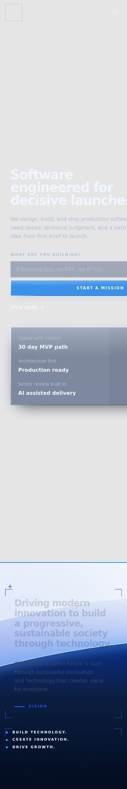

# UI Design System & Master Generation Blueprint: www-vanguardinitiative-com

> **Vanguard Initiative · Software Development Company in Laos** (https://www.vanguardinitiative.com/) — Vanguard Initiative is a Laos-based software company that designs, builds, and ships production-ready web applications, MVPs, internal pl...


---

## 1. Executive Visual Persona & Design Archetype

- **Brand Essence & Persona**: **Vanguard Initiative · Software Development Company in Laos** (`https://www.vanguardinitiative.com/`). Vanguard Initiative is a Laos-based software company that designs, builds, and ships production-ready web applications, MVPs, internal pl...
- **Visual Archetype**: **Light-Gallery WebGL / Canvas Interactive Experience (`#e5e5e5` / `#fff`)**.
- **Anti-AI-Slop Differentiators**:
  - **Source-Grounded Chromatic Polarity**: Anchors the viewport in `#e5e5e5` (`var(--color-neutral-200)` in `:root`) paired with `#000` primary typography and `#fff` accents.
  - **Extracted Typographic Hierarchy**: Pairs `Hubot Sans` for display copy (`Vanguard Initiative : Software engin`) with `Hubot Sans Fallback` and `Geist Mono`.
  - **Calibrated Spatial Grid & Motion**: Combines `var(--page-max)` container bounds (`gap: var(--space-2xs)`, padding `var(--page-gutter)`) with `cubic-bezier(.4,0,1,1)` easing and Lenis Smooth Scroll (`data-lenis`), Three.js / WebGL Canvas Pipeline.

---

## 2. Spatial Architecture & Modular Grid Mathematics



### Viewport Allocation & Container Geometry
- **Captured Viewport Dimensions**: Desktop `1440×15305px` (`assets/desktop.png`, full-page scroll capture), Mobile `390×2400px` (`assets/mobile.png`, capped at 2400px multi-section capture).
- **Master Container Bounds**: `var(--page-max)` extracted from `www-vanguardinitiative-com` stylesheet.
- **Canvas Lateral Padding & Spacing**: `var(--page-gutter)` lateral canvas padding with `var(--space-2xs)` grid gap.
- **Border Radius Scale**: `50%`, `.3125rem`, `.375rem`, `.25rem`.

### Responsive Breakpoint Architecture
- **Desktop Layout**: Multi-column CSS Grid / Flexbox layout at `1440px` (`max-width: var(--page-max)`, `gap: var(--space-2xs)`).
- **Mobile Layout**: Single-column vertical stack at `390px` viewport width with `var(--page-gutter)` horizontal padding.
- **Extracted CSS Media Queries**: `@media (prefers-reduced-motion:reduce)`, `@media (min-width:1024px) and (prefers-reduced-motion:no-prefere...`, `@media (hover:none),(pointer:coarse),(prefers-reduced-motion:red...`, `@media (max-width:767.98px)`.

---

## 3. Color System, Materiality & Atmospheric Lighting

### Semantic Palette & Source Grounding
| Semantic Role | Ground-Truth Value | Extracted CSS Source / Selector |
|---|---|---|
| **Primary Canvas Substrate** | `#e5e5e5` | `var(--color-neutral-200)` in `:root` |
| **Primary Typography Ink** | `#262626` | `var(--color-neutral-800)` in `:root` |
| **Elevated Surface / Card Substrate** | `#000` | `var(--color-black)` in `:root` |
| **Interactive Accent / Highlight** | `#fff` | `var(--color-white)` in `:root` |
| **Secondary / Muted Copy** | `#b00a1d` | `var(--color-danger-ink)` in `:root` |
| **Structural Hairline Border** | `#0000` | `textarea { background-color: #0000 }` |

### Sanitized Root CSS Variables (`ui-ux.md` Ground Truth)
| Variable Name | Extracted Value | Semantic Role |
|---|---|---|
| `--font-hubot` | `"Hubot Sans", "Hubot Sans Fallback"` | Typography / Scale Token |
| `--font-mona` | `"Mona Sans", "Mona Sans Fallback"` | Typography / Scale Token |
| `--font-geist-mono` | `"Geist Mono", "Geist Mono Fallback"` | Typography / Scale Token |
| `--font-noto-sans-lao` | `"Noto Sans Lao", "Noto Sans Lao Fallback"` | Typography / Scale Token |
| `--color-neutral-200` | `#e5e5e5` | Brand / Palette Token |
| `--color-neutral-800` | `#262626` | Brand / Palette Token |
| `--color-black` | `#000` | Canvas / Surface Token |
| `--color-white` | `#fff` | Canvas / Surface Token |
| `--spacing` | `.25rem` | Layout / Spatial Grid Token |
| `--container-xs` | `20rem` | Layout / Spatial Grid Token |
| `--container-sm` | `24rem` | Layout / Spatial Grid Token |
| `--container-md` | `28rem` | Layout / Spatial Grid Token |
| `--container-lg` | `32rem` | Layout / Spatial Grid Token |
| `--container-xl` | `36rem` | Layout / Spatial Grid Token |
| `--container-3xl` | `48rem` | Layout / Spatial Grid Token |
| `--container-4xl` | `56rem` | Layout / Spatial Grid Token |

---

## 4. Typographic Scale & Editorial Hierarchy

### Font Family Stacks
- **Display Typography**: `Hubot Sans`.
- **Primary Body Stack**: `Hubot Sans Fallback`.
- **Technical / Metadata Stack**: `Geist Mono`.

### Typographic Scale & Rules (Extracted from Stylesheet & Variables)
- **Hero Display (`H1`)**: CSS variables `--text-4xl: 2.25rem`, `--font-display: var(--font-display)`, `--text-display-s: clamp(2.5rem, 1.5rem + 4vw, 5rem)`; rule `h1` (`font-size: var(--text-3xl)`, `line-height: var(--tw-leading,var(...`).
- **Section Heading (`H2`)**: CSS variables `--text-2xl: 1.5rem`, `--text-2xl--line-height: calc(2 / 1.5)`, `--text-3xl: 1.875rem`; rule `h2` (`font-size: var(--text-2xl)`, `line-height: var(--tw-leading,var(...`).
- **Body Copy**: CSS variables `--text-base: 1rem`, `--text-base--line-height: calc(1.5 / 1)`, `--font-body: var(--font-mona), var(--font-noto-sans-lao), system-ui, sans-serif`; rule `p` (`line-height: calc(var(--spacing) * 7)`).
- **Metadata & Navigation Labels**: CSS variables `--font-geist-mono: "Geist Mono", "Geist Mono Fallback"`, `--text-xs: .75rem`, `--text-xs--line-height: calc(1 / .75)`.

---

## 5. Choreographed Motion & Interaction Physics

### Primary Easing Curves
- **Extracted Timing Functions**: `cubic-bezier(.4,0,1,1)`, `cubic-bezier(0,0,.2,1)`, `cubic-bezier(.4,0,.2,1)`.

### Per-Element Transition & Choreography Rules
- **Selector `layer theme`**: `transition: .15s` extracted from `www-vanguardinitiative-com` stylesheet.
- **Selector `.btn-mission`**: `transition: background-color var(--dur-base) var(--ease-out), transform va...` extracted from `www-vanguardinitiative-com` stylesheet.
- **Selector `.link-arrow`**: `transition: text-decoration-color var(--dur-base) var(--ease-out)` extracted from `www-vanguardinitiative-com` stylesheet.
- **Extracted Easing Curve (`cubic-bezier(.4,0,1,1)`)**: Governs interactive state transitions across `<header.site-nav>` and `<section.surface-haze>`.
- **Runtime Interaction Engine**: Integrates Lenis Smooth Scroll (`data-lenis`), Three.js / WebGL Canvas Pipeline with `prefers-reduced-motion: reduce` fallback guards.

---

## 6. Component Wireframe & Structural DOM Map

### Visual Layout Schematic (Grounded in `dom.html` — `1440px` Desktop & `390px` Mobile Reflow)
```
┌────────────────────────────────────────────────────────────────────────┐
│ DESKTOP VIEWPORT (1440px) — Vanguard Initiative · Software Development │
│ ====================================================================== │
│ [ <header.site-nav>        | Vision · Services · Customers · Work · ]  │
│ ---------------------------------------------------------------------- │
│ | HERO STAGE: <section.surface-space>                              |   │
│ | H1: Vanguard Initiative : Software engineered for dec...         |   │
│ | Substrate: #e5e5e5    | Ink: #000       | Accent: #fff           |   │
│ ---------------------------------------------------------------------- │
│ | SHOWCASE GRID (<section.surface-haze>    ) max-w: var(--page-max |   │
│ | +------------------------------+  +------------------------------+ | │
│ | | Vision : Driving modern inno |  | Mission : Build and incubate | | │
│ | +------------------------------+  +------------------------------+ | │
│ ---------------------------------------------------------------------- │
│ | MOBILE VIEWPORT REFLOW (390px) — Single-Column Stack (gap: var(--) | │
│ | [<header.site-nav>] -> [<section.surface-s] -> [<section.surface-h]  │
│ ---------------------------------------------------------------------- │
│ [ FOOTER (<footer.surface-space>) | https://www.vanguardinitiative.com │
└────────────────────────────────────────────────────────────────────────┘
```

### Granular DOM Region Breakdown
1. **Brand Header & Navigation Bar (<header.site-nav> — `www-vanguardinitiative-com`)**:
   - Landmark `<header class="site-nav">` hosting `Vanguard Initiative · Software Devel` navigation (`Vision · Services · Customers · Work · News`), DOM attributes (`data-glass="refract"`, `data-starfield="ready"`, `data-precedence="next"`, `data-precedence="next"`), and stylesheet rule `sans_e77d6951-module__FFcELq__cla... { font-family:Hubot Sans,Hubot Sans Fallback;font-style:normal }`.
2. **Hero Stage & Focal Lead (<section.surface-space> — `Vanguard Initiative : Software eng`)**:
   - Landmark `<section class="surface-space">` presenting display lead `Vanguard Initiative : Software engineered for dec...` and copy excerpt *"Vientiane · 17.97° N · 102.63° E"* over `#e5e5e5` canvas and `#000` ink.
3. **Primary Showcase & Content Grid (<section.surface-haze> — `Vision : Driving modern innovation`)**:
   - Landmark `<section class="surface-haze">` rendering section `Vision : Driving modern innovation to build a pro...` with copy *"Build technology. Create innovation. Drive growth."*, asset references (`671921b99e4f15ea-s.p.144u-zwhc_ek...`, `797e433ab948586e-s.p.08e28id.o-ok...`, `88a013264a4e85f3-s.p.0.1xv-4ms-j6...`, `896ab7b170aff81a-s.p.0x1fcv_1lywi...`), and grid rule `sans_e77d6951-module__FFcELq__var... { --font-hubot:"Hubot Sans", "Hubot Sans Fallback" }`.
4. **Interactive Detail & Feature Matrix (<article.vision__block> — `Mission : Build and incubate start`)**:
   - Landmark `<article class="vision__block brackets">` framing `Mission : Build and incubate startups that use ne...` and `Four orbits around one mission.` (*"Create innovation."*) with `#000` surface cards, `#fff` accents, and `sans_784dac51-module__aFRYXa__cla... { font-family:Mona Sans,Mona Sans Fallback;font-style:normal }`.
5. **Colophon & Global Directory Footer (<footer.surface-space> — `https://www.vanguardinitiative.com/`)**:
   - Landmark `<footer class="surface-space relative">` anchoring `Vanguard Initiative · Software D` footer links (`Vision · Services · Customers · Work · News`), copy *"Vanguard Initiative :"*, and `#0000` structural dividers.

---

## 7. Master Zero-Shot AI Generation Prompt

```markdown
# Master Zero-Shot Frontend Generation Prompt: www-vanguardinitiative-com (Vanguard Initiative · Software Development Company in Laos)

You are a principal frontend architect and design systems engineer. Build a complete, production-ready web application replicating the exact design system, DOM landmarks, typographic hierarchy, color tokens, and motion physics of `www-vanguardinitiative-com` (**Vanguard Initiative · Software Development Company in Laos** — `https://www.vanguardinitiative.com/`).

### 1. Visual Archetype & Anti-AI-Slop Mandates
- **Archetype**: Light-Gallery WebGL / Canvas Interactive Experience (`#e5e5e5` / `#fff`).
- **Identity & Domain Context**: Vanguard Initiative is a Laos-based software company that designs, builds, and ships production-ready web applications, MVPs, internal pl...
- **Primary Substrate**: `#e5e5e5` (`var(--color-neutral-200)` in `:root`), **Primary Ink**: `#000`, **Accent / Highlight**: `#fff`.
- **Site-Specific Differentiators**:
  - **Source-Grounded Chromatic Polarity**: Anchors the viewport in `#e5e5e5` (`var(--color-neutral-200)` in `:root`) paired with `#000` primary typography and `#fff` accents.
  - **Extracted Typographic Hierarchy**: Pairs `Hubot Sans` for display copy (`Vanguard Initiative : Software engin`) with `Hubot Sans Fallback` and `Geist Mono`.
  - **Calibrated Spatial Grid & Motion**: Combines `var(--page-max)` container bounds (`gap: var(--space-2xs)`, padding `var(--page-gutter)`) with `cubic-bezier(.4,0,1,1)` easing and Lenis Smooth Scroll (`data-lenis`), Three.js / WebGL Canvas Pipeline.

### 2. Ground-Truth CSS Variables (`:root` Token Contract)
Declare and consume these exact custom properties extracted from `www-vanguardinitiative-com` in your global stylesheet:

:root {
  /* Vanguard Initiative · Software Development Company in Laos (www-vanguardinitiative-com) — Ground-Truth Extracted CSS Variables */
  --font-hubot: "Hubot Sans", "Hubot Sans Fallback"; /* Typography / Scale Token (www-vanguardinitiative-com) */
  --font-mona: "Mona Sans", "Mona Sans Fallback"; /* Typography / Scale Token (www-vanguardinitiative-com) */
  --font-geist-mono: "Geist Mono", "Geist Mono Fallback"; /* Typography / Scale Token (www-vanguardinitiative-com) */
  --font-noto-sans-lao: "Noto Sans Lao", "Noto Sans Lao Fallback"; /* Typography / Scale Token (www-vanguardinitiative-com) */
  --color-neutral-200: #e5e5e5; /* Brand / Palette Token (www-vanguardinitiative-com) */
  --color-neutral-800: #262626; /* Brand / Palette Token (www-vanguardinitiative-com) */
  --color-black: #000; /* Canvas / Surface Token (www-vanguardinitiative-com) */
  --color-white: #fff; /* Canvas / Surface Token (www-vanguardinitiative-com) */
  --spacing: .25rem; /* Layout / Spatial Grid Token (www-vanguardinitiative-com) */
  --container-xs: 20rem; /* Layout / Spatial Grid Token (www-vanguardinitiative-com) */
  --container-sm: 24rem; /* Layout / Spatial Grid Token (www-vanguardinitiative-com) */
  --container-md: 28rem; /* Layout / Spatial Grid Token (www-vanguardinitiative-com) */
  --container-lg: 32rem; /* Layout / Spatial Grid Token (www-vanguardinitiative-com) */
  --container-xl: 36rem; /* Layout / Spatial Grid Token (www-vanguardinitiative-com) */
  --container-3xl: 48rem; /* Layout / Spatial Grid Token (www-vanguardinitiative-com) */
  --container-4xl: 56rem; /* Layout / Spatial Grid Token (www-vanguardinitiative-com) */
}

### 3. Semantic Color & Materiality Contract
Map every surface, ink, and border strictly to these source-grounded tokens:
- **Primary Canvas Substrate**: `#e5e5e5` — grounded in `var(--color-neutral-200)` in `:root`
- **Primary Typography Ink**: `#262626` — grounded in `var(--color-neutral-800)` in `:root`
- **Elevated Surface / Card Substrate**: `#000` — grounded in `var(--color-black)` in `:root`
- **Interactive Accent / Highlight**: `#fff` — grounded in `var(--color-white)` in `:root`
- **Secondary / Muted Copy**: `#b00a1d` — grounded in `var(--color-danger-ink)` in `:root`
- **Structural Hairline Border**: `#0000` — grounded in `textarea { background-color: #0000 }`

### 4. Spatial Grid, Container Bounds & Responsive Breakpoints
- **Desktop Viewport Reference**: `1440×15305px` (full-page scroll capture, `1440px` standard desktop width).
- **Mobile Viewport Reference**: `390×2400px` (capped at 2400px multi-section capture, `390px` standard mobile width).
- **Container Max-Width**: `var(--page-max)` extracted from `www-vanguardinitiative-com` stylesheet
- **Padding & Gutters**: `var(--page-gutter)` lateral canvas padding with `var(--space-2xs)` grid gap
- **Desktop Grid**: Multi-column CSS Grid / Flexbox layout at `1440px` (`max-width: var(--page-max)`, `gap: var(--space-2xs)`)
- **Mobile Adaptation**: Single-column vertical stack at `390px` viewport width with `var(--page-gutter)` horizontal padding
- **Media Queries**: `@media (prefers-reduced-motion:reduce)`, `@media (min-width:1024px) and (prefers-reduced-motion:no-prefere...`, `@media (hover:none),(pointer:coarse),(prefers-reduced-motion:red...`, `@media (max-width:767.98px)`
- **Corner Radii**: `50%`, `.3125rem`, `.375rem`, `.25rem`

### 5. Typography & Editorial Scale Contract
- **Display Font Stack**: `Hubot Sans`
- **Body Font Stack**: `Hubot Sans Fallback`
- **Monospace / Technical Font Stack**: `Geist Mono`
- **H1 Display Rule**: CSS variables `--text-4xl: 2.25rem`, `--font-display: var(--font-display)`, `--text-display-s: clamp(2.5rem, 1.5rem + 4vw, 5rem)`; rule `h1` (`font-size: var(--text-3xl)`, `line-height: var(--tw-leading,var(...`)
- **H2 Section Rule**: CSS variables `--text-2xl: 1.5rem`, `--text-2xl--line-height: calc(2 / 1.5)`, `--text-3xl: 1.875rem`; rule `h2` (`font-size: var(--text-2xl)`, `line-height: var(--tw-leading,var(...`)
- **Body Copy Rule**: CSS variables `--text-base: 1rem`, `--text-base--line-height: calc(1.5 / 1)`, `--font-body: var(--font-mona), var(--font-noto-sans-lao), system-ui, sans-serif`; rule `p` (`line-height: calc(var(--spacing) * 7)`)
- **Metadata & Index Rule**: CSS variables `--font-geist-mono: "Geist Mono", "Geist Mono Fallback"`, `--text-xs: .75rem`, `--text-xs--line-height: calc(1 / .75)`

### 6. Component Hierarchy, Verbatim Copy & Real DOM Landmarks
Scaffold `www-vanguardinitiative-com` (`Vanguard Initiative · Software Development Company in Laos`) with these exact structural regions, extracted copy, and CSS rules from `dom.html`:
1. **Brand Header & Navigation Bar (<header.site-nav> — `www-vanguardinitiative-com`)**:
   - DOM & Selectors: Landmark `<header class="site-nav">` hosting `Vanguard Initiative · Software Devel` navigation (`Vision · Services · Customers · Work · News`), DOM attributes (`data-glass="refract"`, `data-starfield="ready"`, `data-precedence="next"`, `data-precedence="next"`), and stylesheet rule `sans_e77d6951-module__FFcELq__cla... { font-family:Hubot Sans,Hubot Sans Fallback;font-style:normal }`.
   - Responsive Contract: Header `Brand Header & Navigation Bar (<header.site-nav> — `www-vanguardinitiative-com`)` (`www-vanguardinitiative-com`) adapts across `@media (prefers-reduced-motion:reduce)`, `@media (min-width:1024px) and (prefers-reduced-motion:no-prefere...`, `@media (hover:none),(pointer:coarse),(prefers-reduced-motion:red...`, `@media (max-width:767.98px)` with `cubic-bezier(.4,0,1,1)`, `cubic-bezier(0,0,.2,1)`, `cubic-bezier(.4,0,.2,1)` transitions and links `Vision · Services · Customers · Work · News`.
2. **Hero Stage & Focal Lead (<section.surface-space> — `Vanguard Initiative : Software eng`)**:
   - DOM & Selectors: Landmark `<section class="surface-space">` presenting display lead `Vanguard Initiative : Software engineered for dec...` and copy excerpt *"Vientiane · 17.97° N · 102.63° E"* over `#e5e5e5` canvas and `#000` ink.
   - Responsive Contract: Hero stage (`1440×15305px` desktop / `390×2400px` mobile) sets `#e5e5e5` background with `#000` headline `Vanguard Initiative : Software engineered for dec...`.
3. **Primary Showcase & Content Grid (<section.surface-haze> — `Vision : Driving modern innovation`)**:
   - DOM & Selectors: Landmark `<section class="surface-haze">` rendering section `Vision : Driving modern innovation to build a pro...` with copy *"Build technology. Create innovation. Drive growth."*, asset references (`671921b99e4f15ea-s.p.144u-zwhc_ek...`, `797e433ab948586e-s.p.08e28id.o-ok...`, `88a013264a4e85f3-s.p.0.1xv-4ms-j6...`, `896ab7b170aff81a-s.p.0x1fcv_1lywi...`), and grid rule `sans_e77d6951-module__FFcELq__var... { --font-hubot:"Hubot Sans", "Hubot Sans Fallback" }`.
   - Responsive Contract: Showcase grid `Primary Showcase & Content Grid (<section.surface-haze> — `Vision : Driving modern innovation`)` applies Multi-column CSS Grid / Flexbox layout at `1440px` (`max-width: var(--page-max)`, `gap: var(--space-2xs)`) on desktop and Single-column vertical stack at `390px` viewport width with `var(--page-gutter)` horizontal padding on mobile.
4. **Interactive Detail & Feature Matrix (<article.vision__block> — `Mission : Build and incubate start`)**:
   - DOM & Selectors: Landmark `<article class="vision__block brackets">` framing `Mission : Build and incubate startups that use ne...` and `Four orbits around one mission.` (*"Create innovation."*) with `#000` surface cards, `#fff` accents, and `sans_784dac51-module__aFRYXa__cla... { font-family:Mona Sans,Mona Sans Fallback;font-style:normal }`.
   - Responsive Contract: Detail module `Interactive Detail & Feature Matrix (<article.vision__block> — `Mission : Build and incubate start`)` uses `50%`, `.3125rem`, `.375rem`, `.25rem` radii, `#fff` highlights, and assets (671921b99e4f15ea-s.p.144u-zwhc_ek..., 797e433ab948586e-s.p.08e28id.o-ok..., 88a013264a4e85f3-s.p.0.1xv-4ms-j6...).
5. **Colophon & Global Directory Footer (<footer.surface-space> — `https://www.vanguardinitiative.com/`)**:
   - DOM & Selectors: Landmark `<footer class="surface-space relative">` anchoring `Vanguard Initiative · Software D` footer links (`Vision · Services · Customers · Work · News`), copy *"Vanguard Initiative :"*, and `#0000` structural dividers.
   - Responsive Contract: Footer `Colophon & Global Directory Footer (<footer.surface-space> — `https://www.vanguardinitiative.com/`)` aligns to `var(--page-max)` extracted from `www-vanguardinitiative-com` stylesheet with `var(--page-gutter)` lateral canvas padding with `var(--space-2xs)` grid gap and attributes (data-glass="refract", data-starfield="ready", data-precedence="next").

#### Verbatim DOM Copy Excerpts (`dom.html`)
- Copy Excerpt 1: *"Vientiane · 17.97° N · 102.63° E"*
- Copy Excerpt 2: *"Build technology. Create innovation. Drive growth."*
- Copy Excerpt 3: *"Create innovation."*
- Copy Excerpt 4: *"Vanguard Initiative :"*

### 7. Motion, Extracted Stylesheet Rules & Interaction Choreography
- **Primary Easing Functions**: `cubic-bezier(.4,0,1,1)`, `cubic-bezier(0,0,.2,1)`, `cubic-bezier(.4,0,.2,1)`
- **Extracted Stylesheet Rules (`www-vanguardinitiative-com`)**:
- `sans_e77d6951-module__FFcELq__cla... { font-family:Hubot Sans,Hubot Sans Fallback;font-style:normal }`
- `sans_e77d6951-module__FFcELq__var... { --font-hubot:"Hubot Sans", "Hubot Sans Fallback" }`
- `sans_784dac51-module__aFRYXa__cla... { font-family:Mona Sans,Mona Sans Fallback;font-style:normal }`
- `sans_784dac51-module__aFRYXa__var... { --font-mona:"Mona Sans", "Mona Sans Fallback" }`
- `mono_42eec60-module__Gb1_vG__clas... { font-family:Geist Mono,Geist Mono Fallback;font-style:normal }`
- **Per-Selector Transition Rules**:
- **Selector `layer theme`**: `transition: .15s` extracted from `www-vanguardinitiative-com` stylesheet.
- **Selector `.btn-mission`**: `transition: background-color var(--dur-base) var(--ease-out), transform va...` extracted from `www-vanguardinitiative-com` stylesheet.
- **Selector `.link-arrow`**: `transition: text-decoration-color var(--dur-base) var(--ease-out)` extracted from `www-vanguardinitiative-com` stylesheet.
- **Extracted Easing Curve (`cubic-bezier(.4,0,1,1)`)**: Governs interactive state transitions across `<header.site-nav>` and `<section.surface-haze>`.
- **Runtime Interaction Engine**: Integrates Lenis Smooth Scroll (`data-lenis`), Three.js / WebGL Canvas Pipeline with `prefers-reduced-motion: reduce` fallback guards.

### 8. Technical Deliverables
- Implement in Next.js (App Router) with TypeScript and Tailwind CSS consuming the `:root` custom properties defined above for `www-vanguardinitiative-com`.
- Reproduce both the `1440px` desktop architecture and `390px` mobile breakpoint transitions, preserving semantic HTML5 landmarks (`<header>`, `<nav>`, `<main>`, `<section>`, `<footer>`) and `prefers-reduced-motion` accessibility guards.
```
