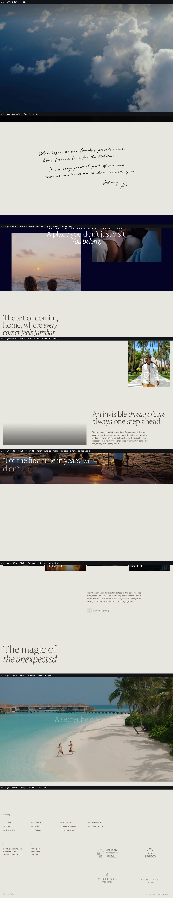
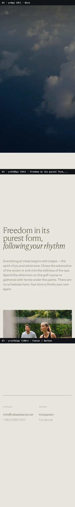

# UI Design System & Master Generation Blueprint: www-velaaprivateisland-com

> **Velaa Private Island Maldives** (https://www.velaaprivateisland.com/) — The World's Best Kept Secret





---

## 1. Executive Visual Persona & Design Archetype

- **Brand Essence & Persona**: **Velaa Private Island Maldives** (`https://www.velaaprivateisland.com/`). The World's Best Kept Secret
- **Capture Provenance**: Live browser capture (`tier1_fast`, HTTP `200`, captured `2026-11-24`).
- **Visual Archetype**: **Light-Substrate Editorial & Modular Grid System (`#e8e6df` canvas, `#000000` ink, `#0000ee` accent)**.
- **Anti-AI-Slop Differentiators**:
  - **Live-Computed Chromatic Polarity**: Anchors the viewport in `#e8e6df` (live computed `body` `background-color` (`computed_styles.json`)) paired with `#000000` primary typography and `#0000ee` accents.
  - **Grounded Typographic Hierarchy**: Pairs `Canela Text LC Web Thin` for display copy (`A symphony of flavours & shared mome`) with `Instrument Sans`.
  - **Calibrated Spatial Grid & Motion**: Combines `1600px` container bounds (`gap: 192px`, padding `24px`) with `cubic-bezier(0.25,0.1,0.25,1)` easing and Lenis Smooth Scroll (`data-lenis`), Framer Motion Layout Physics.

---

## 2. Spatial Architecture & Modular Grid Mathematics

### Viewport Allocation & Container Geometry
- **Captured Journey Filmstrips**: Desktop `1280×6624px` (`assets/desktop-journey.webp`, `8` keyframes up to `y=13655px` / doc `14555px`), Mobile `390×2616px` (`assets/mobile-journey.webp`, `3` keyframes).
- **Master Container Bounds**: `1600px` (non-`@media` desktop container stylesheet rule).
- **Canvas Lateral Padding & Spacing**: `24px` lateral canvas padding with `192px` grid gap.
- **Border Radius Scale**: `1px`, `0px`.

### Responsive Breakpoint Architecture
- **Desktop Layout**: Multi-column CSS Grid / Flexbox layout at `1440px` (`max-width: 1600px`, `gap: 192px`).
- **Mobile Layout**: Single-column vertical stack at `390px` viewport width with `24px` horizontal padding.
- **Extracted CSS Media Queries**: `@media (min-width: 1920px)`, `@media (min-width: 1200px) and (max-width: 1919.98px)`, `@media (min-width: 810px) and (max-width: 1199.98px)`, `@media (max-width: 809.98px)`.

---

## 3. Color System, Materiality & Atmospheric Lighting

### Semantic Palette & Source Grounding
| Semantic Role | Ground-Truth Value | Extracted Live / CSS Source |
|---|---|---|
| **Primary Canvas Substrate** | `#e8e6df` | live computed `body` `background-color` (`computed_styles.json`) |
| **Primary Typography Ink** | `#000000` | live computed `body` `color` (`computed_styles.json`) |
| **Elevated Surface / Card Substrate** | `#dddddd` | `2lq7sn.rich-text-wrapper blockq... { background-color: #dddddd }` |
| **Interactive Accent / Highlight** | `#0000ee` | live computed `a` `color` (`computed_styles.json`) |
| **Secondary / Muted Copy** | `#4b4335` | live computed `p` `color` (`computed_styles.json`) |
| **Structural Hairline Border** | `#8a8479` | `var(--border-color)` in `:root` (`var(--token-b2023aa5-98b5-447b-bf...`) |
| **Variable Token (`--token-df8a0dff-7898-4597-93d1-7c8c4165687e`)** | `#ffffff` | `var(--token-df8a0dff-7898-4597-93d1-7c8c4165687e)` in `:root` |
| **Variable Token (`--token-64804b58-d0c9-408c-8ef8-18e7c8c4fa42`)** | `#fffc` | `var(--token-64804b58-d0c9-408c-8ef8-18e7c8c4fa42)` in `:root` |
| **Variable Token (`--token-c9cc39ca-b83c-4612-97b2-3b045f31b8b2`)** | `#fff9` | `var(--token-c9cc39ca-b83c-4612-97b2-3b045f31b8b2)` in `:root` |
| **Variable Token (`--token-04acd034-cd76-4966-889c-0be31a7f0cd7`)** | `#010101` | `var(--token-04acd034-cd76-4966-889c-0be31a7f0cd7)` in `:root` |
| **Variable Token (`--token-63ce1974-4123-43fe-af3f-45583d0362a1`)** | `#040326` | `var(--token-63ce1974-4123-43fe-af3f-45583d0362a1)` in `:root` |

### Sanitized Root CSS Variables (`ui-ux.md` Ground Truth)
| Variable Name | Extracted Value | Semantic Role |
|---|---|---|
| `--token-df8a0dff-7898-4597-93d1-7c8c4165687e` | `#fff` | Color / Atmospheric Token |
| `--token-64804b58-d0c9-408c-8ef8-18e7c8c4fa42` | `#fffc` | Color / Atmospheric Token |
| `--token-c9cc39ca-b83c-4612-97b2-3b045f31b8b2` | `#fff9` | Color / Atmospheric Token |
| `--token-04acd034-cd76-4966-889c-0be31a7f0cd7` | `#010101` | Color / Atmospheric Token |
| `--token-59d5d661-5e78-4b72-9e79-cd47aff41722` | `#e8e6df` | Color / Atmospheric Token |
| `--token-0a872567-8429-4796-9d1f-16128f686cfc` | `#4b4335` | Color / Atmospheric Token |
| `--token-a75c5af9-0c80-4a37-bd5a-30e8355d8a08` | `#010101cc` | Color / Atmospheric Token |
| `--token-b2023aa5-98b5-447b-bfed-ac60292ed2aa` | `#4b433599` | Color / Atmospheric Token |
| `--token-c05169e4-f21b-4021-88d5-c3405b44ef9c` | `#01010199` | Color / Atmospheric Token |
| `--token-3c8552f2-f351-49db-acd1-4cf7d791ba30` | `#4b433533` | Color / Atmospheric Token |
| `--token-63ce1974-4123-43fe-af3f-45583d0362a1` | `#040326` | Color / Atmospheric Token |
| `--text-decoration-skip-ink` | `var(--framer-text-decoration-skip-ink)` | Typography Ink Token |
| `--text-underline-offset` | `var(--framer-text-decoration-offset)` | Typography Ink Token |
| `--font-family` | `var(--framer-font-family)` | Typography / Scale Token |
| `--font-style` | `var(--framer-font-style)` | Typography / Scale Token |
| `--font-weight` | `var(--framer-font-weight)` | Typography / Scale Token |

---

## 4. Typographic Scale & Editorial Hierarchy

### Font Family Stacks
- **Display Typography**: `Canela Text LC Web Thin`.
- **Primary Body Stack**: `Instrument Sans`.
- **Technical / Metadata Stack**: not declared in live computed styles (uses primary stack / `ui-monospace`).

### Typographic Scale & Rules (Live Computed & Stylesheet Grounded)
- **Hero Display (`H1`)**: live computed `h1` (`font-size: 80px`, `line-height: 80px`, `font-weight: 100`, `letter-spacing: -1.6px`); CSS variables `--text-truncation-display-inline-for-safari-16: inline`, `--text-truncation-display-none-for-safari-16: none`; rule `h1` (`font-size: 60px`, `line-height: 100%`, `letter-spacing: -.02em`, `font-weight: 100`).
- **Section Heading (`H2`)**: live computed `h2` (`font-size: 60px`, `line-height: 60px`, `font-weight: 100`, `letter-spacing: -1.2px`); rule `h2` (`font-size: 48px`, `line-height: 100%`, `letter-spacing: -.02em`, `font-weight: 100`).
- **Body Copy**: live computed `body` (`font-size: 12px`, `line-height: normal`, `font-weight: 400`); rule `p` (`font-size: 16px`, `line-height: 150%`, `letter-spacing: 0em`, `font-weight: 400`).
- **Metadata & Navigation Labels**: live computed `nav/a` (`font-size: 12px`, `line-height: normal`, `font-weight: 400`); CSS variables `--letter-spacing: var(--framer-letter-spacing)`.

---

## 5. Choreographed Motion & Interaction Physics

### Primary Easing Curves
- **Extracted Timing Functions**: `cubic-bezier(0.25,0.1,0.25,1)`.

### Per-Element Transition & Choreography Rules
- **Selector `.lenis.lenis-autoToggle`**: `transition: 1ms` extracted from `www-velaaprivateisland-com` stylesheet.
- **Standard CSS Easing (`cubic-bezier(0.25,0.1,0.25,1)`)**: Default timing curve (no custom `cubic-bezier()` declared in captured CSS).
- **Runtime Interaction Engine**: Integrates Lenis Smooth Scroll (`data-lenis`), Framer Motion Layout Physics with `prefers-reduced-motion: reduce` fallback guards.
### Measured Runtime Scroll & Interaction Telemetry (`behavioral_journey_v2`)
- **Scroll Driver Mode**: `native` (max document height `14555px`, deepest scrollY reached `13655px` across `8` desktop keyframes).
- **Detected Scroll / Motion Libraries**: `Framer Motion`.

---

## 6. Component Wireframe & Structural DOM Map

### Visual Layout Schematic — Desktop (`1440px`, Grounded in `dom.html` & Landmark Bounding Boxes)
```
┌────────────────────────────────────────────────────────────────────────┐
│ DESKTOP VIEWPORT (1440px) — Velaa Private Island Maldives              │
│ ====================================================================== │
│ [ <header.framer-Olafn> (1440px)      | Find your home · Step into a ] │
│ ---------------------------------------------------------------------- │
│ | HERO STAGE: <div.framer-h13ff> (w=1440px)                          | │
│ | H1: A symphony of flavours & shared moments                        | │
│ | Substrate: #e8e6df | Ink: #000000 | Accent: #0000ee                | │
│ ---------------------------------------------------------------------- │
│ | SHOWCASE GRID (<div.framer-sg5GW>) max-w: 1600px                   | │
│ | +------------------------------+  +------------------------------+ | │
│ | | Velaa is a world of its own. |  | T h e a r t o f c o m i n g  | | │
│ | +------------------------------+  +------------------------------+ | │
│ ---------------------------------------------------------------------- │
│ | DETAIL MODULE (<div.framer-oQS6D>) — More than paradise, i         | │
│ ---------------------------------------------------------------------- │
│ [ FOOTER (<footer.framer-RVHbs) | https://www.velaaprivateisland.com/  │
└────────────────────────────────────────────────────────────────────────┘
```

### Visual Layout Schematic — Mobile Reflow (`390px`)
```
┌────────────────────────────────────────────────────────────────────────┐
│ MOBILE VIEWPORT REFLOW (390px) — Single-Column Stack (gap: 192px)      │
│ ====================================================================== │
│ [ HEADER BAR (<header.framer-Olafn>   ) | Compact Menu (390px)         │
│ ---------------------------------------------------------------------- │
│ | HERO STAGE (<div.framer-h13ff>) — 390px Vertical Lead              | │
│ | H1: A symphony of flavours & shared moments                        | │
│ ---------------------------------------------------------------------- │
│ | SHOWCASE STACK (<div.framer-sg5GW>) — 1-Col Stack                  | │
│ | [ Item 1: Velaa is a world of its own.                           ] | │
│ | [ Item 2: T h e a r t o f c o m i n g h o m e , w h e r e e...   ] | │
│ ---------------------------------------------------------------------- │
│ | DETAIL STACK (<div.framer-oQS6D>) — 1-Col (More than paradise)     | │
│ ---------------------------------------------------------------------- │
│ [ FOOTER (<footer.framer-RVHbs) | Stacked 390px Colophon               │
└────────────────────────────────────────────────────────────────────────┘
```

### Granular DOM Region Breakdown
1. **Brand Header & Navigation Bar (<header.framer-Olafn> — `www-velaaprivateisland-com`)**:
   - Landmark `<header class="framer-Olafn">` (`1440px`) hosting `Velaa Private Island Maldives` navigation (`Find your home · Step into adventure · Explore all dining · See what awaits · Villas Villas`), DOM attributes (`data-redirect-timezone="1"`, `data-framer-font-css`, `data-framer-breakpoint-css`, `data-framer-css-ssr-minified`), and stylesheet rule `html.lenis body { height:auto }`.
2. **Hero Stage & Focal Lead (<div.framer-h13ff> — `A symphony of flavours & shared mo`)**:
   - Landmark `<div class="framer-h13ff">` presenting display lead `A symphony of flavours & shared moments` and copy excerpt *"From the moment you arrive, the world outside fades. The air is l"* over `#e8e6df` canvas and `#000000` ink.
3. **Primary Showcase & Content Grid (<div.framer-sg5GW> — `Velaa is a world of its own.`)**:
   - Landmark `<div class="framer-sg5GW">` rendering section `Velaa is a world of its own.` with copy *"Discover Story of Velaa"*, asset references (`SeYxW6iTSKyLSDpsNhJ7cT1OhI.png`, `GXFdcLw3RCaSfwQY7YSTLdzO0Vk.png`, `fonts.gstatic.com`, `script`), and grid rule `.lenis-stopped { overflow:clip }`.
4. **Interactive Detail & Feature Matrix (<div.framer-oQS6D> — `T h e a r t o f c o m i n g h o m `)**:
   - Landmark `<div class="framer-oQS6D">` framing `T h e a r t o f c o m i n g h o m e , w h e r e e...` and `More than paradise, it's the feeling of being exa...` (*"Your personal butler is the guardian of your peace. It’s beyond s"*) with `#dddddd` surface cards, `#0000ee` accents, and `.lenis.lenis-smooth iframe { pointer-events:none }`.
5. **Colophon & Global Directory Footer (<footer.framer-RVHbs> — `https://www.velaaprivateisland.com/`)**:
   - Landmark `<footer class="framer-RVHbs">` anchoring `Velaa Private Island Maldives` footer links (`Find your home · Step into adventure · Explore all dining · See what awaits · Villas Villas`), copy *"Everything at Velaa begins with majaa — the spirit of joy an"*, and `#8a8479` structural dividers.
### Full Vertical Scroll Sequence (Desktop `1440×900` Keyframes)
- **Step 01** (`y=0px`, `0%`): Active landmark `Hero` · sticky/fixed elements: `0`
- **Step 02** (`y=850px`, `6%`): Active landmark `Section @ 6%` · sticky/fixed elements: `1`
- **Step 03** (`y=3400px`, `25%`): Active landmark `A place you don’t just visit. You belong.` · sticky/fixed elements: `1`
- **Step 04** (`y=5950px`, `44%`): Active landmark `An invisible thread of care,` · sticky/fixed elements: `0`
- **Step 05** (`y=7650px`, `56%`): Active landmark `"For the first time in years, we didn't have to m...` · sticky/fixed elements: `0`
- **Step 06** (`y=10200px`, `75%`): Active landmark `The magic of the unexpected` · sticky/fixed elements: `0`
- **Step 07** (`y=12750px`, `93%`): Active landmark `A secret held for you.` · sticky/fixed elements: `0`
- **Step 08** (`y=13655px`, `100%`): Active landmark `Footer / Bottom` · sticky/fixed elements: `0`

---

## 7. Master Zero-Shot AI Generation Prompt

```markdown
# Master Zero-Shot Frontend Generation Prompt: www-velaaprivateisland-com (Velaa Private Island Maldives)

You are a principal frontend architect and design systems engineer. Build a complete, production-ready web application replicating the exact design system, DOM landmarks, typographic hierarchy, color tokens, and motion physics of `www-velaaprivateisland-com` (**Velaa Private Island Maldives** — `https://www.velaaprivateisland.com/`).

### 1. Visual Archetype & Anti-AI-Slop Mandates
- **Archetype**: Light-Substrate Editorial & Modular Grid System (`#e8e6df` canvas, `#000000` ink, `#0000ee` accent).
- **Identity & Domain Context**: The World's Best Kept Secret
- **Primary Substrate**: `#e8e6df` (live computed `body` `background-color` (`computed_styles.json`)), **Primary Ink**: `#000000`, **Accent / Highlight**: `#0000ee`.
- **Site-Specific Differentiators**:
  - **Live-Computed Chromatic Polarity**: Anchors the viewport in `#e8e6df` (live computed `body` `background-color` (`computed_styles.json`)) paired with `#000000` primary typography and `#0000ee` accents.
  - **Grounded Typographic Hierarchy**: Pairs `Canela Text LC Web Thin` for display copy (`A symphony of flavours & shared mome`) with `Instrument Sans`.
  - **Calibrated Spatial Grid & Motion**: Combines `1600px` container bounds (`gap: 192px`, padding `24px`) with `cubic-bezier(0.25,0.1,0.25,1)` easing and Lenis Smooth Scroll (`data-lenis`), Framer Motion Layout Physics.

### 2. Ground-Truth CSS Variables (`:root` Token Contract)
Declare and consume these exact custom properties extracted from `www-velaaprivateisland-com` in your global stylesheet:

:root {
  /* Velaa Private Island Maldives (www-velaaprivateisland-com) — Live-Grounded CSS Variables */
  --token-df8a0dff-7898-4597-93d1-7c8c4165687e: #fff; /* Color / Atmospheric Token (www-velaaprivateisland-com) */
  --token-64804b58-d0c9-408c-8ef8-18e7c8c4fa42: #fffc; /* Color / Atmospheric Token (www-velaaprivateisland-com) */
  --token-c9cc39ca-b83c-4612-97b2-3b045f31b8b2: #fff9; /* Color / Atmospheric Token (www-velaaprivateisland-com) */
  --token-04acd034-cd76-4966-889c-0be31a7f0cd7: #010101; /* Color / Atmospheric Token (www-velaaprivateisland-com) */
  --token-59d5d661-5e78-4b72-9e79-cd47aff41722: #e8e6df; /* Color / Atmospheric Token (www-velaaprivateisland-com) */
  --token-0a872567-8429-4796-9d1f-16128f686cfc: #4b4335; /* Color / Atmospheric Token (www-velaaprivateisland-com) */
  --token-a75c5af9-0c80-4a37-bd5a-30e8355d8a08: #010101cc; /* Color / Atmospheric Token (www-velaaprivateisland-com) */
  --token-b2023aa5-98b5-447b-bfed-ac60292ed2aa: #4b433599; /* Color / Atmospheric Token (www-velaaprivateisland-com) */
  --token-c05169e4-f21b-4021-88d5-c3405b44ef9c: #01010199; /* Color / Atmospheric Token (www-velaaprivateisland-com) */
  --token-3c8552f2-f351-49db-acd1-4cf7d791ba30: #4b433533; /* Color / Atmospheric Token (www-velaaprivateisland-com) */
  --token-63ce1974-4123-43fe-af3f-45583d0362a1: #040326; /* Color / Atmospheric Token (www-velaaprivateisland-com) */
  --text-decoration-skip-ink: var(--framer-text-decoration-skip-ink); /* Typography Ink Token (www-velaaprivateisland-com) */
  --text-underline-offset: var(--framer-text-decoration-offset); /* Typography Ink Token (www-velaaprivateisland-com) */
  --font-family: var(--framer-font-family); /* Typography / Scale Token (www-velaaprivateisland-com) */
  --font-style: var(--framer-font-style); /* Typography / Scale Token (www-velaaprivateisland-com) */
  --font-weight: var(--framer-font-weight); /* Typography / Scale Token (www-velaaprivateisland-com) */
}

### 3. Semantic Color & Materiality Contract
Map every surface, ink, and border strictly to these source-grounded tokens:
- **Primary Canvas Substrate**: `#e8e6df` — grounded in live computed `body` `background-color` (`computed_styles.json`)
- **Primary Typography Ink**: `#000000` — grounded in live computed `body` `color` (`computed_styles.json`)
- **Elevated Surface / Card Substrate**: `#dddddd` — grounded in `2lq7sn.rich-text-wrapper blockq... { background-color: #dddddd }`
- **Interactive Accent / Highlight**: `#0000ee` — grounded in live computed `a` `color` (`computed_styles.json`)
- **Secondary / Muted Copy**: `#4b4335` — grounded in live computed `p` `color` (`computed_styles.json`)
- **Structural Hairline Border**: `#8a8479` — grounded in `var(--border-color)` in `:root` (`var(--token-b2023aa5-98b5-447b-bf...`)
- **Variable Token (`--token-df8a0dff-7898-4597-93d1-7c8c4165687e`)**: `#ffffff` — grounded in `var(--token-df8a0dff-7898-4597-93d1-7c8c4165687e)` in `:root`
- **Variable Token (`--token-64804b58-d0c9-408c-8ef8-18e7c8c4fa42`)**: `#fffc` — grounded in `var(--token-64804b58-d0c9-408c-8ef8-18e7c8c4fa42)` in `:root`
- **Variable Token (`--token-c9cc39ca-b83c-4612-97b2-3b045f31b8b2`)**: `#fff9` — grounded in `var(--token-c9cc39ca-b83c-4612-97b2-3b045f31b8b2)` in `:root`
- **Variable Token (`--token-04acd034-cd76-4966-889c-0be31a7f0cd7`)**: `#010101` — grounded in `var(--token-04acd034-cd76-4966-889c-0be31a7f0cd7)` in `:root`
- **Variable Token (`--token-63ce1974-4123-43fe-af3f-45583d0362a1`)**: `#040326` — grounded in `var(--token-63ce1974-4123-43fe-af3f-45583d0362a1)` in `:root`

### 4. Spatial Grid, Container Bounds & Responsive Breakpoints
- **Desktop Viewport Reference**: `1280×6624px` (multi-frame vertical journey filmstrip (6624px), `1440px` standard desktop width).
- **Mobile Viewport Reference**: `390×2616px` (multi-frame vertical journey filmstrip (2616px), `390px` standard mobile width).
- **Container Max-Width**: `1600px` (non-`@media` desktop container stylesheet rule)
- **Padding & Gutters**: `24px` lateral canvas padding with `192px` grid gap
- **Desktop Grid**: Multi-column CSS Grid / Flexbox layout at `1440px` (`max-width: 1600px`, `gap: 192px`)
- **Mobile Adaptation**: Single-column vertical stack at `390px` viewport width with `24px` horizontal padding
- **Media Queries**: `@media (min-width: 1920px)`, `@media (min-width: 1200px) and (max-width: 1919.98px)`, `@media (min-width: 810px) and (max-width: 1199.98px)`, `@media (max-width: 809.98px)`
- **Corner Radii**: `1px`, `0px`

### 5. Typography & Editorial Scale Contract
- **Display Font Stack**: `Canela Text LC Web Thin`
- **Body Font Stack**: `Instrument Sans`
- **Monospace / Technical Font Stack**: not declared in live computed styles (uses primary stack / `ui-monospace`)
- **H1 Display Rule**: live computed `h1` (`font-size: 80px`, `line-height: 80px`, `font-weight: 100`, `letter-spacing: -1.6px`); CSS variables `--text-truncation-display-inline-for-safari-16: inline`, `--text-truncation-display-none-for-safari-16: none`; rule `h1` (`font-size: 60px`, `line-height: 100%`, `letter-spacing: -.02em`, `font-weight: 100`)
- **H2 Section Rule**: live computed `h2` (`font-size: 60px`, `line-height: 60px`, `font-weight: 100`, `letter-spacing: -1.2px`); rule `h2` (`font-size: 48px`, `line-height: 100%`, `letter-spacing: -.02em`, `font-weight: 100`)
- **Body Copy Rule**: live computed `body` (`font-size: 12px`, `line-height: normal`, `font-weight: 400`); rule `p` (`font-size: 16px`, `line-height: 150%`, `letter-spacing: 0em`, `font-weight: 400`)
- **Metadata & Index Rule**: live computed `nav/a` (`font-size: 12px`, `line-height: normal`, `font-weight: 400`); CSS variables `--letter-spacing: var(--framer-letter-spacing)`

### 6. Component Hierarchy, Verbatim Copy & Real DOM Landmarks
Scaffold `www-velaaprivateisland-com` (`Velaa Private Island Maldives`) with these exact structural regions, extracted copy, and CSS rules from `dom.html`:
1. **Brand Header & Navigation Bar (<header.framer-Olafn> — `www-velaaprivateisland-com`)**:
   - DOM & Selectors: Landmark `<header class="framer-Olafn">` (`1440px`) hosting `Velaa Private Island Maldives` navigation (`Find your home · Step into adventure · Explore all dining · See what awaits · Villas Villas`), DOM attributes (`data-redirect-timezone="1"`, `data-framer-font-css`, `data-framer-breakpoint-css`, `data-framer-css-ssr-minified`), and stylesheet rule `html.lenis body { height:auto }`.
   - Responsive Contract: Header `Brand Header & Navigation Bar (<header.framer-Olafn> — `www-velaaprivateisland-com`)` (`www-velaaprivateisland-com`) adapts across `@media (min-width: 1920px)`, `@media (min-width: 1200px) and (max-width: 1919.98px)`, `@media (min-width: 810px) and (max-width: 1199.98px)`, `@media (max-width: 809.98px)` with `cubic-bezier(0.25,0.1,0.25,1)` transitions and links `Find your home · Step into adventure · Explore all dining · See what awaits · Villas Villas`.
2. **Hero Stage & Focal Lead (<div.framer-h13ff> — `A symphony of flavours & shared mo`)**:
   - DOM & Selectors: Landmark `<div class="framer-h13ff">` presenting display lead `A symphony of flavours & shared moments` and copy excerpt *"From the moment you arrive, the world outside fades. The air is l"* over `#e8e6df` canvas and `#000000` ink.
   - Responsive Contract: Hero stage (`1280×6624px` desktop / `390×2616px` mobile) sets `#e8e6df` background with `#000000` headline `A symphony of flavours & shared moments`.
3. **Primary Showcase & Content Grid (<div.framer-sg5GW> — `Velaa is a world of its own.`)**:
   - DOM & Selectors: Landmark `<div class="framer-sg5GW">` rendering section `Velaa is a world of its own.` with copy *"Discover Story of Velaa"*, asset references (`SeYxW6iTSKyLSDpsNhJ7cT1OhI.png`, `GXFdcLw3RCaSfwQY7YSTLdzO0Vk.png`, `fonts.gstatic.com`, `script`), and grid rule `.lenis-stopped { overflow:clip }`.
   - Responsive Contract: Showcase grid `Primary Showcase & Content Grid (<div.framer-sg5GW> — `Velaa is a world of its own.`)` applies Multi-column CSS Grid / Flexbox layout at `1440px` (`max-width: 1600px`, `gap: 192px`) on desktop and Single-column vertical stack at `390px` viewport width with `24px` horizontal padding on mobile.
4. **Interactive Detail & Feature Matrix (<div.framer-oQS6D> — `T h e a r t o f c o m i n g h o m `)**:
   - DOM & Selectors: Landmark `<div class="framer-oQS6D">` framing `T h e a r t o f c o m i n g h o m e , w h e r e e...` and `More than paradise, it's the feeling of being exa...` (*"Your personal butler is the guardian of your peace. It’s beyond s"*) with `#dddddd` surface cards, `#0000ee` accents, and `.lenis.lenis-smooth iframe { pointer-events:none }`.
   - Responsive Contract: Detail module `Interactive Detail & Feature Matrix (<div.framer-oQS6D> — `T h e a r t o f c o m i n g h o m `)` uses `1px`, `0px` radii, `#0000ee` highlights, and assets (SeYxW6iTSKyLSDpsNhJ7cT1OhI.png, GXFdcLw3RCaSfwQY7YSTLdzO0Vk.png, fonts.gstatic.com).
5. **Colophon & Global Directory Footer (<footer.framer-RVHbs> — `https://www.velaaprivateisland.com/`)**:
   - DOM & Selectors: Landmark `<footer class="framer-RVHbs">` anchoring `Velaa Private Island Maldives` footer links (`Find your home · Step into adventure · Explore all dining · See what awaits · Villas Villas`), copy *"Everything at Velaa begins with majaa — the spirit of joy an"*, and `#8a8479` structural dividers.
   - Responsive Contract: Footer `Colophon & Global Directory Footer (<footer.framer-RVHbs> — `https://www.velaaprivateisland.com/`)` aligns to `1600px` (non-`@media` desktop container stylesheet rule) with `24px` lateral canvas padding with `192px` grid gap and attributes (data-redirect-timezone="1", data-framer-font-css, data-framer-breakpoint-css).

#### Verbatim DOM Copy Excerpts (`dom.html`)
- Copy Excerpt 1: *"From the moment you arrive, the world outside fades. The air is lighter here, and..."*
- Copy Excerpt 2: *"Discover Story of Velaa"*
- Copy Excerpt 3: *"Your personal butler is the guardian of your peace. It’s beyond service; it’s a de..."*
- Copy Excerpt 4: *"Everything at Velaa begins with majaa — the spirit of joy and adventure. Chase the..."*

### 7. Motion, Extracted Stylesheet Rules & Interaction Choreography
- **Primary Easing Functions**: `cubic-bezier(0.25,0.1,0.25,1)`
- **Extracted Stylesheet Rules (`www-velaaprivateisland-com`)**:
- `html.lenis body { height:auto }`
- `.lenis-stopped { overflow:clip }`
- `.lenis.lenis-smooth iframe { pointer-events:none }`
- `.lenis.lenis-autoToggle { transition-property:overflow;transition-duration:1ms;transition-behavior... }`
- `.hidden-7zscqu { display:none!important }`
- **Per-Selector Transition Rules**:
- **Selector `.lenis.lenis-autoToggle`**: `transition: 1ms` extracted from `www-velaaprivateisland-com` stylesheet.
- **Standard CSS Easing (`cubic-bezier(0.25,0.1,0.25,1)`)**: Default timing curve (no custom `cubic-bezier()` declared in captured CSS).
- **Runtime Interaction Engine**: Integrates Lenis Smooth Scroll (`data-lenis`), Framer Motion Layout Physics with `prefers-reduced-motion: reduce` fallback guards.
### 7b. Full-Page Scroll Choreography, Interactive States & Multi-Page Routes
- **Scroll Mechanics**: Implement `native` vertical progression up to `14555px` across 8 distinct viewport chapters using Framer Motion.
- **Vertical Chapter Sequence**: Hero (0%) -> Section @ 6% (6%) -> A place you don’t just visi... (25%) -> An invisible thread of care, (44%) -> "For the first time in year... (56%) -> The magic of the unexpected (75%) -> A secret held for you. (93%) -> Footer / Bottom (100%).

### 8. Technical Deliverables
- Implement in Next.js (App Router) with TypeScript and Tailwind CSS consuming the `:root` custom properties defined above for `www-velaaprivateisland-com`.
- Reproduce both the `1440px` desktop architecture and `390px` mobile breakpoint transitions, preserving semantic HTML5 landmarks (`<header>`, `<nav>`, `<main>`, `<section>`, `<footer>`) and `prefers-reduced-motion` accessibility guards.
```
---

## 8. Full-Page Scroll Journey, Interactive States & Subpage Inventory

### Desktop Scroll Keyframes (`1440×900` WebP)
| Step | Scroll Y | Progress | Active Landmark / Section | Sticky/Fixed | Visual Asset |
| :---: | :---: | :---: | :--- | :---: | :--- |
| `#01` | `0px` | `0%` | Hero | `0` | [desktop-step-01.webp](assets/desktop-step-01.webp) |
| `#02` | `850px` | `6%` | Section @ 6% | `1` | [desktop-step-02.webp](assets/desktop-step-02.webp) |
| `#03` | `3400px` | `25%` | A place you don’t just visit. You belong. | `1` | [desktop-step-03.webp](assets/desktop-step-03.webp) |
| `#04` | `5950px` | `44%` | An invisible thread of care, | `0` | [desktop-step-04.webp](assets/desktop-step-04.webp) |
| `#05` | `7650px` | `56%` | "For the first time in years, we didn't have... | `0` | [desktop-step-05.webp](assets/desktop-step-05.webp) |
| `#06` | `10200px` | `75%` | The magic of the unexpected | `0` | [desktop-step-06.webp](assets/desktop-step-06.webp) |
| `#07` | `12750px` | `93%` | A secret held for you. | `0` | [desktop-step-07.webp](assets/desktop-step-07.webp) |
| `#08` | `13655px` | `100%` | Footer / Bottom | `0` | [desktop-step-08.webp](assets/desktop-step-08.webp) |

### Mobile Condensed Keyframes (`390×844` WebP)
| Step | Scroll Y | Progress | Active Landmark | Visual Asset |
| :---: | :---: | :---: | :--- | :--- |
| `#01` | `0px` | `0%` | Hero | [mobile-step-01.webp](assets/mobile-step-01.webp) |
| `#02` | `6280px` | `50%` | Freedom in its purest form, following you... | [mobile-step-02.webp](assets/mobile-step-02.webp) |
| `#03` | `12561px` | `100%` | Footer / Bottom | [mobile-step-03.webp](assets/mobile-step-03.webp) |

