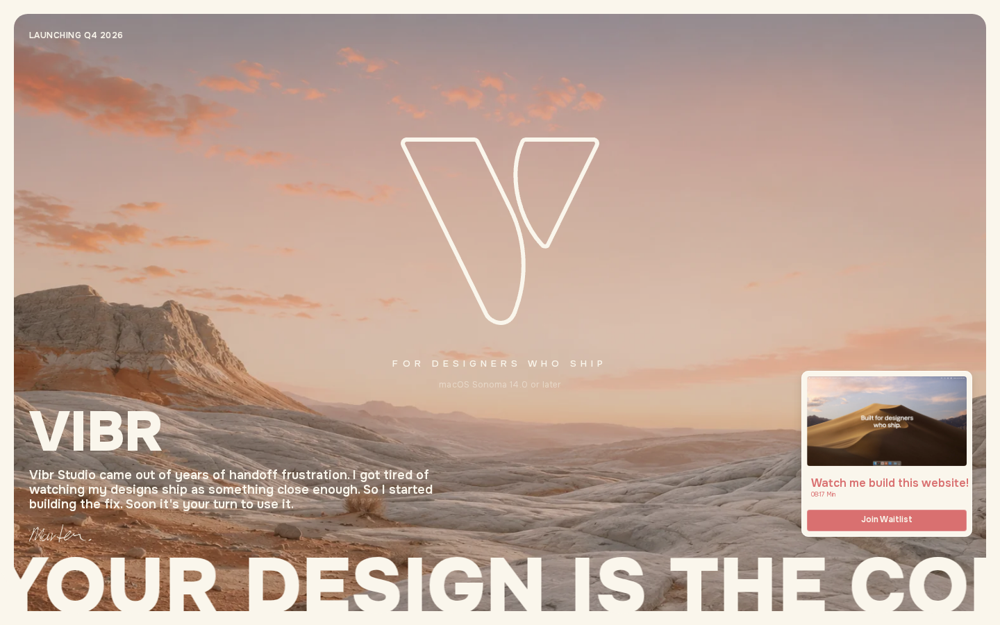

# UI Design System & Master Generation Blueprint: www-vibr-studio

> **Vibr — Figma to code for designers who ship** (https://www.vibr.studio/) — Your design is the code. Vibr compiles your Figma file into a responsive Next.js site you own, edit with Claude Code or Codex and ship. J...



---

## 1. Executive Visual Persona & Design Archetype

- **Brand Essence & Persona**: **Vibr — Figma to code for designers who ship** (`https://www.vibr.studio/`). Your design is the code. Vibr compiles your Figma file into a responsive Next.js site you own, edit with Claude Code or Codex and ship. J...
- **Capture Provenance**: Live browser capture (`tier1_fast`, HTTP `200`, captured `2026-11-23`).
- **Visual Archetype**: **Light-Gallery WebGL / Canvas Interactive Experience (`#faf6ec` / `#586aea`)**.
- **Anti-AI-Slop Differentiators**:
  - **Live-Computed Chromatic Polarity**: Anchors the viewport in `#faf6ec` (live computed `body` `background-color` (`computed_styles.json`)) paired with `#000000` primary typography and `#586aea` accents.
  - **Grounded Typographic Hierarchy**: Pairs `Onest` for display copy (`VIBR : FIGMA TO CODE FOR DESIGNERS W`) with `grain` and `SF Mono`.
  - **Calibrated Spatial Grid & Motion**: Combines `1822px` container bounds (`gap: 52.56px`, padding `37.44px`) with `cubic-bezier(.34,1.6,.64,1)` easing and Lenis Smooth Scroll (`data-lenis`), Three.js / WebGL Canvas Pipeline.

---

## 2. Spatial Architecture & Modular Grid Mathematics


### Viewport Allocation & Container Geometry
- **Captured Viewport Dimensions**: Desktop `1440×900px` (`assets/desktop.png`, single-viewport 100vh live capture (900px)), Mobile `390×2400px` (`assets/mobile.png`, clamped at 2400px live multi-section capture).
- **Master Container Bounds**: `1822px` (non-`@media` desktop container stylesheet rule).
- **Canvas Lateral Padding & Spacing**: `37.44px` lateral canvas padding with `52.56px` grid gap.
- **Border Radius Scale**: `4px`, `6px`, `20px`, `50%`.

### Responsive Breakpoint Architecture
- **Desktop Layout**: Multi-column CSS Grid / Flexbox layout at `1440px` (`max-width: 1822px`, `gap: 52.56px`).
- **Mobile Layout**: Single-column vertical stack at `390px` viewport width with `37.44px` horizontal padding.
- **Extracted CSS Media Queries**: `@media (max-width:1024px)`, `@media (max-width:480px)`, `@media (min-width:900px) and (min-height:720px) and (prefers-red...`, `@media (prefers-reduced-motion:reduce)`.

---

## 3. Color System, Materiality & Atmospheric Lighting

### Semantic Palette & Source Grounding
| Semantic Role | Ground-Truth Value | Extracted Live / CSS Source |
|---|---|---|
| **Primary Canvas Substrate** | `#faf6ec` | live computed `body` `background-color` (`computed_styles.json`) |
| **Primary Typography Ink** | `#000000` | live computed `main` `color` (`computed_styles.json`) |
| **Elevated Surface / Card Substrate** | `#f5f5f7` | `var(--bg)` in `:root` |
| **Interactive Accent / Highlight** | `#586aea` | live computed `a` `background-color` (`computed_styles.json`) |
| **Secondary / Muted Copy** | `#6e6e73` | `var(--text-secondary)` in `:root` |
| **Structural Hairline Border** | `#e6e3d9` | `var(--border)` in `:root` (`00000014`) |
| **Variable Token (`--surface`)** | `#ffffff` | `var(--surface)` in `:root` |
| **Variable Token (`--surface-hover`)** | `#e8e8ed` | `var(--surface-hover)` in `:root` |
| **Variable Token (`--text`)** | `#1d1d1f` | `var(--text)` in `:root` |
| **Variable Token (`--text-tertiary`)** | `#aeaeb2` | `var(--text-tertiary)` in `:root` |
| **Variable Token (`--accent`)** | `#6e5ce6` | `var(--accent)` in `:root` |
| **Variable Token (`--accent-hover`)** | `#5b48d4` | `var(--accent-hover)` in `:root` |
| **Variable Token (`--success`)** | `#30d158` | `var(--success)` in `:root` |
| **Variable Token (`--error`)** | `#ff453a` | `var(--error)` in `:root` |
| **Variable Token (`--coal`)** | `#40474b` | `var(--coal)` in `:root` |
| **Variable Token (`--dusty-brick`)** | `#d97070` | `var(--dusty-brick)` in `:root` |
| **Variable Token (`--warm-stone`)** | `#b8afa8` | `var(--warm-stone)` in `:root` |

### Sanitized Root CSS Variables (`ui-ux.md` Ground Truth)
| Variable Name | Extracted Value | Semantic Role |
|---|---|---|
| `--bg` | `#f5f5f7` | Canvas / Surface Token |
| `--surface` | `#fff` | Canvas / Surface Token |
| `--surface-hover` | `#e8e8ed` | Canvas / Surface Token |
| `--surface-elevated` | `#fff` | Canvas / Surface Token |
| `--text` | `#1d1d1f` | Typography Ink Token |
| `--text-secondary` | `#6e6e73` | Typography Ink Token |
| `--text-tertiary` | `#aeaeb2` | Typography Ink Token |
| `--accent` | `#6e5ce6` | Brand / Palette Token |
| `--accent-hover` | `#5b48d4` | Brand / Palette Token |
| `--border` | `#00000014` | Elevation / Border Token |
| `--success` | `#30d158` | Color / Atmospheric Token |
| `--error` | `#ff453a` | Color / Atmospheric Token |
| `--sand` | `#faf6ec` | Color / Atmospheric Token |
| `--coal` | `#40474b` | Color / Atmospheric Token |
| `--dusty-brick` | `#d97070` | Color / Atmospheric Token |
| `--warm-stone` | `#b8afa8` | Color / Atmospheric Token |

---

## 4. Typographic Scale & Editorial Hierarchy

### Font Family Stacks
- **Display Typography**: `Onest`.
- **Primary Body Stack**: `grain`.
- **Technical / Metadata Stack**: `SF Mono`.

### Typographic Scale & Rules (Live Computed & Stylesheet Grounded)
- **Hero Display (`H1`)**: live computed `h1` (`font-size: 80px`, `line-height: 72px`, `font-weight: 900`); CSS variables `--m-h1: 32px`, `--m-h1-lh: 1.1`.
- **Section Heading (`H2`)**: live computed `h2` (`font-size: 60.048px`, `line-height: 60.048px`, `font-weight: 600`, `letter-spacing: -1.5012px`); CSS variables `--m-h2: 24px`, `--m-h2-lh: 1.2`.
- **Body Copy**: live computed `body` (`font-size: 16px`, `line-height: 24px`, `font-weight: 400`); CSS variables `--m-body: 16px`, `--m-body-lh: 1.4`.
- **Metadata & Navigation Labels**: live computed `nav/a` (`font-size: 16px`, `line-height: normal`, `font-weight: 400`).

---

## 5. Choreographed Motion & Interaction Physics

### Primary Easing Curves
- **Extracted Timing Functions**: `cubic-bezier(.34,1.6,.64,1)`, `cubic-bezier(.22,1,.36,1)`, `cubic-bezier(.22,.7,.24,1)`.

### Per-Element Transition & Choreography Rules
- **Selector `.clock-section-module__aYA5Ra__ring`**: `transition: opacity .25s` extracted from `www-vibr-studio` stylesheet.
- **Selector `.clock-section-module__aYA5Ra__disc`**: `transition: opacity .2s,transform .28s cubic-bezier(.34,1.6,.64,1)` extracted from `www-vibr-studio` stylesheet.
- **Selector `.clock-section-module__aYA5Ra__check`**: `transition: opacity .18s 60ms,transform .28s cubic-bezier(.34,1.6,.64,1) 60ms` extracted from `www-vibr-studio` stylesheet.
- **Extracted Easing Curve (`cubic-bezier(.34,1.6,.64,1)`)**: Governs interactive state transitions across `<header.hero-module__sup1Jq__hero>` and `<main.landing-page-module__p_mWBW__page:nth(2)>`.
- **Runtime Interaction Engine**: Integrates Lenis Smooth Scroll (`data-lenis`), Three.js / WebGL Canvas Pipeline with `prefers-reduced-motion: reduce` fallback guards.

---

## 6. Component Wireframe & Structural DOM Map

### Visual Layout Schematic — Desktop (`1440px`, Grounded in `dom.html` & Landmark Bounding Boxes)
```
┌────────────────────────────────────────────────────────────────────────┐
│ DESKTOP VIEWPORT (1440px) — Vibr — Figma to code for designers who shi │
│ ====================================================================== │
│ [ <header.hero-module__s (1440x900px) | Overview · Index · Archive · ] │
│ ---------------------------------------------------------------------- │
│ | HERO STAGE: <main.landing-page-module__p_mWBW__p (w=1440px)        | │
│ | H1: VIBR : FIGMA TO CODE FOR DESIGNERS WHO SHIP                    | │
│ | Substrate: #faf6ec | Ink: #000000 | Accent: #586aea                | │
│ ---------------------------------------------------------------------- │
│ | SHOWCASE GRID (<main.landing-page-module_) max-w: 1822px           | │
│ | +------------------------------+  +------------------------------+ | │
│ | | Vibr : Figma to code for des |  | Vibr starts with your actual | | │
│ | +------------------------------+  +------------------------------+ | │
│ ---------------------------------------------------------------------- │
│ | DETAIL MODULE (<main.landing-page-module_) — Figma Build your sect | │
│ ---------------------------------------------------------------------- │
│ [ FOOTER (<footer.landing-foot) | https://www.vibr.studio/             │
└────────────────────────────────────────────────────────────────────────┘
```

### Visual Layout Schematic — Mobile Reflow (`390px`)
```
┌────────────────────────────────────────────────────────────────────────┐
│ MOBILE VIEWPORT REFLOW (390px) — Single-Column Stack (gap: 52.56px)    │
│ ====================================================================== │
│ [ HEADER BAR (<header.hero-module__sup) | Compact Menu (390px)         │
│ ---------------------------------------------------------------------- │
│ | HERO STAGE (<main.landing-page-modul) — 390px Vertical Lead        | │
│ | H1: VIBR : FIGMA TO CODE FOR DESIGNERS WHO SHIP                    | │
│ ---------------------------------------------------------------------- │
│ | SHOWCASE STACK (<main.landing-page-mod) — 1-Col Stack              | │
│ | [ Item 1: Vibr : Figma to code for designers who ship            ] | │
│ | [ Item 2: Vibr starts with your actual design.                   ] | │
│ ---------------------------------------------------------------------- │
│ | DETAIL STACK (<main.landing-page-modul) — 1-Col (Figma Build your s) │
│ ---------------------------------------------------------------------- │
│ [ FOOTER (<footer.landing-foot) | Stacked 390px Colophon               │
└────────────────────────────────────────────────────────────────────────┘
```

### Granular DOM Region Breakdown
1. **Brand Header & Navigation Bar (<header.hero-module__sup1Jq__hero> — `www-vibr-studio`)**:
   - Landmark `<header class="hero-module__sup1Jq__hero">` (`1440x900px`) hosting `Vibr — Figma to code for designers w` navigation (`Overview · Index · Archive · About · Contact`), DOM attributes (`data-precedence="next"`, `data-precedence="next"`, `data-sdkn="@vercel/analytics/next"`, `data-sdkv="2.0.1"`), and stylesheet rule `.about-me-module__qpLcqW__headlin... { width:100%;display:block }`.
2. **Hero Stage & Focal Lead (<main.landing-page-module__p_mWBW__page> — `VIBR : FIGMA TO CODE FOR DESIGNERS`)**:
   - Landmark `<main class="landing-page-module__p_mWBW__page">` presenting display lead `VIBR : FIGMA TO CODE FOR DESIGNERS WHO SHIP` and copy excerpt *"Your design is the code - Your design is the code - Your design i"* over `#faf6ec` canvas and `#000000` ink.
3. **Primary Showcase & Content Grid (<main.landing-page-module__p_mWBW__page:nth(2)> — `Vibr : Figma to code for designers`)**:
   - Landmark `<main class="landing-page-module__p_mWBW__page">` rendering section `Vibr : Figma to code for designers who ship` with copy *"Your design is the code -"*, asset references (`83afe278b6a6bb3c-s.p.3a6ba036.woff2`, `8780dfd0812b997c-s.p.5704523e.woff2`, `8800dfc60902df36-s.p.d48c4d68.woff2`, `Grain_Variable_Trial-s.p.2731fd70...`), and grid rule `.about-me-module__qpLcqW__authorIcon { flex-shrink:0;width:22px;height:22px;position:relative }`.
4. **Interactive Detail & Feature Matrix (<main.landing-page-module__p_mWBW__page:nth(3)> — `Vibr starts with your actual desig`)**:
   - Landmark `<main class="landing-page-module__p_mWBW__page">` framing `Vibr starts with your actual design.` and `Figma Build your sections` (*": Figma to code for designers who ship"*) with `#f5f5f7` surface cards, `#586aea` accents, and `.about-me-module__qpLcqW__authorG... { width:62.5%;height:62.5%;position:absolute;top:18.87%;left:18.75%;overfl... }`.
5. **Colophon & Global Directory Footer (<footer.landing-footer-module__8-2yDa__root> — `https://www.vibr.studio/`)**:
   - Landmark `<footer class="landing-footer-module__8-2yDa__root">` anchoring `Vibr — Figma to code for designe` footer links (`Overview · Index · Archive · About · Contact`), copy *"Vibr Studio came out of years of handoff frustration. I got "*, and `#e6e3d9` structural dividers.

---

## 7. Master Zero-Shot AI Generation Prompt

```markdown
# Master Zero-Shot Frontend Generation Prompt: www-vibr-studio (Vibr — Figma to code for designers who ship)

You are a principal frontend architect and design systems engineer. Build a complete, production-ready web application replicating the exact design system, DOM landmarks, typographic hierarchy, color tokens, and motion physics of `www-vibr-studio` (**Vibr — Figma to code for designers who ship** — `https://www.vibr.studio/`).

### 1. Visual Archetype & Anti-AI-Slop Mandates
- **Archetype**: Light-Gallery WebGL / Canvas Interactive Experience (`#faf6ec` / `#586aea`).
- **Identity & Domain Context**: Your design is the code. Vibr compiles your Figma file into a responsive Next.js site you own, edit with Claude Code or Codex and ship. J...
- **Primary Substrate**: `#faf6ec` (live computed `body` `background-color` (`computed_styles.json`)), **Primary Ink**: `#000000`, **Accent / Highlight**: `#586aea`.
- **Site-Specific Differentiators**:
  - **Live-Computed Chromatic Polarity**: Anchors the viewport in `#faf6ec` (live computed `body` `background-color` (`computed_styles.json`)) paired with `#000000` primary typography and `#586aea` accents.
  - **Grounded Typographic Hierarchy**: Pairs `Onest` for display copy (`VIBR : FIGMA TO CODE FOR DESIGNERS W`) with `grain` and `SF Mono`.
  - **Calibrated Spatial Grid & Motion**: Combines `1822px` container bounds (`gap: 52.56px`, padding `37.44px`) with `cubic-bezier(.34,1.6,.64,1)` easing and Lenis Smooth Scroll (`data-lenis`), Three.js / WebGL Canvas Pipeline.

### 2. Ground-Truth CSS Variables (`:root` Token Contract)
Declare and consume these exact custom properties extracted from `www-vibr-studio` in your global stylesheet:

:root {
  /* Vibr — Figma to code for designers who ship (www-vibr-studio) — Live-Grounded CSS Variables */
  --bg: #f5f5f7; /* Canvas / Surface Token (www-vibr-studio) */
  --surface: #fff; /* Canvas / Surface Token (www-vibr-studio) */
  --surface-hover: #e8e8ed; /* Canvas / Surface Token (www-vibr-studio) */
  --surface-elevated: #fff; /* Canvas / Surface Token (www-vibr-studio) */
  --text: #1d1d1f; /* Typography Ink Token (www-vibr-studio) */
  --text-secondary: #6e6e73; /* Typography Ink Token (www-vibr-studio) */
  --text-tertiary: #aeaeb2; /* Typography Ink Token (www-vibr-studio) */
  --accent: #6e5ce6; /* Brand / Palette Token (www-vibr-studio) */
  --accent-hover: #5b48d4; /* Brand / Palette Token (www-vibr-studio) */
  --border: #00000014; /* Elevation / Border Token (www-vibr-studio) */
  --success: #30d158; /* Color / Atmospheric Token (www-vibr-studio) */
  --error: #ff453a; /* Color / Atmospheric Token (www-vibr-studio) */
  --sand: #faf6ec; /* Color / Atmospheric Token (www-vibr-studio) */
  --coal: #40474b; /* Color / Atmospheric Token (www-vibr-studio) */
  --dusty-brick: #d97070; /* Color / Atmospheric Token (www-vibr-studio) */
  --warm-stone: #b8afa8; /* Color / Atmospheric Token (www-vibr-studio) */
}

### 3. Semantic Color & Materiality Contract
Map every surface, ink, and border strictly to these source-grounded tokens:
- **Primary Canvas Substrate**: `#faf6ec` — grounded in live computed `body` `background-color` (`computed_styles.json`)
- **Primary Typography Ink**: `#000000` — grounded in live computed `main` `color` (`computed_styles.json`)
- **Elevated Surface / Card Substrate**: `#f5f5f7` — grounded in `var(--bg)` in `:root`
- **Interactive Accent / Highlight**: `#586aea` — grounded in live computed `a` `background-color` (`computed_styles.json`)
- **Secondary / Muted Copy**: `#6e6e73` — grounded in `var(--text-secondary)` in `:root`
- **Structural Hairline Border**: `#e6e3d9` — grounded in `var(--border)` in `:root` (`00000014`)
- **Variable Token (`--surface`)**: `#ffffff` — grounded in `var(--surface)` in `:root`
- **Variable Token (`--surface-hover`)**: `#e8e8ed` — grounded in `var(--surface-hover)` in `:root`
- **Variable Token (`--text`)**: `#1d1d1f` — grounded in `var(--text)` in `:root`
- **Variable Token (`--text-tertiary`)**: `#aeaeb2` — grounded in `var(--text-tertiary)` in `:root`
- **Variable Token (`--accent`)**: `#6e5ce6` — grounded in `var(--accent)` in `:root`
- **Variable Token (`--accent-hover`)**: `#5b48d4` — grounded in `var(--accent-hover)` in `:root`
- **Variable Token (`--success`)**: `#30d158` — grounded in `var(--success)` in `:root`
- **Variable Token (`--error`)**: `#ff453a` — grounded in `var(--error)` in `:root`
- **Variable Token (`--coal`)**: `#40474b` — grounded in `var(--coal)` in `:root`
- **Variable Token (`--dusty-brick`)**: `#d97070` — grounded in `var(--dusty-brick)` in `:root`
- **Variable Token (`--warm-stone`)**: `#b8afa8` — grounded in `var(--warm-stone)` in `:root`

### 4. Spatial Grid, Container Bounds & Responsive Breakpoints
- **Desktop Viewport Reference**: `1440×900px` (single-viewport 100vh live capture (900px), `1440px` standard desktop width).
- **Mobile Viewport Reference**: `390×2400px` (clamped at 2400px live multi-section capture, `390px` standard mobile width).
- **Container Max-Width**: `1822px` (non-`@media` desktop container stylesheet rule)
- **Padding & Gutters**: `37.44px` lateral canvas padding with `52.56px` grid gap
- **Desktop Grid**: Multi-column CSS Grid / Flexbox layout at `1440px` (`max-width: 1822px`, `gap: 52.56px`)
- **Mobile Adaptation**: Single-column vertical stack at `390px` viewport width with `37.44px` horizontal padding
- **Media Queries**: `@media (max-width:1024px)`, `@media (max-width:480px)`, `@media (min-width:900px) and (min-height:720px) and (prefers-red...`, `@media (prefers-reduced-motion:reduce)`
- **Corner Radii**: `4px`, `6px`, `20px`, `50%`

### 5. Typography & Editorial Scale Contract
- **Display Font Stack**: `Onest`
- **Body Font Stack**: `grain`
- **Monospace / Technical Font Stack**: `SF Mono`
- **H1 Display Rule**: live computed `h1` (`font-size: 80px`, `line-height: 72px`, `font-weight: 900`); CSS variables `--m-h1: 32px`, `--m-h1-lh: 1.1`
- **H2 Section Rule**: live computed `h2` (`font-size: 60.048px`, `line-height: 60.048px`, `font-weight: 600`, `letter-spacing: -1.5012px`); CSS variables `--m-h2: 24px`, `--m-h2-lh: 1.2`
- **Body Copy Rule**: live computed `body` (`font-size: 16px`, `line-height: 24px`, `font-weight: 400`); CSS variables `--m-body: 16px`, `--m-body-lh: 1.4`
- **Metadata & Index Rule**: live computed `nav/a` (`font-size: 16px`, `line-height: normal`, `font-weight: 400`)

### 6. Component Hierarchy, Verbatim Copy & Real DOM Landmarks
Scaffold `www-vibr-studio` (`Vibr — Figma to code for designers who ship`) with these exact structural regions, extracted copy, and CSS rules from `dom.html`:
1. **Brand Header & Navigation Bar (<header.hero-module__sup1Jq__hero> — `www-vibr-studio`)**:
   - DOM & Selectors: Landmark `<header class="hero-module__sup1Jq__hero">` (`1440x900px`) hosting `Vibr — Figma to code for designers w` navigation (`Overview · Index · Archive · About · Contact`), DOM attributes (`data-precedence="next"`, `data-precedence="next"`, `data-sdkn="@vercel/analytics/next"`, `data-sdkv="2.0.1"`), and stylesheet rule `.about-me-module__qpLcqW__headlin... { width:100%;display:block }`.
   - Responsive Contract: Header `Brand Header & Navigation Bar (<header.hero-module__sup1Jq__hero> — `www-vibr-studio`)` (`www-vibr-studio`) adapts across `@media (max-width:1024px)`, `@media (max-width:480px)`, `@media (min-width:900px) and (min-height:720px) and (prefers-red...`, `@media (prefers-reduced-motion:reduce)` with `cubic-bezier(.34,1.6,.64,1)`, `cubic-bezier(.22,1,.36,1)`, `cubic-bezier(.22,.7,.24,1)` transitions and links `Overview · Index · Archive · About · Contact`.
2. **Hero Stage & Focal Lead (<main.landing-page-module__p_mWBW__page> — `VIBR : FIGMA TO CODE FOR DESIGNERS`)**:
   - DOM & Selectors: Landmark `<main class="landing-page-module__p_mWBW__page">` presenting display lead `VIBR : FIGMA TO CODE FOR DESIGNERS WHO SHIP` and copy excerpt *"Your design is the code - Your design is the code - Your design i"* over `#faf6ec` canvas and `#000000` ink.
   - Responsive Contract: Hero stage (`1440×900px` desktop / `390×2400px` mobile) sets `#faf6ec` background with `#000000` headline `VIBR : FIGMA TO CODE FOR DESIGNERS WHO SHIP`.
3. **Primary Showcase & Content Grid (<main.landing-page-module__p_mWBW__page:nth(2)> — `Vibr : Figma to code for designers`)**:
   - DOM & Selectors: Landmark `<main class="landing-page-module__p_mWBW__page">` rendering section `Vibr : Figma to code for designers who ship` with copy *"Your design is the code -"*, asset references (`83afe278b6a6bb3c-s.p.3a6ba036.woff2`, `8780dfd0812b997c-s.p.5704523e.woff2`, `8800dfc60902df36-s.p.d48c4d68.woff2`, `Grain_Variable_Trial-s.p.2731fd70...`), and grid rule `.about-me-module__qpLcqW__authorIcon { flex-shrink:0;width:22px;height:22px;position:relative }`.
   - Responsive Contract: Showcase grid `Primary Showcase & Content Grid (<main.landing-page-module__p_mWBW__page:nth(2)> — `Vibr : Figma to code for designers`)` applies Multi-column CSS Grid / Flexbox layout at `1440px` (`max-width: 1822px`, `gap: 52.56px`) on desktop and Single-column vertical stack at `390px` viewport width with `37.44px` horizontal padding on mobile.
4. **Interactive Detail & Feature Matrix (<main.landing-page-module__p_mWBW__page:nth(3)> — `Vibr starts with your actual desig`)**:
   - DOM & Selectors: Landmark `<main class="landing-page-module__p_mWBW__page">` framing `Vibr starts with your actual design.` and `Figma Build your sections` (*": Figma to code for designers who ship"*) with `#f5f5f7` surface cards, `#586aea` accents, and `.about-me-module__qpLcqW__authorG... { width:62.5%;height:62.5%;position:absolute;top:18.87%;left:18.75%;overfl... }`.
   - Responsive Contract: Detail module `Interactive Detail & Feature Matrix (<main.landing-page-module__p_mWBW__page:nth(3)> — `Vibr starts with your actual desig`)` uses `4px`, `6px`, `20px`, `50%` radii, `#586aea` highlights, and assets (83afe278b6a6bb3c-s.p.3a6ba036.woff2, 8780dfd0812b997c-s.p.5704523e.woff2, 8800dfc60902df36-s.p.d48c4d68.woff2).
5. **Colophon & Global Directory Footer (<footer.landing-footer-module__8-2yDa__root> — `https://www.vibr.studio/`)**:
   - DOM & Selectors: Landmark `<footer class="landing-footer-module__8-2yDa__root">` anchoring `Vibr — Figma to code for designe` footer links (`Overview · Index · Archive · About · Contact`), copy *"Vibr Studio came out of years of handoff frustration. I got "*, and `#e6e3d9` structural dividers.
   - Responsive Contract: Footer `Colophon & Global Directory Footer (<footer.landing-footer-module__8-2yDa__root> — `https://www.vibr.studio/`)` aligns to `1822px` (non-`@media` desktop container stylesheet rule) with `37.44px` lateral canvas padding with `52.56px` grid gap and attributes (data-precedence="next", data-precedence="next", data-sdkn="@vercel/analytics/next").

#### Verbatim DOM Copy Excerpts (`dom.html`)
- Copy Excerpt 1: *"Your design is the code - Your design is the code - Your design is the code - Your..."*
- Copy Excerpt 2: *"Your design is the code -"*
- Copy Excerpt 3: *": Figma to code for designers who ship"*
- Copy Excerpt 4: *"Vibr Studio came out of years of handoff frustration. I got tired of watching my d..."*

### 7. Motion, Extracted Stylesheet Rules & Interaction Choreography
- **Primary Easing Functions**: `cubic-bezier(.34,1.6,.64,1)`, `cubic-bezier(.22,1,.36,1)`, `cubic-bezier(.22,.7,.24,1)`
- **Extracted Stylesheet Rules (`www-vibr-studio`)**:
- `.about-me-module__qpLcqW__headlin... { width:100%;display:block }`
- `.about-me-module__qpLcqW__authorIcon { flex-shrink:0;width:22px;height:22px;position:relative }`
- `.about-me-module__qpLcqW__authorG... { width:62.5%;height:62.5%;position:absolute;top:18.87%;left:18.75%;overfl... }`
- `.about-me-module__qpLcqW__column { box-sizing:border-box;padding-inline:30px }`
- `.about-me-module__qpLcqW__bio { font-size:var(--m-body);line-height:var(--m-body-lh) }`
- **Per-Selector Transition Rules**:
- **Selector `.clock-section-module__aYA5Ra__ring`**: `transition: opacity .25s` extracted from `www-vibr-studio` stylesheet.
- **Selector `.clock-section-module__aYA5Ra__disc`**: `transition: opacity .2s,transform .28s cubic-bezier(.34,1.6,.64,1)` extracted from `www-vibr-studio` stylesheet.
- **Selector `.clock-section-module__aYA5Ra__check`**: `transition: opacity .18s 60ms,transform .28s cubic-bezier(.34,1.6,.64,1) 60ms` extracted from `www-vibr-studio` stylesheet.
- **Extracted Easing Curve (`cubic-bezier(.34,1.6,.64,1)`)**: Governs interactive state transitions across `<header.hero-module__sup1Jq__hero>` and `<main.landing-page-module__p_mWBW__page:nth(2)>`.
- **Runtime Interaction Engine**: Integrates Lenis Smooth Scroll (`data-lenis`), Three.js / WebGL Canvas Pipeline with `prefers-reduced-motion: reduce` fallback guards.

### 8. Technical Deliverables
- Implement in Next.js (App Router) with TypeScript and Tailwind CSS consuming the `:root` custom properties defined above for `www-vibr-studio`.
- Reproduce both the `1440px` desktop architecture and `390px` mobile breakpoint transitions, preserving semantic HTML5 landmarks (`<header>`, `<nav>`, `<main>`, `<section>`, `<footer>`) and `prefers-reduced-motion` accessibility guards.
```
