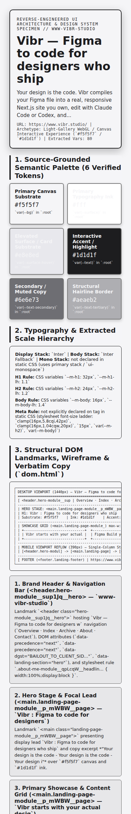

# UI Design System & Master Generation Blueprint: www-vibr-studio

> **Vibr — Figma to code for designers who ship** (https://www.vibr.studio/) — Your design is the code. Vibr compiles your Figma file into a real, responsive Next.js site you own, edit with Claude Code or Codex, and...


---

## 1. Executive Visual Persona & Design Archetype

- **Brand Essence & Persona**: **Vibr — Figma to code for designers who ship** (`https://www.vibr.studio/`). Your design is the code. Vibr compiles your Figma file into a real, responsive Next.js site you own, edit with Claude Code or Codex, and...
- **Visual Archetype**: **Light-Gallery WebGL / Canvas Interactive Experience (`#f5f5f7` / `#1d1d1f`)**.
- **Anti-AI-Slop Differentiators**:
  - **Source-Grounded Chromatic Polarity**: Anchors the viewport in `#f5f5f7` (`var(--bg)` in `:root`) paired with `#1d1d1f` primary typography and `#1d1d1f` accents.
  - **Extracted Typographic Hierarchy**: Pairs `Inter` for display copy (`Vibr : Figma to code for designers w`) with `Inter Fallback` and not declared in static CSS (uses primary stack / `ui-monospace`).
  - **Calibrated Spatial Grid & Motion**: Combines `800px` container bounds (`gap: 6px`, padding `2px`) with `cubic-bezier(.34,1.6,.64,1)` easing and Lenis Smooth Scroll (`data-lenis`), Three.js / WebGL Canvas Pipeline.

---

## 2. Spatial Architecture & Modular Grid Mathematics



### Viewport Allocation & Container Geometry
- **Captured Viewport Dimensions**: Desktop `1440×2400px` (`assets/desktop.png`, capped at 2400px multi-section capture), Mobile `390×2400px` (`assets/mobile.png`, capped at 2400px multi-section capture).
- **Master Container Bounds**: `800px` extracted from `www-vibr-studio` stylesheet.
- **Canvas Lateral Padding & Spacing**: `2px` lateral canvas padding with `6px` grid gap.
- **Border Radius Scale**: `20px`, `6px`, `50%`, `.75px`.

### Responsive Breakpoint Architecture
- **Desktop Layout**: Multi-column CSS Grid / Flexbox layout at `1440px` (`max-width: 800px`, `gap: 6px`).
- **Mobile Layout**: Single-column vertical stack at `390px` viewport width with `2px` horizontal padding.
- **Extracted CSS Media Queries**: `@media (max-width:1024px)`, `@media (max-width:480px)`, `@media (min-width:900px) and (min-height:720px) and (prefers-red...`, `@media (prefers-reduced-motion:reduce)`.

---

## 3. Color System, Materiality & Atmospheric Lighting

### Semantic Palette & Source Grounding
| Semantic Role | Ground-Truth Value | Extracted CSS Source / Selector |
|---|---|---|
| **Primary Canvas Substrate** | `#f5f5f7` | `var(--bg)` in `:root` |
| **Primary Typography Ink** | `#fff` | `var(--surface)` in `:root` |
| **Elevated Surface / Card Substrate** | `#e8e8ed` | `var(--surface-hover)` in `:root` |
| **Interactive Accent / Highlight** | `#1d1d1f` | `var(--text)` in `:root` |
| **Secondary / Muted Copy** | `#6e6e73` | `var(--text-secondary)` in `:root` |
| **Structural Hairline Border** | `#aeaeb2` | `var(--text-tertiary)` in `:root` |

### Sanitized Root CSS Variables (`ui-ux.md` Ground Truth)
| Variable Name | Extracted Value | Semantic Role |
|---|---|---|
| `--panel-w` | `min(440px,calc(100vw - 40px))` | Dimension / Scale Token |
| `--panel-h` | `calc(100dvh - 100px)` | Dimension / Scale Token |
| `--panel-inset` | `20px` | Dimension / Scale Token |
| `--content-top` | `65px` | Dimension / Scale Token |
| `--bleed` | `32px` | Dimension / Scale Token |
| `--gutter` | `clamp(20px,7vw,56px)` | Layout / Spatial Grid Token |
| `--card-zoom` | `.6` | Design System Custom Token |
| `--hero-mark` | `316px` | Dimension / Scale Token |
| `--hero-gap` | `clamp(32px,3.34cqw,64px)` | Layout / Spatial Grid Token |
| `--hero-bottom-block` | `199px` | Dimension / Scale Token |
| `--hero-bottom-offset` | `clamp(90px,8cqw,154px)` | Dimension / Scale Token |
| `--hero-clear` | `24px` | Dimension / Scale Token |
| `--hero-phone-top` | `70px` | Dimension / Scale Token |
| `--watch-card-w` | `246px` | Dimension / Scale Token |
| `--watch-card-h` | `239.38px` | Dimension / Scale Token |
| `--watch-card-right` | `clamp(20px,2.76cqw,53px)` | Dimension / Scale Token |

---

## 4. Typographic Scale & Editorial Hierarchy

### Font Family Stacks
- **Display Typography**: `Inter`.
- **Primary Body Stack**: `Inter Fallback`.
- **Technical / Metadata Stack**: not declared in static CSS (uses primary stack / `ui-monospace`).

### Typographic Scale & Rules (Extracted from Stylesheet & Variables)
- **Hero Display (`H1`)**: CSS variables `--m-h1: 32px`, `--m-h1-lh: 1.1`.
- **Section Heading (`H2`)**: CSS variables `--m-h2: 24px`, `--m-h2-lh: 1.2`.
- **Body Copy**: CSS variables `--m-body: 16px`, `--m-body-lh: 1.4`.
- **Metadata & Navigation Labels**: not explicitly declared on tag in static CSS (stylesheet font-size ladder: `clamp(16px,5.8cqi,42px)`, `clamp(16px,1.04cqw,20px)`, `15px`, `var(--m-h2)`, `var(--m-body)`).

---

## 5. Choreographed Motion & Interaction Physics

### Primary Easing Curves
- **Extracted Timing Functions**: `cubic-bezier(.34,1.6,.64,1)`, `cubic-bezier(.22,1,.36,1)`, `cubic-bezier(.22,.7,.24,1)`.

### Per-Element Transition & Choreography Rules
- **Selector `.clock-section-module__aYA5Ra__ring`**: `transition: opacity .25s` extracted from `www-vibr-studio` stylesheet.
- **Selector `.clock-section-module__aYA5Ra__disc`**: `transition: opacity .2s,transform .28s cubic-bezier(.34,1.6,.64,1)` extracted from `www-vibr-studio` stylesheet.
- **Selector `.clock-section-module__aYA5Ra__check`**: `transition: opacity .18s 60ms,transform .28s cubic-bezier(.34,1.6,.64,1) 60ms` extracted from `www-vibr-studio` stylesheet.
- **Extracted Easing Curve (`cubic-bezier(.34,1.6,.64,1)`)**: Governs interactive state transitions across `<header.hero-module__sup1Jq__hero>` and `<main.landing-page-module__p_mWBW__page>`.
- **Runtime Interaction Engine**: Integrates Lenis Smooth Scroll (`data-lenis`), Three.js / WebGL Canvas Pipeline with `prefers-reduced-motion: reduce` fallback guards.

---

## 6. Component Wireframe & Structural DOM Map

### Visual Layout Schematic (Grounded in `dom.html` — `1440px` Desktop & `390px` Mobile Reflow)
```
┌────────────────────────────────────────────────────────────────────────┐
│ DESKTOP VIEWPORT (1440px) — Vibr — Figma to code for designers who shi │
│ ====================================================================== │
│ [ <header.hero-module__sup | Overview · Index · Archive · About · C ]  │
│ ---------------------------------------------------------------------- │
│ | HERO STAGE: <main.landing-page-module__p_mWBW__page>             |   │
│ | H1: Vibr : Figma to code for designers who ship                  |   │
│ | Substrate: #f5f5f7    | Ink: #1d1d1f    | Accent: #1d1d1f        |   │
│ ---------------------------------------------------------------------- │
│ | SHOWCASE GRID (<main.landing-page-module_) max-w: 800px          |   │
│ | +------------------------------+  +------------------------------+ | │
│ | | Vibr starts with your actual |  | Figma Build your sections    | | │
│ | +------------------------------+  +------------------------------+ | │
│ ---------------------------------------------------------------------- │
│ | MOBILE VIEWPORT REFLOW (390px) — Single-Column Stack (gap: 6px   ) | │
│ | [<header.hero-modul] -> [<main.landing-page] -> [<main.landing-page] │
│ ---------------------------------------------------------------------- │
│ [ FOOTER (<footer.landing-footer) | https://www.vibr.studio/           │
└────────────────────────────────────────────────────────────────────────┘
```

### Granular DOM Region Breakdown
1. **Brand Header & Navigation Bar (<header.hero-module__sup1Jq__hero> — `www-vibr-studio`)**:
   - Landmark `<header class="hero-module__sup1Jq__hero">` hosting `Vibr — Figma to code for designers w` navigation (`Overview · Index · Archive · About · Contact`), DOM attributes (`data-precedence="next"`, `data-precedence="next"`, `data-dgst="BAILOUT_TO_CLIENT_SID..."`, `data-landing-section="hero"`), and stylesheet rule `.about-me-module__qpLcqW__headlin... { width:100%;display:block }`.
2. **Hero Stage & Focal Lead (<main.landing-page-module__p_mWBW__page> — `Vibr : Figma to code for designers`)**:
   - Landmark `<main class="landing-page-module__p_mWBW__page">` presenting display lead `Vibr : Figma to code for designers who ship` and copy excerpt *"Your design is the code - Your design is the code - Your design i"* over `#f5f5f7` canvas and `#1d1d1f` ink.
3. **Primary Showcase & Content Grid (<main.landing-page-module__p_mWBW__page> — `Vibr starts with your actual desig`)**:
   - Landmark `<main class="landing-page-module__p_mWBW__page">` rendering section `Vibr starts with your actual design.` with copy *"Your design is the code -"*, asset references (`83afe278b6a6bb3c-s.p.3a6ba036.woff2`, `8780dfd0812b997c-s.p.5704523e.woff2`, `8800dfc60902df36-s.p.d48c4d68.woff2`, `Grain_Variable_Trial-s.p.2731fd70...`), and grid rule `.about-me-module__qpLcqW__authorIcon { flex-shrink:0;width:22px;height:22px;position:relative }`.
4. **Interactive Detail & Feature Matrix (<main.landing-page-module__p_mWBW__page> — `Figma Build your sections`)**:
   - Landmark `<main class="landing-page-module__p_mWBW__page">` framing `Figma Build your sections` and `Compile Click to edit anything` (*": Figma to code for designers who ship"*) with `#e8e8ed` surface cards, `#1d1d1f` accents, and `.about-me-module__qpLcqW__authorG... { width:62.5%;height:62.5%;position:absolute;top:18.87%;left:18.75%;overfl... }`.
5. **Colophon & Global Directory Footer (<footer.landing-footer-module__8-2yDa__root> — `https://www.vibr.studio/`)**:
   - Landmark `<footer class="landing-footer-module__8-2yDa__root">` anchoring `Vibr — Figma to code for designe` footer links (`Overview · Index · Archive · About · Contact`), copy *"Vibr Studio came out of years of handoff frustration. I got "*, and `#aeaeb2` structural dividers.

---

## 7. Master Zero-Shot AI Generation Prompt

```markdown
# Master Zero-Shot Frontend Generation Prompt: www-vibr-studio (Vibr — Figma to code for designers who ship)

You are a principal frontend architect and design systems engineer. Build a complete, production-ready web application replicating the exact design system, DOM landmarks, typographic hierarchy, color tokens, and motion physics of `www-vibr-studio` (**Vibr — Figma to code for designers who ship** — `https://www.vibr.studio/`).

### 1. Visual Archetype & Anti-AI-Slop Mandates
- **Archetype**: Light-Gallery WebGL / Canvas Interactive Experience (`#f5f5f7` / `#1d1d1f`).
- **Identity & Domain Context**: Your design is the code. Vibr compiles your Figma file into a real, responsive Next.js site you own, edit with Claude Code or Codex, and...
- **Primary Substrate**: `#f5f5f7` (`var(--bg)` in `:root`), **Primary Ink**: `#1d1d1f`, **Accent / Highlight**: `#1d1d1f`.
- **Site-Specific Differentiators**:
  - **Source-Grounded Chromatic Polarity**: Anchors the viewport in `#f5f5f7` (`var(--bg)` in `:root`) paired with `#1d1d1f` primary typography and `#1d1d1f` accents.
  - **Extracted Typographic Hierarchy**: Pairs `Inter` for display copy (`Vibr : Figma to code for designers w`) with `Inter Fallback` and not declared in static CSS (uses primary stack / `ui-monospace`).
  - **Calibrated Spatial Grid & Motion**: Combines `800px` container bounds (`gap: 6px`, padding `2px`) with `cubic-bezier(.34,1.6,.64,1)` easing and Lenis Smooth Scroll (`data-lenis`), Three.js / WebGL Canvas Pipeline.

### 2. Ground-Truth CSS Variables (`:root` Token Contract)
Declare and consume these exact custom properties extracted from `www-vibr-studio` in your global stylesheet:

:root {
  /* Vibr — Figma to code for designers who ship (www-vibr-studio) — Ground-Truth Extracted CSS Variables */
  --panel-w: min(440px,calc(100vw - 40px)); /* Dimension / Scale Token (www-vibr-studio) */
  --panel-h: calc(100dvh - 100px); /* Dimension / Scale Token (www-vibr-studio) */
  --panel-inset: 20px; /* Dimension / Scale Token (www-vibr-studio) */
  --content-top: 65px; /* Dimension / Scale Token (www-vibr-studio) */
  --bleed: 32px; /* Dimension / Scale Token (www-vibr-studio) */
  --gutter: clamp(20px,7vw,56px); /* Layout / Spatial Grid Token (www-vibr-studio) */
  --card-zoom: .6; /* Design System Custom Token (www-vibr-studio) */
  --hero-mark: 316px; /* Dimension / Scale Token (www-vibr-studio) */
  --hero-gap: clamp(32px,3.34cqw,64px); /* Layout / Spatial Grid Token (www-vibr-studio) */
  --hero-bottom-block: 199px; /* Dimension / Scale Token (www-vibr-studio) */
  --hero-bottom-offset: clamp(90px,8cqw,154px); /* Dimension / Scale Token (www-vibr-studio) */
  --hero-clear: 24px; /* Dimension / Scale Token (www-vibr-studio) */
  --hero-phone-top: 70px; /* Dimension / Scale Token (www-vibr-studio) */
  --watch-card-w: 246px; /* Dimension / Scale Token (www-vibr-studio) */
  --watch-card-h: 239.38px; /* Dimension / Scale Token (www-vibr-studio) */
  --watch-card-right: clamp(20px,2.76cqw,53px); /* Dimension / Scale Token (www-vibr-studio) */
}

### 3. Semantic Color & Materiality Contract
Map every surface, ink, and border strictly to these source-grounded tokens:
- **Primary Canvas Substrate**: `#f5f5f7` — grounded in `var(--bg)` in `:root`
- **Primary Typography Ink**: `#fff` — grounded in `var(--surface)` in `:root`
- **Elevated Surface / Card Substrate**: `#e8e8ed` — grounded in `var(--surface-hover)` in `:root`
- **Interactive Accent / Highlight**: `#1d1d1f` — grounded in `var(--text)` in `:root`
- **Secondary / Muted Copy**: `#6e6e73` — grounded in `var(--text-secondary)` in `:root`
- **Structural Hairline Border**: `#aeaeb2` — grounded in `var(--text-tertiary)` in `:root`

### 4. Spatial Grid, Container Bounds & Responsive Breakpoints
- **Desktop Viewport Reference**: `1440×2400px` (capped at 2400px multi-section capture, `1440px` standard desktop width).
- **Mobile Viewport Reference**: `390×2400px` (capped at 2400px multi-section capture, `390px` standard mobile width).
- **Container Max-Width**: `800px` extracted from `www-vibr-studio` stylesheet
- **Padding & Gutters**: `2px` lateral canvas padding with `6px` grid gap
- **Desktop Grid**: Multi-column CSS Grid / Flexbox layout at `1440px` (`max-width: 800px`, `gap: 6px`)
- **Mobile Adaptation**: Single-column vertical stack at `390px` viewport width with `2px` horizontal padding
- **Media Queries**: `@media (max-width:1024px)`, `@media (max-width:480px)`, `@media (min-width:900px) and (min-height:720px) and (prefers-red...`, `@media (prefers-reduced-motion:reduce)`
- **Corner Radii**: `20px`, `6px`, `50%`, `.75px`

### 5. Typography & Editorial Scale Contract
- **Display Font Stack**: `Inter`
- **Body Font Stack**: `Inter Fallback`
- **Monospace / Technical Font Stack**: not declared in static CSS (uses primary stack / `ui-monospace`)
- **H1 Display Rule**: CSS variables `--m-h1: 32px`, `--m-h1-lh: 1.1`
- **H2 Section Rule**: CSS variables `--m-h2: 24px`, `--m-h2-lh: 1.2`
- **Body Copy Rule**: CSS variables `--m-body: 16px`, `--m-body-lh: 1.4`
- **Metadata & Index Rule**: not explicitly declared on tag in static CSS (stylesheet font-size ladder: `clamp(16px,5.8cqi,42px)`, `clamp(16px,1.04cqw,20px)`, `15px`, `var(--m-h2)`, `var(--m-body)`)

### 6. Component Hierarchy, Verbatim Copy & Real DOM Landmarks
Scaffold `www-vibr-studio` (`Vibr — Figma to code for designers who ship`) with these exact structural regions, extracted copy, and CSS rules from `dom.html`:
1. **Brand Header & Navigation Bar (<header.hero-module__sup1Jq__hero> — `www-vibr-studio`)**:
   - DOM & Selectors: Landmark `<header class="hero-module__sup1Jq__hero">` hosting `Vibr — Figma to code for designers w` navigation (`Overview · Index · Archive · About · Contact`), DOM attributes (`data-precedence="next"`, `data-precedence="next"`, `data-dgst="BAILOUT_TO_CLIENT_SID..."`, `data-landing-section="hero"`), and stylesheet rule `.about-me-module__qpLcqW__headlin... { width:100%;display:block }`.
   - Responsive Contract: Header `Brand Header & Navigation Bar (<header.hero-module__sup1Jq__hero> — `www-vibr-studio`)` (`www-vibr-studio`) adapts across `@media (max-width:1024px)`, `@media (max-width:480px)`, `@media (min-width:900px) and (min-height:720px) and (prefers-red...`, `@media (prefers-reduced-motion:reduce)` with `cubic-bezier(.34,1.6,.64,1)`, `cubic-bezier(.22,1,.36,1)`, `cubic-bezier(.22,.7,.24,1)` transitions and links `Overview · Index · Archive · About · Contact`.
2. **Hero Stage & Focal Lead (<main.landing-page-module__p_mWBW__page> — `Vibr : Figma to code for designers`)**:
   - DOM & Selectors: Landmark `<main class="landing-page-module__p_mWBW__page">` presenting display lead `Vibr : Figma to code for designers who ship` and copy excerpt *"Your design is the code - Your design is the code - Your design i"* over `#f5f5f7` canvas and `#1d1d1f` ink.
   - Responsive Contract: Hero stage (`1440×2400px` desktop / `390×2400px` mobile) sets `#f5f5f7` background with `#1d1d1f` headline `Vibr : Figma to code for designers who ship`.
3. **Primary Showcase & Content Grid (<main.landing-page-module__p_mWBW__page> — `Vibr starts with your actual desig`)**:
   - DOM & Selectors: Landmark `<main class="landing-page-module__p_mWBW__page">` rendering section `Vibr starts with your actual design.` with copy *"Your design is the code -"*, asset references (`83afe278b6a6bb3c-s.p.3a6ba036.woff2`, `8780dfd0812b997c-s.p.5704523e.woff2`, `8800dfc60902df36-s.p.d48c4d68.woff2`, `Grain_Variable_Trial-s.p.2731fd70...`), and grid rule `.about-me-module__qpLcqW__authorIcon { flex-shrink:0;width:22px;height:22px;position:relative }`.
   - Responsive Contract: Showcase grid `Primary Showcase & Content Grid (<main.landing-page-module__p_mWBW__page> — `Vibr starts with your actual desig`)` applies Multi-column CSS Grid / Flexbox layout at `1440px` (`max-width: 800px`, `gap: 6px`) on desktop and Single-column vertical stack at `390px` viewport width with `2px` horizontal padding on mobile.
4. **Interactive Detail & Feature Matrix (<main.landing-page-module__p_mWBW__page> — `Figma Build your sections`)**:
   - DOM & Selectors: Landmark `<main class="landing-page-module__p_mWBW__page">` framing `Figma Build your sections` and `Compile Click to edit anything` (*": Figma to code for designers who ship"*) with `#e8e8ed` surface cards, `#1d1d1f` accents, and `.about-me-module__qpLcqW__authorG... { width:62.5%;height:62.5%;position:absolute;top:18.87%;left:18.75%;overfl... }`.
   - Responsive Contract: Detail module `Interactive Detail & Feature Matrix (<main.landing-page-module__p_mWBW__page> — `Figma Build your sections`)` uses `20px`, `6px`, `50%`, `.75px` radii, `#1d1d1f` highlights, and assets (83afe278b6a6bb3c-s.p.3a6ba036.woff2, 8780dfd0812b997c-s.p.5704523e.woff2, 8800dfc60902df36-s.p.d48c4d68.woff2).
5. **Colophon & Global Directory Footer (<footer.landing-footer-module__8-2yDa__root> — `https://www.vibr.studio/`)**:
   - DOM & Selectors: Landmark `<footer class="landing-footer-module__8-2yDa__root">` anchoring `Vibr — Figma to code for designe` footer links (`Overview · Index · Archive · About · Contact`), copy *"Vibr Studio came out of years of handoff frustration. I got "*, and `#aeaeb2` structural dividers.
   - Responsive Contract: Footer `Colophon & Global Directory Footer (<footer.landing-footer-module__8-2yDa__root> — `https://www.vibr.studio/`)` aligns to `800px` extracted from `www-vibr-studio` stylesheet with `2px` lateral canvas padding with `6px` grid gap and attributes (data-precedence="next", data-precedence="next", data-dgst="BAILOUT_TO_CLIENT_SID...").

#### Verbatim DOM Copy Excerpts (`dom.html`)
- Copy Excerpt 1: *"Your design is the code - Your design is the code - Your design is the code - Your..."*
- Copy Excerpt 2: *"Your design is the code -"*
- Copy Excerpt 3: *": Figma to code for designers who ship"*
- Copy Excerpt 4: *"Vibr Studio came out of years of handoff frustration. I got tired of watching my d..."*

### 7. Motion, Extracted Stylesheet Rules & Interaction Choreography
- **Primary Easing Functions**: `cubic-bezier(.34,1.6,.64,1)`, `cubic-bezier(.22,1,.36,1)`, `cubic-bezier(.22,.7,.24,1)`
- **Extracted Stylesheet Rules (`www-vibr-studio`)**:
- `.about-me-module__qpLcqW__headlin... { width:100%;display:block }`
- `.about-me-module__qpLcqW__authorIcon { flex-shrink:0;width:22px;height:22px;position:relative }`
- `.about-me-module__qpLcqW__authorG... { width:62.5%;height:62.5%;position:absolute;top:18.87%;left:18.75%;overfl... }`
- `.about-me-module__qpLcqW__column { box-sizing:border-box;padding-inline:30px }`
- `.about-me-module__qpLcqW__bio { font-size:var(--m-body);line-height:var(--m-body-lh) }`
- **Per-Selector Transition Rules**:
- **Selector `.clock-section-module__aYA5Ra__ring`**: `transition: opacity .25s` extracted from `www-vibr-studio` stylesheet.
- **Selector `.clock-section-module__aYA5Ra__disc`**: `transition: opacity .2s,transform .28s cubic-bezier(.34,1.6,.64,1)` extracted from `www-vibr-studio` stylesheet.
- **Selector `.clock-section-module__aYA5Ra__check`**: `transition: opacity .18s 60ms,transform .28s cubic-bezier(.34,1.6,.64,1) 60ms` extracted from `www-vibr-studio` stylesheet.
- **Extracted Easing Curve (`cubic-bezier(.34,1.6,.64,1)`)**: Governs interactive state transitions across `<header.hero-module__sup1Jq__hero>` and `<main.landing-page-module__p_mWBW__page>`.
- **Runtime Interaction Engine**: Integrates Lenis Smooth Scroll (`data-lenis`), Three.js / WebGL Canvas Pipeline with `prefers-reduced-motion: reduce` fallback guards.

### 8. Technical Deliverables
- Implement in Next.js (App Router) with TypeScript and Tailwind CSS consuming the `:root` custom properties defined above for `www-vibr-studio`.
- Reproduce both the `1440px` desktop architecture and `390px` mobile breakpoint transitions, preserving semantic HTML5 landmarks (`<header>`, `<nav>`, `<main>`, `<section>`, `<footer>`) and `prefers-reduced-motion` accessibility guards.
```
