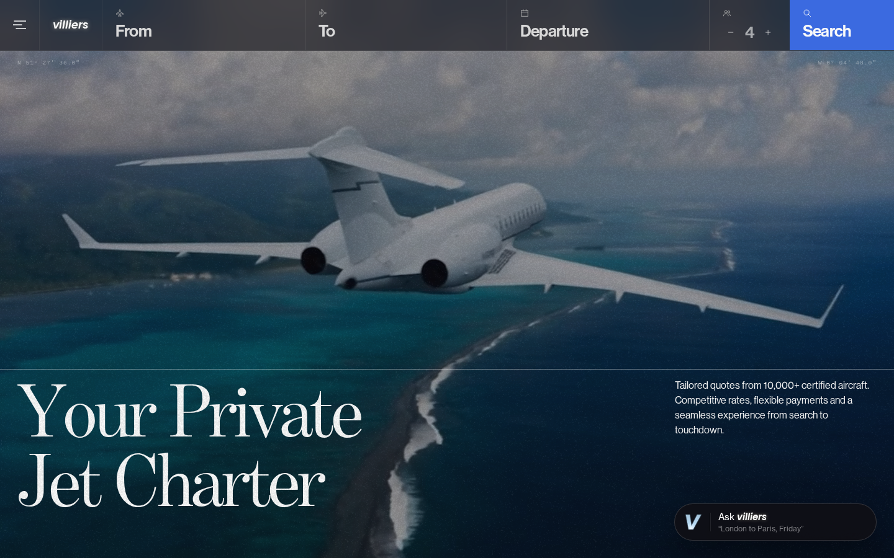
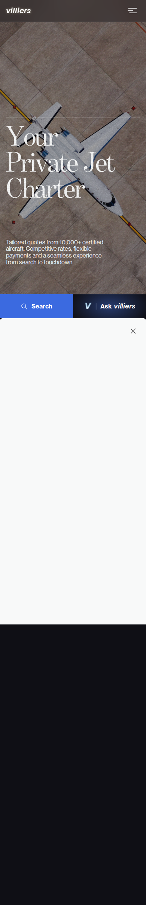

# UI Design System & Master Generation Blueprint: www-villiers-ai

> **Private Jet Charter and Empty Leg Flights · Villiers** (https://www.villiers.ai/) — Charter a private jet or find an empty leg flight. Villiers is an independent broker that compares vetted operators and quotes one clear...



---

## 1. Executive Visual Persona & Design Archetype

- **Brand Essence & Persona**: **Private Jet Charter and Empty Leg Flights · Villiers** (`https://www.villiers.ai/`). Charter a private jet or find an empty leg flight. Villiers is an independent broker that compares vetted operators and quotes one clear...
- **Capture Provenance**: Live browser capture (`tier1_fast`, HTTP `200`, captured `2026-11-23`).
- **Visual Archetype**: **High-Contrast Obsidian / Atmospheric Design System (`#0f0f15` canvas, `#ffffff` ink, `#4879ef` accent)**.
- **Anti-AI-Slop Differentiators**:
  - **Live-Computed Chromatic Polarity**: Anchors the viewport in `#0f0f15` (live computed `body` `background-color` (`computed_styles.json`)) paired with `#ffffff` primary typography and `#4879ef` accents.
  - **Grounded Typographic Hierarchy**: Pairs `neue-haas-grotesk-display` for display copy (`Your Private Jet Charter`) with `neue-haas-grotesk-display` and `JetBrains Mono`.
  - **Calibrated Spatial Grid & Motion**: Combines `1400px` container bounds (`gap: 9.625px`, padding `28px`) with `cubic-bezier(0,0,.2,1)` easing and Lenis Smooth Scroll (`data-lenis`).

---

## 2. Spatial Architecture & Modular Grid Mathematics



### Viewport Allocation & Container Geometry
- **Captured Viewport Dimensions**: Desktop `1440×900px` (`assets/desktop.png`, single-viewport 100vh live capture (900px)), Mobile `390×2400px` (`assets/mobile.png`, clamped at 2400px live multi-section capture).
- **Master Container Bounds**: `1400px` (non-`@media` desktop container stylesheet rule).
- **Canvas Lateral Padding & Spacing**: `28px` lateral canvas padding with `9.625px` grid gap.
- **Border Radius Scale**: `.25rem`, `1rem`, `1.5rem`, `11px`.

### Responsive Breakpoint Architecture
- **Desktop Layout**: Multi-column CSS Grid / Flexbox layout at `1440px` (`max-width: 1400px`, `gap: 9.625px`).
- **Mobile Layout**: Single-column vertical stack at `390px` viewport width with `28px` horizontal padding.
- **Extracted CSS Media Queries**: `@media (min-width:1400px)`, `@media (min-width:390px)`, `@media (min-width:744px)`, `@media (min-width:1280px)`.

---

## 3. Color System, Materiality & Atmospheric Lighting

### Semantic Palette & Source Grounding
| Semantic Role | Ground-Truth Value | Extracted Live / CSS Source |
|---|---|---|
| **Primary Canvas Substrate** | `#0f0f15` | live computed `body` `background-color` (`computed_styles.json`) |
| **Primary Typography Ink** | `#ffffff` | live computed `footer` `color` (`computed_styles.json`) |
| **Elevated Surface / Card Substrate** | `#1a1a1f` | `var(--empty-search-bg)` in `:root` |
| **Interactive Accent / Highlight** | `#4879ef` | `.accent-accent-blue { color: #4879ef }` |
| **Secondary / Muted Copy** | `#707070` | live computed `p` `color` (`computed_styles.json`) |
| **Structural Hairline Border** | `#707070` | `var(--empty-card-border)` in `:root` |

### Sanitized Root CSS Variables (`ui-ux.md` Ground Truth)
| Variable Name | Extracted Value | Semantic Role |
|---|---|---|
| `--mobile-bar-h` | `4rem` | Dimension / Scale Token |
| `--background` | `222 47% 11%` | Canvas / Surface Token |
| `--foreground` | `210 40% 98%` | Typography Ink Token |
| `--card` | `222 47% 11%` | Dimension / Scale Token |
| `--card-foreground` | `210 40% 98%` | Typography Ink Token |
| `--popover` | `222 47% 11%` | Dimension / Scale Token |
| `--popover-foreground` | `210 40% 98%` | Typography Ink Token |
| `--primary` | `210 40% 98%` | Brand / Palette Token |
| `--primary-foreground` | `222 47% 11%` | Typography Ink Token |
| `--secondary` | `217.2 32.6% 17.5%` | Brand / Palette Token |
| `--secondary-foreground` | `210 40% 98%` | Typography Ink Token |
| `--muted` | `217.2 32.6% 17.5%` | Dimension / Scale Token |
| `--muted-foreground` | `215 20.2% 82%` | Typography Ink Token |
| `--accent` | `217.2 32.6% 17.5%` | Brand / Palette Token |
| `--accent-foreground` | `210 40% 98%` | Typography Ink Token |
| `--destructive` | `0 62.8% 30.6%` | Dimension / Scale Token |

---

## 4. Typographic Scale & Editorial Hierarchy

### Font Family Stacks
- **Display Typography**: `neue-haas-grotesk-display`.
- **Primary Body Stack**: `neue-haas-grotesk-display`.
- **Technical / Metadata Stack**: `JetBrains Mono`.

### Typographic Scale & Rules (Live Computed & Stylesheet Grounded)
- **Hero Display (`H1`)**: live computed `h1` (`font-size: 14px`, `line-height: 21px`, `font-weight: 400`); CSS variables `--text-h1: 4rem`, `--text-h1-clamp: clamp(64px,4rem,160px)`.
- **Section Heading (`H2`)**: live computed `h2` (`font-size: 52.5px`, `line-height: 46.2px`, `font-weight: 700`, `letter-spacing: -1.575px`); CSS variables `--text-h2: 3.25rem`, `--text-h2-small: 2.333rem`, `--text-h2-clamp: clamp(52px,3.25rem,68px)`.
- **Body Copy**: live computed `body` (`font-size: 14px`, `line-height: 21px`, `font-weight: 400`); CSS variables `--text-body: clamp(16px,1rem,9999px)`, `--text-body-sm: clamp(14px,0.875rem,9999px)`, `--text-body-xs: clamp(12px,0.75rem,9999px)`; rule `p` (`line-height: 1.625`).
- **Metadata & Navigation Labels**: live computed `nav/a` (`font-size: 38.5px`, `line-height: 33.88px`, `font-weight: 600`); CSS variables `--text-h2-small: 2.333rem`, `--text-h2-small-clamp: clamp(37px,2.333rem,44px)`, `--font-jetbrains-mono: "JetBrains Mono","JetBrains Mono Fallback",Menlo,ui-monospace,monospace`; rule `.meta` (`font-size: 13px`).

---

## 5. Choreographed Motion & Interaction Physics

### Primary Easing Curves
- **Extracted Timing Functions**: `cubic-bezier(0,0,.2,1)`, `cubic-bezier(.4,0,.6,1)`, `cubic-bezier(.4,0,.2,1)`.

### Per-Element Transition & Choreography Rules
- **Selector `.transition`**: `transition: cubic-bezier(0,0,.2,1)` extracted from `www-villiers-ai` stylesheet.
- **Selector `sition-\[border-color\2c backgrou...`**: `transition: cubic-bezier(0,0,.2,1)` extracted from `www-villiers-ai` stylesheet.
- **Selector `.transition-\[color\2c transform\]`**: `transition: cubic-bezier(0,0,.2,1)` extracted from `www-villiers-ai` stylesheet.
- **Extracted Easing Curve (`cubic-bezier(0,0,.2,1)`)**: Governs interactive state transitions across `<header.left-0>` and `<section.relative>`.
- **Runtime Interaction Engine**: Integrates Lenis Smooth Scroll (`data-lenis`) with `prefers-reduced-motion: reduce` fallback guards.

---

## 6. Component Wireframe & Structural DOM Map

### Visual Layout Schematic — Desktop (`1440px`, Grounded in `dom.html` & Landmark Bounding Boxes)
```
┌────────────────────────────────────────────────────────────────────────┐
│ DESKTOP VIEWPORT (1440px) — Private Jet Charter and Empty Leg Flights  │
│ ====================================================================== │
│ [ <header.left-0> (1440x82px)         | H H O O M M E E · B B L L O  ] │
│ ---------------------------------------------------------------------- │
│ | HERO STAGE: <section.app-scene_vappSection__NNKx (w=1440px)        | │
│ | H1: Your Private Jet Charter                                       | │
│ | Substrate: #0f0f15 | Ink: #ffffff | Accent: #4879ef                | │
│ ---------------------------------------------------------------------- │
│ | SHOWCASE GRID (<section.relative>) max-w: 1400px                   | │
│ | +------------------------------+  +------------------------------+ | │
│ | | Your charter, on your lock s |  | E E M M P P T T Y Y L L E E  | | │
│ | +------------------------------+  +------------------------------+ | │
│ ---------------------------------------------------------------------- │
│ | DETAIL MODULE (<section.py-section-lg>) — E E M M P P T T Y Y      | │
│ ---------------------------------------------------------------------- │
│ [ FOOTER (<footer.bg-neutral-5) | https://www.villiers.ai/             │
└────────────────────────────────────────────────────────────────────────┘
```

### Visual Layout Schematic — Mobile Reflow (`390px`)
```
┌────────────────────────────────────────────────────────────────────────┐
│ MOBILE VIEWPORT REFLOW (390px) — Single-Column Stack (gap: 9.625px)    │
│ ====================================================================== │
│ [ HEADER BAR (<header.left-0>         ) | Compact Menu (390px)         │
│ ---------------------------------------------------------------------- │
│ | HERO STAGE (<section.app-scene_vappS) — 390px Vertical Lead        | │
│ | H1: Your Private Jet Charter                                       | │
│ ---------------------------------------------------------------------- │
│ | SHOWCASE STACK (<section.relative>) — 1-Col Stack                  | │
│ | [ Item 1: Your charter, on your lock screen.                     ] | │
│ | [ Item 2: E E M M P P T T Y Y L L E E G G S S                    ] | │
│ ---------------------------------------------------------------------- │
│ | DETAIL STACK (<section.py-section-lg>) — 1-Col (E E M M P P T T Y )  │
│ ---------------------------------------------------------------------- │
│ [ FOOTER (<footer.bg-neutral-5) | Stacked 390px Colophon               │
└────────────────────────────────────────────────────────────────────────┘
```

### Granular DOM Region Breakdown
1. **Brand Header & Navigation Bar (<header.left-0> — `www-villiers-ai`)**:
   - Landmark `<header class="left-0 right-0">` (`1440x82px`) hosting `Private Jet Charter and Empty Leg Fl` navigation (`H H O O M M E E · B B L L O O G G · A A B B O O U U T T`), DOM attributes (`data-header-ready="true"`, `data-precedence="next"`, `data-precedence="next"`, `data-precedence="next"`), and stylesheet rule `before { box-sizing:border-box;border:0 solid e5e7eb }`.
2. **Hero Stage & Focal Lead (<section.app-scene_vappSection__NNKxF> — `Your Private Jet Charter`)**:
   - Landmark `<section class="app-scene_vappSection__NNKxF">` presenting display lead `Your Private Jet Charter` and copy excerpt *"© 2026 Villiers. All rights reserved."* over `#0f0f15` canvas and `#ffffff` ink.
3. **Primary Showcase & Content Grid (<section.relative> — `Your charter, on your lock screen.`)**:
   - Landmark `<section class="relative min-h-screen">` rendering section `Your charter, on your lock screen.` with copy *"E E M M P P T T Y Y L L E E G G S S"*, asset references (`0484562807a97172-s.p.woff2`, `2cc74b96cdc9383d-s.p.woff2`, `36966cca54120369-s.p.woff2`, `427e4a37d3642943-s.p.woff2`), and grid rule `body { margin:0;line-height:inherit }`.
4. **Interactive Detail & Feature Matrix (<section.py-section-lg> — `E E M M P P T T Y Y L L E E G G S `)**:
   - Landmark `<section class="py-section-lg bg-neutral-50">` framing `E E M M P P T T Y Y L L E E G G S S` and `E E M M P P T T Y Y` (*"E E M M P P T T Y Y"*) with `#1a1a1f` surface cards, `#4879ef` accents, and `strong { font-weight:bolder }`.
5. **Colophon & Global Directory Footer (<footer.bg-neutral-500> — `https://www.villiers.ai/`)**:
   - Landmark `<footer class="bg-neutral-500 pt-16">` anchoring `Private Jet Charter and Empty Le` footer links (`H H O O M M E E · B B L L O O G G · A A B B O O U U T T`), copy *"v v i i l l l l i i e e r r s s O O S S"*, and `#707070` structural dividers.

---

## 7. Master Zero-Shot AI Generation Prompt

```markdown
# Master Zero-Shot Frontend Generation Prompt: www-villiers-ai (Private Jet Charter and Empty Leg Flights · Villiers)

You are a principal frontend architect and design systems engineer. Build a complete, production-ready web application replicating the exact design system, DOM landmarks, typographic hierarchy, color tokens, and motion physics of `www-villiers-ai` (**Private Jet Charter and Empty Leg Flights · Villiers** — `https://www.villiers.ai/`).

### 1. Visual Archetype & Anti-AI-Slop Mandates
- **Archetype**: High-Contrast Obsidian / Atmospheric Design System (`#0f0f15` canvas, `#ffffff` ink, `#4879ef` accent).
- **Identity & Domain Context**: Charter a private jet or find an empty leg flight. Villiers is an independent broker that compares vetted operators and quotes one clear...
- **Primary Substrate**: `#0f0f15` (live computed `body` `background-color` (`computed_styles.json`)), **Primary Ink**: `#ffffff`, **Accent / Highlight**: `#4879ef`.
- **Site-Specific Differentiators**:
  - **Live-Computed Chromatic Polarity**: Anchors the viewport in `#0f0f15` (live computed `body` `background-color` (`computed_styles.json`)) paired with `#ffffff` primary typography and `#4879ef` accents.
  - **Grounded Typographic Hierarchy**: Pairs `neue-haas-grotesk-display` for display copy (`Your Private Jet Charter`) with `neue-haas-grotesk-display` and `JetBrains Mono`.
  - **Calibrated Spatial Grid & Motion**: Combines `1400px` container bounds (`gap: 9.625px`, padding `28px`) with `cubic-bezier(0,0,.2,1)` easing and Lenis Smooth Scroll (`data-lenis`).

### 2. Ground-Truth CSS Variables (`:root` Token Contract)
Declare and consume these exact custom properties extracted from `www-villiers-ai` in your global stylesheet:

:root {
  /* Private Jet Charter and Empty Leg Flights · Villiers (www-villiers-ai) — Live-Grounded CSS Variables */
  --mobile-bar-h: 4rem; /* Dimension / Scale Token (www-villiers-ai) */
  --background: 222 47% 11%; /* Canvas / Surface Token (www-villiers-ai) */
  --foreground: 210 40% 98%; /* Typography Ink Token (www-villiers-ai) */
  --card: 222 47% 11%; /* Dimension / Scale Token (www-villiers-ai) */
  --card-foreground: 210 40% 98%; /* Typography Ink Token (www-villiers-ai) */
  --popover: 222 47% 11%; /* Dimension / Scale Token (www-villiers-ai) */
  --popover-foreground: 210 40% 98%; /* Typography Ink Token (www-villiers-ai) */
  --primary: 210 40% 98%; /* Brand / Palette Token (www-villiers-ai) */
  --primary-foreground: 222 47% 11%; /* Typography Ink Token (www-villiers-ai) */
  --secondary: 217.2 32.6% 17.5%; /* Brand / Palette Token (www-villiers-ai) */
  --secondary-foreground: 210 40% 98%; /* Typography Ink Token (www-villiers-ai) */
  --muted: 217.2 32.6% 17.5%; /* Dimension / Scale Token (www-villiers-ai) */
  --muted-foreground: 215 20.2% 82%; /* Typography Ink Token (www-villiers-ai) */
  --accent: 217.2 32.6% 17.5%; /* Brand / Palette Token (www-villiers-ai) */
  --accent-foreground: 210 40% 98%; /* Typography Ink Token (www-villiers-ai) */
  --destructive: 0 62.8% 30.6%; /* Dimension / Scale Token (www-villiers-ai) */
}

### 3. Semantic Color & Materiality Contract
Map every surface, ink, and border strictly to these source-grounded tokens:
- **Primary Canvas Substrate**: `#0f0f15` — grounded in live computed `body` `background-color` (`computed_styles.json`)
- **Primary Typography Ink**: `#ffffff` — grounded in live computed `footer` `color` (`computed_styles.json`)
- **Elevated Surface / Card Substrate**: `#1a1a1f` — grounded in `var(--empty-search-bg)` in `:root`
- **Interactive Accent / Highlight**: `#4879ef` — grounded in `.accent-accent-blue { color: #4879ef }`
- **Secondary / Muted Copy**: `#707070` — grounded in live computed `p` `color` (`computed_styles.json`)
- **Structural Hairline Border**: `#707070` — grounded in `var(--empty-card-border)` in `:root`

### 4. Spatial Grid, Container Bounds & Responsive Breakpoints
- **Desktop Viewport Reference**: `1440×900px` (single-viewport 100vh live capture (900px), `1440px` standard desktop width).
- **Mobile Viewport Reference**: `390×2400px` (clamped at 2400px live multi-section capture, `390px` standard mobile width).
- **Container Max-Width**: `1400px` (non-`@media` desktop container stylesheet rule)
- **Padding & Gutters**: `28px` lateral canvas padding with `9.625px` grid gap
- **Desktop Grid**: Multi-column CSS Grid / Flexbox layout at `1440px` (`max-width: 1400px`, `gap: 9.625px`)
- **Mobile Adaptation**: Single-column vertical stack at `390px` viewport width with `28px` horizontal padding
- **Media Queries**: `@media (min-width:1400px)`, `@media (min-width:390px)`, `@media (min-width:744px)`, `@media (min-width:1280px)`
- **Corner Radii**: `.25rem`, `1rem`, `1.5rem`, `11px`

### 5. Typography & Editorial Scale Contract
- **Display Font Stack**: `neue-haas-grotesk-display`
- **Body Font Stack**: `neue-haas-grotesk-display`
- **Monospace / Technical Font Stack**: `JetBrains Mono`
- **H1 Display Rule**: live computed `h1` (`font-size: 14px`, `line-height: 21px`, `font-weight: 400`); CSS variables `--text-h1: 4rem`, `--text-h1-clamp: clamp(64px,4rem,160px)`
- **H2 Section Rule**: live computed `h2` (`font-size: 52.5px`, `line-height: 46.2px`, `font-weight: 700`, `letter-spacing: -1.575px`); CSS variables `--text-h2: 3.25rem`, `--text-h2-small: 2.333rem`, `--text-h2-clamp: clamp(52px,3.25rem,68px)`
- **Body Copy Rule**: live computed `body` (`font-size: 14px`, `line-height: 21px`, `font-weight: 400`); CSS variables `--text-body: clamp(16px,1rem,9999px)`, `--text-body-sm: clamp(14px,0.875rem,9999px)`, `--text-body-xs: clamp(12px,0.75rem,9999px)`; rule `p` (`line-height: 1.625`)
- **Metadata & Index Rule**: live computed `nav/a` (`font-size: 38.5px`, `line-height: 33.88px`, `font-weight: 600`); CSS variables `--text-h2-small: 2.333rem`, `--text-h2-small-clamp: clamp(37px,2.333rem,44px)`, `--font-jetbrains-mono: "JetBrains Mono","JetBrains Mono Fallback",Menlo,ui-monospace,monospace`; rule `.meta` (`font-size: 13px`)

### 6. Component Hierarchy, Verbatim Copy & Real DOM Landmarks
Scaffold `www-villiers-ai` (`Private Jet Charter and Empty Leg Flights · Villiers`) with these exact structural regions, extracted copy, and CSS rules from `dom.html`:
1. **Brand Header & Navigation Bar (<header.left-0> — `www-villiers-ai`)**:
   - DOM & Selectors: Landmark `<header class="left-0 right-0">` (`1440x82px`) hosting `Private Jet Charter and Empty Leg Fl` navigation (`H H O O M M E E · B B L L O O G G · A A B B O O U U T T`), DOM attributes (`data-header-ready="true"`, `data-precedence="next"`, `data-precedence="next"`, `data-precedence="next"`), and stylesheet rule `before { box-sizing:border-box;border:0 solid e5e7eb }`.
   - Responsive Contract: Header `Brand Header & Navigation Bar (<header.left-0> — `www-villiers-ai`)` (`www-villiers-ai`) adapts across `@media (min-width:1400px)`, `@media (min-width:390px)`, `@media (min-width:744px)`, `@media (min-width:1280px)` with `cubic-bezier(0,0,.2,1)`, `cubic-bezier(.4,0,.6,1)`, `cubic-bezier(.4,0,.2,1)` transitions and links `H H O O M M E E · B B L L O O G G · A A B B O O U U T T`.
2. **Hero Stage & Focal Lead (<section.app-scene_vappSection__NNKxF> — `Your Private Jet Charter`)**:
   - DOM & Selectors: Landmark `<section class="app-scene_vappSection__NNKxF">` presenting display lead `Your Private Jet Charter` and copy excerpt *"© 2026 Villiers. All rights reserved."* over `#0f0f15` canvas and `#ffffff` ink.
   - Responsive Contract: Hero stage (`1440×900px` desktop / `390×2400px` mobile) sets `#0f0f15` background with `#ffffff` headline `Your Private Jet Charter`.
3. **Primary Showcase & Content Grid (<section.relative> — `Your charter, on your lock screen.`)**:
   - DOM & Selectors: Landmark `<section class="relative min-h-screen">` rendering section `Your charter, on your lock screen.` with copy *"E E M M P P T T Y Y L L E E G G S S"*, asset references (`0484562807a97172-s.p.woff2`, `2cc74b96cdc9383d-s.p.woff2`, `36966cca54120369-s.p.woff2`, `427e4a37d3642943-s.p.woff2`), and grid rule `body { margin:0;line-height:inherit }`.
   - Responsive Contract: Showcase grid `Primary Showcase & Content Grid (<section.relative> — `Your charter, on your lock screen.`)` applies Multi-column CSS Grid / Flexbox layout at `1440px` (`max-width: 1400px`, `gap: 9.625px`) on desktop and Single-column vertical stack at `390px` viewport width with `28px` horizontal padding on mobile.
4. **Interactive Detail & Feature Matrix (<section.py-section-lg> — `E E M M P P T T Y Y L L E E G G S `)**:
   - DOM & Selectors: Landmark `<section class="py-section-lg bg-neutral-50">` framing `E E M M P P T T Y Y L L E E G G S S` and `E E M M P P T T Y Y` (*"E E M M P P T T Y Y"*) with `#1a1a1f` surface cards, `#4879ef` accents, and `strong { font-weight:bolder }`.
   - Responsive Contract: Detail module `Interactive Detail & Feature Matrix (<section.py-section-lg> — `E E M M P P T T Y Y L L E E G G S `)` uses `.25rem`, `1rem`, `1.5rem`, `11px` radii, `#4879ef` highlights, and assets (0484562807a97172-s.p.woff2, 2cc74b96cdc9383d-s.p.woff2, 36966cca54120369-s.p.woff2).
5. **Colophon & Global Directory Footer (<footer.bg-neutral-500> — `https://www.villiers.ai/`)**:
   - DOM & Selectors: Landmark `<footer class="bg-neutral-500 pt-16">` anchoring `Private Jet Charter and Empty Le` footer links (`H H O O M M E E · B B L L O O G G · A A B B O O U U T T`), copy *"v v i i l l l l i i e e r r s s O O S S"*, and `#707070` structural dividers.
   - Responsive Contract: Footer `Colophon & Global Directory Footer (<footer.bg-neutral-500> — `https://www.villiers.ai/`)` aligns to `1400px` (non-`@media` desktop container stylesheet rule) with `28px` lateral canvas padding with `9.625px` grid gap and attributes (data-header-ready="true", data-precedence="next", data-precedence="next").

#### Verbatim DOM Copy Excerpts (`dom.html`)
- Copy Excerpt 1: *"© 2026 Villiers. All rights reserved."*
- Copy Excerpt 2: *"E E M M P P T T Y Y L L E E G G S S"*
- Copy Excerpt 3: *"E E M M P P T T Y Y"*
- Copy Excerpt 4: *"v v i i l l l l i i e e r r s s O O S S"*

### 7. Motion, Extracted Stylesheet Rules & Interaction Choreography
- **Primary Easing Functions**: `cubic-bezier(0,0,.2,1)`, `cubic-bezier(.4,0,.6,1)`, `cubic-bezier(.4,0,.2,1)`
- **Extracted Stylesheet Rules (`www-villiers-ai`)**:
- `before { box-sizing:border-box;border:0 solid e5e7eb }`
- `body { margin:0;line-height:inherit }`
- `strong { font-weight:bolder }`
- `small { font-size:80% }`
- `sup { font-size:75%;line-height:0;position:relative;vertical-align:baseline }`
- **Per-Selector Transition Rules**:
- **Selector `.transition`**: `transition: cubic-bezier(0,0,.2,1)` extracted from `www-villiers-ai` stylesheet.
- **Selector `sition-\[border-color\2c backgrou...`**: `transition: cubic-bezier(0,0,.2,1)` extracted from `www-villiers-ai` stylesheet.
- **Selector `.transition-\[color\2c transform\]`**: `transition: cubic-bezier(0,0,.2,1)` extracted from `www-villiers-ai` stylesheet.
- **Extracted Easing Curve (`cubic-bezier(0,0,.2,1)`)**: Governs interactive state transitions across `<header.left-0>` and `<section.relative>`.
- **Runtime Interaction Engine**: Integrates Lenis Smooth Scroll (`data-lenis`) with `prefers-reduced-motion: reduce` fallback guards.

### 8. Technical Deliverables
- Implement in Next.js (App Router) with TypeScript and Tailwind CSS consuming the `:root` custom properties defined above for `www-villiers-ai`.
- Reproduce both the `1440px` desktop architecture and `390px` mobile breakpoint transitions, preserving semantic HTML5 landmarks (`<header>`, `<nav>`, `<main>`, `<section>`, `<footer>`) and `prefers-reduced-motion` accessibility guards.
```
