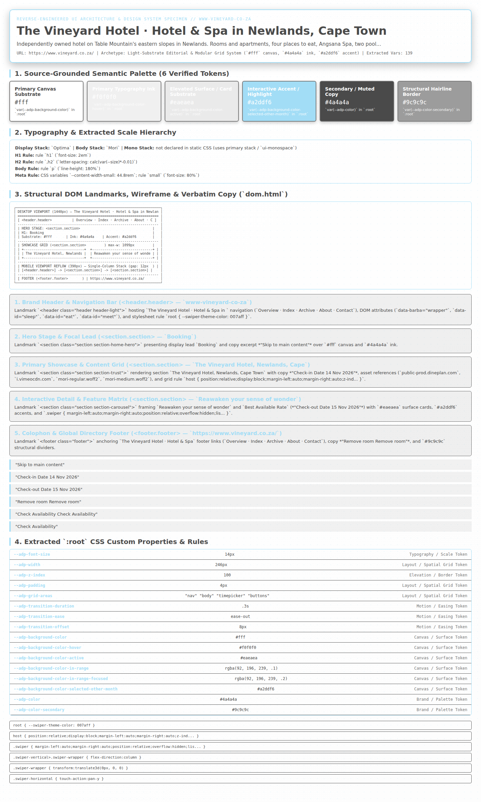

# UI Design System & Master Generation Blueprint: www-vineyard-co-za

> **The Vineyard Hotel · Hotel & Spa in Newlands, Cape Town** (https://www.vineyard.co.za/) — Independently owned hotel on Table Mountain's eastern slopes in Newlands. Rooms and apartments, four places to eat, Angsana Spa, two pool...



---

## 1. Executive Visual Persona & Design Archetype

- **Brand Essence & Persona**: **The Vineyard Hotel · Hotel & Spa in Newlands, Cape Town** (`https://www.vineyard.co.za/`). Independently owned hotel on Table Mountain's eastern slopes in Newlands. Rooms and apartments, four places to eat, Angsana Spa, two pool...
- **Visual Archetype**: **Light-Substrate Editorial & Modular Grid System (`#fff` canvas, `#4a4a4a` ink, `#a2ddf6` accent)**.
- **Anti-AI-Slop Differentiators**:
  - **Source-Grounded Chromatic Polarity**: Anchors the viewport in `#fff` (`var(--adp-background-color)` in `:root`) paired with `#4a4a4a` primary typography and `#a2ddf6` accents.
  - **Extracted Typographic Hierarchy**: Pairs `Optima` for display copy (`Booking`) with `Mori` and not declared in static CSS (uses primary stack / `ui-monospace`).
  - **Calibrated Spatial Grid & Motion**: Combines `1099px` container bounds (`gap: 12px`, padding `var(--adp-padding)`) with `cubic-bezier(.6,0,.2,1)` easing and Lenis Smooth Scroll (`data-lenis`), Three.js / WebGL Canvas Pipeline.

---

## 2. Spatial Architecture & Modular Grid Mathematics


### Viewport Allocation & Container Geometry
- **Captured Viewport Dimensions**: Desktop `1440×2400px` (`assets/desktop.png`, capped at 2400px multi-section capture), Mobile `390×2400px` (`assets/mobile.png`, capped at 2400px multi-section capture).
- **Master Container Bounds**: `1099px` extracted from `www-vineyard-co-za` stylesheet.
- **Canvas Lateral Padding & Spacing**: `var(--adp-padding)` lateral canvas padding with `12px` grid gap.
- **Border Radius Scale**: `50%`, `var(--adp-cell-border-radius)`, `var(--adp-border-radius)`, `var(--adp-btn-border-radius)`.

### Responsive Breakpoint Architecture
- **Desktop Layout**: Multi-column CSS Grid / Flexbox layout at `1440px` (`max-width: 1099px`, `gap: 12px`).
- **Mobile Layout**: Single-column vertical stack at `390px` viewport width with `var(--adp-padding)` horizontal padding.
- **Extracted CSS Media Queries**: `@media (max-width: 1099px)`, `@media (min-width: 1100px)`, `@media (max-width: 1439px)`, `@media (max-width: 499px)`.

---

## 3. Color System, Materiality & Atmospheric Lighting

### Semantic Palette & Source Grounding
| Semantic Role | Ground-Truth Value | Extracted CSS Source / Selector |
|---|---|---|
| **Primary Canvas Substrate** | `#fff` | `var(--adp-background-color)` in `:root` |
| **Primary Typography Ink** | `#f0f0f0` | `var(--adp-background-color-hover)` in `:root` |
| **Elevated Surface / Card Substrate** | `#eaeaea` | `var(--adp-background-color-active)` in `:root` |
| **Interactive Accent / Highlight** | `#a2ddf6` | `var(--adp-background-color-selected-other-month)` in `:root` |
| **Secondary / Muted Copy** | `#4a4a4a` | `var(--adp-color)` in `:root` |
| **Structural Hairline Border** | `#9c9c9c` | `var(--adp-color-secondary)` in `:root` |

### Sanitized Root CSS Variables (`ui-ux.md` Ground Truth)
| Variable Name | Extracted Value | Semantic Role |
|---|---|---|
| `--adp-font-size` | `14px` | Typography / Scale Token |
| `--adp-width` | `246px` | Layout / Spatial Grid Token |
| `--adp-z-index` | `100` | Elevation / Border Token |
| `--adp-padding` | `4px` | Layout / Spatial Grid Token |
| `--adp-grid-areas` | `"nav" "body" "timepicker" "buttons"` | Layout / Spatial Grid Token |
| `--adp-transition-duration` | `.3s` | Motion / Easing Token |
| `--adp-transition-ease` | `ease-out` | Motion / Easing Token |
| `--adp-transition-offset` | `8px` | Motion / Easing Token |
| `--adp-background-color` | `#fff` | Canvas / Surface Token |
| `--adp-background-color-hover` | `#f0f0f0` | Canvas / Surface Token |
| `--adp-background-color-active` | `#eaeaea` | Canvas / Surface Token |
| `--adp-background-color-in-range` | `rgba(92, 196, 239, .1)` | Canvas / Surface Token |
| `--adp-background-color-in-range-focused` | `rgba(92, 196, 239, .2)` | Canvas / Surface Token |
| `--adp-background-color-selected-other-month` | `#a2ddf6` | Canvas / Surface Token |
| `--adp-color` | `#4a4a4a` | Brand / Palette Token |
| `--adp-color-secondary` | `#9c9c9c` | Brand / Palette Token |

---

## 4. Typographic Scale & Editorial Hierarchy

### Font Family Stacks
- **Display Typography**: `Optima`.
- **Primary Body Stack**: `Mori`.
- **Technical / Metadata Stack**: not declared in static CSS (uses primary stack / `ui-monospace`).

### Typographic Scale & Rules (Extracted from Stylesheet & Variables)
- **Hero Display (`H1`)**: rule `h1` (`font-size: 2em`).
- **Section Heading (`H2`)**: rule `,h2` (`letter-spacing: calc(var(--size)*-0.01)`).
- **Body Copy**: rule `p` (`line-height: 180%`).
- **Metadata & Navigation Labels**: CSS variables `--content-width-small: 44.8rem`; rule `small` (`font-size: 80%`).

---

## 5. Choreographed Motion & Interaction Physics

### Primary Easing Curves
- **Extracted Timing Functions**: `cubic-bezier(.6,0,.2,1)`, `cubic-bezier(0.19,1,0.22,1)`, `cubic-bezier(0.65,0,0.35,1)`.

### Per-Element Transition & Choreography Rules
- **Selector `.swiper-wrapper`**: `transition: var(--swiper-wrapper-transition-timing-function, initial)` extracted from `www-vineyard-co-za` stylesheet.
- **Selector `.air-datepicker-body`**: `transition: all var(--adp-transition-duration) var(--adp-transition-ease)` extracted from `www-vineyard-co-za` stylesheet.
- **Selector `row input[type=range]::-webkit-sl...`**: `transition: background var(--adp-transition-duration)` extracted from `www-vineyard-co-za` stylesheet.
- **Extracted Easing Curve (`cubic-bezier(.6,0,.2,1)`)**: Governs interactive state transitions across `<header.header>` and `<section.section>`.
- **Runtime Interaction Engine**: Integrates Lenis Smooth Scroll (`data-lenis`), Three.js / WebGL Canvas Pipeline, Swiper Touch Carousel Engine, Barba.js Page Transition Router with `prefers-reduced-motion: reduce` fallback guards.

---

## 6. Component Wireframe & Structural DOM Map

### Visual Layout Schematic (Grounded in `dom.html` — `1440px` Desktop & `390px` Mobile Reflow)
```
┌────────────────────────────────────────────────────────────────────────┐
│ DESKTOP VIEWPORT (1440px) — The Vineyard Hotel · Hotel & Spa in Newlan │
│ ====================================================================== │
│ [ <header.header>          | Overview · Index · Archive · About · C ]  │
│ ---------------------------------------------------------------------- │
│ | HERO STAGE: <section.section>                                    |   │
│ | H1: Booking                                                      |   │
│ | Substrate: #fff       | Ink: #4a4a4a    | Accent: #a2ddf6        |   │
│ ---------------------------------------------------------------------- │
│ | SHOWCASE GRID (<section.section>         ) max-w: 1099px         |   │
│ | +------------------------------+  +------------------------------+ | │
│ | | The Vineyard Hotel, Newlands |  | Reawaken your sense of wonde | | │
│ | +------------------------------+  +------------------------------+ | │
│ ---------------------------------------------------------------------- │
│ | MOBILE VIEWPORT REFLOW (390px) — Single-Column Stack (gap: 12px  ) | │
│ | [<header.header>] -> [<section.section>] -> [<section.section>] |    │
│ ---------------------------------------------------------------------- │
│ [ FOOTER (<footer.footer>       ) | https://www.vineyard.co.za/        │
└────────────────────────────────────────────────────────────────────────┘
```

### Granular DOM Region Breakdown
1. **Brand Header & Navigation Bar (<header.header> — `www-vineyard-co-za`)**:
   - Landmark `<header class="header header-light">` hosting `The Vineyard Hotel · Hotel & Spa in ` navigation (`Overview · Index · Archive · About · Contact`), DOM attributes (`data-barba="wrapper"`, `data-id="sleep"`, `data-id="eat"`, `data-id="meet"`), and stylesheet rule `root { --swiper-theme-color: 007aff }`.
2. **Hero Stage & Focal Lead (<section.section> — `Booking`)**:
   - Landmark `<section class="section section-home-hero">` presenting display lead `Booking` and copy excerpt *"Skip to main content"* over `#fff` canvas and `#4a4a4a` ink.
3. **Primary Showcase & Content Grid (<section.section> — `The Vineyard Hotel, Newlands, Cape`)**:
   - Landmark `<section class="section section-trust">` rendering section `The Vineyard Hotel, Newlands, Cape Town` with copy *"Check-in Date 14 Nov 2026"*, asset references (`public-prod.dineplan.com`, `i.vimeocdn.com`, `mori-regular.woff2`, `mori-medium.woff2`), and grid rule `host { position:relative;display:block;margin-left:auto;margin-right:auto;z-ind... }`.
4. **Interactive Detail & Feature Matrix (<section.section> — `Reawaken your sense of wonder`)**:
   - Landmark `<section class="section section-carousel">` framing `Reawaken your sense of wonder` and `Best Available Rate` (*"Check-out Date 15 Nov 2026"*) with `#eaeaea` surface cards, `#a2ddf6` accents, and `.swiper { margin-left:auto;margin-right:auto;position:relative;overflow:hidden;lis... }`.
5. **Colophon & Global Directory Footer (<footer.footer> — `https://www.vineyard.co.za/`)**:
   - Landmark `<footer class="footer">` anchoring `The Vineyard Hotel · Hotel & Spa` footer links (`Overview · Index · Archive · About · Contact`), copy *"Remove room Remove room"*, and `#9c9c9c` structural dividers.

---

## 7. Master Zero-Shot AI Generation Prompt

```markdown
# Master Zero-Shot Frontend Generation Prompt: www-vineyard-co-za (The Vineyard Hotel · Hotel & Spa in Newlands, Cape Town)

You are a principal frontend architect and design systems engineer. Build a complete, production-ready web application replicating the exact design system, DOM landmarks, typographic hierarchy, color tokens, and motion physics of `www-vineyard-co-za` (**The Vineyard Hotel · Hotel & Spa in Newlands, Cape Town** — `https://www.vineyard.co.za/`).

### 1. Visual Archetype & Anti-AI-Slop Mandates
- **Archetype**: Light-Substrate Editorial & Modular Grid System (`#fff` canvas, `#4a4a4a` ink, `#a2ddf6` accent).
- **Identity & Domain Context**: Independently owned hotel on Table Mountain's eastern slopes in Newlands. Rooms and apartments, four places to eat, Angsana Spa, two pool...
- **Primary Substrate**: `#fff` (`var(--adp-background-color)` in `:root`), **Primary Ink**: `#4a4a4a`, **Accent / Highlight**: `#a2ddf6`.
- **Site-Specific Differentiators**:
  - **Source-Grounded Chromatic Polarity**: Anchors the viewport in `#fff` (`var(--adp-background-color)` in `:root`) paired with `#4a4a4a` primary typography and `#a2ddf6` accents.
  - **Extracted Typographic Hierarchy**: Pairs `Optima` for display copy (`Booking`) with `Mori` and not declared in static CSS (uses primary stack / `ui-monospace`).
  - **Calibrated Spatial Grid & Motion**: Combines `1099px` container bounds (`gap: 12px`, padding `var(--adp-padding)`) with `cubic-bezier(.6,0,.2,1)` easing and Lenis Smooth Scroll (`data-lenis`), Three.js / WebGL Canvas Pipeline.

### 2. Ground-Truth CSS Variables (`:root` Token Contract)
Declare and consume these exact custom properties extracted from `www-vineyard-co-za` in your global stylesheet:

:root {
  /* The Vineyard Hotel · Hotel & Spa in Newlands, Cape Town (www-vineyard-co-za) — Ground-Truth Extracted CSS Variables */
  --adp-font-size: 14px; /* Typography / Scale Token (www-vineyard-co-za) */
  --adp-width: 246px; /* Layout / Spatial Grid Token (www-vineyard-co-za) */
  --adp-z-index: 100; /* Elevation / Border Token (www-vineyard-co-za) */
  --adp-padding: 4px; /* Layout / Spatial Grid Token (www-vineyard-co-za) */
  --adp-grid-areas: "nav" "body" "timepicker" "buttons"; /* Layout / Spatial Grid Token (www-vineyard-co-za) */
  --adp-transition-duration: .3s; /* Motion / Easing Token (www-vineyard-co-za) */
  --adp-transition-ease: ease-out; /* Motion / Easing Token (www-vineyard-co-za) */
  --adp-transition-offset: 8px; /* Motion / Easing Token (www-vineyard-co-za) */
  --adp-background-color: #fff; /* Canvas / Surface Token (www-vineyard-co-za) */
  --adp-background-color-hover: #f0f0f0; /* Canvas / Surface Token (www-vineyard-co-za) */
  --adp-background-color-active: #eaeaea; /* Canvas / Surface Token (www-vineyard-co-za) */
  --adp-background-color-in-range: rgba(92, 196, 239, .1); /* Canvas / Surface Token (www-vineyard-co-za) */
  --adp-background-color-in-range-focused: rgba(92, 196, 239, .2); /* Canvas / Surface Token (www-vineyard-co-za) */
  --adp-background-color-selected-other-month: #a2ddf6; /* Canvas / Surface Token (www-vineyard-co-za) */
  --adp-color: #4a4a4a; /* Brand / Palette Token (www-vineyard-co-za) */
  --adp-color-secondary: #9c9c9c; /* Brand / Palette Token (www-vineyard-co-za) */
}

### 3. Semantic Color & Materiality Contract
Map every surface, ink, and border strictly to these source-grounded tokens:
- **Primary Canvas Substrate**: `#fff` — grounded in `var(--adp-background-color)` in `:root`
- **Primary Typography Ink**: `#f0f0f0` — grounded in `var(--adp-background-color-hover)` in `:root`
- **Elevated Surface / Card Substrate**: `#eaeaea` — grounded in `var(--adp-background-color-active)` in `:root`
- **Interactive Accent / Highlight**: `#a2ddf6` — grounded in `var(--adp-background-color-selected-other-month)` in `:root`
- **Secondary / Muted Copy**: `#4a4a4a` — grounded in `var(--adp-color)` in `:root`
- **Structural Hairline Border**: `#9c9c9c` — grounded in `var(--adp-color-secondary)` in `:root`

### 4. Spatial Grid, Container Bounds & Responsive Breakpoints
- **Desktop Viewport Reference**: `1440×2400px` (capped at 2400px multi-section capture, `1440px` standard desktop width).
- **Mobile Viewport Reference**: `390×2400px` (capped at 2400px multi-section capture, `390px` standard mobile width).
- **Container Max-Width**: `1099px` extracted from `www-vineyard-co-za` stylesheet
- **Padding & Gutters**: `var(--adp-padding)` lateral canvas padding with `12px` grid gap
- **Desktop Grid**: Multi-column CSS Grid / Flexbox layout at `1440px` (`max-width: 1099px`, `gap: 12px`)
- **Mobile Adaptation**: Single-column vertical stack at `390px` viewport width with `var(--adp-padding)` horizontal padding
- **Media Queries**: `@media (max-width: 1099px)`, `@media (min-width: 1100px)`, `@media (max-width: 1439px)`, `@media (max-width: 499px)`
- **Corner Radii**: `50%`, `var(--adp-cell-border-radius)`, `var(--adp-border-radius)`, `var(--adp-btn-border-radius)`

### 5. Typography & Editorial Scale Contract
- **Display Font Stack**: `Optima`
- **Body Font Stack**: `Mori`
- **Monospace / Technical Font Stack**: not declared in static CSS (uses primary stack / `ui-monospace`)
- **H1 Display Rule**: rule `h1` (`font-size: 2em`)
- **H2 Section Rule**: rule `,h2` (`letter-spacing: calc(var(--size)*-0.01)`)
- **Body Copy Rule**: rule `p` (`line-height: 180%`)
- **Metadata & Index Rule**: CSS variables `--content-width-small: 44.8rem`; rule `small` (`font-size: 80%`)

### 6. Component Hierarchy, Verbatim Copy & Real DOM Landmarks
Scaffold `www-vineyard-co-za` (`The Vineyard Hotel · Hotel & Spa in Newlands, Cape Town`) with these exact structural regions, extracted copy, and CSS rules from `dom.html`:
1. **Brand Header & Navigation Bar (<header.header> — `www-vineyard-co-za`)**:
   - DOM & Selectors: Landmark `<header class="header header-light">` hosting `The Vineyard Hotel · Hotel & Spa in ` navigation (`Overview · Index · Archive · About · Contact`), DOM attributes (`data-barba="wrapper"`, `data-id="sleep"`, `data-id="eat"`, `data-id="meet"`), and stylesheet rule `root { --swiper-theme-color: 007aff }`.
   - Responsive Contract: Header `Brand Header & Navigation Bar (<header.header> — `www-vineyard-co-za`)` (`www-vineyard-co-za`) adapts across `@media (max-width: 1099px)`, `@media (min-width: 1100px)`, `@media (max-width: 1439px)`, `@media (max-width: 499px)` with `cubic-bezier(.6,0,.2,1)`, `cubic-bezier(0.19,1,0.22,1)`, `cubic-bezier(0.65,0,0.35,1)` transitions and links `Overview · Index · Archive · About · Contact`.
2. **Hero Stage & Focal Lead (<section.section> — `Booking`)**:
   - DOM & Selectors: Landmark `<section class="section section-home-hero">` presenting display lead `Booking` and copy excerpt *"Skip to main content"* over `#fff` canvas and `#4a4a4a` ink.
   - Responsive Contract: Hero stage (`1440×2400px` desktop / `390×2400px` mobile) sets `#fff` background with `#4a4a4a` headline `Booking`.
3. **Primary Showcase & Content Grid (<section.section> — `The Vineyard Hotel, Newlands, Cape`)**:
   - DOM & Selectors: Landmark `<section class="section section-trust">` rendering section `The Vineyard Hotel, Newlands, Cape Town` with copy *"Check-in Date 14 Nov 2026"*, asset references (`public-prod.dineplan.com`, `i.vimeocdn.com`, `mori-regular.woff2`, `mori-medium.woff2`), and grid rule `host { position:relative;display:block;margin-left:auto;margin-right:auto;z-ind... }`.
   - Responsive Contract: Showcase grid `Primary Showcase & Content Grid (<section.section> — `The Vineyard Hotel, Newlands, Cape`)` applies Multi-column CSS Grid / Flexbox layout at `1440px` (`max-width: 1099px`, `gap: 12px`) on desktop and Single-column vertical stack at `390px` viewport width with `var(--adp-padding)` horizontal padding on mobile.
4. **Interactive Detail & Feature Matrix (<section.section> — `Reawaken your sense of wonder`)**:
   - DOM & Selectors: Landmark `<section class="section section-carousel">` framing `Reawaken your sense of wonder` and `Best Available Rate` (*"Check-out Date 15 Nov 2026"*) with `#eaeaea` surface cards, `#a2ddf6` accents, and `.swiper { margin-left:auto;margin-right:auto;position:relative;overflow:hidden;lis... }`.
   - Responsive Contract: Detail module `Interactive Detail & Feature Matrix (<section.section> — `Reawaken your sense of wonder`)` uses `50%`, `var(--adp-cell-border-radius)`, `var(--adp-border-radius)`, `var(--adp-btn-border-radius)` radii, `#a2ddf6` highlights, and assets (public-prod.dineplan.com, i.vimeocdn.com, mori-regular.woff2).
5. **Colophon & Global Directory Footer (<footer.footer> — `https://www.vineyard.co.za/`)**:
   - DOM & Selectors: Landmark `<footer class="footer">` anchoring `The Vineyard Hotel · Hotel & Spa` footer links (`Overview · Index · Archive · About · Contact`), copy *"Remove room Remove room"*, and `#9c9c9c` structural dividers.
   - Responsive Contract: Footer `Colophon & Global Directory Footer (<footer.footer> — `https://www.vineyard.co.za/`)` aligns to `1099px` extracted from `www-vineyard-co-za` stylesheet with `var(--adp-padding)` lateral canvas padding with `12px` grid gap and attributes (data-barba="wrapper", data-id="sleep", data-id="eat").

#### Verbatim DOM Copy Excerpts (`dom.html`)
- Copy Excerpt 1: *"Skip to main content"*
- Copy Excerpt 2: *"Check-in Date 14 Nov 2026"*
- Copy Excerpt 3: *"Check-out Date 15 Nov 2026"*
- Copy Excerpt 4: *"Remove room Remove room"*

### 7. Motion, Extracted Stylesheet Rules & Interaction Choreography
- **Primary Easing Functions**: `cubic-bezier(.6,0,.2,1)`, `cubic-bezier(0.19,1,0.22,1)`, `cubic-bezier(0.65,0,0.35,1)`
- **Extracted Stylesheet Rules (`www-vineyard-co-za`)**:
- `root { --swiper-theme-color: 007aff }`
- `host { position:relative;display:block;margin-left:auto;margin-right:auto;z-ind... }`
- `.swiper { margin-left:auto;margin-right:auto;position:relative;overflow:hidden;lis... }`
- `.swiper-vertical>.swiper-wrapper { flex-direction:column }`
- `.swiper-wrapper { transform:translate3d(0px, 0, 0) }`
- **Per-Selector Transition Rules**:
- **Selector `.swiper-wrapper`**: `transition: var(--swiper-wrapper-transition-timing-function, initial)` extracted from `www-vineyard-co-za` stylesheet.
- **Selector `.air-datepicker-body`**: `transition: all var(--adp-transition-duration) var(--adp-transition-ease)` extracted from `www-vineyard-co-za` stylesheet.
- **Selector `row input[type=range]::-webkit-sl...`**: `transition: background var(--adp-transition-duration)` extracted from `www-vineyard-co-za` stylesheet.
- **Extracted Easing Curve (`cubic-bezier(.6,0,.2,1)`)**: Governs interactive state transitions across `<header.header>` and `<section.section>`.
- **Runtime Interaction Engine**: Integrates Lenis Smooth Scroll (`data-lenis`), Three.js / WebGL Canvas Pipeline, Swiper Touch Carousel Engine, Barba.js Page Transition Router with `prefers-reduced-motion: reduce` fallback guards.

### 8. Technical Deliverables
- Implement in Next.js (App Router) with TypeScript and Tailwind CSS consuming the `:root` custom properties defined above for `www-vineyard-co-za`.
- Reproduce both the `1440px` desktop architecture and `390px` mobile breakpoint transitions, preserving semantic HTML5 landmarks (`<header>`, `<nav>`, `<main>`, `<section>`, `<footer>`) and `prefers-reduced-motion` accessibility guards.
```
