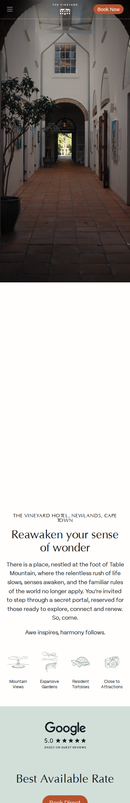

# UI Design System & Master Generation Blueprint: www-vineyard-co-za

> **The Vineyard Hotel · Hotel & Spa in Newlands, Cape Town** (https://www.vineyard.co.za/) — Independently owned hotel on Table Mountain's eastern slopes in Newlands. Rooms and apartments, four places to eat, Angsana Spa, two pool...


---

## 1. Executive Visual Persona & Design Archetype

- **Brand Essence & Persona**: **The Vineyard Hotel · Hotel & Spa in Newlands, Cape Town** (`https://www.vineyard.co.za/`). Independently owned hotel on Table Mountain's eastern slopes in Newlands. Rooms and apartments, four places to eat, Angsana Spa, two pool...
- **Capture Provenance**: Live browser capture (`tier1_fast`, HTTP `200`, captured `2026-11-23`).
- **Visual Archetype**: **Light-Substrate Editorial & Modular Grid System (`#fffefd` canvas, `#151d25` ink, `#185abc` accent)**.
- **Anti-AI-Slop Differentiators**:
  - **Live-Computed Chromatic Polarity**: Anchors the viewport in `#fffefd` (live computed `body` `background-color` (`computed_styles.json`)) paired with `#151d25` primary typography and `#185abc` accents.
  - **Grounded Typographic Hierarchy**: Pairs `Optima` for display copy (`THE VINEYARD HOTEL, NEWLANDS, CAPE T`) with `Mori` and not declared in live computed styles (uses primary stack / `ui-monospace`).
  - **Calibrated Spatial Grid & Motion**: Combines `115.6rem` container bounds (`gap: 12px`, padding `66.6667px`) with `cubic-bezier(.6,0,.2,1)` easing and Lenis Smooth Scroll (`data-lenis`), Three.js / WebGL Canvas Pipeline.

---

## 2. Spatial Architecture & Modular Grid Mathematics



### Viewport Allocation & Container Geometry
- **Captured Viewport Dimensions**: Desktop `1440×900px` (`assets/desktop.png`, single-viewport 100vh live capture (900px)), Mobile `390×2400px` (`assets/mobile.png`, clamped at 2400px live multi-section capture).
- **Master Container Bounds**: `115.6rem` (non-`@media` desktop container stylesheet rule).
- **Canvas Lateral Padding & Spacing**: `66.6667px` lateral canvas padding with `12px` grid gap.
- **Border Radius Scale**: `40px`, `0px 0px 4px 4px`, `50%`, `var(--adp-cell-border-radius)`.

### Responsive Breakpoint Architecture
- **Desktop Layout**: Multi-column CSS Grid / Flexbox layout at `1440px` (`max-width: 115.6rem`, `gap: 12px`).
- **Mobile Layout**: Single-column vertical stack at `390px` viewport width with `66.6667px` horizontal padding.
- **Extracted CSS Media Queries**: `@media (max-width: 1099px)`, `@media (min-width: 1100px)`, `@media (max-width: 1439px)`, `@media (max-width: 499px)`.

---

## 3. Color System, Materiality & Atmospheric Lighting

### Semantic Palette & Source Grounding
| Semantic Role | Ground-Truth Value | Extracted Live / CSS Source |
|---|---|---|
| **Primary Canvas Substrate** | `#fffefd` | live computed `body` `background-color` (`computed_styles.json`) |
| **Primary Typography Ink** | `#151d25` | live computed `h1` `color` (`computed_styles.json`) |
| **Elevated Surface / Card Substrate** | `#ffffff` | `var(--adp-background-color)` in `:root` |
| **Interactive Accent / Highlight** | `#185abc` | `.rc-2fa-submit-button-holder bu... { background-color: #185abc }` |
| **Secondary / Muted Copy** | `#9c9c9c` | `var(--adp-color-secondary)` in `:root` |
| **Structural Hairline Border** | `#dbdbdb` | `var(--adp-border-color)` in `:root` |
| **Variable Token (`--c-black`)** | `#000000` | `var(--c-black)` in `:root` |
| **Variable Token (`--c-mb-15`)** | `#293a49` | `var(--c-mb-15)` in `:root` |
| **Variable Token (`--c-mb-20`)** | `#41525f` | `var(--c-mb-20)` in `:root` |
| **Variable Token (`--c-mb-30`)** | `#5d7587` | `var(--c-mb-30)` in `:root` |

### Sanitized Root CSS Variables (`ui-ux.md` Ground Truth)
| Variable Name | Extracted Value | Semantic Role |
|---|---|---|
| `--font-optima` | `"Optima", sans-serif` | Typography / Scale Token |
| `--font-mori` | `"Mori", sans-serif` | Typography / Scale Token |
| `--container-width` | `140rem` | Layout / Spatial Grid Token |
| `--container-width-s` | `115.6rem` | Layout / Spatial Grid Token |
| `--content-width` | `68.4rem` | Layout / Spatial Grid Token |
| `--content-width-small` | `44.8rem` | Layout / Spatial Grid Token |
| `--container-offset` | `calc((100vw - var(--container-width)) * .5)` | Layout / Spatial Grid Token |
| `--gap` | `1.6rem` | Layout / Spatial Grid Token |
| `--header-height` | `12rem` | Layout / Spatial Grid Token |
| `--header-height-scroll` | `6.4rem` | Layout / Spatial Grid Token |
| `--c-black` | `#000` | Canvas / Surface Token |
| `--c-white` | `#fff` | Canvas / Surface Token |
| `--c-mb-10` | `#151D25` | Color / Atmospheric Token |
| `--c-mb-15` | `#293A49` | Color / Atmospheric Token |
| `--c-mb-20` | `#41525F` | Color / Atmospheric Token |
| `--c-mb-30` | `#5D7587` | Color / Atmospheric Token |

---

## 4. Typographic Scale & Editorial Hierarchy

### Font Family Stacks
- **Display Typography**: `Optima`.
- **Primary Body Stack**: `Mori`.
- **Technical / Metadata Stack**: not declared in live computed styles (uses primary stack / `ui-monospace`).

### Typographic Scale & Rules (Live Computed & Stylesheet Grounded)
- **Hero Display (`H1`)**: live computed `h1` (`font-size: 11.6667px`, `line-height: 11.6667px`, `font-weight: 400`, `letter-spacing: 0.466667px`).
- **Section Heading (`H2`)**: live computed `h2` (`font-size: 49.1667px`, `line-height: 54.0833px`, `font-weight: 400`, `letter-spacing: -0.491667px`); rule `,h2` (`letter-spacing: calc(var(--size)*-0.01)`).
- **Body Copy**: live computed `body` (`font-size: 13.3333px`, `line-height: 21.3333px`, `font-weight: 400`); rule `p` (`line-height: 180%`).
- **Metadata & Navigation Labels**: live computed `nav/a` (`font-size: 13.3333px`, `line-height: 21.3333px`, `font-weight: 400`); CSS variables `--content-width-small: 44.8rem`.

---

## 5. Choreographed Motion & Interaction Physics

### Primary Easing Curves
- **Extracted Timing Functions**: `cubic-bezier(.6,0,.2,1)`, `cubic-bezier(0.19,1,0.22,1)`, `cubic-bezier(0.65,0,0.35,1)`.

### Per-Element Transition & Choreography Rules
- **Selector `.swiper-wrapper`**: `transition: var(--swiper-wrapper-transition-timing-function, initial)` extracted from `www-vineyard-co-za` stylesheet.
- **Selector `.air-datepicker-body`**: `transition: all var(--adp-transition-duration) var(--adp-transition-ease)` extracted from `www-vineyard-co-za` stylesheet.
- **Selector `row input[type=range]::-webkit-sl...`**: `transition: background var(--adp-transition-duration)` extracted from `www-vineyard-co-za` stylesheet.
- **Extracted Easing Curve (`cubic-bezier(.6,0,.2,1)`)**: Governs interactive state transitions across `<header.header>` and `<section.section-trust>`.
- **Runtime Interaction Engine**: Integrates Lenis Smooth Scroll (`data-lenis`), Three.js / WebGL Canvas Pipeline, Swiper Touch Carousel Engine, Barba.js Page Transition Router with `prefers-reduced-motion: reduce` fallback guards.

---

## 6. Component Wireframe & Structural DOM Map

### Visual Layout Schematic — Desktop (`1440px`, Grounded in `dom.html` & Landmark Bounding Boxes)
```
┌────────────────────────────────────────────────────────────────────────┐
│ DESKTOP VIEWPORT (1440px) — The Vineyard Hotel · Hotel & Spa in Newlan │
│ ====================================================================== │
│ [ <header.header> (1440x100px)        | Overview · Index · Archive · ] │
│ ---------------------------------------------------------------------- │
│ | HERO STAGE: <section.section> (w=1440px)                           | │
│ | H1: THE VINEYARD HOTEL, NEWLANDS, CAPE TOWN                        | │
│ | Substrate: #fffefd | Ink: #151d25 | Accent: #185abc                | │
│ ---------------------------------------------------------------------- │
│ | SHOWCASE GRID (<section.section-trust>) max-w: 115.6rem            | │
│ | +------------------------------+  +------------------------------+ | │
│ | | The Vineyard Hotel, Newlands |  | Reawaken your sense of wonde | | │
│ | +------------------------------+  +------------------------------+ | │
│ ---------------------------------------------------------------------- │
│ | DETAIL MODULE (<section.section-carousel>) — Best Available Rate   | │
│ ---------------------------------------------------------------------- │
│ [ FOOTER (<footer.footer>     ) | https://www.vineyard.co.za/          │
└────────────────────────────────────────────────────────────────────────┘
```

### Visual Layout Schematic — Mobile Reflow (`390px`)
```
┌────────────────────────────────────────────────────────────────────────┐
│ MOBILE VIEWPORT REFLOW (390px) — Single-Column Stack (gap: 12px)       │
│ ====================================================================== │
│ [ HEADER BAR (<header.header>         ) | Compact Menu (390px)         │
│ ---------------------------------------------------------------------- │
│ | HERO STAGE (<section.section>) — 390px Vertical Lead               | │
│ | H1: THE VINEYARD HOTEL, NEWLANDS, CAPE TOWN                        | │
│ ---------------------------------------------------------------------- │
│ | SHOWCASE STACK (<section.section-trust) — 1-Col Stack              | │
│ | [ Item 1: The Vineyard Hotel, Newlands, Cape Town                ] | │
│ | [ Item 2: Reawaken your sense of wonder                          ] | │
│ ---------------------------------------------------------------------- │
│ | DETAIL STACK (<section.section-carouse) — 1-Col (Best Available Rat) │
│ ---------------------------------------------------------------------- │
│ [ FOOTER (<footer.footer>     ) | Stacked 390px Colophon               │
└────────────────────────────────────────────────────────────────────────┘
```

### Granular DOM Region Breakdown
1. **Brand Header & Navigation Bar (<header.header> — `www-vineyard-co-za`)**:
   - Landmark `<header class="header header-light">` (`1440x100px`) hosting `The Vineyard Hotel · Hotel & Spa in ` navigation (`Overview · Index · Archive · About · Contact`), DOM attributes (`data-barba="wrapper"`, `data-id="sleep"`, `data-id="eat"`, `data-id="meet"`), and stylesheet rule `root { --swiper-theme-color: 007aff }`.
2. **Hero Stage & Focal Lead (<section.section> — `THE VINEYARD HOTEL, NEWLANDS, CAPE`)**:
   - Landmark `<section class="section section-home-hero">` presenting display lead `THE VINEYARD HOTEL, NEWLANDS, CAPE TOWN` and copy excerpt *"1 Adults, 0 Children"* over `#fffefd` canvas and `#151d25` ink.
3. **Primary Showcase & Content Grid (<section.section-trust> — `The Vineyard Hotel, Newlands, Cape`)**:
   - Landmark `<section class="section section-trust">` rendering section `The Vineyard Hotel, Newlands, Cape Town` with copy *"Remove room Remove room"*, asset references (`public-prod.dineplan.com`, `i.vimeocdn.com`, `mori-regular.woff2`, `mori-medium.woff2`), and grid rule `host { position:relative;display:block;margin-left:auto;margin-right:auto;z-ind... }`.
4. **Interactive Detail & Feature Matrix (<section.section-carousel> — `Reawaken your sense of wonder`)**:
   - Landmark `<section class="section section-carousel">` framing `Reawaken your sense of wonder` and `Best Available Rate` (*"Book Your Stay Book Your Stay"*) with `#ffffff` surface cards, `#185abc` accents, and `.swiper { margin-left:auto;margin-right:auto;position:relative;overflow:hidden;lis... }`.
5. **Colophon & Global Directory Footer (<footer.footer> — `https://www.vineyard.co.za/`)**:
   - Landmark `<footer class="footer">` anchoring `The Vineyard Hotel · Hotel & Spa` footer links (`Overview · Index · Archive · About · Contact`), copy *"There is a place, nestled at the foot of Table Mountain, whe"*, and `#dbdbdb` structural dividers.

---

## 7. Master Zero-Shot AI Generation Prompt

```markdown
# Master Zero-Shot Frontend Generation Prompt: www-vineyard-co-za (The Vineyard Hotel · Hotel & Spa in Newlands, Cape Town)

You are a principal frontend architect and design systems engineer. Build a complete, production-ready web application replicating the exact design system, DOM landmarks, typographic hierarchy, color tokens, and motion physics of `www-vineyard-co-za` (**The Vineyard Hotel · Hotel & Spa in Newlands, Cape Town** — `https://www.vineyard.co.za/`).

### 1. Visual Archetype & Anti-AI-Slop Mandates
- **Archetype**: Light-Substrate Editorial & Modular Grid System (`#fffefd` canvas, `#151d25` ink, `#185abc` accent).
- **Identity & Domain Context**: Independently owned hotel on Table Mountain's eastern slopes in Newlands. Rooms and apartments, four places to eat, Angsana Spa, two pool...
- **Primary Substrate**: `#fffefd` (live computed `body` `background-color` (`computed_styles.json`)), **Primary Ink**: `#151d25`, **Accent / Highlight**: `#185abc`.
- **Site-Specific Differentiators**:
  - **Live-Computed Chromatic Polarity**: Anchors the viewport in `#fffefd` (live computed `body` `background-color` (`computed_styles.json`)) paired with `#151d25` primary typography and `#185abc` accents.
  - **Grounded Typographic Hierarchy**: Pairs `Optima` for display copy (`THE VINEYARD HOTEL, NEWLANDS, CAPE T`) with `Mori` and not declared in live computed styles (uses primary stack / `ui-monospace`).
  - **Calibrated Spatial Grid & Motion**: Combines `115.6rem` container bounds (`gap: 12px`, padding `66.6667px`) with `cubic-bezier(.6,0,.2,1)` easing and Lenis Smooth Scroll (`data-lenis`), Three.js / WebGL Canvas Pipeline.

### 2. Ground-Truth CSS Variables (`:root` Token Contract)
Declare and consume these exact custom properties extracted from `www-vineyard-co-za` in your global stylesheet:

:root {
  /* The Vineyard Hotel · Hotel & Spa in Newlands, Cape Town (www-vineyard-co-za) — Live-Grounded CSS Variables */
  --font-optima: "Optima", sans-serif; /* Typography / Scale Token (www-vineyard-co-za) */
  --font-mori: "Mori", sans-serif; /* Typography / Scale Token (www-vineyard-co-za) */
  --container-width: 140rem; /* Layout / Spatial Grid Token (www-vineyard-co-za) */
  --container-width-s: 115.6rem; /* Layout / Spatial Grid Token (www-vineyard-co-za) */
  --content-width: 68.4rem; /* Layout / Spatial Grid Token (www-vineyard-co-za) */
  --content-width-small: 44.8rem; /* Layout / Spatial Grid Token (www-vineyard-co-za) */
  --container-offset: calc((100vw - var(--container-width)) * .5); /* Layout / Spatial Grid Token (www-vineyard-co-za) */
  --gap: 1.6rem; /* Layout / Spatial Grid Token (www-vineyard-co-za) */
  --header-height: 12rem; /* Layout / Spatial Grid Token (www-vineyard-co-za) */
  --header-height-scroll: 6.4rem; /* Layout / Spatial Grid Token (www-vineyard-co-za) */
  --c-black: #000; /* Canvas / Surface Token (www-vineyard-co-za) */
  --c-white: #fff; /* Canvas / Surface Token (www-vineyard-co-za) */
  --c-mb-10: #151D25; /* Color / Atmospheric Token (www-vineyard-co-za) */
  --c-mb-15: #293A49; /* Color / Atmospheric Token (www-vineyard-co-za) */
  --c-mb-20: #41525F; /* Color / Atmospheric Token (www-vineyard-co-za) */
  --c-mb-30: #5D7587; /* Color / Atmospheric Token (www-vineyard-co-za) */
}

### 3. Semantic Color & Materiality Contract
Map every surface, ink, and border strictly to these source-grounded tokens:
- **Primary Canvas Substrate**: `#fffefd` — grounded in live computed `body` `background-color` (`computed_styles.json`)
- **Primary Typography Ink**: `#151d25` — grounded in live computed `h1` `color` (`computed_styles.json`)
- **Elevated Surface / Card Substrate**: `#ffffff` — grounded in `var(--adp-background-color)` in `:root`
- **Interactive Accent / Highlight**: `#185abc` — grounded in `.rc-2fa-submit-button-holder bu... { background-color: #185abc }`
- **Secondary / Muted Copy**: `#9c9c9c` — grounded in `var(--adp-color-secondary)` in `:root`
- **Structural Hairline Border**: `#dbdbdb` — grounded in `var(--adp-border-color)` in `:root`
- **Variable Token (`--c-black`)**: `#000000` — grounded in `var(--c-black)` in `:root`
- **Variable Token (`--c-mb-15`)**: `#293a49` — grounded in `var(--c-mb-15)` in `:root`
- **Variable Token (`--c-mb-20`)**: `#41525f` — grounded in `var(--c-mb-20)` in `:root`
- **Variable Token (`--c-mb-30`)**: `#5d7587` — grounded in `var(--c-mb-30)` in `:root`

### 4. Spatial Grid, Container Bounds & Responsive Breakpoints
- **Desktop Viewport Reference**: `1440×900px` (single-viewport 100vh live capture (900px), `1440px` standard desktop width).
- **Mobile Viewport Reference**: `390×2400px` (clamped at 2400px live multi-section capture, `390px` standard mobile width).
- **Container Max-Width**: `115.6rem` (non-`@media` desktop container stylesheet rule)
- **Padding & Gutters**: `66.6667px` lateral canvas padding with `12px` grid gap
- **Desktop Grid**: Multi-column CSS Grid / Flexbox layout at `1440px` (`max-width: 115.6rem`, `gap: 12px`)
- **Mobile Adaptation**: Single-column vertical stack at `390px` viewport width with `66.6667px` horizontal padding
- **Media Queries**: `@media (max-width: 1099px)`, `@media (min-width: 1100px)`, `@media (max-width: 1439px)`, `@media (max-width: 499px)`
- **Corner Radii**: `40px`, `0px 0px 4px 4px`, `50%`, `var(--adp-cell-border-radius)`

### 5. Typography & Editorial Scale Contract
- **Display Font Stack**: `Optima`
- **Body Font Stack**: `Mori`
- **Monospace / Technical Font Stack**: not declared in live computed styles (uses primary stack / `ui-monospace`)
- **H1 Display Rule**: live computed `h1` (`font-size: 11.6667px`, `line-height: 11.6667px`, `font-weight: 400`, `letter-spacing: 0.466667px`)
- **H2 Section Rule**: live computed `h2` (`font-size: 49.1667px`, `line-height: 54.0833px`, `font-weight: 400`, `letter-spacing: -0.491667px`); rule `,h2` (`letter-spacing: calc(var(--size)*-0.01)`)
- **Body Copy Rule**: live computed `body` (`font-size: 13.3333px`, `line-height: 21.3333px`, `font-weight: 400`); rule `p` (`line-height: 180%`)
- **Metadata & Index Rule**: live computed `nav/a` (`font-size: 13.3333px`, `line-height: 21.3333px`, `font-weight: 400`); CSS variables `--content-width-small: 44.8rem`

### 6. Component Hierarchy, Verbatim Copy & Real DOM Landmarks
Scaffold `www-vineyard-co-za` (`The Vineyard Hotel · Hotel & Spa in Newlands, Cape Town`) with these exact structural regions, extracted copy, and CSS rules from `dom.html`:
1. **Brand Header & Navigation Bar (<header.header> — `www-vineyard-co-za`)**:
   - DOM & Selectors: Landmark `<header class="header header-light">` (`1440x100px`) hosting `The Vineyard Hotel · Hotel & Spa in ` navigation (`Overview · Index · Archive · About · Contact`), DOM attributes (`data-barba="wrapper"`, `data-id="sleep"`, `data-id="eat"`, `data-id="meet"`), and stylesheet rule `root { --swiper-theme-color: 007aff }`.
   - Responsive Contract: Header `Brand Header & Navigation Bar (<header.header> — `www-vineyard-co-za`)` (`www-vineyard-co-za`) adapts across `@media (max-width: 1099px)`, `@media (min-width: 1100px)`, `@media (max-width: 1439px)`, `@media (max-width: 499px)` with `cubic-bezier(.6,0,.2,1)`, `cubic-bezier(0.19,1,0.22,1)`, `cubic-bezier(0.65,0,0.35,1)` transitions and links `Overview · Index · Archive · About · Contact`.
2. **Hero Stage & Focal Lead (<section.section> — `THE VINEYARD HOTEL, NEWLANDS, CAPE`)**:
   - DOM & Selectors: Landmark `<section class="section section-home-hero">` presenting display lead `THE VINEYARD HOTEL, NEWLANDS, CAPE TOWN` and copy excerpt *"1 Adults, 0 Children"* over `#fffefd` canvas and `#151d25` ink.
   - Responsive Contract: Hero stage (`1440×900px` desktop / `390×2400px` mobile) sets `#fffefd` background with `#151d25` headline `THE VINEYARD HOTEL, NEWLANDS, CAPE TOWN`.
3. **Primary Showcase & Content Grid (<section.section-trust> — `The Vineyard Hotel, Newlands, Cape`)**:
   - DOM & Selectors: Landmark `<section class="section section-trust">` rendering section `The Vineyard Hotel, Newlands, Cape Town` with copy *"Remove room Remove room"*, asset references (`public-prod.dineplan.com`, `i.vimeocdn.com`, `mori-regular.woff2`, `mori-medium.woff2`), and grid rule `host { position:relative;display:block;margin-left:auto;margin-right:auto;z-ind... }`.
   - Responsive Contract: Showcase grid `Primary Showcase & Content Grid (<section.section-trust> — `The Vineyard Hotel, Newlands, Cape`)` applies Multi-column CSS Grid / Flexbox layout at `1440px` (`max-width: 115.6rem`, `gap: 12px`) on desktop and Single-column vertical stack at `390px` viewport width with `66.6667px` horizontal padding on mobile.
4. **Interactive Detail & Feature Matrix (<section.section-carousel> — `Reawaken your sense of wonder`)**:
   - DOM & Selectors: Landmark `<section class="section section-carousel">` framing `Reawaken your sense of wonder` and `Best Available Rate` (*"Book Your Stay Book Your Stay"*) with `#ffffff` surface cards, `#185abc` accents, and `.swiper { margin-left:auto;margin-right:auto;position:relative;overflow:hidden;lis... }`.
   - Responsive Contract: Detail module `Interactive Detail & Feature Matrix (<section.section-carousel> — `Reawaken your sense of wonder`)` uses `40px`, `0px 0px 4px 4px`, `50%`, `var(--adp-cell-border-radius)` radii, `#185abc` highlights, and assets (public-prod.dineplan.com, i.vimeocdn.com, mori-regular.woff2).
5. **Colophon & Global Directory Footer (<footer.footer> — `https://www.vineyard.co.za/`)**:
   - DOM & Selectors: Landmark `<footer class="footer">` anchoring `The Vineyard Hotel · Hotel & Spa` footer links (`Overview · Index · Archive · About · Contact`), copy *"There is a place, nestled at the foot of Table Mountain, whe"*, and `#dbdbdb` structural dividers.
   - Responsive Contract: Footer `Colophon & Global Directory Footer (<footer.footer> — `https://www.vineyard.co.za/`)` aligns to `115.6rem` (non-`@media` desktop container stylesheet rule) with `66.6667px` lateral canvas padding with `12px` grid gap and attributes (data-barba="wrapper", data-id="sleep", data-id="eat").

#### Verbatim DOM Copy Excerpts (`dom.html`)
- Copy Excerpt 1: *"1 Adults, 0 Children"*
- Copy Excerpt 2: *"Remove room Remove room"*
- Copy Excerpt 3: *"Book Your Stay Book Your Stay"*
- Copy Excerpt 4: *"There is a place, nestled at the foot of Table Mountain, where the relentless rush..."*

### 7. Motion, Extracted Stylesheet Rules & Interaction Choreography
- **Primary Easing Functions**: `cubic-bezier(.6,0,.2,1)`, `cubic-bezier(0.19,1,0.22,1)`, `cubic-bezier(0.65,0,0.35,1)`
- **Extracted Stylesheet Rules (`www-vineyard-co-za`)**:
- `root { --swiper-theme-color: 007aff }`
- `host { position:relative;display:block;margin-left:auto;margin-right:auto;z-ind... }`
- `.swiper { margin-left:auto;margin-right:auto;position:relative;overflow:hidden;lis... }`
- `.swiper-vertical>.swiper-wrapper { flex-direction:column }`
- `.swiper-wrapper { transform:translate3d(0px, 0, 0) }`
- **Per-Selector Transition Rules**:
- **Selector `.swiper-wrapper`**: `transition: var(--swiper-wrapper-transition-timing-function, initial)` extracted from `www-vineyard-co-za` stylesheet.
- **Selector `.air-datepicker-body`**: `transition: all var(--adp-transition-duration) var(--adp-transition-ease)` extracted from `www-vineyard-co-za` stylesheet.
- **Selector `row input[type=range]::-webkit-sl...`**: `transition: background var(--adp-transition-duration)` extracted from `www-vineyard-co-za` stylesheet.
- **Extracted Easing Curve (`cubic-bezier(.6,0,.2,1)`)**: Governs interactive state transitions across `<header.header>` and `<section.section-trust>`.
- **Runtime Interaction Engine**: Integrates Lenis Smooth Scroll (`data-lenis`), Three.js / WebGL Canvas Pipeline, Swiper Touch Carousel Engine, Barba.js Page Transition Router with `prefers-reduced-motion: reduce` fallback guards.

### 8. Technical Deliverables
- Implement in Next.js (App Router) with TypeScript and Tailwind CSS consuming the `:root` custom properties defined above for `www-vineyard-co-za`.
- Reproduce both the `1440px` desktop architecture and `390px` mobile breakpoint transitions, preserving semantic HTML5 landmarks (`<header>`, `<nav>`, `<main>`, `<section>`, `<footer>`) and `prefers-reduced-motion` accessibility guards.
```
