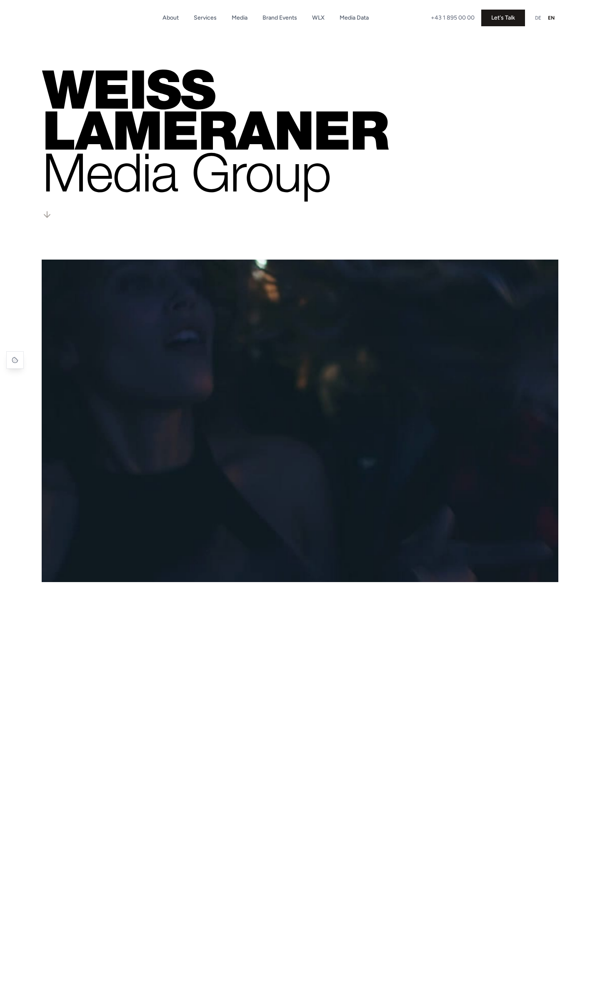
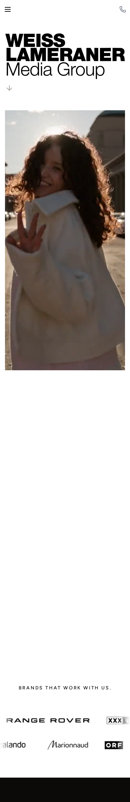

# UI Design System & Master Generation Blueprint: www-weisslameraner-com_en

> **Weiss & Lameraner Media Group – Lifestyle Media House Vienna** (https://www.weisslameraner.com/en) — Vienna media house: STYLE UP YOUR LIFE!, Y, OBEGG and ADIWEISS.TV. Advertising in print, online, social and TV, plus content and events f...



---

## 1. Executive Visual Persona & Design Archetype

- **Brand Essence & Persona**: **Weiss & Lameraner Media Group – Lifestyle Media House Vienna** (`https://www.weisslameraner.com/en`). Vienna media house: STYLE UP YOUR LIFE!, Y, OBEGG and ADIWEISS.TV. Advertising in print, online, social and TV, plus content and events f...
- **Capture Provenance**: Live browser capture (`tier1_fast`, HTTP `200`, captured `2026-11-23`).
- **Visual Archetype**: **Light-Substrate Editorial & Modular Grid System (`#ffffff` canvas, `#000000` ink, `#171717` accent)**.
- **Anti-AI-Slop Differentiators**:
  - **Live-Computed Chromatic Polarity**: Anchors the viewport in `#ffffff` (live computed `section` `background-color` (`computed_styles.json`)) paired with `#000000` primary typography and `#171717` accents.
  - **Grounded Typographic Hierarchy**: Pairs `figtreeUpright` for display copy (`Lifestyle media for your brand.`) with `Segoe UI` and `SFMono-Regular`.
  - **Calibrated Spatial Grid & Motion**: Combines `96rem` container bounds (`gap: 4px`, padding `1.5rem`) with `cubic-bezier(0,0,.2,1)` easing and Lenis Smooth Scroll (`data-lenis`).

---

## 2. Spatial Architecture & Modular Grid Mathematics



### Viewport Allocation & Container Geometry
- **Captured Viewport Dimensions**: Desktop `1440×2400px` (`assets/desktop.png`, clamped at 2400px live multi-section capture), Mobile `390×2400px` (`assets/mobile.png`, clamped at 2400px live multi-section capture).
- **Master Container Bounds**: `96rem` (non-`@media` desktop container stylesheet rule).
- **Canvas Lateral Padding & Spacing**: `1.5rem` lateral canvas padding with `4px` grid gap.
- **Border Radius Scale**: `.3125rem`, `.375rem`, `.25rem`, `2px`.

### Responsive Breakpoint Architecture
- **Desktop Layout**: Multi-column CSS Grid / Flexbox layout at `1440px` (`max-width: 96rem`, `gap: 4px`).
- **Mobile Layout**: Single-column vertical stack at `390px` viewport width with `1.5rem` horizontal padding.
- **Extracted CSS Media Queries**: `@media (min-width:40rem)`, `@media (min-width:48rem)`, `@media (min-width:64rem)`, `@media (min-width:80rem)`.

---

## 3. Color System, Materiality & Atmospheric Lighting

### Semantic Palette & Source Grounding
| Semantic Role | Ground-Truth Value | Extracted Live / CSS Source |
|---|---|---|
| **Primary Canvas Substrate** | `#ffffff` | live computed `section` `background-color` (`computed_styles.json`) |
| **Primary Typography Ink** | `#000000` | live computed `main` `color` (`computed_styles.json`) |
| **Elevated Surface / Card Substrate** | `#808080` | `.bg-gray-100 { background-color: gray }` (`#808080`) |
| **Interactive Accent / Highlight** | `#171717` | `var(--primary)` in `:root` |
| **Secondary / Muted Copy** | `#737373` | `var(--muted-foreground)` in `:root` |
| **Structural Hairline Border** | `#e5e5e5` | `var(--border)` in `:root` |
| **Variable Token (`--foreground`)** | `#0a0a0a` | `var(--foreground)` in `:root` |
| **Variable Token (`--primary-foreground`)** | `#fafafa` | `var(--primary-foreground)` in `:root` |
| **Variable Token (`--secondary`)** | `#f5f5f5` | `var(--secondary)` in `:root` |
| **Variable Token (`--destructive`)** | `#e40014` | `var(--destructive)` in `:root` |

### Sanitized Root CSS Variables (`ui-ux.md` Ground Truth)
| Variable Name | Extracted Value | Semantic Role |
|---|---|---|
| `--radius` | `.625rem` | Elevation / Border Token |
| `--background` | `#fff` | Canvas / Surface Token |
| `--foreground` | `#0a0a0a` | Typography Ink Token |
| `--card` | `#fff` | Color / Atmospheric Token |
| `--card-foreground` | `#0a0a0a` | Typography Ink Token |
| `--popover` | `#fff` | Color / Atmospheric Token |
| `--popover-foreground` | `#0a0a0a` | Typography Ink Token |
| `--primary` | `#171717` | Brand / Palette Token |
| `--primary-foreground` | `#fafafa` | Typography Ink Token |
| `--secondary` | `#f5f5f5` | Brand / Palette Token |
| `--secondary-foreground` | `#171717` | Typography Ink Token |
| `--muted` | `#f5f5f5` | Color / Atmospheric Token |
| `--muted-foreground` | `#737373` | Typography Ink Token |
| `--accent` | `#f5f5f5` | Brand / Palette Token |
| `--accent-foreground` | `#171717` | Typography Ink Token |
| `--destructive` | `#e40014` | Color / Atmospheric Token |

---

## 4. Typographic Scale & Editorial Hierarchy

### Font Family Stacks
- **Display Typography**: `figtreeUpright`.
- **Primary Body Stack**: `Segoe UI`.
- **Technical / Metadata Stack**: `SFMono-Regular`.

### Typographic Scale & Rules (Live Computed & Stylesheet Grounded)
- **Hero Display (`H1`)**: live computed `h1` (`font-size: 72px`, `line-height: 77.76px`, `font-weight: 300`, `letter-spacing: -1.8px`); CSS variables `--text-4xl: 2.25rem`, `--text-4xl--line-height: calc(2.5 / 2.25)`, `--text-5xl: 3rem`.
- **Section Heading (`H2`)**: live computed `h2 (largest visible desktop heading)` (`font-size: 60px`, `line-height: 1.2`, `font-weight: 400`); CSS variables `--text-2xl: 1.5rem`, `--text-2xl--line-height: calc(2 / 1.5)`, `--text-3xl: 1.875rem`; rule `h2` (`font-size: inherit`, `line-height: normal`, `letter-spacing: normal`, `font-weight: inherit`).
- **Body Copy**: live computed `body` (`font-size: 16px`, `line-height: 24px`, `font-weight: 400`); CSS variables `--text-base: 1rem`, `--text-base--line-height: calc(1.5 / 1)`.
- **Metadata & Navigation Labels**: live computed `nav/a` (`font-size: 16px`, `line-height: 24px`, `font-weight: 400`); CSS variables `--text-xs: .75rem`, `--text-xs--line-height: calc(1 / .75)`, `--text-sm: .875rem`; rule `small` (`font-size: .36em`, `letter-spacing: .02em`).

---

## 5. Choreographed Motion & Interaction Physics

### Primary Easing Curves
- **Extracted Timing Functions**: `cubic-bezier(0,0,.2,1)`, `cubic-bezier(.4,0,.2,1)`, `cubic-bezier(.4,0,.6,1)`.

### Per-Element Transition & Choreography Rules
- **Selector `layer theme`**: `transition: .15s` extracted from `www-weisslameraner-com_en` stylesheet.
- **Selector `.transition`**: `transition: var(--tw-ease,var(--default-transition-timing-function))` extracted from `www-weisslameraner-com_en` stylesheet.
- **Selector `.transition-\[background-size\]`**: `transition: var(--tw-ease,var(--default-transition-timing-function))` extracted from `www-weisslameraner-com_en` stylesheet.
- **Extracted Easing Curve (`cubic-bezier(0,0,.2,1)`)**: Governs interactive state transitions across `<header.top-0>` and `<section.bg-white>`.
- **Runtime Interaction Engine**: Integrates Lenis Smooth Scroll (`data-lenis`) with `prefers-reduced-motion: reduce` fallback guards.

---

## 6. Component Wireframe & Structural DOM Map

### Visual Layout Schematic — Desktop (`1440px`, Grounded in `dom.html` & Landmark Bounding Boxes)
```
┌────────────────────────────────────────────────────────────────────────┐
│ DESKTOP VIEWPORT (1440px) — Weiss & Lameraner Media Group – Lifestyle  │
│ ====================================================================== │
│ [ <header.top-0> (1440x85px)          | About · Services · Media · B ] │
│ ---------------------------------------------------------------------- │
│ | HERO STAGE: <section.relative> (w=1440px)                          | │
│ | H1: Lifestyle media for your brand.                                | │
│ | Substrate: #ffffff | Ink: #000000 | Accent: #171717                | │
│ ---------------------------------------------------------------------- │
│ | SHOWCASE GRID (<section.bg-white>) max-w: 96rem                    | │
│ | +------------------------------+  +------------------------------+ | │
│ | | Brands that work with us.    |  | Austria's media house for li | | │
│ | +------------------------------+  +------------------------------+ | │
│ ---------------------------------------------------------------------- │
│ | DETAIL MODULE (<section.bg-stone-950>) — Guide for brands What     | │
│ ---------------------------------------------------------------------- │
│ [ FOOTER (<footer.bg-stone-950) | https://www.weisslameraner.com/en    │
└────────────────────────────────────────────────────────────────────────┘
```

### Visual Layout Schematic — Mobile Reflow (`390px`)
```
┌────────────────────────────────────────────────────────────────────────┐
│ MOBILE VIEWPORT REFLOW (390px) — Single-Column Stack (gap: 4px)        │
│ ====================================================================== │
│ [ HEADER BAR (<header.top-0>          ) | Compact Menu (390px)         │
│ ---------------------------------------------------------------------- │
│ | HERO STAGE (<section.relative>) — 390px Vertical Lead              | │
│ | H1: Lifestyle media for your brand.                                | │
│ ---------------------------------------------------------------------- │
│ | SHOWCASE STACK (<section.bg-white>) — 1-Col Stack                  | │
│ | [ Item 1: Brands that work with us.                              ] | │
│ | [ Item 2: Austria's media house for lifestyle.                   ] | │
│ ---------------------------------------------------------------------- │
│ | DETAIL STACK (<section.bg-stone-950>) — 1-Col (Guide for brands W) | │
│ ---------------------------------------------------------------------- │
│ [ FOOTER (<footer.bg-stone-950) | Stacked 390px Colophon               │
└────────────────────────────────────────────────────────────────────────┘
```

### Granular DOM Region Breakdown
1. **Brand Header & Navigation Bar (<header.top-0> — `www-weisslameraner-com_en`)**:
   - Landmark `<header class="top-0 left-0">` (`1440x85px`) hosting `Weiss & Lameraner Media Group – Life` navigation (`About · Services · Media · Brand Events · WLX`), DOM attributes (`data-precedence="next"`, `data-precedence="next"`, `data-precedence="cms-o9gdh8"`, `data-href="cms-o9gdh8"`), and stylesheet rule `ight_6c9c2d2c-module__T-NGCq__cla... { font-family:figtreeUpright,figtreeUpright Fallback }`.
2. **Hero Stage & Focal Lead (<section.relative> — `Lifestyle media for your brand.`)**:
   - Landmark `<section class="relative bg-white">` presenting display lead `Lifestyle media for your brand.` and copy excerpt *"Since 2009 we have been taking brands to where their audience is:"* over `#ffffff` canvas and `#000000` ink.
3. **Primary Showcase & Content Grid (<section.bg-white> — `Brands that work with us.`)**:
   - Landmark `<section class="bg-white py-16">` rendering section `Brands that work with us.` with copy *"Media Data 2027 Media Data 2027"*, asset references (`Figtree_VariableFont_wght-s.p.0r5...`, `3emm7imx_eab9.css`, `1lfjsiuslldzn.css`, `37mpl03i35te0.js`), and grid rule `right_6c9c2d2c-module__T-NGCq__va... { --font-figtree:"figtreeUpright", "figtreeUpright Fallback" }`.
4. **Interactive Detail & Feature Matrix (<section.bg-stone-950> — `Austria's media house for lifestyl`)**:
   - Landmark `<section class="bg-stone-950 relative">` framing `Austria's media house for lifestyle.` and `Guide for brands What do you want to achieve? Dis...` (*"(opens in a new window)"*) with `#808080` surface cards, `#171717` accents, and `alic_2112d0a2-module__njfJ-W__cla... { font-family:figtreeItalic,figtreeItalic Fallback }`.
5. **Colophon & Global Directory Footer (<footer.bg-stone-950> — `https://www.weisslameraner.com/en`)**:
   - Landmark `<footer class="bg-stone-950 font-sans">` anchoring `Weiss & Lameraner Media Group – ` footer links (`About · Services · Media · Brand Events · WLX`), copy *"Austria's media house"*, and `#e5e5e5` structural dividers.

---

## 7. Master Zero-Shot AI Generation Prompt

```markdown
# Master Zero-Shot Frontend Generation Prompt: www-weisslameraner-com_en (Weiss & Lameraner Media Group – Lifestyle Media House Vienna)

You are a principal frontend architect and design systems engineer. Build a complete, production-ready web application replicating the exact design system, DOM landmarks, typographic hierarchy, color tokens, and motion physics of `www-weisslameraner-com_en` (**Weiss & Lameraner Media Group – Lifestyle Media House Vienna** — `https://www.weisslameraner.com/en`).

### 1. Visual Archetype & Anti-AI-Slop Mandates
- **Archetype**: Light-Substrate Editorial & Modular Grid System (`#ffffff` canvas, `#000000` ink, `#171717` accent).
- **Identity & Domain Context**: Vienna media house: STYLE UP YOUR LIFE!, Y, OBEGG and ADIWEISS.TV. Advertising in print, online, social and TV, plus content and events f...
- **Primary Substrate**: `#ffffff` (live computed `section` `background-color` (`computed_styles.json`)), **Primary Ink**: `#000000`, **Accent / Highlight**: `#171717`.
- **Site-Specific Differentiators**:
  - **Live-Computed Chromatic Polarity**: Anchors the viewport in `#ffffff` (live computed `section` `background-color` (`computed_styles.json`)) paired with `#000000` primary typography and `#171717` accents.
  - **Grounded Typographic Hierarchy**: Pairs `figtreeUpright` for display copy (`Lifestyle media for your brand.`) with `Segoe UI` and `SFMono-Regular`.
  - **Calibrated Spatial Grid & Motion**: Combines `96rem` container bounds (`gap: 4px`, padding `1.5rem`) with `cubic-bezier(0,0,.2,1)` easing and Lenis Smooth Scroll (`data-lenis`).

### 2. Ground-Truth CSS Variables (`:root` Token Contract)
Declare and consume these exact custom properties extracted from `www-weisslameraner-com_en` in your global stylesheet:

:root {
  /* Weiss & Lameraner Media Group – Lifestyle Media House Vienna (www-weisslameraner-com_en) — Live-Grounded CSS Variables */
  --radius: .625rem; /* Elevation / Border Token (www-weisslameraner-com_en) */
  --background: #fff; /* Canvas / Surface Token (www-weisslameraner-com_en) */
  --foreground: #0a0a0a; /* Typography Ink Token (www-weisslameraner-com_en) */
  --card: #fff; /* Color / Atmospheric Token (www-weisslameraner-com_en) */
  --card-foreground: #0a0a0a; /* Typography Ink Token (www-weisslameraner-com_en) */
  --popover: #fff; /* Color / Atmospheric Token (www-weisslameraner-com_en) */
  --popover-foreground: #0a0a0a; /* Typography Ink Token (www-weisslameraner-com_en) */
  --primary: #171717; /* Brand / Palette Token (www-weisslameraner-com_en) */
  --primary-foreground: #fafafa; /* Typography Ink Token (www-weisslameraner-com_en) */
  --secondary: #f5f5f5; /* Brand / Palette Token (www-weisslameraner-com_en) */
  --secondary-foreground: #171717; /* Typography Ink Token (www-weisslameraner-com_en) */
  --muted: #f5f5f5; /* Color / Atmospheric Token (www-weisslameraner-com_en) */
  --muted-foreground: #737373; /* Typography Ink Token (www-weisslameraner-com_en) */
  --accent: #f5f5f5; /* Brand / Palette Token (www-weisslameraner-com_en) */
  --accent-foreground: #171717; /* Typography Ink Token (www-weisslameraner-com_en) */
  --destructive: #e40014; /* Color / Atmospheric Token (www-weisslameraner-com_en) */
}

### 3. Semantic Color & Materiality Contract
Map every surface, ink, and border strictly to these source-grounded tokens:
- **Primary Canvas Substrate**: `#ffffff` — grounded in live computed `section` `background-color` (`computed_styles.json`)
- **Primary Typography Ink**: `#000000` — grounded in live computed `main` `color` (`computed_styles.json`)
- **Elevated Surface / Card Substrate**: `#808080` — grounded in `.bg-gray-100 { background-color: gray }` (`#808080`)
- **Interactive Accent / Highlight**: `#171717` — grounded in `var(--primary)` in `:root`
- **Secondary / Muted Copy**: `#737373` — grounded in `var(--muted-foreground)` in `:root`
- **Structural Hairline Border**: `#e5e5e5` — grounded in `var(--border)` in `:root`
- **Variable Token (`--foreground`)**: `#0a0a0a` — grounded in `var(--foreground)` in `:root`
- **Variable Token (`--primary-foreground`)**: `#fafafa` — grounded in `var(--primary-foreground)` in `:root`
- **Variable Token (`--secondary`)**: `#f5f5f5` — grounded in `var(--secondary)` in `:root`
- **Variable Token (`--destructive`)**: `#e40014` — grounded in `var(--destructive)` in `:root`

### 4. Spatial Grid, Container Bounds & Responsive Breakpoints
- **Desktop Viewport Reference**: `1440×2400px` (clamped at 2400px live multi-section capture, `1440px` standard desktop width).
- **Mobile Viewport Reference**: `390×2400px` (clamped at 2400px live multi-section capture, `390px` standard mobile width).
- **Container Max-Width**: `96rem` (non-`@media` desktop container stylesheet rule)
- **Padding & Gutters**: `1.5rem` lateral canvas padding with `4px` grid gap
- **Desktop Grid**: Multi-column CSS Grid / Flexbox layout at `1440px` (`max-width: 96rem`, `gap: 4px`)
- **Mobile Adaptation**: Single-column vertical stack at `390px` viewport width with `1.5rem` horizontal padding
- **Media Queries**: `@media (min-width:40rem)`, `@media (min-width:48rem)`, `@media (min-width:64rem)`, `@media (min-width:80rem)`
- **Corner Radii**: `.3125rem`, `.375rem`, `.25rem`, `2px`

### 5. Typography & Editorial Scale Contract
- **Display Font Stack**: `figtreeUpright`
- **Body Font Stack**: `Segoe UI`
- **Monospace / Technical Font Stack**: `SFMono-Regular`
- **H1 Display Rule**: live computed `h1` (`font-size: 72px`, `line-height: 77.76px`, `font-weight: 300`, `letter-spacing: -1.8px`); CSS variables `--text-4xl: 2.25rem`, `--text-4xl--line-height: calc(2.5 / 2.25)`, `--text-5xl: 3rem`
- **H2 Section Rule**: live computed `h2 (largest visible desktop heading)` (`font-size: 60px`, `line-height: 1.2`, `font-weight: 400`); CSS variables `--text-2xl: 1.5rem`, `--text-2xl--line-height: calc(2 / 1.5)`, `--text-3xl: 1.875rem`; rule `h2` (`font-size: inherit`, `line-height: normal`, `letter-spacing: normal`, `font-weight: inherit`)
- **Body Copy Rule**: live computed `body` (`font-size: 16px`, `line-height: 24px`, `font-weight: 400`); CSS variables `--text-base: 1rem`, `--text-base--line-height: calc(1.5 / 1)`
- **Metadata & Index Rule**: live computed `nav/a` (`font-size: 16px`, `line-height: 24px`, `font-weight: 400`); CSS variables `--text-xs: .75rem`, `--text-xs--line-height: calc(1 / .75)`, `--text-sm: .875rem`; rule `small` (`font-size: .36em`, `letter-spacing: .02em`)

### 6. Component Hierarchy, Verbatim Copy & Real DOM Landmarks
Scaffold `www-weisslameraner-com_en` (`Weiss & Lameraner Media Group – Lifestyle Media House Vienna`) with these exact structural regions, extracted copy, and CSS rules from `dom.html`:
1. **Brand Header & Navigation Bar (<header.top-0> — `www-weisslameraner-com_en`)**:
   - DOM & Selectors: Landmark `<header class="top-0 left-0">` (`1440x85px`) hosting `Weiss & Lameraner Media Group – Life` navigation (`About · Services · Media · Brand Events · WLX`), DOM attributes (`data-precedence="next"`, `data-precedence="next"`, `data-precedence="cms-o9gdh8"`, `data-href="cms-o9gdh8"`), and stylesheet rule `ight_6c9c2d2c-module__T-NGCq__cla... { font-family:figtreeUpright,figtreeUpright Fallback }`.
   - Responsive Contract: Header `Brand Header & Navigation Bar (<header.top-0> — `www-weisslameraner-com_en`)` (`www-weisslameraner-com_en`) adapts across `@media (min-width:40rem)`, `@media (min-width:48rem)`, `@media (min-width:64rem)`, `@media (min-width:80rem)` with `cubic-bezier(0,0,.2,1)`, `cubic-bezier(.4,0,.2,1)`, `cubic-bezier(.4,0,.6,1)` transitions and links `About · Services · Media · Brand Events · WLX`.
2. **Hero Stage & Focal Lead (<section.relative> — `Lifestyle media for your brand.`)**:
   - DOM & Selectors: Landmark `<section class="relative bg-white">` presenting display lead `Lifestyle media for your brand.` and copy excerpt *"Since 2009 we have been taking brands to where their audience is:"* over `#ffffff` canvas and `#000000` ink.
   - Responsive Contract: Hero stage (`1440×2400px` desktop / `390×2400px` mobile) sets `#ffffff` background with `#000000` headline `Lifestyle media for your brand.`.
3. **Primary Showcase & Content Grid (<section.bg-white> — `Brands that work with us.`)**:
   - DOM & Selectors: Landmark `<section class="bg-white py-16">` rendering section `Brands that work with us.` with copy *"Media Data 2027 Media Data 2027"*, asset references (`Figtree_VariableFont_wght-s.p.0r5...`, `3emm7imx_eab9.css`, `1lfjsiuslldzn.css`, `37mpl03i35te0.js`), and grid rule `right_6c9c2d2c-module__T-NGCq__va... { --font-figtree:"figtreeUpright", "figtreeUpright Fallback" }`.
   - Responsive Contract: Showcase grid `Primary Showcase & Content Grid (<section.bg-white> — `Brands that work with us.`)` applies Multi-column CSS Grid / Flexbox layout at `1440px` (`max-width: 96rem`, `gap: 4px`) on desktop and Single-column vertical stack at `390px` viewport width with `1.5rem` horizontal padding on mobile.
4. **Interactive Detail & Feature Matrix (<section.bg-stone-950> — `Austria's media house for lifestyl`)**:
   - DOM & Selectors: Landmark `<section class="bg-stone-950 relative">` framing `Austria's media house for lifestyle.` and `Guide for brands What do you want to achieve? Dis...` (*"(opens in a new window)"*) with `#808080` surface cards, `#171717` accents, and `alic_2112d0a2-module__njfJ-W__cla... { font-family:figtreeItalic,figtreeItalic Fallback }`.
   - Responsive Contract: Detail module `Interactive Detail & Feature Matrix (<section.bg-stone-950> — `Austria's media house for lifestyl`)` uses `.3125rem`, `.375rem`, `.25rem`, `2px` radii, `#171717` highlights, and assets (Figtree_VariableFont_wght-s.p.0r5..., 3emm7imx_eab9.css, 1lfjsiuslldzn.css).
5. **Colophon & Global Directory Footer (<footer.bg-stone-950> — `https://www.weisslameraner.com/en`)**:
   - DOM & Selectors: Landmark `<footer class="bg-stone-950 font-sans">` anchoring `Weiss & Lameraner Media Group – ` footer links (`About · Services · Media · Brand Events · WLX`), copy *"Austria's media house"*, and `#e5e5e5` structural dividers.
   - Responsive Contract: Footer `Colophon & Global Directory Footer (<footer.bg-stone-950> — `https://www.weisslameraner.com/en`)` aligns to `96rem` (non-`@media` desktop container stylesheet rule) with `1.5rem` lateral canvas padding with `4px` grid gap and attributes (data-precedence="next", data-precedence="next", data-precedence="cms-o9gdh8").

#### Verbatim DOM Copy Excerpts (`dom.html`)
- Copy Excerpt 1: *"Since 2009 we have been taking brands to where their audience is: into our four me..."*
- Copy Excerpt 2: *"Media Data 2027 Media Data 2027"*
- Copy Excerpt 3: *"(opens in a new window)"*
- Copy Excerpt 4: *"Austria's media house"*

### 7. Motion, Extracted Stylesheet Rules & Interaction Choreography
- **Primary Easing Functions**: `cubic-bezier(0,0,.2,1)`, `cubic-bezier(.4,0,.2,1)`, `cubic-bezier(.4,0,.6,1)`
- **Extracted Stylesheet Rules (`www-weisslameraner-com_en`)**:
- `ight_6c9c2d2c-module__T-NGCq__cla... { font-family:figtreeUpright,figtreeUpright Fallback }`
- `right_6c9c2d2c-module__T-NGCq__va... { --font-figtree:"figtreeUpright", "figtreeUpright Fallback" }`
- `alic_2112d0a2-module__njfJ-W__cla... { font-family:figtreeItalic,figtreeItalic Fallback }`
- `talic_2112d0a2-module__njfJ-W__va... { --font-figtree-italic:"figtreeItalic", "figtreeItalic Fallback" }`
- `backdrop { box-sizing:border-box;border:0 solid;margin:0;padding:0 }`
- **Per-Selector Transition Rules**:
- **Selector `layer theme`**: `transition: .15s` extracted from `www-weisslameraner-com_en` stylesheet.
- **Selector `.transition`**: `transition: var(--tw-ease,var(--default-transition-timing-function))` extracted from `www-weisslameraner-com_en` stylesheet.
- **Selector `.transition-\[background-size\]`**: `transition: var(--tw-ease,var(--default-transition-timing-function))` extracted from `www-weisslameraner-com_en` stylesheet.
- **Extracted Easing Curve (`cubic-bezier(0,0,.2,1)`)**: Governs interactive state transitions across `<header.top-0>` and `<section.bg-white>`.
- **Runtime Interaction Engine**: Integrates Lenis Smooth Scroll (`data-lenis`) with `prefers-reduced-motion: reduce` fallback guards.

### 8. Technical Deliverables
- Implement in Next.js (App Router) with TypeScript and Tailwind CSS consuming the `:root` custom properties defined above for `www-weisslameraner-com_en`.
- Reproduce both the `1440px` desktop architecture and `390px` mobile breakpoint transitions, preserving semantic HTML5 landmarks (`<header>`, `<nav>`, `<main>`, `<section>`, `<footer>`) and `prefers-reduced-motion` accessibility guards.
```
