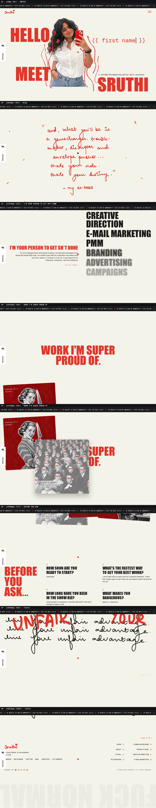
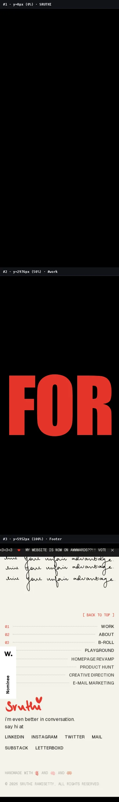

# UI Design System & Master Generation Blueprint: www-worksruthi-com

> **meet Sruthi. a copywriter, marketer and artist with chutzpah.** (https://www.worksruthi.com/) — you've built something good and nobody's talking about it yet? i write and design the art that helps capitalists sell their stuff. loudly.





---

## 1. Executive Visual Persona & Design Archetype

- **Brand Essence & Persona**: **meet Sruthi. a copywriter, marketer and artist with chutzpah.** (`https://www.worksruthi.com/`). you've built something good and nobody's talking about it yet? i write and design the art that helps capitalists sell their stuff. loudly.
- **Capture Provenance**: Live browser capture (`tier1_fast`, HTTP `200`, captured `2026-11-24`).
- **Visual Archetype**: **Light-Gallery WebGL / Canvas Interactive Experience (`#f3f3e9` / `#e33529`)**.
- **Anti-AI-Slop Differentiators**:
  - **Live-Computed Chromatic Polarity**: Anchors the viewport in `#f3f3e9` (live computed `body` `background-color` (`computed_styles.json`)) paired with `#1c1b1a` primary typography and `#e33529` accents.
  - **Grounded Typographic Hierarchy**: Pairs `Impact` for display copy (`SRUTHI`) with `Geist` and `Geist Mono`.
  - **Calibrated Spatial Grid & Motion**: Combines `96rem` container bounds (`gap: var(--s4)`, padding `40px`) with `cubic-bezier(.22,1,.36,1)` easing and GSAP Timeline & ScrollTrigger, HTML5 `<canvas>` Interactive Viewport Surface.

---

## 2. Spatial Architecture & Modular Grid Mathematics

### Viewport Allocation & Container Geometry
- **Captured Journey Filmstrips**: Desktop `1280×6624px` (`assets/desktop-journey.webp`, `8` keyframes up to `y=8836px` / doc `9736px`), Mobile `390×2616px` (`assets/mobile-journey.webp`, `3` keyframes).
- **Master Container Bounds**: `96rem` (non-`@media` desktop container stylesheet rule).
- **Canvas Lateral Padding & Spacing**: `40px` lateral canvas padding with `var(--s4)` grid gap.
- **Border Radius Scale**: `16px`, `999px`, `8px`, `.25rem`.

### Responsive Breakpoint Architecture
- **Desktop Layout**: Multi-column CSS Grid / Flexbox layout at `1440px` (`max-width: 96rem`, `gap: var(--s4)`).
- **Mobile Layout**: Single-column vertical stack at `390px` viewport width with `40px` horizontal padding.
- **Extracted CSS Media Queries**: `@media (prefers-reduced-motion:reduce)`, `@media (max-width:1024px)`, `@media (min-width:1025px),(min-width:810px) and (min-aspect-rati...`, `@media (min-width:810px)`.

---

## 3. Color System, Materiality & Atmospheric Lighting

### Semantic Palette & Source Grounding
| Semantic Role | Ground-Truth Value | Extracted Live / CSS Source |
|---|---|---|
| **Primary Canvas Substrate** | `#f3f3e9` | live computed `body` `background-color` (`computed_styles.json`) |
| **Primary Typography Ink** | `#1c1b1a` | live computed `body` `color` (`computed_styles.json`) |
| **Elevated Surface / Card Substrate** | `#f4f0e5` | `.cork-paper { background: #f4f0e5 }` |
| **Interactive Accent / Highlight** | `#e33529` | live computed `button` `background-color` (`computed_styles.json`) |
| **Secondary / Muted Copy** | `#e33529` | live computed `p` `color` (`computed_styles.json`) |
| **Structural Hairline Border** | `#808080` | `.f-col .lead { border-bottom: #808080 }` |
| **Variable Token (`--cherub`)** | `#f4ced3` | `var(--cherub)` in `:root` |
| **Variable Token (`--sail`)** | `#afd8fb` | `var(--sail)` in `:root` |
| **Variable Token (`--cobalt`)** | `#2b52d9` | `var(--cobalt)` in `:root` |
| **Variable Token (`--marigold`)** | `#f2a900` | `var(--marigold)` in `:root` |
| **Variable Token (`--grey`)** | `#6b6862` | `var(--grey)` in `:root` |
| **Variable Token (`--grey-soft`)** | `#a09c92` | `var(--grey-soft)` in `:root` |

### Sanitized Root CSS Variables (`ui-ux.md` Ground Truth)
| Variable Name | Extracted Value | Semantic Role |
|---|---|---|
| `--font-display` | `"Impact", "Arial Narrow", sans-serif` | Typography / Scale Token |
| `--font-bayon` | `"Bayon", "Arial Narrow", sans-serif` | Typography / Scale Token |
| `--font-sans` | `"Geist", "Helvetica Neue", Helvetica, Arial, sans-serif` | Typography / Scale Token |
| `--font-mono` | `"Geist Mono", "SF Mono", Menlo, monospace` | Typography / Scale Token |
| `--font-helvetica` | `"Helvetica Neue", Helvetica, Arial, sans-serif` | Typography / Scale Token |
| `--spring` | `#f3f3e9` | Elevation / Border Token |
| `--ink` | `#1c1b1a` | Typography Ink Token |
| `--cinnabar` | `#e33529` | Color / Atmospheric Token |
| `--cherub` | `#f4ced3` | Color / Atmospheric Token |
| `--sail` | `#afd8fb` | Color / Atmospheric Token |
| `--cobalt` | `#2b52d9` | Color / Atmospheric Token |
| `--marigold` | `#f2a900` | Color / Atmospheric Token |
| `--grey` | `#6b6862` | Color / Atmospheric Token |
| `--grey-soft` | `#a09c92` | Color / Atmospheric Token |
| `--cream` | `var(--spring)` | Design System Custom Token |
| `--red` | `var(--cinnabar)` | Design System Custom Token |

---

## 4. Typographic Scale & Editorial Hierarchy

### Font Family Stacks
- **Display Typography**: `Impact`.
- **Primary Body Stack**: `Geist`.
- **Technical / Metadata Stack**: `Geist Mono`.

### Typographic Scale & Rules (Live Computed & Stylesheet Grounded)
- **Hero Display (`H1`)**: live computed `h1` (`font-size: 161.973px`, `line-height: 126.339px`, `font-weight: 400`); CSS variables `--font-display: "Impact", "Arial Narrow", sans-serif`, `--h1: calc(clamp(72px, calc(28.17px + 11.24vw), 190px) * var(--vp-scale))`.
- **Section Heading (`H2`)**: live computed `h2` (`font-size: 46px`, `line-height: 46px`, `font-weight: 400`); CSS variables `--h2: calc(clamp(62px, calc(28.57px + 8.57vw), 152px) * var(--vp-scale))`.
- **Body Copy**: live computed `body` (`font-size: 16px`, `line-height: 22.4px`, `font-weight: 400`); rule `p` (`font-size: calc(var(--h9) * .7)`, `line-height: 1.3`, `font-weight: 400`).
- **Metadata & Navigation Labels**: live computed `nav/a` (`font-size: 16px`, `line-height: 22.4px`, `font-weight: 400`); CSS variables `--font-mono: "Geist Mono", "SF Mono", Menlo, monospace`, `--lh-small: 1.14`, `--default-mono-font-family: var(--font-mono)`.

---

## 5. Choreographed Motion & Interaction Physics

### Primary Easing Curves
- **Extracted Timing Functions**: `cubic-bezier(.22,1,.36,1)`, `cubic-bezier(.34,1.56,.64,1)`, `cubic-bezier(.65,0,.35,1)`.

### Per-Element Transition & Choreography Rules
- **Selector `body:has(.gsap-ticker)`**: `transition: --ticker-h .4s var(--ease-site)` extracted from `www-worksruthi-com` stylesheet.
- **Selector `:root.gsap-ticker-still body`**: `transition: none` extracted from `www-worksruthi-com` stylesheet.
- **Selector `body:has(.gsap-ticker) #site-nav`**: `transition: transform .4s var(--ease-site), top .4s var(--ease-site)` extracted from `www-worksruthi-com` stylesheet.
- **Extracted Easing Curve (`cubic-bezier(.22,1,.36,1)`)**: Governs interactive state transitions across `<header.has-tc>` and `<section.bq>`.
- **Runtime Interaction Engine**: Integrates GSAP Timeline & ScrollTrigger, HTML5 `<canvas>` Interactive Viewport Surface with `prefers-reduced-motion: reduce` fallback guards.
### Measured Runtime Scroll & Interaction Telemetry (`behavioral_journey_v2`)
- **Scroll Driver Mode**: `native` (max document height `9736px`, deepest scrollY reached `8836px` across `8` desktop keyframes).
- **Detected Scroll / Motion Libraries**: `GSAP/ScrollTrigger`, `WebGL/Canvas`.
- **Nav / Drawer Probe (`menu`)**: Triggered visual change (pixel diff `158.483`, captured in `assets/state-nav.webp`); revealed links: HOME, WORK, ABOUT, B-ROLL, PLAYGROUND.
- **Route Transition Architecture**: First internal navigation (`/work`) measured as `direct` in `1172ms`.

---

## 6. Component Wireframe & Structural DOM Map

### Visual Layout Schematic — Desktop (`1440px`, Grounded in `dom.html` & Landmark Bounding Boxes)
```
┌────────────────────────────────────────────────────────────────────────┐
│ DESKTOP VIEWPORT (1440px) — meet Sruthi. a copywriter, marketer and ar │
│ ====================================================================== │
│ [ <header.has-tc> (1440x64px)         | Overview · Index · Archive · ] │
│ ---------------------------------------------------------------------- │
│ | HERO STAGE: <section.hero> (w=1440px)                              | │
│ | H1: SRUTHI                                                         | │
│ | Substrate: #f3f3e9 | Ink: #1c1b1a | Accent: #e33529                | │
│ ---------------------------------------------------------------------- │
│ | SHOWCASE GRID (<section.bq>) max-w: 96rem                          | │
│ | +------------------------------+  +------------------------------+ | │
│ | | sruthi                       |  | MY WEBSITE IS NOW ON AWWWARD | | │
│ | +------------------------------+  +------------------------------+ | │
│ ---------------------------------------------------------------------- │
│ | DETAIL MODULE (<section.sfold>) — MY WEBSITE IS NOW ON             | │
│ ---------------------------------------------------------------------- │
│ [ FOOTER (<footer.site-footer>) | https://www.worksruthi.com/          │
└────────────────────────────────────────────────────────────────────────┘
```

### Visual Layout Schematic — Mobile Reflow (`390px`)
```
┌────────────────────────────────────────────────────────────────────────┐
│ MOBILE VIEWPORT REFLOW (390px) — Single-Column Stack (gap: var(--s4)   │
│ ====================================================================== │
│ [ HEADER BAR (<header.has-tc>         ) | Compact Menu (390px)         │
│ ---------------------------------------------------------------------- │
│ | HERO STAGE (<section.hero>) — 390px Vertical Lead                  | │
│ | H1: SRUTHI                                                         | │
│ ---------------------------------------------------------------------- │
│ | SHOWCASE STACK (<section.bq>) — 1-Col Stack                        | │
│ | [ Item 1: sruthi                                                 ] | │
│ | [ Item 2: MY WEBSITE IS NOW ON AWWWARDS??!! VOTE FOR MEEE        ] | │
│ ---------------------------------------------------------------------- │
│ | DETAIL STACK (<section.sfold>) — 1-Col (MY WEBSITE IS NOW )        | │
│ ---------------------------------------------------------------------- │
│ [ FOOTER (<footer.site-footer>) | Stacked 390px Colophon               │
└────────────────────────────────────────────────────────────────────────┘
```

### Granular DOM Region Breakdown
1. **Brand Header & Navigation Bar (<header.has-tc> — `www-worksruthi-com`)**:
   - Landmark `<header class="has-tc">` (`1440x64px`) hosting `meet Sruthi. a copywriter, marketer ` navigation (`Overview · Index · Archive · About · Contact`), DOM attributes (`data-precedence="next"`, `data-precedence="next"`, `data-sdkn="@vercel/analytics/next"`, `data-sdkv="2.0.1"`), and stylesheet rule `.pf canvas { width:100%;height:100%;display:block }`.
2. **Hero Stage & Focal Lead (<section.hero> — `SRUTHI`)**:
   - Landmark `<section class="hero in">` presenting display lead `SRUTHI` and copy excerpt *"handmade with 🫀 and 🧠 and"* over `#f3f3e9` canvas and `#1c1b1a` ink.
3. **Primary Showcase & Content Grid (<section.bq> — `sruthi`)**:
   - Landmark `<section class="bq">` rendering section `sruthi` with copy *"MY WEBSITE IS NOW ON AWWWARDS??!! VOTE FOR MEEE <3<3<3 MY WEBSITE"*, asset references (`Impact.woff2`, `0_vr5kr4-0c-u.css`, `3y62y2uuds32t.css`, `1mlftcslf095m.js`), and grid rule `.pf:focus-visible { outline:2px solid var(--cobalt);outline-offset:-8px;border-radius:16px }`.
4. **Interactive Detail & Feature Matrix (<section.sfold> — `MY WEBSITE IS NOW ON AWWWARDS??!! `)**:
   - Landmark `<section class="sfold">` framing `MY WEBSITE IS NOW ON AWWWARDS??!! VOTE FOR MEEE ` and `MY WEBSITE IS NOW ON AWWWARDS??!! VOTE FOR MEEE ` (*"MY WEBSITE IS NOW ON AWWWARDS??!! VOTE FOR MEEE <3<3<3"*) with `#f4f0e5` surface cards, `#e33529` accents, and `.pl-frame { justify-content:center;align-items:center;display:flex;position:absolute... }`.
5. **Colophon & Global Directory Footer (<footer.site-footer> — `https://www.worksruthi.com/`)**:
   - Landmark `<footer class="site-footer">` anchoring `meet Sruthi. a copywriter, marke` footer links (`Overview · Index · Archive · About · Contact`), copy *"a copywriter/marketer/artist with chutzpah. a c o p y w r i "*, and `#808080` structural dividers.
### Full Vertical Scroll Sequence (Desktop `1440×900` Keyframes)
- **Step 01** (`y=0px`, `0%`): Active landmark `SRUTHI` · sticky/fixed elements: `4`
- **Step 02** (`y=850px`, `10%`): Active landmark `#top` · sticky/fixed elements: `4`
- **Step 03** (`y=2550px`, `29%`): Active landmark `I'M YOUR PERSON TO GET SH*T DONE` · sticky/fixed elements: `4`
- **Step 04** (`y=4250px`, `48%`): Active landmark `WORK I'M SUPER PROUD OF` · sticky/fixed elements: `4`
- **Step 05** (`y=5100px`, `58%`): Active landmark `WORK I'M SUPER PROUD OF` · sticky/fixed elements: `4`
- **Step 06** (`y=6800px`, `77%`): Active landmark `BEFORE YOU ASK` · sticky/fixed elements: `4`
- **Step 07** (`y=8500px`, `96%`): Active landmark `Footer` · sticky/fixed elements: `4`
- **Step 08** (`y=8836px`, `100%`): Active landmark `Footer` · sticky/fixed elements: `4`

### Multi-Page Internal Route Map
- **Listing Route (`/work`)**: `https://www.worksruthi.com/work` — H1: `LOVE LOVE LOVE LOVE LOVE LOVE LOVE LOVE LOVE LOVE...`, scrollHeight `3609px`, transition `direct` (`1172ms`)
- **About Route (`/about`)**: `https://www.worksruthi.com/about` — H1: `i want a big life.`, scrollHeight `20347px`, transition `direct` (`822ms`)
- **Other Route (`/b-roll`)**: `https://www.worksruthi.com/b-roll` — H1: `b-roll`, scrollHeight `900px`, transition `direct` (`1069ms`)

---

## 7. Master Zero-Shot AI Generation Prompt

```markdown
# Master Zero-Shot Frontend Generation Prompt: www-worksruthi-com (meet Sruthi. a copywriter, marketer and artist with chutzpah.)

You are a principal frontend architect and design systems engineer. Build a complete, production-ready web application replicating the exact design system, DOM landmarks, typographic hierarchy, color tokens, and motion physics of `www-worksruthi-com` (**meet Sruthi. a copywriter, marketer and artist with chutzpah.** — `https://www.worksruthi.com/`).

### 1. Visual Archetype & Anti-AI-Slop Mandates
- **Archetype**: Light-Gallery WebGL / Canvas Interactive Experience (`#f3f3e9` / `#e33529`).
- **Identity & Domain Context**: you've built something good and nobody's talking about it yet? i write and design the art that helps capitalists sell their stuff. loudly.
- **Primary Substrate**: `#f3f3e9` (live computed `body` `background-color` (`computed_styles.json`)), **Primary Ink**: `#1c1b1a`, **Accent / Highlight**: `#e33529`.
- **Site-Specific Differentiators**:
  - **Live-Computed Chromatic Polarity**: Anchors the viewport in `#f3f3e9` (live computed `body` `background-color` (`computed_styles.json`)) paired with `#1c1b1a` primary typography and `#e33529` accents.
  - **Grounded Typographic Hierarchy**: Pairs `Impact` for display copy (`SRUTHI`) with `Geist` and `Geist Mono`.
  - **Calibrated Spatial Grid & Motion**: Combines `96rem` container bounds (`gap: var(--s4)`, padding `40px`) with `cubic-bezier(.22,1,.36,1)` easing and GSAP Timeline & ScrollTrigger, HTML5 `<canvas>` Interactive Viewport Surface.

### 2. Ground-Truth CSS Variables (`:root` Token Contract)
Declare and consume these exact custom properties extracted from `www-worksruthi-com` in your global stylesheet:

:root {
  /* meet Sruthi. a copywriter, marketer and artist with chutzpah. (www-worksruthi-com) — Live-Grounded CSS Variables */
  --font-display: "Impact", "Arial Narrow", sans-serif; /* Typography / Scale Token (www-worksruthi-com) */
  --font-bayon: "Bayon", "Arial Narrow", sans-serif; /* Typography / Scale Token (www-worksruthi-com) */
  --font-sans: "Geist", "Helvetica Neue", Helvetica, Arial, sans-serif; /* Typography / Scale Token (www-worksruthi-com) */
  --font-mono: "Geist Mono", "SF Mono", Menlo, monospace; /* Typography / Scale Token (www-worksruthi-com) */
  --font-helvetica: "Helvetica Neue", Helvetica, Arial, sans-serif; /* Typography / Scale Token (www-worksruthi-com) */
  --spring: #f3f3e9; /* Elevation / Border Token (www-worksruthi-com) */
  --ink: #1c1b1a; /* Typography Ink Token (www-worksruthi-com) */
  --cinnabar: #e33529; /* Color / Atmospheric Token (www-worksruthi-com) */
  --cherub: #f4ced3; /* Color / Atmospheric Token (www-worksruthi-com) */
  --sail: #afd8fb; /* Color / Atmospheric Token (www-worksruthi-com) */
  --cobalt: #2b52d9; /* Color / Atmospheric Token (www-worksruthi-com) */
  --marigold: #f2a900; /* Color / Atmospheric Token (www-worksruthi-com) */
  --grey: #6b6862; /* Color / Atmospheric Token (www-worksruthi-com) */
  --grey-soft: #a09c92; /* Color / Atmospheric Token (www-worksruthi-com) */
  --cream: var(--spring); /* Design System Custom Token (www-worksruthi-com) */
  --red: var(--cinnabar); /* Design System Custom Token (www-worksruthi-com) */
}

### 3. Semantic Color & Materiality Contract
Map every surface, ink, and border strictly to these source-grounded tokens:
- **Primary Canvas Substrate**: `#f3f3e9` — grounded in live computed `body` `background-color` (`computed_styles.json`)
- **Primary Typography Ink**: `#1c1b1a` — grounded in live computed `body` `color` (`computed_styles.json`)
- **Elevated Surface / Card Substrate**: `#f4f0e5` — grounded in `.cork-paper { background: #f4f0e5 }`
- **Interactive Accent / Highlight**: `#e33529` — grounded in live computed `button` `background-color` (`computed_styles.json`)
- **Secondary / Muted Copy**: `#e33529` — grounded in live computed `p` `color` (`computed_styles.json`)
- **Structural Hairline Border**: `#808080` — grounded in `.f-col .lead { border-bottom: #808080 }`
- **Variable Token (`--cherub`)**: `#f4ced3` — grounded in `var(--cherub)` in `:root`
- **Variable Token (`--sail`)**: `#afd8fb` — grounded in `var(--sail)` in `:root`
- **Variable Token (`--cobalt`)**: `#2b52d9` — grounded in `var(--cobalt)` in `:root`
- **Variable Token (`--marigold`)**: `#f2a900` — grounded in `var(--marigold)` in `:root`
- **Variable Token (`--grey`)**: `#6b6862` — grounded in `var(--grey)` in `:root`
- **Variable Token (`--grey-soft`)**: `#a09c92` — grounded in `var(--grey-soft)` in `:root`

### 4. Spatial Grid, Container Bounds & Responsive Breakpoints
- **Desktop Viewport Reference**: `1280×6624px` (multi-frame vertical journey filmstrip (6624px), `1440px` standard desktop width).
- **Mobile Viewport Reference**: `390×2616px` (multi-frame vertical journey filmstrip (2616px), `390px` standard mobile width).
- **Container Max-Width**: `96rem` (non-`@media` desktop container stylesheet rule)
- **Padding & Gutters**: `40px` lateral canvas padding with `var(--s4)` grid gap
- **Desktop Grid**: Multi-column CSS Grid / Flexbox layout at `1440px` (`max-width: 96rem`, `gap: var(--s4)`)
- **Mobile Adaptation**: Single-column vertical stack at `390px` viewport width with `40px` horizontal padding
- **Media Queries**: `@media (prefers-reduced-motion:reduce)`, `@media (max-width:1024px)`, `@media (min-width:1025px),(min-width:810px) and (min-aspect-rati...`, `@media (min-width:810px)`
- **Corner Radii**: `16px`, `999px`, `8px`, `.25rem`

### 5. Typography & Editorial Scale Contract
- **Display Font Stack**: `Impact`
- **Body Font Stack**: `Geist`
- **Monospace / Technical Font Stack**: `Geist Mono`
- **H1 Display Rule**: live computed `h1` (`font-size: 161.973px`, `line-height: 126.339px`, `font-weight: 400`); CSS variables `--font-display: "Impact", "Arial Narrow", sans-serif`, `--h1: calc(clamp(72px, calc(28.17px + 11.24vw), 190px) * var(--vp-scale))`
- **H2 Section Rule**: live computed `h2` (`font-size: 46px`, `line-height: 46px`, `font-weight: 400`); CSS variables `--h2: calc(clamp(62px, calc(28.57px + 8.57vw), 152px) * var(--vp-scale))`
- **Body Copy Rule**: live computed `body` (`font-size: 16px`, `line-height: 22.4px`, `font-weight: 400`); rule `p` (`font-size: calc(var(--h9) * .7)`, `line-height: 1.3`, `font-weight: 400`)
- **Metadata & Index Rule**: live computed `nav/a` (`font-size: 16px`, `line-height: 22.4px`, `font-weight: 400`); CSS variables `--font-mono: "Geist Mono", "SF Mono", Menlo, monospace`, `--lh-small: 1.14`, `--default-mono-font-family: var(--font-mono)`

### 6. Component Hierarchy, Verbatim Copy & Real DOM Landmarks
Scaffold `www-worksruthi-com` (`meet Sruthi. a copywriter, marketer and artist with chutzpah.`) with these exact structural regions, extracted copy, and CSS rules from `dom.html`:
1. **Brand Header & Navigation Bar (<header.has-tc> — `www-worksruthi-com`)**:
   - DOM & Selectors: Landmark `<header class="has-tc">` (`1440x64px`) hosting `meet Sruthi. a copywriter, marketer ` navigation (`Overview · Index · Archive · About · Contact`), DOM attributes (`data-precedence="next"`, `data-precedence="next"`, `data-sdkn="@vercel/analytics/next"`, `data-sdkv="2.0.1"`), and stylesheet rule `.pf canvas { width:100%;height:100%;display:block }`.
   - Responsive Contract: Header `Brand Header & Navigation Bar (<header.has-tc> — `www-worksruthi-com`)` (`www-worksruthi-com`) adapts across `@media (prefers-reduced-motion:reduce)`, `@media (max-width:1024px)`, `@media (min-width:1025px),(min-width:810px) and (min-aspect-rati...`, `@media (min-width:810px)` with `cubic-bezier(.22,1,.36,1)`, `cubic-bezier(.34,1.56,.64,1)`, `cubic-bezier(.65,0,.35,1)` transitions and links `Overview · Index · Archive · About · Contact`.
2. **Hero Stage & Focal Lead (<section.hero> — `SRUTHI`)**:
   - DOM & Selectors: Landmark `<section class="hero in">` presenting display lead `SRUTHI` and copy excerpt *"handmade with 🫀 and 🧠 and"* over `#f3f3e9` canvas and `#1c1b1a` ink.
   - Responsive Contract: Hero stage (`1280×6624px` desktop / `390×2616px` mobile) sets `#f3f3e9` background with `#1c1b1a` headline `SRUTHI`.
3. **Primary Showcase & Content Grid (<section.bq> — `sruthi`)**:
   - DOM & Selectors: Landmark `<section class="bq">` rendering section `sruthi` with copy *"MY WEBSITE IS NOW ON AWWWARDS??!! VOTE FOR MEEE <3<3<3 MY WEBSITE"*, asset references (`Impact.woff2`, `0_vr5kr4-0c-u.css`, `3y62y2uuds32t.css`, `1mlftcslf095m.js`), and grid rule `.pf:focus-visible { outline:2px solid var(--cobalt);outline-offset:-8px;border-radius:16px }`.
   - Responsive Contract: Showcase grid `Primary Showcase & Content Grid (<section.bq> — `sruthi`)` applies Multi-column CSS Grid / Flexbox layout at `1440px` (`max-width: 96rem`, `gap: var(--s4)`) on desktop and Single-column vertical stack at `390px` viewport width with `40px` horizontal padding on mobile.
4. **Interactive Detail & Feature Matrix (<section.sfold> — `MY WEBSITE IS NOW ON AWWWARDS??!! `)**:
   - DOM & Selectors: Landmark `<section class="sfold">` framing `MY WEBSITE IS NOW ON AWWWARDS??!! VOTE FOR MEEE ` and `MY WEBSITE IS NOW ON AWWWARDS??!! VOTE FOR MEEE ` (*"MY WEBSITE IS NOW ON AWWWARDS??!! VOTE FOR MEEE <3<3<3"*) with `#f4f0e5` surface cards, `#e33529` accents, and `.pl-frame { justify-content:center;align-items:center;display:flex;position:absolute... }`.
   - Responsive Contract: Detail module `Interactive Detail & Feature Matrix (<section.sfold> — `MY WEBSITE IS NOW ON AWWWARDS??!! `)` uses `16px`, `999px`, `8px`, `.25rem` radii, `#e33529` highlights, and assets (Impact.woff2, 0_vr5kr4-0c-u.css, 3y62y2uuds32t.css).
5. **Colophon & Global Directory Footer (<footer.site-footer> — `https://www.worksruthi.com/`)**:
   - DOM & Selectors: Landmark `<footer class="site-footer">` anchoring `meet Sruthi. a copywriter, marke` footer links (`Overview · Index · Archive · About · Contact`), copy *"a copywriter/marketer/artist with chutzpah. a c o p y w r i "*, and `#808080` structural dividers.
   - Responsive Contract: Footer `Colophon & Global Directory Footer (<footer.site-footer> — `https://www.worksruthi.com/`)` aligns to `96rem` (non-`@media` desktop container stylesheet rule) with `40px` lateral canvas padding with `var(--s4)` grid gap and attributes (data-precedence="next", data-precedence="next", data-sdkn="@vercel/analytics/next").

#### Verbatim DOM Copy Excerpts (`dom.html`)
- Copy Excerpt 1: *"handmade with 🫀 and 🧠 and"*
- Copy Excerpt 2: *"MY WEBSITE IS NOW ON AWWWARDS??!! VOTE FOR MEEE <3<3<3 MY WEBSITE IS NOW ON AWWWAR..."*
- Copy Excerpt 3: *"MY WEBSITE IS NOW ON AWWWARDS??!! VOTE FOR MEEE <3<3<3"*
- Copy Excerpt 4: *"a copywriter/marketer/artist with chutzpah. a c o p y w r i t e r / m a r k e t e..."*

### 7. Motion, Extracted Stylesheet Rules & Interaction Choreography
- **Primary Easing Functions**: `cubic-bezier(.22,1,.36,1)`, `cubic-bezier(.34,1.56,.64,1)`, `cubic-bezier(.65,0,.35,1)`
- **Extracted Stylesheet Rules (`www-worksruthi-com`)**:
- `.pf canvas { width:100%;height:100%;display:block }`
- `.pf:focus-visible { outline:2px solid var(--cobalt);outline-offset:-8px;border-radius:16px }`
- `.pl-frame { justify-content:center;align-items:center;display:flex;position:absolute... }`
- `.pl-frame.is-black { background:000 }`
- `.pl-frame.is-cinnabar { background:var(--cinnabar) }`
- **Per-Selector Transition Rules**:
- **Selector `body:has(.gsap-ticker)`**: `transition: --ticker-h .4s var(--ease-site)` extracted from `www-worksruthi-com` stylesheet.
- **Selector `:root.gsap-ticker-still body`**: `transition: none` extracted from `www-worksruthi-com` stylesheet.
- **Selector `body:has(.gsap-ticker) #site-nav`**: `transition: transform .4s var(--ease-site), top .4s var(--ease-site)` extracted from `www-worksruthi-com` stylesheet.
- **Extracted Easing Curve (`cubic-bezier(.22,1,.36,1)`)**: Governs interactive state transitions across `<header.has-tc>` and `<section.bq>`.
- **Runtime Interaction Engine**: Integrates GSAP Timeline & ScrollTrigger, HTML5 `<canvas>` Interactive Viewport Surface with `prefers-reduced-motion: reduce` fallback guards.
### 7b. Full-Page Scroll Choreography, Interactive States & Multi-Page Routes
- **Scroll Mechanics**: Implement `native` vertical progression up to `9736px` across 8 distinct viewport chapters using GSAP/ScrollTrigger, WebGL/Canvas.
- **Vertical Chapter Sequence**: SRUTHI (0%) -> #top (10%) -> I'M YOUR PERSON TO GET SH*T... (29%) -> WORK I'M SUPER PROUD OF (48%) -> WORK I'M SUPER PROUD OF (58%) -> BEFORE YOU ASK (77%) -> Footer (96%) -> Footer (100%).
- **Navigation Drawer / Menu State**: Replicate interactive menu toggle (`menu`) with Escape-to-close keyboard handling.
- **Multi-Page Routes**: Scaffold internal routes `/work` (listing, direct), `/about` (about, direct), `/b-roll` (other, direct) sharing the global header/footer shell and design tokens.

### 8. Technical Deliverables
- Implement in Next.js (App Router) with TypeScript and Tailwind CSS consuming the `:root` custom properties defined above for `www-worksruthi-com`.
- Reproduce both the `1440px` desktop architecture and `390px` mobile breakpoint transitions, preserving semantic HTML5 landmarks (`<header>`, `<nav>`, `<main>`, `<section>`, `<footer>`) and `prefers-reduced-motion` accessibility guards.
```
---

## 8. Full-Page Scroll Journey, Interactive States & Subpage Inventory

### Desktop Scroll Keyframes (`1440×900` WebP)
| Step | Scroll Y | Progress | Active Landmark / Section | Sticky/Fixed | Visual Asset |
| :---: | :---: | :---: | :--- | :---: | :--- |
| `#01` | `0px` | `0%` | SRUTHI | `4` | [desktop-step-01.webp](assets/desktop-step-01.webp) |
| `#02` | `850px` | `10%` | #top | `4` | [desktop-step-02.webp](assets/desktop-step-02.webp) |
| `#03` | `2550px` | `29%` | I'M YOUR PERSON TO GET SH*T DONE | `4` | [desktop-step-03.webp](assets/desktop-step-03.webp) |
| `#04` | `4250px` | `48%` | WORK I'M SUPER PROUD OF | `4` | [desktop-step-04.webp](assets/desktop-step-04.webp) |
| `#05` | `5100px` | `58%` | WORK I'M SUPER PROUD OF | `4` | [desktop-step-05.webp](assets/desktop-step-05.webp) |
| `#06` | `6800px` | `77%` | BEFORE YOU ASK | `4` | [desktop-step-06.webp](assets/desktop-step-06.webp) |
| `#07` | `8500px` | `96%` | Footer | `4` | [desktop-step-07.webp](assets/desktop-step-07.webp) |
| `#08` | `8836px` | `100%` | Footer | `4` | [desktop-step-08.webp](assets/desktop-step-08.webp) |

### Mobile Condensed Keyframes (`390×844` WebP)
| Step | Scroll Y | Progress | Active Landmark | Visual Asset |
| :---: | :---: | :---: | :--- | :--- |
| `#01` | `0px` | `0%` | SRUTHI | [mobile-step-01.webp](assets/mobile-step-01.webp) |
| `#02` | `2976px` | `50%` | #work | [mobile-step-02.webp](assets/mobile-step-02.webp) |
| `#03` | `5952px` | `100%` | Footer | [mobile-step-03.webp](assets/mobile-step-03.webp) |

### Interactive UI State Captures (`1440×900` WebP)
| State Type | Trigger / Observation | Visual Asset |
| :--- | :--- | :--- |
| `nav_menu` | Nav/Menu opened (`menu`, diff `158.483`) | [state-nav.webp](assets/state-nav.webp) |

### Internal Subpage Filmstrips (`1080px` Wide WebP)
| # | Template | Route URL | H1 / Title | Scroll Height | Transition | Filmstrip Asset |
| :-: | :---: | :--- | :--- | :---: | :---: | :--- |
| `1` | `listing` | `https://www.worksruthi.com/work` | LOVE LOVE LOVE LOVE LOVE LOVE LOVE LO... | `3609px` | `direct` (`1172ms`) | [subpage-01-work.webp](assets/subpage-01-work.webp) |
| `2` | `about` | `https://www.worksruthi.com/about` | i want a big life. | `20347px` | `direct` (`822ms`) | [subpage-02-about.webp](assets/subpage-02-about.webp) |
| `3` | `other` | `https://www.worksruthi.com/b-roll` | b-roll | `900px` | `direct` (`1069ms`) | [subpage-03-b-roll.webp](assets/subpage-03-b-roll.webp) |

