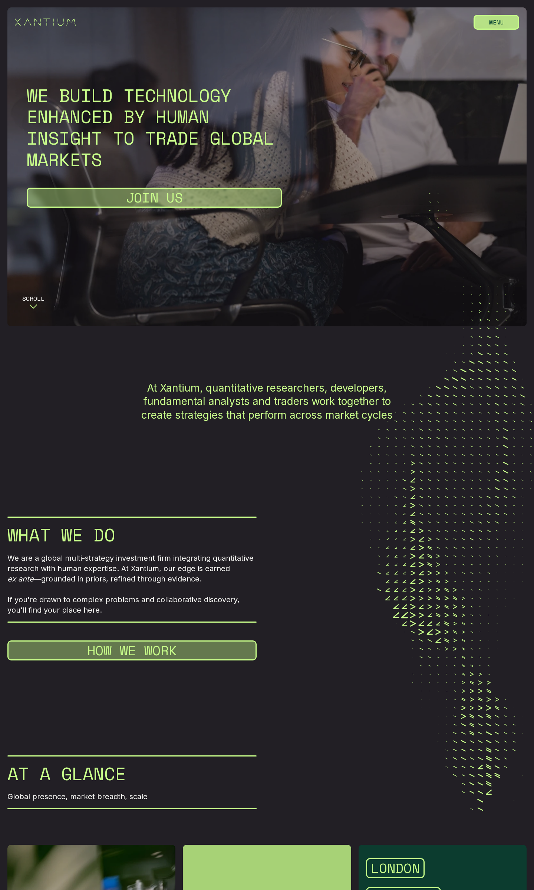
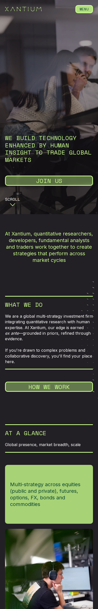

# UI Design System & Master Generation Blueprint: www-xantium-com

> **Xantium** (https://www.xantium.com) — Xantium



---

## 1. Executive Visual Persona & Design Archetype

- **Brand Essence & Persona**: **Xantium** (`https://www.xantium.com`). Xantium
- **Capture Provenance**: Live browser capture (`tier1_fast`, HTTP `200`, captured `2026-11-23`).
- **Visual Archetype**: **High-Contrast Obsidian / Atmospheric Design System (`#221f25` canvas, `#f5f5f2` ink, `#c9ff8b` accent)**.
- **Anti-AI-Slop Differentiators**:
  - **Live-Computed Chromatic Polarity**: Anchors the viewport in `#221f25` (live computed `body` `background-color` (`computed_styles.json`)) paired with `#f5f5f2` primary typography and `#c9ff8b` accents.
  - **Grounded Typographic Hierarchy**: Pairs `Space Mono` for display copy (`WE BUILD TECHNOLOGY ENHANCED BY HUMA`) with `Inter` and `Space Mono`.
  - **Calibrated Spatial Grid & Motion**: Combines `96rem` container bounds (`gap: 16px`, padding `40px`) with `cubic-bezier(0,0,.2,1)` easing and Lottie Vector Animation Player.

---

## 2. Spatial Architecture & Modular Grid Mathematics



### Viewport Allocation & Container Geometry
- **Captured Viewport Dimensions**: Desktop `1440×2400px` (`assets/desktop.png`, clamped at 2400px live multi-section capture), Mobile `390×2400px` (`assets/mobile.png`, clamped at 2400px live multi-section capture).
- **Master Container Bounds**: `96rem` (non-`@media` desktop container stylesheet rule).
- **Canvas Lateral Padding & Spacing**: `40px` lateral canvas padding with `16px` grid gap.
- **Border Radius Scale**: `10px`, `4px`, `3px`.

### Responsive Breakpoint Architecture
- **Desktop Layout**: Multi-column CSS Grid / Flexbox layout at `1440px` (`max-width: 96rem`, `gap: 16px`).
- **Mobile Layout**: Single-column vertical stack at `390px` viewport width with `40px` horizontal padding.
- **Extracted CSS Media Queries**: `@media (min-width:40rem)`, `@media (min-width:48rem)`, `@media (min-width:64rem)`, `@media (min-width:80rem)`.

---

## 3. Color System, Materiality & Atmospheric Lighting

### Semantic Palette & Source Grounding
| Semantic Role | Ground-Truth Value | Extracted Live / CSS Source |
|---|---|---|
| **Primary Canvas Substrate** | `#221f25` | live computed `body` `background-color` (`computed_styles.json`) |
| **Primary Typography Ink** | `#f5f5f2` | live computed `main` `color` (`computed_styles.json`) |
| **Elevated Surface / Card Substrate** | `#000000` | `.bg-cache-black { background-color: black }` (`#000000`) |
| **Interactive Accent / Highlight** | `#c9ff8b` | live computed `a` `color` (`computed_styles.json`) |
| **Secondary / Muted Copy** | `#084432` | live computed `button` `color` (`computed_styles.json`) |
| **Structural Hairline Border** | `#413f44` | `15 { border-color: #413f44 }` |
| **Variable Token (`--color-white`)** | `#ffffff` | `var(--color-white)` in `:root` |

### Sanitized Root CSS Variables (`ui-ux.md` Ground Truth)
| Variable Name | Extracted Value | Semantic Role |
|---|---|---|
| `--font-inter` | `"Inter","Inter Fallback"` | Typography / Scale Token |
| `--font-space-mono` | `"Space Mono","Space Mono Fallback"` | Typography / Scale Token |
| `--color-white` | `#fff` | Canvas / Surface Token |
| `--spacing` | `.25rem` | Layout / Spatial Grid Token |
| `--container-sm` | `24rem` | Layout / Spatial Grid Token |
| `--container-lg` | `32rem` | Layout / Spatial Grid Token |
| `--container-2xl` | `42rem` | Layout / Spatial Grid Token |
| `--container-3xl` | `48rem` | Layout / Spatial Grid Token |
| `--container-4xl` | `56rem` | Layout / Spatial Grid Token |
| `--text-xs` | `.75rem` | Typography Ink Token |
| `--text-xs--line-height` | `calc(1/.75)` | Typography Ink Token |
| `--text-sm` | `.875rem` | Typography Ink Token |
| `--text-sm--line-height` | `calc(1.25/.875)` | Typography Ink Token |
| `--text-base` | `1rem` | Typography Ink Token |
| `--text-base--line-height` | `calc(1.5/1)` | Typography Ink Token |
| `--text-xl` | `1.25rem` | Typography Ink Token |

---

## 4. Typographic Scale & Editorial Hierarchy

### Font Family Stacks
- **Display Typography**: `Space Mono`.
- **Primary Body Stack**: `Inter`.
- **Technical / Metadata Stack**: `Space Mono`.

### Typographic Scale & Rules (Live Computed & Stylesheet Grounded)
- **Hero Display (`H1`)**: live computed `h1` (`font-size: 48px`, `line-height: 57.6px`, `font-weight: 400`); CSS variables `--text-4xl: 2.25rem`, `--text-4xl--line-height: calc(2.5/2.25)`, `--text-5xl: 3rem`.
- **Section Heading (`H2`)**: live computed `h2` (`font-size: 48px`, `line-height: 57.6px`, `font-weight: 400`); CSS variables `--text-2xl: 1.5rem`, `--text-2xl--line-height: calc(2/1.5)`, `--text-3xl: 1.875rem`.
- **Body Copy**: live computed `body` (`font-size: 20px`, `line-height: 28px`, `font-weight: 400`); CSS variables `--text-base: 1rem`, `--text-base--line-height: calc(1.5/1)`, `--font-body: system-ui,sans-serif`.
- **Metadata & Navigation Labels**: live computed `nav/a` (`font-size: 20px`, `line-height: 28px`, `font-weight: 400`); CSS variables `--font-space-mono: "Space Mono","Space Mono Fallback"`, `--text-xs: .75rem`, `--text-xs--line-height: calc(1/.75)`.

---

## 5. Choreographed Motion & Interaction Physics

### Primary Easing Curves
- **Extracted Timing Functions**: `cubic-bezier(0,0,.2,1)`, `cubic-bezier(.4,0,.2,1)`.

### Per-Element Transition & Choreography Rules
- **Selector `layer theme`**: `transition: .15s` extracted from `www-xantium-com` stylesheet.
- **Selector `.transition`**: `transition: var(--tw-ease,var(--default-transition-timing-function))` extracted from `www-xantium-com` stylesheet.
- **Selector `.transition-all`**: `transition: var(--tw-ease,var(--default-transition-timing-function))` extracted from `www-xantium-com` stylesheet.
- **Extracted Easing Curve (`cubic-bezier(0,0,.2,1)`)**: Governs interactive state transitions across `<header.pointer-events-none>` and `<section.py-16>`.
- **Runtime Interaction Engine**: Integrates Lottie Vector Animation Player with `prefers-reduced-motion: reduce` fallback guards.

---

## 6. Component Wireframe & Structural DOM Map

### Visual Layout Schematic — Desktop (`1440px`, Grounded in `dom.html` & Landmark Bounding Boxes)
```
┌────────────────────────────────────────────────────────────────────────┐
│ DESKTOP VIEWPORT (1440px) — Xantium                                    │
│ ====================================================================== │
│ [ <header.pointer-events (1440x40px)  | Home · How We Work · Our Cul ] │
│ ---------------------------------------------------------------------- │
│ | HERO STAGE: <section.z-3> (w=1440px)                               | │
│ | H1: WE BUILD TECHNOLOGY ENHANCED BY HUMAN INSIGHT TO...            | │
│ | Substrate: #221f25 | Ink: #f5f5f2 | Accent: #c9ff8b                | │
│ ---------------------------------------------------------------------- │
│ | SHOWCASE GRID (<section.py-16>) max-w: 96rem                       | │
│ | +------------------------------+  +------------------------------+ | │
│ | | We build technology enhanced |  | Founded in 2019 as part of T | | │
│ | +------------------------------+  +------------------------------+ | │
│ ---------------------------------------------------------------------- │
│ | DETAIL MODULE (<section.relative>) — 250+ people across 4          | │
│ ---------------------------------------------------------------------- │
│ [ FOOTER (<footer.bg-cache-bla) | https://www.xantium.com              │
└────────────────────────────────────────────────────────────────────────┘
```

### Visual Layout Schematic — Mobile Reflow (`390px`)
```
┌────────────────────────────────────────────────────────────────────────┐
│ MOBILE VIEWPORT REFLOW (390px) — Single-Column Stack (gap: 16px)       │
│ ====================================================================== │
│ [ HEADER BAR (<header.pointer-events-n) | Compact Menu (390px)         │
│ ---------------------------------------------------------------------- │
│ | HERO STAGE (<section.z-3>) — 390px Vertical Lead                   | │
│ | H1: WE BUILD TECHNOLOGY ENHANCED BY HUMAN INSIGHT TO...            | │
│ ---------------------------------------------------------------------- │
│ | SHOWCASE STACK (<section.py-16>) — 1-Col Stack                     | │
│ | [ Item 1: We build technology enhanced by human insight to...    ] | │
│ | [ Item 2: Founded in 2019 as part of Tudor Group                 ] | │
│ ---------------------------------------------------------------------- │
│ | DETAIL STACK (<section.relative>) — 1-Col (250+ people across)     | │
│ ---------------------------------------------------------------------- │
│ [ FOOTER (<footer.bg-cache-bla) | Stacked 390px Colophon               │
└────────────────────────────────────────────────────────────────────────┘
```

### Granular DOM Region Breakdown
1. **Brand Header & Navigation Bar (<header.pointer-events-none> — `www-xantium-com`)**:
   - Landmark `<header class="pointer-events-none inset-x-0">` (`1440x40px`) hosting `Xantium` navigation (`Home · How We Work · Our Culture · Our Team · Careers`), DOM attributes (`data-precedence="next"`, `data-nimg="fill"`, `data-nimg="fill"`, `data-nimg="fill"`), and stylesheet rule `nter_fe8b9d92-module__LINzvG__cla... { font-family:Inter,Inter Fallback;font-style:normal }`.
2. **Hero Stage & Focal Lead (<section.z-3> — `WE BUILD TECHNOLOGY ENHANCED BY HU`)**:
   - Landmark `<section class="z-3 py-16">` presenting display lead `WE BUILD TECHNOLOGY ENHANCED BY HUMAN INSIGHT TO...` and copy excerpt *"At Xantium, quantitative researchers, developers, fundamental ana"* over `#221f25` canvas and `#f5f5f2` ink.
3. **Primary Showcase & Content Grid (<section.py-16> — `We build technology enhanced by hu`)**:
   - Landmark `<section class="z-3 py-16">` rendering section `We build technology enhanced by human insight to...` with copy *"We are a global multi-strategy investment firm integrating quanti"*, asset references (`28e60ca39c9ae554-s.p.7a4e9fcc.woff2`, `83afe278b6a6bb3c-s.p.3a6ba036.woff2`, `8d05cfa5faa8406c-s.p.4adea45d.woff2`, `d7a0600e467cf0bd-s.p.20ecb425.woff2`), and grid rule `inter_fe8b9d92-module__LINzvG__va... { --font-inter:"Inter","Inter Fallback" }`.
4. **Interactive Detail & Feature Matrix (<section.relative> — `Founded in 2019 as part of Tudor G`)**:
   - Landmark `<section class="py-16 relative">` framing `Founded in 2019 as part of Tudor Group` and `250+ people across 4 offices` (*"If you're drawn to complex problems and collaborative discovery, "*) with `#000000` surface cards, `#c9ff8b` accents, and `mono_e13c1f09-module__VyLqqa__cla... { font-family:Space Mono,Space Mono Fallback;font-style:normal }`.
5. **Colophon & Global Directory Footer (<footer.bg-cache-black> — `https://www.xantium.com`)**:
   - Landmark `<footer class="bg-cache-black relative">` anchoring `Xantium` footer links (`Home · How We Work · Our Culture · Our Team · Careers`), copy *"Global presence, market breadth, scale"*, and `#413f44` structural dividers.

---

## 7. Master Zero-Shot AI Generation Prompt

```markdown
# Master Zero-Shot Frontend Generation Prompt: www-xantium-com (Xantium)

You are a principal frontend architect and design systems engineer. Build a complete, production-ready web application replicating the exact design system, DOM landmarks, typographic hierarchy, color tokens, and motion physics of `www-xantium-com` (**Xantium** — `https://www.xantium.com`).

### 1. Visual Archetype & Anti-AI-Slop Mandates
- **Archetype**: High-Contrast Obsidian / Atmospheric Design System (`#221f25` canvas, `#f5f5f2` ink, `#c9ff8b` accent).
- **Identity & Domain Context**: Xantium
- **Primary Substrate**: `#221f25` (live computed `body` `background-color` (`computed_styles.json`)), **Primary Ink**: `#f5f5f2`, **Accent / Highlight**: `#c9ff8b`.
- **Site-Specific Differentiators**:
  - **Live-Computed Chromatic Polarity**: Anchors the viewport in `#221f25` (live computed `body` `background-color` (`computed_styles.json`)) paired with `#f5f5f2` primary typography and `#c9ff8b` accents.
  - **Grounded Typographic Hierarchy**: Pairs `Space Mono` for display copy (`WE BUILD TECHNOLOGY ENHANCED BY HUMA`) with `Inter` and `Space Mono`.
  - **Calibrated Spatial Grid & Motion**: Combines `96rem` container bounds (`gap: 16px`, padding `40px`) with `cubic-bezier(0,0,.2,1)` easing and Lottie Vector Animation Player.

### 2. Ground-Truth CSS Variables (`:root` Token Contract)
Declare and consume these exact custom properties extracted from `www-xantium-com` in your global stylesheet:

:root {
  /* Xantium (www-xantium-com) — Live-Grounded CSS Variables */
  --font-inter: "Inter","Inter Fallback"; /* Typography / Scale Token (www-xantium-com) */
  --font-space-mono: "Space Mono","Space Mono Fallback"; /* Typography / Scale Token (www-xantium-com) */
  --color-white: #fff; /* Canvas / Surface Token (www-xantium-com) */
  --spacing: .25rem; /* Layout / Spatial Grid Token (www-xantium-com) */
  --container-sm: 24rem; /* Layout / Spatial Grid Token (www-xantium-com) */
  --container-lg: 32rem; /* Layout / Spatial Grid Token (www-xantium-com) */
  --container-2xl: 42rem; /* Layout / Spatial Grid Token (www-xantium-com) */
  --container-3xl: 48rem; /* Layout / Spatial Grid Token (www-xantium-com) */
  --container-4xl: 56rem; /* Layout / Spatial Grid Token (www-xantium-com) */
  --text-xs: .75rem; /* Typography Ink Token (www-xantium-com) */
  --text-xs--line-height: calc(1/.75); /* Typography Ink Token (www-xantium-com) */
  --text-sm: .875rem; /* Typography Ink Token (www-xantium-com) */
  --text-sm--line-height: calc(1.25/.875); /* Typography Ink Token (www-xantium-com) */
  --text-base: 1rem; /* Typography Ink Token (www-xantium-com) */
  --text-base--line-height: calc(1.5/1); /* Typography Ink Token (www-xantium-com) */
  --text-xl: 1.25rem; /* Typography Ink Token (www-xantium-com) */
}

### 3. Semantic Color & Materiality Contract
Map every surface, ink, and border strictly to these source-grounded tokens:
- **Primary Canvas Substrate**: `#221f25` — grounded in live computed `body` `background-color` (`computed_styles.json`)
- **Primary Typography Ink**: `#f5f5f2` — grounded in live computed `main` `color` (`computed_styles.json`)
- **Elevated Surface / Card Substrate**: `#000000` — grounded in `.bg-cache-black { background-color: black }` (`#000000`)
- **Interactive Accent / Highlight**: `#c9ff8b` — grounded in live computed `a` `color` (`computed_styles.json`)
- **Secondary / Muted Copy**: `#084432` — grounded in live computed `button` `color` (`computed_styles.json`)
- **Structural Hairline Border**: `#413f44` — grounded in `15 { border-color: #413f44 }`
- **Variable Token (`--color-white`)**: `#ffffff` — grounded in `var(--color-white)` in `:root`

### 4. Spatial Grid, Container Bounds & Responsive Breakpoints
- **Desktop Viewport Reference**: `1440×2400px` (clamped at 2400px live multi-section capture, `1440px` standard desktop width).
- **Mobile Viewport Reference**: `390×2400px` (clamped at 2400px live multi-section capture, `390px` standard mobile width).
- **Container Max-Width**: `96rem` (non-`@media` desktop container stylesheet rule)
- **Padding & Gutters**: `40px` lateral canvas padding with `16px` grid gap
- **Desktop Grid**: Multi-column CSS Grid / Flexbox layout at `1440px` (`max-width: 96rem`, `gap: 16px`)
- **Mobile Adaptation**: Single-column vertical stack at `390px` viewport width with `40px` horizontal padding
- **Media Queries**: `@media (min-width:40rem)`, `@media (min-width:48rem)`, `@media (min-width:64rem)`, `@media (min-width:80rem)`
- **Corner Radii**: `10px`, `4px`, `3px`

### 5. Typography & Editorial Scale Contract
- **Display Font Stack**: `Space Mono`
- **Body Font Stack**: `Inter`
- **Monospace / Technical Font Stack**: `Space Mono`
- **H1 Display Rule**: live computed `h1` (`font-size: 48px`, `line-height: 57.6px`, `font-weight: 400`); CSS variables `--text-4xl: 2.25rem`, `--text-4xl--line-height: calc(2.5/2.25)`, `--text-5xl: 3rem`
- **H2 Section Rule**: live computed `h2` (`font-size: 48px`, `line-height: 57.6px`, `font-weight: 400`); CSS variables `--text-2xl: 1.5rem`, `--text-2xl--line-height: calc(2/1.5)`, `--text-3xl: 1.875rem`
- **Body Copy Rule**: live computed `body` (`font-size: 20px`, `line-height: 28px`, `font-weight: 400`); CSS variables `--text-base: 1rem`, `--text-base--line-height: calc(1.5/1)`, `--font-body: system-ui,sans-serif`
- **Metadata & Index Rule**: live computed `nav/a` (`font-size: 20px`, `line-height: 28px`, `font-weight: 400`); CSS variables `--font-space-mono: "Space Mono","Space Mono Fallback"`, `--text-xs: .75rem`, `--text-xs--line-height: calc(1/.75)`

### 6. Component Hierarchy, Verbatim Copy & Real DOM Landmarks
Scaffold `www-xantium-com` (`Xantium`) with these exact structural regions, extracted copy, and CSS rules from `dom.html`:
1. **Brand Header & Navigation Bar (<header.pointer-events-none> — `www-xantium-com`)**:
   - DOM & Selectors: Landmark `<header class="pointer-events-none inset-x-0">` (`1440x40px`) hosting `Xantium` navigation (`Home · How We Work · Our Culture · Our Team · Careers`), DOM attributes (`data-precedence="next"`, `data-nimg="fill"`, `data-nimg="fill"`, `data-nimg="fill"`), and stylesheet rule `nter_fe8b9d92-module__LINzvG__cla... { font-family:Inter,Inter Fallback;font-style:normal }`.
   - Responsive Contract: Header `Brand Header & Navigation Bar (<header.pointer-events-none> — `www-xantium-com`)` (`www-xantium-com`) adapts across `@media (min-width:40rem)`, `@media (min-width:48rem)`, `@media (min-width:64rem)`, `@media (min-width:80rem)` with `cubic-bezier(0,0,.2,1)`, `cubic-bezier(.4,0,.2,1)` transitions and links `Home · How We Work · Our Culture · Our Team · Careers`.
2. **Hero Stage & Focal Lead (<section.z-3> — `WE BUILD TECHNOLOGY ENHANCED BY HU`)**:
   - DOM & Selectors: Landmark `<section class="z-3 py-16">` presenting display lead `WE BUILD TECHNOLOGY ENHANCED BY HUMAN INSIGHT TO...` and copy excerpt *"At Xantium, quantitative researchers, developers, fundamental ana"* over `#221f25` canvas and `#f5f5f2` ink.
   - Responsive Contract: Hero stage (`1440×2400px` desktop / `390×2400px` mobile) sets `#221f25` background with `#f5f5f2` headline `WE BUILD TECHNOLOGY ENHANCED BY HUMAN INSIGHT TO...`.
3. **Primary Showcase & Content Grid (<section.py-16> — `We build technology enhanced by hu`)**:
   - DOM & Selectors: Landmark `<section class="z-3 py-16">` rendering section `We build technology enhanced by human insight to...` with copy *"We are a global multi-strategy investment firm integrating quanti"*, asset references (`28e60ca39c9ae554-s.p.7a4e9fcc.woff2`, `83afe278b6a6bb3c-s.p.3a6ba036.woff2`, `8d05cfa5faa8406c-s.p.4adea45d.woff2`, `d7a0600e467cf0bd-s.p.20ecb425.woff2`), and grid rule `inter_fe8b9d92-module__LINzvG__va... { --font-inter:"Inter","Inter Fallback" }`.
   - Responsive Contract: Showcase grid `Primary Showcase & Content Grid (<section.py-16> — `We build technology enhanced by hu`)` applies Multi-column CSS Grid / Flexbox layout at `1440px` (`max-width: 96rem`, `gap: 16px`) on desktop and Single-column vertical stack at `390px` viewport width with `40px` horizontal padding on mobile.
4. **Interactive Detail & Feature Matrix (<section.relative> — `Founded in 2019 as part of Tudor G`)**:
   - DOM & Selectors: Landmark `<section class="py-16 relative">` framing `Founded in 2019 as part of Tudor Group` and `250+ people across 4 offices` (*"If you're drawn to complex problems and collaborative discovery, "*) with `#000000` surface cards, `#c9ff8b` accents, and `mono_e13c1f09-module__VyLqqa__cla... { font-family:Space Mono,Space Mono Fallback;font-style:normal }`.
   - Responsive Contract: Detail module `Interactive Detail & Feature Matrix (<section.relative> — `Founded in 2019 as part of Tudor G`)` uses `10px`, `4px`, `3px` radii, `#c9ff8b` highlights, and assets (28e60ca39c9ae554-s.p.7a4e9fcc.woff2, 83afe278b6a6bb3c-s.p.3a6ba036.woff2, 8d05cfa5faa8406c-s.p.4adea45d.woff2).
5. **Colophon & Global Directory Footer (<footer.bg-cache-black> — `https://www.xantium.com`)**:
   - DOM & Selectors: Landmark `<footer class="bg-cache-black relative">` anchoring `Xantium` footer links (`Home · How We Work · Our Culture · Our Team · Careers`), copy *"Global presence, market breadth, scale"*, and `#413f44` structural dividers.
   - Responsive Contract: Footer `Colophon & Global Directory Footer (<footer.bg-cache-black> — `https://www.xantium.com`)` aligns to `96rem` (non-`@media` desktop container stylesheet rule) with `40px` lateral canvas padding with `16px` grid gap and attributes (data-precedence="next", data-nimg="fill", data-nimg="fill").

#### Verbatim DOM Copy Excerpts (`dom.html`)
- Copy Excerpt 1: *"At Xantium, quantitative researchers, developers, fundamental analysts and traders..."*
- Copy Excerpt 2: *"We are a global multi-strategy investment firm integrating quantitative research w..."*
- Copy Excerpt 3: *"If you're drawn to complex problems and collaborative discovery, you'll find your..."*
- Copy Excerpt 4: *"Global presence, market breadth, scale"*

### 7. Motion, Extracted Stylesheet Rules & Interaction Choreography
- **Primary Easing Functions**: `cubic-bezier(0,0,.2,1)`, `cubic-bezier(.4,0,.2,1)`
- **Extracted Stylesheet Rules (`www-xantium-com`)**:
- `nter_fe8b9d92-module__LINzvG__cla... { font-family:Inter,Inter Fallback;font-style:normal }`
- `inter_fe8b9d92-module__LINzvG__va... { --font-inter:"Inter","Inter Fallback" }`
- `mono_e13c1f09-module__VyLqqa__cla... { font-family:Space Mono,Space Mono Fallback;font-style:normal }`
- `mono_e13c1f09-module__VyLqqa__var... { --font-space-mono:"Space Mono","Space Mono Fallback" }`
- `backdrop { box-sizing:border-box;border:0 solid;margin:0;padding:0 }`
- **Per-Selector Transition Rules**:
- **Selector `layer theme`**: `transition: .15s` extracted from `www-xantium-com` stylesheet.
- **Selector `.transition`**: `transition: var(--tw-ease,var(--default-transition-timing-function))` extracted from `www-xantium-com` stylesheet.
- **Selector `.transition-all`**: `transition: var(--tw-ease,var(--default-transition-timing-function))` extracted from `www-xantium-com` stylesheet.
- **Extracted Easing Curve (`cubic-bezier(0,0,.2,1)`)**: Governs interactive state transitions across `<header.pointer-events-none>` and `<section.py-16>`.
- **Runtime Interaction Engine**: Integrates Lottie Vector Animation Player with `prefers-reduced-motion: reduce` fallback guards.

### 8. Technical Deliverables
- Implement in Next.js (App Router) with TypeScript and Tailwind CSS consuming the `:root` custom properties defined above for `www-xantium-com`.
- Reproduce both the `1440px` desktop architecture and `390px` mobile breakpoint transitions, preserving semantic HTML5 landmarks (`<header>`, `<nav>`, `<main>`, `<section>`, `<footer>`) and `prefers-reduced-motion` accessibility guards.
```
