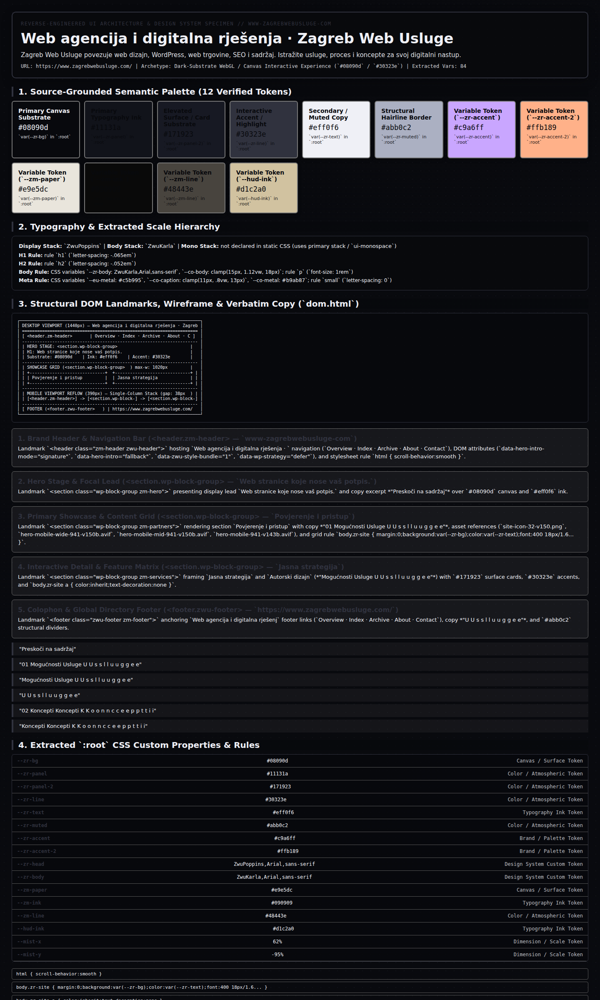

# UI Design System & Master Generation Blueprint: www-zagrebwebusluge-com

> **Web agencija i digitalna rješenja · Zagreb Web Usluge** (https://www.zagrebwebusluge.com/) — Zagreb Web Usluge povezuje web dizajn, WordPress, web trgovine, SEO i sadržaj. Istražite usluge, proces i koncepte za svoj digitalni nastup.



---

## 1. Executive Visual Persona & Design Archetype

- **Brand Essence & Persona**: **Web agencija i digitalna rješenja · Zagreb Web Usluge** (`https://www.zagrebwebusluge.com/`). Zagreb Web Usluge povezuje web dizajn, WordPress, web trgovine, SEO i sadržaj. Istražite usluge, proces i koncepte za svoj digitalni nastup.
- **Visual Archetype**: **Dark-Substrate WebGL / Canvas Interactive Experience (`#08090d` / `#30323e`)**.
- **Anti-AI-Slop Differentiators**:
  - **Source-Grounded Chromatic Polarity**: Anchors the viewport in `#08090d` (`var(--zr-bg)` in `:root`) paired with `#eff0f6` primary typography and `#30323e` accents.
  - **Extracted Typographic Hierarchy**: Pairs `ZwuPoppins` for display copy (`Web stranice koje nose vaš potpis.`) with `ZwuKarla` and not declared in static CSS (uses primary stack / `ui-monospace`).
  - **Calibrated Spatial Grid & Motion**: Combines `1020px` container bounds (`gap: 38px`, padding `12px`) with `cubic-bezier(.22,1,.36,1)` easing and HTML5 `<canvas>` Interactive Viewport Surface.

---

## 2. Spatial Architecture & Modular Grid Mathematics


### Viewport Allocation & Container Geometry
- **Captured Viewport Dimensions**: Desktop `1440×2400px` (`assets/desktop.png`, capped at 2400px multi-section capture), Mobile `390×2400px` (`assets/mobile.png`, capped at 2400px multi-section capture).
- **Master Container Bounds**: `1020px` extracted from `www-zagrebwebusluge-com` stylesheet.
- **Canvas Lateral Padding & Spacing**: `12px` lateral canvas padding with `38px` grid gap.
- **Border Radius Scale**: `50%`, `24px`, `0px`.

### Responsive Breakpoint Architecture
- **Desktop Layout**: Multi-column CSS Grid / Flexbox layout at `1440px` (`max-width: 1020px`, `gap: 38px`).
- **Mobile Layout**: Single-column vertical stack at `390px` viewport width with `12px` horizontal padding.
- **Extracted CSS Media Queries**: `@media (max-width:1050px)`, `@media (max-width:820px)`, `@media (max-width:560px)`, `@media (prefers-reduced-motion:reduce)`.

---

## 3. Color System, Materiality & Atmospheric Lighting

### Semantic Palette & Source Grounding
| Semantic Role | Ground-Truth Value | Extracted CSS Source / Selector |
|---|---|---|
| **Primary Canvas Substrate** | `#08090d` | `var(--zr-bg)` in `:root` |
| **Primary Typography Ink** | `#11131a` | `var(--zr-panel)` in `:root` |
| **Elevated Surface / Card Substrate** | `#171923` | `var(--zr-panel-2)` in `:root` |
| **Interactive Accent / Highlight** | `#30323e` | `var(--zr-line)` in `:root` |
| **Secondary / Muted Copy** | `#eff0f6` | `var(--zr-text)` in `:root` |
| **Structural Hairline Border** | `#abb0c2` | `var(--zr-muted)` in `:root` |
| **Variable Token (`--zr-accent`)** | `#c9a6ff` | `var(--zr-accent)` in `:root` |
| **Variable Token (`--zr-accent-2`)** | `#ffb189` | `var(--zr-accent-2)` in `:root` |
| **Variable Token (`--zm-paper`)** | `#e9e5dc` | `var(--zm-paper)` in `:root` |
| **Variable Token (`--zm-ink`)** | `#090909` | `var(--zm-ink)` in `:root` |
| **Variable Token (`--zm-line`)** | `#48443e` | `var(--zm-line)` in `:root` |
| **Variable Token (`--hud-ink`)** | `#d1c2a0` | `var(--hud-ink)` in `:root` |

### Sanitized Root CSS Variables (`ui-ux.md` Ground Truth)
| Variable Name | Extracted Value | Semantic Role |
|---|---|---|
| `--zr-bg` | `#08090d` | Canvas / Surface Token |
| `--zr-panel` | `#11131a` | Color / Atmospheric Token |
| `--zr-panel-2` | `#171923` | Color / Atmospheric Token |
| `--zr-line` | `#30323e` | Color / Atmospheric Token |
| `--zr-text` | `#eff0f6` | Typography Ink Token |
| `--zr-muted` | `#abb0c2` | Color / Atmospheric Token |
| `--zr-accent` | `#c9a6ff` | Brand / Palette Token |
| `--zr-accent-2` | `#ffb189` | Brand / Palette Token |
| `--zr-head` | `ZwuPoppins,Arial,sans-serif` | Design System Custom Token |
| `--zr-body` | `ZwuKarla,Arial,sans-serif` | Design System Custom Token |
| `--zm-paper` | `#e9e5dc` | Canvas / Surface Token |
| `--zm-ink` | `#090909` | Typography Ink Token |
| `--zm-line` | `#48443e` | Color / Atmospheric Token |
| `--hud-ink` | `#d1c2a0` | Typography Ink Token |
| `--mist-x` | `62%` | Dimension / Scale Token |
| `--mist-y` | `-95%` | Dimension / Scale Token |

---

## 4. Typographic Scale & Editorial Hierarchy

### Font Family Stacks
- **Display Typography**: `ZwuPoppins`.
- **Primary Body Stack**: `ZwuKarla`.
- **Technical / Metadata Stack**: not declared in static CSS (uses primary stack / `ui-monospace`).

### Typographic Scale & Rules (Extracted from Stylesheet & Variables)
- **Hero Display (`H1`)**: rule `h1` (`letter-spacing: -.065em`).
- **Section Heading (`H2`)**: rule `h2` (`letter-spacing: -.052em`).
- **Body Copy**: CSS variables `--zr-body: ZwuKarla,Arial,sans-serif`, `--co-body: clamp(15px, 1.12vw, 18px)`; rule `p` (`font-size: 1rem`).
- **Metadata & Navigation Labels**: CSS variables `--eu-metal: #c5b995`, `--co-caption: clamp(11px, .8vw, 13px)`, `--co-metal: #b9ab87`; rule `small` (`letter-spacing: 0`).

---

## 5. Choreographed Motion & Interaction Physics

### Primary Easing Curves
- **Extracted Timing Functions**: `cubic-bezier(.22,1,.36,1)`, `cubic-bezier(.22,.65,.25,1)`.

### Per-Element Transition & Choreography Rules
- **Selector `.zr-nav-list a`**: `transition: color .2s` extracted from `www-zagrebwebusluge-com` stylesheet.
- **Selector `.zr-button`**: `transition: transform .2s,background .2s` extracted from `www-zagrebwebusluge-com` stylesheet.
- **Selector `.zr-nav-list a`**: `transition: none` extracted from `www-zagrebwebusluge-com` stylesheet.
- **Extracted Easing Curve (`cubic-bezier(.22,1,.36,1)`)**: Governs interactive state transitions across `<header.zm-header>` and `<section.wp-block-group>`.
- **Runtime Interaction Engine**: Integrates HTML5 `<canvas>` Interactive Viewport Surface with `prefers-reduced-motion: reduce` fallback guards.

---

## 6. Component Wireframe & Structural DOM Map

### Visual Layout Schematic (Grounded in `dom.html` — `1440px` Desktop & `390px` Mobile Reflow)
```
┌────────────────────────────────────────────────────────────────────────┐
│ DESKTOP VIEWPORT (1440px) — Web agencija i digitalna rješenja · Zagreb │
│ ====================================================================== │
│ [ <header.zm-header>       | Overview · Index · Archive · About · C ]  │
│ ---------------------------------------------------------------------- │
│ | HERO STAGE: <section.wp-block-group>                             |   │
│ | H1: Web stranice koje nose vaš potpis.                           |   │
│ | Substrate: #08090d    | Ink: #eff0f6    | Accent: #30323e        |   │
│ ---------------------------------------------------------------------- │
│ | SHOWCASE GRID (<section.wp-block-group>  ) max-w: 1020px         |   │
│ | +------------------------------+  +------------------------------+ | │
│ | | Povjerenje i pristup         |  | Jasna strategija             | | │
│ | +------------------------------+  +------------------------------+ | │
│ ---------------------------------------------------------------------- │
│ | MOBILE VIEWPORT REFLOW (390px) — Single-Column Stack (gap: 38px  ) | │
│ | [<header.zm-header>] -> [<section.wp-block-] -> [<section.wp-block-] │
│ ---------------------------------------------------------------------- │
│ [ FOOTER (<footer.zwu-footer>   ) | https://www.zagrebwebusluge.com/   │
└────────────────────────────────────────────────────────────────────────┘
```

### Granular DOM Region Breakdown
1. **Brand Header & Navigation Bar (<header.zm-header> — `www-zagrebwebusluge-com`)**:
   - Landmark `<header class="zm-header zwu-header">` hosting `Web agencija i digitalna rješenja · ` navigation (`Overview · Index · Archive · About · Contact`), DOM attributes (`data-hero-intro-mode="signature"`, `data-hero-intro="fallback"`, `data-zwu-style-bundle="1"`, `data-wp-strategy="defer"`), and stylesheet rule `html { scroll-behavior:smooth }`.
2. **Hero Stage & Focal Lead (<section.wp-block-group> — `Web stranice koje nose vaš potpis.`)**:
   - Landmark `<section class="wp-block-group zm-hero">` presenting display lead `Web stranice koje nose vaš potpis.` and copy excerpt *"Preskoči na sadržaj"* over `#08090d` canvas and `#eff0f6` ink.
3. **Primary Showcase & Content Grid (<section.wp-block-group> — `Povjerenje i pristup`)**:
   - Landmark `<section class="wp-block-group zm-partners">` rendering section `Povjerenje i pristup` with copy *"01 Mogućnosti Usluge U U s s l l u u g g e e"*, asset references (`site-icon-32-v150.png`, `hero-mobile-wide-941-v150b.avif`, `hero-mobile-mid-941-v150b.avif`, `hero-mobile-941-v143b.avif`), and grid rule `body.zr-site { margin:0;background:var(--zr-bg);color:var(--zr-text);font:400 18px/1.6... }`.
4. **Interactive Detail & Feature Matrix (<section.wp-block-group> — `Jasna strategija`)**:
   - Landmark `<section class="wp-block-group zm-services">` framing `Jasna strategija` and `Autorski dizajn` (*"Mogućnosti Usluge U U s s l l u u g g e e"*) with `#171923` surface cards, `#30323e` accents, and `body.zr-site a { color:inherit;text-decoration:none }`.
5. **Colophon & Global Directory Footer (<footer.zwu-footer> — `https://www.zagrebwebusluge.com/`)**:
   - Landmark `<footer class="zwu-footer zm-footer">` anchoring `Web agencija i digitalna rješenj` footer links (`Overview · Index · Archive · About · Contact`), copy *"U U s s l l u u g g e e"*, and `#abb0c2` structural dividers.

---

## 7. Master Zero-Shot AI Generation Prompt

```markdown
# Master Zero-Shot Frontend Generation Prompt: www-zagrebwebusluge-com (Web agencija i digitalna rješenja · Zagreb Web Usluge)

You are a principal frontend architect and design systems engineer. Build a complete, production-ready web application replicating the exact design system, DOM landmarks, typographic hierarchy, color tokens, and motion physics of `www-zagrebwebusluge-com` (**Web agencija i digitalna rješenja · Zagreb Web Usluge** — `https://www.zagrebwebusluge.com/`).

### 1. Visual Archetype & Anti-AI-Slop Mandates
- **Archetype**: Dark-Substrate WebGL / Canvas Interactive Experience (`#08090d` / `#30323e`).
- **Identity & Domain Context**: Zagreb Web Usluge povezuje web dizajn, WordPress, web trgovine, SEO i sadržaj. Istražite usluge, proces i koncepte za svoj digitalni nastup.
- **Primary Substrate**: `#08090d` (`var(--zr-bg)` in `:root`), **Primary Ink**: `#eff0f6`, **Accent / Highlight**: `#30323e`.
- **Site-Specific Differentiators**:
  - **Source-Grounded Chromatic Polarity**: Anchors the viewport in `#08090d` (`var(--zr-bg)` in `:root`) paired with `#eff0f6` primary typography and `#30323e` accents.
  - **Extracted Typographic Hierarchy**: Pairs `ZwuPoppins` for display copy (`Web stranice koje nose vaš potpis.`) with `ZwuKarla` and not declared in static CSS (uses primary stack / `ui-monospace`).
  - **Calibrated Spatial Grid & Motion**: Combines `1020px` container bounds (`gap: 38px`, padding `12px`) with `cubic-bezier(.22,1,.36,1)` easing and HTML5 `<canvas>` Interactive Viewport Surface.

### 2. Ground-Truth CSS Variables (`:root` Token Contract)
Declare and consume these exact custom properties extracted from `www-zagrebwebusluge-com` in your global stylesheet:

:root {
  /* Web agencija i digitalna rješenja · Zagreb Web Usluge (www-zagrebwebusluge-com) — Ground-Truth Extracted CSS Variables */
  --zr-bg: #08090d; /* Canvas / Surface Token (www-zagrebwebusluge-com) */
  --zr-panel: #11131a; /* Color / Atmospheric Token (www-zagrebwebusluge-com) */
  --zr-panel-2: #171923; /* Color / Atmospheric Token (www-zagrebwebusluge-com) */
  --zr-line: #30323e; /* Color / Atmospheric Token (www-zagrebwebusluge-com) */
  --zr-text: #eff0f6; /* Typography Ink Token (www-zagrebwebusluge-com) */
  --zr-muted: #abb0c2; /* Color / Atmospheric Token (www-zagrebwebusluge-com) */
  --zr-accent: #c9a6ff; /* Brand / Palette Token (www-zagrebwebusluge-com) */
  --zr-accent-2: #ffb189; /* Brand / Palette Token (www-zagrebwebusluge-com) */
  --zr-head: ZwuPoppins,Arial,sans-serif; /* Design System Custom Token (www-zagrebwebusluge-com) */
  --zr-body: ZwuKarla,Arial,sans-serif; /* Design System Custom Token (www-zagrebwebusluge-com) */
  --zm-paper: #e9e5dc; /* Canvas / Surface Token (www-zagrebwebusluge-com) */
  --zm-ink: #090909; /* Typography Ink Token (www-zagrebwebusluge-com) */
  --zm-line: #48443e; /* Color / Atmospheric Token (www-zagrebwebusluge-com) */
  --hud-ink: #d1c2a0; /* Typography Ink Token (www-zagrebwebusluge-com) */
  --mist-x: 62%; /* Dimension / Scale Token (www-zagrebwebusluge-com) */
  --mist-y: -95%; /* Dimension / Scale Token (www-zagrebwebusluge-com) */
}

### 3. Semantic Color & Materiality Contract
Map every surface, ink, and border strictly to these source-grounded tokens:
- **Primary Canvas Substrate**: `#08090d` — grounded in `var(--zr-bg)` in `:root`
- **Primary Typography Ink**: `#11131a` — grounded in `var(--zr-panel)` in `:root`
- **Elevated Surface / Card Substrate**: `#171923` — grounded in `var(--zr-panel-2)` in `:root`
- **Interactive Accent / Highlight**: `#30323e` — grounded in `var(--zr-line)` in `:root`
- **Secondary / Muted Copy**: `#eff0f6` — grounded in `var(--zr-text)` in `:root`
- **Structural Hairline Border**: `#abb0c2` — grounded in `var(--zr-muted)` in `:root`
- **Variable Token (`--zr-accent`)**: `#c9a6ff` — grounded in `var(--zr-accent)` in `:root`
- **Variable Token (`--zr-accent-2`)**: `#ffb189` — grounded in `var(--zr-accent-2)` in `:root`
- **Variable Token (`--zm-paper`)**: `#e9e5dc` — grounded in `var(--zm-paper)` in `:root`
- **Variable Token (`--zm-ink`)**: `#090909` — grounded in `var(--zm-ink)` in `:root`
- **Variable Token (`--zm-line`)**: `#48443e` — grounded in `var(--zm-line)` in `:root`
- **Variable Token (`--hud-ink`)**: `#d1c2a0` — grounded in `var(--hud-ink)` in `:root`

### 4. Spatial Grid, Container Bounds & Responsive Breakpoints
- **Desktop Viewport Reference**: `1440×2400px` (capped at 2400px multi-section capture, `1440px` standard desktop width).
- **Mobile Viewport Reference**: `390×2400px` (capped at 2400px multi-section capture, `390px` standard mobile width).
- **Container Max-Width**: `1020px` extracted from `www-zagrebwebusluge-com` stylesheet
- **Padding & Gutters**: `12px` lateral canvas padding with `38px` grid gap
- **Desktop Grid**: Multi-column CSS Grid / Flexbox layout at `1440px` (`max-width: 1020px`, `gap: 38px`)
- **Mobile Adaptation**: Single-column vertical stack at `390px` viewport width with `12px` horizontal padding
- **Media Queries**: `@media (max-width:1050px)`, `@media (max-width:820px)`, `@media (max-width:560px)`, `@media (prefers-reduced-motion:reduce)`
- **Corner Radii**: `50%`, `24px`, `0px`

### 5. Typography & Editorial Scale Contract
- **Display Font Stack**: `ZwuPoppins`
- **Body Font Stack**: `ZwuKarla`
- **Monospace / Technical Font Stack**: not declared in static CSS (uses primary stack / `ui-monospace`)
- **H1 Display Rule**: rule `h1` (`letter-spacing: -.065em`)
- **H2 Section Rule**: rule `h2` (`letter-spacing: -.052em`)
- **Body Copy Rule**: CSS variables `--zr-body: ZwuKarla,Arial,sans-serif`, `--co-body: clamp(15px, 1.12vw, 18px)`; rule `p` (`font-size: 1rem`)
- **Metadata & Index Rule**: CSS variables `--eu-metal: #08090d`, `--co-caption: clamp(11px, .8vw, 13px)`, `--co-metal: #08090d`; rule `small` (`letter-spacing: 0`)

### 6. Component Hierarchy, Verbatim Copy & Real DOM Landmarks
Scaffold `www-zagrebwebusluge-com` (`Web agencija i digitalna rješenja · Zagreb Web Usluge`) with these exact structural regions, extracted copy, and CSS rules from `dom.html`:
1. **Brand Header & Navigation Bar (<header.zm-header> — `www-zagrebwebusluge-com`)**:
   - DOM & Selectors: Landmark `<header class="zm-header zwu-header">` hosting `Web agencija i digitalna rješenja · ` navigation (`Overview · Index · Archive · About · Contact`), DOM attributes (`data-hero-intro-mode="signature"`, `data-hero-intro="fallback"`, `data-zwu-style-bundle="1"`, `data-wp-strategy="defer"`), and stylesheet rule `html { scroll-behavior:smooth }`.
   - Responsive Contract: Header `Brand Header & Navigation Bar (<header.zm-header> — `www-zagrebwebusluge-com`)` (`www-zagrebwebusluge-com`) adapts across `@media (max-width:1050px)`, `@media (max-width:820px)`, `@media (max-width:560px)`, `@media (prefers-reduced-motion:reduce)` with `cubic-bezier(.22,1,.36,1)`, `cubic-bezier(.22,.65,.25,1)` transitions and links `Overview · Index · Archive · About · Contact`.
2. **Hero Stage & Focal Lead (<section.wp-block-group> — `Web stranice koje nose vaš potpis.`)**:
   - DOM & Selectors: Landmark `<section class="wp-block-group zm-hero">` presenting display lead `Web stranice koje nose vaš potpis.` and copy excerpt *"Preskoči na sadržaj"* over `#08090d` canvas and `#eff0f6` ink.
   - Responsive Contract: Hero stage (`1440×2400px` desktop / `390×2400px` mobile) sets `#08090d` background with `#eff0f6` headline `Web stranice koje nose vaš potpis.`.
3. **Primary Showcase & Content Grid (<section.wp-block-group> — `Povjerenje i pristup`)**:
   - DOM & Selectors: Landmark `<section class="wp-block-group zm-partners">` rendering section `Povjerenje i pristup` with copy *"01 Mogućnosti Usluge U U s s l l u u g g e e"*, asset references (`site-icon-32-v150.png`, `hero-mobile-wide-941-v150b.avif`, `hero-mobile-mid-941-v150b.avif`, `hero-mobile-941-v143b.avif`), and grid rule `body.zr-site { margin:0;background:var(--zr-bg);color:var(--zr-text);font:400 18px/1.6... }`.
   - Responsive Contract: Showcase grid `Primary Showcase & Content Grid (<section.wp-block-group> — `Povjerenje i pristup`)` applies Multi-column CSS Grid / Flexbox layout at `1440px` (`max-width: 1020px`, `gap: 38px`) on desktop and Single-column vertical stack at `390px` viewport width with `12px` horizontal padding on mobile.
4. **Interactive Detail & Feature Matrix (<section.wp-block-group> — `Jasna strategija`)**:
   - DOM & Selectors: Landmark `<section class="wp-block-group zm-services">` framing `Jasna strategija` and `Autorski dizajn` (*"Mogućnosti Usluge U U s s l l u u g g e e"*) with `#171923` surface cards, `#30323e` accents, and `body.zr-site a { color:inherit;text-decoration:none }`.
   - Responsive Contract: Detail module `Interactive Detail & Feature Matrix (<section.wp-block-group> — `Jasna strategija`)` uses `50%`, `24px`, `0px` radii, `#30323e` highlights, and assets (site-icon-32-v150.png, hero-mobile-wide-941-v150b.avif, hero-mobile-mid-941-v150b.avif).
5. **Colophon & Global Directory Footer (<footer.zwu-footer> — `https://www.zagrebwebusluge.com/`)**:
   - DOM & Selectors: Landmark `<footer class="zwu-footer zm-footer">` anchoring `Web agencija i digitalna rješenj` footer links (`Overview · Index · Archive · About · Contact`), copy *"U U s s l l u u g g e e"*, and `#abb0c2` structural dividers.
   - Responsive Contract: Footer `Colophon & Global Directory Footer (<footer.zwu-footer> — `https://www.zagrebwebusluge.com/`)` aligns to `1020px` extracted from `www-zagrebwebusluge-com` stylesheet with `12px` lateral canvas padding with `38px` grid gap and attributes (data-hero-intro-mode="signature", data-hero-intro="fallback", data-zwu-style-bundle="1").

#### Verbatim DOM Copy Excerpts (`dom.html`)
- Copy Excerpt 1: *"Preskoči na sadržaj"*
- Copy Excerpt 2: *"01 Mogućnosti Usluge U U s s l l u u g g e e"*
- Copy Excerpt 3: *"Mogućnosti Usluge U U s s l l u u g g e e"*
- Copy Excerpt 4: *"U U s s l l u u g g e e"*

### 7. Motion, Extracted Stylesheet Rules & Interaction Choreography
- **Primary Easing Functions**: `cubic-bezier(.22,1,.36,1)`, `cubic-bezier(.22,.65,.25,1)`
- **Extracted Stylesheet Rules (`www-zagrebwebusluge-com`)**:
- `html { scroll-behavior:smooth }`
- `body.zr-site { margin:0;background:var(--zr-bg);color:var(--zr-text);font:400 18px/1.6... }`
- `body.zr-site a { color:inherit;text-decoration:none }`
- `body.zr-site textarea { font:inherit }`
- `body.zr-site button { cursor:pointer }`
- **Per-Selector Transition Rules**:
- **Selector `.zr-nav-list a`**: `transition: color .2s` extracted from `www-zagrebwebusluge-com` stylesheet.
- **Selector `.zr-button`**: `transition: transform .2s,background .2s` extracted from `www-zagrebwebusluge-com` stylesheet.
- **Selector `.zr-nav-list a`**: `transition: none` extracted from `www-zagrebwebusluge-com` stylesheet.
- **Extracted Easing Curve (`cubic-bezier(.22,1,.36,1)`)**: Governs interactive state transitions across `<header.zm-header>` and `<section.wp-block-group>`.
- **Runtime Interaction Engine**: Integrates HTML5 `<canvas>` Interactive Viewport Surface with `prefers-reduced-motion: reduce` fallback guards.

### 8. Technical Deliverables
- Implement in Next.js (App Router) with TypeScript and Tailwind CSS consuming the `:root` custom properties defined above for `www-zagrebwebusluge-com`.
- Reproduce both the `1440px` desktop architecture and `390px` mobile breakpoint transitions, preserving semantic HTML5 landmarks (`<header>`, `<nav>`, `<main>`, `<section>`, `<footer>`) and `prefers-reduced-motion` accessibility guards.
```
