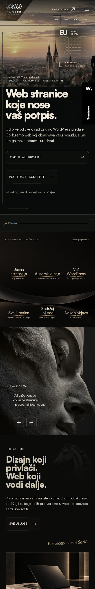

# UI Design System & Master Generation Blueprint: www-zagrebwebusluge-com

> **Web agencija i digitalna rješenja · Zagreb Web Usluge** (https://www.zagrebwebusluge.com/) — Zagreb Web Usluge povezuje web dizajn, WordPress, web trgovine, SEO i sadržaj. Istražite usluge, proces i koncepte za svoj digitalni nastup.


---

## 1. Executive Visual Persona & Design Archetype

- **Brand Essence & Persona**: **Web agencija i digitalna rješenja · Zagreb Web Usluge** (`https://www.zagrebwebusluge.com/`). Zagreb Web Usluge povezuje web dizajn, WordPress, web trgovine, SEO i sadržaj. Istražite usluge, proces i koncepte za svoj digitalni nastup.
- **Capture Provenance**: Live browser capture (`tier1_fast`, HTTP `200`, captured `2026-11-23`).
- **Visual Archetype**: **Dark-Substrate WebGL / Canvas Interactive Experience (`#090909` / `#ffb189`)**.
- **Anti-AI-Slop Differentiators**:
  - **Live-Computed Chromatic Polarity**: Anchors the viewport in `#090909` (live computed `body` `background-color` (`computed_styles.json`)) paired with `#eee7da` primary typography and `#ffb189` accents.
  - **Grounded Typographic Hierarchy**: Pairs `Satoshi` for display copy (`Web stranice koje nose vaš potpis.`) with `Satoshi` and not declared in live computed styles (uses primary stack / `ui-monospace`).
  - **Calibrated Spatial Grid & Motion**: Combines `1700px` container bounds (`gap: 28px`, padding `64.8px`) with `cubic-bezier(.22,1,.36,1)` easing and HTML5 `<canvas>` Interactive Viewport Surface.

---

## 2. Spatial Architecture & Modular Grid Mathematics



### Viewport Allocation & Container Geometry
- **Captured Viewport Dimensions**: Desktop `1440×2400px` (`assets/desktop.png`, clamped at 2400px live multi-section capture), Mobile `390×2400px` (`assets/mobile.png`, clamped at 2400px live multi-section capture).
- **Master Container Bounds**: `1700px` (non-`@media` desktop container stylesheet rule).
- **Canvas Lateral Padding & Spacing**: `64.8px` lateral canvas padding with `28px` grid gap.
- **Border Radius Scale**: `50%`, `24px`, `0px`.

### Responsive Breakpoint Architecture
- **Desktop Layout**: Multi-column CSS Grid / Flexbox layout at `1440px` (`max-width: 1700px`, `gap: 28px`).
- **Mobile Layout**: Single-column vertical stack at `390px` viewport width with `64.8px` horizontal padding.
- **Extracted CSS Media Queries**: `@media (max-width:1050px)`, `@media (max-width:820px)`, `@media (max-width:560px)`, `@media (prefers-reduced-motion:reduce)`.

---

## 3. Color System, Materiality & Atmospheric Lighting

### Semantic Palette & Source Grounding
| Semantic Role | Ground-Truth Value | Extracted Live / CSS Source |
|---|---|---|
| **Primary Canvas Substrate** | `#090909` | live computed `body` `background-color` (`computed_styles.json`) |
| **Primary Typography Ink** | `#eee7da` | live computed `h1` `color` (`computed_styles.json`) |
| **Elevated Surface / Card Substrate** | `#0a0b0a` | live computed `footer` `background-color` (`computed_styles.json`) |
| **Interactive Accent / Highlight** | `#ffb189` | `var(--zr-accent-2)` in `:root` |
| **Secondary / Muted Copy** | `#aaa99e` | `var(--nav-muted)` in `:root` |
| **Structural Hairline Border** | `#30323e` | `var(--zr-line)` in `:root` |
| **Variable Token (`--wp-block-synced-color`)** | `#7a00df` | `var(--wp-block-synced-color)` in `:root` |
| **Variable Token (`--wp-editor-canvas-background`)** | `#dddddd` | `var(--wp-editor-canvas-background)` in `:root` |
| **Variable Token (`--wp-admin-theme-color`)** | `#007cba` | `var(--wp-admin-theme-color)` in `:root` |
| **Variable Token (`--wp-admin-theme-color-darker-10`)** | `#006ba1` | `var(--wp-admin-theme-color-darker-10)` in `:root` |
| **Variable Token (`--wp-admin-theme-color-darker-20`)** | `#005a87` | `var(--wp-admin-theme-color-darker-20)` in `:root` |
| **Variable Token (`--zr-bg`)** | `#08090d` | `var(--zr-bg)` in `:root` |
| **Variable Token (`--zr-panel`)** | `#11131a` | `var(--zr-panel)` in `:root` |

### Sanitized Root CSS Variables (`ui-ux.md` Ground Truth)
| Variable Name | Extracted Value | Semantic Role |
|---|---|---|
| `--wp-block-synced-color` | `#7a00df` | Brand / Palette Token |
| `--wp-block-synced-color--rgb` | `122,0,223` | Brand / Palette Token |
| `--wp-bound-block-color` | `var(--wp-block-synced-color)` | Brand / Palette Token |
| `--wp-editor-canvas-background` | `#ddd` | Canvas / Surface Token |
| `--wp-admin-theme-color` | `#007cba` | Brand / Palette Token |
| `--wp-admin-theme-color--rgb` | `0,124,186` | Brand / Palette Token |
| `--wp-admin-theme-color-darker-10` | `#006ba1` | Canvas / Surface Token |
| `--wp-admin-theme-color-darker-10--rgb` | `0,107,160.5` | Canvas / Surface Token |
| `--wp-admin-theme-color-darker-20` | `#005a87` | Canvas / Surface Token |
| `--wp-admin-theme-color-darker-20--rgb` | `0,90,135` | Canvas / Surface Token |
| `--wp-admin-border-width-focus` | `2px` | Layout / Spatial Grid Token |
| `--wp-admin--admin-bar--position-offset` | `var(--wp-admin--admin-bar--height,0px)` | Dimension / Scale Token |
| `--wp--style--global--content-size` | `1200px` | Layout / Spatial Grid Token |
| `--wp--style--global--wide-size` | `1440px` | Layout / Spatial Grid Token |
| `--zr-bg` | `#08090d` | Canvas / Surface Token |
| `--zr-panel` | `#11131a` | Color / Atmospheric Token |

---

## 4. Typographic Scale & Editorial Hierarchy

### Font Family Stacks
- **Display Typography**: `Satoshi`.
- **Primary Body Stack**: `Satoshi`.
- **Technical / Metadata Stack**: not declared in live computed styles (uses primary stack / `ui-monospace`).

### Typographic Scale & Rules (Live Computed & Stylesheet Grounded)
- **Hero Display (`H1`)**: live computed `h1` (`font-size: 95.76px`, `line-height: 87.1416px`, `font-weight: 900`, `letter-spacing: -5.7456px`); rule `h1` (`letter-spacing: -.065em`).
- **Section Heading (`H2`)**: live computed `h2` (`font-size: 24px`, `line-height: 25.92px`, `font-weight: 900`, `letter-spacing: -0.672px`); rule `h2` (`letter-spacing: -.052em`).
- **Body Copy**: live computed `body` (`font-size: 16px`, `line-height: 24px`, `font-weight: 400`); CSS variables `--zr-body: ZwuKarla,Arial,sans-serif`, `--co-body: clamp(15px, 1.12vw, 18px)`; rule `p` (`font-size: 1rem`).
- **Metadata & Navigation Labels**: live computed `nav/a` (`font-size: 12px`, `line-height: 18px`, `font-weight: 400`); CSS variables `--co-caption: clamp(11px, .8vw, 13px)`; rule `small` (`letter-spacing: 0`).

---

## 5. Choreographed Motion & Interaction Physics

### Primary Easing Curves
- **Extracted Timing Functions**: `cubic-bezier(.22,1,.36,1)`, `cubic-bezier(.22,.65,.25,1)`.

### Per-Element Transition & Choreography Rules
- **Selector `.zr-nav-list a`**: `transition: color .2s` extracted from `www-zagrebwebusluge-com` stylesheet.
- **Selector `.zr-button`**: `transition: transform .2s,background .2s` extracted from `www-zagrebwebusluge-com` stylesheet.
- **Selector `.zr-nav-list a`**: `transition: none` extracted from `www-zagrebwebusluge-com` stylesheet.
- **Extracted Easing Curve (`cubic-bezier(.22,1,.36,1)`)**: Governs interactive state transitions across `<header.zm-header>` and `<section.zm-partners>`.
- **Runtime Interaction Engine**: Integrates HTML5 `<canvas>` Interactive Viewport Surface with `prefers-reduced-motion: reduce` fallback guards.

---

## 6. Component Wireframe & Structural DOM Map

### Visual Layout Schematic — Desktop (`1440px`, Grounded in `dom.html` & Landmark Bounding Boxes)
```
┌────────────────────────────────────────────────────────────────────────┐
│ DESKTOP VIEWPORT (1440px) — Web agencija i digitalna rješenja · Zagreb │
│ ====================================================================== │
│ [ <header.zm-header> (1440x110px)     | Overview · Index · Archive · ] │
│ ---------------------------------------------------------------------- │
│ | HERO STAGE: <section.wp-block-group> (w=1440px)                    | │
│ | H1: Web stranice koje nose vaš potpis.                             | │
│ | Substrate: #090909 | Ink: #eee7da | Accent: #ffb189                | │
│ ---------------------------------------------------------------------- │
│ | SHOWCASE GRID (<section.zm-partners>) max-w: 1700px                | │
│ | +------------------------------+  +------------------------------+ | │
│ | | Povjerenje i pristup         |  | Jasna strategija             | | │
│ | +------------------------------+  +------------------------------+ | │
│ ---------------------------------------------------------------------- │
│ | DETAIL MODULE (<section.zm-services>) — Autorski dizajn            | │
│ ---------------------------------------------------------------------- │
│ [ FOOTER (<footer.zwu-footer> ) | https://www.zagrebwebusluge.com/     │
└────────────────────────────────────────────────────────────────────────┘
```

### Visual Layout Schematic — Mobile Reflow (`390px`)
```
┌────────────────────────────────────────────────────────────────────────┐
│ MOBILE VIEWPORT REFLOW (390px) — Single-Column Stack (gap: 28px)       │
│ ====================================================================== │
│ [ HEADER BAR (<header.zm-header>      ) | Compact Menu (390px)         │
│ ---------------------------------------------------------------------- │
│ | HERO STAGE (<section.wp-block-group>) — 390px Vertical Lead        | │
│ | H1: Web stranice koje nose vaš potpis.                             | │
│ ---------------------------------------------------------------------- │
│ | SHOWCASE STACK (<section.zm-partners>) — 1-Col Stack               | │
│ | [ Item 1: Povjerenje i pristup                                   ] | │
│ | [ Item 2: Jasna strategija                                       ] | │
│ ---------------------------------------------------------------------- │
│ | DETAIL STACK (<section.zm-services>) — 1-Col (Autorski dizajn)     | │
│ ---------------------------------------------------------------------- │
│ [ FOOTER (<footer.zwu-footer> ) | Stacked 390px Colophon               │
└────────────────────────────────────────────────────────────────────────┘
```

### Granular DOM Region Breakdown
1. **Brand Header & Navigation Bar (<header.zm-header> — `www-zagrebwebusluge-com`)**:
   - Landmark `<header class="zm-header zwu-header">` (`1440x110px`) hosting `Web agencija i digitalna rješenja · ` navigation (`Overview · Index · Archive · About · Contact`), DOM attributes (`data-hero-intro-mode="signature"`, `data-hero-intro="fallback"`, `data-zwu-style-bundle="1"`, `data-wp-strategy="defer"`), and stylesheet rule `html { scroll-behavior:smooth }`.
2. **Hero Stage & Focal Lead (<section.wp-block-group> — `Web stranice koje nose vaš potpis.`)**:
   - Landmark `<section class="wp-block-group zm-hero">` presenting display lead `Web stranice koje nose vaš potpis.` and copy excerpt *"ZAGREB WEB USLUGE DIZAJN · WORDPRESS · WEB TRGOVINE"* over `#090909` canvas and `#eee7da` ink.
3. **Primary Showcase & Content Grid (<section.zm-partners> — `Povjerenje i pristup`)**:
   - Landmark `<section class="wp-block-group zm-partners">` rendering section `Povjerenje i pristup` with copy *"HRVATSKA ZAGREB / EUROPE"*, asset references (`site-icon-32-v150.png`, `hero-mobile-wide-941-v150b.avif`, `hero-mobile-mid-941-v150b.avif`, `hero-mobile-941-v143b.avif`), and grid rule `body.zr-site { margin:0;background:var(--zr-bg);color:var(--zr-text);font:400 18px/1.6... }`.
4. **Interactive Detail & Feature Matrix (<section.zm-services> — `Jasna strategija`)**:
   - Landmark `<section class="wp-block-group zm-services">` framing `Jasna strategija` and `Autorski dizajn` (*"Zagreb Web Usluge Dizajn · WordPress · Web trgovine"*) with `#0a0b0a` surface cards, `#ffb189` accents, and `body.zr-site a { color:inherit;text-decoration:none }`.
5. **Colophon & Global Directory Footer (<footer.zwu-footer> — `https://www.zagrebwebusluge.com/`)**:
   - Landmark `<footer class="zwu-footer zm-footer">` anchoring `Web agencija i digitalna rješenj` footer links (`Overview · Index · Archive · About · Contact`), copy *"Od prve odluke o sadržaju do WordPress predaje. Oblikujemo w"*, and `#30323e` structural dividers.

---

## 7. Master Zero-Shot AI Generation Prompt

```markdown
# Master Zero-Shot Frontend Generation Prompt: www-zagrebwebusluge-com (Web agencija i digitalna rješenja · Zagreb Web Usluge)

You are a principal frontend architect and design systems engineer. Build a complete, production-ready web application replicating the exact design system, DOM landmarks, typographic hierarchy, color tokens, and motion physics of `www-zagrebwebusluge-com` (**Web agencija i digitalna rješenja · Zagreb Web Usluge** — `https://www.zagrebwebusluge.com/`).

### 1. Visual Archetype & Anti-AI-Slop Mandates
- **Archetype**: Dark-Substrate WebGL / Canvas Interactive Experience (`#090909` / `#ffb189`).
- **Identity & Domain Context**: Zagreb Web Usluge povezuje web dizajn, WordPress, web trgovine, SEO i sadržaj. Istražite usluge, proces i koncepte za svoj digitalni nastup.
- **Primary Substrate**: `#090909` (live computed `body` `background-color` (`computed_styles.json`)), **Primary Ink**: `#eee7da`, **Accent / Highlight**: `#ffb189`.
- **Site-Specific Differentiators**:
  - **Live-Computed Chromatic Polarity**: Anchors the viewport in `#090909` (live computed `body` `background-color` (`computed_styles.json`)) paired with `#eee7da` primary typography and `#ffb189` accents.
  - **Grounded Typographic Hierarchy**: Pairs `Satoshi` for display copy (`Web stranice koje nose vaš potpis.`) with `Satoshi` and not declared in live computed styles (uses primary stack / `ui-monospace`).
  - **Calibrated Spatial Grid & Motion**: Combines `1700px` container bounds (`gap: 28px`, padding `64.8px`) with `cubic-bezier(.22,1,.36,1)` easing and HTML5 `<canvas>` Interactive Viewport Surface.

### 2. Ground-Truth CSS Variables (`:root` Token Contract)
Declare and consume these exact custom properties extracted from `www-zagrebwebusluge-com` in your global stylesheet:

:root {
  /* Web agencija i digitalna rješenja · Zagreb Web Usluge (www-zagrebwebusluge-com) — Live-Grounded CSS Variables */
  --wp-block-synced-color: #7a00df; /* Brand / Palette Token (www-zagrebwebusluge-com) */
  --wp-block-synced-color--rgb: 122,0,223; /* Brand / Palette Token (www-zagrebwebusluge-com) */
  --wp-bound-block-color: var(--wp-block-synced-color); /* Brand / Palette Token (www-zagrebwebusluge-com) */
  --wp-editor-canvas-background: #ddd; /* Canvas / Surface Token (www-zagrebwebusluge-com) */
  --wp-admin-theme-color: #007cba; /* Brand / Palette Token (www-zagrebwebusluge-com) */
  --wp-admin-theme-color--rgb: 0,124,186; /* Brand / Palette Token (www-zagrebwebusluge-com) */
  --wp-admin-theme-color-darker-10: #006ba1; /* Canvas / Surface Token (www-zagrebwebusluge-com) */
  --wp-admin-theme-color-darker-10--rgb: 0,107,160.5; /* Canvas / Surface Token (www-zagrebwebusluge-com) */
  --wp-admin-theme-color-darker-20: #005a87; /* Canvas / Surface Token (www-zagrebwebusluge-com) */
  --wp-admin-theme-color-darker-20--rgb: 0,90,135; /* Canvas / Surface Token (www-zagrebwebusluge-com) */
  --wp-admin-border-width-focus: 2px; /* Layout / Spatial Grid Token (www-zagrebwebusluge-com) */
  --wp-admin--admin-bar--position-offset: var(--wp-admin--admin-bar--height,0px); /* Dimension / Scale Token (www-zagrebwebusluge-com) */
  --wp--style--global--content-size: 1200px; /* Layout / Spatial Grid Token (www-zagrebwebusluge-com) */
  --wp--style--global--wide-size: 1440px; /* Layout / Spatial Grid Token (www-zagrebwebusluge-com) */
  --zr-bg: #08090d; /* Canvas / Surface Token (www-zagrebwebusluge-com) */
  --zr-panel: #11131a; /* Color / Atmospheric Token (www-zagrebwebusluge-com) */
}

### 3. Semantic Color & Materiality Contract
Map every surface, ink, and border strictly to these source-grounded tokens:
- **Primary Canvas Substrate**: `#090909` — grounded in live computed `body` `background-color` (`computed_styles.json`)
- **Primary Typography Ink**: `#eee7da` — grounded in live computed `h1` `color` (`computed_styles.json`)
- **Elevated Surface / Card Substrate**: `#0a0b0a` — grounded in live computed `footer` `background-color` (`computed_styles.json`)
- **Interactive Accent / Highlight**: `#ffb189` — grounded in `var(--zr-accent-2)` in `:root`
- **Secondary / Muted Copy**: `#aaa99e` — grounded in `var(--nav-muted)` in `:root`
- **Structural Hairline Border**: `#30323e` — grounded in `var(--zr-line)` in `:root`
- **Variable Token (`--wp-block-synced-color`)**: `#7a00df` — grounded in `var(--wp-block-synced-color)` in `:root`
- **Variable Token (`--wp-editor-canvas-background`)**: `#dddddd` — grounded in `var(--wp-editor-canvas-background)` in `:root`
- **Variable Token (`--wp-admin-theme-color`)**: `#007cba` — grounded in `var(--wp-admin-theme-color)` in `:root`
- **Variable Token (`--wp-admin-theme-color-darker-10`)**: `#006ba1` — grounded in `var(--wp-admin-theme-color-darker-10)` in `:root`
- **Variable Token (`--wp-admin-theme-color-darker-20`)**: `#005a87` — grounded in `var(--wp-admin-theme-color-darker-20)` in `:root`
- **Variable Token (`--zr-bg`)**: `#08090d` — grounded in `var(--zr-bg)` in `:root`
- **Variable Token (`--zr-panel`)**: `#11131a` — grounded in `var(--zr-panel)` in `:root`

### 4. Spatial Grid, Container Bounds & Responsive Breakpoints
- **Desktop Viewport Reference**: `1440×2400px` (clamped at 2400px live multi-section capture, `1440px` standard desktop width).
- **Mobile Viewport Reference**: `390×2400px` (clamped at 2400px live multi-section capture, `390px` standard mobile width).
- **Container Max-Width**: `1700px` (non-`@media` desktop container stylesheet rule)
- **Padding & Gutters**: `64.8px` lateral canvas padding with `28px` grid gap
- **Desktop Grid**: Multi-column CSS Grid / Flexbox layout at `1440px` (`max-width: 1700px`, `gap: 28px`)
- **Mobile Adaptation**: Single-column vertical stack at `390px` viewport width with `64.8px` horizontal padding
- **Media Queries**: `@media (max-width:1050px)`, `@media (max-width:820px)`, `@media (max-width:560px)`, `@media (prefers-reduced-motion:reduce)`
- **Corner Radii**: `50%`, `24px`, `0px`

### 5. Typography & Editorial Scale Contract
- **Display Font Stack**: `Satoshi`
- **Body Font Stack**: `Satoshi`
- **Monospace / Technical Font Stack**: not declared in live computed styles (uses primary stack / `ui-monospace`)
- **H1 Display Rule**: live computed `h1` (`font-size: 95.76px`, `line-height: 87.1416px`, `font-weight: 900`, `letter-spacing: -5.7456px`); rule `h1` (`letter-spacing: -.065em`)
- **H2 Section Rule**: live computed `h2` (`font-size: 24px`, `line-height: 25.92px`, `font-weight: 900`, `letter-spacing: -0.672px`); rule `h2` (`letter-spacing: -.052em`)
- **Body Copy Rule**: live computed `body` (`font-size: 16px`, `line-height: 24px`, `font-weight: 400`); CSS variables `--zr-body: ZwuKarla,Arial,sans-serif`, `--co-body: clamp(15px, 1.12vw, 18px)`; rule `p` (`font-size: 1rem`)
- **Metadata & Index Rule**: live computed `nav/a` (`font-size: 12px`, `line-height: 18px`, `font-weight: 400`); CSS variables `--co-caption: clamp(11px, .8vw, 13px)`; rule `small` (`letter-spacing: 0`)

### 6. Component Hierarchy, Verbatim Copy & Real DOM Landmarks
Scaffold `www-zagrebwebusluge-com` (`Web agencija i digitalna rješenja · Zagreb Web Usluge`) with these exact structural regions, extracted copy, and CSS rules from `dom.html`:
1. **Brand Header & Navigation Bar (<header.zm-header> — `www-zagrebwebusluge-com`)**:
   - DOM & Selectors: Landmark `<header class="zm-header zwu-header">` (`1440x110px`) hosting `Web agencija i digitalna rješenja · ` navigation (`Overview · Index · Archive · About · Contact`), DOM attributes (`data-hero-intro-mode="signature"`, `data-hero-intro="fallback"`, `data-zwu-style-bundle="1"`, `data-wp-strategy="defer"`), and stylesheet rule `html { scroll-behavior:smooth }`.
   - Responsive Contract: Header `Brand Header & Navigation Bar (<header.zm-header> — `www-zagrebwebusluge-com`)` (`www-zagrebwebusluge-com`) adapts across `@media (max-width:1050px)`, `@media (max-width:820px)`, `@media (max-width:560px)`, `@media (prefers-reduced-motion:reduce)` with `cubic-bezier(.22,1,.36,1)`, `cubic-bezier(.22,.65,.25,1)` transitions and links `Overview · Index · Archive · About · Contact`.
2. **Hero Stage & Focal Lead (<section.wp-block-group> — `Web stranice koje nose vaš potpis.`)**:
   - DOM & Selectors: Landmark `<section class="wp-block-group zm-hero">` presenting display lead `Web stranice koje nose vaš potpis.` and copy excerpt *"ZAGREB WEB USLUGE DIZAJN · WORDPRESS · WEB TRGOVINE"* over `#090909` canvas and `#eee7da` ink.
   - Responsive Contract: Hero stage (`1440×2400px` desktop / `390×2400px` mobile) sets `#090909` background with `#eee7da` headline `Web stranice koje nose vaš potpis.`.
3. **Primary Showcase & Content Grid (<section.zm-partners> — `Povjerenje i pristup`)**:
   - DOM & Selectors: Landmark `<section class="wp-block-group zm-partners">` rendering section `Povjerenje i pristup` with copy *"HRVATSKA ZAGREB / EUROPE"*, asset references (`site-icon-32-v150.png`, `hero-mobile-wide-941-v150b.avif`, `hero-mobile-mid-941-v150b.avif`, `hero-mobile-941-v143b.avif`), and grid rule `body.zr-site { margin:0;background:var(--zr-bg);color:var(--zr-text);font:400 18px/1.6... }`.
   - Responsive Contract: Showcase grid `Primary Showcase & Content Grid (<section.zm-partners> — `Povjerenje i pristup`)` applies Multi-column CSS Grid / Flexbox layout at `1440px` (`max-width: 1700px`, `gap: 28px`) on desktop and Single-column vertical stack at `390px` viewport width with `64.8px` horizontal padding on mobile.
4. **Interactive Detail & Feature Matrix (<section.zm-services> — `Jasna strategija`)**:
   - DOM & Selectors: Landmark `<section class="wp-block-group zm-services">` framing `Jasna strategija` and `Autorski dizajn` (*"Zagreb Web Usluge Dizajn · WordPress · Web trgovine"*) with `#0a0b0a` surface cards, `#ffb189` accents, and `body.zr-site a { color:inherit;text-decoration:none }`.
   - Responsive Contract: Detail module `Interactive Detail & Feature Matrix (<section.zm-services> — `Jasna strategija`)` uses `50%`, `24px`, `0px` radii, `#ffb189` highlights, and assets (site-icon-32-v150.png, hero-mobile-wide-941-v150b.avif, hero-mobile-mid-941-v150b.avif).
5. **Colophon & Global Directory Footer (<footer.zwu-footer> — `https://www.zagrebwebusluge.com/`)**:
   - DOM & Selectors: Landmark `<footer class="zwu-footer zm-footer">` anchoring `Web agencija i digitalna rješenj` footer links (`Overview · Index · Archive · About · Contact`), copy *"Od prve odluke o sadržaju do WordPress predaje. Oblikujemo w"*, and `#30323e` structural dividers.
   - Responsive Contract: Footer `Colophon & Global Directory Footer (<footer.zwu-footer> — `https://www.zagrebwebusluge.com/`)` aligns to `1700px` (non-`@media` desktop container stylesheet rule) with `64.8px` lateral canvas padding with `28px` grid gap and attributes (data-hero-intro-mode="signature", data-hero-intro="fallback", data-zwu-style-bundle="1").

#### Verbatim DOM Copy Excerpts (`dom.html`)
- Copy Excerpt 1: *"ZAGREB WEB USLUGE DIZAJN · WORDPRESS · WEB TRGOVINE"*
- Copy Excerpt 2: *"HRVATSKA ZAGREB / EUROPE"*
- Copy Excerpt 3: *"Zagreb Web Usluge Dizajn · WordPress · Web trgovine"*
- Copy Excerpt 4: *"Od prve odluke o sadržaju do WordPress predaje. Oblikujemo web koji objašnjava vaš..."*

### 7. Motion, Extracted Stylesheet Rules & Interaction Choreography
- **Primary Easing Functions**: `cubic-bezier(.22,1,.36,1)`, `cubic-bezier(.22,.65,.25,1)`
- **Extracted Stylesheet Rules (`www-zagrebwebusluge-com`)**:
- `html { scroll-behavior:smooth }`
- `body.zr-site { margin:0;background:var(--zr-bg);color:var(--zr-text);font:400 18px/1.6... }`
- `body.zr-site a { color:inherit;text-decoration:none }`
- `body.zr-site textarea { font:inherit }`
- `body.zr-site button { cursor:pointer }`
- **Per-Selector Transition Rules**:
- **Selector `.zr-nav-list a`**: `transition: color .2s` extracted from `www-zagrebwebusluge-com` stylesheet.
- **Selector `.zr-button`**: `transition: transform .2s,background .2s` extracted from `www-zagrebwebusluge-com` stylesheet.
- **Selector `.zr-nav-list a`**: `transition: none` extracted from `www-zagrebwebusluge-com` stylesheet.
- **Extracted Easing Curve (`cubic-bezier(.22,1,.36,1)`)**: Governs interactive state transitions across `<header.zm-header>` and `<section.zm-partners>`.
- **Runtime Interaction Engine**: Integrates HTML5 `<canvas>` Interactive Viewport Surface with `prefers-reduced-motion: reduce` fallback guards.

### 8. Technical Deliverables
- Implement in Next.js (App Router) with TypeScript and Tailwind CSS consuming the `:root` custom properties defined above for `www-zagrebwebusluge-com`.
- Reproduce both the `1440px` desktop architecture and `390px` mobile breakpoint transitions, preserving semantic HTML5 landmarks (`<header>`, `<nav>`, `<main>`, `<section>`, `<footer>`) and `prefers-reduced-motion` accessibility guards.
```
