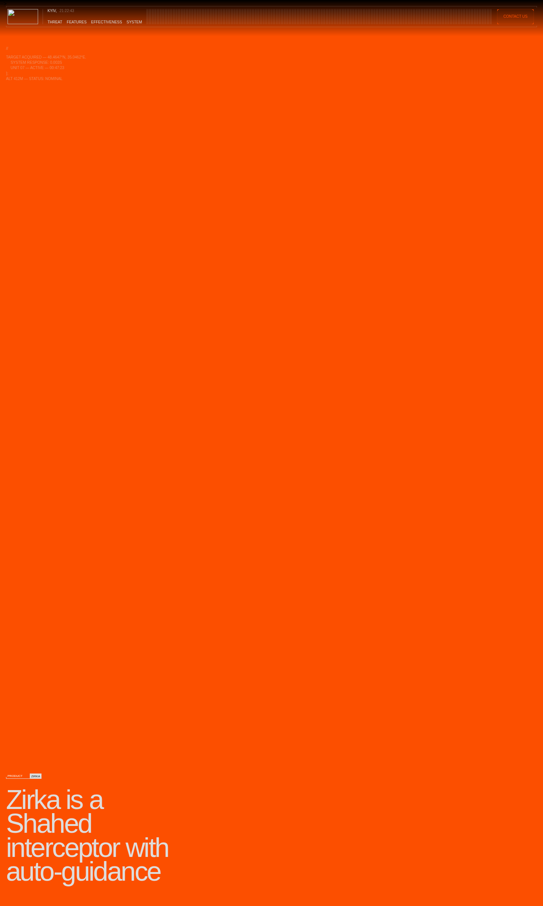
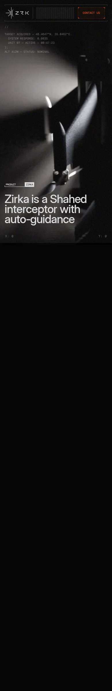

# UI Design System & Master Generation Blueprint: www-zrk-technology

> **Shahed interceptor with auto-guidance · Zirka** (https://www.zrk.technology/) — Ukrainian interceptor drone Zirka for defeating UAV threats. Automatic target tracking, combat-proven technology, and an airspeed twice t...



---

## 1. Executive Visual Persona & Design Archetype

- **Brand Essence & Persona**: **Shahed interceptor with auto-guidance · Zirka** (`https://www.zrk.technology/`). Ukrainian interceptor drone Zirka for defeating UAV threats. Automatic target tracking, combat-proven technology, and an airspeed twice t...
- **Visual Archetype**: **Light-Gallery WebGL / Canvas Interactive Experience (`#fc4f00` / `#0000`)**.
- **Anti-AI-Slop Differentiators**:
  - **Source-Grounded Chromatic Polarity**: Anchors the viewport in `#fc4f00` (`var(--orange)` in `:root`) paired with `#ff0` primary typography and `#0000` accents.
  - **Extracted Typographic Hierarchy**: Pairs `Inter display` for display copy (`Z i r k a i s a S h a h e d i n t e `) with `Geist mono` and `Geist mono`.
  - **Calibrated Spatial Grid & Motion**: Combines `940px` container bounds (`gap: 16px`, padding `9px`) with `cubic-bezier(0.25,1,0.5,1)` easing and Lenis Smooth Scroll (`data-lenis`), GSAP Timeline & ScrollTrigger.

---

## 2. Spatial Architecture & Modular Grid Mathematics



### Viewport Allocation & Container Geometry
- **Captured Viewport Dimensions**: Desktop `1440×2400px` (`assets/desktop.png`, capped at 2400px multi-section capture), Mobile `390×2400px` (`assets/mobile.png`, capped at 2400px multi-section capture).
- **Master Container Bounds**: `940px` extracted from `www-zrk-technology` stylesheet.
- **Canvas Lateral Padding & Spacing**: `9px` lateral canvas padding with `16px` grid gap.
- **Border Radius Scale**: `3px`, `100%`, `50%`.

### Responsive Breakpoint Architecture
- **Desktop Layout**: Multi-column CSS Grid / Flexbox layout at `1440px` (`max-width: 940px`, `gap: 16px`).
- **Mobile Layout**: Single-column vertical stack at `390px` viewport width with `9px` horizontal padding.
- **Extracted CSS Media Queries**: `@media screen and (max-width:991px)`, `@media screen and (max-width:767px)`, `@media screen and (max-width:479px)`, `@media (min-width:768px)`.

---

## 3. Color System, Materiality & Atmospheric Lighting

### Semantic Palette & Source Grounding
| Semantic Role | Ground-Truth Value | Extracted CSS Source / Selector |
|---|---|---|
| **Primary Canvas Substrate** | `#fc4f00` | `var(--orange)` in `:root` |
| **Primary Typography Ink** | `#050505` | `var(--black)` in `:root` |
| **Elevated Surface / Card Substrate** | `#ddd` | `var(--white)` in `:root` |
| **Interactive Accent / Highlight** | `#0000` | `a { background-color: #0000 }` |
| **Secondary / Muted Copy** | `#000` | `mark { color: #000 }` |
| **Structural Hairline Border** | `#ff0` | `mark { background: #ff0 }` |

### Sanitized Root CSS Variables (`ui-ux.md` Ground Truth)
| Variable Name | Extracted Value | Semantic Role |
|---|---|---|
| `--orange` | `#fc4f00` | Color / Atmospheric Token |
| `--black` | `#050505` | Canvas / Surface Token |
| `--white` | `#ddd` | Canvas / Surface Token |
| `--bar` | `1px` | Dimension / Scale Token |
| `--gap` | `2.5px` | Layout / Spatial Grid Token |
| `--word` | `1` | Design System Custom Token |
| `--char` | `1` | Design System Custom Token |
| `--www-zrk-technolo-bg` | `#fc4f00` | Canvas Substrate (from `var(--orange)` in `:root`) |
| `--www-zrk-technolo-ink` | `#ff0` | Primary Typography Ink (stylesheet-derived) |
| `--www-zrk-technolo-surface` | `#ddd` | Surface Substrate (stylesheet-derived) |
| `--www-zrk-technolo-accent` | `#0000` | Interactive Accent (stylesheet-derived) |
| `--www-zrk-technolo-muted` | `#000` | Secondary Ink (stylesheet-derived) |
| `--www-zrk-technolo-border` | `#ff0` | Structural Border (stylesheet-derived) |
| `--www-zrk-technolo-container` | `940px` | Container Bound (stylesheet-derived) |
| `--www-zrk-technolo-gap` | `16px` | Grid Gutter (stylesheet-derived) |
| `--www-zrk-technolo-pad` | `9px` | Lateral Padding (stylesheet-derived) |

---

## 4. Typographic Scale & Editorial Hierarchy

### Font Family Stacks
- **Display Typography**: `Inter display`.
- **Primary Body Stack**: `Geist mono`.
- **Technical / Metadata Stack**: `Geist mono`.

### Typographic Scale & Rules (Extracted from Stylesheet & Variables)
- **Hero Display (`H1`)**: not explicitly declared on tag in static CSS (stylesheet font-size ladder: `2em`, `80%`, `75%`, `1em`, `14px`).
- **Section Heading (`H2`)**: not explicitly declared on tag in static CSS (stylesheet font-size ladder: `2em`, `80%`, `75%`, `1em`, `14px`).
- **Body Copy**: not explicitly declared on tag in static CSS (stylesheet font-size ladder: `2em`, `80%`, `75%`, `1em`, `14px`).
- **Metadata & Navigation Labels**: not explicitly declared on tag in static CSS (stylesheet font-size ladder: `2em`, `80%`, `75%`, `1em`, `14px`).

---

## 5. Choreographed Motion & Interaction Physics

### Primary Easing Curves
- **Extracted Timing Functions**: `cubic-bezier(0.25,1,0.5,1)`.

### Per-Element Transition & Choreography Rules
- **Selector `.w-webflow-badge>img`**: `transition: unset` extracted from `www-zrk-technology` stylesheet.
- **Selector `.w-slider-dot`**: `transition: background-color .1s,color .1s` extracted from `www-zrk-technology` stylesheet.
- **Selector `.w-lightbox-control`**: `transition: all .3s` extracted from `www-zrk-technology` stylesheet.
- **Extracted Easing Curve (`cubic-bezier(0.25,1,0.5,1)`)**: Governs interactive state transitions across `<header.header>` and `<main.main>`.
- **Runtime Interaction Engine**: Integrates Lenis Smooth Scroll (`data-lenis`), GSAP Timeline & ScrollTrigger, Three.js / WebGL Canvas Pipeline, Lottie Vector Animation Player, Framer Motion Layout Physics with `prefers-reduced-motion: reduce` fallback guards.

---

## 6. Component Wireframe & Structural DOM Map

### Visual Layout Schematic (Grounded in `dom.html` — `1440px` Desktop & `390px` Mobile Reflow)
```
┌────────────────────────────────────────────────────────────────────────┐
│ DESKTOP VIEWPORT (1440px) — Shahed interceptor with auto-guidance · Zi │
│ ====================================================================== │
│ [ <header.header>          | EN · ua · Threat · Features · Effectiv ]  │
│ ---------------------------------------------------------------------- │
│ | HERO STAGE: <main.main>                                          |   │
│ | H1: Z i r k a i s a S h a h e d i n t e r c e p t o r...         |   │
│ | Substrate: #fc4f00    | Ink: #ff0       | Accent: #0000          |   │
│ ---------------------------------------------------------------------- │
│ | SHOWCASE GRID (<main.main>               ) max-w: 940px          |   │
│ | +------------------------------+  +------------------------------+ | │
│ | | A l l U k r a i n i a n i n  |  | F i r s t s t r i k e s o n  | | │
│ | +------------------------------+  +------------------------------+ | │
│ ---------------------------------------------------------------------- │
│ | MOBILE VIEWPORT REFLOW (390px) — Single-Column Stack (gap: 16px  ) | │
│ | [<header.header>] -> [<main.main>] -> [<main.main>] |                │
│ ---------------------------------------------------------------------- │
│ [ FOOTER (<footer.footer-2>     ) | https://www.zrk.technology/        │
└────────────────────────────────────────────────────────────────────────┘
```

### Granular DOM Region Breakdown
1. **Brand Header & Navigation Bar (<header.header> — `www-zrk-technology`)**:
   - Landmark `<header class="header">` hosting `Shahed interceptor with auto-guidanc` navigation (`EN · ua · Threat · Features · Effectiveness`), DOM attributes (`data-wf-domain="www.zrk.technology"`, `data-wf-page="6a6b45050da8002d7ece655a"`, `data-wf-site="6a6b45050da8002d7ece655c"`, `data-w-id="ede80d56-8c0e-ad0b-36..."`), and stylesheet rule `html { -webkit-text-size-adjust:100%;-ms-text-size-adjust:100%;font-family:sans... }`.
2. **Hero Stage & Focal Lead (<main.main> — `Z i r k a i s a S h a h e d i n t `)**:
   - Landmark `<main class="main">` presenting display lead `Z i r k a i s a S h a h e d i n t e r c e p t o r...` and copy excerpt *"i n t e r c e p t o r"* over `#fc4f00` canvas and `#ff0` ink.
3. **Primary Showcase & Content Grid (<main.main> — `A l l U k r a i n i a n i n t e r `)**:
   - Landmark `<main class="main">` rendering section `A l l U k r a i n i a n i n t e r c e p t i o n e...` with copy *"a u t o - g u i d a n c e"*, asset references (`cdn.prod.website-files.com`, `zirka-awwwards.webflow.shared.2f0...`, `6a4281712b40a844defb5fdd_180x180.png`, `6a1573e5debd7fd87a125ab4_180x180.png`), and grid rule `summary { display:block }`.
4. **Interactive Detail & Feature Matrix (<main.main> — `F i r s t s t r i k e s o n U k r `)**:
   - Landmark `<main class="main">` framing `F i r s t s t r i k e s o n U k r a i n e` and `G e r a n - 2 : R u s s i a ’ s a d a p t a t i o...` (*"i n t e r c e p t i o n"*) with `#ddd` surface cards, `#0000` accents, and `video { vertical-align:baseline;display:inline-block }`.
5. **Colophon & Global Directory Footer (<footer.footer-2> — `https://www.zrk.technology/`)**:
   - Landmark `<footer class="footer-2">` anchoring `Shahed interceptor with auto-gui` footer links (`EN · ua · Threat · Features · Effectiveness`), copy *"e x p e r i e n c e"*, and `#ff0` structural dividers.

---

## 7. Master Zero-Shot AI Generation Prompt

```markdown
# Master Zero-Shot Frontend Generation Prompt: www-zrk-technology (Shahed interceptor with auto-guidance · Zirka)

You are a principal frontend architect and design systems engineer. Build a complete, production-ready web application replicating the exact design system, DOM landmarks, typographic hierarchy, color tokens, and motion physics of `www-zrk-technology` (**Shahed interceptor with auto-guidance · Zirka** — `https://www.zrk.technology/`).

### 1. Visual Archetype & Anti-AI-Slop Mandates
- **Archetype**: Light-Gallery WebGL / Canvas Interactive Experience (`#fc4f00` / `#0000`).
- **Identity & Domain Context**: Ukrainian interceptor drone Zirka for defeating UAV threats. Automatic target tracking, combat-proven technology, and an airspeed twice t...
- **Primary Substrate**: `#fc4f00` (`var(--orange)` in `:root`), **Primary Ink**: `#ff0`, **Accent / Highlight**: `#0000`.
- **Site-Specific Differentiators**:
  - **Source-Grounded Chromatic Polarity**: Anchors the viewport in `#fc4f00` (`var(--orange)` in `:root`) paired with `#ff0` primary typography and `#0000` accents.
  - **Extracted Typographic Hierarchy**: Pairs `Inter display` for display copy (`Z i r k a i s a S h a h e d i n t e `) with `Geist mono` and `Geist mono`.
  - **Calibrated Spatial Grid & Motion**: Combines `940px` container bounds (`gap: 16px`, padding `9px`) with `cubic-bezier(0.25,1,0.5,1)` easing and Lenis Smooth Scroll (`data-lenis`), GSAP Timeline & ScrollTrigger.

### 2. Ground-Truth CSS Variables (`:root` Token Contract)
Declare and consume these exact custom properties extracted from `www-zrk-technology` in your global stylesheet:

:root {
  /* Shahed interceptor with auto-guidance · Zirka (www-zrk-technology) — Ground-Truth Extracted CSS Variables */
  --orange: #fc4f00; /* Color / Atmospheric Token (www-zrk-technology) */
  --black: #050505; /* Canvas / Surface Token (www-zrk-technology) */
  --white: #ddd; /* Canvas / Surface Token (www-zrk-technology) */
  --bar: 1px; /* Dimension / Scale Token (www-zrk-technology) */
  --gap: 2.5px; /* Layout / Spatial Grid Token (www-zrk-technology) */
  --word: 1; /* Design System Custom Token (www-zrk-technology) */
  --char: 1; /* Design System Custom Token (www-zrk-technology) */
  --www-zrk-technolo-bg: #fc4f00; /* Canvas Substrate (from `var(--orange)` in `:root`) (www-zrk-technology) */
  --www-zrk-technolo-ink: #ff0; /* Primary Typography Ink (stylesheet-derived) (www-zrk-technology) */
  --www-zrk-technolo-surface: #ddd; /* Surface Substrate (stylesheet-derived) (www-zrk-technology) */
  --www-zrk-technolo-accent: #0000; /* Interactive Accent (stylesheet-derived) (www-zrk-technology) */
  --www-zrk-technolo-muted: #000; /* Secondary Ink (stylesheet-derived) (www-zrk-technology) */
  --www-zrk-technolo-border: #ff0; /* Structural Border (stylesheet-derived) (www-zrk-technology) */
  --www-zrk-technolo-container: 940px; /* Container Bound (stylesheet-derived) (www-zrk-technology) */
  --www-zrk-technolo-gap: 16px; /* Grid Gutter (stylesheet-derived) (www-zrk-technology) */
  --www-zrk-technolo-pad: 9px; /* Lateral Padding (stylesheet-derived) (www-zrk-technology) */
}

### 3. Semantic Color & Materiality Contract
Map every surface, ink, and border strictly to these source-grounded tokens:
- **Primary Canvas Substrate**: `#fc4f00` — grounded in `var(--orange)` in `:root`
- **Primary Typography Ink**: `#050505` — grounded in `var(--black)` in `:root`
- **Elevated Surface / Card Substrate**: `#ddd` — grounded in `var(--white)` in `:root`
- **Interactive Accent / Highlight**: `#0000` — grounded in `a { background-color: #0000 }`
- **Secondary / Muted Copy**: `#000` — grounded in `mark { color: #000 }`
- **Structural Hairline Border**: `#ff0` — grounded in `mark { background: #ff0 }`

### 4. Spatial Grid, Container Bounds & Responsive Breakpoints
- **Desktop Viewport Reference**: `1440×2400px` (capped at 2400px multi-section capture, `1440px` standard desktop width).
- **Mobile Viewport Reference**: `390×2400px` (capped at 2400px multi-section capture, `390px` standard mobile width).
- **Container Max-Width**: `940px` extracted from `www-zrk-technology` stylesheet
- **Padding & Gutters**: `9px` lateral canvas padding with `16px` grid gap
- **Desktop Grid**: Multi-column CSS Grid / Flexbox layout at `1440px` (`max-width: 940px`, `gap: 16px`)
- **Mobile Adaptation**: Single-column vertical stack at `390px` viewport width with `9px` horizontal padding
- **Media Queries**: `@media screen and (max-width:991px)`, `@media screen and (max-width:767px)`, `@media screen and (max-width:479px)`, `@media (min-width:768px)`
- **Corner Radii**: `3px`, `100%`, `50%`

### 5. Typography & Editorial Scale Contract
- **Display Font Stack**: `Inter display`
- **Body Font Stack**: `Geist mono`
- **Monospace / Technical Font Stack**: `Geist mono`
- **H1 Display Rule**: not explicitly declared on tag in static CSS (stylesheet font-size ladder: `2em`, `80%`, `75%`, `1em`, `14px`)
- **H2 Section Rule**: not explicitly declared on tag in static CSS (stylesheet font-size ladder: `2em`, `80%`, `75%`, `1em`, `14px`)
- **Body Copy Rule**: not explicitly declared on tag in static CSS (stylesheet font-size ladder: `2em`, `80%`, `75%`, `1em`, `14px`)
- **Metadata & Index Rule**: not explicitly declared on tag in static CSS (stylesheet font-size ladder: `2em`, `80%`, `75%`, `1em`, `14px`)

### 6. Component Hierarchy, Verbatim Copy & Real DOM Landmarks
Scaffold `www-zrk-technology` (`Shahed interceptor with auto-guidance · Zirka`) with these exact structural regions, extracted copy, and CSS rules from `dom.html`:
1. **Brand Header & Navigation Bar (<header.header> — `www-zrk-technology`)**:
   - DOM & Selectors: Landmark `<header class="header">` hosting `Shahed interceptor with auto-guidanc` navigation (`EN · ua · Threat · Features · Effectiveness`), DOM attributes (`data-wf-domain="www.zrk.technology"`, `data-wf-page="6a6b45050da8002d7ece655a"`, `data-wf-site="6a6b45050da8002d7ece655c"`, `data-w-id="ede80d56-8c0e-ad0b-36..."`), and stylesheet rule `html { -webkit-text-size-adjust:100%;-ms-text-size-adjust:100%;font-family:sans... }`.
   - Responsive Contract: Header `Brand Header & Navigation Bar (<header.header> — `www-zrk-technology`)` (`www-zrk-technology`) adapts across `@media screen and (max-width:991px)`, `@media screen and (max-width:767px)`, `@media screen and (max-width:479px)`, `@media (min-width:768px)` with `cubic-bezier(0.25,1,0.5,1)` transitions and links `EN · ua · Threat · Features · Effectiveness`.
2. **Hero Stage & Focal Lead (<main.main> — `Z i r k a i s a S h a h e d i n t `)**:
   - DOM & Selectors: Landmark `<main class="main">` presenting display lead `Z i r k a i s a S h a h e d i n t e r c e p t o r...` and copy excerpt *"i n t e r c e p t o r"* over `#fc4f00` canvas and `#ff0` ink.
   - Responsive Contract: Hero stage (`1440×2400px` desktop / `390×2400px` mobile) sets `#fc4f00` background with `#ff0` headline `Z i r k a i s a S h a h e d i n t e r c e p t o r...`.
3. **Primary Showcase & Content Grid (<main.main> — `A l l U k r a i n i a n i n t e r `)**:
   - DOM & Selectors: Landmark `<main class="main">` rendering section `A l l U k r a i n i a n i n t e r c e p t i o n e...` with copy *"a u t o - g u i d a n c e"*, asset references (`cdn.prod.website-files.com`, `zirka-awwwards.webflow.shared.2f0...`, `6a4281712b40a844defb5fdd_180x180.png`, `6a1573e5debd7fd87a125ab4_180x180.png`), and grid rule `summary { display:block }`.
   - Responsive Contract: Showcase grid `Primary Showcase & Content Grid (<main.main> — `A l l U k r a i n i a n i n t e r `)` applies Multi-column CSS Grid / Flexbox layout at `1440px` (`max-width: 940px`, `gap: 16px`) on desktop and Single-column vertical stack at `390px` viewport width with `9px` horizontal padding on mobile.
4. **Interactive Detail & Feature Matrix (<main.main> — `F i r s t s t r i k e s o n U k r `)**:
   - DOM & Selectors: Landmark `<main class="main">` framing `F i r s t s t r i k e s o n U k r a i n e` and `G e r a n - 2 : R u s s i a ’ s a d a p t a t i o...` (*"i n t e r c e p t i o n"*) with `#ddd` surface cards, `#0000` accents, and `video { vertical-align:baseline;display:inline-block }`.
   - Responsive Contract: Detail module `Interactive Detail & Feature Matrix (<main.main> — `F i r s t s t r i k e s o n U k r `)` uses `3px`, `100%`, `50%` radii, `#0000` highlights, and assets (cdn.prod.website-files.com, zirka-awwwards.webflow.shared.2f0..., 6a4281712b40a844defb5fdd_180x180.png).
5. **Colophon & Global Directory Footer (<footer.footer-2> — `https://www.zrk.technology/`)**:
   - DOM & Selectors: Landmark `<footer class="footer-2">` anchoring `Shahed interceptor with auto-gui` footer links (`EN · ua · Threat · Features · Effectiveness`), copy *"e x p e r i e n c e"*, and `#ff0` structural dividers.
   - Responsive Contract: Footer `Colophon & Global Directory Footer (<footer.footer-2> — `https://www.zrk.technology/`)` aligns to `940px` extracted from `www-zrk-technology` stylesheet with `9px` lateral canvas padding with `16px` grid gap and attributes (data-wf-domain="www.zrk.technology", data-wf-page="6a6b45050da8002d7ece655a", data-wf-site="6a6b45050da8002d7ece655c").

#### Verbatim DOM Copy Excerpts (`dom.html`)
- Copy Excerpt 1: *"i n t e r c e p t o r"*
- Copy Excerpt 2: *"a u t o - g u i d a n c e"*
- Copy Excerpt 3: *"i n t e r c e p t i o n"*
- Copy Excerpt 4: *"e x p e r i e n c e"*

### 7. Motion, Extracted Stylesheet Rules & Interaction Choreography
- **Primary Easing Functions**: `cubic-bezier(0.25,1,0.5,1)`
- **Extracted Stylesheet Rules (`www-zrk-technology`)**:
- `html { -webkit-text-size-adjust:100%;-ms-text-size-adjust:100%;font-family:sans... }`
- `summary { display:block }`
- `video { vertical-align:baseline;display:inline-block }`
- `template { display:none }`
- `strong { font-weight:700 }`
- **Per-Selector Transition Rules**:
- **Selector `.w-webflow-badge>img`**: `transition: unset` extracted from `www-zrk-technology` stylesheet.
- **Selector `.w-slider-dot`**: `transition: background-color .1s,color .1s` extracted from `www-zrk-technology` stylesheet.
- **Selector `.w-lightbox-control`**: `transition: all .3s` extracted from `www-zrk-technology` stylesheet.
- **Extracted Easing Curve (`cubic-bezier(0.25,1,0.5,1)`)**: Governs interactive state transitions across `<header.header>` and `<main.main>`.
- **Runtime Interaction Engine**: Integrates Lenis Smooth Scroll (`data-lenis`), GSAP Timeline & ScrollTrigger, Three.js / WebGL Canvas Pipeline, Lottie Vector Animation Player, Framer Motion Layout Physics with `prefers-reduced-motion: reduce` fallback guards.

### 8. Technical Deliverables
- Implement in Next.js (App Router) with TypeScript and Tailwind CSS consuming the `:root` custom properties defined above for `www-zrk-technology`.
- Reproduce both the `1440px` desktop architecture and `390px` mobile breakpoint transitions, preserving semantic HTML5 landmarks (`<header>`, `<nav>`, `<main>`, `<section>`, `<footer>`) and `prefers-reduced-motion` accessibility guards.
```
