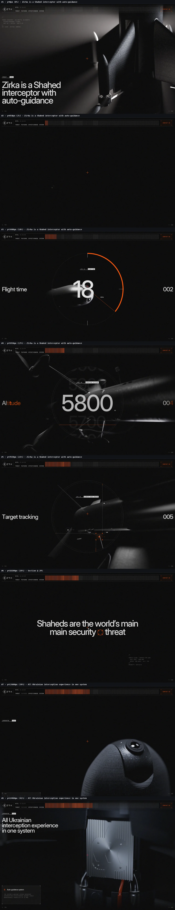
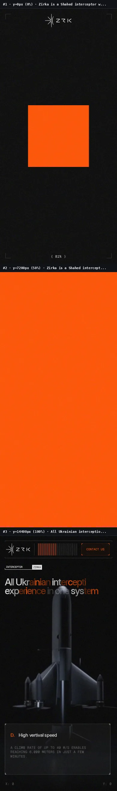

# UI Design System & Master Generation Blueprint: www-zrk-technology

> **Shahed interceptor with auto-guidance · Zirka** (https://www.zrk.technology/) — Ukrainian interceptor drone Zirka for defeating UAV threats. Automatic target tracking, combat-proven technology, and an airspeed twice t...





---

## 1. Executive Visual Persona & Design Archetype

- **Brand Essence & Persona**: **Shahed interceptor with auto-guidance · Zirka** (`https://www.zrk.technology/`). Ukrainian interceptor drone Zirka for defeating UAV threats. Automatic target tracking, combat-proven technology, and an airspeed twice t...
- **Capture Provenance**: Live browser capture (`tier1_fast`, HTTP `200`, captured `2026-11-24`).
- **Visual Archetype**: **Dark-Substrate WebGL / Canvas Interactive Experience (`#050505` / `#ffa500`)**.
- **Anti-AI-Slop Differentiators**:
  - **Live-Computed Chromatic Polarity**: Anchors the viewport in `#050505` (live computed `body` `background-color` (`computed_styles.json`)) paired with `#dddddd` primary typography and `#ffa500` accents.
  - **Grounded Typographic Hierarchy**: Uses `Inter display` across display (`Zirka is a Shahed interceptor with a`) and body copy, paired with `Geist mono` for monospace/code.
  - **Calibrated Spatial Grid & Motion**: Combines `97.7778rem` container bounds (`gap: 16px`, padding `15.984px`) with `cubic-bezier(0.25,1,0.5,1)` easing and Lenis Smooth Scroll (`data-lenis`), GSAP Timeline & ScrollTrigger.

---

## 2. Spatial Architecture & Modular Grid Mathematics

### Viewport Allocation & Container Geometry
- **Captured Journey Filmstrips**: Desktop `1280×6624px` (`assets/desktop-journey.webp`, `8` keyframes up to `y=14400px` / doc `35640px`), Mobile `390×2616px` (`assets/mobile-journey.webp`, `3` keyframes).
- **Master Container Bounds**: `97.7778rem` (non-`@media` desktop container stylesheet rule).
- **Canvas Lateral Padding & Spacing**: `15.984px` lateral canvas padding with `16px` grid gap.
- **Border Radius Scale**: `3px`, `100%`, `50%`.

### Responsive Breakpoint Architecture
- **Desktop Layout**: Multi-column CSS Grid / Flexbox layout at `1440px` (`max-width: 97.7778rem`, `gap: 16px`).
- **Mobile Layout**: Single-column vertical stack at `390px` viewport width with `15.984px` horizontal padding.
- **Extracted CSS Media Queries**: `@media screen and (max-width:991px)`, `@media screen and (max-width:767px)`, `@media screen and (max-width:479px)`, `@media (min-width:768px)`.

---

## 3. Color System, Materiality & Atmospheric Lighting

### Semantic Palette & Source Grounding
| Semantic Role | Ground-Truth Value | Extracted Live / CSS Source |
|---|---|---|
| **Primary Canvas Substrate** | `#050505` | live computed `body` `background-color` (`computed_styles.json`) |
| **Primary Typography Ink** | `#dddddd` | live computed `h1` `color` (`computed_styles.json`) |
| **Elevated Surface / Card Substrate** | `#222222` | `.w-slider-nav-invert>div.w-active { background-color: #222222 }` |
| **Interactive Accent / Highlight** | `#ffa500` | `.nav-link:hover { color: orange }` (`#ffa500`) |
| **Secondary / Muted Copy** | `#333333` | live computed `footer` `color` (`computed_styles.json`) |
| **Structural Hairline Border** | `#3898ec` | `.w-select:focus { border-color: #3898ec }` |
| **Variable Token (`--orange`)** | `#fc4f00` | `var(--orange)` in `:root` |

### Sanitized Root CSS Variables (`ui-ux.md` Ground Truth)
| Variable Name | Extracted Value | Semantic Role |
|---|---|---|
| `--orange` | `#fc4f00` | Color / Atmospheric Token |
| `--black` | `#050505` | Canvas / Surface Token |
| `--white` | `#ddd` | Canvas / Surface Token |
| `--bar` | `1px` | Dimension / Scale Token |
| `--gap` | `2.5px` | Layout / Spatial Grid Token |
| `--word` | `1` | Design System Custom Token |
| `--char` | `1` | Design System Custom Token |
| `--www-zrk-technolo-bg` | `#050505` | Canvas Substrate (from live computed `body` `background-color` (`computed_styles.json`)) |
| `--www-zrk-technolo-ink` | `#dddddd` | Primary Typography Ink (computed-derived) |
| `--www-zrk-technolo-surface` | `#222222` | Surface Substrate (computed-derived) |
| `--www-zrk-technolo-accent` | `#ffa500` | Interactive Accent (computed-derived) |
| `--www-zrk-technolo-muted` | `#333333` | Secondary Ink (computed-derived) |
| `--www-zrk-technolo-border` | `#3898ec` | Structural Border (computed-derived) |
| `--www-zrk-technolo-container` | `97.7778rem` | Container Bound (computed-derived) |
| `--www-zrk-technolo-gap` | `16px` | Grid Gutter (computed-derived) |
| `--www-zrk-technolo-pad` | `15.984px` | Lateral Padding (computed-derived) |

---

## 4. Typographic Scale & Editorial Hierarchy

### Font Family Stacks
- **Display Typography**: `Inter display`.
- **Primary Body Stack**: `Inter display`.
- **Technical / Metadata Stack**: `Geist mono`.

### Typographic Scale & Rules (Live Computed & Stylesheet Grounded)
- **Hero Display (`H1`)**: live computed `h1` (`font-size: 72px`, `line-height: 63.36px`, `font-weight: 500`, `letter-spacing: -3.6px`).
- **Section Heading (`H2`)**: live computed `h2` (`font-size: 72px`, `line-height: 63.36px`, `font-weight: 500`, `letter-spacing: -3.6px`).
- **Body Copy**: live computed `body` (`font-size: 14px`, `line-height: 20px`, `font-weight: 400`).
- **Metadata & Navigation Labels**: live computed `nav/a` (`font-size: 14px`, `line-height: 20px`, `font-weight: 400`).

---

## 5. Choreographed Motion & Interaction Physics

### Primary Easing Curves
- **Extracted Timing Functions**: `cubic-bezier(0.25,1,0.5,1)`.

### Per-Element Transition & Choreography Rules
- **Selector `.w-webflow-badge>img`**: `transition: unset` extracted from `www-zrk-technology` stylesheet.
- **Selector `.w-slider-dot`**: `transition: background-color .1s,color .1s` extracted from `www-zrk-technology` stylesheet.
- **Selector `.w-lightbox-control`**: `transition: all .3s` extracted from `www-zrk-technology` stylesheet.
- **Extracted Easing Curve (`cubic-bezier(0.25,1,0.5,1)`)**: Governs interactive state transitions across `<header.header>` and `<main.main:nth(2)>`.
- **Runtime Interaction Engine**: Integrates Lenis Smooth Scroll (`data-lenis`), GSAP Timeline & ScrollTrigger, Three.js / WebGL Canvas Pipeline, Lottie Vector Animation Player, Framer Motion Layout Physics with `prefers-reduced-motion: reduce` fallback guards.
### Measured Runtime Scroll & Interaction Telemetry (`behavioral_journey_v2`)
- **Scroll Driver Mode**: `native` (max document height `35640px`, deepest scrollY reached `14400px` across `8` desktop keyframes).
- **Detected Scroll / Motion Libraries**: `Lenis`, `GSAP/ScrollTrigger`, `WebGL/Canvas`.
- **Hover Physics (`primary_cta` · `CONTACT US`)**: Computed transition `0s` / `ease` (no static color/transform shift captured at rest).

---

## 6. Component Wireframe & Structural DOM Map

### Visual Layout Schematic — Desktop (`1440px`, Grounded in `dom.html` & Landmark Bounding Boxes)
```
┌────────────────────────────────────────────────────────────────────────┐
│ DESKTOP VIEWPORT (1440px) — Shahed interceptor with auto-guidance · Zi │
│ ====================================================================== │
│ [ <header.header> (1440x96px)         | EN · ua · Threat · Features  ] │
│ ---------------------------------------------------------------------- │
│ | HERO STAGE: <main.main> (w=1440px)                                 | │
│ | H1: Zirka is a Shahed interceptor with auto-guidance               | │
│ | Substrate: #050505 | Ink: #dddddd | Accent: #ffa500                | │
│ ---------------------------------------------------------------------- │
│ | SHOWCASE GRID (<main.main:nth(2)>) max-w: 97.7778rem               | │
│ | +------------------------------+  +------------------------------+ | │
│ | | Z i r k a i s a S h a h e d  |  | A l l U k r a i n i a n i n  | | │
│ | +------------------------------+  +------------------------------+ | │
│ ---------------------------------------------------------------------- │
│ | DETAIL MODULE (<main.main:nth(3)>) — F i r s t s t r i k e         | │
│ ---------------------------------------------------------------------- │
│ [ FOOTER (<footer.footer-2>   ) | https://www.zrk.technology/          │
└────────────────────────────────────────────────────────────────────────┘
```

### Visual Layout Schematic — Mobile Reflow (`390px`)
```
┌────────────────────────────────────────────────────────────────────────┐
│ MOBILE VIEWPORT REFLOW (390px) — Single-Column Stack (gap: 16px)       │
│ ====================================================================== │
│ [ HEADER BAR (<header.header>         ) | Compact Menu (390px)         │
│ ---------------------------------------------------------------------- │
│ | HERO STAGE (<main.main>) — 390px Vertical Lead                     | │
│ | H1: Zirka is a Shahed interceptor with auto-guidance               | │
│ ---------------------------------------------------------------------- │
│ | SHOWCASE STACK (<main.main:nth(2)>) — 1-Col Stack                  | │
│ | [ Item 1: Z i r k a i s a S h a h e d i n t e r c e p t o r...   ] | │
│ | [ Item 2: A l l U k r a i n i a n i n t e r c e p t i o n e...   ] | │
│ ---------------------------------------------------------------------- │
│ | DETAIL STACK (<main.main:nth(3)>) — 1-Col (F i r s t s t r i )     | │
│ ---------------------------------------------------------------------- │
│ [ FOOTER (<footer.footer-2>   ) | Stacked 390px Colophon               │
└────────────────────────────────────────────────────────────────────────┘
```

### Granular DOM Region Breakdown
1. **Brand Header & Navigation Bar (<header.header> — `www-zrk-technology`)**:
   - Landmark `<header class="header">` (`1440x96px`) hosting `Shahed interceptor with auto-guidanc` navigation (`EN · ua · Threat · Features · Effectiveness`), DOM attributes (`data-wf-domain="www.zrk.technology"`, `data-wf-page="6a6b45050da8002d7ece655a"`, `data-wf-site="6a6b45050da8002d7ece655c"`, `data-w-id="ede80d56-8c0e-ad0b-36..."`), and stylesheet rule `html { -webkit-text-size-adjust:100%;-ms-text-size-adjust:100%;font-family:sans... }`.
2. **Hero Stage & Focal Lead (<main.main> — `Zirka is a Shahed interceptor with`)**:
   - Landmark `<main class="main">` presenting display lead `Zirka is a Shahed interceptor with auto-guidance` and copy excerpt *"i n t e r c e p t o r"* over `#050505` canvas and `#dddddd` ink.
3. **Primary Showcase & Content Grid (<main.main:nth(2)> — `Z i r k a i s a S h a h e d i n t `)**:
   - Landmark `<main class="main">` rendering section `Z i r k a i s a S h a h e d i n t e r c e p t o r...` with copy *"a u t o - g u i d a n c e"*, asset references (`cdn.prod.website-files.com`, `zirka-awwwards.webflow.shared.2f0...`, `6a4281712b40a844defb5fdd_180x180.png`, `6a1573e5debd7fd87a125ab4_180x180.png`), and grid rule `summary { display:block }`.
4. **Interactive Detail & Feature Matrix (<main.main:nth(3)> — `A l l U k r a i n i a n i n t e r `)**:
   - Landmark `<main class="main">` framing `A l l U k r a i n i a n i n t e r c e p t i o n e...` and `F i r s t s t r i k e s o n U k r a i n e` (*"i n t e r c e p t i o n"*) with `#222222` surface cards, `#ffa500` accents, and `video { vertical-align:baseline;display:inline-block }`.
5. **Colophon & Global Directory Footer (<footer.footer-2> — `https://www.zrk.technology/`)**:
   - Landmark `<footer class="footer-2">` anchoring `Shahed interceptor with auto-gui` footer links (`EN · ua · Threat · Features · Effectiveness`), copy *"e x p e r i e n c e"*, and `#3898ec` structural dividers.
### Full Vertical Scroll Sequence (Desktop `1440×900` Keyframes)
- **Step 01** (`y=0px`, `0%`): Active landmark `Zirka is a Shahed interceptor with auto-guidance` · sticky/fixed elements: `2`
- **Step 02** (`y=850px`, `2%`): Active landmark `Zirka is a Shahed interceptor with auto-guidance` · sticky/fixed elements: `2`
- **Step 03** (`y=3400px`, `10%`): Active landmark `Zirka is a Shahed interceptor with auto-guidance` · sticky/fixed elements: `2`
- **Step 04** (`y=5950px`, `17%`): Active landmark `Zirka is a Shahed interceptor with auto-guidance` · sticky/fixed elements: `2`
- **Step 05** (`y=7650px`, `22%`): Active landmark `Zirka is a Shahed interceptor with auto-guidance` · sticky/fixed elements: `2`
- **Step 06** (`y=10200px`, `29%`): Active landmark `Section @ 29%` · sticky/fixed elements: `3`
- **Step 07** (`y=13600px`, `39%`): Active landmark `All Ukrainian interception experience in one system` · sticky/fixed elements: `3`
- **Step 08** (`y=14400px`, `41%`): Active landmark `All Ukrainian interception experience in one system` · sticky/fixed elements: `2`

---

## 7. Master Zero-Shot AI Generation Prompt

```markdown
# Master Zero-Shot Frontend Generation Prompt: www-zrk-technology (Shahed interceptor with auto-guidance · Zirka)

You are a principal frontend architect and design systems engineer. Build a complete, production-ready web application replicating the exact design system, DOM landmarks, typographic hierarchy, color tokens, and motion physics of `www-zrk-technology` (**Shahed interceptor with auto-guidance · Zirka** — `https://www.zrk.technology/`).

### 1. Visual Archetype & Anti-AI-Slop Mandates
- **Archetype**: Dark-Substrate WebGL / Canvas Interactive Experience (`#050505` / `#ffa500`).
- **Identity & Domain Context**: Ukrainian interceptor drone Zirka for defeating UAV threats. Automatic target tracking, combat-proven technology, and an airspeed twice t...
- **Primary Substrate**: `#050505` (live computed `body` `background-color` (`computed_styles.json`)), **Primary Ink**: `#dddddd`, **Accent / Highlight**: `#ffa500`.
- **Site-Specific Differentiators**:
  - **Live-Computed Chromatic Polarity**: Anchors the viewport in `#050505` (live computed `body` `background-color` (`computed_styles.json`)) paired with `#dddddd` primary typography and `#ffa500` accents.
  - **Grounded Typographic Hierarchy**: Uses `Inter display` across display (`Zirka is a Shahed interceptor with a`) and body copy, paired with `Geist mono` for monospace/code.
  - **Calibrated Spatial Grid & Motion**: Combines `97.7778rem` container bounds (`gap: 16px`, padding `15.984px`) with `cubic-bezier(0.25,1,0.5,1)` easing and Lenis Smooth Scroll (`data-lenis`), GSAP Timeline & ScrollTrigger.

### 2. Ground-Truth CSS Variables (`:root` Token Contract)
Declare and consume these exact custom properties extracted from `www-zrk-technology` in your global stylesheet:

:root {
  /* Shahed interceptor with auto-guidance · Zirka (www-zrk-technology) — Live-Grounded CSS Variables */
  --orange: #fc4f00; /* Color / Atmospheric Token (www-zrk-technology) */
  --black: #050505; /* Canvas / Surface Token (www-zrk-technology) */
  --white: #ddd; /* Canvas / Surface Token (www-zrk-technology) */
  --bar: 1px; /* Dimension / Scale Token (www-zrk-technology) */
  --gap: 2.5px; /* Layout / Spatial Grid Token (www-zrk-technology) */
  --word: 1; /* Design System Custom Token (www-zrk-technology) */
  --char: 1; /* Design System Custom Token (www-zrk-technology) */
  --www-zrk-technolo-bg: #050505; /* Canvas Substrate (from live computed `body` `background-color` (`computed_styles.json`)) (www-zrk-technology) */
  --www-zrk-technolo-ink: #dddddd; /* Primary Typography Ink (computed-derived) (www-zrk-technology) */
  --www-zrk-technolo-surface: #222222; /* Surface Substrate (computed-derived) (www-zrk-technology) */
  --www-zrk-technolo-accent: #ffa500; /* Interactive Accent (computed-derived) (www-zrk-technology) */
  --www-zrk-technolo-muted: #333333; /* Secondary Ink (computed-derived) (www-zrk-technology) */
  --www-zrk-technolo-border: #3898ec; /* Structural Border (computed-derived) (www-zrk-technology) */
  --www-zrk-technolo-container: 97.7778rem; /* Container Bound (computed-derived) (www-zrk-technology) */
  --www-zrk-technolo-gap: 16px; /* Grid Gutter (computed-derived) (www-zrk-technology) */
  --www-zrk-technolo-pad: 15.984px; /* Lateral Padding (computed-derived) (www-zrk-technology) */
}

### 3. Semantic Color & Materiality Contract
Map every surface, ink, and border strictly to these source-grounded tokens:
- **Primary Canvas Substrate**: `#050505` — grounded in live computed `body` `background-color` (`computed_styles.json`)
- **Primary Typography Ink**: `#dddddd` — grounded in live computed `h1` `color` (`computed_styles.json`)
- **Elevated Surface / Card Substrate**: `#222222` — grounded in `.w-slider-nav-invert>div.w-active { background-color: #222222 }`
- **Interactive Accent / Highlight**: `#ffa500` — grounded in `.nav-link:hover { color: orange }` (`#ffa500`)
- **Secondary / Muted Copy**: `#333333` — grounded in live computed `footer` `color` (`computed_styles.json`)
- **Structural Hairline Border**: `#3898ec` — grounded in `.w-select:focus { border-color: #3898ec }`
- **Variable Token (`--orange`)**: `#fc4f00` — grounded in `var(--orange)` in `:root`

### 4. Spatial Grid, Container Bounds & Responsive Breakpoints
- **Desktop Viewport Reference**: `1280×6624px` (multi-frame vertical journey filmstrip (6624px), `1440px` standard desktop width).
- **Mobile Viewport Reference**: `390×2616px` (multi-frame vertical journey filmstrip (2616px), `390px` standard mobile width).
- **Container Max-Width**: `97.7778rem` (non-`@media` desktop container stylesheet rule)
- **Padding & Gutters**: `15.984px` lateral canvas padding with `16px` grid gap
- **Desktop Grid**: Multi-column CSS Grid / Flexbox layout at `1440px` (`max-width: 97.7778rem`, `gap: 16px`)
- **Mobile Adaptation**: Single-column vertical stack at `390px` viewport width with `15.984px` horizontal padding
- **Media Queries**: `@media screen and (max-width:991px)`, `@media screen and (max-width:767px)`, `@media screen and (max-width:479px)`, `@media (min-width:768px)`
- **Corner Radii**: `3px`, `100%`, `50%`

### 5. Typography & Editorial Scale Contract
- **Display Font Stack**: `Inter display`
- **Body Font Stack**: `Inter display`
- **Monospace / Technical Font Stack**: `Geist mono`
- **H1 Display Rule**: live computed `h1` (`font-size: 72px`, `line-height: 63.36px`, `font-weight: 500`, `letter-spacing: -3.6px`)
- **H2 Section Rule**: live computed `h2` (`font-size: 72px`, `line-height: 63.36px`, `font-weight: 500`, `letter-spacing: -3.6px`)
- **Body Copy Rule**: live computed `body` (`font-size: 14px`, `line-height: 20px`, `font-weight: 400`)
- **Metadata & Index Rule**: live computed `nav/a` (`font-size: 14px`, `line-height: 20px`, `font-weight: 400`)

### 6. Component Hierarchy, Verbatim Copy & Real DOM Landmarks
Scaffold `www-zrk-technology` (`Shahed interceptor with auto-guidance · Zirka`) with these exact structural regions, extracted copy, and CSS rules from `dom.html`:
1. **Brand Header & Navigation Bar (<header.header> — `www-zrk-technology`)**:
   - DOM & Selectors: Landmark `<header class="header">` (`1440x96px`) hosting `Shahed interceptor with auto-guidanc` navigation (`EN · ua · Threat · Features · Effectiveness`), DOM attributes (`data-wf-domain="www.zrk.technology"`, `data-wf-page="6a6b45050da8002d7ece655a"`, `data-wf-site="6a6b45050da8002d7ece655c"`, `data-w-id="ede80d56-8c0e-ad0b-36..."`), and stylesheet rule `html { -webkit-text-size-adjust:100%;-ms-text-size-adjust:100%;font-family:sans... }`.
   - Responsive Contract: Header `Brand Header & Navigation Bar (<header.header> — `www-zrk-technology`)` (`www-zrk-technology`) adapts across `@media screen and (max-width:991px)`, `@media screen and (max-width:767px)`, `@media screen and (max-width:479px)`, `@media (min-width:768px)` with `cubic-bezier(0.25,1,0.5,1)` transitions and links `EN · ua · Threat · Features · Effectiveness`.
2. **Hero Stage & Focal Lead (<main.main> — `Zirka is a Shahed interceptor with`)**:
   - DOM & Selectors: Landmark `<main class="main">` presenting display lead `Zirka is a Shahed interceptor with auto-guidance` and copy excerpt *"i n t e r c e p t o r"* over `#050505` canvas and `#dddddd` ink.
   - Responsive Contract: Hero stage (`1280×6624px` desktop / `390×2616px` mobile) sets `#050505` background with `#dddddd` headline `Zirka is a Shahed interceptor with auto-guidance`.
3. **Primary Showcase & Content Grid (<main.main:nth(2)> — `Z i r k a i s a S h a h e d i n t `)**:
   - DOM & Selectors: Landmark `<main class="main">` rendering section `Z i r k a i s a S h a h e d i n t e r c e p t o r...` with copy *"a u t o - g u i d a n c e"*, asset references (`cdn.prod.website-files.com`, `zirka-awwwards.webflow.shared.2f0...`, `6a4281712b40a844defb5fdd_180x180.png`, `6a1573e5debd7fd87a125ab4_180x180.png`), and grid rule `summary { display:block }`.
   - Responsive Contract: Showcase grid `Primary Showcase & Content Grid (<main.main:nth(2)> — `Z i r k a i s a S h a h e d i n t `)` applies Multi-column CSS Grid / Flexbox layout at `1440px` (`max-width: 97.7778rem`, `gap: 16px`) on desktop and Single-column vertical stack at `390px` viewport width with `15.984px` horizontal padding on mobile.
4. **Interactive Detail & Feature Matrix (<main.main:nth(3)> — `A l l U k r a i n i a n i n t e r `)**:
   - DOM & Selectors: Landmark `<main class="main">` framing `A l l U k r a i n i a n i n t e r c e p t i o n e...` and `F i r s t s t r i k e s o n U k r a i n e` (*"i n t e r c e p t i o n"*) with `#222222` surface cards, `#ffa500` accents, and `video { vertical-align:baseline;display:inline-block }`.
   - Responsive Contract: Detail module `Interactive Detail & Feature Matrix (<main.main:nth(3)> — `A l l U k r a i n i a n i n t e r `)` uses `3px`, `100%`, `50%` radii, `#ffa500` highlights, and assets (cdn.prod.website-files.com, zirka-awwwards.webflow.shared.2f0..., 6a4281712b40a844defb5fdd_180x180.png).
5. **Colophon & Global Directory Footer (<footer.footer-2> — `https://www.zrk.technology/`)**:
   - DOM & Selectors: Landmark `<footer class="footer-2">` anchoring `Shahed interceptor with auto-gui` footer links (`EN · ua · Threat · Features · Effectiveness`), copy *"e x p e r i e n c e"*, and `#3898ec` structural dividers.
   - Responsive Contract: Footer `Colophon & Global Directory Footer (<footer.footer-2> — `https://www.zrk.technology/`)` aligns to `97.7778rem` (non-`@media` desktop container stylesheet rule) with `15.984px` lateral canvas padding with `16px` grid gap and attributes (data-wf-domain="www.zrk.technology", data-wf-page="6a6b45050da8002d7ece655a", data-wf-site="6a6b45050da8002d7ece655c").

#### Verbatim DOM Copy Excerpts (`dom.html`)
- Copy Excerpt 1: *"i n t e r c e p t o r"*
- Copy Excerpt 2: *"a u t o - g u i d a n c e"*
- Copy Excerpt 3: *"i n t e r c e p t i o n"*
- Copy Excerpt 4: *"e x p e r i e n c e"*

### 7. Motion, Extracted Stylesheet Rules & Interaction Choreography
- **Primary Easing Functions**: `cubic-bezier(0.25,1,0.5,1)`
- **Extracted Stylesheet Rules (`www-zrk-technology`)**:
- `html { -webkit-text-size-adjust:100%;-ms-text-size-adjust:100%;font-family:sans... }`
- `summary { display:block }`
- `video { vertical-align:baseline;display:inline-block }`
- `template { display:none }`
- `strong { font-weight:700 }`
- **Per-Selector Transition Rules**:
- **Selector `.w-webflow-badge>img`**: `transition: unset` extracted from `www-zrk-technology` stylesheet.
- **Selector `.w-slider-dot`**: `transition: background-color .1s,color .1s` extracted from `www-zrk-technology` stylesheet.
- **Selector `.w-lightbox-control`**: `transition: all .3s` extracted from `www-zrk-technology` stylesheet.
- **Extracted Easing Curve (`cubic-bezier(0.25,1,0.5,1)`)**: Governs interactive state transitions across `<header.header>` and `<main.main:nth(2)>`.
- **Runtime Interaction Engine**: Integrates Lenis Smooth Scroll (`data-lenis`), GSAP Timeline & ScrollTrigger, Three.js / WebGL Canvas Pipeline, Lottie Vector Animation Player, Framer Motion Layout Physics with `prefers-reduced-motion: reduce` fallback guards.
### 7b. Full-Page Scroll Choreography, Interactive States & Multi-Page Routes
- **Scroll Mechanics**: Implement `native` vertical progression up to `35640px` across 8 distinct viewport chapters using Lenis, GSAP/ScrollTrigger, WebGL/Canvas.
- **Vertical Chapter Sequence**: Zirka is a Shahed intercept... (0%) -> Zirka is a Shahed intercept... (2%) -> Zirka is a Shahed intercept... (10%) -> Zirka is a Shahed intercept... (17%) -> Zirka is a Shahed intercept... (22%) -> Section @ 29% (29%) -> All Ukrainian interception... (39%) -> All Ukrainian interception... (41%).

### 8. Technical Deliverables
- Implement in Next.js (App Router) with TypeScript and Tailwind CSS consuming the `:root` custom properties defined above for `www-zrk-technology`.
- Reproduce both the `1440px` desktop architecture and `390px` mobile breakpoint transitions, preserving semantic HTML5 landmarks (`<header>`, `<nav>`, `<main>`, `<section>`, `<footer>`) and `prefers-reduced-motion` accessibility guards.
```
---

## 8. Full-Page Scroll Journey, Interactive States & Subpage Inventory

### Desktop Scroll Keyframes (`1440×900` WebP)
| Step | Scroll Y | Progress | Active Landmark / Section | Sticky/Fixed | Visual Asset |
| :---: | :---: | :---: | :--- | :---: | :--- |
| `#01` | `0px` | `0%` | Zirka is a Shahed interceptor with auto-guidance | `2` | [desktop-step-01.webp](assets/desktop-step-01.webp) |
| `#02` | `850px` | `2%` | Zirka is a Shahed interceptor with auto-guidance | `2` | [desktop-step-02.webp](assets/desktop-step-02.webp) |
| `#03` | `3400px` | `10%` | Zirka is a Shahed interceptor with auto-guidance | `2` | [desktop-step-03.webp](assets/desktop-step-03.webp) |
| `#04` | `5950px` | `17%` | Zirka is a Shahed interceptor with auto-guidance | `2` | [desktop-step-04.webp](assets/desktop-step-04.webp) |
| `#05` | `7650px` | `22%` | Zirka is a Shahed interceptor with auto-guidance | `2` | [desktop-step-05.webp](assets/desktop-step-05.webp) |
| `#06` | `10200px` | `29%` | Section @ 29% | `3` | [desktop-step-06.webp](assets/desktop-step-06.webp) |
| `#07` | `13600px` | `39%` | All Ukrainian interception experience in one... | `3` | [desktop-step-07.webp](assets/desktop-step-07.webp) |
| `#08` | `14400px` | `41%` | All Ukrainian interception experience in one... | `2` | [desktop-step-08.webp](assets/desktop-step-08.webp) |

### Mobile Condensed Keyframes (`390×844` WebP)
| Step | Scroll Y | Progress | Active Landmark | Visual Asset |
| :---: | :---: | :---: | :--- | :--- |
| `#01` | `0px` | `0%` | Zirka is a Shahed interceptor with auto-g... | [mobile-step-01.webp](assets/mobile-step-01.webp) |
| `#02` | `7200px` | `50%` | Zirka is a Shahed interceptor with auto-g... | [mobile-step-02.webp](assets/mobile-step-02.webp) |
| `#03` | `14400px` | `100%` | All Ukrainian interception experience in... | [mobile-step-03.webp](assets/mobile-step-03.webp) |

