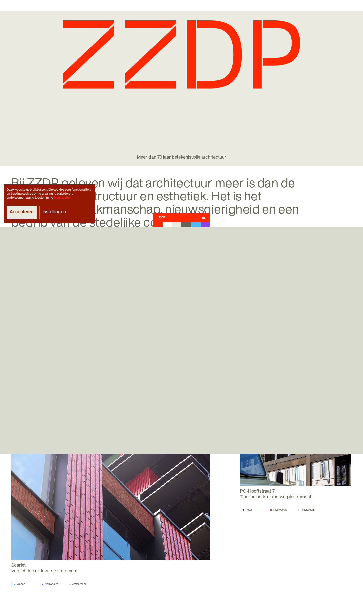
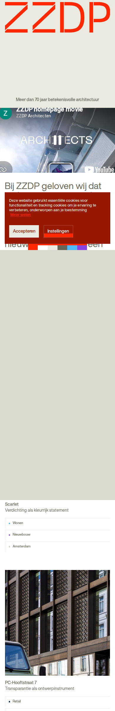

# UI Design System & Master Generation Blueprint: www-zzdp-nl

> **Al meer dan 70 jaar betekenisvolle architectuur · ZZDP** (https://www.zzdp.nl/) — Bij ZZDP combineren we vakmanschap en visie in betekenisvolle architectuur. Met meer dan 70 jaar ervaring realiseren we ontwerpen waarin...



---

## 1. Executive Visual Persona & Design Archetype

- **Brand Essence & Persona**: **Al meer dan 70 jaar betekenisvolle architectuur · ZZDP** (`https://www.zzdp.nl/`). Bij ZZDP combineren we vakmanschap en visie in betekenisvolle architectuur. Met meer dan 70 jaar ervaring realiseren we ontwerpen waarin...
- **Capture Provenance**: Live browser capture (`tier1_fast`, HTTP `200`, captured `2026-11-23`).
- **Visual Archetype**: **Light-Substrate Editorial & Modular Grid System (`#ffffff` canvas, `#961800` ink, `#ff2800` accent)**.
- **Anti-AI-Slop Differentiators**:
  - **Live-Computed Chromatic Polarity**: Anchors the viewport in `#ffffff` (live computed `html` `background-color` (`computed_styles.json`)) paired with `#961800` primary typography and `#ff2800` accents.
  - **Grounded Typographic Hierarchy**: Pairs `HelveticaNowDisplay` for display copy (`ZZDP`) with `HelveticaNowDisplay` and not declared in live computed styles (uses primary stack / `ui-monospace`).
  - **Calibrated Spatial Grid & Motion**: Combines `1440px` container bounds (`gap: 10.6667vw`, padding `8vw`) with `cubic-bezier(.48,0,.03,1)` easing and Lenis Smooth Scroll (`data-lenis`), Lottie Vector Animation Player.

---

## 2. Spatial Architecture & Modular Grid Mathematics



### Viewport Allocation & Container Geometry
- **Captured Viewport Dimensions**: Desktop `1440×2400px` (`assets/desktop.png`, clamped at 2400px live multi-section capture), Mobile `390×2400px` (`assets/mobile.png`, clamped at 2400px live multi-section capture).
- **Master Container Bounds**: `1440px` (full-bleed `100%` desktop stage measured on `1440px` viewport).
- **Canvas Lateral Padding & Spacing**: `8vw` lateral canvas padding with `10.6667vw` grid gap.
- **Border Radius Scale**: `10px`, `9999px`, `8px`, `50%`.

### Responsive Breakpoint Architecture
- **Desktop Layout**: Multi-column CSS Grid / Flexbox layout at `1440px` (`max-width: 1440px`, `gap: 10.6667vw`).
- **Mobile Layout**: Single-column vertical stack at `390px` viewport width with `8vw` horizontal padding.
- **Extracted CSS Media Queries**: `@media (max-width:47.99em)`, `@media (min-width:48em)`, `@media (max-width:47.99em) and (max-width:47.99em)`, `@media (max-width:47.99em) and (min-width:48em)`.

---

## 3. Color System, Materiality & Atmospheric Lighting

### Semantic Palette & Source Grounding
| Semantic Role | Ground-Truth Value | Extracted Live / CSS Source |
|---|---|---|
| **Primary Canvas Substrate** | `#ffffff` | live computed `html` `background-color` (`computed_styles.json`) |
| **Primary Typography Ink** | `#961800` | live computed `button` `color` (`computed_styles.json`) |
| **Elevated Surface / Card Substrate** | `#dadbcf` | `dule-scss-module__INwY-W__curta... { background-color: #dadbcf }` |
| **Interactive Accent / Highlight** | `#ff2800` | live computed `a` `color` (`computed_styles.json`) |
| **Secondary / Muted Copy** | `#c7c6be` | `var(--secondary-ui-label-disabled-color)` in `:root` |
| **Structural Hairline Border** | `#b5b899` | `var(--primary-ui-stroke-hover-color)` in `:root` |
| **Variable Token (`--title-color`)** | `#656657` | `var(--title-color)` in `:root` |
| **Variable Token (`--line-color`)** | `#1a1630` | `var(--line-color)` in `:root` |
| **Variable Token (`--accent-color`)** | `#8746e3` | `var(--accent-color)` in `:root` |
| **Variable Token (`--primary-ui-background-disabled-color`)** | `#ebeae1` | `var(--primary-ui-background-disabled-color)` in `:root` |

### Sanitized Root CSS Variables (`ui-ux.md` Ground Truth)
| Variable Name | Extracted Value | Semantic Role |
|---|---|---|
| `--background-color` | `#fff` | Canvas / Surface Token |
| `--title-color` | `#656657` | Brand / Palette Token |
| `--subtitle-color` | `#656657` | Brand / Palette Token |
| `--body-color` | `#656657` | Typography Ink Token |
| `--line-color` | `#1a163019` | Brand / Palette Token |
| `--accent-color` | `#8746e3` | Brand / Palette Token |
| `--primary-ui-label-default-color` | `#fff` | Brand / Palette Token |
| `--primary-ui-label-hover-color` | `#fff` | Brand / Palette Token |
| `--primary-ui-label-disabled-color` | `#c7c6be` | Brand / Palette Token |
| `--primary-ui-background-default-color` | `#656657` | Canvas / Surface Token |
| `--primary-ui-background-hover-color` | `#b5b899` | Canvas / Surface Token |
| `--primary-ui-background-disabled-color` | `#ebeae1` | Canvas / Surface Token |
| `--primary-ui-stroke-default-color` | `#656657` | Brand / Palette Token |
| `--primary-ui-stroke-hover-color` | `#b5b899` | Brand / Palette Token |
| `--primary-ui-stroke-disabled-color` | `#ebeae1` | Brand / Palette Token |
| `--secondary-ui-label-default-color` | `#656657` | Brand / Palette Token |

---

## 4. Typographic Scale & Editorial Hierarchy

### Font Family Stacks
- **Display Typography**: `HelveticaNowDisplay`.
- **Primary Body Stack**: `HelveticaNowDisplay`.
- **Technical / Metadata Stack**: not declared in live computed styles (uses primary stack / `ui-monospace`).

### Typographic Scale & Rules (Live Computed & Stylesheet Grounded)
- **Hero Display (`H1`)**: live computed `h1` (`font-size: 32px`, `line-height: 48px`, `font-weight: 700`); CSS variables `--font-helvetica-now-display: "helveticaNowDisplay", "helveticaNowDisplay Fallback"`; rule `h1` (`font-size: 13.3333vw`, `line-height: 82%`, `letter-spacing: -.07em`, `font-weight: 400`).
- **Section Heading (`H2`)**: live computed `h2` (`font-size: 49.5px`, `line-height: 51.975px`, `font-weight: 400`, `letter-spacing: 0.495px`); rule `h2` (`font-size: 8vw`, `line-height: 105%`, `letter-spacing: .01em`, `font-weight: 400`).
- **Body Copy**: live computed `body` (`font-size: 16px`, `line-height: 24px`, `font-weight: 400`); rule `p` (`font-size: 3.73333vw`, `line-height: 132%`, `letter-spacing: 0`, `font-weight: 500`).
- **Metadata & Navigation Labels**: live computed `nav/a` (`font-size: 16px`, `line-height: 24px`, `font-weight: 400`).

---

## 5. Choreographed Motion & Interaction Physics

### Primary Easing Curves
- **Extracted Timing Functions**: `cubic-bezier(.48,0,.03,1)`, `cubic-bezier(.65,0,0,1)`, `cubic-bezier(.5,0,0,1)`.

### Per-Element Transition & Choreography Rules
- **Selector `scss-module__09KfWW__u-underline-...`**: `transition: transform .3s cubic-bezier(.48,0,.03,1)` extracted from `www-zzdp-nl` stylesheet.
- **Selector `scss-module__oaQZ0W__u-underline-...`**: `transition: transform .3s cubic-bezier(.48,0,.03,1)` extracted from `www-zzdp-nl` stylesheet.
- **Selector `le-scss-module__oaQZ0W__descripti...`**: `transition: transform .3s cubic-bezier(.48,0,.03,1)` extracted from `www-zzdp-nl` stylesheet.
- **Extracted Easing Curve (`cubic-bezier(.48,0,.03,1)`)**: Governs interactive state transitions across `<nav.lenis>` and `<section.vjs-styles-dimensions>`.
- **Runtime Interaction Engine**: Integrates Lenis Smooth Scroll (`data-lenis`), Lottie Vector Animation Player with `prefers-reduced-motion: reduce` fallback guards.

---

## 6. Component Wireframe & Structural DOM Map

### Visual Layout Schematic — Desktop (`1440px`, Grounded in `dom.html` & Landmark Bounding Boxes)
```
┌────────────────────────────────────────────────────────────────────────┐
│ DESKTOP VIEWPORT (1440px) — Al meer dan 70 jaar betekenisvolle archite │
│ ====================================================================== │
│ [ <nav.lenis> (227x18px)              | Home · Projecten · Over ons  ] │
│ ---------------------------------------------------------------------- │
│ | HERO STAGE: <section.theme--mossLight> (w=1440px)                  | │
│ | H1: ZZDP                                                           | │
│ | Substrate: #ffffff | Ink: #961800 | Accent: #ff2800                | │
│ ---------------------------------------------------------------------- │
│ | SHOWCASE GRID (<section.vjs-styles-dimens) max-w: 1440px           | │
│ | +------------------------------+  +------------------------------+ | │
│ | | Bij ZZDP geloven wij dat arc |  | Gedreven door nalatenschap   | | │
│ | +------------------------------+  +------------------------------+ | │
│ ---------------------------------------------------------------------- │
│ | DETAIL MODULE (<section.theme--white>) — Partners in design        | │
│ ---------------------------------------------------------------------- │
│ [ FOOTER (<footer.theme--white) | https://www.zzdp.nl/                 │
└────────────────────────────────────────────────────────────────────────┘
```

### Visual Layout Schematic — Mobile Reflow (`390px`)
```
┌────────────────────────────────────────────────────────────────────────┐
│ MOBILE VIEWPORT REFLOW (390px) — Single-Column Stack (gap: 10.6667v)   │
│ ====================================================================== │
│ [ HEADER BAR (<nav.lenis>             ) | Compact Menu (390px)         │
│ ---------------------------------------------------------------------- │
│ | HERO STAGE (<section.theme--mossLigh) — 390px Vertical Lead        | │
│ | H1: ZZDP                                                           | │
│ ---------------------------------------------------------------------- │
│ | SHOWCASE STACK (<section.vjs-styles-di) — 1-Col Stack              | │
│ | [ Item 1: Bij ZZDP geloven wij dat architectuur meer is dan...   ] | │
│ | [ Item 2: Gedreven door nalatenschap                             ] | │
│ ---------------------------------------------------------------------- │
│ | DETAIL STACK (<section.theme--white>) — 1-Col (Partners in design) | │
│ ---------------------------------------------------------------------- │
│ [ FOOTER (<footer.theme--white) | Stacked 390px Colophon               │
└────────────────────────────────────────────────────────────────────────┘
```

### Granular DOM Region Breakdown
1. **Brand Header & Navigation Bar (<nav.lenis> — `www-zzdp-nl`)**:
   - Landmark `<nav class="lenis">` (`227x18px`) hosting `Al meer dan 70 jaar betekenisvolle a` navigation (`Home · Projecten · Over ons · Nieuws en inzichten · Vacatures`), DOM attributes (`data-next-head`, `data-next-font="size-adjust"`, `data-next-font="size-adjust"`, `data-next-font="size-adjust"`), and stylesheet rule `module__09KfWW__u-underline-link:... { height:.266667vw }`.
2. **Hero Stage & Focal Lead (<section.theme--mossLight> — `ZZDP`)**:
   - Landmark `<section class="theme--mossLight">` presenting display lead `ZZDP` and copy excerpt *"Deze website gebruikt essentiële cookies voor functionaliteit en "* over `#ffffff` canvas and `#961800` ink.
3. **Primary Showcase & Content Grid (<section.vjs-styles-dimensions> — `Bij ZZDP geloven wij dat architect`)**:
   - Landmark `<section class="vjs-styles-dimensions">` rendering section `Bij ZZDP geloven wij dat architectuur meer is dan...` with copy *"Video Player is loading."*, asset references (`favicon.svg`, `HelveticaNowDisplay_Regular-s.p.1...`, `HelveticaNowDisplay_Md-s.p.16ns3u...`, `PPNeueMachina_PlainRegular-s.p.39...`), and grid rule `e__09KfWW__u-underline-link:hover... { transform:scaleX(1) }`.
4. **Interactive Detail & Feature Matrix (<section.theme--white> — `Gedreven door nalatenschap`)**:
   - Landmark `<section class="theme--white">` framing `Gedreven door nalatenschap` and `Partners in design` (*"Seek to live, currently behind live"*) with `#dadbcf` surface cards, `#ff2800` accents, and `ss-module__09KfWW__default-in-ani... { transform:translateY(26.6667vw) }`.
5. **Colophon & Global Directory Footer (<footer.theme--white> — `https://www.zzdp.nl/`)**:
   - Landmark `<footer class="theme--white">` anchoring `Al meer dan 70 jaar betekenisvol` footer links (`Home · Projecten · Over ons · Nieuws en inzichten · Vacatures`), copy *"descriptions off , selected"*, and `#b5b899` structural dividers.

---

## 7. Master Zero-Shot AI Generation Prompt

```markdown
# Master Zero-Shot Frontend Generation Prompt: www-zzdp-nl (Al meer dan 70 jaar betekenisvolle architectuur · ZZDP)

You are a principal frontend architect and design systems engineer. Build a complete, production-ready web application replicating the exact design system, DOM landmarks, typographic hierarchy, color tokens, and motion physics of `www-zzdp-nl` (**Al meer dan 70 jaar betekenisvolle architectuur · ZZDP** — `https://www.zzdp.nl/`).

### 1. Visual Archetype & Anti-AI-Slop Mandates
- **Archetype**: Light-Substrate Editorial & Modular Grid System (`#ffffff` canvas, `#961800` ink, `#ff2800` accent).
- **Identity & Domain Context**: Bij ZZDP combineren we vakmanschap en visie in betekenisvolle architectuur. Met meer dan 70 jaar ervaring realiseren we ontwerpen waarin...
- **Primary Substrate**: `#ffffff` (live computed `html` `background-color` (`computed_styles.json`)), **Primary Ink**: `#961800`, **Accent / Highlight**: `#ff2800`.
- **Site-Specific Differentiators**:
  - **Live-Computed Chromatic Polarity**: Anchors the viewport in `#ffffff` (live computed `html` `background-color` (`computed_styles.json`)) paired with `#961800` primary typography and `#ff2800` accents.
  - **Grounded Typographic Hierarchy**: Pairs `HelveticaNowDisplay` for display copy (`ZZDP`) with `HelveticaNowDisplay` and not declared in live computed styles (uses primary stack / `ui-monospace`).
  - **Calibrated Spatial Grid & Motion**: Combines `1440px` container bounds (`gap: 10.6667vw`, padding `8vw`) with `cubic-bezier(.48,0,.03,1)` easing and Lenis Smooth Scroll (`data-lenis`), Lottie Vector Animation Player.

### 2. Ground-Truth CSS Variables (`:root` Token Contract)
Declare and consume these exact custom properties extracted from `www-zzdp-nl` in your global stylesheet:

:root {
  /* Al meer dan 70 jaar betekenisvolle architectuur · ZZDP (www-zzdp-nl) — Live-Grounded CSS Variables */
  --background-color: #fff; /* Canvas / Surface Token (www-zzdp-nl) */
  --title-color: #656657; /* Brand / Palette Token (www-zzdp-nl) */
  --subtitle-color: #656657; /* Brand / Palette Token (www-zzdp-nl) */
  --body-color: #656657; /* Typography Ink Token (www-zzdp-nl) */
  --line-color: #1a163019; /* Brand / Palette Token (www-zzdp-nl) */
  --accent-color: #8746e3; /* Brand / Palette Token (www-zzdp-nl) */
  --primary-ui-label-default-color: #fff; /* Brand / Palette Token (www-zzdp-nl) */
  --primary-ui-label-hover-color: #fff; /* Brand / Palette Token (www-zzdp-nl) */
  --primary-ui-label-disabled-color: #c7c6be; /* Brand / Palette Token (www-zzdp-nl) */
  --primary-ui-background-default-color: #656657; /* Canvas / Surface Token (www-zzdp-nl) */
  --primary-ui-background-hover-color: #b5b899; /* Canvas / Surface Token (www-zzdp-nl) */
  --primary-ui-background-disabled-color: #ebeae1; /* Canvas / Surface Token (www-zzdp-nl) */
  --primary-ui-stroke-default-color: #656657; /* Brand / Palette Token (www-zzdp-nl) */
  --primary-ui-stroke-hover-color: #b5b899; /* Brand / Palette Token (www-zzdp-nl) */
  --primary-ui-stroke-disabled-color: #ebeae1; /* Brand / Palette Token (www-zzdp-nl) */
  --secondary-ui-label-default-color: #656657; /* Brand / Palette Token (www-zzdp-nl) */
}

### 3. Semantic Color & Materiality Contract
Map every surface, ink, and border strictly to these source-grounded tokens:
- **Primary Canvas Substrate**: `#ffffff` — grounded in live computed `html` `background-color` (`computed_styles.json`)
- **Primary Typography Ink**: `#961800` — grounded in live computed `button` `color` (`computed_styles.json`)
- **Elevated Surface / Card Substrate**: `#dadbcf` — grounded in `dule-scss-module__INwY-W__curta... { background-color: #dadbcf }`
- **Interactive Accent / Highlight**: `#ff2800` — grounded in live computed `a` `color` (`computed_styles.json`)
- **Secondary / Muted Copy**: `#c7c6be` — grounded in `var(--secondary-ui-label-disabled-color)` in `:root`
- **Structural Hairline Border**: `#b5b899` — grounded in `var(--primary-ui-stroke-hover-color)` in `:root`
- **Variable Token (`--title-color`)**: `#656657` — grounded in `var(--title-color)` in `:root`
- **Variable Token (`--line-color`)**: `#1a1630` — grounded in `var(--line-color)` in `:root`
- **Variable Token (`--accent-color`)**: `#8746e3` — grounded in `var(--accent-color)` in `:root`
- **Variable Token (`--primary-ui-background-disabled-color`)**: `#ebeae1` — grounded in `var(--primary-ui-background-disabled-color)` in `:root`

### 4. Spatial Grid, Container Bounds & Responsive Breakpoints
- **Desktop Viewport Reference**: `1440×2400px` (clamped at 2400px live multi-section capture, `1440px` standard desktop width).
- **Mobile Viewport Reference**: `390×2400px` (clamped at 2400px live multi-section capture, `390px` standard mobile width).
- **Container Max-Width**: `1440px` (full-bleed `100%` desktop stage measured on `1440px` viewport)
- **Padding & Gutters**: `8vw` lateral canvas padding with `10.6667vw` grid gap
- **Desktop Grid**: Multi-column CSS Grid / Flexbox layout at `1440px` (`max-width: 1440px`, `gap: 10.6667vw`)
- **Mobile Adaptation**: Single-column vertical stack at `390px` viewport width with `8vw` horizontal padding
- **Media Queries**: `@media (max-width:47.99em)`, `@media (min-width:48em)`, `@media (max-width:47.99em) and (max-width:47.99em)`, `@media (max-width:47.99em) and (min-width:48em)`
- **Corner Radii**: `10px`, `9999px`, `8px`, `50%`

### 5. Typography & Editorial Scale Contract
- **Display Font Stack**: `HelveticaNowDisplay`
- **Body Font Stack**: `HelveticaNowDisplay`
- **Monospace / Technical Font Stack**: not declared in live computed styles (uses primary stack / `ui-monospace`)
- **H1 Display Rule**: live computed `h1` (`font-size: 32px`, `line-height: 48px`, `font-weight: 700`); CSS variables `--font-helvetica-now-display: "helveticaNowDisplay", "helveticaNowDisplay Fallback"`; rule `h1` (`font-size: 13.3333vw`, `line-height: 82%`, `letter-spacing: -.07em`, `font-weight: 400`)
- **H2 Section Rule**: live computed `h2` (`font-size: 49.5px`, `line-height: 51.975px`, `font-weight: 400`, `letter-spacing: 0.495px`); rule `h2` (`font-size: 8vw`, `line-height: 105%`, `letter-spacing: .01em`, `font-weight: 400`)
- **Body Copy Rule**: live computed `body` (`font-size: 16px`, `line-height: 24px`, `font-weight: 400`); rule `p` (`font-size: 3.73333vw`, `line-height: 132%`, `letter-spacing: 0`, `font-weight: 500`)
- **Metadata & Index Rule**: live computed `nav/a` (`font-size: 16px`, `line-height: 24px`, `font-weight: 400`)

### 6. Component Hierarchy, Verbatim Copy & Real DOM Landmarks
Scaffold `www-zzdp-nl` (`Al meer dan 70 jaar betekenisvolle architectuur · ZZDP`) with these exact structural regions, extracted copy, and CSS rules from `dom.html`:
1. **Brand Header & Navigation Bar (<nav.lenis> — `www-zzdp-nl`)**:
   - DOM & Selectors: Landmark `<nav class="lenis">` (`227x18px`) hosting `Al meer dan 70 jaar betekenisvolle a` navigation (`Home · Projecten · Over ons · Nieuws en inzichten · Vacatures`), DOM attributes (`data-next-head`, `data-next-font="size-adjust"`, `data-next-font="size-adjust"`, `data-next-font="size-adjust"`), and stylesheet rule `module__09KfWW__u-underline-link:... { height:.266667vw }`.
   - Responsive Contract: Header `Brand Header & Navigation Bar (<nav.lenis> — `www-zzdp-nl`)` (`www-zzdp-nl`) adapts across `@media (max-width:47.99em)`, `@media (min-width:48em)`, `@media (max-width:47.99em) and (max-width:47.99em)`, `@media (max-width:47.99em) and (min-width:48em)` with `cubic-bezier(.48,0,.03,1)`, `cubic-bezier(.65,0,0,1)`, `cubic-bezier(.5,0,0,1)` transitions and links `Home · Projecten · Over ons · Nieuws en inzichten · Vacatures`.
2. **Hero Stage & Focal Lead (<section.theme--mossLight> — `ZZDP`)**:
   - DOM & Selectors: Landmark `<section class="theme--mossLight">` presenting display lead `ZZDP` and copy excerpt *"Deze website gebruikt essentiële cookies voor functionaliteit en "* over `#ffffff` canvas and `#961800` ink.
   - Responsive Contract: Hero stage (`1440×2400px` desktop / `390×2400px` mobile) sets `#ffffff` background with `#961800` headline `ZZDP`.
3. **Primary Showcase & Content Grid (<section.vjs-styles-dimensions> — `Bij ZZDP geloven wij dat architect`)**:
   - DOM & Selectors: Landmark `<section class="vjs-styles-dimensions">` rendering section `Bij ZZDP geloven wij dat architectuur meer is dan...` with copy *"Video Player is loading."*, asset references (`favicon.svg`, `HelveticaNowDisplay_Regular-s.p.1...`, `HelveticaNowDisplay_Md-s.p.16ns3u...`, `PPNeueMachina_PlainRegular-s.p.39...`), and grid rule `e__09KfWW__u-underline-link:hover... { transform:scaleX(1) }`.
   - Responsive Contract: Showcase grid `Primary Showcase & Content Grid (<section.vjs-styles-dimensions> — `Bij ZZDP geloven wij dat architect`)` applies Multi-column CSS Grid / Flexbox layout at `1440px` (`max-width: 1440px`, `gap: 10.6667vw`) on desktop and Single-column vertical stack at `390px` viewport width with `8vw` horizontal padding on mobile.
4. **Interactive Detail & Feature Matrix (<section.theme--white> — `Gedreven door nalatenschap`)**:
   - DOM & Selectors: Landmark `<section class="theme--white">` framing `Gedreven door nalatenschap` and `Partners in design` (*"Seek to live, currently behind live"*) with `#dadbcf` surface cards, `#ff2800` accents, and `ss-module__09KfWW__default-in-ani... { transform:translateY(26.6667vw) }`.
   - Responsive Contract: Detail module `Interactive Detail & Feature Matrix (<section.theme--white> — `Gedreven door nalatenschap`)` uses `10px`, `9999px`, `8px`, `50%` radii, `#ff2800` highlights, and assets (favicon.svg, HelveticaNowDisplay_Regular-s.p.1..., HelveticaNowDisplay_Md-s.p.16ns3u...).
5. **Colophon & Global Directory Footer (<footer.theme--white> — `https://www.zzdp.nl/`)**:
   - DOM & Selectors: Landmark `<footer class="theme--white">` anchoring `Al meer dan 70 jaar betekenisvol` footer links (`Home · Projecten · Over ons · Nieuws en inzichten · Vacatures`), copy *"descriptions off , selected"*, and `#b5b899` structural dividers.
   - Responsive Contract: Footer `Colophon & Global Directory Footer (<footer.theme--white> — `https://www.zzdp.nl/`)` aligns to `1440px` (full-bleed `100%` desktop stage measured on `1440px` viewport) with `8vw` lateral canvas padding with `10.6667vw` grid gap and attributes (data-next-head, data-next-font="size-adjust", data-next-font="size-adjust").

#### Verbatim DOM Copy Excerpts (`dom.html`)
- Copy Excerpt 1: *"Deze website gebruikt essentiële cookies voor functionaliteit en tracking cookies..."*
- Copy Excerpt 2: *"Video Player is loading."*
- Copy Excerpt 3: *"Seek to live, currently behind live"*
- Copy Excerpt 4: *"descriptions off , selected"*

### 7. Motion, Extracted Stylesheet Rules & Interaction Choreography
- **Primary Easing Functions**: `cubic-bezier(.48,0,.03,1)`, `cubic-bezier(.65,0,0,1)`, `cubic-bezier(.5,0,0,1)`
- **Extracted Stylesheet Rules (`www-zzdp-nl`)**:
- `module__09KfWW__u-underline-link:... { height:.266667vw }`
- `e__09KfWW__u-underline-link:hover... { transform:scaleX(1) }`
- `ss-module__09KfWW__default-in-ani... { transform:translateY(26.6667vw) }`
- `ion-module-scss-module__09KfWW__w... { color:var(--body-color);background-color:var(--background-color) }`
- `css-module__09KfWW__wrapper ::sel... { background-color:var(--body-color);color:var(--background-color) }`
- **Per-Selector Transition Rules**:
- **Selector `scss-module__09KfWW__u-underline-...`**: `transition: transform .3s cubic-bezier(.48,0,.03,1)` extracted from `www-zzdp-nl` stylesheet.
- **Selector `scss-module__oaQZ0W__u-underline-...`**: `transition: transform .3s cubic-bezier(.48,0,.03,1)` extracted from `www-zzdp-nl` stylesheet.
- **Selector `le-scss-module__oaQZ0W__descripti...`**: `transition: transform .3s cubic-bezier(.48,0,.03,1)` extracted from `www-zzdp-nl` stylesheet.
- **Extracted Easing Curve (`cubic-bezier(.48,0,.03,1)`)**: Governs interactive state transitions across `<nav.lenis>` and `<section.vjs-styles-dimensions>`.
- **Runtime Interaction Engine**: Integrates Lenis Smooth Scroll (`data-lenis`), Lottie Vector Animation Player with `prefers-reduced-motion: reduce` fallback guards.

### 8. Technical Deliverables
- Implement in Next.js (App Router) with TypeScript and Tailwind CSS consuming the `:root` custom properties defined above for `www-zzdp-nl`.
- Reproduce both the `1440px` desktop architecture and `390px` mobile breakpoint transitions, preserving semantic HTML5 landmarks (`<header>`, `<nav>`, `<main>`, `<section>`, `<footer>`) and `prefers-reduced-motion` accessibility guards.
```
