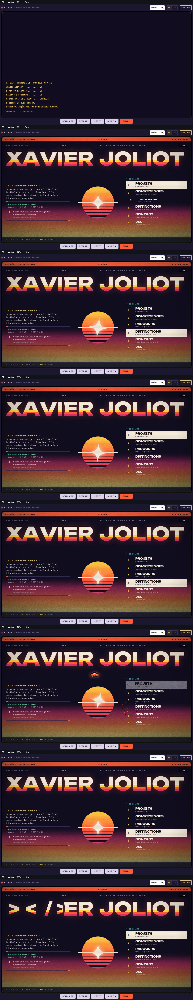
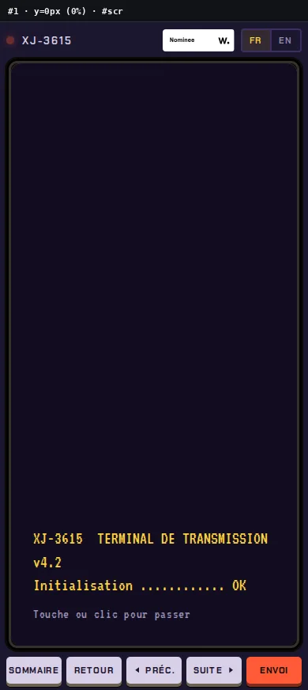

# UI Design System & Master Generation Blueprint: xavierjoliot-com

> **Xavier Joliot · Développeur Créatif** (https://xavierjoliot.com) — Xavier Joliot, développeur créatif à Béziers : branding, UI/UX, stratégie, développement full-stack et mise en production. Disponible imm...





---

## 1. Executive Visual Persona & Design Archetype

- **Brand Essence & Persona**: **Xavier Joliot · Développeur Créatif** (`https://xavierjoliot.com`). Xavier Joliot, développeur créatif à Béziers : branding, UI/UX, stratégie, développement full-stack et mise en production. Disponible imm...
- **Capture Provenance**: Live browser capture (`tier1_fast`, HTTP `200`, captured `2026-11-24`).
- **Visual Archetype**: **Dark-Substrate WebGL / Canvas Interactive Experience (`#1c1730` / `#ffd23f`)**.
- **Anti-AI-Slop Differentiators**:
  - **Live-Computed Chromatic Polarity**: Anchors the viewport in `#1c1730` (live computed `body` `background-color` (`computed_styles.json`)) paired with `#f4ead9` primary typography and `#ffd23f` accents.
  - **Grounded Typographic Hierarchy**: Uses `Space Mono` across display (`Xavier Joliot · Développeur Créatif`) and body copy, paired with `Space Mono` for monospace/code.
  - **Calibrated Spatial Grid & Motion**: Combines `1404px` container bounds (`gap: 14px`, padding `8px`) with `cubic-bezier(.4,0,.2,1)` easing and HTML5 `<canvas>` Interactive Viewport Surface.

---

## 2. Spatial Architecture & Modular Grid Mathematics

### Viewport Allocation & Container Geometry
- **Captured Journey Filmstrips**: Desktop `1280×6624px` (`assets/desktop-journey.webp`, `8` keyframes up to `y=0px` / doc `900px`), Mobile `390×872px` (`assets/mobile-journey.webp`, `1` keyframes).
- **Master Container Bounds**: `1404px` (measured widest bounded `<section>` landmark width on `1440px` desktop).
- **Canvas Lateral Padding & Spacing**: `8px` lateral canvas padding with `14px` grid gap.
- **Border Radius Scale**: `4px`, `18px`, `50%`, `12px`.

### Responsive Breakpoint Architecture
- **Desktop Layout**: Multi-column CSS Grid / Flexbox layout at `1440px` (`max-width: 1404px`, `gap: 14px`).
- **Mobile Layout**: Single-column vertical stack at `390px` viewport width with `8px` horizontal padding.
- **Extracted CSS Media Queries**: `@media (max-width:820px)`, `@media (max-width:1180px)`, `@media (max-width:1180px) and (min-width:821px)`, `@media (max-height:520px)`.

---

## 3. Color System, Materiality & Atmospheric Lighting

### Semantic Palette & Source Grounding
| Semantic Role | Ground-Truth Value | Extracted Live / CSS Source |
|---|---|---|
| **Primary Canvas Substrate** | `#1c1730` | live computed `body` `background-color` (`computed_styles.json`) |
| **Primary Typography Ink** | `#f4ead9` | live computed `main` `color` (`computed_styles.json`) |
| **Elevated Surface / Card Substrate** | `#0b0907` | live computed `main` `background-color` (`computed_styles.json`) |
| **Interactive Accent / Highlight** | `#ffd23f` | live computed `button` `color` (`computed_styles.json`) |
| **Secondary / Muted Copy** | `#ffd23f` | live computed `button` `color` (`computed_styles.json`) |
| **Structural Hairline Border** | `#3a2f5e` | `var(--line)` in `:root` |
| **Variable Token (`--ok`)** | `#3ddc84` | `var(--ok)` in `:root` |
| **Variable Token (`--bg`)** | `#0d0a1a` | `var(--bg)` in `:root` |
| **Variable Token (`--scr`)** | `#110d20` | `var(--scr)` in `:root` |
| **Variable Token (`--dim`)** | `#9a8fb5` | `var(--dim)` in `:root` |
| **Variable Token (`--a1`)** | `#ff5a36` | `var(--a1)` in `:root` |
| **Variable Token (`--a3`)** | `#2ec4b6` | `var(--a3)` in `:root` |
| **Variable Token (`--a4`)** | `#e0366f` | `var(--a4)` in `:root` |
| **Variable Token (`--key`)** | `#d9d0e8` | `var(--key)` in `:root` |
| **Variable Token (`--keyt`)** | `#1d1630` | `var(--keyt)` in `:root` |
| **Variable Token (`--r0`)** | `#ffe066` | `var(--r0)` in `:root` |
| **Variable Token (`--r2`)** | `#ff9f3a` | `var(--r2)` in `:root` |

### Sanitized Root CSS Variables (`ui-ux.md` Ground Truth)
| Variable Name | Extracted Value | Semantic Role |
|---|---|---|
| `--ok` | `#3ddc84` | Color / Atmospheric Token |
| `--bg` | `#0d0a1a` | Canvas / Surface Token |
| `--scr` | `#110d20` | Color / Atmospheric Token |
| `--ink` | `#f4ead9` | Typography Ink Token |
| `--dim` | `#9a8fb5` | Color / Atmospheric Token |
| `--a1` | `#ff5a36` | Color / Atmospheric Token |
| `--a2` | `#ffd23f` | Color / Atmospheric Token |
| `--a3` | `#2ec4b6` | Color / Atmospheric Token |
| `--a4` | `#e0366f` | Color / Atmospheric Token |
| `--line` | `#3a2f5e` | Color / Atmospheric Token |
| `--ch` | `#1c1730` | Color / Atmospheric Token |
| `--key` | `#d9d0e8` | Color / Atmospheric Token |
| `--keyt` | `#1d1630` | Color / Atmospheric Token |
| `--r0` | `#ffe066` | Color / Atmospheric Token |
| `--r1` | `#ffd23f` | Color / Atmospheric Token |
| `--r2` | `#ff9f3a` | Color / Atmospheric Token |

---

## 4. Typographic Scale & Editorial Hierarchy

### Font Family Stacks
- **Display Typography**: `Space Mono`.
- **Primary Body Stack**: `Space Mono`.
- **Technical / Metadata Stack**: `Space Mono`.

### Typographic Scale & Rules (Live Computed & Stylesheet Grounded)
- **Hero Display (`H1`)**: observed font-size ladder: `15px`, `14.5px`, `13px`, `12px`, `1em`.
- **Section Heading (`H2`)**: rule `h2` (`font-size: 22px`).
- **Body Copy**: live computed `body` (`font-size: 15px`, `line-height: 22.5px`, `font-weight: 400`); rule `p` (`font-size: 13.5px`, `line-height: 1.65`).
- **Metadata & Navigation Labels**: live computed `nav/a` (`font-size: 13px`, `line-height: 13px`, `font-weight: 600`, `letter-spacing: 1.82px`); CSS variables `--default-mono-font-family: var(--font-mono)`; rule `small` (`letter-spacing: .16em`, `font-weight: 500`).

---

## 5. Choreographed Motion & Interaction Physics

### Primary Easing Curves
- **Extracted Timing Functions**: `cubic-bezier(.4,0,.2,1)`.

### Per-Element Transition & Choreography Rules
- **Selector `layer theme`**: `transition: .15s` extracted from `xavierjoliot-com` stylesheet.
- **Selector `.transition`**: `transition: var(--tw-ease,var(--default-transition-timing-function))` extracted from `xavierjoliot-com` stylesheet.
- **Selector `.ease-in-out`**: `transition: var(--ease-in-out)` extracted from `xavierjoliot-com` stylesheet.
- **Extracted Easing Curve (`cubic-bezier(.4,0,.2,1)`)**: Governs interactive state transitions across `<header.top>` and `<section.screen:nth(2)>`.
- **Runtime Interaction Engine**: Integrates HTML5 `<canvas>` Interactive Viewport Surface with `prefers-reduced-motion: reduce` fallback guards.
### Measured Runtime Scroll & Interaction Telemetry (`behavioral_journey_v2`)
- **Scroll Driver Mode**: `wheel` (max document height `900px`, deepest scrollY reached `0px` across `8` desktop keyframes).
- **Detected Scroll / Motion Libraries**: `WebGL/Canvas`.
- **Hover Physics (`primary_cta` · `1 PROJETS 6 réalisations`)**: Computed transition `0s` / `ease` (no static color/transform shift captured at rest).
- **Hover Physics (`first_card` · `Disponible immédiatement Béziers...`)**: Computed transition `0s` / `ease` (no static color/transform shift captured at rest).
- **Route Transition Architecture**: First internal navigation (`/contact`) measured as `SPA` in `2173ms`.

---

## 6. Component Wireframe & Structural DOM Map

### Visual Layout Schematic — Desktop (`1440px`, Grounded in `dom.html` & Landmark Bounding Boxes)
```
┌────────────────────────────────────────────────────────────────────────┐
│ DESKTOP VIEWPORT (1440px) — Xavier Joliot · Développeur Créatif        │
│ ====================================================================== │
│ [ <header.top> (1420x36px)            | FR · EN                      ] │
│ ---------------------------------------------------------------------- │
│ | HERO STAGE: <section.screen> (w=1420px)                            | │
│ | H1: Xavier Joliot · Développeur Créatif                            | │
│ | Substrate: #1c1730 | Ink: #f4ead9 | Accent: #ffd23f                | │
│ ---------------------------------------------------------------------- │
│ | SHOWCASE GRID (<section.screen:nth(2)>) max-w: 1404px              | │
│ | +------------------------------+  +------------------------------+ | │
│ | | Featured Work & Interactive  |  | Technical Architecture & Nar | | │
│ | +------------------------------+  +------------------------------+ | │
│ ---------------------------------------------------------------------- │
│ | DETAIL MODULE (<section.screen:nth(3)>) — Global Directory & Co    | │
│ ---------------------------------------------------------------------- │
│ [ FOOTER (<footer.sp>         ) | https://xavierjoliot.com             │
└────────────────────────────────────────────────────────────────────────┘
```

### Visual Layout Schematic — Mobile Reflow (`390px`)
```
┌────────────────────────────────────────────────────────────────────────┐
│ MOBILE VIEWPORT REFLOW (390px) — Single-Column Stack (gap: 14px)       │
│ ====================================================================== │
│ [ HEADER BAR (<header.top>            ) | Compact Menu (390px)         │
│ ---------------------------------------------------------------------- │
│ | HERO STAGE (<section.screen>) — 390px Vertical Lead                | │
│ | H1: Xavier Joliot · Développeur Créatif                            | │
│ ---------------------------------------------------------------------- │
│ | SHOWCASE STACK (<section.screen:nth(2)) — 1-Col Stack              | │
│ | [ Item 1: Featured Work & Interactive Showcase                   ] | │
│ | [ Item 2: Technical Architecture & Narrative                     ] | │
│ ---------------------------------------------------------------------- │
│ | DETAIL STACK (<section.screen:nth(3)>) — 1-Col (Global Directory &)  │
│ ---------------------------------------------------------------------- │
│ [ FOOTER (<footer.sp>         ) | Stacked 390px Colophon               │
└────────────────────────────────────────────────────────────────────────┘
```

### Granular DOM Region Breakdown
1. **Brand Header & Navigation Bar (<header.top> — `xavierjoliot-com`)**:
   - Landmark `<header class="top">` (`1420x36px`) hosting `Xavier Joliot · Développeur Créatif` navigation (`FR · EN`), DOM attributes (`data-precedence="next"`, `data-label="Connexion"`, `data-n="1"`, `data-n="2"`), and stylesheet rule `nded_fdf5727d-module__3a_gmq__cla... { font-family:Unbounded,Unbounded Fallback;font-style:normal }`.
2. **Hero Stage & Focal Lead (<section.screen> — `Xavier Joliot · Développeur Créati`)**:
   - Landmark `<section class="screen">` presenting display lead `Xavier Joliot · Développeur Créatif` and copy excerpt *"Je pense la marque, je conçois l'interface, je développe le produ"* over `#1c1730` canvas and `#f4ead9` ink.
3. **Primary Showcase & Content Grid (<section.screen:nth(2)> — `Featured Work & Interactive Showca`)**:
   - Landmark `<section class="screen">` rendering section `Featured Work & Interactive Showcase` with copy *"3615 Développeur créatif"*, asset references (`0c8c4ded07fff55c-s.p.5c4452a7.woff2`, `1ccf8ef962b3f693-s.p.1edb596a.woff2`, `374a88ea0960b3d4-s.p.eb0a589c.woff2`, `8d05cfa5faa8406c-s.p.4adea45d.woff2`), and grid rule `unded_fdf5727d-module__3a_gmq__va... { --font-unbounded:"Unbounded","Unbounded Fallback" }`.
4. **Interactive Detail & Feature Matrix (<section.screen:nth(3)> — `Technical Architecture & Narrative`)**:
   - Landmark `<section class="screen">` framing `Technical Architecture & Narrative` and `Global Directory & Contact` (*"© 2026 Xavier Joliot"*) with `#0b0907` surface cards, `#ffd23f` accents, and `etch_f484a735-module__S-MHga__cla... { font-family:Chakra Petch,Chakra Petch Fallback;font-style:normal }`.
5. **Colophon & Global Directory Footer (<footer.sp> — `https://xavierjoliot.com`)**:
   - Landmark `<footer class="sp">` anchoring `Xavier Joliot · Développeur Créa` footer links (`FR · EN`), copy *"Développement · Branding · UI/UX · Stratégie"*, and `#3a2f5e` structural dividers.
### Full Vertical Scroll Sequence (Desktop `1440×900` Keyframes)
- **Step 01** (`y=0px`, `0%`): Active landmark `#scr` · sticky/fixed elements: `0`
- **Step 02** (`y=0px`, `8%`): Active landmark `#scr` · sticky/fixed elements: `0`
- **Step 03** (`y=0px`, `17%`): Active landmark `#scr` · sticky/fixed elements: `0`
- **Step 04** (`y=0px`, `25%`): Active landmark `#scr` · sticky/fixed elements: `0`
- **Step 05** (`y=0px`, `33%`): Active landmark `#scr` · sticky/fixed elements: `1`
- **Step 06** (`y=0px`, `42%`): Active landmark `#scr` · sticky/fixed elements: `0`
- **Step 07** (`y=0px`, `50%`): Active landmark `#scr` · sticky/fixed elements: `0`
- **Step 08** (`y=0px`, `58%`): Active landmark `#scr` · sticky/fixed elements: `0`

### Multi-Page Internal Route Map
- **About Route (`/contact`)**: `https://xavierjoliot.com/contact` — H1: `Contact · Xavier Joliot`, scrollHeight `900px`, transition `SPA` (`2173ms`)
- **Other Route (`/fr`)**: `https://xavierjoliot.com/fr` — H1: `Xavier Joliot · Développeur Créatif`, scrollHeight `900px`, transition `direct` (`1000ms`)
- **Other Route (`/en`)**: `https://xavierjoliot.com/en` — H1: `Xavier Joliot · Creative Developer`, scrollHeight `900px`, transition `direct` (`443ms`)

---

## 7. Master Zero-Shot AI Generation Prompt

```markdown
# Master Zero-Shot Frontend Generation Prompt: xavierjoliot-com (Xavier Joliot · Développeur Créatif)

You are a principal frontend architect and design systems engineer. Build a complete, production-ready web application replicating the exact design system, DOM landmarks, typographic hierarchy, color tokens, and motion physics of `xavierjoliot-com` (**Xavier Joliot · Développeur Créatif** — `https://xavierjoliot.com`).

### 1. Visual Archetype & Anti-AI-Slop Mandates
- **Archetype**: Dark-Substrate WebGL / Canvas Interactive Experience (`#1c1730` / `#ffd23f`).
- **Identity & Domain Context**: Xavier Joliot, développeur créatif à Béziers : branding, UI/UX, stratégie, développement full-stack et mise en production. Disponible imm...
- **Primary Substrate**: `#1c1730` (live computed `body` `background-color` (`computed_styles.json`)), **Primary Ink**: `#f4ead9`, **Accent / Highlight**: `#ffd23f`.
- **Site-Specific Differentiators**:
  - **Live-Computed Chromatic Polarity**: Anchors the viewport in `#1c1730` (live computed `body` `background-color` (`computed_styles.json`)) paired with `#f4ead9` primary typography and `#ffd23f` accents.
  - **Grounded Typographic Hierarchy**: Uses `Space Mono` across display (`Xavier Joliot · Développeur Créatif`) and body copy, paired with `Space Mono` for monospace/code.
  - **Calibrated Spatial Grid & Motion**: Combines `1404px` container bounds (`gap: 14px`, padding `8px`) with `cubic-bezier(.4,0,.2,1)` easing and HTML5 `<canvas>` Interactive Viewport Surface.

### 2. Ground-Truth CSS Variables (`:root` Token Contract)
Declare and consume these exact custom properties extracted from `xavierjoliot-com` in your global stylesheet:

:root {
  /* Xavier Joliot · Développeur Créatif (xavierjoliot-com) — Live-Grounded CSS Variables */
  --ok: #3ddc84; /* Color / Atmospheric Token (xavierjoliot-com) */
  --bg: #0d0a1a; /* Canvas / Surface Token (xavierjoliot-com) */
  --scr: #110d20; /* Color / Atmospheric Token (xavierjoliot-com) */
  --ink: #f4ead9; /* Typography Ink Token (xavierjoliot-com) */
  --dim: #9a8fb5; /* Color / Atmospheric Token (xavierjoliot-com) */
  --a1: #ff5a36; /* Color / Atmospheric Token (xavierjoliot-com) */
  --a2: #ffd23f; /* Color / Atmospheric Token (xavierjoliot-com) */
  --a3: #2ec4b6; /* Color / Atmospheric Token (xavierjoliot-com) */
  --a4: #e0366f; /* Color / Atmospheric Token (xavierjoliot-com) */
  --line: #3a2f5e; /* Color / Atmospheric Token (xavierjoliot-com) */
  --ch: #1c1730; /* Color / Atmospheric Token (xavierjoliot-com) */
  --key: #d9d0e8; /* Color / Atmospheric Token (xavierjoliot-com) */
  --keyt: #1d1630; /* Color / Atmospheric Token (xavierjoliot-com) */
  --r0: #ffe066; /* Color / Atmospheric Token (xavierjoliot-com) */
  --r1: #ffd23f; /* Color / Atmospheric Token (xavierjoliot-com) */
  --r2: #ff9f3a; /* Color / Atmospheric Token (xavierjoliot-com) */
}

### 3. Semantic Color & Materiality Contract
Map every surface, ink, and border strictly to these source-grounded tokens:
- **Primary Canvas Substrate**: `#1c1730` — grounded in live computed `body` `background-color` (`computed_styles.json`)
- **Primary Typography Ink**: `#f4ead9` — grounded in live computed `main` `color` (`computed_styles.json`)
- **Elevated Surface / Card Substrate**: `#0b0907` — grounded in live computed `main` `background-color` (`computed_styles.json`)
- **Interactive Accent / Highlight**: `#ffd23f` — grounded in live computed `button` `color` (`computed_styles.json`)
- **Secondary / Muted Copy**: `#ffd23f` — grounded in live computed `button` `color` (`computed_styles.json`)
- **Structural Hairline Border**: `#3a2f5e` — grounded in `var(--line)` in `:root`
- **Variable Token (`--ok`)**: `#3ddc84` — grounded in `var(--ok)` in `:root`
- **Variable Token (`--bg`)**: `#0d0a1a` — grounded in `var(--bg)` in `:root`
- **Variable Token (`--scr`)**: `#110d20` — grounded in `var(--scr)` in `:root`
- **Variable Token (`--dim`)**: `#9a8fb5` — grounded in `var(--dim)` in `:root`
- **Variable Token (`--a1`)**: `#ff5a36` — grounded in `var(--a1)` in `:root`
- **Variable Token (`--a3`)**: `#2ec4b6` — grounded in `var(--a3)` in `:root`
- **Variable Token (`--a4`)**: `#e0366f` — grounded in `var(--a4)` in `:root`
- **Variable Token (`--key`)**: `#d9d0e8` — grounded in `var(--key)` in `:root`
- **Variable Token (`--keyt`)**: `#1d1630` — grounded in `var(--keyt)` in `:root`
- **Variable Token (`--r0`)**: `#ffe066` — grounded in `var(--r0)` in `:root`
- **Variable Token (`--r2`)**: `#ff9f3a` — grounded in `var(--r2)` in `:root`

### 4. Spatial Grid, Container Bounds & Responsive Breakpoints
- **Desktop Viewport Reference**: `1280×6624px` (multi-frame vertical journey filmstrip (6624px), `1440px` standard desktop width).
- **Mobile Viewport Reference**: `390×872px` (full-page live capture (872px), `390px` standard mobile width).
- **Container Max-Width**: `1404px` (measured widest bounded `<section>` landmark width on `1440px` desktop)
- **Padding & Gutters**: `8px` lateral canvas padding with `14px` grid gap
- **Desktop Grid**: Multi-column CSS Grid / Flexbox layout at `1440px` (`max-width: 1404px`, `gap: 14px`)
- **Mobile Adaptation**: Single-column vertical stack at `390px` viewport width with `8px` horizontal padding
- **Media Queries**: `@media (max-width:820px)`, `@media (max-width:1180px)`, `@media (max-width:1180px) and (min-width:821px)`, `@media (max-height:520px)`
- **Corner Radii**: `4px`, `18px`, `50%`, `12px`

### 5. Typography & Editorial Scale Contract
- **Display Font Stack**: `Space Mono`
- **Body Font Stack**: `Space Mono`
- **Monospace / Technical Font Stack**: `Space Mono`
- **H1 Display Rule**: observed font-size ladder: `15px`, `14.5px`, `13px`, `12px`, `1em`
- **H2 Section Rule**: rule `h2` (`font-size: 22px`)
- **Body Copy Rule**: live computed `body` (`font-size: 15px`, `line-height: 22.5px`, `font-weight: 400`); rule `p` (`font-size: 13.5px`, `line-height: 1.65`)
- **Metadata & Index Rule**: live computed `nav/a` (`font-size: 13px`, `line-height: 13px`, `font-weight: 600`, `letter-spacing: 1.82px`); CSS variables `--default-mono-font-family: var(--font-mono)`; rule `small` (`letter-spacing: .16em`, `font-weight: 500`)

### 6. Component Hierarchy, Verbatim Copy & Real DOM Landmarks
Scaffold `xavierjoliot-com` (`Xavier Joliot · Développeur Créatif`) with these exact structural regions, extracted copy, and CSS rules from `dom.html`:
1. **Brand Header & Navigation Bar (<header.top> — `xavierjoliot-com`)**:
   - DOM & Selectors: Landmark `<header class="top">` (`1420x36px`) hosting `Xavier Joliot · Développeur Créatif` navigation (`FR · EN`), DOM attributes (`data-precedence="next"`, `data-label="Connexion"`, `data-n="1"`, `data-n="2"`), and stylesheet rule `nded_fdf5727d-module__3a_gmq__cla... { font-family:Unbounded,Unbounded Fallback;font-style:normal }`.
   - Responsive Contract: Header `Brand Header & Navigation Bar (<header.top> — `xavierjoliot-com`)` (`xavierjoliot-com`) adapts across `@media (max-width:820px)`, `@media (max-width:1180px)`, `@media (max-width:1180px) and (min-width:821px)`, `@media (max-height:520px)` with `cubic-bezier(.4,0,.2,1)` transitions and links `FR · EN`.
2. **Hero Stage & Focal Lead (<section.screen> — `Xavier Joliot · Développeur Créati`)**:
   - DOM & Selectors: Landmark `<section class="screen">` presenting display lead `Xavier Joliot · Développeur Créatif` and copy excerpt *"Je pense la marque, je conçois l'interface, je développe le produ"* over `#1c1730` canvas and `#f4ead9` ink.
   - Responsive Contract: Hero stage (`1280×6624px` desktop / `390×872px` mobile) sets `#1c1730` background with `#f4ead9` headline `Xavier Joliot · Développeur Créatif`.
3. **Primary Showcase & Content Grid (<section.screen:nth(2)> — `Featured Work & Interactive Showca`)**:
   - DOM & Selectors: Landmark `<section class="screen">` rendering section `Featured Work & Interactive Showcase` with copy *"3615 Développeur créatif"*, asset references (`0c8c4ded07fff55c-s.p.5c4452a7.woff2`, `1ccf8ef962b3f693-s.p.1edb596a.woff2`, `374a88ea0960b3d4-s.p.eb0a589c.woff2`, `8d05cfa5faa8406c-s.p.4adea45d.woff2`), and grid rule `unded_fdf5727d-module__3a_gmq__va... { --font-unbounded:"Unbounded","Unbounded Fallback" }`.
   - Responsive Contract: Showcase grid `Primary Showcase & Content Grid (<section.screen:nth(2)> — `Featured Work & Interactive Showca`)` applies Multi-column CSS Grid / Flexbox layout at `1440px` (`max-width: 1404px`, `gap: 14px`) on desktop and Single-column vertical stack at `390px` viewport width with `8px` horizontal padding on mobile.
4. **Interactive Detail & Feature Matrix (<section.screen:nth(3)> — `Technical Architecture & Narrative`)**:
   - DOM & Selectors: Landmark `<section class="screen">` framing `Technical Architecture & Narrative` and `Global Directory & Contact` (*"© 2026 Xavier Joliot"*) with `#0b0907` surface cards, `#ffd23f` accents, and `etch_f484a735-module__S-MHga__cla... { font-family:Chakra Petch,Chakra Petch Fallback;font-style:normal }`.
   - Responsive Contract: Detail module `Interactive Detail & Feature Matrix (<section.screen:nth(3)> — `Technical Architecture & Narrative`)` uses `4px`, `18px`, `50%`, `12px` radii, `#ffd23f` highlights, and assets (0c8c4ded07fff55c-s.p.5c4452a7.woff2, 1ccf8ef962b3f693-s.p.1edb596a.woff2, 374a88ea0960b3d4-s.p.eb0a589c.woff2).
5. **Colophon & Global Directory Footer (<footer.sp> — `https://xavierjoliot.com`)**:
   - DOM & Selectors: Landmark `<footer class="sp">` anchoring `Xavier Joliot · Développeur Créa` footer links (`FR · EN`), copy *"Développement · Branding · UI/UX · Stratégie"*, and `#3a2f5e` structural dividers.
   - Responsive Contract: Footer `Colophon & Global Directory Footer (<footer.sp> — `https://xavierjoliot.com`)` aligns to `1404px` (measured widest bounded `<section>` landmark width on `1440px` desktop) with `8px` lateral canvas padding with `14px` grid gap and attributes (data-precedence="next", data-label="Connexion", data-n="1").

#### Verbatim DOM Copy Excerpts (`dom.html`)
- Copy Excerpt 1: *"Je pense la marque, je conçois l'interface, je développe le produit. Branding, UI/..."*
- Copy Excerpt 2: *"3615 Développeur créatif"*
- Copy Excerpt 3: *"© 2026 Xavier Joliot"*
- Copy Excerpt 4: *"Développement · Branding · UI/UX · Stratégie"*

### 7. Motion, Extracted Stylesheet Rules & Interaction Choreography
- **Primary Easing Functions**: `cubic-bezier(.4,0,.2,1)`
- **Extracted Stylesheet Rules (`xavierjoliot-com`)**:
- `nded_fdf5727d-module__3a_gmq__cla... { font-family:Unbounded,Unbounded Fallback;font-style:normal }`
- `unded_fdf5727d-module__3a_gmq__va... { --font-unbounded:"Unbounded","Unbounded Fallback" }`
- `etch_f484a735-module__S-MHga__cla... { font-family:Chakra Petch,Chakra Petch Fallback;font-style:normal }`
- `petch_f484a735-module__S-MHga__va... { --font-chakra:"Chakra Petch","Chakra Petch Fallback" }`
- `mono_e0823470-module__6nsbdW__cla... { font-family:Space Mono,Space Mono Fallback;font-style:normal }`
- **Per-Selector Transition Rules**:
- **Selector `layer theme`**: `transition: .15s` extracted from `xavierjoliot-com` stylesheet.
- **Selector `.transition`**: `transition: var(--tw-ease,var(--default-transition-timing-function))` extracted from `xavierjoliot-com` stylesheet.
- **Selector `.ease-in-out`**: `transition: var(--ease-in-out)` extracted from `xavierjoliot-com` stylesheet.
- **Extracted Easing Curve (`cubic-bezier(.4,0,.2,1)`)**: Governs interactive state transitions across `<header.top>` and `<section.screen:nth(2)>`.
- **Runtime Interaction Engine**: Integrates HTML5 `<canvas>` Interactive Viewport Surface with `prefers-reduced-motion: reduce` fallback guards.
### 7b. Full-Page Scroll Choreography, Interactive States & Multi-Page Routes
- **Scroll Mechanics**: Implement `wheel` vertical progression up to `900px` across 8 distinct viewport chapters using WebGL/Canvas.
- **Vertical Chapter Sequence**: #scr (0%) -> #scr (8%) -> #scr (17%) -> #scr (25%) -> #scr (33%) -> #scr (42%) -> #scr (50%) -> #scr (58%).
- **Multi-Page Routes**: Scaffold internal routes `/contact` (about, SPA), `/fr` (other, direct), `/en` (other, direct) sharing the global header/footer shell and design tokens.

### 8. Technical Deliverables
- Implement in Next.js (App Router) with TypeScript and Tailwind CSS consuming the `:root` custom properties defined above for `xavierjoliot-com`.
- Reproduce both the `1440px` desktop architecture and `390px` mobile breakpoint transitions, preserving semantic HTML5 landmarks (`<header>`, `<nav>`, `<main>`, `<section>`, `<footer>`) and `prefers-reduced-motion` accessibility guards.
```
---

## 8. Full-Page Scroll Journey, Interactive States & Subpage Inventory

### Desktop Scroll Keyframes (`1440×900` WebP)
| Step | Scroll Y | Progress | Active Landmark / Section | Sticky/Fixed | Visual Asset |
| :---: | :---: | :---: | :--- | :---: | :--- |
| `#01` | `0px` | `0%` | #scr | `0` | [desktop-step-01.webp](assets/desktop-step-01.webp) |
| `#02` | `0px` | `8%` | #scr | `0` | [desktop-step-02.webp](assets/desktop-step-02.webp) |
| `#03` | `0px` | `17%` | #scr | `0` | [desktop-step-03.webp](assets/desktop-step-03.webp) |
| `#04` | `0px` | `25%` | #scr | `0` | [desktop-step-04.webp](assets/desktop-step-04.webp) |
| `#05` | `0px` | `33%` | #scr | `1` | [desktop-step-05.webp](assets/desktop-step-05.webp) |
| `#06` | `0px` | `42%` | #scr | `0` | [desktop-step-06.webp](assets/desktop-step-06.webp) |
| `#07` | `0px` | `50%` | #scr | `0` | [desktop-step-07.webp](assets/desktop-step-07.webp) |
| `#08` | `0px` | `58%` | #scr | `0` | [desktop-step-08.webp](assets/desktop-step-08.webp) |

### Mobile Condensed Keyframes (`390×844` WebP)
| Step | Scroll Y | Progress | Active Landmark | Visual Asset |
| :---: | :---: | :---: | :--- | :--- |
| `#01` | `0px` | `0%` | #scr | [mobile-step-01.webp](assets/mobile-step-01.webp) |

### Internal Subpage Filmstrips (`1080px` Wide WebP)
| # | Template | Route URL | H1 / Title | Scroll Height | Transition | Filmstrip Asset |
| :-: | :---: | :--- | :--- | :---: | :---: | :--- |
| `1` | `about` | `https://xavierjoliot.com/contact` | Contact · Xavier Joliot | `900px` | `SPA` (`2173ms`) | [subpage-01-contact.webp](assets/subpage-01-contact.webp) |
| `2` | `other` | `https://xavierjoliot.com/fr` | Xavier Joliot · Développeur Créatif | `900px` | `direct` (`1000ms`) | [subpage-02-fr.webp](assets/subpage-02-fr.webp) |
| `3` | `other` | `https://xavierjoliot.com/en` | Xavier Joliot · Creative Developer | `900px` | `direct` (`443ms`) | [subpage-03-en.webp](assets/subpage-03-en.webp) |

