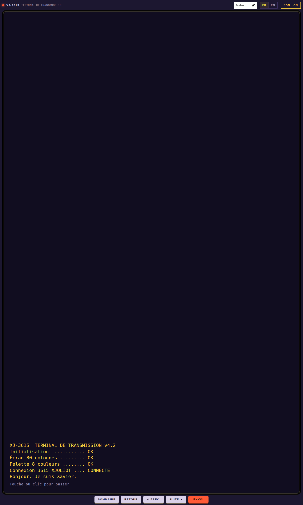
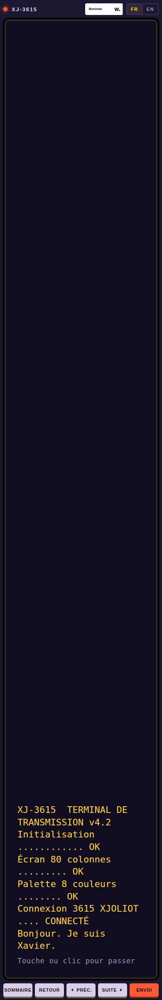

# UI Design System & Master Generation Blueprint: xavierjoliot-com

> **Xavier Joliot · Développeur Créatif** (https://xavierjoliot.com) — Xavier Joliot, développeur créatif à Béziers : branding, UI/UX, stratégie, développement full-stack et mise en production. Disponible imm...



---

## 1. Executive Visual Persona & Design Archetype

- **Brand Essence & Persona**: **Xavier Joliot · Développeur Créatif** (`https://xavierjoliot.com`). Xavier Joliot, développeur créatif à Béziers : branding, UI/UX, stratégie, développement full-stack et mise en production. Disponible imm...
- **Visual Archetype**: **Light-Gallery WebGL / Canvas Interactive Experience (`#3ddc84` / `#f4ead9`)**.
- **Anti-AI-Slop Differentiators**:
  - **Source-Grounded Chromatic Polarity**: Anchors the viewport in `#3ddc84` (`var(--ok)` in `:root`) paired with `#0d0a1a` primary typography and `#f4ead9` accents.
  - **Extracted Typographic Hierarchy**: Pairs `Unbounded` for display copy (`Xavier Joliot · Développeur Créatif`) with `Unbounded Fallback` and `Space Mono`.
  - **Calibrated Spatial Grid & Motion**: Combines `340px` container bounds (`gap: 8px`, padding `8px`) with `cubic-bezier(.4,0,.2,1)` easing and HTML5 `<canvas>` Interactive Viewport Surface.

---

## 2. Spatial Architecture & Modular Grid Mathematics



### Viewport Allocation & Container Geometry
- **Captured Viewport Dimensions**: Desktop `1440×2400px` (`assets/desktop.png`, capped at 2400px multi-section capture), Mobile `390×2400px` (`assets/mobile.png`, capped at 2400px multi-section capture).
- **Master Container Bounds**: `340px` extracted from `xavierjoliot-com` stylesheet.
- **Canvas Lateral Padding & Spacing**: `8px` lateral canvas padding with `8px` grid gap.
- **Border Radius Scale**: `50%`, `4px`, `18px`, `12px`.

### Responsive Breakpoint Architecture
- **Desktop Layout**: Multi-column CSS Grid / Flexbox layout at `1440px` (`max-width: 340px`, `gap: 8px`).
- **Mobile Layout**: Single-column vertical stack at `390px` viewport width with `8px` horizontal padding.
- **Extracted CSS Media Queries**: `@media (max-width:820px)`, `@media (max-width:1180px)`, `@media (max-width:1180px) and (min-width:821px)`, `@media (max-height:520px)`.

---

## 3. Color System, Materiality & Atmospheric Lighting

### Semantic Palette & Source Grounding
| Semantic Role | Ground-Truth Value | Extracted CSS Source / Selector |
|---|---|---|
| **Primary Canvas Substrate** | `#3ddc84` | `var(--ok)` in `:root` |
| **Primary Typography Ink** | `#0d0a1a` | `var(--bg)` in `:root` |
| **Elevated Surface / Card Substrate** | `#110d20` | `var(--scr)` in `:root` |
| **Interactive Accent / Highlight** | `#f4ead9` | `var(--ink)` in `:root` |
| **Secondary / Muted Copy** | `#9a8fb5` | `var(--dim)` in `:root` |
| **Structural Hairline Border** | `#ff5a36` | `var(--a1)` in `:root` |

### Sanitized Root CSS Variables (`ui-ux.md` Ground Truth)
| Variable Name | Extracted Value | Semantic Role |
|---|---|---|
| `--font-unbounded` | `"Unbounded","Unbounded Fallback"` | Typography / Scale Token |
| `--font-chakra` | `"Chakra Petch","Chakra Petch Fallback"` | Typography / Scale Token |
| `--font-space` | `"Space Mono","Space Mono Fallback"` | Typography / Scale Token |
| `--font-vt` | `"VT323","VT323 Fallback"` | Typography / Scale Token |
| `--radius-md` | `.375rem` | Elevation / Border Token |
| `--radius-lg` | `.5rem` | Elevation / Border Token |
| `--ease-in-out` | `cubic-bezier(.4,0,.2,1)` | Motion / Easing Token |
| `--default-transition-duration` | `.15s` | Motion / Easing Token |
| `--default-transition-timing-function` | `cubic-bezier(.4,0,.2,1)` | Motion / Easing Token |
| `--default-font-family` | `var(--font-sans)` | Typography / Scale Token |
| `--default-mono-font-family` | `var(--font-mono)` | Typography / Scale Token |
| `--ok` | `#3ddc84` | Color / Atmospheric Token |
| `--bg` | `#0d0a1a` | Canvas / Surface Token |
| `--scr` | `#110d20` | Color / Atmospheric Token |
| `--ink` | `#f4ead9` | Typography Ink Token |
| `--dim` | `#9a8fb5` | Color / Atmospheric Token |

---

## 4. Typographic Scale & Editorial Hierarchy

### Font Family Stacks
- **Display Typography**: `Unbounded`.
- **Primary Body Stack**: `Unbounded Fallback`.
- **Technical / Metadata Stack**: `Space Mono`.

### Typographic Scale & Rules (Extracted from Stylesheet & Variables)
- **Hero Display (`H1`)**: CSS variables `--h1: #ffe066`.
- **Section Heading (`H2`)**: CSS variables `--h2: #ff7a3a`; rule `h2` (`font-size: 22px`).
- **Body Copy**: rule `p` (`font-size: 13.5px`, `line-height: 1.65`).
- **Metadata & Navigation Labels**: CSS variables `--default-mono-font-family: var(--font-mono)`; rule `small` (`letter-spacing: .16em`, `font-weight: 500`).

---

## 5. Choreographed Motion & Interaction Physics

### Primary Easing Curves
- **Extracted Timing Functions**: `cubic-bezier(.4,0,.2,1)`.

### Per-Element Transition & Choreography Rules
- **Selector `layer theme`**: `transition: .15s` extracted from `xavierjoliot-com` stylesheet.
- **Selector `.transition`**: `transition: var(--tw-ease,var(--default-transition-timing-function))` extracted from `xavierjoliot-com` stylesheet.
- **Selector `.ease-in-out`**: `transition: var(--ease-in-out)` extracted from `xavierjoliot-com` stylesheet.
- **Extracted Easing Curve (`cubic-bezier(.4,0,.2,1)`)**: Governs interactive state transitions across `<header.top>` and `<section.screen>`.
- **Runtime Interaction Engine**: Integrates HTML5 `<canvas>` Interactive Viewport Surface with `prefers-reduced-motion: reduce` fallback guards.

---

## 6. Component Wireframe & Structural DOM Map

### Visual Layout Schematic (Grounded in `dom.html` — `1440px` Desktop & `390px` Mobile Reflow)
```
┌────────────────────────────────────────────────────────────────────────┐
│ DESKTOP VIEWPORT (1440px) — Xavier Joliot · Développeur Créatif        │
│ ====================================================================== │
│ [ <header.top>             | FR · EN                                ]  │
│ ---------------------------------------------------------------------- │
│ | HERO STAGE: <section.screen>                                     |   │
│ | H1: Xavier Joliot · Développeur Créatif                          |   │
│ | Substrate: #3ddc84    | Ink: #0d0a1a    | Accent: #f4ead9        |   │
│ ---------------------------------------------------------------------- │
│ | SHOWCASE GRID (<section.screen>          ) max-w: 340px          |   │
│ | +------------------------------+  +------------------------------+ | │
│ | | Featured Work & Interactive  |  | Technical Architecture & Nar | | │
│ | +------------------------------+  +------------------------------+ | │
│ ---------------------------------------------------------------------- │
│ | MOBILE VIEWPORT REFLOW (390px) — Single-Column Stack (gap: 8px   ) | │
│ | [<header.top>] -> [<section.screen>] -> [<section.screen>] |         │
│ ---------------------------------------------------------------------- │
│ [ FOOTER (<footer.sp>           ) | https://xavierjoliot.com           │
└────────────────────────────────────────────────────────────────────────┘
```

### Granular DOM Region Breakdown
1. **Brand Header & Navigation Bar (<header.top> — `xavierjoliot-com`)**:
   - Landmark `<header class="top">` hosting `Xavier Joliot · Développeur Créatif` navigation (`FR · EN`), DOM attributes (`data-precedence="next"`, `data-label="Connexion"`, `data-n="1"`, `data-n="2"`), and stylesheet rule `nded_fdf5727d-module__3a_gmq__cla... { font-family:Unbounded,Unbounded Fallback;font-style:normal }`.
2. **Hero Stage & Focal Lead (<section.screen> — `Xavier Joliot · Développeur Créati`)**:
   - Landmark `<section class="screen">` presenting display lead `Xavier Joliot · Développeur Créatif` and copy excerpt *"3615 Développeur créatif"* over `#3ddc84` canvas and `#0d0a1a` ink.
3. **Primary Showcase & Content Grid (<section.screen> — `Featured Work & Interactive Showca`)**:
   - Landmark `<section class="screen">` rendering section `Featured Work & Interactive Showcase` with copy *"© 2026 Xavier Joliot"*, asset references (`0c8c4ded07fff55c-s.p.5c4452a7.woff2`, `1ccf8ef962b3f693-s.p.1edb596a.woff2`, `374a88ea0960b3d4-s.p.eb0a589c.woff2`, `8d05cfa5faa8406c-s.p.4adea45d.woff2`), and grid rule `unded_fdf5727d-module__3a_gmq__va... { --font-unbounded:"Unbounded","Unbounded Fallback" }`.
4. **Interactive Detail & Feature Matrix (<section.screen> — `Technical Architecture & Narrative`)**:
   - Landmark `<section class="screen">` framing `Technical Architecture & Narrative` and `Global Directory & Contact` (*"Développement · Branding · UI/UX · Stratégie"*) with `#110d20` surface cards, `#f4ead9` accents, and `etch_f484a735-module__S-MHga__cla... { font-family:Chakra Petch,Chakra Petch Fallback;font-style:normal }`.
5. **Colophon & Global Directory Footer (<footer.sp> — `https://xavierjoliot.com`)**:
   - Landmark `<footer class="sp">` anchoring `Xavier Joliot · Développeur Créa` footer links (`FR · EN`), copy *"Je pense la marque, je conçois l'interface, je développe le "*, and `#ff5a36` structural dividers.

---

## 7. Master Zero-Shot AI Generation Prompt

```markdown
# Master Zero-Shot Frontend Generation Prompt: xavierjoliot-com (Xavier Joliot · Développeur Créatif)

You are a principal frontend architect and design systems engineer. Build a complete, production-ready web application replicating the exact design system, DOM landmarks, typographic hierarchy, color tokens, and motion physics of `xavierjoliot-com` (**Xavier Joliot · Développeur Créatif** — `https://xavierjoliot.com`).

### 1. Visual Archetype & Anti-AI-Slop Mandates
- **Archetype**: Light-Gallery WebGL / Canvas Interactive Experience (`#3ddc84` / `#f4ead9`).
- **Identity & Domain Context**: Xavier Joliot, développeur créatif à Béziers : branding, UI/UX, stratégie, développement full-stack et mise en production. Disponible imm...
- **Primary Substrate**: `#3ddc84` (`var(--ok)` in `:root`), **Primary Ink**: `#0d0a1a`, **Accent / Highlight**: `#f4ead9`.
- **Site-Specific Differentiators**:
  - **Source-Grounded Chromatic Polarity**: Anchors the viewport in `#3ddc84` (`var(--ok)` in `:root`) paired with `#0d0a1a` primary typography and `#f4ead9` accents.
  - **Extracted Typographic Hierarchy**: Pairs `Unbounded` for display copy (`Xavier Joliot · Développeur Créatif`) with `Unbounded Fallback` and `Space Mono`.
  - **Calibrated Spatial Grid & Motion**: Combines `340px` container bounds (`gap: 8px`, padding `8px`) with `cubic-bezier(.4,0,.2,1)` easing and HTML5 `<canvas>` Interactive Viewport Surface.

### 2. Ground-Truth CSS Variables (`:root` Token Contract)
Declare and consume these exact custom properties extracted from `xavierjoliot-com` in your global stylesheet:

:root {
  /* Xavier Joliot · Développeur Créatif (xavierjoliot-com) — Ground-Truth Extracted CSS Variables */
  --font-unbounded: "Unbounded","Unbounded Fallback"; /* Typography / Scale Token (xavierjoliot-com) */
  --font-chakra: "Chakra Petch","Chakra Petch Fallback"; /* Typography / Scale Token (xavierjoliot-com) */
  --font-space: "Space Mono","Space Mono Fallback"; /* Typography / Scale Token (xavierjoliot-com) */
  --font-vt: "VT323","VT323 Fallback"; /* Typography / Scale Token (xavierjoliot-com) */
  --radius-md: .375rem; /* Elevation / Border Token (xavierjoliot-com) */
  --radius-lg: .5rem; /* Elevation / Border Token (xavierjoliot-com) */
  --ease-in-out: cubic-bezier(.4,0,.2,1); /* Motion / Easing Token (xavierjoliot-com) */
  --default-transition-duration: .15s; /* Motion / Easing Token (xavierjoliot-com) */
  --default-transition-timing-function: cubic-bezier(.4,0,.2,1); /* Motion / Easing Token (xavierjoliot-com) */
  --default-font-family: var(--font-sans); /* Typography / Scale Token (xavierjoliot-com) */
  --default-mono-font-family: var(--font-mono); /* Typography / Scale Token (xavierjoliot-com) */
  --ok: #3ddc84; /* Color / Atmospheric Token (xavierjoliot-com) */
  --bg: #0d0a1a; /* Canvas / Surface Token (xavierjoliot-com) */
  --scr: #110d20; /* Color / Atmospheric Token (xavierjoliot-com) */
  --ink: #f4ead9; /* Typography Ink Token (xavierjoliot-com) */
  --dim: #9a8fb5; /* Color / Atmospheric Token (xavierjoliot-com) */
}

### 3. Semantic Color & Materiality Contract
Map every surface, ink, and border strictly to these source-grounded tokens:
- **Primary Canvas Substrate**: `#3ddc84` — grounded in `var(--ok)` in `:root`
- **Primary Typography Ink**: `#0d0a1a` — grounded in `var(--bg)` in `:root`
- **Elevated Surface / Card Substrate**: `#110d20` — grounded in `var(--scr)` in `:root`
- **Interactive Accent / Highlight**: `#f4ead9` — grounded in `var(--ink)` in `:root`
- **Secondary / Muted Copy**: `#9a8fb5` — grounded in `var(--dim)` in `:root`
- **Structural Hairline Border**: `#ff5a36` — grounded in `var(--a1)` in `:root`

### 4. Spatial Grid, Container Bounds & Responsive Breakpoints
- **Desktop Viewport Reference**: `1440×2400px` (capped at 2400px multi-section capture, `1440px` standard desktop width).
- **Mobile Viewport Reference**: `390×2400px` (capped at 2400px multi-section capture, `390px` standard mobile width).
- **Container Max-Width**: `340px` extracted from `xavierjoliot-com` stylesheet
- **Padding & Gutters**: `8px` lateral canvas padding with `8px` grid gap
- **Desktop Grid**: Multi-column CSS Grid / Flexbox layout at `1440px` (`max-width: 340px`, `gap: 8px`)
- **Mobile Adaptation**: Single-column vertical stack at `390px` viewport width with `8px` horizontal padding
- **Media Queries**: `@media (max-width:820px)`, `@media (max-width:1180px)`, `@media (max-width:1180px) and (min-width:821px)`, `@media (max-height:520px)`
- **Corner Radii**: `50%`, `4px`, `18px`, `12px`

### 5. Typography & Editorial Scale Contract
- **Display Font Stack**: `Unbounded`
- **Body Font Stack**: `Unbounded Fallback`
- **Monospace / Technical Font Stack**: `Space Mono`
- **H1 Display Rule**: CSS variables `--h1: #3ddc84`
- **H2 Section Rule**: CSS variables `--h2: #3ddc84`; rule `h2` (`font-size: 22px`)
- **Body Copy Rule**: rule `p` (`font-size: 13.5px`, `line-height: 1.65`)
- **Metadata & Index Rule**: CSS variables `--default-mono-font-family: var(--font-mono)`; rule `small` (`letter-spacing: .16em`, `font-weight: 500`)

### 6. Component Hierarchy, Verbatim Copy & Real DOM Landmarks
Scaffold `xavierjoliot-com` (`Xavier Joliot · Développeur Créatif`) with these exact structural regions, extracted copy, and CSS rules from `dom.html`:
1. **Brand Header & Navigation Bar (<header.top> — `xavierjoliot-com`)**:
   - DOM & Selectors: Landmark `<header class="top">` hosting `Xavier Joliot · Développeur Créatif` navigation (`FR · EN`), DOM attributes (`data-precedence="next"`, `data-label="Connexion"`, `data-n="1"`, `data-n="2"`), and stylesheet rule `nded_fdf5727d-module__3a_gmq__cla... { font-family:Unbounded,Unbounded Fallback;font-style:normal }`.
   - Responsive Contract: Header `Brand Header & Navigation Bar (<header.top> — `xavierjoliot-com`)` (`xavierjoliot-com`) adapts across `@media (max-width:820px)`, `@media (max-width:1180px)`, `@media (max-width:1180px) and (min-width:821px)`, `@media (max-height:520px)` with `cubic-bezier(.4,0,.2,1)` transitions and links `FR · EN`.
2. **Hero Stage & Focal Lead (<section.screen> — `Xavier Joliot · Développeur Créati`)**:
   - DOM & Selectors: Landmark `<section class="screen">` presenting display lead `Xavier Joliot · Développeur Créatif` and copy excerpt *"3615 Développeur créatif"* over `#3ddc84` canvas and `#0d0a1a` ink.
   - Responsive Contract: Hero stage (`1440×2400px` desktop / `390×2400px` mobile) sets `#3ddc84` background with `#0d0a1a` headline `Xavier Joliot · Développeur Créatif`.
3. **Primary Showcase & Content Grid (<section.screen> — `Featured Work & Interactive Showca`)**:
   - DOM & Selectors: Landmark `<section class="screen">` rendering section `Featured Work & Interactive Showcase` with copy *"© 2026 Xavier Joliot"*, asset references (`0c8c4ded07fff55c-s.p.5c4452a7.woff2`, `1ccf8ef962b3f693-s.p.1edb596a.woff2`, `374a88ea0960b3d4-s.p.eb0a589c.woff2`, `8d05cfa5faa8406c-s.p.4adea45d.woff2`), and grid rule `unded_fdf5727d-module__3a_gmq__va... { --font-unbounded:"Unbounded","Unbounded Fallback" }`.
   - Responsive Contract: Showcase grid `Primary Showcase & Content Grid (<section.screen> — `Featured Work & Interactive Showca`)` applies Multi-column CSS Grid / Flexbox layout at `1440px` (`max-width: 340px`, `gap: 8px`) on desktop and Single-column vertical stack at `390px` viewport width with `8px` horizontal padding on mobile.
4. **Interactive Detail & Feature Matrix (<section.screen> — `Technical Architecture & Narrative`)**:
   - DOM & Selectors: Landmark `<section class="screen">` framing `Technical Architecture & Narrative` and `Global Directory & Contact` (*"Développement · Branding · UI/UX · Stratégie"*) with `#110d20` surface cards, `#f4ead9` accents, and `etch_f484a735-module__S-MHga__cla... { font-family:Chakra Petch,Chakra Petch Fallback;font-style:normal }`.
   - Responsive Contract: Detail module `Interactive Detail & Feature Matrix (<section.screen> — `Technical Architecture & Narrative`)` uses `50%`, `4px`, `18px`, `12px` radii, `#f4ead9` highlights, and assets (0c8c4ded07fff55c-s.p.5c4452a7.woff2, 1ccf8ef962b3f693-s.p.1edb596a.woff2, 374a88ea0960b3d4-s.p.eb0a589c.woff2).
5. **Colophon & Global Directory Footer (<footer.sp> — `https://xavierjoliot.com`)**:
   - DOM & Selectors: Landmark `<footer class="sp">` anchoring `Xavier Joliot · Développeur Créa` footer links (`FR · EN`), copy *"Je pense la marque, je conçois l'interface, je développe le "*, and `#ff5a36` structural dividers.
   - Responsive Contract: Footer `Colophon & Global Directory Footer (<footer.sp> — `https://xavierjoliot.com`)` aligns to `340px` extracted from `xavierjoliot-com` stylesheet with `8px` lateral canvas padding with `8px` grid gap and attributes (data-precedence="next", data-label="Connexion", data-n="1").

#### Verbatim DOM Copy Excerpts (`dom.html`)
- Copy Excerpt 1: *"3615 Développeur créatif"*
- Copy Excerpt 2: *"© 2026 Xavier Joliot"*
- Copy Excerpt 3: *"Développement · Branding · UI/UX · Stratégie"*
- Copy Excerpt 4: *"Je pense la marque, je conçois l'interface, je développe le produit. Branding, UI/..."*

### 7. Motion, Extracted Stylesheet Rules & Interaction Choreography
- **Primary Easing Functions**: `cubic-bezier(.4,0,.2,1)`
- **Extracted Stylesheet Rules (`xavierjoliot-com`)**:
- `nded_fdf5727d-module__3a_gmq__cla... { font-family:Unbounded,Unbounded Fallback;font-style:normal }`
- `unded_fdf5727d-module__3a_gmq__va... { --font-unbounded:"Unbounded","Unbounded Fallback" }`
- `etch_f484a735-module__S-MHga__cla... { font-family:Chakra Petch,Chakra Petch Fallback;font-style:normal }`
- `petch_f484a735-module__S-MHga__va... { --font-chakra:"Chakra Petch","Chakra Petch Fallback" }`
- `mono_e0823470-module__6nsbdW__cla... { font-family:Space Mono,Space Mono Fallback;font-style:normal }`
- **Per-Selector Transition Rules**:
- **Selector `layer theme`**: `transition: .15s` extracted from `xavierjoliot-com` stylesheet.
- **Selector `.transition`**: `transition: var(--tw-ease,var(--default-transition-timing-function))` extracted from `xavierjoliot-com` stylesheet.
- **Selector `.ease-in-out`**: `transition: var(--ease-in-out)` extracted from `xavierjoliot-com` stylesheet.
- **Extracted Easing Curve (`cubic-bezier(.4,0,.2,1)`)**: Governs interactive state transitions across `<header.top>` and `<section.screen>`.
- **Runtime Interaction Engine**: Integrates HTML5 `<canvas>` Interactive Viewport Surface with `prefers-reduced-motion: reduce` fallback guards.

### 8. Technical Deliverables
- Implement in Next.js (App Router) with TypeScript and Tailwind CSS consuming the `:root` custom properties defined above for `xavierjoliot-com`.
- Reproduce both the `1440px` desktop architecture and `390px` mobile breakpoint transitions, preserving semantic HTML5 landmarks (`<header>`, `<nav>`, `<main>`, `<section>`, `<footer>`) and `prefers-reduced-motion` accessibility guards.
```
