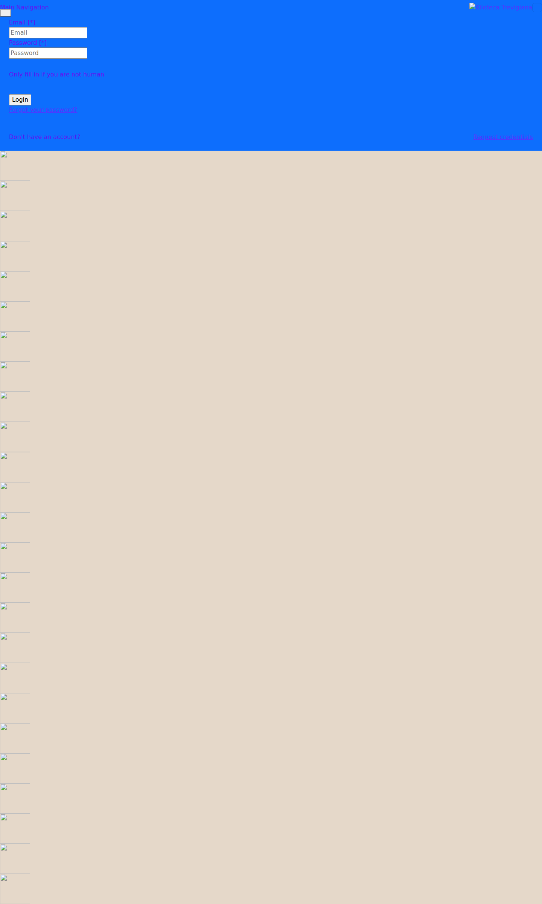
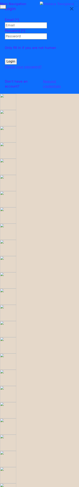

# UI Design System & Master Generation Blueprint: xiloteca-it_en

> **Xiloteca Trevigiana. Woods from around the world. Digital Museum.** (https://xiloteca.it/en/) — Xiloteca Trevigiana. From the heart of the forests to the future of business, wood tells stories. Digital Museum of Wood Sustainability.



---

## 1. Executive Visual Persona & Design Archetype

- **Brand Essence & Persona**: **Xiloteca Trevigiana. Woods from around the world. Digital Museum.** (`https://xiloteca.it/en/`). Xiloteca Trevigiana. From the heart of the forests to the future of business, wood tells stories. Digital Museum of Wood Sustainability.
- **Visual Archetype**: **Dark-Substrate WebGL / Canvas Interactive Experience (`#0d6efd` / `#d63384`)**.
- **Anti-AI-Slop Differentiators**:
  - **Source-Grounded Chromatic Polarity**: Anchors the viewport in `#0d6efd` (`var(--bs-blue)` in `:root`) paired with `#6610f2` primary typography and `#d63384` accents.
  - **Extracted Typographic Hierarchy**: Pairs `Space Mono` for display copy (`Xiloteca Trevigiana. Woods from arou`) with `raty` and `Space Mono`.
  - **Calibrated Spatial Grid & Motion**: Combines `540px` container bounds (`gap: 0.5rem`, padding `2rem`) with `cubic-bezier(.23,1,.32,1)` easing and Lenis Smooth Scroll (`data-lenis`), GSAP Timeline & ScrollTrigger.

---

## 2. Spatial Architecture & Modular Grid Mathematics



### Viewport Allocation & Container Geometry
- **Captured Viewport Dimensions**: Desktop `1440×2400px` (`assets/desktop.png`, capped at 2400px multi-section capture), Mobile `390×2400px` (`assets/mobile.png`, capped at 2400px multi-section capture).
- **Master Container Bounds**: `540px` extracted from `xiloteca-it_en` stylesheet.
- **Canvas Lateral Padding & Spacing**: `2rem` lateral canvas padding with `0.5rem` grid gap.
- **Border Radius Scale**: `0.375rem`, `.25rem`, `.375rem`, `.5rem`.

### Responsive Breakpoint Architecture
- **Desktop Layout**: Multi-column CSS Grid / Flexbox layout at `1440px` (`max-width: 540px`, `gap: 0.5rem`).
- **Mobile Layout**: Single-column vertical stack at `390px` viewport width with `2rem` horizontal padding.
- **Extracted CSS Media Queries**: `@media (prefers-reduced-motion:no-preference)`, `@media (min-width:1200px)`, `@media (min-width:576px)`, `@media (min-width:768px)`.

---

## 3. Color System, Materiality & Atmospheric Lighting

### Semantic Palette & Source Grounding
| Semantic Role | Ground-Truth Value | Extracted CSS Source / Selector |
|---|---|---|
| **Primary Canvas Substrate** | `#0d6efd` | `var(--bs-blue)` in `:root` |
| **Primary Typography Ink** | `#6610f2` | `var(--bs-indigo)` in `:root` |
| **Elevated Surface / Card Substrate** | `#5533ff` | `var(--bs-purple)` in `:root` |
| **Interactive Accent / Highlight** | `#d63384` | `var(--bs-pink)` in `:root` |
| **Secondary / Muted Copy** | `#dc3545` | `var(--bs-red)` in `:root` |
| **Structural Hairline Border** | `#fd7e14` | `var(--bs-orange)` in `:root` |
| **Variable Token (`--bs-yellow`)** | `#ffc107` | `var(--bs-yellow)` in `:root` |
| **Variable Token (`--bs-green`)** | `#198754` | `var(--bs-green)` in `:root` |
| **Variable Token (`--bs-teal`)** | `#20c997` | `var(--bs-teal)` in `:root` |
| **Variable Token (`--bs-cyan`)** | `#0dcaf0` | `var(--bs-cyan)` in `:root` |
| **Variable Token (`--bs-black`)** | `#000` | `var(--bs-black)` in `:root` |
| **Variable Token (`--bs-white`)** | `#fff` | `var(--bs-white)` in `:root` |
| **Variable Token (`--bs-gray`)** | `#6c757d` | `var(--bs-gray)` in `:root` |
| **Variable Token (`--bs-gray-dark`)** | `#343a40` | `var(--bs-gray-dark)` in `:root` |
| **Variable Token (`--bs-gray-100`)** | `#f8f9fa` | `var(--bs-gray-100)` in `:root` |
| **Variable Token (`--bs-gray-200`)** | `#e9ecef` | `var(--bs-gray-200)` in `:root` |

### Sanitized Root CSS Variables (`ui-ux.md` Ground Truth)
| Variable Name | Extracted Value | Semantic Role |
|---|---|---|
| `--bs-blue` | `#0d6efd` | Color / Atmospheric Token |
| `--bs-indigo` | `#6610f2` | Color / Atmospheric Token |
| `--bs-purple` | `#5533ff` | Color / Atmospheric Token |
| `--bs-pink` | `#d63384` | Typography Ink Token |
| `--bs-red` | `#dc3545` | Color / Atmospheric Token |
| `--bs-orange` | `#fd7e14` | Color / Atmospheric Token |
| `--bs-yellow` | `#ffc107` | Color / Atmospheric Token |
| `--bs-green` | `#198754` | Color / Atmospheric Token |
| `--bs-teal` | `#20c997` | Color / Atmospheric Token |
| `--bs-cyan` | `#0dcaf0` | Color / Atmospheric Token |
| `--bs-black` | `#000` | Canvas / Surface Token |
| `--bs-white` | `#fff` | Canvas / Surface Token |
| `--bs-gray` | `#6c757d` | Color / Atmospheric Token |
| `--bs-gray-dark` | `#343a40` | Canvas / Surface Token |
| `--bs-gray-100` | `#f8f9fa` | Color / Atmospheric Token |
| `--bs-gray-200` | `#e9ecef` | Color / Atmospheric Token |

---

## 4. Typographic Scale & Editorial Hierarchy

### Font Family Stacks
- **Display Typography**: `Space Mono`.
- **Primary Body Stack**: `raty`.
- **Technical / Metadata Stack**: `Space Mono`.

### Typographic Scale & Rules (Extracted from Stylesheet & Variables)
- **Hero Display (`H1`)**: CSS variables `--bs-h1-font-size: 7.5rem`; rule `,h1` (`font-size: calc(1.375rem + 1.5vw)`).
- **Section Heading (`H2`)**: CSS variables `--bs-h2-font-size: 5.5rem`; rule `,h2` (`font-size: calc(1.325rem + .9vw)`).
- **Body Copy**: CSS variables `--bs-body-color-rgb: 33,37,41`, `--bs-body-bg-rgb: 255,255,255`, `--bs-body-font-family: var(--bs-font-sans-serif)`; rule `p` (`font-size: var(--bs-h1-font-size)`, `line-height: 1`, `letter-spacing: -.04em`, `font-weight: var(--bs-font...`).
- **Metadata & Navigation Labels**: CSS variables `--search-filter-label-scale-font-size: var(--bs-body-font-size-sm)`, `--search-filter-label-color: var(--bs-dark-bs-body-color)`, `--search-filter-label-scale: 2`; rule `,small` (`font-size: .875em`).

---

## 5. Choreographed Motion & Interaction Physics

### Primary Easing Curves
- **Extracted Timing Functions**: `cubic-bezier(.23,1,.32,1)`, `cubic-bezier(.25,.1,.25,1)`, `cubic-bezier(0.25,0.1,0.25,1)`.

### Per-Element Transition & Choreography Rules
- **Selector `.wpcf7 textarea`**: `transition: border-color .15s ease-in-out,box-shadow .15s ease-in-out` extracted from `xiloteca-it_en` stylesheet.
- **Selector `media (prefers-reduced-motion:red...`**: `transition: none` extracted from `xiloteca-it_en` stylesheet.
- **Selector `.wpcf7 textarea::file-selector-bu...`**: `transition: color .15s ease-in-out,background-color .15s ease-in-out,borde...` extracted from `xiloteca-it_en` stylesheet.
- **Extracted Easing Curve (`cubic-bezier(.23,1,.32,1)`)**: Governs interactive state transitions across `<header.fixed-top>` and `<main.site-main>`.
- **Runtime Interaction Engine**: Integrates Lenis Smooth Scroll (`data-lenis`), GSAP Timeline & ScrollTrigger, Three.js / WebGL Canvas Pipeline, Swiper Touch Carousel Engine, Lottie Vector Animation Player with `prefers-reduced-motion: reduce` fallback guards.

---

## 6. Component Wireframe & Structural DOM Map

### Visual Layout Schematic (Grounded in `dom.html` — `1440px` Desktop & `390px` Mobile Reflow)
```
┌────────────────────────────────────────────────────────────────────────┐
│ DESKTOP VIEWPORT (1440px) — Xiloteca Trevigiana. Woods from around the │
│ ====================================================================== │
│ [ <header.fixed-top>       | Xiloteca Trevigiana · The initiative · ]  │
│ ---------------------------------------------------------------------- │
│ | HERO STAGE: <main.site-main>                                     |   │
│ | H1: Xiloteca Trevigiana. Woods from around the world.            |   │
│ | Substrate: #0d6efd    | Ink: #6610f2    | Accent: #d63384        |   │
│ ---------------------------------------------------------------------- │
│ | SHOWCASE GRID (<main.site-main>          ) max-w: 540px          |   │
│ | +------------------------------+  +------------------------------+ | │
│ | | From the heart of the forest |  | Explore according to your pr | | │
│ | +------------------------------+  +------------------------------+ | │
│ ---------------------------------------------------------------------- │
│ | MOBILE VIEWPORT REFLOW (390px) — Single-Column Stack (gap: 0.5rem) | │
│ | [<header.fixed-top>] -> [<main.site-main>] -> [<main.site-main>] |   │
│ ---------------------------------------------------------------------- │
│ [ FOOTER (<footer.site-footer>  ) | https://xiloteca.it/en/            │
└────────────────────────────────────────────────────────────────────────┘
```

### Granular DOM Region Breakdown
1. **Brand Header & Navigation Bar (<header.fixed-top> — `xiloteca-it_en`)**:
   - Landmark `<header class="fixed-top">` hosting `Xiloteca Trevigiana. Woods from arou` navigation (`Xiloteca Trevigiana · The initiative · Digital collection · Interactive game · Wood Glossary`), DOM attributes (`data-cookieconsent="statistics"`, `data-cookieconsent="statistics"`, `data-cookieconsent="statistics"`, `data-cookieconsent="ignore"`), and stylesheet rule `before { box-sizing:border-box }`.
2. **Hero Stage & Focal Lead (<main.site-main> — `Xiloteca Trevigiana. Woods from ar`)**:
   - Landmark `<main class="site-main">` presenting display lead `Xiloteca Trevigiana. Woods from around the world.` and copy excerpt *"Informazioni sui cookie"* over `#0d6efd` canvas and `#6610f2` ink.
3. **Primary Showcase & Content Grid (<main.site-main> — `From the heart of the forests to t`)**:
   - Landmark `<main class="site-main">` rendering section `From the heart of the forests to the future of bu...` with copy *"Selezione del consenso"*, asset references (`fonts.googleapis.com`, `fonts.gstatic.com`, `css2`, `cc.js`), and grid rule `root { scroll-behavior:smooth }`.
4. **Interactive Detail & Feature Matrix (<main.site-main> — `Explore according to your profile`)**:
   - Landmark `<main class="site-main">` framing `Explore according to your profile` and `Necessari 3 I cookie necessari contribuiscono a ` (*"Necessari 3 I cookie necessari contribuiscono a rendere fruibile "*) with `#5533ff` surface cards, `#d63384` accents, and `address { margin-bottom:1rem;font-style:normal;line-height:inherit }`.
5. **Colophon & Global Directory Footer (<footer.site-footer> — `https://xiloteca.it/en/`)**:
   - Landmark `<footer class="site-footer pt-12">` anchoring `Xiloteca Trevigiana. Woods from ` footer links (`Xiloteca Trevigiana · The initiative · Digital collection · Interactive game · Wood Glossary`), copy *"Cloudflare 1 Per saperne di più su questo fornitore cf.turns"*, and `#fd7e14` structural dividers.

---

## 7. Master Zero-Shot AI Generation Prompt

```markdown
# Master Zero-Shot Frontend Generation Prompt: xiloteca-it_en (Xiloteca Trevigiana. Woods from around the world. Digital Museum.)

You are a principal frontend architect and design systems engineer. Build a complete, production-ready web application replicating the exact design system, DOM landmarks, typographic hierarchy, color tokens, and motion physics of `xiloteca-it_en` (**Xiloteca Trevigiana. Woods from around the world. Digital Museum.** — `https://xiloteca.it/en/`).

### 1. Visual Archetype & Anti-AI-Slop Mandates
- **Archetype**: Dark-Substrate WebGL / Canvas Interactive Experience (`#0d6efd` / `#d63384`).
- **Identity & Domain Context**: Xiloteca Trevigiana. From the heart of the forests to the future of business, wood tells stories. Digital Museum of Wood Sustainability.
- **Primary Substrate**: `#0d6efd` (`var(--bs-blue)` in `:root`), **Primary Ink**: `#6610f2`, **Accent / Highlight**: `#d63384`.
- **Site-Specific Differentiators**:
  - **Source-Grounded Chromatic Polarity**: Anchors the viewport in `#0d6efd` (`var(--bs-blue)` in `:root`) paired with `#6610f2` primary typography and `#d63384` accents.
  - **Extracted Typographic Hierarchy**: Pairs `Space Mono` for display copy (`Xiloteca Trevigiana. Woods from arou`) with `raty` and `Space Mono`.
  - **Calibrated Spatial Grid & Motion**: Combines `540px` container bounds (`gap: 0.5rem`, padding `2rem`) with `cubic-bezier(.23,1,.32,1)` easing and Lenis Smooth Scroll (`data-lenis`), GSAP Timeline & ScrollTrigger.

### 2. Ground-Truth CSS Variables (`:root` Token Contract)
Declare and consume these exact custom properties extracted from `xiloteca-it_en` in your global stylesheet:

:root {
  /* Xiloteca Trevigiana. Woods from around the world. Digital Museum. (xiloteca-it_en) — Ground-Truth Extracted CSS Variables */
  --bs-blue: #0d6efd; /* Color / Atmospheric Token (xiloteca-it_en) */
  --bs-indigo: #6610f2; /* Color / Atmospheric Token (xiloteca-it_en) */
  --bs-purple: #5533ff; /* Color / Atmospheric Token (xiloteca-it_en) */
  --bs-pink: #d63384; /* Typography Ink Token (xiloteca-it_en) */
  --bs-red: #dc3545; /* Color / Atmospheric Token (xiloteca-it_en) */
  --bs-orange: #fd7e14; /* Color / Atmospheric Token (xiloteca-it_en) */
  --bs-yellow: #ffc107; /* Color / Atmospheric Token (xiloteca-it_en) */
  --bs-green: #198754; /* Color / Atmospheric Token (xiloteca-it_en) */
  --bs-teal: #20c997; /* Color / Atmospheric Token (xiloteca-it_en) */
  --bs-cyan: #0dcaf0; /* Color / Atmospheric Token (xiloteca-it_en) */
  --bs-black: #000; /* Canvas / Surface Token (xiloteca-it_en) */
  --bs-white: #fff; /* Canvas / Surface Token (xiloteca-it_en) */
  --bs-gray: #6c757d; /* Color / Atmospheric Token (xiloteca-it_en) */
  --bs-gray-dark: #343a40; /* Canvas / Surface Token (xiloteca-it_en) */
  --bs-gray-100: #f8f9fa; /* Color / Atmospheric Token (xiloteca-it_en) */
  --bs-gray-200: #e9ecef; /* Color / Atmospheric Token (xiloteca-it_en) */
}

### 3. Semantic Color & Materiality Contract
Map every surface, ink, and border strictly to these source-grounded tokens:
- **Primary Canvas Substrate**: `#0d6efd` — grounded in `var(--bs-blue)` in `:root`
- **Primary Typography Ink**: `#6610f2` — grounded in `var(--bs-indigo)` in `:root`
- **Elevated Surface / Card Substrate**: `#5533ff` — grounded in `var(--bs-purple)` in `:root`
- **Interactive Accent / Highlight**: `#d63384` — grounded in `var(--bs-pink)` in `:root`
- **Secondary / Muted Copy**: `#dc3545` — grounded in `var(--bs-red)` in `:root`
- **Structural Hairline Border**: `#fd7e14` — grounded in `var(--bs-orange)` in `:root`
- **Variable Token (`--bs-yellow`)**: `#ffc107` — grounded in `var(--bs-yellow)` in `:root`
- **Variable Token (`--bs-green`)**: `#198754` — grounded in `var(--bs-green)` in `:root`
- **Variable Token (`--bs-teal`)**: `#20c997` — grounded in `var(--bs-teal)` in `:root`
- **Variable Token (`--bs-cyan`)**: `#0dcaf0` — grounded in `var(--bs-cyan)` in `:root`
- **Variable Token (`--bs-black`)**: `#000` — grounded in `var(--bs-black)` in `:root`
- **Variable Token (`--bs-white`)**: `#fff` — grounded in `var(--bs-white)` in `:root`
- **Variable Token (`--bs-gray`)**: `#6c757d` — grounded in `var(--bs-gray)` in `:root`
- **Variable Token (`--bs-gray-dark`)**: `#343a40` — grounded in `var(--bs-gray-dark)` in `:root`
- **Variable Token (`--bs-gray-100`)**: `#f8f9fa` — grounded in `var(--bs-gray-100)` in `:root`
- **Variable Token (`--bs-gray-200`)**: `#e9ecef` — grounded in `var(--bs-gray-200)` in `:root`

### 4. Spatial Grid, Container Bounds & Responsive Breakpoints
- **Desktop Viewport Reference**: `1440×2400px` (capped at 2400px multi-section capture, `1440px` standard desktop width).
- **Mobile Viewport Reference**: `390×2400px` (capped at 2400px multi-section capture, `390px` standard mobile width).
- **Container Max-Width**: `540px` extracted from `xiloteca-it_en` stylesheet
- **Padding & Gutters**: `2rem` lateral canvas padding with `0.5rem` grid gap
- **Desktop Grid**: Multi-column CSS Grid / Flexbox layout at `1440px` (`max-width: 540px`, `gap: 0.5rem`)
- **Mobile Adaptation**: Single-column vertical stack at `390px` viewport width with `2rem` horizontal padding
- **Media Queries**: `@media (prefers-reduced-motion:no-preference)`, `@media (min-width:1200px)`, `@media (min-width:576px)`, `@media (min-width:768px)`
- **Corner Radii**: `0.375rem`, `.25rem`, `.375rem`, `.5rem`

### 5. Typography & Editorial Scale Contract
- **Display Font Stack**: `Space Mono`
- **Body Font Stack**: `raty`
- **Monospace / Technical Font Stack**: `Space Mono`
- **H1 Display Rule**: CSS variables `--bs-h1-font-size: 7.5rem`; rule `,h1` (`font-size: calc(1.375rem + 1.5vw)`)
- **H2 Section Rule**: CSS variables `--bs-h2-font-size: 5.5rem`; rule `,h2` (`font-size: calc(1.325rem + .9vw)`)
- **Body Copy Rule**: CSS variables `--bs-body-color-rgb: 33,37,41`, `--bs-body-bg-rgb: 255,255,255`, `--bs-body-font-family: var(--bs-font-sans-serif)`; rule `p` (`font-size: var(--bs-h1-font-size)`, `line-height: 1`, `letter-spacing: -.04em`, `font-weight: var(--bs-font...`)
- **Metadata & Index Rule**: CSS variables `--search-filter-label-scale-font-size: var(--bs-body-font-size-sm)`, `--search-filter-label-color: var(--bs-dark-bs-body-color)`, `--search-filter-label-scale: 2`; rule `,small` (`font-size: .875em`)

### 6. Component Hierarchy, Verbatim Copy & Real DOM Landmarks
Scaffold `xiloteca-it_en` (`Xiloteca Trevigiana. Woods from around the world. Digital Museum.`) with these exact structural regions, extracted copy, and CSS rules from `dom.html`:
1. **Brand Header & Navigation Bar (<header.fixed-top> — `xiloteca-it_en`)**:
   - DOM & Selectors: Landmark `<header class="fixed-top">` hosting `Xiloteca Trevigiana. Woods from arou` navigation (`Xiloteca Trevigiana · The initiative · Digital collection · Interactive game · Wood Glossary`), DOM attributes (`data-cookieconsent="statistics"`, `data-cookieconsent="statistics"`, `data-cookieconsent="statistics"`, `data-cookieconsent="ignore"`), and stylesheet rule `before { box-sizing:border-box }`.
   - Responsive Contract: Header `Brand Header & Navigation Bar (<header.fixed-top> — `xiloteca-it_en`)` (`xiloteca-it_en`) adapts across `@media (prefers-reduced-motion:no-preference)`, `@media (min-width:1200px)`, `@media (min-width:576px)`, `@media (min-width:768px)` with `cubic-bezier(.23,1,.32,1)`, `cubic-bezier(.25,.1,.25,1)`, `cubic-bezier(0.25,0.1,0.25,1)` transitions and links `Xiloteca Trevigiana · The initiative · Digital collection · Interactive game · Wood Glossary`.
2. **Hero Stage & Focal Lead (<main.site-main> — `Xiloteca Trevigiana. Woods from ar`)**:
   - DOM & Selectors: Landmark `<main class="site-main">` presenting display lead `Xiloteca Trevigiana. Woods from around the world.` and copy excerpt *"Informazioni sui cookie"* over `#0d6efd` canvas and `#6610f2` ink.
   - Responsive Contract: Hero stage (`1440×2400px` desktop / `390×2400px` mobile) sets `#0d6efd` background with `#6610f2` headline `Xiloteca Trevigiana. Woods from around the world.`.
3. **Primary Showcase & Content Grid (<main.site-main> — `From the heart of the forests to t`)**:
   - DOM & Selectors: Landmark `<main class="site-main">` rendering section `From the heart of the forests to the future of bu...` with copy *"Selezione del consenso"*, asset references (`fonts.googleapis.com`, `fonts.gstatic.com`, `css2`, `cc.js`), and grid rule `root { scroll-behavior:smooth }`.
   - Responsive Contract: Showcase grid `Primary Showcase & Content Grid (<main.site-main> — `From the heart of the forests to t`)` applies Multi-column CSS Grid / Flexbox layout at `1440px` (`max-width: 540px`, `gap: 0.5rem`) on desktop and Single-column vertical stack at `390px` viewport width with `2rem` horizontal padding on mobile.
4. **Interactive Detail & Feature Matrix (<main.site-main> — `Explore according to your profile`)**:
   - DOM & Selectors: Landmark `<main class="site-main">` framing `Explore according to your profile` and `Necessari 3 I cookie necessari contribuiscono a ` (*"Necessari 3 I cookie necessari contribuiscono a rendere fruibile "*) with `#5533ff` surface cards, `#d63384` accents, and `address { margin-bottom:1rem;font-style:normal;line-height:inherit }`.
   - Responsive Contract: Detail module `Interactive Detail & Feature Matrix (<main.site-main> — `Explore according to your profile`)` uses `0.375rem`, `.25rem`, `.375rem`, `.5rem` radii, `#d63384` highlights, and assets (fonts.googleapis.com, fonts.gstatic.com, css2).
5. **Colophon & Global Directory Footer (<footer.site-footer> — `https://xiloteca.it/en/`)**:
   - DOM & Selectors: Landmark `<footer class="site-footer pt-12">` anchoring `Xiloteca Trevigiana. Woods from ` footer links (`Xiloteca Trevigiana · The initiative · Digital collection · Interactive game · Wood Glossary`), copy *"Cloudflare 1 Per saperne di più su questo fornitore cf.turns"*, and `#fd7e14` structural dividers.
   - Responsive Contract: Footer `Colophon & Global Directory Footer (<footer.site-footer> — `https://xiloteca.it/en/`)` aligns to `540px` extracted from `xiloteca-it_en` stylesheet with `2rem` lateral canvas padding with `0.5rem` grid gap and attributes (data-cookieconsent="statistics", data-cookieconsent="statistics", data-cookieconsent="statistics").

#### Verbatim DOM Copy Excerpts (`dom.html`)
- Copy Excerpt 1: *"Informazioni sui cookie"*
- Copy Excerpt 2: *"Selezione del consenso"*
- Copy Excerpt 3: *"Necessari 3 I cookie necessari contribuiscono a rendere fruibile il sito web abili..."*
- Copy Excerpt 4: *"Cloudflare 1 Per saperne di più su questo fornitore cf.turnstile.u Questo cookie è..."*

### 7. Motion, Extracted Stylesheet Rules & Interaction Choreography
- **Primary Easing Functions**: `cubic-bezier(.23,1,.32,1)`, `cubic-bezier(.25,.1,.25,1)`, `cubic-bezier(0.25,0.1,0.25,1)`
- **Extracted Stylesheet Rules (`xiloteca-it_en`)**:
- `before { box-sizing:border-box }`
- `root { scroll-behavior:smooth }`
- `address { margin-bottom:1rem;font-style:normal;line-height:inherit }`
- `ul ul { margin-bottom:0 }`
- `blockquote { margin:0 0 1rem }`
- **Per-Selector Transition Rules**:
- **Selector `.wpcf7 textarea`**: `transition: border-color .15s ease-in-out,box-shadow .15s ease-in-out` extracted from `xiloteca-it_en` stylesheet.
- **Selector `media (prefers-reduced-motion:red...`**: `transition: none` extracted from `xiloteca-it_en` stylesheet.
- **Selector `.wpcf7 textarea::file-selector-bu...`**: `transition: color .15s ease-in-out,background-color .15s ease-in-out,borde...` extracted from `xiloteca-it_en` stylesheet.
- **Extracted Easing Curve (`cubic-bezier(.23,1,.32,1)`)**: Governs interactive state transitions across `<header.fixed-top>` and `<main.site-main>`.
- **Runtime Interaction Engine**: Integrates Lenis Smooth Scroll (`data-lenis`), GSAP Timeline & ScrollTrigger, Three.js / WebGL Canvas Pipeline, Swiper Touch Carousel Engine, Lottie Vector Animation Player with `prefers-reduced-motion: reduce` fallback guards.

### 8. Technical Deliverables
- Implement in Next.js (App Router) with TypeScript and Tailwind CSS consuming the `:root` custom properties defined above for `xiloteca-it_en`.
- Reproduce both the `1440px` desktop architecture and `390px` mobile breakpoint transitions, preserving semantic HTML5 landmarks (`<header>`, `<nav>`, `<main>`, `<section>`, `<footer>`) and `prefers-reduced-motion` accessibility guards.
```
