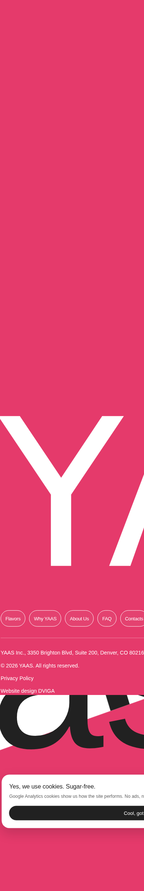

# UI Design System & Master Generation Blueprint: yaas-energy-com

> **YAAS Energy — Zero-Sugar Energy Drink in 5 Bold Flavors** (https://yaas-energy.com/) — YAAS — zero-sugar, 5-calorie energy drink in 5 bold flavors: Citrus Lemon, Blueberry Rush, Wild Strawberry, Solar Orange, Green Apple. No...


---

## 1. Executive Visual Persona & Design Archetype

- **Brand Essence & Persona**: **YAAS Energy — Zero-Sugar Energy Drink in 5 Bold Flavors** (`https://yaas-energy.com/`). YAAS — zero-sugar, 5-calorie energy drink in 5 bold flavors: Citrus Lemon, Blueberry Rush, Wild Strawberry, Solar Orange, Green Apple. No...
- **Visual Archetype**: **Light-Substrate Editorial & Modular Grid System (`#ffffff` canvas, `#0b0a09` ink, `#f3d118` accent)**.
- **Anti-AI-Slop Differentiators**:
  - **Source-Grounded Chromatic Polarity**: Anchors the viewport in `#ffffff` (`var(--ink)` in `:root`) paired with `#0b0a09` primary typography and `#f3d118` accents.
  - **Extracted Typographic Hierarchy**: Pairs `Soledago` for display copy (`5 Flavors. 1 Energy.`) with `Bounded` and `SFMono-Regular`.
  - **Calibrated Spatial Grid & Motion**: Combines `1199px` container bounds (`gap: 50px`, padding `var(--detail-pad)`) with `cubic-bezier(.22,1,.36,1)` easing and Lenis Smooth Scroll (`data-lenis`), Three.js / WebGL Canvas Pipeline.

---

## 2. Spatial Architecture & Modular Grid Mathematics



### Viewport Allocation & Container Geometry
- **Captured Viewport Dimensions**: Desktop `1440×2400px` (`assets/desktop.png`, capped at 2400px multi-section capture), Mobile `390×2400px` (`assets/mobile.png`, capped at 2400px multi-section capture).
- **Master Container Bounds**: `1199px` extracted from `yaas-energy-com` stylesheet.
- **Canvas Lateral Padding & Spacing**: `var(--detail-pad)` lateral canvas padding with `50px` grid gap.
- **Border Radius Scale**: `50%`, `100px`, `18px`, `20px`.

### Responsive Breakpoint Architecture
- **Desktop Layout**: Multi-column CSS Grid / Flexbox layout at `1440px` (`max-width: 1199px`, `gap: 50px`).
- **Mobile Layout**: Single-column vertical stack at `390px` viewport width with `var(--detail-pad)` horizontal padding.
- **Extracted CSS Media Queries**: `@media (max-width: 1199px)`, `@media (min-width: 960px) and (max-width: 1199px)`, `@media (min-width: 1200px)`, `@media (min-width: 640px) and (max-width: 959px)`.

---

## 3. Color System, Materiality & Atmospheric Lighting

### Semantic Palette & Source Grounding
| Semantic Role | Ground-Truth Value | Extracted CSS Source / Selector |
|---|---|---|
| **Primary Canvas Substrate** | `#ffffff` | `var(--ink)` in `:root` |
| **Primary Typography Ink** | `#212121` | `var(--ink-on-light)` in `:root` |
| **Elevated Surface / Card Substrate** | `#fdfaf1` | `var(--paper)` in `:root` |
| **Interactive Accent / Highlight** | `#f3d118` | `var(--bg-color)` in `:root` |
| **Secondary / Muted Copy** | `#e43a6c` | `var(--card-color)` in `:root` |
| **Structural Hairline Border** | `#0b0a09` | `html { background: #0b0a09 }` |

### Sanitized Root CSS Variables (`ui-ux.md` Ground Truth)
| Variable Name | Extracted Value | Semantic Role |
|---|---|---|
| `--font-display` | `"Soledago", "Arial Narrow", system-ui, -apple-system, sans-serif` | Typography / Scale Token |
| `--font-body` | `"Helvetica Neue", Arial, system-ui, -apple-system, sans-serif` | Typography / Scale Token |
| `--font-beiruti` | `"Bounded", "Helvetica Neue", Arial, system-ui, -apple-system, sans-serif` | Typography / Scale Token |
| `--ui-scale` | `1` | Design System Custom Token |
| `--ink` | `#ffffff` | Typography Ink Token |
| `--ink-soft` | `rgba(255, 255, 255, .85)` | Typography Ink Token |
| `--ink-on-light` | `#212121` | Canvas / Surface Token |
| `--ink-on-light-soft` | `rgba(33, 33, 33, .72)` | Canvas / Surface Token |
| `--block-gap` | `calc(120px * var(--ui-scale))` | Layout / Spatial Grid Token |
| `--heading-gap` | `50px` | Typography Ink Token |
| `--block-heading` | `clamp(30px, 4.17vw, calc(80px * var(--ui-scale)))` | Typography Ink Token |
| `--text-body` | `calc(16px * var(--ui-scale))` | Typography Ink Token |
| `--text-body-sm` | `calc(14px * var(--ui-scale))` | Typography Ink Token |
| `--content-gutter` | `30px` | Layout / Spatial Grid Token |
| `--content-inline` | `var(--content-gutter)` | Design System Custom Token |
| `--paper` | `#fdfaf1` | Canvas / Surface Token |

---

## 4. Typographic Scale & Editorial Hierarchy

### Font Family Stacks
- **Display Typography**: `Soledago`.
- **Primary Body Stack**: `Bounded`.
- **Technical / Metadata Stack**: `SFMono-Regular`.

### Typographic Scale & Rules (Extracted from Stylesheet & Variables)
- **Hero Display (`H1`)**: CSS variables `--font-display: "Soledago", "Arial Narrow", system-ui, -apple-system, sans-serif`.
- **Section Heading (`H2`)**: CSS variables `--h2g: 0`.
- **Body Copy**: CSS variables `--font-body: "Helvetica Neue", Arial, system-ui, -apple-system, sans-serif`, `--text-body: calc(16px * var(--ui-scale))`, `--text-body-sm: calc(14px * var(--ui-scale))`.
- **Metadata & Navigation Labels**: CSS variables `--caption-top: 625px`.

---

## 5. Choreographed Motion & Interaction Physics

### Primary Easing Curves
- **Extracted Timing Functions**: `cubic-bezier(.22,1,.36,1)`.

### Per-Element Transition & Choreography Rules
- **Selector `.background-layer`**: `transition: background-color .9s ease` extracted from `yaas-energy-com` stylesheet.
- **Selector `.center-glow`**: `transition: opacity .6s ease` extracted from `yaas-energy-com` stylesheet.
- **Selector `.slider-screen`**: `transition: opacity .5s ease` extracted from `yaas-energy-com` stylesheet.
- **Extracted Easing Curve (`cubic-bezier(.22,1,.36,1)`)**: Governs interactive state transitions across `<nav.hero-nav>` and `<section.screen2>`.
- **Runtime Interaction Engine**: Integrates Lenis Smooth Scroll (`data-lenis`), Three.js / WebGL Canvas Pipeline with `prefers-reduced-motion: reduce` fallback guards.

---

## 6. Component Wireframe & Structural DOM Map

### Visual Layout Schematic (Grounded in `dom.html` — `1440px` Desktop & `390px` Mobile Reflow)
```
┌────────────────────────────────────────────────────────────────────────┐
│ DESKTOP VIEWPORT (1440px) — YAAS Energy — Zero-Sugar Energy Drink in 5 │
│ ====================================================================== │
│ [ <nav.hero-nav>           | Flavors · About us · FAQ · Contacts    ]  │
│ ---------------------------------------------------------------------- │
│ | HERO STAGE: <section.intro-wrap>                                 |   │
│ | H1: 5 Flavors. 1 Energy.                                         |   │
│ | Substrate: #ffffff    | Ink: #0b0a09    | Accent: #f3d118        |   │
│ ---------------------------------------------------------------------- │
│ | SHOWCASE GRID (<section.screen2>         ) max-w: 1199px         |   │
│ | +------------------------------+  +------------------------------+ | │
│ | | YAAS. That feeling when ever |  | This isn't about hyping you  | | │
│ | +------------------------------+  +------------------------------+ | │
│ ---------------------------------------------------------------------- │
│ | MOBILE VIEWPORT REFLOW (390px) — Single-Column Stack (gap: 50px  ) | │
│ | [<nav.hero-nav>] -> [<section.intro-wra] -> [<section.screen2>] |    │
│ ---------------------------------------------------------------------- │
│ [ FOOTER (<footer.site-footer>  ) | https://yaas-energy.com/           │
└────────────────────────────────────────────────────────────────────────┘
```

### Granular DOM Region Breakdown
1. **Brand Header & Navigation Bar (<nav.hero-nav> — `yaas-energy-com`)**:
   - Landmark `<nav class="hero-nav">` hosting `YAAS Energy — Zero-Sugar Energy Drin` navigation (`Flavors · About us · FAQ · Contacts`), DOM attributes (`data-seo="1"`, `data-seo="1"`, `data-seo="1"`, `data-seo="1"`), and stylesheet rule `root { --block-heading: clamp(30px, 4.17vw, calc(80px * var(--ui-scale))) }`.
2. **Hero Stage & Focal Lead (<section.intro-wrap> — `5 Flavors. 1 Energy.`)**:
   - Landmark `<section class="intro-wrap">` presenting display lead `5 Flavors. 1 Energy.` and copy excerpt *"Yes, we use cookies. Sugar-free."* over `#ffffff` canvas and `#0b0a09` ink.
3. **Primary Showcase & Content Grid (<section.screen2> — `YAAS. That feeling when everything`)**:
   - Landmark `<section class="screen2 is-arc-running">` rendering section `YAAS. That feeling when everything just hits diff...` with copy *"Google Analytics cookies show us how the site performs. No ads, n"*, asset references (`favicon.svg`, `favicon-32.png`, `favicon-16.png`, `apple-touch-icon.png`), and grid rule `html { background:0b0a09 }`.
4. **Interactive Detail & Feature Matrix (<section.screen2-arc> — `This isn't about hyping you up. It`)**:
   - Landmark `<section class="screen2-arc">` framing `This isn't about hyping you up. It's about stayin...` and `Hanging with the squad till sunrise` (*"Zero-sugar energy for people who move at their own speed. Flavor "*) with `#fdfaf1` surface cards, `#f3d118` accents, and `button { font-family:inherit;color:inherit;background:none;border:none;cursor:poi... }`.
5. **Colophon & Global Directory Footer (<footer.site-footer> — `https://yaas-energy.com/`)**:
   - Landmark `<footer class="site-footer is-reveal">` anchoring `YAAS Energy — Zero-Sugar Energy ` footer links (`Flavors · About us · FAQ · Contacts`), copy *"This isn't about hyping you up. It's about staying locked in"*, and `#0b0a09` structural dividers.

---

## 7. Master Zero-Shot AI Generation Prompt

```markdown
# Master Zero-Shot Frontend Generation Prompt: yaas-energy-com (YAAS Energy — Zero-Sugar Energy Drink in 5 Bold Flavors)

You are a principal frontend architect and design systems engineer. Build a complete, production-ready web application replicating the exact design system, DOM landmarks, typographic hierarchy, color tokens, and motion physics of `yaas-energy-com` (**YAAS Energy — Zero-Sugar Energy Drink in 5 Bold Flavors** — `https://yaas-energy.com/`).

### 1. Visual Archetype & Anti-AI-Slop Mandates
- **Archetype**: Light-Substrate Editorial & Modular Grid System (`#ffffff` canvas, `#0b0a09` ink, `#f3d118` accent).
- **Identity & Domain Context**: YAAS — zero-sugar, 5-calorie energy drink in 5 bold flavors: Citrus Lemon, Blueberry Rush, Wild Strawberry, Solar Orange, Green Apple. No...
- **Primary Substrate**: `#ffffff` (`var(--ink)` in `:root`), **Primary Ink**: `#0b0a09`, **Accent / Highlight**: `#f3d118`.
- **Site-Specific Differentiators**:
  - **Source-Grounded Chromatic Polarity**: Anchors the viewport in `#ffffff` (`var(--ink)` in `:root`) paired with `#0b0a09` primary typography and `#f3d118` accents.
  - **Extracted Typographic Hierarchy**: Pairs `Soledago` for display copy (`5 Flavors. 1 Energy.`) with `Bounded` and `SFMono-Regular`.
  - **Calibrated Spatial Grid & Motion**: Combines `1199px` container bounds (`gap: 50px`, padding `var(--detail-pad)`) with `cubic-bezier(.22,1,.36,1)` easing and Lenis Smooth Scroll (`data-lenis`), Three.js / WebGL Canvas Pipeline.

### 2. Ground-Truth CSS Variables (`:root` Token Contract)
Declare and consume these exact custom properties extracted from `yaas-energy-com` in your global stylesheet:

:root {
  /* YAAS Energy — Zero-Sugar Energy Drink in 5 Bold Flavors (yaas-energy-com) — Ground-Truth Extracted CSS Variables */
  --font-display: "Soledago", "Arial Narrow", system-ui, -apple-system, sans-serif; /* Typography / Scale Token (yaas-energy-com) */
  --font-body: "Helvetica Neue", Arial, system-ui, -apple-system, sans-serif; /* Typography / Scale Token (yaas-energy-com) */
  --font-beiruti: "Bounded", "Helvetica Neue", Arial, system-ui, -apple-system, sans-serif; /* Typography / Scale Token (yaas-energy-com) */
  --ui-scale: 1; /* Design System Custom Token (yaas-energy-com) */
  --ink: #ffffff; /* Typography Ink Token (yaas-energy-com) */
  --ink-soft: rgba(255, 255, 255, .85); /* Typography Ink Token (yaas-energy-com) */
  --ink-on-light: #212121; /* Canvas / Surface Token (yaas-energy-com) */
  --ink-on-light-soft: rgba(33, 33, 33, .72); /* Canvas / Surface Token (yaas-energy-com) */
  --block-gap: calc(120px * var(--ui-scale)); /* Layout / Spatial Grid Token (yaas-energy-com) */
  --heading-gap: 50px; /* Typography Ink Token (yaas-energy-com) */
  --block-heading: clamp(30px, 4.17vw, calc(80px * var(--ui-scale))); /* Typography Ink Token (yaas-energy-com) */
  --text-body: calc(16px * var(--ui-scale)); /* Typography Ink Token (yaas-energy-com) */
  --text-body-sm: calc(14px * var(--ui-scale)); /* Typography Ink Token (yaas-energy-com) */
  --content-gutter: 30px; /* Layout / Spatial Grid Token (yaas-energy-com) */
  --content-inline: var(--content-gutter); /* Design System Custom Token (yaas-energy-com) */
  --paper: #fdfaf1; /* Canvas / Surface Token (yaas-energy-com) */
}

### 3. Semantic Color & Materiality Contract
Map every surface, ink, and border strictly to these source-grounded tokens:
- **Primary Canvas Substrate**: `#ffffff` — grounded in `var(--ink)` in `:root`
- **Primary Typography Ink**: `#212121` — grounded in `var(--ink-on-light)` in `:root`
- **Elevated Surface / Card Substrate**: `#fdfaf1` — grounded in `var(--paper)` in `:root`
- **Interactive Accent / Highlight**: `#f3d118` — grounded in `var(--bg-color)` in `:root`
- **Secondary / Muted Copy**: `#e43a6c` — grounded in `var(--card-color)` in `:root`
- **Structural Hairline Border**: `#0b0a09` — grounded in `html { background: #0b0a09 }`

### 4. Spatial Grid, Container Bounds & Responsive Breakpoints
- **Desktop Viewport Reference**: `1440×2400px` (capped at 2400px multi-section capture, `1440px` standard desktop width).
- **Mobile Viewport Reference**: `390×2400px` (capped at 2400px multi-section capture, `390px` standard mobile width).
- **Container Max-Width**: `1199px` extracted from `yaas-energy-com` stylesheet
- **Padding & Gutters**: `var(--detail-pad)` lateral canvas padding with `50px` grid gap
- **Desktop Grid**: Multi-column CSS Grid / Flexbox layout at `1440px` (`max-width: 1199px`, `gap: 50px`)
- **Mobile Adaptation**: Single-column vertical stack at `390px` viewport width with `var(--detail-pad)` horizontal padding
- **Media Queries**: `@media (max-width: 1199px)`, `@media (min-width: 960px) and (max-width: 1199px)`, `@media (min-width: 1200px)`, `@media (min-width: 640px) and (max-width: 959px)`
- **Corner Radii**: `50%`, `100px`, `18px`, `20px`

### 5. Typography & Editorial Scale Contract
- **Display Font Stack**: `Soledago`
- **Body Font Stack**: `Bounded`
- **Monospace / Technical Font Stack**: `SFMono-Regular`
- **H1 Display Rule**: CSS variables `--font-display: "Soledago", "Arial Narrow", system-ui, -apple-system, sans-serif`
- **H2 Section Rule**: CSS variables `--h2g: 0`
- **Body Copy Rule**: CSS variables `--font-body: "Helvetica Neue", Arial, system-ui, -apple-system, sans-serif`, `--text-body: calc(16px * var(--ui-scale))`, `--text-body-sm: calc(14px * var(--ui-scale))`
- **Metadata & Index Rule**: CSS variables `--caption-top: 625px`

### 6. Component Hierarchy, Verbatim Copy & Real DOM Landmarks
Scaffold `yaas-energy-com` (`YAAS Energy — Zero-Sugar Energy Drink in 5 Bold Flavors`) with these exact structural regions, extracted copy, and CSS rules from `dom.html`:
1. **Brand Header & Navigation Bar (<nav.hero-nav> — `yaas-energy-com`)**:
   - DOM & Selectors: Landmark `<nav class="hero-nav">` hosting `YAAS Energy — Zero-Sugar Energy Drin` navigation (`Flavors · About us · FAQ · Contacts`), DOM attributes (`data-seo="1"`, `data-seo="1"`, `data-seo="1"`, `data-seo="1"`), and stylesheet rule `root { --block-heading: clamp(30px, 4.17vw, calc(80px * var(--ui-scale))) }`.
   - Responsive Contract: Header `Brand Header & Navigation Bar (<nav.hero-nav> — `yaas-energy-com`)` (`yaas-energy-com`) adapts across `@media (max-width: 1199px)`, `@media (min-width: 960px) and (max-width: 1199px)`, `@media (min-width: 1200px)`, `@media (min-width: 640px) and (max-width: 959px)` with `cubic-bezier(.22,1,.36,1)` transitions and links `Flavors · About us · FAQ · Contacts`.
2. **Hero Stage & Focal Lead (<section.intro-wrap> — `5 Flavors. 1 Energy.`)**:
   - DOM & Selectors: Landmark `<section class="intro-wrap">` presenting display lead `5 Flavors. 1 Energy.` and copy excerpt *"Yes, we use cookies. Sugar-free."* over `#ffffff` canvas and `#0b0a09` ink.
   - Responsive Contract: Hero stage (`1440×2400px` desktop / `390×2400px` mobile) sets `#ffffff` background with `#0b0a09` headline `5 Flavors. 1 Energy.`.
3. **Primary Showcase & Content Grid (<section.screen2> — `YAAS. That feeling when everything`)**:
   - DOM & Selectors: Landmark `<section class="screen2 is-arc-running">` rendering section `YAAS. That feeling when everything just hits diff...` with copy *"Google Analytics cookies show us how the site performs. No ads, n"*, asset references (`favicon.svg`, `favicon-32.png`, `favicon-16.png`, `apple-touch-icon.png`), and grid rule `html { background:0b0a09 }`.
   - Responsive Contract: Showcase grid `Primary Showcase & Content Grid (<section.screen2> — `YAAS. That feeling when everything`)` applies Multi-column CSS Grid / Flexbox layout at `1440px` (`max-width: 1199px`, `gap: 50px`) on desktop and Single-column vertical stack at `390px` viewport width with `var(--detail-pad)` horizontal padding on mobile.
4. **Interactive Detail & Feature Matrix (<section.screen2-arc> — `This isn't about hyping you up. It`)**:
   - DOM & Selectors: Landmark `<section class="screen2-arc">` framing `This isn't about hyping you up. It's about stayin...` and `Hanging with the squad till sunrise` (*"Zero-sugar energy for people who move at their own speed. Flavor "*) with `#fdfaf1` surface cards, `#f3d118` accents, and `button { font-family:inherit;color:inherit;background:none;border:none;cursor:poi... }`.
   - Responsive Contract: Detail module `Interactive Detail & Feature Matrix (<section.screen2-arc> — `This isn't about hyping you up. It`)` uses `50%`, `100px`, `18px`, `20px` radii, `#f3d118` highlights, and assets (favicon.svg, favicon-32.png, favicon-16.png).
5. **Colophon & Global Directory Footer (<footer.site-footer> — `https://yaas-energy.com/`)**:
   - DOM & Selectors: Landmark `<footer class="site-footer is-reveal">` anchoring `YAAS Energy — Zero-Sugar Energy ` footer links (`Flavors · About us · FAQ · Contacts`), copy *"This isn't about hyping you up. It's about staying locked in"*, and `#0b0a09` structural dividers.
   - Responsive Contract: Footer `Colophon & Global Directory Footer (<footer.site-footer> — `https://yaas-energy.com/`)` aligns to `1199px` extracted from `yaas-energy-com` stylesheet with `var(--detail-pad)` lateral canvas padding with `50px` grid gap and attributes (data-seo="1", data-seo="1", data-seo="1").

#### Verbatim DOM Copy Excerpts (`dom.html`)
- Copy Excerpt 1: *"Yes, we use cookies. Sugar-free."*
- Copy Excerpt 2: *"Google Analytics cookies show us how the site performs. No ads, no selling your da..."*
- Copy Excerpt 3: *"Zero-sugar energy for people who move at their own speed. Flavor maxed out, sugar..."*
- Copy Excerpt 4: *"This isn't about hyping you up. It's about staying locked in to your own thing."*

### 7. Motion, Extracted Stylesheet Rules & Interaction Choreography
- **Primary Easing Functions**: `cubic-bezier(.22,1,.36,1)`
- **Extracted Stylesheet Rules (`yaas-energy-com`)**:
- `root { --block-heading: clamp(30px, 4.17vw, calc(80px * var(--ui-scale))) }`
- `html { background:0b0a09 }`
- `button { font-family:inherit;color:inherit;background:none;border:none;cursor:poi... }`
- `.intro-wrap { position:relative;height:300vh }`
- `.intro-pin { position:sticky;top:0;height:100vh;overflow:hidden;--h2g: 0 }`
- **Per-Selector Transition Rules**:
- **Selector `.background-layer`**: `transition: background-color .9s ease` extracted from `yaas-energy-com` stylesheet.
- **Selector `.center-glow`**: `transition: opacity .6s ease` extracted from `yaas-energy-com` stylesheet.
- **Selector `.slider-screen`**: `transition: opacity .5s ease` extracted from `yaas-energy-com` stylesheet.
- **Extracted Easing Curve (`cubic-bezier(.22,1,.36,1)`)**: Governs interactive state transitions across `<nav.hero-nav>` and `<section.screen2>`.
- **Runtime Interaction Engine**: Integrates Lenis Smooth Scroll (`data-lenis`), Three.js / WebGL Canvas Pipeline with `prefers-reduced-motion: reduce` fallback guards.

### 8. Technical Deliverables
- Implement in Next.js (App Router) with TypeScript and Tailwind CSS consuming the `:root` custom properties defined above for `yaas-energy-com`.
- Reproduce both the `1440px` desktop architecture and `390px` mobile breakpoint transitions, preserving semantic HTML5 landmarks (`<header>`, `<nav>`, `<main>`, `<section>`, `<footer>`) and `prefers-reduced-motion` accessibility guards.
```
