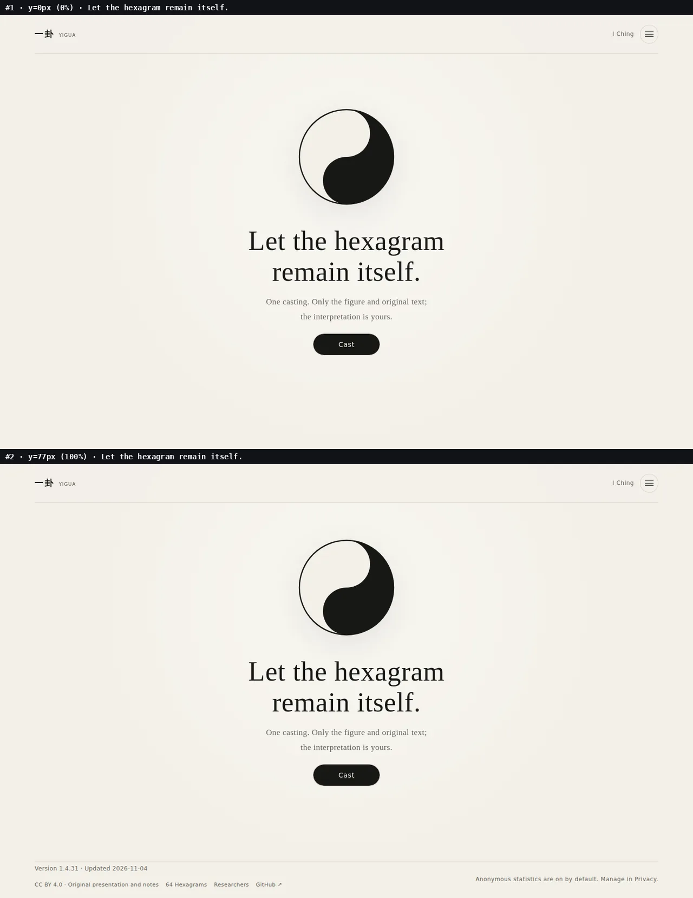
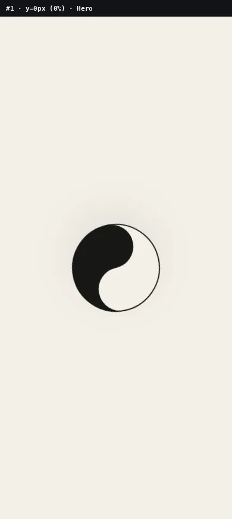

# UI Design System & Master Generation Blueprint: yigua-art

> **一卦** (https://yigua.art/?lang=en) — 讓卦回到卦。一次起卦，只呈現卦象與原典；解讀留給你。





---

## 1. Executive Visual Persona & Design Archetype

- **Brand Essence & Persona**: **一卦** (`https://yigua.art/?lang=en`). 讓卦回到卦。一次起卦，只呈現卦象與原典；解讀留給你。
- **Capture Provenance**: Live browser capture (`tier1_fast`, HTTP `200`, captured `2026-11-24`).
- **Visual Archetype**: **Light-Substrate Editorial & Modular Grid System (`#f3f0e8` canvas, `#171815` ink, `#65645e` accent)**.
- **Anti-AI-Slop Differentiators**:
  - **Live-Computed Chromatic Polarity**: Anchors the viewport in `#f3f0e8` (live computed `body` `background-color` (`computed_styles.json`)) paired with `#171815` primary typography and `#65645e` accents.
  - **Grounded Typographic Hierarchy**: Pairs `Georgia` for display copy (`Let the hexagram remain itself.`) with `PingFang TC` and `SFMono-Regular`.
  - **Calibrated Spatial Grid & Motion**: Combines `1120px` container bounds (`gap: 20px`, padding `72px`) with `cubic-bezier(0,0,.2,1)` easing.

---

## 2. Spatial Architecture & Modular Grid Mathematics

### Viewport Allocation & Container Geometry
- **Captured Journey Filmstrips**: Desktop `1280×1656px` (`assets/desktop-journey.webp`, `2` keyframes up to `y=77px` / doc `977px`), Mobile `390×872px` (`assets/mobile-journey.webp`, `1` keyframes).
- **Master Container Bounds**: `1120px` (measured widest bounded `<section>` landmark width on `1440px` desktop).
- **Canvas Lateral Padding & Spacing**: `72px` lateral canvas padding with `20px` grid gap.
- **Border Radius Scale**: `var(--radius)`, `999px`, `.35rem`, `1px`.

### Responsive Breakpoint Architecture
- **Desktop Layout**: Multi-column CSS Grid / Flexbox layout at `1440px` (`max-width: 1120px`, `gap: 20px`).
- **Mobile Layout**: Single-column vertical stack at `390px` viewport width with `72px` horizontal padding.
- **Extracted CSS Media Queries**: `@media (min-width:800px)`, `@media (prefers-reduced-motion:reduce)`, `@media (max-width:479px)`, `@media (max-width:480px)`.

---

## 3. Color System, Materiality & Atmospheric Lighting

### Semantic Palette & Source Grounding
| Semantic Role | Ground-Truth Value | Extracted Live / CSS Source |
|---|---|---|
| **Primary Canvas Substrate** | `#f3f0e8` | live computed `body` `background-color` (`computed_styles.json`) |
| **Primary Typography Ink** | `#171815` | live computed `h1` `color` (`computed_styles.json`) |
| **Elevated Surface / Card Substrate** | `#e8e3d7` | `var(--paper-deep)` in `:root` |
| **Interactive Accent / Highlight** | `#65645e` | live computed `a` `color` (`computed_styles.json`) |
| **Secondary / Muted Copy** | `#65645e` | live computed `p` `color` (`computed_styles.json`) |
| **Structural Hairline Border** | `#d6d0c4` | `var(--line)` in `:root` |
| **Variable Token (`--paper-light`)** | `#f8f6ef` | `var(--paper-light)` in `:root` |
| **Variable Token (`--cinnabar`)** | `#963e32` | `var(--cinnabar)` in `:root` |

### Sanitized Root CSS Variables (`ui-ux.md` Ground Truth)
| Variable Name | Extracted Value | Semantic Role |
|---|---|---|
| `--paper` | `#f3f0e8` | Canvas / Surface Token |
| `--paper-deep` | `#e8e3d7` | Canvas / Surface Token |
| `--paper-light` | `#f8f6ef` | Canvas / Surface Token |
| `--ink` | `#171815` | Typography Ink Token |
| `--ink-soft` | `#65645e` | Typography Ink Token |
| `--line` | `#d6d0c4` | Color / Atmospheric Token |
| `--cinnabar` | `#963e32` | Color / Atmospheric Token |
| `--background` | `var(--paper)` | Canvas / Surface Token |
| `--foreground` | `var(--ink)` | Typography Ink Token |
| `--card` | `var(--paper-light)` | Design System Custom Token |
| `--card-foreground` | `var(--ink)` | Typography Ink Token |
| `--popover` | `var(--paper-light)` | Design System Custom Token |
| `--popover-foreground` | `var(--ink)` | Typography Ink Token |
| `--primary` | `var(--ink)` | Brand / Palette Token |
| `--primary-foreground` | `var(--paper)` | Typography Ink Token |
| `--secondary` | `var(--paper-deep)` | Brand / Palette Token |

---

## 4. Typographic Scale & Editorial Hierarchy

### Font Family Stacks
- **Display Typography**: `Georgia`.
- **Primary Body Stack**: `PingFang TC`.
- **Technical / Metadata Stack**: `SFMono-Regular`.

### Typographic Scale & Rules (Live Computed & Stylesheet Grounded)
- **Hero Display (`H1`)**: live computed `h1` (`font-size: 56.8px`, `line-height: 63.616px`, `font-weight: 500`, `letter-spacing: 0.6816px`); rule `h1` (`line-height: 1.12`, `letter-spacing: .025em`).
- **Section Heading (`H2`)**: rule `h2` (`font-size: clamp(1.65rem,3vw,2.2rem)`, `letter-spacing: .12em`, `font-weight: 500`).
- **Body Copy**: live computed `body` (`font-size: 16px`, `line-height: 24px`, `font-weight: 400`); rule `p` (`letter-spacing: .02em`).
- **Metadata & Navigation Labels**: live computed `nav/a` (`font-size: 16px`, `line-height: 24px`, `font-weight: 400`); CSS variables `--text-xs: .75rem`, `--text-xs--line-height: calc(1 / .75)`, `--text-sm: .875rem`; rule `small` (`font-size: .68rem`, `letter-spacing: .08em`).

---

## 5. Choreographed Motion & Interaction Physics

### Primary Easing Curves
- **Extracted Timing Functions**: `cubic-bezier(0,0,.2,1)`, `cubic-bezier(.4,0,.2,1)`, `cubic-bezier(.22,1,.36,1)`.

### Per-Element Transition & Choreography Rules
- **Selector `layer theme`**: `transition: .15s` extracted from `yigua-art` stylesheet.
- **Selector `.transition`**: `transition: var(--tw-ease,var(--default-transition-timing-function))` extracted from `yigua-art` stylesheet.
- **Selector `.transition-all`**: `transition: var(--tw-ease,var(--default-transition-timing-function))` extracted from `yigua-art` stylesheet.
- **Extracted Easing Curve (`cubic-bezier(0,0,.2,1)`)**: Governs interactive state transitions across `<header.site-header>` and `<section.casting-experience:nth(2)>`.
- **State & Hover Choreography**: Opacity and transform transitions on `<section.casting-experience>` and `<section.casting-experience:nth(2)>` interactive targets.
### Measured Runtime Scroll & Interaction Telemetry (`behavioral_journey_v2`)
- **Scroll Driver Mode**: `wheel` (max document height `977px`, deepest scrollY reached `77px` across `2` desktop keyframes).
- **Detected Scroll / Motion Libraries**: Native browser scroll / standard CSS transitions.
- **Nav / Drawer Probe**: Tested trigger `Open menu` (diff `1.419`, below state-capture threshold).
- **Hover Physics (`primary_cta` · `一卦 YIGUA`)**: Computed transition `0s` / `ease` (no static color/transform shift captured at rest).
- **Route Transition Architecture**: First internal navigation (`/about`) measured as `direct` in `1622ms`.

---

## 6. Component Wireframe & Structural DOM Map

### Visual Layout Schematic — Desktop (`1440px`, Grounded in `dom.html` & Landmark Bounding Boxes)
```
┌────────────────────────────────────────────────────────────────────────┐
│ DESKTOP VIEWPORT (1440px) — 一卦                                         │
│ ====================================================================== │
│ [ <header.site-header> (1296x80px)    | 64 Hexagrams · About Yi Gua  ] │
│ ---------------------------------------------------------------------- │
│ | HERO STAGE: <section.casting-experience> (w=1440px)                | │
│ | H1: Let the hexagram remain itself.                                | │
│ | Substrate: #f3f0e8 | Ink: #171815 | Accent: #65645e                | │
│ ---------------------------------------------------------------------- │
│ | SHOWCASE GRID (<section.casting-experienc) max-w: 1120px           | │
│ | +------------------------------+  +------------------------------+ | │
│ | | One casting. Only the figure |  | One casting. Only the figure | | │
│ | +------------------------------+  +------------------------------+ | │
│ ---------------------------------------------------------------------- │
│ | DETAIL MODULE (<section.casting-experienc) — the interpretation is | │
│ ---------------------------------------------------------------------- │
│ [ FOOTER (<footer.site-footer>) | https://yigua.art/?lang=en           │
└────────────────────────────────────────────────────────────────────────┘
```

### Visual Layout Schematic — Mobile Reflow (`390px`)
```
┌────────────────────────────────────────────────────────────────────────┐
│ MOBILE VIEWPORT REFLOW (390px) — Single-Column Stack (gap: 20px)       │
│ ====================================================================== │
│ [ HEADER BAR (<header.site-header>    ) | Compact Menu (390px)         │
│ ---------------------------------------------------------------------- │
│ | HERO STAGE (<section.casting-experie) — 390px Vertical Lead        | │
│ | H1: Let the hexagram remain itself.                                | │
│ ---------------------------------------------------------------------- │
│ | SHOWCASE STACK (<section.casting-exper) — 1-Col Stack              | │
│ | [ Item 1: One casting. Only the figure and original text;        ] | │
│ | [ Item 2: One casting. Only the figure and original text;        ] | │
│ ---------------------------------------------------------------------- │
│ | DETAIL STACK (<section.casting-experie) — 1-Col (the interpretation) │
│ ---------------------------------------------------------------------- │
│ [ FOOTER (<footer.site-footer>) | Stacked 390px Colophon               │
└────────────────────────────────────────────────────────────────────────┘
```

### Granular DOM Region Breakdown
1. **Brand Header & Navigation Bar (<header.site-header> — `yigua-art`)**:
   - Landmark `<header class="site-header">` (`1296x80px`) hosting `一卦` navigation (`64 Hexagrams · About Yi Gua · Privacy · Developer · Researchers`), DOM attributes (`data-locale="en"`, `data-startup-lifecycle-bound="true"`, `data-startup-booted="true"`, `data-text-size="medium"`), and stylesheet rule `before { box-sizing:border-box;border:0 solid;margin:0;padding:0 }`.
2. **Hero Stage & Focal Lead (<section.casting-experience> — `Let the hexagram remain itself.`)**:
   - Landmark `<section class="casting-experience">` presenting display lead `Let the hexagram remain itself.` and copy excerpt *"One casting. Only the figure and original text; the interpretatio"* over `#f3f0e8` canvas and `#171815` ink.
3. **Primary Showcase & Content Grid (<section.casting-experience:nth(2)> — `One casting. Only the figure and o`)**:
   - Landmark `<section class="casting-experience">` rendering section `One casting. Only the figure and original text; ` with copy *"One casting. Only the figure and original text;"*, asset references (`index.B1O6CZI_.css`, `index-BdTq9GkK.js`, `rolldown-runtime-C60lm6uB.js`, `framework-D_rUT4EX.js`), and grid rule `backdrop { box-sizing:border-box;border:0 solid;margin:0;padding:0 }`.
4. **Interactive Detail & Feature Matrix (<section.casting-experience:nth(3)> — `One casting. Only the figure and o`)**:
   - Landmark `<section class="casting-experience">` framing `One casting. Only the figure and original text;` and `the interpretation is yours.` (*"the interpretation is yours."*) with `#e8e3d7` surface cards, `#65645e` accents, and `file-selector-button { box-sizing:border-box;border:0 solid;margin:0;padding:0 }`.
5. **Colophon & Global Directory Footer (<footer.site-footer> — `https://yigua.art/?lang=en`)**:
   - Landmark `<footer class="site-footer">` anchoring `一卦` footer links (`64 Hexagrams · About Yi Gua · Privacy · Developer · Researchers`), copy *"Version 1.4.31 · Updated 2026-11-04 CC BY 4.0 · Original pre"*, and `#d6d0c4` structural dividers.
### Full Vertical Scroll Sequence (Desktop `1440×900` Keyframes)
- **Step 01** (`y=0px`, `0%`): Active landmark `Let the hexagram remain itself.` · sticky/fixed elements: `2`
- **Step 02** (`y=77px`, `100%`): Active landmark `Let the hexagram remain itself.` · sticky/fixed elements: `2`

### Multi-Page Internal Route Map
- **About Route (`/about`)**: `https://yigua.art/about` — H1: `A complete I Ching casting, with as little interf...`, scrollHeight `12521px`, transition `direct` (`1622ms`)
- **Other Route (`/hexagrams`)**: `https://yigua.art/hexagrams` — H1: `The 64 Hexagrams`, scrollHeight `1703px`, transition `direct` (`238ms`)
- **Other Route (`/developer`)**: `https://yigua.art/developer` — H1: `曲宸宇 Chen-Yu Chu`, scrollHeight `1257px`, transition `direct` (`642ms`)

---

## 7. Master Zero-Shot AI Generation Prompt

```markdown
# Master Zero-Shot Frontend Generation Prompt: yigua-art (一卦)

You are a principal frontend architect and design systems engineer. Build a complete, production-ready web application replicating the exact design system, DOM landmarks, typographic hierarchy, color tokens, and motion physics of `yigua-art` (**一卦** — `https://yigua.art/?lang=en`).

### 1. Visual Archetype & Anti-AI-Slop Mandates
- **Archetype**: Light-Substrate Editorial & Modular Grid System (`#f3f0e8` canvas, `#171815` ink, `#65645e` accent).
- **Identity & Domain Context**: 讓卦回到卦。一次起卦，只呈現卦象與原典；解讀留給你。
- **Primary Substrate**: `#f3f0e8` (live computed `body` `background-color` (`computed_styles.json`)), **Primary Ink**: `#171815`, **Accent / Highlight**: `#65645e`.
- **Site-Specific Differentiators**:
  - **Live-Computed Chromatic Polarity**: Anchors the viewport in `#f3f0e8` (live computed `body` `background-color` (`computed_styles.json`)) paired with `#171815` primary typography and `#65645e` accents.
  - **Grounded Typographic Hierarchy**: Pairs `Georgia` for display copy (`Let the hexagram remain itself.`) with `PingFang TC` and `SFMono-Regular`.
  - **Calibrated Spatial Grid & Motion**: Combines `1120px` container bounds (`gap: 20px`, padding `72px`) with `cubic-bezier(0,0,.2,1)` easing.

### 2. Ground-Truth CSS Variables (`:root` Token Contract)
Declare and consume these exact custom properties extracted from `yigua-art` in your global stylesheet:

:root {
  /* 一卦 (yigua-art) — Live-Grounded CSS Variables */
  --paper: #f3f0e8; /* Canvas / Surface Token (yigua-art) */
  --paper-deep: #e8e3d7; /* Canvas / Surface Token (yigua-art) */
  --paper-light: #f8f6ef; /* Canvas / Surface Token (yigua-art) */
  --ink: #171815; /* Typography Ink Token (yigua-art) */
  --ink-soft: #65645e; /* Typography Ink Token (yigua-art) */
  --line: #d6d0c4; /* Color / Atmospheric Token (yigua-art) */
  --cinnabar: #963e32; /* Color / Atmospheric Token (yigua-art) */
  --background: var(--paper); /* Canvas / Surface Token (yigua-art) */
  --foreground: var(--ink); /* Typography Ink Token (yigua-art) */
  --card: var(--paper-light); /* Design System Custom Token (yigua-art) */
  --card-foreground: var(--ink); /* Typography Ink Token (yigua-art) */
  --popover: var(--paper-light); /* Design System Custom Token (yigua-art) */
  --popover-foreground: var(--ink); /* Typography Ink Token (yigua-art) */
  --primary: var(--ink); /* Brand / Palette Token (yigua-art) */
  --primary-foreground: var(--paper); /* Typography Ink Token (yigua-art) */
  --secondary: var(--paper-deep); /* Brand / Palette Token (yigua-art) */
}

### 3. Semantic Color & Materiality Contract
Map every surface, ink, and border strictly to these source-grounded tokens:
- **Primary Canvas Substrate**: `#f3f0e8` — grounded in live computed `body` `background-color` (`computed_styles.json`)
- **Primary Typography Ink**: `#171815` — grounded in live computed `h1` `color` (`computed_styles.json`)
- **Elevated Surface / Card Substrate**: `#e8e3d7` — grounded in `var(--paper-deep)` in `:root`
- **Interactive Accent / Highlight**: `#65645e` — grounded in live computed `a` `color` (`computed_styles.json`)
- **Secondary / Muted Copy**: `#65645e` — grounded in live computed `p` `color` (`computed_styles.json`)
- **Structural Hairline Border**: `#d6d0c4` — grounded in `var(--line)` in `:root`
- **Variable Token (`--paper-light`)**: `#f8f6ef` — grounded in `var(--paper-light)` in `:root`
- **Variable Token (`--cinnabar`)**: `#963e32` — grounded in `var(--cinnabar)` in `:root`

### 4. Spatial Grid, Container Bounds & Responsive Breakpoints
- **Desktop Viewport Reference**: `1280×1656px` (full-page live capture (1656px), `1440px` standard desktop width).
- **Mobile Viewport Reference**: `390×872px` (full-page live capture (872px), `390px` standard mobile width).
- **Container Max-Width**: `1120px` (measured widest bounded `<section>` landmark width on `1440px` desktop)
- **Padding & Gutters**: `72px` lateral canvas padding with `20px` grid gap
- **Desktop Grid**: Multi-column CSS Grid / Flexbox layout at `1440px` (`max-width: 1120px`, `gap: 20px`)
- **Mobile Adaptation**: Single-column vertical stack at `390px` viewport width with `72px` horizontal padding
- **Media Queries**: `@media (min-width:800px)`, `@media (prefers-reduced-motion:reduce)`, `@media (max-width:479px)`, `@media (max-width:480px)`
- **Corner Radii**: `var(--radius)`, `999px`, `.35rem`, `1px`

### 5. Typography & Editorial Scale Contract
- **Display Font Stack**: `Georgia`
- **Body Font Stack**: `PingFang TC`
- **Monospace / Technical Font Stack**: `SFMono-Regular`
- **H1 Display Rule**: live computed `h1` (`font-size: 56.8px`, `line-height: 63.616px`, `font-weight: 500`, `letter-spacing: 0.6816px`); rule `h1` (`line-height: 1.12`, `letter-spacing: .025em`)
- **H2 Section Rule**: rule `h2` (`font-size: clamp(1.65rem,3vw,2.2rem)`, `letter-spacing: .12em`, `font-weight: 500`)
- **Body Copy Rule**: live computed `body` (`font-size: 16px`, `line-height: 24px`, `font-weight: 400`); rule `p` (`letter-spacing: .02em`)
- **Metadata & Index Rule**: live computed `nav/a` (`font-size: 16px`, `line-height: 24px`, `font-weight: 400`); CSS variables `--text-xs: .75rem`, `--text-xs--line-height: calc(1 / .75)`, `--text-sm: .875rem`; rule `small` (`font-size: .68rem`, `letter-spacing: .08em`)

### 6. Component Hierarchy, Verbatim Copy & Real DOM Landmarks
Scaffold `yigua-art` (`一卦`) with these exact structural regions, extracted copy, and CSS rules from `dom.html`:
1. **Brand Header & Navigation Bar (<header.site-header> — `yigua-art`)**:
   - DOM & Selectors: Landmark `<header class="site-header">` (`1296x80px`) hosting `一卦` navigation (`64 Hexagrams · About Yi Gua · Privacy · Developer · Researchers`), DOM attributes (`data-locale="en"`, `data-startup-lifecycle-bound="true"`, `data-startup-booted="true"`, `data-text-size="medium"`), and stylesheet rule `before { box-sizing:border-box;border:0 solid;margin:0;padding:0 }`.
   - Responsive Contract: Header `Brand Header & Navigation Bar (<header.site-header> — `yigua-art`)` (`yigua-art`) adapts across `@media (min-width:800px)`, `@media (prefers-reduced-motion:reduce)`, `@media (max-width:479px)`, `@media (max-width:480px)` with `cubic-bezier(0,0,.2,1)`, `cubic-bezier(.4,0,.2,1)`, `cubic-bezier(.22,1,.36,1)` transitions and links `64 Hexagrams · About Yi Gua · Privacy · Developer · Researchers`.
2. **Hero Stage & Focal Lead (<section.casting-experience> — `Let the hexagram remain itself.`)**:
   - DOM & Selectors: Landmark `<section class="casting-experience">` presenting display lead `Let the hexagram remain itself.` and copy excerpt *"One casting. Only the figure and original text; the interpretatio"* over `#f3f0e8` canvas and `#171815` ink.
   - Responsive Contract: Hero stage (`1280×1656px` desktop / `390×872px` mobile) sets `#f3f0e8` background with `#171815` headline `Let the hexagram remain itself.`.
3. **Primary Showcase & Content Grid (<section.casting-experience:nth(2)> — `One casting. Only the figure and o`)**:
   - DOM & Selectors: Landmark `<section class="casting-experience">` rendering section `One casting. Only the figure and original text; ` with copy *"One casting. Only the figure and original text;"*, asset references (`index.B1O6CZI_.css`, `index-BdTq9GkK.js`, `rolldown-runtime-C60lm6uB.js`, `framework-D_rUT4EX.js`), and grid rule `backdrop { box-sizing:border-box;border:0 solid;margin:0;padding:0 }`.
   - Responsive Contract: Showcase grid `Primary Showcase & Content Grid (<section.casting-experience:nth(2)> — `One casting. Only the figure and o`)` applies Multi-column CSS Grid / Flexbox layout at `1440px` (`max-width: 1120px`, `gap: 20px`) on desktop and Single-column vertical stack at `390px` viewport width with `72px` horizontal padding on mobile.
4. **Interactive Detail & Feature Matrix (<section.casting-experience:nth(3)> — `One casting. Only the figure and o`)**:
   - DOM & Selectors: Landmark `<section class="casting-experience">` framing `One casting. Only the figure and original text;` and `the interpretation is yours.` (*"the interpretation is yours."*) with `#e8e3d7` surface cards, `#65645e` accents, and `file-selector-button { box-sizing:border-box;border:0 solid;margin:0;padding:0 }`.
   - Responsive Contract: Detail module `Interactive Detail & Feature Matrix (<section.casting-experience:nth(3)> — `One casting. Only the figure and o`)` uses `var(--radius)`, `999px`, `.35rem`, `1px` radii, `#65645e` highlights, and assets (index.B1O6CZI_.css, index-BdTq9GkK.js, rolldown-runtime-C60lm6uB.js).
5. **Colophon & Global Directory Footer (<footer.site-footer> — `https://yigua.art/?lang=en`)**:
   - DOM & Selectors: Landmark `<footer class="site-footer">` anchoring `一卦` footer links (`64 Hexagrams · About Yi Gua · Privacy · Developer · Researchers`), copy *"Version 1.4.31 · Updated 2026-11-04 CC BY 4.0 · Original pre"*, and `#d6d0c4` structural dividers.
   - Responsive Contract: Footer `Colophon & Global Directory Footer (<footer.site-footer> — `https://yigua.art/?lang=en`)` aligns to `1120px` (measured widest bounded `<section>` landmark width on `1440px` desktop) with `72px` lateral canvas padding with `20px` grid gap and attributes (data-locale="en", data-startup-lifecycle-bound="true", data-startup-booted="true").

#### Verbatim DOM Copy Excerpts (`dom.html`)
- Copy Excerpt 1: *"One casting. Only the figure and original text; the interpretation is yours."*
- Copy Excerpt 2: *"One casting. Only the figure and original text;"*
- Copy Excerpt 3: *"the interpretation is yours."*
- Copy Excerpt 4: *"Version 1.4.31 · Updated 2026-11-04 CC BY 4.0 · Original presentation and notes 64..."*

### 7. Motion, Extracted Stylesheet Rules & Interaction Choreography
- **Primary Easing Functions**: `cubic-bezier(0,0,.2,1)`, `cubic-bezier(.4,0,.2,1)`, `cubic-bezier(.22,1,.36,1)`
- **Extracted Stylesheet Rules (`yigua-art`)**:
- `before { box-sizing:border-box;border:0 solid;margin:0;padding:0 }`
- `backdrop { box-sizing:border-box;border:0 solid;margin:0;padding:0 }`
- `file-selector-button { box-sizing:border-box;border:0 solid;margin:0;padding:0 }`
- `strong { font-weight:bolder }`
- `small { font-size:80% }`
- **Per-Selector Transition Rules**:
- **Selector `layer theme`**: `transition: .15s` extracted from `yigua-art` stylesheet.
- **Selector `.transition`**: `transition: var(--tw-ease,var(--default-transition-timing-function))` extracted from `yigua-art` stylesheet.
- **Selector `.transition-all`**: `transition: var(--tw-ease,var(--default-transition-timing-function))` extracted from `yigua-art` stylesheet.
- **Extracted Easing Curve (`cubic-bezier(0,0,.2,1)`)**: Governs interactive state transitions across `<header.site-header>` and `<section.casting-experience:nth(2)>`.
- **State & Hover Choreography**: Opacity and transform transitions on `<section.casting-experience>` and `<section.casting-experience:nth(2)>` interactive targets.
### 7b. Full-Page Scroll Choreography, Interactive States & Multi-Page Routes
- **Scroll Mechanics**: Implement `wheel` vertical progression up to `977px` across 2 distinct viewport chapters.
- **Vertical Chapter Sequence**: Let the hexagram remain its... (0%) -> Let the hexagram remain its... (100%).
- **Multi-Page Routes**: Scaffold internal routes `/about` (about, direct), `/hexagrams` (other, direct), `/developer` (other, direct) sharing the global header/footer shell and design tokens.

### 8. Technical Deliverables
- Implement in Next.js (App Router) with TypeScript and Tailwind CSS consuming the `:root` custom properties defined above for `yigua-art`.
- Reproduce both the `1440px` desktop architecture and `390px` mobile breakpoint transitions, preserving semantic HTML5 landmarks (`<header>`, `<nav>`, `<main>`, `<section>`, `<footer>`) and `prefers-reduced-motion` accessibility guards.
```
---

## 8. Full-Page Scroll Journey, Interactive States & Subpage Inventory

### Desktop Scroll Keyframes (`1440×900` WebP)
| Step | Scroll Y | Progress | Active Landmark / Section | Sticky/Fixed | Visual Asset |
| :---: | :---: | :---: | :--- | :---: | :--- |
| `#01` | `0px` | `0%` | Let the hexagram remain itself. | `2` | [desktop-step-01.webp](assets/desktop-step-01.webp) |
| `#02` | `77px` | `100%` | Let the hexagram remain itself. | `2` | [desktop-step-02.webp](assets/desktop-step-02.webp) |

### Mobile Condensed Keyframes (`390×844` WebP)
| Step | Scroll Y | Progress | Active Landmark | Visual Asset |
| :---: | :---: | :---: | :--- | :--- |
| `#01` | `0px` | `0%` | Hero | [mobile-step-01.webp](assets/mobile-step-01.webp) |

### Internal Subpage Filmstrips (`1080px` Wide WebP)
| # | Template | Route URL | H1 / Title | Scroll Height | Transition | Filmstrip Asset |
| :-: | :---: | :--- | :--- | :---: | :---: | :--- |
| `1` | `about` | `https://yigua.art/about` | A complete I Ching casting, with as l... | `12521px` | `direct` (`1622ms`) | [subpage-01-about.webp](assets/subpage-01-about.webp) |
| `2` | `other` | `https://yigua.art/hexagrams` | The 64 Hexagrams | `1703px` | `direct` (`238ms`) | [subpage-02-hexagrams.webp](assets/subpage-02-hexagrams.webp) |
| `3` | `other` | `https://yigua.art/developer` | 曲宸宇 Chen-Yu Chu | `1257px` | `direct` (`642ms`) | [subpage-03-developer.webp](assets/subpage-03-developer.webp) |

