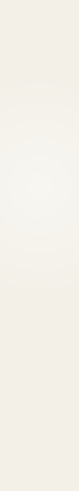

# UI Design System & Master Generation Blueprint: yigua-art

> **一卦** (https://yigua.art/?lang=en) — 讓卦回到卦。一次起卦，只呈現卦象與原典；解讀留給你。


---

## 1. Executive Visual Persona & Design Archetype

- **Brand Essence & Persona**: **一卦** (`https://yigua.art/?lang=en`). 讓卦回到卦。一次起卦，只呈現卦象與原典；解讀留給你。
- **Visual Archetype**: **Light-Substrate Editorial & Modular Grid System (`#f3f0e8` canvas, `#171815` ink, `#171815` accent)**.
- **Anti-AI-Slop Differentiators**:
  - **Source-Grounded Chromatic Polarity**: Anchors the viewport in `#f3f0e8` (`var(--paper)` in `:root`) paired with `#171815` primary typography and `#171815` accents.
  - **Extracted Typographic Hierarchy**: Pairs `Yigua Korean` for display copy (`Let the hexagram remain itself.`) with `Songti TC` and `SFMono-Regular`.
  - **Calibrated Spatial Grid & Motion**: Combines `82rem` container bounds (`gap: .5rem`, padding `4px`) with `cubic-bezier(0,0,.2,1)` easing.

---

## 2. Spatial Architecture & Modular Grid Mathematics



### Viewport Allocation & Container Geometry
- **Captured Viewport Dimensions**: Desktop `1440×2400px` (`assets/desktop.png`, capped at 2400px multi-section capture), Mobile `390×2400px` (`assets/mobile.png`, capped at 2400px multi-section capture).
- **Master Container Bounds**: `82rem` extracted from `yigua-art` stylesheet.
- **Canvas Lateral Padding & Spacing**: `4px` lateral canvas padding with `.5rem` grid gap.
- **Border Radius Scale**: `var(--radius)`, `999px`, `.35rem`, `1px`.

### Responsive Breakpoint Architecture
- **Desktop Layout**: Multi-column CSS Grid / Flexbox layout at `1440px` (`max-width: 82rem`, `gap: .5rem`).
- **Mobile Layout**: Single-column vertical stack at `390px` viewport width with `4px` horizontal padding.
- **Extracted CSS Media Queries**: `@media (min-width:800px)`, `@media (prefers-reduced-motion:reduce)`, `@media (max-width:479px)`, `@media (max-width:480px)`.

---

## 3. Color System, Materiality & Atmospheric Lighting

### Semantic Palette & Source Grounding
| Semantic Role | Ground-Truth Value | Extracted CSS Source / Selector |
|---|---|---|
| **Primary Canvas Substrate** | `#f3f0e8` | `var(--paper)` in `:root` |
| **Primary Typography Ink** | `#e8e3d7` | `var(--paper-deep)` in `:root` |
| **Elevated Surface / Card Substrate** | `#f8f6ef` | `var(--paper-light)` in `:root` |
| **Interactive Accent / Highlight** | `#171815` | `var(--ink)` in `:root` |
| **Secondary / Muted Copy** | `#65645e` | `var(--ink-soft)` in `:root` |
| **Structural Hairline Border** | `#d6d0c4` | `var(--line)` in `:root` |

### Sanitized Root CSS Variables (`ui-ux.md` Ground Truth)
| Variable Name | Extracted Value | Semantic Role |
|---|---|---|
| `--font-sans` | `var(--font-interface)` | Typography / Scale Token |
| `--spacing` | `.25rem` | Layout / Spatial Grid Token |
| `--text-xs` | `.75rem` | Typography Ink Token |
| `--text-xs--line-height` | `calc(1 / .75)` | Typography Ink Token |
| `--text-sm` | `.875rem` | Typography Ink Token |
| `--text-sm--line-height` | `calc(1.25 / .875)` | Typography Ink Token |
| `--font-weight-medium` | `500` | Typography / Scale Token |
| `--radius-md` | `calc(var(--radius) * .8)` | Elevation / Border Token |
| `--ease-out` | `cubic-bezier(0, 0, .2, 1)` | Motion / Easing Token |
| `--default-transition-duration` | `.15s` | Motion / Easing Token |
| `--default-transition-timing-function` | `cubic-bezier(.4, 0, .2, 1)` | Motion / Easing Token |
| `--default-font-family` | `var(--font-interface)` | Typography / Scale Token |
| `--default-mono-font-family` | `var(--font-mono)` | Typography / Scale Token |
| `--paper` | `#f3f0e8` | Canvas / Surface Token |
| `--paper-deep` | `#e8e3d7` | Canvas / Surface Token |
| `--paper-light` | `#f8f6ef` | Canvas / Surface Token |

---

## 4. Typographic Scale & Editorial Hierarchy

### Font Family Stacks
- **Display Typography**: `Yigua Korean`.
- **Primary Body Stack**: `Songti TC`.
- **Technical / Metadata Stack**: `SFMono-Regular`.

### Typographic Scale & Rules (Extracted from Stylesheet & Variables)
- **Hero Display (`H1`)**: rule `h1` (`line-height: 1.12`, `letter-spacing: .025em`).
- **Section Heading (`H2`)**: rule `h2` (`font-size: clamp(1.65rem,3vw,2.2rem)`, `letter-spacing: .12em`, `font-weight: 500`).
- **Body Copy**: rule `p` (`letter-spacing: .02em`).
- **Metadata & Navigation Labels**: CSS variables `--text-xs: .75rem`, `--text-xs--line-height: calc(1 / .75)`, `--text-sm: .875rem`.

---

## 5. Choreographed Motion & Interaction Physics

### Primary Easing Curves
- **Extracted Timing Functions**: `cubic-bezier(0,0,.2,1)`, `cubic-bezier(.4,0,.2,1)`, `cubic-bezier(.22,1,.36,1)`.

### Per-Element Transition & Choreography Rules
- **Selector `layer theme`**: `transition: .15s` extracted from `yigua-art` stylesheet.
- **Selector `.transition`**: `transition: var(--tw-ease,var(--default-transition-timing-function))` extracted from `yigua-art` stylesheet.
- **Selector `.transition-all`**: `transition: var(--tw-ease,var(--default-transition-timing-function))` extracted from `yigua-art` stylesheet.
- **Extracted Easing Curve (`cubic-bezier(0,0,.2,1)`)**: Governs interactive state transitions across `<header.site-header>` and `<section.casting-experience>`.
- **State & Hover Choreography**: Opacity and transform transitions on `<section.casting-experience>` and `<section.casting-experience>` interactive targets.

---

## 6. Component Wireframe & Structural DOM Map

### Visual Layout Schematic (Grounded in `dom.html` — `1440px` Desktop & `390px` Mobile Reflow)
```
┌────────────────────────────────────────────────────────────────────────┐
│ DESKTOP VIEWPORT (1440px) — 一卦                                         │
│ ====================================================================== │
│ [ <header.site-header>     | 64 Hexagrams · About Yi Gua · Privacy  ]  │
│ ---------------------------------------------------------------------- │
│ | HERO STAGE: <section.casting-experience>                         |   │
│ | H1: Let the hexagram remain itself.                              |   │
│ | Substrate: #f3f0e8    | Ink: #171815    | Accent: #171815        |   │
│ ---------------------------------------------------------------------- │
│ | SHOWCASE GRID (<section.casting-experienc) max-w: 82rem          |   │
│ | +------------------------------+  +------------------------------+ | │
│ | | One casting. Only the figure |  | One casting. Only the figure | | │
│ | +------------------------------+  +------------------------------+ | │
│ ---------------------------------------------------------------------- │
│ | MOBILE VIEWPORT REFLOW (390px) — Single-Column Stack (gap: .5rem ) | │
│ | [<header.site-heade] -> [<section.casting-e] -> [<section.casting-e] │
│ ---------------------------------------------------------------------- │
│ [ FOOTER (<footer.site-footer>  ) | https://yigua.art/?lang=en         │
└────────────────────────────────────────────────────────────────────────┘
```

### Granular DOM Region Breakdown
1. **Brand Header & Navigation Bar (<header.site-header> — `yigua-art`)**:
   - Landmark `<header class="site-header">` hosting `一卦` navigation (`64 Hexagrams · About Yi Gua · Privacy · Developer · Researchers`), DOM attributes (`data-locale="en"`, `data-startup-lifecycle-bound="true"`, `data-startup-booted="true"`, `data-text-size="medium"`), and stylesheet rule `before { box-sizing:border-box;border:0 solid;margin:0;padding:0 }`.
2. **Hero Stage & Focal Lead (<section.casting-experience> — `Let the hexagram remain itself.`)**:
   - Landmark `<section class="casting-experience">` presenting display lead `Let the hexagram remain itself.` and copy excerpt *"One casting. Only the figure and original text; the interpretatio"* over `#f3f0e8` canvas and `#171815` ink.
3. **Primary Showcase & Content Grid (<section.casting-experience> — `One casting. Only the figure and o`)**:
   - Landmark `<section class="casting-experience">` rendering section `One casting. Only the figure and original text; ` with copy *"One casting. Only the figure and original text;"*, asset references (`index.B1O6CZI_.css`, `index-BdTq9GkK.js`, `rolldown-runtime-C60lm6uB.js`, `framework-D_rUT4EX.js`), and grid rule `backdrop { box-sizing:border-box;border:0 solid;margin:0;padding:0 }`.
4. **Interactive Detail & Feature Matrix (<section.casting-experience> — `One casting. Only the figure and o`)**:
   - Landmark `<section class="casting-experience">` framing `One casting. Only the figure and original text;` and `the interpretation is yours.` (*"the interpretation is yours."*) with `#f8f6ef` surface cards, `#171815` accents, and `file-selector-button { box-sizing:border-box;border:0 solid;margin:0;padding:0 }`.
5. **Colophon & Global Directory Footer (<footer.site-footer> — `https://yigua.art/?lang=en`)**:
   - Landmark `<footer class="site-footer">` anchoring `一卦` footer links (`64 Hexagrams · About Yi Gua · Privacy · Developer · Researchers`), copy *"Version 1.4.31 · Updated 2026-11-04 CC BY 4.0 · Original pre"*, and `#d6d0c4` structural dividers.

---

## 7. Master Zero-Shot AI Generation Prompt

```markdown
# Master Zero-Shot Frontend Generation Prompt: yigua-art (一卦)

You are a principal frontend architect and design systems engineer. Build a complete, production-ready web application replicating the exact design system, DOM landmarks, typographic hierarchy, color tokens, and motion physics of `yigua-art` (**一卦** — `https://yigua.art/?lang=en`).

### 1. Visual Archetype & Anti-AI-Slop Mandates
- **Archetype**: Light-Substrate Editorial & Modular Grid System (`#f3f0e8` canvas, `#171815` ink, `#171815` accent).
- **Identity & Domain Context**: 讓卦回到卦。一次起卦，只呈現卦象與原典；解讀留給你。
- **Primary Substrate**: `#f3f0e8` (`var(--paper)` in `:root`), **Primary Ink**: `#171815`, **Accent / Highlight**: `#171815`.
- **Site-Specific Differentiators**:
  - **Source-Grounded Chromatic Polarity**: Anchors the viewport in `#f3f0e8` (`var(--paper)` in `:root`) paired with `#171815` primary typography and `#171815` accents.
  - **Extracted Typographic Hierarchy**: Pairs `Yigua Korean` for display copy (`Let the hexagram remain itself.`) with `Songti TC` and `SFMono-Regular`.
  - **Calibrated Spatial Grid & Motion**: Combines `82rem` container bounds (`gap: .5rem`, padding `4px`) with `cubic-bezier(0,0,.2,1)` easing.

### 2. Ground-Truth CSS Variables (`:root` Token Contract)
Declare and consume these exact custom properties extracted from `yigua-art` in your global stylesheet:

:root {
  /* 一卦 (yigua-art) — Ground-Truth Extracted CSS Variables */
  --font-sans: var(--font-interface); /* Typography / Scale Token (yigua-art) */
  --spacing: .25rem; /* Layout / Spatial Grid Token (yigua-art) */
  --text-xs: .75rem; /* Typography Ink Token (yigua-art) */
  --text-xs--line-height: calc(1 / .75); /* Typography Ink Token (yigua-art) */
  --text-sm: .875rem; /* Typography Ink Token (yigua-art) */
  --text-sm--line-height: calc(1.25 / .875); /* Typography Ink Token (yigua-art) */
  --font-weight-medium: 500; /* Typography / Scale Token (yigua-art) */
  --radius-md: calc(var(--radius) * .8); /* Elevation / Border Token (yigua-art) */
  --ease-out: cubic-bezier(0, 0, .2, 1); /* Motion / Easing Token (yigua-art) */
  --default-transition-duration: .15s; /* Motion / Easing Token (yigua-art) */
  --default-transition-timing-function: cubic-bezier(.4, 0, .2, 1); /* Motion / Easing Token (yigua-art) */
  --default-font-family: var(--font-interface); /* Typography / Scale Token (yigua-art) */
  --default-mono-font-family: var(--font-mono); /* Typography / Scale Token (yigua-art) */
  --paper: #f3f0e8; /* Canvas / Surface Token (yigua-art) */
  --paper-deep: #e8e3d7; /* Canvas / Surface Token (yigua-art) */
  --paper-light: #f8f6ef; /* Canvas / Surface Token (yigua-art) */
}

### 3. Semantic Color & Materiality Contract
Map every surface, ink, and border strictly to these source-grounded tokens:
- **Primary Canvas Substrate**: `#f3f0e8` — grounded in `var(--paper)` in `:root`
- **Primary Typography Ink**: `#e8e3d7` — grounded in `var(--paper-deep)` in `:root`
- **Elevated Surface / Card Substrate**: `#f8f6ef` — grounded in `var(--paper-light)` in `:root`
- **Interactive Accent / Highlight**: `#171815` — grounded in `var(--ink)` in `:root`
- **Secondary / Muted Copy**: `#65645e` — grounded in `var(--ink-soft)` in `:root`
- **Structural Hairline Border**: `#d6d0c4` — grounded in `var(--line)` in `:root`

### 4. Spatial Grid, Container Bounds & Responsive Breakpoints
- **Desktop Viewport Reference**: `1440×2400px` (capped at 2400px multi-section capture, `1440px` standard desktop width).
- **Mobile Viewport Reference**: `390×2400px` (capped at 2400px multi-section capture, `390px` standard mobile width).
- **Container Max-Width**: `82rem` extracted from `yigua-art` stylesheet
- **Padding & Gutters**: `4px` lateral canvas padding with `.5rem` grid gap
- **Desktop Grid**: Multi-column CSS Grid / Flexbox layout at `1440px` (`max-width: 82rem`, `gap: .5rem`)
- **Mobile Adaptation**: Single-column vertical stack at `390px` viewport width with `4px` horizontal padding
- **Media Queries**: `@media (min-width:800px)`, `@media (prefers-reduced-motion:reduce)`, `@media (max-width:479px)`, `@media (max-width:480px)`
- **Corner Radii**: `var(--radius)`, `999px`, `.35rem`, `1px`

### 5. Typography & Editorial Scale Contract
- **Display Font Stack**: `Yigua Korean`
- **Body Font Stack**: `Songti TC`
- **Monospace / Technical Font Stack**: `SFMono-Regular`
- **H1 Display Rule**: rule `h1` (`line-height: 1.12`, `letter-spacing: .025em`)
- **H2 Section Rule**: rule `h2` (`font-size: clamp(1.65rem,3vw,2.2rem)`, `letter-spacing: .12em`, `font-weight: 500`)
- **Body Copy Rule**: rule `p` (`letter-spacing: .02em`)
- **Metadata & Index Rule**: CSS variables `--text-xs: .75rem`, `--text-xs--line-height: calc(1 / .75)`, `--text-sm: .875rem`

### 6. Component Hierarchy, Verbatim Copy & Real DOM Landmarks
Scaffold `yigua-art` (`一卦`) with these exact structural regions, extracted copy, and CSS rules from `dom.html`:
1. **Brand Header & Navigation Bar (<header.site-header> — `yigua-art`)**:
   - DOM & Selectors: Landmark `<header class="site-header">` hosting `一卦` navigation (`64 Hexagrams · About Yi Gua · Privacy · Developer · Researchers`), DOM attributes (`data-locale="en"`, `data-startup-lifecycle-bound="true"`, `data-startup-booted="true"`, `data-text-size="medium"`), and stylesheet rule `before { box-sizing:border-box;border:0 solid;margin:0;padding:0 }`.
   - Responsive Contract: Header `Brand Header & Navigation Bar (<header.site-header> — `yigua-art`)` (`yigua-art`) adapts across `@media (min-width:800px)`, `@media (prefers-reduced-motion:reduce)`, `@media (max-width:479px)`, `@media (max-width:480px)` with `cubic-bezier(0,0,.2,1)`, `cubic-bezier(.4,0,.2,1)`, `cubic-bezier(.22,1,.36,1)` transitions and links `64 Hexagrams · About Yi Gua · Privacy · Developer · Researchers`.
2. **Hero Stage & Focal Lead (<section.casting-experience> — `Let the hexagram remain itself.`)**:
   - DOM & Selectors: Landmark `<section class="casting-experience">` presenting display lead `Let the hexagram remain itself.` and copy excerpt *"One casting. Only the figure and original text; the interpretatio"* over `#f3f0e8` canvas and `#171815` ink.
   - Responsive Contract: Hero stage (`1440×2400px` desktop / `390×2400px` mobile) sets `#f3f0e8` background with `#171815` headline `Let the hexagram remain itself.`.
3. **Primary Showcase & Content Grid (<section.casting-experience> — `One casting. Only the figure and o`)**:
   - DOM & Selectors: Landmark `<section class="casting-experience">` rendering section `One casting. Only the figure and original text; ` with copy *"One casting. Only the figure and original text;"*, asset references (`index.B1O6CZI_.css`, `index-BdTq9GkK.js`, `rolldown-runtime-C60lm6uB.js`, `framework-D_rUT4EX.js`), and grid rule `backdrop { box-sizing:border-box;border:0 solid;margin:0;padding:0 }`.
   - Responsive Contract: Showcase grid `Primary Showcase & Content Grid (<section.casting-experience> — `One casting. Only the figure and o`)` applies Multi-column CSS Grid / Flexbox layout at `1440px` (`max-width: 82rem`, `gap: .5rem`) on desktop and Single-column vertical stack at `390px` viewport width with `4px` horizontal padding on mobile.
4. **Interactive Detail & Feature Matrix (<section.casting-experience> — `One casting. Only the figure and o`)**:
   - DOM & Selectors: Landmark `<section class="casting-experience">` framing `One casting. Only the figure and original text;` and `the interpretation is yours.` (*"the interpretation is yours."*) with `#f8f6ef` surface cards, `#171815` accents, and `file-selector-button { box-sizing:border-box;border:0 solid;margin:0;padding:0 }`.
   - Responsive Contract: Detail module `Interactive Detail & Feature Matrix (<section.casting-experience> — `One casting. Only the figure and o`)` uses `var(--radius)`, `999px`, `.35rem`, `1px` radii, `#171815` highlights, and assets (index.B1O6CZI_.css, index-BdTq9GkK.js, rolldown-runtime-C60lm6uB.js).
5. **Colophon & Global Directory Footer (<footer.site-footer> — `https://yigua.art/?lang=en`)**:
   - DOM & Selectors: Landmark `<footer class="site-footer">` anchoring `一卦` footer links (`64 Hexagrams · About Yi Gua · Privacy · Developer · Researchers`), copy *"Version 1.4.31 · Updated 2026-11-04 CC BY 4.0 · Original pre"*, and `#d6d0c4` structural dividers.
   - Responsive Contract: Footer `Colophon & Global Directory Footer (<footer.site-footer> — `https://yigua.art/?lang=en`)` aligns to `82rem` extracted from `yigua-art` stylesheet with `4px` lateral canvas padding with `.5rem` grid gap and attributes (data-locale="en", data-startup-lifecycle-bound="true", data-startup-booted="true").

#### Verbatim DOM Copy Excerpts (`dom.html`)
- Copy Excerpt 1: *"One casting. Only the figure and original text; the interpretation is yours."*
- Copy Excerpt 2: *"One casting. Only the figure and original text;"*
- Copy Excerpt 3: *"the interpretation is yours."*
- Copy Excerpt 4: *"Version 1.4.31 · Updated 2026-11-04 CC BY 4.0 · Original presentation and notes 64..."*

### 7. Motion, Extracted Stylesheet Rules & Interaction Choreography
- **Primary Easing Functions**: `cubic-bezier(0,0,.2,1)`, `cubic-bezier(.4,0,.2,1)`, `cubic-bezier(.22,1,.36,1)`
- **Extracted Stylesheet Rules (`yigua-art`)**:
- `before { box-sizing:border-box;border:0 solid;margin:0;padding:0 }`
- `backdrop { box-sizing:border-box;border:0 solid;margin:0;padding:0 }`
- `file-selector-button { box-sizing:border-box;border:0 solid;margin:0;padding:0 }`
- `strong { font-weight:bolder }`
- `small { font-size:80% }`
- **Per-Selector Transition Rules**:
- **Selector `layer theme`**: `transition: .15s` extracted from `yigua-art` stylesheet.
- **Selector `.transition`**: `transition: var(--tw-ease,var(--default-transition-timing-function))` extracted from `yigua-art` stylesheet.
- **Selector `.transition-all`**: `transition: var(--tw-ease,var(--default-transition-timing-function))` extracted from `yigua-art` stylesheet.
- **Extracted Easing Curve (`cubic-bezier(0,0,.2,1)`)**: Governs interactive state transitions across `<header.site-header>` and `<section.casting-experience>`.
- **State & Hover Choreography**: Opacity and transform transitions on `<section.casting-experience>` and `<section.casting-experience>` interactive targets.

### 8. Technical Deliverables
- Implement in Next.js (App Router) with TypeScript and Tailwind CSS consuming the `:root` custom properties defined above for `yigua-art`.
- Reproduce both the `1440px` desktop architecture and `390px` mobile breakpoint transitions, preserving semantic HTML5 landmarks (`<header>`, `<nav>`, `<main>`, `<section>`, `<footer>`) and `prefers-reduced-motion` accessibility guards.
```
