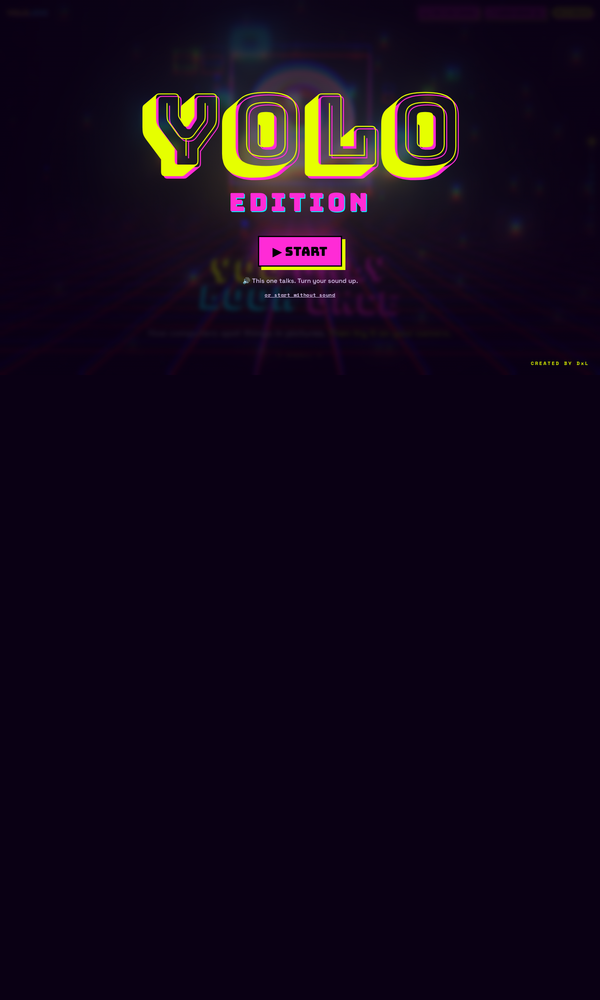
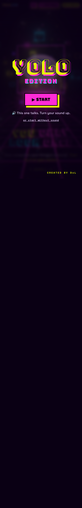

# UI Design System & Master Generation Blueprint: yoloexe-com

> **YOLO — DxL** (https://yoloexe.com) — A loud, scrolling crash course in YOLO: how computers spot things in pictures, in one look. Then run 27 real YOLO models in your browser.



---

## 1. Executive Visual Persona & Design Archetype

- **Brand Essence & Persona**: **YOLO — DxL** (`https://yoloexe.com`). A loud, scrolling crash course in YOLO: how computers spot things in pictures, in one look. Then run 27 real YOLO models in your browser.
- **Capture Provenance**: Live browser capture (`tier1_fast`, HTTP `200`, captured `2026-11-23`).
- **Visual Archetype**: **Dark-Substrate WebGL / Canvas Interactive Experience (`#0a0014` / `#00f0ff`)**.
- **Anti-AI-Slop Differentiators**:
  - **Live-Computed Chromatic Polarity**: Anchors the viewport in `#0a0014` (live computed `body` `background-color` (`computed_styles.json`)) paired with `#fff6fd` primary typography and `#00f0ff` accents.
  - **Grounded Typographic Hierarchy**: Pairs `Bungee Shade` for display copy (`YOLO EDITION`) with `Space Grotesk` and `Space Mono`.
  - **Calibrated Spatial Grid & Motion**: Combines `1440px` container bounds (`gap: 9px`, padding `6px`) with `cubic-bezier(.2,2,.4,1)` easing and Three.js / WebGL Canvas Pipeline.

---

## 2. Spatial Architecture & Modular Grid Mathematics



### Viewport Allocation & Container Geometry
- **Captured Viewport Dimensions**: Desktop `1440×2400px` (`assets/desktop.png`, clamped at 2400px live multi-section capture), Mobile `390×2400px` (`assets/mobile.png`, clamped at 2400px live multi-section capture).
- **Master Container Bounds**: `1440px` (full-bleed `100%` desktop stage measured on `1440px` viewport).
- **Canvas Lateral Padding & Spacing**: `6px` lateral canvas padding with `9px` grid gap.
- **Border Radius Scale**: `99px`, `4px`, `3px`.

### Responsive Breakpoint Architecture
- **Desktop Layout**: Multi-column CSS Grid / Flexbox layout at `1440px` (`max-width: 1440px`, `gap: 9px`).
- **Mobile Layout**: Single-column vertical stack at `390px` viewport width with `6px` horizontal padding.
- **Extracted CSS Media Queries**: `@media (max-width:720px)`, `@media (max-width:900px)`, `@media (prefers-reduced-motion:reduce)`.

---

## 3. Color System, Materiality & Atmospheric Lighting

### Semantic Palette & Source Grounding
| Semantic Role | Ground-Truth Value | Extracted Live / CSS Source |
|---|---|---|
| **Primary Canvas Substrate** | `#0a0014` | live computed `body` `background-color` (`computed_styles.json`) |
| **Primary Typography Ink** | `#fff6fd` | live computed `main` `color` (`computed_styles.json`) |
| **Elevated Surface / Card Substrate** | `#ff2bd6` | live computed `button` `background-color` (`computed_styles.json`) |
| **Interactive Accent / Highlight** | `#00f0ff` | live computed `a` `color` (`computed_styles.json`) |
| **Secondary / Muted Copy** | `#ff2bd6` | `var(--pink)` in `:root` |
| **Structural Hairline Border** | `#3b3343` | `code { border: #3b3343 }` |
| **Variable Token (`--muted`)** | `#c9b6dd` | `var(--muted)` in `:root` |
| **Variable Token (`--acid`)** | `#e6ff00` | `var(--acid)` in `:root` |
| **Variable Token (`--orange`)** | `#ff7a1a` | `var(--orange)` in `:root` |
| **Variable Token (`--violet`)** | `#8a2bff` | `var(--violet)` in `:root` |

### Sanitized Root CSS Variables (`ui-ux.md` Ground Truth)
| Variable Name | Extracted Value | Semantic Role |
|---|---|---|
| `--dxl-bg` | `var(--dxlBg)` | Canvas / Surface Token |
| `--dxl-fg` | `var(--dxlFg)` | Typography Ink Token |
| `--dxl-accent` | `var(--dxlAccent)` | Brand / Palette Token |
| `--bg` | `#0a0014` | Canvas / Surface Token |
| `--ink` | `#fff6fd` | Typography Ink Token |
| `--muted` | `#c9b6dd` | Color / Atmospheric Token |
| `--pink` | `#ff2bd6` | Typography Ink Token |
| `--cyan` | `#00f0ff` | Color / Atmospheric Token |
| `--acid` | `#e6ff00` | Color / Atmospheric Token |
| `--orange` | `#ff7a1a` | Color / Atmospheric Token |
| `--violet` | `#8a2bff` | Color / Atmospheric Token |
| `--card` | `rgba(14, 0, 32, .78)` | Color / Atmospheric Token |
| `--display` | `"Bungee", "Impact", system-ui, sans-serif` | Dimension / Scale Token |
| `--shade` | `"Bungee Shade", "Bungee", "Impact", system-ui, sans-serif` | Dimension / Scale Token |
| `--body` | `"Space Grotesk", ui-sans-serif, system-ui, sans-serif` | Dimension / Scale Token |
| `--mono` | `"Space Mono", ui-monospace, monospace` | Typography / Scale Token |

---

## 4. Typographic Scale & Editorial Hierarchy

### Font Family Stacks
- **Display Typography**: `Bungee Shade`.
- **Primary Body Stack**: `Space Grotesk`.
- **Technical / Metadata Stack**: `Space Mono`.

### Typographic Scale & Rules (Live Computed & Stylesheet Grounded)
- **Hero Display (`H1`)**: live computed `h1` (`font-size: 234px`, `line-height: 257.4px`, `font-weight: 400`); CSS variables `--display: "Bungee", "Impact", system-ui, sans-serif`; rule `.title` (`letter-spacing: -.01em`).
- **Section Heading (`H2`)**: live computed `h2` (`font-size: 72px`, `line-height: 73.44px`, `font-weight: 400`, `letter-spacing: -0.72px`); rule `h2` (`font-size: clamp(30px,4.4vw,54px)`, `line-height: 1`, `font-weight: 400`).
- **Body Copy**: live computed `body` (`font-size: 18px`, `line-height: 27.9px`, `font-weight: 400`); CSS variables `--body: "Space Grotesk", ui-sans-serif, system-ui, sans-serif`; rule `p` (`font-size: 19px`).
- **Metadata & Navigation Labels**: live computed `nav/a` (`font-size: 18px`, `line-height: 27.9px`, `font-weight: 400`); CSS variables `--mono: "Space Mono", ui-monospace, monospace`; rule `small` (`font-size: 14px`, `letter-spacing: .2em`).

---

## 5. Choreographed Motion & Interaction Physics

### Primary Easing Curves
- **Extracted Timing Functions**: `cubic-bezier(.2,2,.4,1)`, `cubic-bezier(.2,1.6,.4,1)`, `cubic-bezier(.2,1.4,.4,1)`.

### Per-Element Transition & Choreography Rules
- **Selector `.dxl-mark[data-astro-cid-n6wkilw4]`**: `transition: opacity .2s` extracted from `yoloexe-com` stylesheet.
- **Selector `.big-counter`**: `transition: opacity .3s` extracted from `yoloexe-com` stylesheet.
- **Selector `.cursor-box`**: `transition: border-color .2s,box-shadow .2s,opacity .2s` extracted from `yoloexe-com` stylesheet.
- **Extracted Easing Curve (`cubic-bezier(.2,2,.4,1)`)**: Governs interactive state transitions across `<nav.dots>` and `<section.chap:nth(2)>`.
- **Runtime Interaction Engine**: Integrates Three.js / WebGL Canvas Pipeline with `prefers-reduced-motion: reduce` fallback guards.

---

## 6. Component Wireframe & Structural DOM Map

### Visual Layout Schematic — Desktop (`1440px`, Grounded in `dom.html` & Landmark Bounding Boxes)
```
┌────────────────────────────────────────────────────────────────────────┐
│ DESKTOP VIEWPORT (1440px) — YOLO — DxL                                 │
│ ====================================================================== │
│ [ <nav.dots> (11x231px)               | Overview · Index · Archive · ] │
│ ---------------------------------------------------------------------- │
│ | HERO STAGE: <section.chap> (w=1440px)                              | │
│ | H1: YOLO EDITION                                                   | │
│ | Substrate: #0a0014 | Ink: #fff6fd | Accent: #00f0ff                | │
│ ---------------------------------------------------------------------- │
│ | SHOWCASE GRID (<section.chap:nth(2)>) max-w: 1440px                | │
│ | +------------------------------+  +------------------------------+ | │
│ | | YOU ONLY LOOK ONCE           |  | NOW YOU KNOW YOLO.           | | │
│ | +------------------------------+  +------------------------------+ | │
│ ---------------------------------------------------------------------- │
│ | DETAIL MODULE (<section.chap:nth(3)>) — YOUR TURN.                 | │
│ ---------------------------------------------------------------------- │
│ [ FOOTER (<footer.hud>        ) | https://yoloexe.com                  │
└────────────────────────────────────────────────────────────────────────┘
```

### Visual Layout Schematic — Mobile Reflow (`390px`)
```
┌────────────────────────────────────────────────────────────────────────┐
│ MOBILE VIEWPORT REFLOW (390px) — Single-Column Stack (gap: 9px)        │
│ ====================================================================== │
│ [ HEADER BAR (<nav.dots>              ) | Compact Menu (390px)         │
│ ---------------------------------------------------------------------- │
│ | HERO STAGE (<section.chap>) — 390px Vertical Lead                  | │
│ | H1: YOLO EDITION                                                   | │
│ ---------------------------------------------------------------------- │
│ | SHOWCASE STACK (<section.chap:nth(2)>) — 1-Col Stack               | │
│ | [ Item 1: YOU ONLY LOOK ONCE                                     ] | │
│ | [ Item 2: NOW YOU KNOW YOLO.                                     ] | │
│ ---------------------------------------------------------------------- │
│ | DETAIL STACK (<section.chap:nth(3)>) — 1-Col (YOUR TURN.)          | │
│ ---------------------------------------------------------------------- │
│ [ FOOTER (<footer.hud>        ) | Stacked 390px Colophon               │
└────────────────────────────────────────────────────────────────────────┘
```

### Granular DOM Region Breakdown
1. **Brand Header & Navigation Bar (<nav.dots> — `yoloexe-com`)**:
   - Landmark `<nav class="dots">` (`11x231px`) hosting `YOLO — DxL` navigation (`Overview · Index · Archive · About · Contact`), DOM attributes (`data-engine="three.js r180"`, `data-yolo="button"`, `data-yolo="button"`, `data-i="0"`), and stylesheet rule `html { scroll-behavior:auto;overflow-x:clip }`.
2. **Hero Stage & Focal Lead (<section.chap> — `YOLO EDITION`)**:
   - Landmark `<section class="chap hero">` presenting display lead `YOLO EDITION` and copy excerpt *"🔊 This one talks. Turn your sound up."* over `#0a0014` canvas and `#fff6fd` ink.
3. **Primary Showcase & Content Grid (<section.chap:nth(2)> — `YOU ONLY LOOK ONCE`)**:
   - Landmark `<section class="chap">` rendering section `YOU ONLY LOOK ONCE` with copy *"How computers spot things in pictures. Then try it on your camera"*, asset references (`favicon.svg`, `apple-touch-icon.png`, `sitemap-index.xml`, `script.js`), and grid rule `body { margin:0;background:var(--bg);color:var(--ink);font-family:var(--body);f... }`.
4. **Interactive Detail & Feature Matrix (<section.chap:nth(3)> — `NOW YOU KNOW YOLO.`)**:
   - Landmark `<section class="chap">` framing `NOW YOU KNOW YOLO.` and `YOUR TURN.` (*"This is how YOLO works"*) with `#ff2bd6` surface cards, `#00f0ff` accents, and `selection { background:var(--acid);color:000 }`.
5. **Colophon & Global Directory Footer (<footer.hud> — `https://yoloexe.com`)**:
   - Landmark `<footer class="hud">` anchoring `YOLO — DxL` footer links (`Overview · Index · Archive · About · Contact`), copy *"Cut the picture into a grid"*, and `#3b3343` structural dividers.

---

## 7. Master Zero-Shot AI Generation Prompt

```markdown
# Master Zero-Shot Frontend Generation Prompt: yoloexe-com (YOLO — DxL)

You are a principal frontend architect and design systems engineer. Build a complete, production-ready web application replicating the exact design system, DOM landmarks, typographic hierarchy, color tokens, and motion physics of `yoloexe-com` (**YOLO — DxL** — `https://yoloexe.com`).

### 1. Visual Archetype & Anti-AI-Slop Mandates
- **Archetype**: Dark-Substrate WebGL / Canvas Interactive Experience (`#0a0014` / `#00f0ff`).
- **Identity & Domain Context**: A loud, scrolling crash course in YOLO: how computers spot things in pictures, in one look. Then run 27 real YOLO models in your browser.
- **Primary Substrate**: `#0a0014` (live computed `body` `background-color` (`computed_styles.json`)), **Primary Ink**: `#fff6fd`, **Accent / Highlight**: `#00f0ff`.
- **Site-Specific Differentiators**:
  - **Live-Computed Chromatic Polarity**: Anchors the viewport in `#0a0014` (live computed `body` `background-color` (`computed_styles.json`)) paired with `#fff6fd` primary typography and `#00f0ff` accents.
  - **Grounded Typographic Hierarchy**: Pairs `Bungee Shade` for display copy (`YOLO EDITION`) with `Space Grotesk` and `Space Mono`.
  - **Calibrated Spatial Grid & Motion**: Combines `1440px` container bounds (`gap: 9px`, padding `6px`) with `cubic-bezier(.2,2,.4,1)` easing and Three.js / WebGL Canvas Pipeline.

### 2. Ground-Truth CSS Variables (`:root` Token Contract)
Declare and consume these exact custom properties extracted from `yoloexe-com` in your global stylesheet:

:root {
  /* YOLO — DxL (yoloexe-com) — Live-Grounded CSS Variables */
  --dxl-bg: var(--dxlBg); /* Canvas / Surface Token (yoloexe-com) */
  --dxl-fg: var(--dxlFg); /* Typography Ink Token (yoloexe-com) */
  --dxl-accent: var(--dxlAccent); /* Brand / Palette Token (yoloexe-com) */
  --bg: #0a0014; /* Canvas / Surface Token (yoloexe-com) */
  --ink: #fff6fd; /* Typography Ink Token (yoloexe-com) */
  --muted: #c9b6dd; /* Color / Atmospheric Token (yoloexe-com) */
  --pink: #ff2bd6; /* Typography Ink Token (yoloexe-com) */
  --cyan: #00f0ff; /* Color / Atmospheric Token (yoloexe-com) */
  --acid: #e6ff00; /* Color / Atmospheric Token (yoloexe-com) */
  --orange: #ff7a1a; /* Color / Atmospheric Token (yoloexe-com) */
  --violet: #8a2bff; /* Color / Atmospheric Token (yoloexe-com) */
  --card: rgba(14, 0, 32, .78); /* Color / Atmospheric Token (yoloexe-com) */
  --display: "Bungee", "Impact", system-ui, sans-serif; /* Dimension / Scale Token (yoloexe-com) */
  --shade: "Bungee Shade", "Bungee", "Impact", system-ui, sans-serif; /* Dimension / Scale Token (yoloexe-com) */
  --body: "Space Grotesk", ui-sans-serif, system-ui, sans-serif; /* Dimension / Scale Token (yoloexe-com) */
  --mono: "Space Mono", ui-monospace, monospace; /* Typography / Scale Token (yoloexe-com) */
}

### 3. Semantic Color & Materiality Contract
Map every surface, ink, and border strictly to these source-grounded tokens:
- **Primary Canvas Substrate**: `#0a0014` — grounded in live computed `body` `background-color` (`computed_styles.json`)
- **Primary Typography Ink**: `#fff6fd` — grounded in live computed `main` `color` (`computed_styles.json`)
- **Elevated Surface / Card Substrate**: `#ff2bd6` — grounded in live computed `button` `background-color` (`computed_styles.json`)
- **Interactive Accent / Highlight**: `#00f0ff` — grounded in live computed `a` `color` (`computed_styles.json`)
- **Secondary / Muted Copy**: `#ff2bd6` — grounded in `var(--pink)` in `:root`
- **Structural Hairline Border**: `#3b3343` — grounded in `code { border: #3b3343 }`
- **Variable Token (`--muted`)**: `#c9b6dd` — grounded in `var(--muted)` in `:root`
- **Variable Token (`--acid`)**: `#e6ff00` — grounded in `var(--acid)` in `:root`
- **Variable Token (`--orange`)**: `#ff7a1a` — grounded in `var(--orange)` in `:root`
- **Variable Token (`--violet`)**: `#8a2bff` — grounded in `var(--violet)` in `:root`

### 4. Spatial Grid, Container Bounds & Responsive Breakpoints
- **Desktop Viewport Reference**: `1440×2400px` (clamped at 2400px live multi-section capture, `1440px` standard desktop width).
- **Mobile Viewport Reference**: `390×2400px` (clamped at 2400px live multi-section capture, `390px` standard mobile width).
- **Container Max-Width**: `1440px` (full-bleed `100%` desktop stage measured on `1440px` viewport)
- **Padding & Gutters**: `6px` lateral canvas padding with `9px` grid gap
- **Desktop Grid**: Multi-column CSS Grid / Flexbox layout at `1440px` (`max-width: 1440px`, `gap: 9px`)
- **Mobile Adaptation**: Single-column vertical stack at `390px` viewport width with `6px` horizontal padding
- **Media Queries**: `@media (max-width:720px)`, `@media (max-width:900px)`, `@media (prefers-reduced-motion:reduce)`
- **Corner Radii**: `99px`, `4px`, `3px`

### 5. Typography & Editorial Scale Contract
- **Display Font Stack**: `Bungee Shade`
- **Body Font Stack**: `Space Grotesk`
- **Monospace / Technical Font Stack**: `Space Mono`
- **H1 Display Rule**: live computed `h1` (`font-size: 234px`, `line-height: 257.4px`, `font-weight: 400`); CSS variables `--display: "Bungee", "Impact", system-ui, sans-serif`; rule `.title` (`letter-spacing: -.01em`)
- **H2 Section Rule**: live computed `h2` (`font-size: 72px`, `line-height: 73.44px`, `font-weight: 400`, `letter-spacing: -0.72px`); rule `h2` (`font-size: clamp(30px,4.4vw,54px)`, `line-height: 1`, `font-weight: 400`)
- **Body Copy Rule**: live computed `body` (`font-size: 18px`, `line-height: 27.9px`, `font-weight: 400`); CSS variables `--body: "Space Grotesk", ui-sans-serif, system-ui, sans-serif`; rule `p` (`font-size: 19px`)
- **Metadata & Index Rule**: live computed `nav/a` (`font-size: 18px`, `line-height: 27.9px`, `font-weight: 400`); CSS variables `--mono: "Space Mono", ui-monospace, monospace`; rule `small` (`font-size: 14px`, `letter-spacing: .2em`)

### 6. Component Hierarchy, Verbatim Copy & Real DOM Landmarks
Scaffold `yoloexe-com` (`YOLO — DxL`) with these exact structural regions, extracted copy, and CSS rules from `dom.html`:
1. **Brand Header & Navigation Bar (<nav.dots> — `yoloexe-com`)**:
   - DOM & Selectors: Landmark `<nav class="dots">` (`11x231px`) hosting `YOLO — DxL` navigation (`Overview · Index · Archive · About · Contact`), DOM attributes (`data-engine="three.js r180"`, `data-yolo="button"`, `data-yolo="button"`, `data-i="0"`), and stylesheet rule `html { scroll-behavior:auto;overflow-x:clip }`.
   - Responsive Contract: Header `Brand Header & Navigation Bar (<nav.dots> — `yoloexe-com`)` (`yoloexe-com`) adapts across `@media (max-width:720px)`, `@media (max-width:900px)`, `@media (prefers-reduced-motion:reduce)` with `cubic-bezier(.2,2,.4,1)`, `cubic-bezier(.2,1.6,.4,1)`, `cubic-bezier(.2,1.4,.4,1)` transitions and links `Overview · Index · Archive · About · Contact`.
2. **Hero Stage & Focal Lead (<section.chap> — `YOLO EDITION`)**:
   - DOM & Selectors: Landmark `<section class="chap hero">` presenting display lead `YOLO EDITION` and copy excerpt *"🔊 This one talks. Turn your sound up."* over `#0a0014` canvas and `#fff6fd` ink.
   - Responsive Contract: Hero stage (`1440×2400px` desktop / `390×2400px` mobile) sets `#0a0014` background with `#fff6fd` headline `YOLO EDITION`.
3. **Primary Showcase & Content Grid (<section.chap:nth(2)> — `YOU ONLY LOOK ONCE`)**:
   - DOM & Selectors: Landmark `<section class="chap">` rendering section `YOU ONLY LOOK ONCE` with copy *"How computers spot things in pictures. Then try it on your camera"*, asset references (`favicon.svg`, `apple-touch-icon.png`, `sitemap-index.xml`, `script.js`), and grid rule `body { margin:0;background:var(--bg);color:var(--ink);font-family:var(--body);f... }`.
   - Responsive Contract: Showcase grid `Primary Showcase & Content Grid (<section.chap:nth(2)> — `YOU ONLY LOOK ONCE`)` applies Multi-column CSS Grid / Flexbox layout at `1440px` (`max-width: 1440px`, `gap: 9px`) on desktop and Single-column vertical stack at `390px` viewport width with `6px` horizontal padding on mobile.
4. **Interactive Detail & Feature Matrix (<section.chap:nth(3)> — `NOW YOU KNOW YOLO.`)**:
   - DOM & Selectors: Landmark `<section class="chap">` framing `NOW YOU KNOW YOLO.` and `YOUR TURN.` (*"This is how YOLO works"*) with `#ff2bd6` surface cards, `#00f0ff` accents, and `selection { background:var(--acid);color:000 }`.
   - Responsive Contract: Detail module `Interactive Detail & Feature Matrix (<section.chap:nth(3)> — `NOW YOU KNOW YOLO.`)` uses `99px`, `4px`, `3px` radii, `#00f0ff` highlights, and assets (favicon.svg, apple-touch-icon.png, sitemap-index.xml).
5. **Colophon & Global Directory Footer (<footer.hud> — `https://yoloexe.com`)**:
   - DOM & Selectors: Landmark `<footer class="hud">` anchoring `YOLO — DxL` footer links (`Overview · Index · Archive · About · Contact`), copy *"Cut the picture into a grid"*, and `#3b3343` structural dividers.
   - Responsive Contract: Footer `Colophon & Global Directory Footer (<footer.hud> — `https://yoloexe.com`)` aligns to `1440px` (full-bleed `100%` desktop stage measured on `1440px` viewport) with `6px` lateral canvas padding with `9px` grid gap and attributes (data-engine="three.js r180", data-yolo="button", data-yolo="button").

#### Verbatim DOM Copy Excerpts (`dom.html`)
- Copy Excerpt 1: *"🔊 This one talks. Turn your sound up."*
- Copy Excerpt 2: *"How computers spot things in pictures. Then try it on your camera."*
- Copy Excerpt 3: *"This is how YOLO works"*
- Copy Excerpt 4: *"Cut the picture into a grid"*

### 7. Motion, Extracted Stylesheet Rules & Interaction Choreography
- **Primary Easing Functions**: `cubic-bezier(.2,2,.4,1)`, `cubic-bezier(.2,1.6,.4,1)`, `cubic-bezier(.2,1.4,.4,1)`
- **Extracted Stylesheet Rules (`yoloexe-com`)**:
- `html { scroll-behavior:auto;overflow-x:clip }`
- `body { margin:0;background:var(--bg);color:var(--ink);font-family:var(--body);f... }`
- `selection { background:var(--acid);color:000 }`
- `gl { position:fixed;top:0;left:0;width:100vw;height:100vh;height:100lvh;displ... }`
- `main { position:relative;z-index:1 }`
- **Per-Selector Transition Rules**:
- **Selector `.dxl-mark[data-astro-cid-n6wkilw4]`**: `transition: opacity .2s` extracted from `yoloexe-com` stylesheet.
- **Selector `.big-counter`**: `transition: opacity .3s` extracted from `yoloexe-com` stylesheet.
- **Selector `.cursor-box`**: `transition: border-color .2s,box-shadow .2s,opacity .2s` extracted from `yoloexe-com` stylesheet.
- **Extracted Easing Curve (`cubic-bezier(.2,2,.4,1)`)**: Governs interactive state transitions across `<nav.dots>` and `<section.chap:nth(2)>`.
- **Runtime Interaction Engine**: Integrates Three.js / WebGL Canvas Pipeline with `prefers-reduced-motion: reduce` fallback guards.

### 8. Technical Deliverables
- Implement in Next.js (App Router) with TypeScript and Tailwind CSS consuming the `:root` custom properties defined above for `yoloexe-com`.
- Reproduce both the `1440px` desktop architecture and `390px` mobile breakpoint transitions, preserving semantic HTML5 landmarks (`<header>`, `<nav>`, `<main>`, `<section>`, `<footer>`) and `prefers-reduced-motion` accessibility guards.
```
