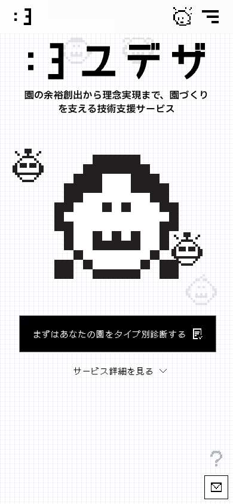

# UI Design System & Master Generation Blueprint: yoyu-design

> **ヨユデザ（よゆでざ）｜幼稚園・保育園・認定こども園の技術支援サービス** (https://yoyu.design/) — 園の業務としくみを整え、まず余裕をつくる。その余裕を、園が大切にする保育の実現へつなげる技術支援サービスです。


---

## 1. Executive Visual Persona & Design Archetype

- **Brand Essence & Persona**: **ヨユデザ（よゆでざ）｜幼稚園・保育園・認定こども園の技術支援サービス** (`https://yoyu.design/`). 園の業務としくみを整え、まず余裕をつくる。その余裕を、園が大切にする保育の実現へつなげる技術支援サービスです。
- **Capture Provenance**: Live browser capture (`tier2_webgl`, HTTP `200`, captured `2026-11-23`).
- **Visual Archetype**: **Light-Gallery WebGL / Canvas Interactive Experience (`#f6f8fb` / `#007aff`)**.
- **Anti-AI-Slop Differentiators**:
  - **Live-Computed Chromatic Polarity**: Anchors the viewport in `#f6f8fb` (live computed `body` `background-color` (`computed_styles.json`)) paired with `#000000` primary typography and `#007aff` accents.
  - **Grounded Typographic Hierarchy**: Pairs `IBM Plex Sans JP` for display copy (`増えすぎたツール を、ひとつに`) with `IBM Plex Sans JP` and not declared in live computed styles (uses primary stack / `ui-monospace`).
  - **Calibrated Spatial Grid & Motion**: Combines `1440px` container bounds (`gap: 40px`, padding `48px`) with `cubic-bezier(.22,1,.36,1)` easing and Swiper Touch Carousel Engine, HTML5 `<canvas>` Interactive Viewport Surface.

---

## 2. Spatial Architecture & Modular Grid Mathematics



### Viewport Allocation & Container Geometry
- **Captured Viewport Dimensions**: Desktop `1440×900px` (`assets/desktop.png`, single-viewport 100vh live capture (900px)), Mobile `390×844px` (`assets/mobile.png`, single-viewport 100vh live capture (844px)).
- **Master Container Bounds**: `1440px` (full-bleed `100%` desktop stage measured on `1440px` viewport).
- **Canvas Lateral Padding & Spacing**: `48px` lateral canvas padding with `40px` grid gap.
- **Border Radius Scale**: `50%`.

### Responsive Breakpoint Architecture
- **Desktop Layout**: Multi-column CSS Grid / Flexbox layout at `1440px` (`max-width: 1440px`, `gap: 40px`).
- **Mobile Layout**: Single-column vertical stack at `390px` viewport width with `48px` horizontal padding.
- **Extracted CSS Media Queries**: `@media screen and (min-width:781px)and (max-width:920px)`, `@media screen and (min-width:781px)and (max-width:1439px)`, `@media screen and (max-width:780px)`, `@media (prefers-reduced-motion:reduce)`.

---

## 3. Color System, Materiality & Atmospheric Lighting

### Semantic Palette & Source Grounding
| Semantic Role | Ground-Truth Value | Extracted Live / CSS Source |
|---|---|---|
| **Primary Canvas Substrate** | `#f6f8fb` | live computed `body` `background-color` (`computed_styles.json`) |
| **Primary Typography Ink** | `#000000` | live computed `h1` `color` (`computed_styles.json`) |
| **Elevated Surface / Card Substrate** | `#ffffff` | live computed `header` `background-color` (`computed_styles.json`) |
| **Interactive Accent / Highlight** | `#007aff` | `:root { color: #007aff }` |
| **Secondary / Muted Copy** | `#007aff` | `:root { color: #007aff }` |
| **Structural Hairline Border** | `#ffffff` | `:disabled { border-color: #ffffff }` |
| **Variable Token (`--color-gray-dark`)** | `#858890` | `var(--color-gray-dark)` in `:root` |
| **Variable Token (`--color-gray-heavy`)** | `#e2e4ea` | `var(--color-gray-heavy)` in `:root` |
| **Variable Token (`--color-gray-middle`)** | `#edeff4` | `var(--color-gray-middle)` in `:root` |
| **Variable Token (`--color-red`)** | `#ff4130` | `var(--color-red)` in `:root` |
| **Variable Token (`--color-yellow`)** | `#eeff5a` | `var(--color-yellow)` in `:root` |
| **Variable Token (`--color-green`)** | `#00b995` | `var(--color-green)` in `:root` |
| **Variable Token (`--color-pale-blue`)** | `#99e1ff` | `var(--color-pale-blue)` in `:root` |
| **Variable Token (`--color-blue`)** | `#004261` | `var(--color-blue)` in `:root` |

### Sanitized Root CSS Variables (`ui-ux.md` Ground Truth)
| Variable Name | Extracted Value | Semantic Role |
|---|---|---|
| `--color-black` | `#000000` | Canvas / Surface Token |
| `--color-gray-dark` | `#858890` | Canvas / Surface Token |
| `--color-gray-heavy` | `#E2E4EA` | Brand / Palette Token |
| `--color-gray-middle` | `#EDEFF4` | Brand / Palette Token |
| `--color-gray-light` | `#F6F8FB` | Canvas / Surface Token |
| `--color-white` | `#FFFFFF` | Canvas / Surface Token |
| `--color-red` | `#FF4130` | Brand / Palette Token |
| `--color-yellow` | `#EEFF5A` | Brand / Palette Token |
| `--color-green` | `#00B995` | Brand / Palette Token |
| `--color-pale-blue` | `#99E1FF` | Brand / Palette Token |
| `--color-blue` | `#004261` | Brand / Palette Token |
| `--pixel-min` | `2px` | Dimension / Scale Token |
| `--pixel-small` | `4px` | Dimension / Scale Token |
| `--grid-unit` | `8px` | Layout / Spatial Grid Token |
| `--menu-bar-delay` | `0ms` | Motion / Easing Token |
| `--idle-big-kid-base-size` | `540px` | Layout / Spatial Grid Token |

---

## 4. Typographic Scale & Editorial Hierarchy

### Font Family Stacks
- **Display Typography**: `IBM Plex Sans JP`.
- **Primary Body Stack**: `IBM Plex Sans JP`.
- **Technical / Metadata Stack**: not declared in live computed styles (uses primary stack / `ui-monospace`).

### Typographic Scale & Rules (Live Computed & Stylesheet Grounded)
- **Hero Display (`H1`)**: live computed `h1` (`font-size: 16px`, `line-height: normal`, `font-weight: 400`).
- **Section Heading (`H2`)**: live computed `h3 (primary section heading)` (`font-size: 24px`, `line-height: 34.56px`, `font-weight: 500`, `letter-spacing: 0.48px`).
- **Body Copy**: live computed `body` (`font-size: 16px`, `line-height: normal`, `font-weight: 400`).
- **Metadata & Navigation Labels**: live computed `nav/a` (`font-size: 16px`, `line-height: normal`, `font-weight: 400`); CSS variables `--pixel-small: 4px`.

---

## 5. Choreographed Motion & Interaction Physics

### Primary Easing Curves
- **Extracted Timing Functions**: `cubic-bezier(.22,1,.36,1)`, `cubic-bezier(0.4,0,0.2,1)`.

### Per-Element Transition & Choreography Rules
- **Selector `.site-header__menu-icon i[data-v-...`**: `transition: top .2s cubic-bezier(.22,1,.36,1),right .2s cubic-bezier(.22,1...` extracted from `yoyu-design` stylesheet.
- **Selector `header__menu-icon i[data-v-8ab53e...`**: `transition: transform 104ms cubic-bezier(.22,1,.36,1)` extracted from `yoyu-design` stylesheet.
- **Selector `e-header-menu-enter-active[data-v...`**: `transition: opacity .16s ease-out` extracted from `yoyu-design` stylesheet.
- **Extracted Easing Curve (`cubic-bezier(.22,1,.36,1)`)**: Governs interactive state transitions across `<header.site-header>` and `<section.quick-test>`.
- **Runtime Interaction Engine**: Integrates Swiper Touch Carousel Engine, HTML5 `<canvas>` Interactive Viewport Surface with `prefers-reduced-motion: reduce` fallback guards.

---

## 6. Component Wireframe & Structural DOM Map

### Visual Layout Schematic — Desktop (`1440px`, Grounded in `dom.html` & Landmark Bounding Boxes)
```
┌────────────────────────────────────────────────────────────────────────┐
│ DESKTOP VIEWPORT (1440px) — ヨユデザ（よゆでざ）｜幼稚園・保育園・認定こども園の技術支援サービス         │
│ ====================================================================== │
│ [ <header.site-header> (1440x80px)    | QUICK TEST · 私たちからの提案 · サポート ] │
│ ---------------------------------------------------------------------- │
│ | HERO STAGE: <section.first-view> (w=1440px)                        | │
│ | H1: 増えすぎたツール を、ひとつに                                                | │
│ | Substrate: #f6f8fb | Ink: #000000 | Accent: #007aff                | │
│ ---------------------------------------------------------------------- │
│ | SHOWCASE GRID (<section.quick-test>) max-w: 1440px                 | │
│ | +------------------------------+  +------------------------------+ | │
│ | | \ ご利用までの流れ /                 |  | ITに詳しくない職員でも大丈夫ですか？          | | │
│ | +------------------------------+  +------------------------------+ | │
│ ---------------------------------------------------------------------- │
│ | DETAIL MODULE (<article.quick-test__panel) — 費用はどれくらいかかりますか？       | │
│ ---------------------------------------------------------------------- │
│ [ FOOTER (<footer.site-footer>) | https://yoyu.design/                 │
└────────────────────────────────────────────────────────────────────────┘
```

### Visual Layout Schematic — Mobile Reflow (`390px`)
```
┌────────────────────────────────────────────────────────────────────────┐
│ MOBILE VIEWPORT REFLOW (390px) — Single-Column Stack (gap: 40px)       │
│ ====================================================================== │
│ [ HEADER BAR (<header.site-header>    ) | Compact Menu (390px)         │
│ ---------------------------------------------------------------------- │
│ | HERO STAGE (<section.first-view>) — 390px Vertical Lead            | │
│ | H1: 増えすぎたツール を、ひとつに                                                | │
│ ---------------------------------------------------------------------- │
│ | SHOWCASE STACK (<section.quick-test>) — 1-Col Stack                | │
│ | [ Item 1: \ ご利用までの流れ /                                           ] | │
│ | [ Item 2: ITに詳しくない職員でも大丈夫ですか？                                    ] | │
│ ---------------------------------------------------------------------- │
│ | DETAIL STACK (<article.quick-test__pan) — 1-Col (費用はどれくらいかかりますか？)  | │
│ ---------------------------------------------------------------------- │
│ [ FOOTER (<footer.site-footer>) | Stacked 390px Colophon               │
└────────────────────────────────────────────────────────────────────────┘
```

### Granular DOM Region Breakdown
1. **Brand Header & Navigation Bar (<header.site-header> — `yoyu-design`)**:
   - Landmark `<header class="site-header is-visible">` (`1440x80px`) hosting `ヨユデザ（よゆでざ）｜幼稚園・保育園・認定こども園の技術支援サービス` navigation (`QUICK TEST · 私たちからの提案 · サポート領域 · 事例紹介 · FAQ`), DOM attributes (`data-question-invasion-reveal-active="false"`, `data-question-invasion-reveal-start-scroll-y="2885"`, `data-question-invasion-covered="false"`, `data-question-content-visible="false"`), and stylesheet rule `.main-content { min-height:100svh }`.
2. **Hero Stage & Focal Lead (<section.first-view> — `増えすぎたツール を、ひとつに`)**:
   - Landmark `<section class="first-view">` presenting display lead `増えすぎたツール を、ひとつに` and copy excerpt *"園の余裕創出から理念実現まで、園づくりを支える技術支援サービス"* over `#f6f8fb` canvas and `#000000` ink.
3. **Primary Showcase & Content Grid (<section.quick-test> — `\ ご利用までの流れ /`)**:
   - Landmark `<section class="quick-test is-idle">` rendering section `\ ご利用までの流れ /` with copy *"システムを導入したのになぜか時間に追われていませんか？"*, asset references (`gtm.js`, `favicon-32.png`, `favicon.svg`, `apple-touch-icon.png`), and grid rule `.idle-big-kid-overlay { translate:var(--idle-big-kid-shake-x, 0) var(--idle-big-kid-shake-y, 0) }`.
4. **Interactive Detail & Feature Matrix (<article.quick-test__panel> — `ITに詳しくない職員でも大丈夫ですか？`)**:
   - Landmark `<article class="quick-test__panel is-current">` framing `ITに詳しくない職員でも大丈夫ですか？` and `費用はどれくらいかかりますか？` (*"保育に集中できない 保育に集中できない 保育に集中できない"*) with `#ffffff` surface cards, `#007aff` accents, and `hover { box-shadow:inset 0 -2px 000 }`.
5. **Colophon & Global Directory Footer (<footer.site-footer> — `https://yoyu.design/`)**:
   - Landmark `<footer class="site-footer">` anchoring `ヨユデザ（よゆでざ）｜幼稚園・保育園・認定こども園の技術支援サー` footer links (`QUICK TEST · 私たちからの提案 · サポート領域 · 事例紹介 · FAQ`), copy *"園児情報を書き写すまいにち 園児情報を書き写すまいにち 園児情報を書き写すまいにち"*, and `#ffffff` structural dividers.

---

## 7. Master Zero-Shot AI Generation Prompt

```markdown
# Master Zero-Shot Frontend Generation Prompt: yoyu-design (ヨユデザ（よゆでざ）｜幼稚園・保育園・認定こども園の技術支援サービス)

You are a principal frontend architect and design systems engineer. Build a complete, production-ready web application replicating the exact design system, DOM landmarks, typographic hierarchy, color tokens, and motion physics of `yoyu-design` (**ヨユデザ（よゆでざ）｜幼稚園・保育園・認定こども園の技術支援サービス** — `https://yoyu.design/`).

### 1. Visual Archetype & Anti-AI-Slop Mandates
- **Archetype**: Light-Gallery WebGL / Canvas Interactive Experience (`#f6f8fb` / `#007aff`).
- **Identity & Domain Context**: 園の業務としくみを整え、まず余裕をつくる。その余裕を、園が大切にする保育の実現へつなげる技術支援サービスです。
- **Primary Substrate**: `#f6f8fb` (live computed `body` `background-color` (`computed_styles.json`)), **Primary Ink**: `#000000`, **Accent / Highlight**: `#007aff`.
- **Site-Specific Differentiators**:
  - **Live-Computed Chromatic Polarity**: Anchors the viewport in `#f6f8fb` (live computed `body` `background-color` (`computed_styles.json`)) paired with `#000000` primary typography and `#007aff` accents.
  - **Grounded Typographic Hierarchy**: Pairs `IBM Plex Sans JP` for display copy (`増えすぎたツール を、ひとつに`) with `IBM Plex Sans JP` and not declared in live computed styles (uses primary stack / `ui-monospace`).
  - **Calibrated Spatial Grid & Motion**: Combines `1440px` container bounds (`gap: 40px`, padding `48px`) with `cubic-bezier(.22,1,.36,1)` easing and Swiper Touch Carousel Engine, HTML5 `<canvas>` Interactive Viewport Surface.

### 2. Ground-Truth CSS Variables (`:root` Token Contract)
Declare and consume these exact custom properties extracted from `yoyu-design` in your global stylesheet:

:root {
  /* ヨユデザ（よゆでざ）｜幼稚園・保育園・認定こども園の技術支援サービス (yoyu-design) — Live-Grounded CSS Variables */
  --color-black: #000000; /* Canvas / Surface Token (yoyu-design) */
  --color-gray-dark: #858890; /* Canvas / Surface Token (yoyu-design) */
  --color-gray-heavy: #E2E4EA; /* Brand / Palette Token (yoyu-design) */
  --color-gray-middle: #EDEFF4; /* Brand / Palette Token (yoyu-design) */
  --color-gray-light: #F6F8FB; /* Canvas / Surface Token (yoyu-design) */
  --color-white: #FFFFFF; /* Canvas / Surface Token (yoyu-design) */
  --color-red: #FF4130; /* Brand / Palette Token (yoyu-design) */
  --color-yellow: #EEFF5A; /* Brand / Palette Token (yoyu-design) */
  --color-green: #00B995; /* Brand / Palette Token (yoyu-design) */
  --color-pale-blue: #99E1FF; /* Brand / Palette Token (yoyu-design) */
  --color-blue: #004261; /* Brand / Palette Token (yoyu-design) */
  --pixel-min: 2px; /* Dimension / Scale Token (yoyu-design) */
  --pixel-small: 4px; /* Dimension / Scale Token (yoyu-design) */
  --grid-unit: 8px; /* Layout / Spatial Grid Token (yoyu-design) */
  --menu-bar-delay: 0ms; /* Motion / Easing Token (yoyu-design) */
  --idle-big-kid-base-size: 540px; /* Layout / Spatial Grid Token (yoyu-design) */
}

### 3. Semantic Color & Materiality Contract
Map every surface, ink, and border strictly to these source-grounded tokens:
- **Primary Canvas Substrate**: `#f6f8fb` — grounded in live computed `body` `background-color` (`computed_styles.json`)
- **Primary Typography Ink**: `#000000` — grounded in live computed `h1` `color` (`computed_styles.json`)
- **Elevated Surface / Card Substrate**: `#ffffff` — grounded in live computed `header` `background-color` (`computed_styles.json`)
- **Interactive Accent / Highlight**: `#007aff` — grounded in `:root { color: #007aff }`
- **Secondary / Muted Copy**: `#007aff` — grounded in `:root { color: #007aff }`
- **Structural Hairline Border**: `#ffffff` — grounded in `:disabled { border-color: #ffffff }`
- **Variable Token (`--color-gray-dark`)**: `#858890` — grounded in `var(--color-gray-dark)` in `:root`
- **Variable Token (`--color-gray-heavy`)**: `#e2e4ea` — grounded in `var(--color-gray-heavy)` in `:root`
- **Variable Token (`--color-gray-middle`)**: `#edeff4` — grounded in `var(--color-gray-middle)` in `:root`
- **Variable Token (`--color-red`)**: `#ff4130` — grounded in `var(--color-red)` in `:root`
- **Variable Token (`--color-yellow`)**: `#eeff5a` — grounded in `var(--color-yellow)` in `:root`
- **Variable Token (`--color-green`)**: `#00b995` — grounded in `var(--color-green)` in `:root`
- **Variable Token (`--color-pale-blue`)**: `#99e1ff` — grounded in `var(--color-pale-blue)` in `:root`
- **Variable Token (`--color-blue`)**: `#004261` — grounded in `var(--color-blue)` in `:root`

### 4. Spatial Grid, Container Bounds & Responsive Breakpoints
- **Desktop Viewport Reference**: `1440×900px` (single-viewport 100vh live capture (900px), `1440px` standard desktop width).
- **Mobile Viewport Reference**: `390×844px` (single-viewport 100vh live capture (844px), `390px` standard mobile width).
- **Container Max-Width**: `1440px` (full-bleed `100%` desktop stage measured on `1440px` viewport)
- **Padding & Gutters**: `48px` lateral canvas padding with `40px` grid gap
- **Desktop Grid**: Multi-column CSS Grid / Flexbox layout at `1440px` (`max-width: 1440px`, `gap: 40px`)
- **Mobile Adaptation**: Single-column vertical stack at `390px` viewport width with `48px` horizontal padding
- **Media Queries**: `@media screen and (min-width:781px)and (max-width:920px)`, `@media screen and (min-width:781px)and (max-width:1439px)`, `@media screen and (max-width:780px)`, `@media (prefers-reduced-motion:reduce)`
- **Corner Radii**: `50%`

### 5. Typography & Editorial Scale Contract
- **Display Font Stack**: `IBM Plex Sans JP`
- **Body Font Stack**: `IBM Plex Sans JP`
- **Monospace / Technical Font Stack**: not declared in live computed styles (uses primary stack / `ui-monospace`)
- **H1 Display Rule**: live computed `h1` (`font-size: 16px`, `line-height: normal`, `font-weight: 400`)
- **H2 Section Rule**: live computed `h3 (primary section heading)` (`font-size: 24px`, `line-height: 34.56px`, `font-weight: 500`, `letter-spacing: 0.48px`)
- **Body Copy Rule**: live computed `body` (`font-size: 16px`, `line-height: normal`, `font-weight: 400`)
- **Metadata & Index Rule**: live computed `nav/a` (`font-size: 16px`, `line-height: normal`, `font-weight: 400`); CSS variables `--pixel-small: 4px`

### 6. Component Hierarchy, Verbatim Copy & Real DOM Landmarks
Scaffold `yoyu-design` (`ヨユデザ（よゆでざ）｜幼稚園・保育園・認定こども園の技術支援サービス`) with these exact structural regions, extracted copy, and CSS rules from `dom.html`:
1. **Brand Header & Navigation Bar (<header.site-header> — `yoyu-design`)**:
   - DOM & Selectors: Landmark `<header class="site-header is-visible">` (`1440x80px`) hosting `ヨユデザ（よゆでざ）｜幼稚園・保育園・認定こども園の技術支援サービス` navigation (`QUICK TEST · 私たちからの提案 · サポート領域 · 事例紹介 · FAQ`), DOM attributes (`data-question-invasion-reveal-active="false"`, `data-question-invasion-reveal-start-scroll-y="2885"`, `data-question-invasion-covered="false"`, `data-question-content-visible="false"`), and stylesheet rule `.main-content { min-height:100svh }`.
   - Responsive Contract: Header `Brand Header & Navigation Bar (<header.site-header> — `yoyu-design`)` (`yoyu-design`) adapts across `@media screen and (min-width:781px)and (max-width:920px)`, `@media screen and (min-width:781px)and (max-width:1439px)`, `@media screen and (max-width:780px)`, `@media (prefers-reduced-motion:reduce)` with `cubic-bezier(.22,1,.36,1)`, `cubic-bezier(0.4,0,0.2,1)` transitions and links `QUICK TEST · 私たちからの提案 · サポート領域 · 事例紹介 · FAQ`.
2. **Hero Stage & Focal Lead (<section.first-view> — `増えすぎたツール を、ひとつに`)**:
   - DOM & Selectors: Landmark `<section class="first-view">` presenting display lead `増えすぎたツール を、ひとつに` and copy excerpt *"園の余裕創出から理念実現まで、園づくりを支える技術支援サービス"* over `#f6f8fb` canvas and `#000000` ink.
   - Responsive Contract: Hero stage (`1440×900px` desktop / `390×844px` mobile) sets `#f6f8fb` background with `#000000` headline `増えすぎたツール を、ひとつに`.
3. **Primary Showcase & Content Grid (<section.quick-test> — `\ ご利用までの流れ /`)**:
   - DOM & Selectors: Landmark `<section class="quick-test is-idle">` rendering section `\ ご利用までの流れ /` with copy *"システムを導入したのになぜか時間に追われていませんか？"*, asset references (`gtm.js`, `favicon-32.png`, `favicon.svg`, `apple-touch-icon.png`), and grid rule `.idle-big-kid-overlay { translate:var(--idle-big-kid-shake-x, 0) var(--idle-big-kid-shake-y, 0) }`.
   - Responsive Contract: Showcase grid `Primary Showcase & Content Grid (<section.quick-test> — `\ ご利用までの流れ /`)` applies Multi-column CSS Grid / Flexbox layout at `1440px` (`max-width: 1440px`, `gap: 40px`) on desktop and Single-column vertical stack at `390px` viewport width with `48px` horizontal padding on mobile.
4. **Interactive Detail & Feature Matrix (<article.quick-test__panel> — `ITに詳しくない職員でも大丈夫ですか？`)**:
   - DOM & Selectors: Landmark `<article class="quick-test__panel is-current">` framing `ITに詳しくない職員でも大丈夫ですか？` and `費用はどれくらいかかりますか？` (*"保育に集中できない 保育に集中できない 保育に集中できない"*) with `#ffffff` surface cards, `#007aff` accents, and `hover { box-shadow:inset 0 -2px 000 }`.
   - Responsive Contract: Detail module `Interactive Detail & Feature Matrix (<article.quick-test__panel> — `ITに詳しくない職員でも大丈夫ですか？`)` uses `50%` radii, `#007aff` highlights, and assets (gtm.js, favicon-32.png, favicon.svg).
5. **Colophon & Global Directory Footer (<footer.site-footer> — `https://yoyu.design/`)**:
   - DOM & Selectors: Landmark `<footer class="site-footer">` anchoring `ヨユデザ（よゆでざ）｜幼稚園・保育園・認定こども園の技術支援サー` footer links (`QUICK TEST · 私たちからの提案 · サポート領域 · 事例紹介 · FAQ`), copy *"園児情報を書き写すまいにち 園児情報を書き写すまいにち 園児情報を書き写すまいにち"*, and `#ffffff` structural dividers.
   - Responsive Contract: Footer `Colophon & Global Directory Footer (<footer.site-footer> — `https://yoyu.design/`)` aligns to `1440px` (full-bleed `100%` desktop stage measured on `1440px` viewport) with `48px` lateral canvas padding with `40px` grid gap and attributes (data-question-invasion-reveal-active="false", data-question-invasion-reveal-start-scroll-y="2885", data-question-invasion-covered="false").

#### Verbatim DOM Copy Excerpts (`dom.html`)
- Copy Excerpt 1: *"園の余裕創出から理念実現まで、園づくりを支える技術支援サービス"*
- Copy Excerpt 2: *"システムを導入したのになぜか時間に追われていませんか？"*
- Copy Excerpt 3: *"保育に集中できない 保育に集中できない 保育に集中できない"*
- Copy Excerpt 4: *"園児情報を書き写すまいにち 園児情報を書き写すまいにち 園児情報を書き写すまいにち"*

### 7. Motion, Extracted Stylesheet Rules & Interaction Choreography
- **Primary Easing Functions**: `cubic-bezier(.22,1,.36,1)`, `cubic-bezier(0.4,0,0.2,1)`
- **Extracted Stylesheet Rules (`yoyu-design`)**:
- `.main-content { min-height:100svh }`
- `.idle-big-kid-overlay { translate:var(--idle-big-kid-shake-x, 0) var(--idle-big-kid-shake-y, 0) }`
- `hover { box-shadow:inset 0 -2px 000 }`
- `before { transform:scaleX(1) }`
- `html.is-yoyu-menu-open body { overflow:hidden }`
- **Per-Selector Transition Rules**:
- **Selector `.site-header__menu-icon i[data-v-...`**: `transition: top .2s cubic-bezier(.22,1,.36,1),right .2s cubic-bezier(.22,1...` extracted from `yoyu-design` stylesheet.
- **Selector `header__menu-icon i[data-v-8ab53e...`**: `transition: transform 104ms cubic-bezier(.22,1,.36,1)` extracted from `yoyu-design` stylesheet.
- **Selector `e-header-menu-enter-active[data-v...`**: `transition: opacity .16s ease-out` extracted from `yoyu-design` stylesheet.
- **Extracted Easing Curve (`cubic-bezier(.22,1,.36,1)`)**: Governs interactive state transitions across `<header.site-header>` and `<section.quick-test>`.
- **Runtime Interaction Engine**: Integrates Swiper Touch Carousel Engine, HTML5 `<canvas>` Interactive Viewport Surface with `prefers-reduced-motion: reduce` fallback guards.

### 8. Technical Deliverables
- Implement in Next.js (App Router) with TypeScript and Tailwind CSS consuming the `:root` custom properties defined above for `yoyu-design`.
- Reproduce both the `1440px` desktop architecture and `390px` mobile breakpoint transitions, preserving semantic HTML5 landmarks (`<header>`, `<nav>`, `<main>`, `<section>`, `<footer>`) and `prefers-reduced-motion` accessibility guards.
```
