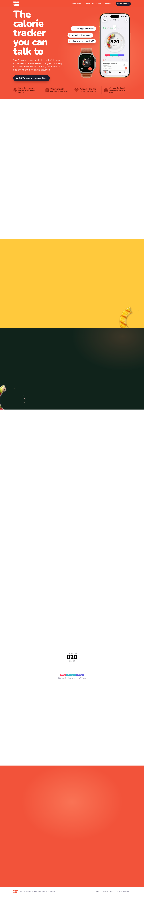
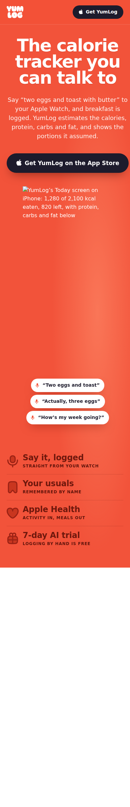

# UI Design System & Master Generation Blueprint: yumlog-dev

> **YumLog — the calorie tracker you can talk to, for Apple Watch and iPhone** (https://yumlog.dev/) — Say what you ate and YumLog logs the calories, protein, carbs and fat. Voice logging on Apple Watch, chat and photos on iPhone, restauran...



---

## 1. Executive Visual Persona & Design Archetype

- **Brand Essence & Persona**: **YumLog — the calorie tracker you can talk to, for Apple Watch and iPhone** (`https://yumlog.dev/`). Say what you ate and YumLog logs the calories, protein, carbs and fat. Voice logging on Apple Watch, chat and photos on iPhone, restauran...
- **Visual Archetype**: **Light-Substrate Editorial & Modular Grid System (`#fff` canvas, `#10231b` ink, `#ff8d6b` accent)**.
- **Anti-AI-Slop Differentiators**:
  - **Source-Grounded Chromatic Polarity**: Anchors the viewport in `#fff` (`var(--ground)` in `:root`) paired with `#10231b` primary typography and `#ff8d6b` accents.
  - **Extracted Typographic Hierarchy**: Pairs `Nunito` for display copy (`The calorie tracker you can talk to`) with `ui-rounded` and not declared in static CSS (uses primary stack / `ui-monospace`).
  - **Calibrated Spatial Grid & Motion**: Combines `1240px` container bounds (`gap: 8px`, padding `11px`) with `cubic-bezier(0.2,0.7,0.2,1)` easing and Three.js / WebGL Canvas Pipeline.

---

## 2. Spatial Architecture & Modular Grid Mathematics



### Viewport Allocation & Container Geometry
- **Captured Viewport Dimensions**: Desktop `1440×8917px` (`assets/desktop.png`, full-page scroll capture), Mobile `390×2400px` (`assets/mobile.png`, capped at 2400px multi-section capture).
- **Master Container Bounds**: `1240px` extracted from `yumlog-dev` stylesheet.
- **Canvas Lateral Padding & Spacing**: `11px` lateral canvas padding with `8px` grid gap.
- **Border Radius Scale**: `999px`, `21px`, `36px`, `50%`.

### Responsive Breakpoint Architecture
- **Desktop Layout**: Multi-column CSS Grid / Flexbox layout at `1440px` (`max-width: 1240px`, `gap: 8px`).
- **Mobile Layout**: Single-column vertical stack at `390px` viewport width with `11px` horizontal padding.
- **Extracted CSS Media Queries**: `@media (prefers-reduced-motion: reduce)`, `@media (max-width: 1200px)`, `@media (max-width: 980px)`, `@media (max-width: 640px)`.

---

## 3. Color System, Materiality & Atmospheric Lighting

### Semantic Palette & Source Grounding
| Semantic Role | Ground-Truth Value | Extracted CSS Source / Selector |
|---|---|---|
| **Primary Canvas Substrate** | `#fff` | `var(--ground)` in `:root` |
| **Primary Typography Ink** | `#f2533a` | `var(--coral)` in `:root` |
| **Elevated Surface / Card Substrate** | `#e53e30` | `var(--coral-deep)` in `:root` |
| **Interactive Accent / Highlight** | `#ff8d6b` | `var(--coral-light)` in `:root` |
| **Secondary / Muted Copy** | `#ffc93c` | `var(--pineapple)` in `:root` |
| **Structural Hairline Border** | `#10231b` | `var(--nori)` in `:root` |
| **Variable Token (`--nori-2`)** | `#1b3a2d` | `var(--nori-2)` in `:root` |
| **Variable Token (`--salmon`)** | `#ff8a5c` | `var(--salmon)` in `:root` |
| **Variable Token (`--donut`)** | `#ffc3d6` | `var(--donut)` in `:root` |
| **Variable Token (`--melon`)** | `#1f7a45` | `var(--melon)` in `:root` |
| **Variable Token (`--night`)** | `#131119` | `var(--night)` in `:root` |
| **Variable Token (`--ink`)** | `#1d1b2c` | `var(--ink)` in `:root` |

### Sanitized Root CSS Variables (`ui-ux.md` Ground Truth)
| Variable Name | Extracted Value | Semantic Role |
|---|---|---|
| `--ground` | `#fff` | Color / Atmospheric Token |
| `--coral` | `#f2533a` | Color / Atmospheric Token |
| `--coral-deep` | `#e53e30` | Color / Atmospheric Token |
| `--coral-light` | `#ff8d6b` | Canvas / Surface Token |
| `--pineapple` | `#ffc93c` | Color / Atmospheric Token |
| `--nori` | `#10231b` | Color / Atmospheric Token |
| `--nori-2` | `#1b3a2d` | Color / Atmospheric Token |
| `--salmon` | `#ff8a5c` | Color / Atmospheric Token |
| `--donut` | `#ffc3d6` | Color / Atmospheric Token |
| `--melon` | `#1f7a45` | Color / Atmospheric Token |
| `--night` | `#131119` | Color / Atmospheric Token |
| `--display` | `ui-rounded, "SF Pro Rounded", "Nunito", system-ui, sans-serif` | Dimension / Scale Token |
| `--shadow-soft` | `0 1px 2px rgb(40 30 90 / 0.06), 0 8px 24px -6px rgb(40 30 90 / 0.16)` | Elevation / Border Token |
| `--shadow-lift` | `0 2px 4px rgb(40 30 90 / 0.08), 0 30px 70px -20px rgb(40 30 90 / 0.4)` | Elevation / Border Token |
| `--gutter` | `32px` | Layout / Spatial Grid Token |
| `--ink` | `#1d1b2c` | Typography Ink Token |

---

## 4. Typographic Scale & Editorial Hierarchy

### Font Family Stacks
- **Display Typography**: `Nunito`.
- **Primary Body Stack**: `ui-rounded`.
- **Technical / Metadata Stack**: not declared in static CSS (uses primary stack / `ui-monospace`).

### Typographic Scale & Rules (Extracted from Stylesheet & Variables)
- **Hero Display (`H1`)**: CSS variables `--display: ui-rounded, "SF Pro Rounded", "Nunito", system-ui, sans-serif`; rule `h1` (`font-size: clamp(52px, 7vw, 100px)`, `line-height: 0.92`, `letter-spacing: -0.035em`).
- **Section Heading (`H2`)**: rule `h2` (`font-size: clamp(40px, 5.4vw, 72px)`).
- **Body Copy**: rule `p` (`font-size: 20px`, `line-height: 1.6`).
- **Metadata & Navigation Labels**: rule `.label` (`font-size: 12px`, `line-height: 1.25`).

---

## 5. Choreographed Motion & Interaction Physics

### Primary Easing Curves
- **Extracted Timing Functions**: `cubic-bezier(0.2,0.7,0.2,1)`, `cubic-bezier(0.2,0.8,0.2,1)`, `cubic-bezier(0.3,1.6,0.5,1)`.

### Per-Element Transition & Choreography Rules
- **Selector `.motion .hearing .w`**: `transition: opacity 0.6s cubic-bezier(0.2,0.7,0.2,1) calc(var(--i) * 75...` extracted from `yumlog-dev` stylesheet.
- **Selector `.motion .hearing::after`**: `transition: opacity 0.6s cubic-bezier(0.2,0.7,0.2,1) calc(var(--n) * 75ms)` extracted from `yumlog-dev` stylesheet.
- **Selector `.top`**: `transition: background-color 0.35s ease, color 0.35s ease, box-shadow 0.35...` extracted from `yumlog-dev` stylesheet.
- **Extracted Easing Curve (`cubic-bezier(0.2,0.7,0.2,1)`)**: Governs interactive state transitions across `<header.top>` and `<section.facts>`.
- **Runtime Interaction Engine**: Integrates Three.js / WebGL Canvas Pipeline with `prefers-reduced-motion: reduce` fallback guards.

---

## 6. Component Wireframe & Structural DOM Map

### Visual Layout Schematic (Grounded in `dom.html` — `1440px` Desktop & `390px` Mobile Reflow)
```
┌────────────────────────────────────────────────────────────────────────┐
│ DESKTOP VIEWPORT (1440px) — YumLog — the calorie tracker you can talk  │
│ ====================================================================== │
│ [ <header.top>             | How it works · Features · Rings · Ques ]  │
│ ---------------------------------------------------------------------- │
│ | HERO STAGE: <section.hero>                                       |   │
│ | H1: The calorie tracker you can talk to                          |   │
│ | Substrate: #fff       | Ink: #10231b    | Accent: #ff8d6b        |   │
│ ---------------------------------------------------------------------- │
│ | SHOWCASE GRID (<section.facts>           ) max-w: 1240px         |   │
│ | +------------------------------+  +------------------------------+ | │
│ | | Say what you ate. Get on wit |  | Two eggs and toast with butt | | │
│ | +------------------------------+  +------------------------------+ | │
│ ---------------------------------------------------------------------- │
│ | MOBILE VIEWPORT REFLOW (390px) — Single-Column Stack (gap: 8px   ) | │
│ | [<header.top>] -> [<section.hero>] -> [<section.facts>] |            │
│ ---------------------------------------------------------------------- │
│ [ FOOTER (<footer.foot>         ) | https://yumlog.dev/                │
└────────────────────────────────────────────────────────────────────────┘
```

### Granular DOM Region Breakdown
1. **Brand Header & Navigation Bar (<header.top> — `yumlog-dev`)**:
   - Landmark `<header class="top">` hosting `YumLog — the calorie tracker you can` navigation (`How it works · Features · Rings · Questions`), DOM attributes (`data-reveal`, `data-sequence="0.5 2.6"`, `data-cycle="8"`, `data-step="1"`), and stylesheet rule `.closing { --ink: 1d1b2c; --ink-2: 4c4a60; --ink-3: 6f6d85; --line: rgb(29 27 44 /... }`.
2. **Hero Stage & Focal Lead (<section.hero> — `The calorie tracker you can talk t`)**:
   - Landmark `<section class="hero">` presenting display lead `The calorie tracker you can talk to` and copy excerpt *"Say “two eggs and toast with butter” to your Apple Watch, and bre"* over `#fff` canvas and `#10231b` ink.
3. **Primary Showcase & Content Grid (<section.facts> — `Say what you ate. Get on with your`)**:
   - Landmark `<section class="facts wrap">` rendering section `Say what you ate. Get on with your day.` with copy *"Get YumLog on the App Store"*, asset references (`favicon.png`, `apple-touch-icon.png`, `home.css`, `site.js`), and grid rule `after { box-sizing: border-box; }`.
4. **Interactive Detail & Feature Matrix (<section.how> — `Two eggs and toast with butter for`)**:
   - Landmark `<section class="how wrap">` framing `Two eggs and toast with butter for breakfast.` and `Can I fit a burger and fries in for lunch?` (*"“Two eggs and toast”"*) with `#e53e30` surface cards, `#ff8d6b` accents, and `html { scroll-behavior: smooth; -webkit-text-size-adjust: 100%; }`.
5. **Colophon & Global Directory Footer (<footer.foot> — `https://yumlog.dev/`)**:
   - Landmark `<footer class="foot">` anchoring `YumLog — the calorie tracker you` footer links (`How it works · Features · Rings · Questions`), copy *"“Actually, three eggs”"*, and `#10231b` structural dividers.

---

## 7. Master Zero-Shot AI Generation Prompt

```markdown
# Master Zero-Shot Frontend Generation Prompt: yumlog-dev (YumLog — the calorie tracker you can talk to, for Apple Watch and iPhone)

You are a principal frontend architect and design systems engineer. Build a complete, production-ready web application replicating the exact design system, DOM landmarks, typographic hierarchy, color tokens, and motion physics of `yumlog-dev` (**YumLog — the calorie tracker you can talk to, for Apple Watch and iPhone** — `https://yumlog.dev/`).

### 1. Visual Archetype & Anti-AI-Slop Mandates
- **Archetype**: Light-Substrate Editorial & Modular Grid System (`#fff` canvas, `#10231b` ink, `#ff8d6b` accent).
- **Identity & Domain Context**: Say what you ate and YumLog logs the calories, protein, carbs and fat. Voice logging on Apple Watch, chat and photos on iPhone, restauran...
- **Primary Substrate**: `#fff` (`var(--ground)` in `:root`), **Primary Ink**: `#10231b`, **Accent / Highlight**: `#ff8d6b`.
- **Site-Specific Differentiators**:
  - **Source-Grounded Chromatic Polarity**: Anchors the viewport in `#fff` (`var(--ground)` in `:root`) paired with `#10231b` primary typography and `#ff8d6b` accents.
  - **Extracted Typographic Hierarchy**: Pairs `Nunito` for display copy (`The calorie tracker you can talk to`) with `ui-rounded` and not declared in static CSS (uses primary stack / `ui-monospace`).
  - **Calibrated Spatial Grid & Motion**: Combines `1240px` container bounds (`gap: 8px`, padding `11px`) with `cubic-bezier(0.2,0.7,0.2,1)` easing and Three.js / WebGL Canvas Pipeline.

### 2. Ground-Truth CSS Variables (`:root` Token Contract)
Declare and consume these exact custom properties extracted from `yumlog-dev` in your global stylesheet:

:root {
  /* YumLog — the calorie tracker you can talk to, for Apple Watch and iPhone (yumlog-dev) — Ground-Truth Extracted CSS Variables */
  --ground: #fff; /* Color / Atmospheric Token (yumlog-dev) */
  --coral: #f2533a; /* Color / Atmospheric Token (yumlog-dev) */
  --coral-deep: #e53e30; /* Color / Atmospheric Token (yumlog-dev) */
  --coral-light: #ff8d6b; /* Canvas / Surface Token (yumlog-dev) */
  --pineapple: #ffc93c; /* Color / Atmospheric Token (yumlog-dev) */
  --nori: #10231b; /* Color / Atmospheric Token (yumlog-dev) */
  --nori-2: #1b3a2d; /* Color / Atmospheric Token (yumlog-dev) */
  --salmon: #ff8a5c; /* Color / Atmospheric Token (yumlog-dev) */
  --donut: #ffc3d6; /* Color / Atmospheric Token (yumlog-dev) */
  --melon: #1f7a45; /* Color / Atmospheric Token (yumlog-dev) */
  --night: #131119; /* Color / Atmospheric Token (yumlog-dev) */
  --display: ui-rounded, "SF Pro Rounded", "Nunito", system-ui, sans-serif; /* Dimension / Scale Token (yumlog-dev) */
  --shadow-soft: 0 1px 2px rgb(40 30 90 / 0.06), 0 8px 24px -6px rgb(40 30 90 / 0.16); /* Elevation / Border Token (yumlog-dev) */
  --shadow-lift: 0 2px 4px rgb(40 30 90 / 0.08), 0 30px 70px -20px rgb(40 30 90 / 0.4); /* Elevation / Border Token (yumlog-dev) */
  --gutter: 32px; /* Layout / Spatial Grid Token (yumlog-dev) */
  --ink: #1d1b2c; /* Typography Ink Token (yumlog-dev) */
}

### 3. Semantic Color & Materiality Contract
Map every surface, ink, and border strictly to these source-grounded tokens:
- **Primary Canvas Substrate**: `#fff` — grounded in `var(--ground)` in `:root`
- **Primary Typography Ink**: `#f2533a` — grounded in `var(--coral)` in `:root`
- **Elevated Surface / Card Substrate**: `#e53e30` — grounded in `var(--coral-deep)` in `:root`
- **Interactive Accent / Highlight**: `#ff8d6b` — grounded in `var(--coral-light)` in `:root`
- **Secondary / Muted Copy**: `#ffc93c` — grounded in `var(--pineapple)` in `:root`
- **Structural Hairline Border**: `#10231b` — grounded in `var(--nori)` in `:root`
- **Variable Token (`--nori-2`)**: `#1b3a2d` — grounded in `var(--nori-2)` in `:root`
- **Variable Token (`--salmon`)**: `#ff8a5c` — grounded in `var(--salmon)` in `:root`
- **Variable Token (`--donut`)**: `#ffc3d6` — grounded in `var(--donut)` in `:root`
- **Variable Token (`--melon`)**: `#1f7a45` — grounded in `var(--melon)` in `:root`
- **Variable Token (`--night`)**: `#131119` — grounded in `var(--night)` in `:root`
- **Variable Token (`--ink`)**: `#1d1b2c` — grounded in `var(--ink)` in `:root`

### 4. Spatial Grid, Container Bounds & Responsive Breakpoints
- **Desktop Viewport Reference**: `1440×8917px` (full-page scroll capture, `1440px` standard desktop width).
- **Mobile Viewport Reference**: `390×2400px` (capped at 2400px multi-section capture, `390px` standard mobile width).
- **Container Max-Width**: `1240px` extracted from `yumlog-dev` stylesheet
- **Padding & Gutters**: `11px` lateral canvas padding with `8px` grid gap
- **Desktop Grid**: Multi-column CSS Grid / Flexbox layout at `1440px` (`max-width: 1240px`, `gap: 8px`)
- **Mobile Adaptation**: Single-column vertical stack at `390px` viewport width with `11px` horizontal padding
- **Media Queries**: `@media (prefers-reduced-motion: reduce)`, `@media (max-width: 1200px)`, `@media (max-width: 980px)`, `@media (max-width: 640px)`
- **Corner Radii**: `999px`, `21px`, `36px`, `50%`

### 5. Typography & Editorial Scale Contract
- **Display Font Stack**: `Nunito`
- **Body Font Stack**: `ui-rounded`
- **Monospace / Technical Font Stack**: not declared in static CSS (uses primary stack / `ui-monospace`)
- **H1 Display Rule**: CSS variables `--display: ui-rounded, "SF Pro Rounded", "Nunito", system-ui, sans-serif`; rule `h1` (`font-size: clamp(52px, 7vw, 100px)`, `line-height: 0.92`, `letter-spacing: -0.035em`)
- **H2 Section Rule**: rule `h2` (`font-size: clamp(40px, 5.4vw, 72px)`)
- **Body Copy Rule**: rule `p` (`font-size: 20px`, `line-height: 1.6`)
- **Metadata & Index Rule**: rule `.label` (`font-size: 12px`, `line-height: 1.25`)

### 6. Component Hierarchy, Verbatim Copy & Real DOM Landmarks
Scaffold `yumlog-dev` (`YumLog — the calorie tracker you can talk to, for Apple Watch and iPhone`) with these exact structural regions, extracted copy, and CSS rules from `dom.html`:
1. **Brand Header & Navigation Bar (<header.top> — `yumlog-dev`)**:
   - DOM & Selectors: Landmark `<header class="top">` hosting `YumLog — the calorie tracker you can` navigation (`How it works · Features · Rings · Questions`), DOM attributes (`data-reveal`, `data-sequence="0.5 2.6"`, `data-cycle="8"`, `data-step="1"`), and stylesheet rule `.closing { --ink: 1d1b2c; --ink-2: 4c4a60; --ink-3: 6f6d85; --line: rgb(29 27 44 /... }`.
   - Responsive Contract: Header `Brand Header & Navigation Bar (<header.top> — `yumlog-dev`)` (`yumlog-dev`) adapts across `@media (prefers-reduced-motion: reduce)`, `@media (max-width: 1200px)`, `@media (max-width: 980px)`, `@media (max-width: 640px)` with `cubic-bezier(0.2,0.7,0.2,1)`, `cubic-bezier(0.2,0.8,0.2,1)`, `cubic-bezier(0.3,1.6,0.5,1)` transitions and links `How it works · Features · Rings · Questions`.
2. **Hero Stage & Focal Lead (<section.hero> — `The calorie tracker you can talk t`)**:
   - DOM & Selectors: Landmark `<section class="hero">` presenting display lead `The calorie tracker you can talk to` and copy excerpt *"Say “two eggs and toast with butter” to your Apple Watch, and bre"* over `#fff` canvas and `#10231b` ink.
   - Responsive Contract: Hero stage (`1440×8917px` desktop / `390×2400px` mobile) sets `#fff` background with `#10231b` headline `The calorie tracker you can talk to`.
3. **Primary Showcase & Content Grid (<section.facts> — `Say what you ate. Get on with your`)**:
   - DOM & Selectors: Landmark `<section class="facts wrap">` rendering section `Say what you ate. Get on with your day.` with copy *"Get YumLog on the App Store"*, asset references (`favicon.png`, `apple-touch-icon.png`, `home.css`, `site.js`), and grid rule `after { box-sizing: border-box; }`.
   - Responsive Contract: Showcase grid `Primary Showcase & Content Grid (<section.facts> — `Say what you ate. Get on with your`)` applies Multi-column CSS Grid / Flexbox layout at `1440px` (`max-width: 1240px`, `gap: 8px`) on desktop and Single-column vertical stack at `390px` viewport width with `11px` horizontal padding on mobile.
4. **Interactive Detail & Feature Matrix (<section.how> — `Two eggs and toast with butter for`)**:
   - DOM & Selectors: Landmark `<section class="how wrap">` framing `Two eggs and toast with butter for breakfast.` and `Can I fit a burger and fries in for lunch?` (*"“Two eggs and toast”"*) with `#e53e30` surface cards, `#ff8d6b` accents, and `html { scroll-behavior: smooth; -webkit-text-size-adjust: 100%; }`.
   - Responsive Contract: Detail module `Interactive Detail & Feature Matrix (<section.how> — `Two eggs and toast with butter for`)` uses `999px`, `21px`, `36px`, `50%` radii, `#ff8d6b` highlights, and assets (favicon.png, apple-touch-icon.png, home.css).
5. **Colophon & Global Directory Footer (<footer.foot> — `https://yumlog.dev/`)**:
   - DOM & Selectors: Landmark `<footer class="foot">` anchoring `YumLog — the calorie tracker you` footer links (`How it works · Features · Rings · Questions`), copy *"“Actually, three eggs”"*, and `#10231b` structural dividers.
   - Responsive Contract: Footer `Colophon & Global Directory Footer (<footer.foot> — `https://yumlog.dev/`)` aligns to `1240px` extracted from `yumlog-dev` stylesheet with `11px` lateral canvas padding with `8px` grid gap and attributes (data-reveal, data-sequence="0.5 2.6", data-cycle="8").

#### Verbatim DOM Copy Excerpts (`dom.html`)
- Copy Excerpt 1: *"Say “two eggs and toast with butter” to your Apple Watch, and breakfast is logged...."*
- Copy Excerpt 2: *"Get YumLog on the App Store"*
- Copy Excerpt 3: *"“Two eggs and toast”"*
- Copy Excerpt 4: *"“Actually, three eggs”"*

### 7. Motion, Extracted Stylesheet Rules & Interaction Choreography
- **Primary Easing Functions**: `cubic-bezier(0.2,0.7,0.2,1)`, `cubic-bezier(0.2,0.8,0.2,1)`, `cubic-bezier(0.3,1.6,0.5,1)`
- **Extracted Stylesheet Rules (`yumlog-dev`)**:
- `.closing { --ink: 1d1b2c; --ink-2: 4c4a60; --ink-3: 6f6d85; --line: rgb(29 27 44 /... }`
- `after { box-sizing: border-box; }`
- `html { scroll-behavior: smooth; -webkit-text-size-adjust: 100%; }`
- `main { overflow-x: clip; }`
- `img { display: block; max-width: 100%; height: auto; }`
- **Per-Selector Transition Rules**:
- **Selector `.motion .hearing .w`**: `transition: opacity 0.6s cubic-bezier(0.2,0.7,0.2,1) calc(var(--i) * 75...` extracted from `yumlog-dev` stylesheet.
- **Selector `.motion .hearing::after`**: `transition: opacity 0.6s cubic-bezier(0.2,0.7,0.2,1) calc(var(--n) * 75ms)` extracted from `yumlog-dev` stylesheet.
- **Selector `.top`**: `transition: background-color 0.35s ease, color 0.35s ease, box-shadow 0.35...` extracted from `yumlog-dev` stylesheet.
- **Extracted Easing Curve (`cubic-bezier(0.2,0.7,0.2,1)`)**: Governs interactive state transitions across `<header.top>` and `<section.facts>`.
- **Runtime Interaction Engine**: Integrates Three.js / WebGL Canvas Pipeline with `prefers-reduced-motion: reduce` fallback guards.

### 8. Technical Deliverables
- Implement in Next.js (App Router) with TypeScript and Tailwind CSS consuming the `:root` custom properties defined above for `yumlog-dev`.
- Reproduce both the `1440px` desktop architecture and `390px` mobile breakpoint transitions, preserving semantic HTML5 landmarks (`<header>`, `<nav>`, `<main>`, `<section>`, `<footer>`) and `prefers-reduced-motion` accessibility guards.
```
