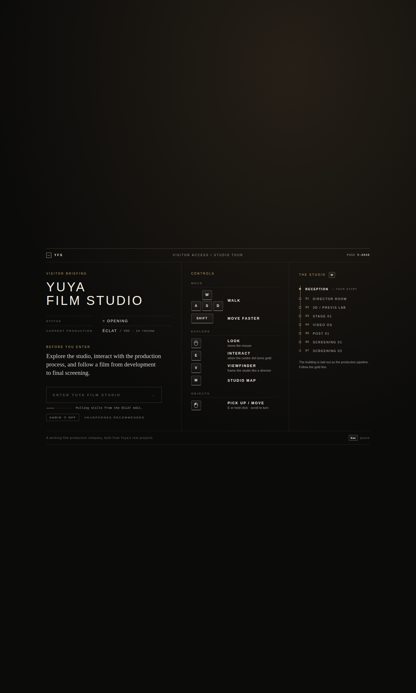
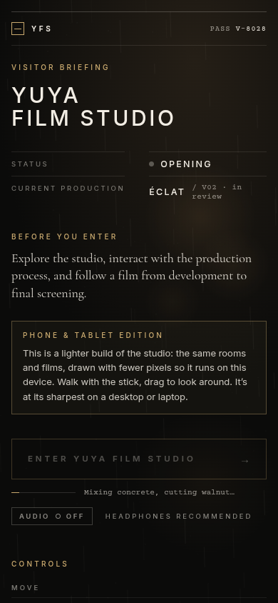

# UI Design System & Master Generation Blueprint: yuyafilmstudio-dev

> **YUYA FILM STUDIO** (https://yuyafilmstudio.dev/) — Walk through YUYA FILM STUDIO — a working film company built from Yuya's real Video OS, projects and footage.



---

## 1. Executive Visual Persona & Design Archetype

- **Brand Essence & Persona**: **YUYA FILM STUDIO** (`https://yuyafilmstudio.dev/`). Walk through YUYA FILM STUDIO — a working film company built from Yuya's real Video OS, projects and footage.
- **Visual Archetype**: **Dark-Substrate WebGL / Canvas Interactive Experience (`#0b0b0a` / `#c9a96e`)**.
- **Anti-AI-Slop Differentiators**:
  - **Source-Grounded Chromatic Polarity**: Anchors the viewport in `#0b0b0a` (`var(--ink)` in `:root`) paired with `#f2ede4` primary typography and `#c9a96e` accents.
  - **Extracted Typographic Hierarchy**: Pairs `Inter` for display copy (`YUYA FILM STUDIO`) with `Cormorant Garamond` and `Courier Prime`.
  - **Calibrated Spatial Grid & Motion**: Combines `400px` container bounds (`gap: 10px`, padding `2px`) with `cubic-bezier(.2,.7,.2,1)` easing and Three.js / WebGL Canvas Pipeline.

---

## 2. Spatial Architecture & Modular Grid Mathematics



### Viewport Allocation & Container Geometry
- **Captured Viewport Dimensions**: Desktop `1440×2400px` (`assets/desktop.png`, capped at 2400px multi-section capture), Mobile `390×2400px` (`assets/mobile.png`, capped at 2400px multi-section capture).
- **Master Container Bounds**: `400px` extracted from `yuyafilmstudio-dev` stylesheet.
- **Canvas Lateral Padding & Spacing**: `2px` lateral canvas padding with `10px` grid gap.
- **Border Radius Scale**: `3px`, `50%`, `4px`.

### Responsive Breakpoint Architecture
- **Desktop Layout**: Multi-column CSS Grid / Flexbox layout at `1440px` (`max-width: 400px`, `gap: 10px`).
- **Mobile Layout**: Single-column vertical stack at `390px` viewport width with `2px` horizontal padding.
- **Extracted CSS Media Queries**: `@media (max-width:1000px)`, `@media (max-width:640px)`, `@media (prefers-reduced-motion:reduce)`, `@media (max-width:720px)`.

---

## 3. Color System, Materiality & Atmospheric Lighting

### Semantic Palette & Source Grounding
| Semantic Role | Ground-Truth Value | Extracted CSS Source / Selector |
|---|---|---|
| **Primary Canvas Substrate** | `#0b0b0a` | `var(--ink)` in `:root` |
| **Primary Typography Ink** | `#f2ede4` | `var(--paper)` in `:root` |
| **Elevated Surface / Card Substrate** | `#a39e94` | `var(--muted)` in `:root` |
| **Interactive Accent / Highlight** | `#c9a96e` | `var(--gold)` in `:root` |
| **Secondary / Muted Copy** | `#8c7650` | `var(--gold-dim)` in `:root` |
| **Structural Hairline Border** | `#e0402f` | `var(--rec)` in `:root` |

### Sanitized Root CSS Variables (`ui-ux.md` Ground Truth)
| Variable Name | Extracted Value | Semantic Role |
|---|---|---|
| `--ink` | `#0b0b0a` | Typography Ink Token |
| `--paper` | `#f2ede4` | Canvas / Surface Token |
| `--muted` | `#a39e94` | Color / Atmospheric Token |
| `--gold` | `#c9a96e` | Color / Atmospheric Token |
| `--gold-dim` | `#8c7650` | Color / Atmospheric Token |
| `--rec` | `#e0402f` | Color / Atmospheric Token |
| `--serif` | `"Cormorant Garamond", "Baskerville", Georgia, serif` | Typography / Scale Token |
| `--sans` | `"Inter", "Helvetica Neue", Arial, sans-serif` | Typography / Scale Token |
| `--mono` | `"Courier Prime", "Courier New", monospace` | Typography / Scale Token |
| `--yuyafilmstudio-d-bg` | `#0b0b0a` | Canvas Substrate (from `var(--ink)` in `:root`) |
| `--yuyafilmstudio-d-ink` | `#f2ede4` | Primary Typography Ink (stylesheet-derived) |
| `--yuyafilmstudio-d-surface` | `#a39e94` | Surface Substrate (stylesheet-derived) |
| `--yuyafilmstudio-d-accent` | `#c9a96e` | Interactive Accent (stylesheet-derived) |
| `--yuyafilmstudio-d-muted` | `#8c7650` | Secondary Ink (stylesheet-derived) |
| `--yuyafilmstudio-d-border` | `#e0402f` | Structural Border (stylesheet-derived) |
| `--yuyafilmstudio-d-container` | `400px` | Container Bound (stylesheet-derived) |

---

## 4. Typographic Scale & Editorial Hierarchy

### Font Family Stacks
- **Display Typography**: `Inter`.
- **Primary Body Stack**: `Cormorant Garamond`.
- **Technical / Metadata Stack**: `Courier Prime`.

### Typographic Scale & Rules (Extracted from Stylesheet & Variables)
- **Hero Display (`H1`)**: rule `h1` (`font-size: clamp(30px,3.5vw,44px)`, `line-height: 1.06`, `letter-spacing: .12em`, `font-weight: 500`).
- **Section Heading (`H2`)**: rule `h2` (`font-size: 9.5px`, `letter-spacing: .32em`, `font-weight: 500`).
- **Body Copy**: rule `p` (`font-size: 21px`, `line-height: 1.38`).
- **Metadata & Navigation Labels**: CSS variables `--mono: "Courier Prime", "Courier New", monospace`; rule `small` (`font-size: 11px`, `letter-spacing: .01em`).

---

## 5. Choreographed Motion & Interaction Physics

### Primary Easing Curves
- **Extracted Timing Functions**: `cubic-bezier(.2,.7,.2,1)`, `cubic-bezier(.4,0,.2,1)`.

### Per-Element Transition & Choreography Rules
- **Selector `.btn-enter`**: `transition: background .3s,color .3s,opacity .3s` extracted from `yuyafilmstudio-dev` stylesheet.
- **Selector `#loader`**: `transition: background 1.6s ease` extracted from `yuyafilmstudio-dev` stylesheet.
- **Selector `.bf-dot`**: `transition: background .6s` extracted from `yuyafilmstudio-dev` stylesheet.
- **Extracted Easing Curve (`cubic-bezier(.2,.7,.2,1)`)**: Governs interactive state transitions across `<header.bf-top>` and `<section.bf-id>`.
- **Runtime Interaction Engine**: Integrates Three.js / WebGL Canvas Pipeline with `prefers-reduced-motion: reduce` fallback guards.

---

## 6. Component Wireframe & Structural DOM Map

### Visual Layout Schematic (Grounded in `dom.html` — `1440px` Desktop & `390px` Mobile Reflow)
```
┌────────────────────────────────────────────────────────────────────────┐
│ DESKTOP VIEWPORT (1440px) — YUYA FILM STUDIO                           │
│ ====================================================================== │
│ [ <header.bf-top>          | Overview · Index · Archive · About · C ]  │
│ ---------------------------------------------------------------------- │
│ | HERO STAGE: <section.brief>                                      |   │
│ | H1: YUYA FILM STUDIO                                             |   │
│ | Substrate: #0b0b0a    | Ink: #f2ede4    | Accent: #c9a96e        |   │
│ ---------------------------------------------------------------------- │
│ | SHOWCASE GRID (<section.bf-id>           ) max-w: 400px          |   │
│ | +------------------------------+  +------------------------------+ | │
│ | | MOVE                         |  | EXPLORE                      | | │
│ | +------------------------------+  +------------------------------+ | │
│ ---------------------------------------------------------------------- │
│ | MOBILE VIEWPORT REFLOW (390px) — Single-Column Stack (gap: 10px  ) | │
│ | [<header.bf-top>] -> [<section.brief>] -> [<section.bf-id>] |        │
│ ---------------------------------------------------------------------- │
│ [ FOOTER (<footer.bf-foot>      ) | https://yuyafilmstudio.dev/        │
└────────────────────────────────────────────────────────────────────────┘
```

### Granular DOM Region Breakdown
1. **Brand Header & Navigation Bar (<header.bf-top> — `yuyafilmstudio-dev`)**:
   - Landmark `<header class="bf-top">` hosting `YUYA FILM STUDIO` navigation (`Overview · Index · Archive · About · Contact`), DOM attributes (`data-sdkn="@vercel/analytics"`, `data-sdkv="2.0.1"`, `data-engine="three.js r180"`, `data-k="KeyV"`), and stylesheet rule `gl { position:fixed;inset:0;width:100vw;height:100vh;display:block;outline:none }`.
2. **Hero Stage & Focal Lead (<section.brief> — `YUYA FILM STUDIO`)**:
   - Landmark `<section class="brief">` presenting display lead `YUYA FILM STUDIO` and copy excerpt *"VISITOR ACCESS / STUDIO TOUR"* over `#0b0b0a` canvas and `#f2ede4` ink.
3. **Primary Showcase & Content Grid (<section.bf-id> — `MOVE`)**:
   - Landmark `<section class="bf-id">` rendering section `MOVE` with copy *"Explore the studio, interact with the production process, and fol"*, asset references (`index-BGb4Src9.js`, `index-C-QYK-dA.css`, `script.js`), and grid rule `.hidden { display:none!important }`.
4. **Interactive Detail & Feature Matrix (<section.bf-controls> — `EXPLORE`)**:
   - Landmark `<section class="bf-controls">` framing `EXPLORE` and `OBJECTS` (*"ENTER YUYA FILM STUDIO"*) with `#a39e94` surface cards, `#c9a96e` accents, and `button { font-family:var(--sans);cursor:pointer }`.
5. **Colophon & Global Directory Footer (<footer.bf-foot> — `https://yuyafilmstudio.dev/`)**:
   - Landmark `<footer class="bf-foot">` anchoring `YUYA FILM STUDIO` footer links (`Overview · Index · Archive · About · Contact`), copy *"Pulling stills from the ÉCLAT edit…"*, and `#e0402f` structural dividers.

---

## 7. Master Zero-Shot AI Generation Prompt

```markdown
# Master Zero-Shot Frontend Generation Prompt: yuyafilmstudio-dev (YUYA FILM STUDIO)

You are a principal frontend architect and design systems engineer. Build a complete, production-ready web application replicating the exact design system, DOM landmarks, typographic hierarchy, color tokens, and motion physics of `yuyafilmstudio-dev` (**YUYA FILM STUDIO** — `https://yuyafilmstudio.dev/`).

### 1. Visual Archetype & Anti-AI-Slop Mandates
- **Archetype**: Dark-Substrate WebGL / Canvas Interactive Experience (`#0b0b0a` / `#c9a96e`).
- **Identity & Domain Context**: Walk through YUYA FILM STUDIO — a working film company built from Yuya's real Video OS, projects and footage.
- **Primary Substrate**: `#0b0b0a` (`var(--ink)` in `:root`), **Primary Ink**: `#f2ede4`, **Accent / Highlight**: `#c9a96e`.
- **Site-Specific Differentiators**:
  - **Source-Grounded Chromatic Polarity**: Anchors the viewport in `#0b0b0a` (`var(--ink)` in `:root`) paired with `#f2ede4` primary typography and `#c9a96e` accents.
  - **Extracted Typographic Hierarchy**: Pairs `Inter` for display copy (`YUYA FILM STUDIO`) with `Cormorant Garamond` and `Courier Prime`.
  - **Calibrated Spatial Grid & Motion**: Combines `400px` container bounds (`gap: 10px`, padding `2px`) with `cubic-bezier(.2,.7,.2,1)` easing and Three.js / WebGL Canvas Pipeline.

### 2. Ground-Truth CSS Variables (`:root` Token Contract)
Declare and consume these exact custom properties extracted from `yuyafilmstudio-dev` in your global stylesheet:

:root {
  /* YUYA FILM STUDIO (yuyafilmstudio-dev) — Ground-Truth Extracted CSS Variables */
  --ink: #0b0b0a; /* Typography Ink Token (yuyafilmstudio-dev) */
  --paper: #f2ede4; /* Canvas / Surface Token (yuyafilmstudio-dev) */
  --muted: #a39e94; /* Color / Atmospheric Token (yuyafilmstudio-dev) */
  --gold: #c9a96e; /* Color / Atmospheric Token (yuyafilmstudio-dev) */
  --gold-dim: #8c7650; /* Color / Atmospheric Token (yuyafilmstudio-dev) */
  --rec: #e0402f; /* Color / Atmospheric Token (yuyafilmstudio-dev) */
  --serif: "Cormorant Garamond", "Baskerville", Georgia, serif; /* Typography / Scale Token (yuyafilmstudio-dev) */
  --sans: "Inter", "Helvetica Neue", Arial, sans-serif; /* Typography / Scale Token (yuyafilmstudio-dev) */
  --mono: "Courier Prime", "Courier New", monospace; /* Typography / Scale Token (yuyafilmstudio-dev) */
  --yuyafilmstudio-d-bg: #0b0b0a; /* Canvas Substrate (from `var(--ink)` in `:root`) (yuyafilmstudio-dev) */
  --yuyafilmstudio-d-ink: #f2ede4; /* Primary Typography Ink (stylesheet-derived) (yuyafilmstudio-dev) */
  --yuyafilmstudio-d-surface: #a39e94; /* Surface Substrate (stylesheet-derived) (yuyafilmstudio-dev) */
  --yuyafilmstudio-d-accent: #c9a96e; /* Interactive Accent (stylesheet-derived) (yuyafilmstudio-dev) */
  --yuyafilmstudio-d-muted: #8c7650; /* Secondary Ink (stylesheet-derived) (yuyafilmstudio-dev) */
  --yuyafilmstudio-d-border: #e0402f; /* Structural Border (stylesheet-derived) (yuyafilmstudio-dev) */
  --yuyafilmstudio-d-container: 400px; /* Container Bound (stylesheet-derived) (yuyafilmstudio-dev) */
}

### 3. Semantic Color & Materiality Contract
Map every surface, ink, and border strictly to these source-grounded tokens:
- **Primary Canvas Substrate**: `#0b0b0a` — grounded in `var(--ink)` in `:root`
- **Primary Typography Ink**: `#f2ede4` — grounded in `var(--paper)` in `:root`
- **Elevated Surface / Card Substrate**: `#a39e94` — grounded in `var(--muted)` in `:root`
- **Interactive Accent / Highlight**: `#c9a96e` — grounded in `var(--gold)` in `:root`
- **Secondary / Muted Copy**: `#8c7650` — grounded in `var(--gold-dim)` in `:root`
- **Structural Hairline Border**: `#e0402f` — grounded in `var(--rec)` in `:root`

### 4. Spatial Grid, Container Bounds & Responsive Breakpoints
- **Desktop Viewport Reference**: `1440×2400px` (capped at 2400px multi-section capture, `1440px` standard desktop width).
- **Mobile Viewport Reference**: `390×2400px` (capped at 2400px multi-section capture, `390px` standard mobile width).
- **Container Max-Width**: `400px` extracted from `yuyafilmstudio-dev` stylesheet
- **Padding & Gutters**: `2px` lateral canvas padding with `10px` grid gap
- **Desktop Grid**: Multi-column CSS Grid / Flexbox layout at `1440px` (`max-width: 400px`, `gap: 10px`)
- **Mobile Adaptation**: Single-column vertical stack at `390px` viewport width with `2px` horizontal padding
- **Media Queries**: `@media (max-width:1000px)`, `@media (max-width:640px)`, `@media (prefers-reduced-motion:reduce)`, `@media (max-width:720px)`
- **Corner Radii**: `3px`, `50%`, `4px`

### 5. Typography & Editorial Scale Contract
- **Display Font Stack**: `Inter`
- **Body Font Stack**: `Cormorant Garamond`
- **Monospace / Technical Font Stack**: `Courier Prime`
- **H1 Display Rule**: rule `h1` (`font-size: clamp(30px,3.5vw,44px)`, `line-height: 1.06`, `letter-spacing: .12em`, `font-weight: 500`)
- **H2 Section Rule**: rule `h2` (`font-size: 9.5px`, `letter-spacing: .32em`, `font-weight: 500`)
- **Body Copy Rule**: rule `p` (`font-size: 21px`, `line-height: 1.38`)
- **Metadata & Index Rule**: CSS variables `--mono: "Courier Prime", "Courier New", monospace`; rule `small` (`font-size: 11px`, `letter-spacing: .01em`)

### 6. Component Hierarchy, Verbatim Copy & Real DOM Landmarks
Scaffold `yuyafilmstudio-dev` (`YUYA FILM STUDIO`) with these exact structural regions, extracted copy, and CSS rules from `dom.html`:
1. **Brand Header & Navigation Bar (<header.bf-top> — `yuyafilmstudio-dev`)**:
   - DOM & Selectors: Landmark `<header class="bf-top">` hosting `YUYA FILM STUDIO` navigation (`Overview · Index · Archive · About · Contact`), DOM attributes (`data-sdkn="@vercel/analytics"`, `data-sdkv="2.0.1"`, `data-engine="three.js r180"`, `data-k="KeyV"`), and stylesheet rule `gl { position:fixed;inset:0;width:100vw;height:100vh;display:block;outline:none }`.
   - Responsive Contract: Header `Brand Header & Navigation Bar (<header.bf-top> — `yuyafilmstudio-dev`)` (`yuyafilmstudio-dev`) adapts across `@media (max-width:1000px)`, `@media (max-width:640px)`, `@media (prefers-reduced-motion:reduce)`, `@media (max-width:720px)` with `cubic-bezier(.2,.7,.2,1)`, `cubic-bezier(.4,0,.2,1)` transitions and links `Overview · Index · Archive · About · Contact`.
2. **Hero Stage & Focal Lead (<section.brief> — `YUYA FILM STUDIO`)**:
   - DOM & Selectors: Landmark `<section class="brief">` presenting display lead `YUYA FILM STUDIO` and copy excerpt *"VISITOR ACCESS / STUDIO TOUR"* over `#0b0b0a` canvas and `#f2ede4` ink.
   - Responsive Contract: Hero stage (`1440×2400px` desktop / `390×2400px` mobile) sets `#0b0b0a` background with `#f2ede4` headline `YUYA FILM STUDIO`.
3. **Primary Showcase & Content Grid (<section.bf-id> — `MOVE`)**:
   - DOM & Selectors: Landmark `<section class="bf-id">` rendering section `MOVE` with copy *"Explore the studio, interact with the production process, and fol"*, asset references (`index-BGb4Src9.js`, `index-C-QYK-dA.css`, `script.js`), and grid rule `.hidden { display:none!important }`.
   - Responsive Contract: Showcase grid `Primary Showcase & Content Grid (<section.bf-id> — `MOVE`)` applies Multi-column CSS Grid / Flexbox layout at `1440px` (`max-width: 400px`, `gap: 10px`) on desktop and Single-column vertical stack at `390px` viewport width with `2px` horizontal padding on mobile.
4. **Interactive Detail & Feature Matrix (<section.bf-controls> — `EXPLORE`)**:
   - DOM & Selectors: Landmark `<section class="bf-controls">` framing `EXPLORE` and `OBJECTS` (*"ENTER YUYA FILM STUDIO"*) with `#a39e94` surface cards, `#c9a96e` accents, and `button { font-family:var(--sans);cursor:pointer }`.
   - Responsive Contract: Detail module `Interactive Detail & Feature Matrix (<section.bf-controls> — `EXPLORE`)` uses `3px`, `50%`, `4px` radii, `#c9a96e` highlights, and assets (index-BGb4Src9.js, index-C-QYK-dA.css, script.js).
5. **Colophon & Global Directory Footer (<footer.bf-foot> — `https://yuyafilmstudio.dev/`)**:
   - DOM & Selectors: Landmark `<footer class="bf-foot">` anchoring `YUYA FILM STUDIO` footer links (`Overview · Index · Archive · About · Contact`), copy *"Pulling stills from the ÉCLAT edit…"*, and `#e0402f` structural dividers.
   - Responsive Contract: Footer `Colophon & Global Directory Footer (<footer.bf-foot> — `https://yuyafilmstudio.dev/`)` aligns to `400px` extracted from `yuyafilmstudio-dev` stylesheet with `2px` lateral canvas padding with `10px` grid gap and attributes (data-sdkn="@vercel/analytics", data-sdkv="2.0.1", data-engine="three.js r180").

#### Verbatim DOM Copy Excerpts (`dom.html`)
- Copy Excerpt 1: *"VISITOR ACCESS / STUDIO TOUR"*
- Copy Excerpt 2: *"Explore the studio, interact with the production process, and follow a film from d..."*
- Copy Excerpt 3: *"ENTER YUYA FILM STUDIO"*
- Copy Excerpt 4: *"Pulling stills from the ÉCLAT edit…"*

### 7. Motion, Extracted Stylesheet Rules & Interaction Choreography
- **Primary Easing Functions**: `cubic-bezier(.2,.7,.2,1)`, `cubic-bezier(.4,0,.2,1)`
- **Extracted Stylesheet Rules (`yuyafilmstudio-dev`)**:
- `gl { position:fixed;inset:0;width:100vw;height:100vh;display:block;outline:none }`
- `.hidden { display:none!important }`
- `button { font-family:var(--sans);cursor:pointer }`
- `.btn-enter:disabled { opacity:.25;cursor:default }`
- `hover { background:var(--gold);color:var(--ink) }`
- **Per-Selector Transition Rules**:
- **Selector `.btn-enter`**: `transition: background .3s,color .3s,opacity .3s` extracted from `yuyafilmstudio-dev` stylesheet.
- **Selector `#loader`**: `transition: background 1.6s ease` extracted from `yuyafilmstudio-dev` stylesheet.
- **Selector `.bf-dot`**: `transition: background .6s` extracted from `yuyafilmstudio-dev` stylesheet.
- **Extracted Easing Curve (`cubic-bezier(.2,.7,.2,1)`)**: Governs interactive state transitions across `<header.bf-top>` and `<section.bf-id>`.
- **Runtime Interaction Engine**: Integrates Three.js / WebGL Canvas Pipeline with `prefers-reduced-motion: reduce` fallback guards.

### 8. Technical Deliverables
- Implement in Next.js (App Router) with TypeScript and Tailwind CSS consuming the `:root` custom properties defined above for `yuyafilmstudio-dev`.
- Reproduce both the `1440px` desktop architecture and `390px` mobile breakpoint transitions, preserving semantic HTML5 landmarks (`<header>`, `<nav>`, `<main>`, `<section>`, `<footer>`) and `prefers-reduced-motion` accessibility guards.
```
