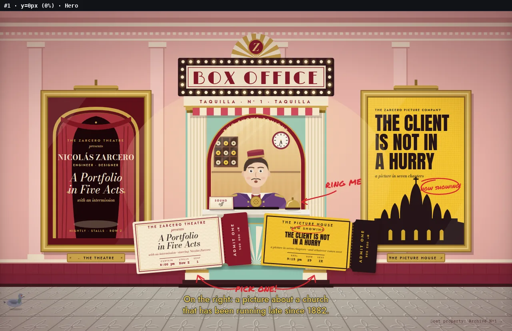
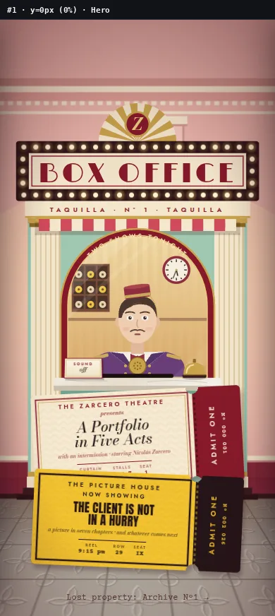

# UI Design System & Master Generation Blueprint: zarcerog-com

> **Nicolás Zarcero — Box Office** (https://zarcerog.com) — Two shows tonight: a portfolio in five acts, with an intermission; and a picture about a church that is running late. Nicolás Zarcero, en...





---

## 1. Executive Visual Persona & Design Archetype

- **Brand Essence & Persona**: **Nicolás Zarcero — Box Office** (`https://zarcerog.com`). Two shows tonight: a portfolio in five acts, with an intermission; and a picture about a church that is running late. Nicolás Zarcero, en...
- **Capture Provenance**: Live browser capture (`tier2_webgl`, HTTP `200`, captured `2026-11-24`).
- **Visual Archetype**: **Light-Substrate Editorial & Modular Grid System (`#e8b3a9` canvas, `#000000` ink, `#ffff00` accent)**.
- **Anti-AI-Slop Differentiators**:
  - **Live-Computed Chromatic Polarity**: Anchors the viewport in `#e8b3a9` (live computed `body` `background-color` (`computed_styles.json`)) paired with `#000000` primary typography and `#ffff00` accents.
  - **Grounded Typographic Hierarchy**: Pairs `Jost` for display copy (`Nicolás Zarcero: box office. Two sho`) with `Jost Fallback`.
  - **Calibrated Spatial Grid & Motion**: Combines `1440px` container bounds (`gap: 16px`, padding `18px`) with `cubic-bezier(.2,.7,.2,1)` easing.

---

## 2. Spatial Architecture & Modular Grid Mathematics

### Viewport Allocation & Container Geometry
- **Captured Journey Filmstrips**: Desktop `1280×828px` (`assets/desktop-journey.webp`, `1` keyframes up to `y=0px` / doc `900px`), Mobile `390×872px` (`assets/mobile-journey.webp`, `1` keyframes).
- **Master Container Bounds**: `1440px` (full-bleed `100%` desktop stage measured on `1440px` viewport).
- **Canvas Lateral Padding & Spacing**: `18px` lateral canvas padding with `16px` grid gap.
- **Border Radius Scale**: `50%`, `4px`, `2px`.

### Responsive Breakpoint Architecture
- **Desktop Layout**: Multi-column CSS Grid / Flexbox layout at `1440px` (`max-width: 1440px`, `gap: 16px`).
- **Mobile Layout**: Single-column vertical stack at `390px` viewport width with `18px` horizontal padding.
- **Extracted CSS Media Queries**: `@media (max-aspect-ratio:1)`, `@media (prefers-reduced-motion:reduce)`, `@media (max-width:620px)`.

---

## 3. Color System, Materiality & Atmospheric Lighting

### Semantic Palette & Source Grounding
| Semantic Role | Ground-Truth Value | Extracted Live / CSS Source |
|---|---|---|
| **Primary Canvas Substrate** | `#e8b3a9` | live computed `body` `background-color` (`computed_styles.json`) |
| **Primary Typography Ink** | `#000000` | live computed `body` `color` (`computed_styles.json`) |
| **Elevated Surface / Card Substrate** | `#f3ead6` | `var(--paper)` in `:root` |
| **Interactive Accent / Highlight** | `#ffff00` | `.wk-top a:focus-visible { color: yellow }` (`#ffff00`) |
| **Secondary / Muted Copy** | `#241417` | live computed `p` `color` (`computed_styles.json`) |
| **Structural Hairline Border** | `#ff0000` | `.bx-note path { stroke: #ff0000 }` |

### Sanitized Root CSS Variables (`ui-ux.md` Ground Truth)
| Variable Name | Extracted Value | Semantic Role |
|---|---|---|
| `--f-sans` | `"Jost", "Jost Fallback"` | Typography / Scale Token |
| `--f-serif` | `"Bodoni Moda", "Bodoni Moda Fallback"` | Typography / Scale Token |
| `--f-type` | `"Courier Prime", "Courier Prime Fallback"` | Typography / Scale Token |
| `--f-cinzel` | `"Cinzel", "Cinzel Fallback"` | Design System Custom Token |
| `--f-anton` | `"Anton", "Anton Fallback"` | Design System Custom Token |
| `--f-shrikhand` | `"Shrikhand", "Shrikhand Fallback"` | Design System Custom Token |
| `--f-abril` | `"Abril Fatface", "Abril Fatface Fallback"` | Design System Custom Token |
| `--f-pen` | `"Nanum Pen Script", "Nanum Pen Script Fallback"` | Design System Custom Token |
| `--f-slab` | `"Alfa Slab One", "Alfa Slab One Fallback"` | Design System Custom Token |
| `--f-script` | `"Yellowtail", "Yellowtail Fallback"` | Design System Custom Token |
| `--f-marker` | `"Permanent Marker", "Permanent Marker Fallback"` | Design System Custom Token |
| `--f-marquee` | `"Limelight", "Limelight Fallback"` | Design System Custom Token |
| `--bx-sans` | `var(--f-sans,Jost), Jost, Futura, "Helvetica Neue", sans-serif` | Typography / Scale Token |
| `--bx-type` | `var(--f-type,"Courier Prime"), "Courier Prime", "Courier New", monospace` | Typography / Scale Token |
| `--bx-marquee` | `var(--f-marquee,Limelight), Limelight, var(--f-serif,"Bodoni Moda"), serif` | Design System Custom Token |
| `--bx-anton` | `var(--f-anton,Anton), Anton, Impact, "Arial Narrow", sans-serif` | Design System Custom Token |

---

## 4. Typographic Scale & Editorial Hierarchy

### Font Family Stacks
- **Display Typography**: `Jost`.
- **Primary Body Stack**: `Jost Fallback`.
- **Technical / Metadata Stack**: not declared in live computed styles (uses primary stack / `ui-monospace`).

### Typographic Scale & Rules (Live Computed & Stylesheet Grounded)
- **Hero Display (`H1`)**: live computed `h1` (`font-size: 32px`, `line-height: normal`, `font-weight: 700`).
- **Section Heading (`H2`)**: observed font-size ladder: `32px`, `16px`, `30px`, `clamp(16px,1.7vw,26px)`, `12px`.
- **Body Copy**: live computed `body` (`font-size: 16px`, `line-height: normal`, `font-weight: 400`).
- **Metadata & Navigation Labels**: live computed `nav/a` (`font-size: 16px`, `line-height: normal`, `font-weight: 400`); rule `small` (`font-size: 12px`).

---

## 5. Choreographed Motion & Interaction Physics

### Primary Easing Curves
- **Extracted Timing Functions**: `cubic-bezier(.2,.7,.2,1)`, `cubic-bezier(.5,0,.3,1)`, `cubic-bezier(.4,0,.8,.4)`.

### Per-Element Transition & Choreography Rules
- **Selector `.bx-layer`**: `transition: transform .9s cubic-bezier(.2,.7,.2,1)` extracted from `zarcerog-com` stylesheet.
- **Selector `.bx-pupils`**: `transition: transform .25s ease-out` extracted from `zarcerog-com` stylesheet.
- **Selector `.bx-clerk`**: `transition: transform .6s` extracted from `zarcerog-com` stylesheet.
- **Extracted Easing Curve (`cubic-bezier(.2,.7,.2,1)`)**: Governs interactive state transitions across `<nav.bx-layer>` and `<main.bx-root:nth(2)>`.
- **State & Hover Choreography**: Opacity and transform transitions on `<main.bx-root>` and `<main.bx-root:nth(2)>` interactive targets.
### Measured Runtime Scroll & Interaction Telemetry (`behavioral_journey_v2`)
- **Scroll Driver Mode**: `wheel` (max document height `900px`, deepest scrollY reached `0px` across `1` desktop keyframes).
- **Detected Scroll / Motion Libraries**: Native browser scroll / standard CSS transitions.
- **Hover Physics (`primary_cta` · `SOUND off`)**: `transform`: `matrix3d(1, 0, 0, 0, 0,...` -> `matrix3d(1, 0, 0, 0, 0,...` (`transition-duration: 0s`, `timing: ease`).
- **Route Transition Architecture**: First internal navigation (`/works`) measured as `MPA` in `5278ms`.

---

## 6. Component Wireframe & Structural DOM Map

### Visual Layout Schematic — Desktop (`1440px`, Grounded in `dom.html` & Landmark Bounding Boxes)
```
┌────────────────────────────────────────────────────────────────────────┐
│ DESKTOP VIEWPORT (1440px) — Nicolás Zarcero — Box Office               │
│ ====================================================================== │
│ [ <nav.bx-layer> (1440x900px)         | Overview · Index · Archive · ] │
│ ---------------------------------------------------------------------- │
│ | HERO STAGE: <main.bx-root> (w=1440px)                              | │
│ | H1: Nicolás Zarcero: box office. Two shows tonight —...            | │
│ | Substrate: #e8b3a9 | Ink: #000000 | Accent: #ffff00                | │
│ ---------------------------------------------------------------------- │
│ | SHOWCASE GRID (<main.bx-root:nth(2)>) max-w: 1440px                | │
│ | +------------------------------+  +------------------------------+ | │
│ | | Nicolás Zarcero : box office |  | The Zarcero Theatre presents | | │
│ | +------------------------------+  +------------------------------+ | │
│ ---------------------------------------------------------------------- │
│ | DETAIL MODULE (<main.bx-root:nth(3)>) — The Zarcero Theatre        | │
│ ---------------------------------------------------------------------- │
│ [ FOOTER (<footer.bx-foot>    ) | https://zarcerog.com                 │
└────────────────────────────────────────────────────────────────────────┘
```

### Visual Layout Schematic — Mobile Reflow (`390px`)
```
┌────────────────────────────────────────────────────────────────────────┐
│ MOBILE VIEWPORT REFLOW (390px) — Single-Column Stack (gap: 16px)       │
│ ====================================================================== │
│ [ HEADER BAR (<nav.bx-layer>          ) | Compact Menu (390px)         │
│ ---------------------------------------------------------------------- │
│ | HERO STAGE (<main.bx-root>) — 390px Vertical Lead                  | │
│ | H1: Nicolás Zarcero: box office. Two shows tonight —...            | │
│ ---------------------------------------------------------------------- │
│ | SHOWCASE STACK (<main.bx-root:nth(2)>) — 1-Col Stack               | │
│ | [ Item 1: Nicolás Zarcero : box office. Two shows tonight —...   ] | │
│ | [ Item 2: The Zarcero Theatre presents A Portfolio in Five       ] | │
│ ---------------------------------------------------------------------- │
│ | DETAIL STACK (<main.bx-root:nth(3)>) — 1-Col (The Zarcero Theatr)  | │
│ ---------------------------------------------------------------------- │
│ [ FOOTER (<footer.bx-foot>    ) | Stacked 390px Colophon               │
└────────────────────────────────────────────────────────────────────────┘
```

### Granular DOM Region Breakdown
1. **Brand Header & Navigation Bar (<nav.bx-layer> — `zarcerog-com`)**:
   - Landmark `<nav class="bx-layer bx-layer--tickets">` (`1440x900px`) hosting `Nicolás Zarcero — Box Office` navigation (`Overview · Index · Archive · About · Contact`), DOM attributes (`data-precedence="next"`, `data-precedence="next"`, `data-sdkn="@vercel/analytics/next"`, `data-sdkv="1.6.1"`), and stylesheet rule `jost_65562e22-module__iZxnCa__cla... { font-family:Jost,Jost Fallback;font-style:normal }`.
2. **Hero Stage & Focal Lead (<main.bx-root> — `Nicolás Zarcero: box office. Two s`)**:
   - Landmark `<main class="bx-root">` presenting display lead `Nicolás Zarcero: box office. Two shows tonight —...` and copy excerpt *"On the right: a picture about a church that has been running late"* over `#e8b3a9` canvas and `#000000` ink.
3. **Primary Showcase & Content Grid (<main.bx-root:nth(2)> — `Nicolás Zarcero : box office. Two `)**:
   - Landmark `<main class="bx-root">` rendering section `Nicolás Zarcero : box office. Two shows tonight —...` with copy *"The Zarcero Theatre presents A Portfolio in Five Acts with an int"*, asset references (`52b5d5098cb87ddd-s.p.3r2y_bth_sjs...`, `5f440d3eea613716-s.p.1xmps1tcyqv3...`, `612bd71aa396cae6-s.p.0y-3ea_6ee5g...`, `81cef6a21128489e-s.p.2csanl8cs02r...`), and grid rule `.jost_65562e22-module__iZxnCa__va... { --f-sans:"Jost", "Jost Fallback" }`.
4. **Interactive Detail & Feature Matrix (<main.bx-root:nth(3)> — `The Zarcero Theatre presents A Por`)**:
   - Landmark `<main class="bx-root">` framing `The Zarcero Theatre presents A Portfolio in Five` and `The Zarcero Theatre` (*"The Zarcero Theatre"*) with `#f3ead6` surface cards, `#ffff00` accents, and `moda_1acaef39-module__CjqdXa__cla... { font-family:Bodoni Moda,Bodoni Moda Fallback }`.
5. **Colophon & Global Directory Footer (<footer.bx-foot> — `https://zarcerog.com`)**:
   - Landmark `<footer class="bx-foot">` anchoring `Nicolás Zarcero — Box Office` footer links (`Overview · Index · Archive · About · Contact`), copy *"A Portfolio in Five Acts"*, and `#ff0000` structural dividers.
### Full Vertical Scroll Sequence (Desktop `1440×900` Keyframes)
- **Step 01** (`y=0px`, `0%`): Active landmark `Hero` · sticky/fixed elements: `2`

### Multi-Page Internal Route Map
- **Listing Route (`/works`)**: `https://zarcerog.com/works` — H1: `WORKS dated like reels in a can · newest first`, scrollHeight `1355px`, transition `MPA` (`5278ms`)

---

## 7. Master Zero-Shot AI Generation Prompt

```markdown
# Master Zero-Shot Frontend Generation Prompt: zarcerog-com (Nicolás Zarcero — Box Office)

You are a principal frontend architect and design systems engineer. Build a complete, production-ready web application replicating the exact design system, DOM landmarks, typographic hierarchy, color tokens, and motion physics of `zarcerog-com` (**Nicolás Zarcero — Box Office** — `https://zarcerog.com`).

### 1. Visual Archetype & Anti-AI-Slop Mandates
- **Archetype**: Light-Substrate Editorial & Modular Grid System (`#e8b3a9` canvas, `#000000` ink, `#ffff00` accent).
- **Identity & Domain Context**: Two shows tonight: a portfolio in five acts, with an intermission; and a picture about a church that is running late. Nicolás Zarcero, en...
- **Primary Substrate**: `#e8b3a9` (live computed `body` `background-color` (`computed_styles.json`)), **Primary Ink**: `#000000`, **Accent / Highlight**: `#ffff00`.
- **Site-Specific Differentiators**:
  - **Live-Computed Chromatic Polarity**: Anchors the viewport in `#e8b3a9` (live computed `body` `background-color` (`computed_styles.json`)) paired with `#000000` primary typography and `#ffff00` accents.
  - **Grounded Typographic Hierarchy**: Pairs `Jost` for display copy (`Nicolás Zarcero: box office. Two sho`) with `Jost Fallback`.
  - **Calibrated Spatial Grid & Motion**: Combines `1440px` container bounds (`gap: 16px`, padding `18px`) with `cubic-bezier(.2,.7,.2,1)` easing.

### 2. Ground-Truth CSS Variables (`:root` Token Contract)
Declare and consume these exact custom properties extracted from `zarcerog-com` in your global stylesheet:

:root {
  /* Nicolás Zarcero — Box Office (zarcerog-com) — Live-Grounded CSS Variables */
  --f-sans: "Jost", "Jost Fallback"; /* Typography / Scale Token (zarcerog-com) */
  --f-serif: "Bodoni Moda", "Bodoni Moda Fallback"; /* Typography / Scale Token (zarcerog-com) */
  --f-type: "Courier Prime", "Courier Prime Fallback"; /* Typography / Scale Token (zarcerog-com) */
  --f-cinzel: "Cinzel", "Cinzel Fallback"; /* Design System Custom Token (zarcerog-com) */
  --f-anton: "Anton", "Anton Fallback"; /* Design System Custom Token (zarcerog-com) */
  --f-shrikhand: "Shrikhand", "Shrikhand Fallback"; /* Design System Custom Token (zarcerog-com) */
  --f-abril: "Abril Fatface", "Abril Fatface Fallback"; /* Design System Custom Token (zarcerog-com) */
  --f-pen: "Nanum Pen Script", "Nanum Pen Script Fallback"; /* Design System Custom Token (zarcerog-com) */
  --f-slab: "Alfa Slab One", "Alfa Slab One Fallback"; /* Design System Custom Token (zarcerog-com) */
  --f-script: "Yellowtail", "Yellowtail Fallback"; /* Design System Custom Token (zarcerog-com) */
  --f-marker: "Permanent Marker", "Permanent Marker Fallback"; /* Design System Custom Token (zarcerog-com) */
  --f-marquee: "Limelight", "Limelight Fallback"; /* Design System Custom Token (zarcerog-com) */
  --bx-sans: var(--f-sans,Jost), Jost, Futura, "Helvetica Neue", sans-serif; /* Typography / Scale Token (zarcerog-com) */
  --bx-type: var(--f-type,"Courier Prime"), "Courier Prime", "Courier New", monospace; /* Typography / Scale Token (zarcerog-com) */
  --bx-marquee: var(--f-marquee,Limelight), Limelight, var(--f-serif,"Bodoni Moda"), serif; /* Design System Custom Token (zarcerog-com) */
  --bx-anton: var(--f-anton,Anton), Anton, Impact, "Arial Narrow", sans-serif; /* Design System Custom Token (zarcerog-com) */
}

### 3. Semantic Color & Materiality Contract
Map every surface, ink, and border strictly to these source-grounded tokens:
- **Primary Canvas Substrate**: `#e8b3a9` — grounded in live computed `body` `background-color` (`computed_styles.json`)
- **Primary Typography Ink**: `#000000` — grounded in live computed `body` `color` (`computed_styles.json`)
- **Elevated Surface / Card Substrate**: `#f3ead6` — grounded in `var(--paper)` in `:root`
- **Interactive Accent / Highlight**: `#ffff00` — grounded in `.wk-top a:focus-visible { color: yellow }` (`#ffff00`)
- **Secondary / Muted Copy**: `#241417` — grounded in live computed `p` `color` (`computed_styles.json`)
- **Structural Hairline Border**: `#ff0000` — grounded in `.bx-note path { stroke: #ff0000 }`

### 4. Spatial Grid, Container Bounds & Responsive Breakpoints
- **Desktop Viewport Reference**: `1280×828px` (single-viewport 100vh live capture (900px), `1440px` standard desktop width).
- **Mobile Viewport Reference**: `390×872px` (full-page live capture (872px), `390px` standard mobile width).
- **Container Max-Width**: `1440px` (full-bleed `100%` desktop stage measured on `1440px` viewport)
- **Padding & Gutters**: `18px` lateral canvas padding with `16px` grid gap
- **Desktop Grid**: Multi-column CSS Grid / Flexbox layout at `1440px` (`max-width: 1440px`, `gap: 16px`)
- **Mobile Adaptation**: Single-column vertical stack at `390px` viewport width with `18px` horizontal padding
- **Media Queries**: `@media (max-aspect-ratio:1)`, `@media (prefers-reduced-motion:reduce)`, `@media (max-width:620px)`
- **Corner Radii**: `50%`, `4px`, `2px`

### 5. Typography & Editorial Scale Contract
- **Display Font Stack**: `Jost`
- **Body Font Stack**: `Jost Fallback`
- **Monospace / Technical Font Stack**: not declared in live computed styles (uses primary stack / `ui-monospace`)
- **H1 Display Rule**: live computed `h1` (`font-size: 32px`, `line-height: normal`, `font-weight: 700`)
- **H2 Section Rule**: observed font-size ladder: `32px`, `16px`, `30px`, `clamp(16px,1.7vw,26px)`, `12px`
- **Body Copy Rule**: live computed `body` (`font-size: 16px`, `line-height: normal`, `font-weight: 400`)
- **Metadata & Index Rule**: live computed `nav/a` (`font-size: 16px`, `line-height: normal`, `font-weight: 400`); rule `small` (`font-size: 12px`)

### 6. Component Hierarchy, Verbatim Copy & Real DOM Landmarks
Scaffold `zarcerog-com` (`Nicolás Zarcero — Box Office`) with these exact structural regions, extracted copy, and CSS rules from `dom.html`:
1. **Brand Header & Navigation Bar (<nav.bx-layer> — `zarcerog-com`)**:
   - DOM & Selectors: Landmark `<nav class="bx-layer bx-layer--tickets">` (`1440x900px`) hosting `Nicolás Zarcero — Box Office` navigation (`Overview · Index · Archive · About · Contact`), DOM attributes (`data-precedence="next"`, `data-precedence="next"`, `data-sdkn="@vercel/analytics/next"`, `data-sdkv="1.6.1"`), and stylesheet rule `jost_65562e22-module__iZxnCa__cla... { font-family:Jost,Jost Fallback;font-style:normal }`.
   - Responsive Contract: Header `Brand Header & Navigation Bar (<nav.bx-layer> — `zarcerog-com`)` (`zarcerog-com`) adapts across `@media (max-aspect-ratio:1)`, `@media (prefers-reduced-motion:reduce)`, `@media (max-width:620px)` with `cubic-bezier(.2,.7,.2,1)`, `cubic-bezier(.5,0,.3,1)`, `cubic-bezier(.4,0,.8,.4)` transitions and links `Overview · Index · Archive · About · Contact`.
2. **Hero Stage & Focal Lead (<main.bx-root> — `Nicolás Zarcero: box office. Two s`)**:
   - DOM & Selectors: Landmark `<main class="bx-root">` presenting display lead `Nicolás Zarcero: box office. Two shows tonight —...` and copy excerpt *"On the right: a picture about a church that has been running late"* over `#e8b3a9` canvas and `#000000` ink.
   - Responsive Contract: Hero stage (`1280×828px` desktop / `390×872px` mobile) sets `#e8b3a9` background with `#000000` headline `Nicolás Zarcero: box office. Two shows tonight —...`.
3. **Primary Showcase & Content Grid (<main.bx-root:nth(2)> — `Nicolás Zarcero : box office. Two `)**:
   - DOM & Selectors: Landmark `<main class="bx-root">` rendering section `Nicolás Zarcero : box office. Two shows tonight —...` with copy *"The Zarcero Theatre presents A Portfolio in Five Acts with an int"*, asset references (`52b5d5098cb87ddd-s.p.3r2y_bth_sjs...`, `5f440d3eea613716-s.p.1xmps1tcyqv3...`, `612bd71aa396cae6-s.p.0y-3ea_6ee5g...`, `81cef6a21128489e-s.p.2csanl8cs02r...`), and grid rule `.jost_65562e22-module__iZxnCa__va... { --f-sans:"Jost", "Jost Fallback" }`.
   - Responsive Contract: Showcase grid `Primary Showcase & Content Grid (<main.bx-root:nth(2)> — `Nicolás Zarcero : box office. Two `)` applies Multi-column CSS Grid / Flexbox layout at `1440px` (`max-width: 1440px`, `gap: 16px`) on desktop and Single-column vertical stack at `390px` viewport width with `18px` horizontal padding on mobile.
4. **Interactive Detail & Feature Matrix (<main.bx-root:nth(3)> — `The Zarcero Theatre presents A Por`)**:
   - DOM & Selectors: Landmark `<main class="bx-root">` framing `The Zarcero Theatre presents A Portfolio in Five` and `The Zarcero Theatre` (*"The Zarcero Theatre"*) with `#f3ead6` surface cards, `#ffff00` accents, and `moda_1acaef39-module__CjqdXa__cla... { font-family:Bodoni Moda,Bodoni Moda Fallback }`.
   - Responsive Contract: Detail module `Interactive Detail & Feature Matrix (<main.bx-root:nth(3)> — `The Zarcero Theatre presents A Por`)` uses `50%`, `4px`, `2px` radii, `#ffff00` highlights, and assets (52b5d5098cb87ddd-s.p.3r2y_bth_sjs..., 5f440d3eea613716-s.p.1xmps1tcyqv3..., 612bd71aa396cae6-s.p.0y-3ea_6ee5g...).
5. **Colophon & Global Directory Footer (<footer.bx-foot> — `https://zarcerog.com`)**:
   - DOM & Selectors: Landmark `<footer class="bx-foot">` anchoring `Nicolás Zarcero — Box Office` footer links (`Overview · Index · Archive · About · Contact`), copy *"A Portfolio in Five Acts"*, and `#ff0000` structural dividers.
   - Responsive Contract: Footer `Colophon & Global Directory Footer (<footer.bx-foot> — `https://zarcerog.com`)` aligns to `1440px` (full-bleed `100%` desktop stage measured on `1440px` viewport) with `18px` lateral canvas padding with `16px` grid gap and attributes (data-precedence="next", data-precedence="next", data-sdkn="@vercel/analytics/next").

#### Verbatim DOM Copy Excerpts (`dom.html`)
- Copy Excerpt 1: *"On the right: a picture about a church that has been running late since 1882."*
- Copy Excerpt 2: *"The Zarcero Theatre presents A Portfolio in Five Acts with an intermission · starr..."*
- Copy Excerpt 3: *"The Zarcero Theatre"*
- Copy Excerpt 4: *"A Portfolio in Five Acts"*

### 7. Motion, Extracted Stylesheet Rules & Interaction Choreography
- **Primary Easing Functions**: `cubic-bezier(.2,.7,.2,1)`, `cubic-bezier(.5,0,.3,1)`, `cubic-bezier(.4,0,.8,.4)`
- **Extracted Stylesheet Rules (`zarcerog-com`)**:
- `jost_65562e22-module__iZxnCa__cla... { font-family:Jost,Jost Fallback;font-style:normal }`
- `.jost_65562e22-module__iZxnCa__va... { --f-sans:"Jost", "Jost Fallback" }`
- `moda_1acaef39-module__CjqdXa__cla... { font-family:Bodoni Moda,Bodoni Moda Fallback }`
- `moda_1acaef39-module__CjqdXa__var... { --f-serif:"Bodoni Moda", "Bodoni Moda Fallback" }`
- `rime_5f7767ab-module__fGXHCq__cla... { font-family:Courier Prime,Courier Prime Fallback;font-style:normal }`
- **Per-Selector Transition Rules**:
- **Selector `.bx-layer`**: `transition: transform .9s cubic-bezier(.2,.7,.2,1)` extracted from `zarcerog-com` stylesheet.
- **Selector `.bx-pupils`**: `transition: transform .25s ease-out` extracted from `zarcerog-com` stylesheet.
- **Selector `.bx-clerk`**: `transition: transform .6s` extracted from `zarcerog-com` stylesheet.
- **Extracted Easing Curve (`cubic-bezier(.2,.7,.2,1)`)**: Governs interactive state transitions across `<nav.bx-layer>` and `<main.bx-root:nth(2)>`.
- **State & Hover Choreography**: Opacity and transform transitions on `<main.bx-root>` and `<main.bx-root:nth(2)>` interactive targets.
### 7b. Full-Page Scroll Choreography, Interactive States & Multi-Page Routes
- **Scroll Mechanics**: Implement `wheel` vertical progression up to `900px` across 1 distinct viewport chapters.
- **Vertical Chapter Sequence**: Hero (0%).
- **Hover Micro-Interaction (`primary_cta`)**: Animate `transform` with `0s ease`.
- **Multi-Page Routes**: Scaffold internal routes `/works` (listing, MPA) sharing the global header/footer shell and design tokens.

### 8. Technical Deliverables
- Implement in Next.js (App Router) with TypeScript and Tailwind CSS consuming the `:root` custom properties defined above for `zarcerog-com`.
- Reproduce both the `1440px` desktop architecture and `390px` mobile breakpoint transitions, preserving semantic HTML5 landmarks (`<header>`, `<nav>`, `<main>`, `<section>`, `<footer>`) and `prefers-reduced-motion` accessibility guards.
```
---

## 8. Full-Page Scroll Journey, Interactive States & Subpage Inventory

### Desktop Scroll Keyframes (`1440×900` WebP)
| Step | Scroll Y | Progress | Active Landmark / Section | Sticky/Fixed | Visual Asset |
| :---: | :---: | :---: | :--- | :---: | :--- |
| `#01` | `0px` | `0%` | Hero | `2` | [desktop-step-01.webp](assets/desktop-step-01.webp) |

### Mobile Condensed Keyframes (`390×844` WebP)
| Step | Scroll Y | Progress | Active Landmark | Visual Asset |
| :---: | :---: | :---: | :--- | :--- |
| `#01` | `0px` | `0%` | Hero | [mobile-step-01.webp](assets/mobile-step-01.webp) |

### Internal Subpage Filmstrips (`1080px` Wide WebP)
| # | Template | Route URL | H1 / Title | Scroll Height | Transition | Filmstrip Asset |
| :-: | :---: | :--- | :--- | :---: | :---: | :--- |
| `1` | `listing` | `https://zarcerog.com/works` | WORKS dated like reels in a can · new... | `1355px` | `MPA` (`5278ms`) | [subpage-01-works.webp](assets/subpage-01-works.webp) |

