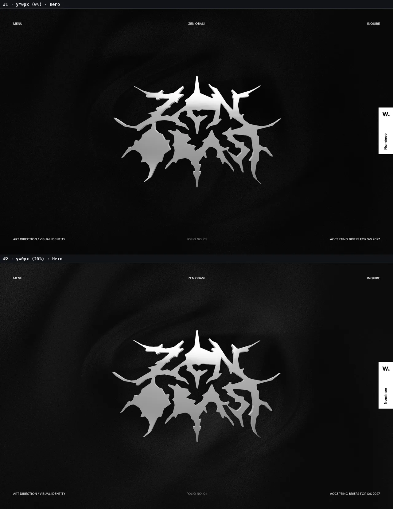
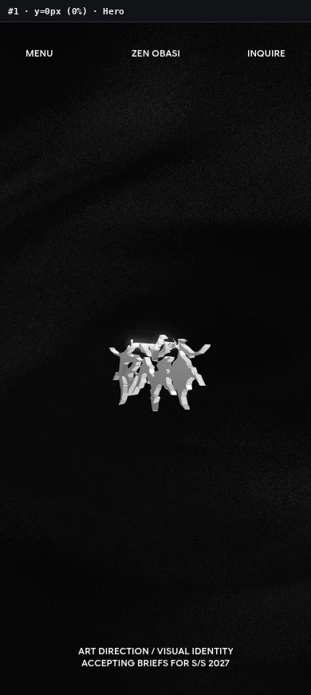

# UI Design System & Master Generation Blueprint: zenobasi-com

> **Zen Obasi — Art Director** (https://zenobasi.com) — Art director and visual strategist working across identity, campaign and editorial for brands worldwide.





---

## 1. Executive Visual Persona & Design Archetype

- **Brand Essence & Persona**: **Zen Obasi — Art Director** (`https://zenobasi.com`). Art director and visual strategist working across identity, campaign and editorial for brands worldwide.
- **Capture Provenance**: Live browser capture (`tier2_webgl`, HTTP `200`, captured `2026-11-24`).
- **Visual Archetype**: **Dark-Substrate WebGL / Canvas Interactive Experience (`#000000` / `#0c0c0c`)**.
- **Anti-AI-Slop Differentiators**:
  - **Live-Computed Chromatic Polarity**: Anchors the viewport in `#000000` (live computed `body` `background-color` (`computed_styles.json`)) paired with `#ffffff` primary typography and `#0c0c0c` accents.
  - **Grounded Typographic Hierarchy**: Uses `Google Sans Flex` across display (`Zen Obasi, Art Director`) and body copy.
  - **Calibrated Spatial Grid & Motion**: Combines `1440px` container bounds (`gap: 18rem`, padding `var(--edge)`) with `cubic-bezier(0.25,0.1,0.25,1)` easing and Lenis Smooth Scroll (`data-lenis`), HTML5 `<canvas>` Interactive Viewport Surface.

---

## 2. Spatial Architecture & Modular Grid Mathematics

### Viewport Allocation & Container Geometry
- **Captured Journey Filmstrips**: Desktop `1280×1656px` (`assets/desktop-journey.webp`, `2` keyframes up to `y=0px` / doc `900px`), Mobile `390×872px` (`assets/mobile-journey.webp`, `1` keyframes).
- **Master Container Bounds**: `1440px` (full-bleed `100%` desktop stage measured on `1440px` viewport).
- **Canvas Lateral Padding & Spacing**: `var(--edge)` lateral canvas padding with `18rem` grid gap.
- **Border Radius Scale**: `.5rem`, `.375rem`.

### Responsive Breakpoint Architecture
- **Desktop Layout**: Multi-column CSS Grid / Flexbox layout at `1440px` (`max-width: 1440px`, `gap: 18rem`).
- **Mobile Layout**: Single-column vertical stack at `390px` viewport width with `var(--edge)` horizontal padding.
- **Extracted CSS Media Queries**: `@media (max-width:600px)`, `@media (hover:none) and (pointer:coarse),(max-width:1024px)`, `@media (max-width:1000px)`.

---

## 3. Color System, Materiality & Atmospheric Lighting

### Semantic Palette & Source Grounding
| Semantic Role | Ground-Truth Value | Extracted Live / CSS Source |
|---|---|---|
| **Primary Canvas Substrate** | `#000000` | live computed `body` `background-color` (`computed_styles.json`) |
| **Primary Typography Ink** | `#ffffff` | live computed `h1` `color` (`computed_styles.json`) |
| **Elevated Surface / Card Substrate** | `#0c0c0c` | `.background { background-color: #0c0c0c }` |
| **Interactive Accent / Highlight** | `#0c0c0c` | `<meta name="theme-color" content="#0c0c0c">` in `dom.html` |
| **Secondary / Muted Copy** | `#ffffff` | secondary opacity step of live computed `h1` `color` (`computed_styles.json`) |
| **Structural Hairline Border** | `#ffffff` | hairline divider derived from secondary opacity step of live computed `h1` `color` (`computed_styles.json`) |

### Sanitized Root CSS Variables (`ui-ux.md` Ground Truth)
| Variable Name | Extracted Value | Semantic Role |
|---|---|---|
| `--base-100` | `#fff` | Color / Atmospheric Token |
| `--base-200` | `rgb(255 255 255/0.5)` | Color / Atmospheric Token |
| `--base-300` | `#000` | Color / Atmospheric Token |
| `--edge` | `clamp(2rem,3.5vw,3rem)` | Dimension / Scale Token |
| `--section-gap` | `18rem` | Layout / Spatial Grid Token |
| `--text-small` | `0.7rem` | Typography Ink Token |
| `--text-large` | `clamp(16px,3.5vw,24px)` | Typography Ink Token |
| `--side-reach` | `3.5em` | Dimension / Scale Token |
| `--font-sans` | `"Google Sans Flex"` | Typography / Scale Token |
| `--backdrop` | `0 0 0` | Design System Custom Token |
| `--digit-h` | `1.1em` | Dimension / Scale Token |
| `--fill-mobile` | `0.75` | Design System Custom Token |
| `--fill-desktop` | `0.45` | Design System Custom Token |
| `--zenobasi-com-bg` | `#000000` | Canvas Substrate (from live computed `body` `background-color` (`computed_styles.json`)) |
| `--zenobasi-com-ink` | `#ffffff` | Primary Typography Ink (computed-derived) |
| `--zenobasi-com-surface` | `#0c0c0c` | Surface Substrate (computed-derived) |

---

## 4. Typographic Scale & Editorial Hierarchy

### Font Family Stacks
- **Display Typography**: `Google Sans Flex`.
- **Primary Body Stack**: `Google Sans Flex`.
- **Technical / Metadata Stack**: not declared in live computed styles (uses primary stack / `ui-monospace`).

### Typographic Scale & Rules (Live Computed & Stylesheet Grounded)
- **Hero Display (`H1`)**: live computed `h1` (`font-size: 24px`, `line-height: 30px`, `font-weight: 350`).
- **Section Heading (`H2`)**: observed font-size ladder: `24px`, `16px`, `11.2px`, `var(--text-large)`, `var(--text-small)`.
- **Body Copy**: live computed `body` (`font-size: 16px`, `line-height: normal`, `font-weight: 400`); rule `,p` (`font-size: var(--text-small)`, `line-height: 1.35`, `font-weight: 400`).
- **Metadata & Navigation Labels**: live computed `nav/a` (`font-size: 16px`, `line-height: normal`, `font-weight: 400`); CSS variables `--text-small: 0.7rem`.

---

## 5. Choreographed Motion & Interaction Physics

### Primary Easing Curves
- **Extracted Timing Functions**: `cubic-bezier(0.25,0.1,0.25,1)`.

### Per-Element Transition & Choreography Rules
- **Selector `.menu-toggle`**: `transition: color .35s ease` extracted from `zenobasi-com` stylesheet.
- **Standard CSS Easing (`cubic-bezier(0.25,0.1,0.25,1)`)**: Default timing curve (no custom `cubic-bezier()` declared in captured CSS).
- **Runtime Interaction Engine**: Integrates Lenis Smooth Scroll (`data-lenis`), HTML5 `<canvas>` Interactive Viewport Surface with `prefers-reduced-motion: reduce` fallback guards.
### Measured Runtime Scroll & Interaction Telemetry (`behavioral_journey_v2`)
- **Scroll Driver Mode**: `wheel` (max document height `900px`, deepest scrollY reached `0px` across `2` desktop keyframes).
- **Detected Scroll / Motion Libraries**: `Lenis`, `WebGL/Canvas`.

---

## 6. Component Wireframe & Structural DOM Map

### Visual Layout Schematic — Desktop (`1440px`, Grounded in `dom.html` & Landmark Bounding Boxes)
```
┌────────────────────────────────────────────────────────────────────────┐
│ DESKTOP VIEWPORT (1440px) — Zen Obasi — Art Director                   │
│ ====================================================================== │
│ [ <nav.lenis> (1440x111px)            | Index Index · Work Work · Ab ] │
│ ---------------------------------------------------------------------- │
│ | HERO STAGE: <main.background> (w=1440px)                           | │
│ | H1: Zen Obasi, Art Director                                        | │
│ | Substrate: #000000 | Ink: #ffffff | Accent: #0c0c0c                | │
│ ---------------------------------------------------------------------- │
│ | SHOWCASE GRID (<main.container>) max-w: 1440px                     | │
│ | +------------------------------+  +------------------------------+ | │
│ | | ART DIRECTION / VISUAL IDENT |  | Art Direction / Visual Ident | | │
│ | +------------------------------+  +------------------------------+ | │
│ ---------------------------------------------------------------------- │
│ | DETAIL MODULE (<main.menu-toggle>) — Accepting Briefs for          | │
│ ---------------------------------------------------------------------- │
│ [ FOOTER (<footer.footer-pinne) | https://zenobasi.com                 │
└────────────────────────────────────────────────────────────────────────┘
```

### Visual Layout Schematic — Mobile Reflow (`390px`)
```
┌────────────────────────────────────────────────────────────────────────┐
│ MOBILE VIEWPORT REFLOW (390px) — Single-Column Stack (gap: 18rem)      │
│ ====================================================================== │
│ [ HEADER BAR (<nav.lenis>             ) | Compact Menu (390px)         │
│ ---------------------------------------------------------------------- │
│ | HERO STAGE (<main.background>) — 390px Vertical Lead               | │
│ | H1: Zen Obasi, Art Director                                        | │
│ ---------------------------------------------------------------------- │
│ | SHOWCASE STACK (<main.container>) — 1-Col Stack                    | │
│ | [ Item 1: ART DIRECTION / VISUAL IDENTITY                        ] | │
│ | [ Item 2: Art Direction / Visual Identity                        ] | │
│ ---------------------------------------------------------------------- │
│ | DETAIL STACK (<main.menu-toggle>) — 1-Col (Accepting Briefs f)     | │
│ ---------------------------------------------------------------------- │
│ [ FOOTER (<footer.footer-pinne) | Stacked 390px Colophon               │
└────────────────────────────────────────────────────────────────────────┘
```

### Granular DOM Region Breakdown
1. **Brand Header & Navigation Bar (<nav.lenis> — `zenobasi-com`)**:
   - Landmark `<nav class="lenis">` (`1440x111px`) hosting `Zen Obasi — Art Director` navigation (`Index Index · Work Work · About About · Inquire Inquire · Zen Obasi Zen Obasi`), DOM attributes (`data-precedence="next"`, `data-href="/_next/static/css/5f4..."`, `data-copy="lines"`, `data-copy="lines"`), and stylesheet rule `html { overflow-x:clip }`.
2. **Hero Stage & Focal Lead (<main.background> — `Zen Obasi, Art Director`)**:
   - Landmark `<main class="background">` presenting display lead `Zen Obasi, Art Director` and copy excerpt *"ART DIRECTION / VISUAL IDENTITY"* over `#000000` canvas and `#ffffff` ink.
3. **Primary Showcase & Content Grid (<main.container> — `ART DIRECTION / VISUAL IDENTITY`)**:
   - Landmark `<main class="container">` rendering section `ART DIRECTION / VISUAL IDENTITY` with copy *"Art Direction / Visual Identity"*, asset references (`2adbc45882a5a7c5.p.woff2`, `webpack-b827b2449ca92f38.js`, `4bd1b696-228d6cc6681fc189.js`, `826-cff36fe3db5d20f7.js`), and grid rule `body { font-family:var(--font-sans),sans-serif;background-color:var(--base-300)... }`.
4. **Interactive Detail & Feature Matrix (<main.menu-toggle> — `Art Direction / Visual Identity`)**:
   - Landmark `<main class="menu-toggle">` framing `Art Direction / Visual Identity` and `Accepting Briefs for S/S 2027` (*"Accepting Briefs for S/S 2027"*) with `#0c0c0c` surface cards, `#0c0c0c` accents, and `selection { background-color:var(--base-100);color:var(--base-300) }`.
5. **Colophon & Global Directory Footer (<footer.footer-pinned> — `https://zenobasi.com`)**:
   - Landmark `<footer class="footer-pinned footer-simple">` anchoring `Zen Obasi — Art Director` footer links (`Index Index · Work Work · About About · Inquire Inquire · Zen Obasi Zen Obasi`), copy *"Zen Obasi Zen Obasi"*, and `#ffffff` structural dividers.
### Full Vertical Scroll Sequence (Desktop `1440×900` Keyframes)
- **Step 01** (`y=0px`, `0%`): Active landmark `Hero` · sticky/fixed elements: `4`
- **Step 02** (`y=0px`, `20%`): Active landmark `Hero` · sticky/fixed elements: `4`

---

## 7. Master Zero-Shot AI Generation Prompt

```markdown
# Master Zero-Shot Frontend Generation Prompt: zenobasi-com (Zen Obasi — Art Director)

You are a principal frontend architect and design systems engineer. Build a complete, production-ready web application replicating the exact design system, DOM landmarks, typographic hierarchy, color tokens, and motion physics of `zenobasi-com` (**Zen Obasi — Art Director** — `https://zenobasi.com`).

### 1. Visual Archetype & Anti-AI-Slop Mandates
- **Archetype**: Dark-Substrate WebGL / Canvas Interactive Experience (`#000000` / `#0c0c0c`).
- **Identity & Domain Context**: Art director and visual strategist working across identity, campaign and editorial for brands worldwide.
- **Primary Substrate**: `#000000` (live computed `body` `background-color` (`computed_styles.json`)), **Primary Ink**: `#ffffff`, **Accent / Highlight**: `#0c0c0c`.
- **Site-Specific Differentiators**:
  - **Live-Computed Chromatic Polarity**: Anchors the viewport in `#000000` (live computed `body` `background-color` (`computed_styles.json`)) paired with `#ffffff` primary typography and `#0c0c0c` accents.
  - **Grounded Typographic Hierarchy**: Uses `Google Sans Flex` across display (`Zen Obasi, Art Director`) and body copy.
  - **Calibrated Spatial Grid & Motion**: Combines `1440px` container bounds (`gap: 18rem`, padding `var(--edge)`) with `cubic-bezier(0.25,0.1,0.25,1)` easing and Lenis Smooth Scroll (`data-lenis`), HTML5 `<canvas>` Interactive Viewport Surface.

### 2. Ground-Truth CSS Variables (`:root` Token Contract)
Declare and consume these exact custom properties extracted from `zenobasi-com` in your global stylesheet:

:root {
  /* Zen Obasi — Art Director (zenobasi-com) — Live-Grounded CSS Variables */
  --base-100: #fff; /* Color / Atmospheric Token (zenobasi-com) */
  --base-200: rgb(255 255 255/0.5); /* Color / Atmospheric Token (zenobasi-com) */
  --base-300: #000; /* Color / Atmospheric Token (zenobasi-com) */
  --edge: clamp(2rem,3.5vw,3rem); /* Dimension / Scale Token (zenobasi-com) */
  --section-gap: 18rem; /* Layout / Spatial Grid Token (zenobasi-com) */
  --text-small: 0.7rem; /* Typography Ink Token (zenobasi-com) */
  --text-large: clamp(16px,3.5vw,24px); /* Typography Ink Token (zenobasi-com) */
  --side-reach: 3.5em; /* Dimension / Scale Token (zenobasi-com) */
  --font-sans: "Google Sans Flex"; /* Typography / Scale Token (zenobasi-com) */
  --backdrop: 0 0 0; /* Design System Custom Token (zenobasi-com) */
  --digit-h: 1.1em; /* Dimension / Scale Token (zenobasi-com) */
  --fill-mobile: 0.75; /* Design System Custom Token (zenobasi-com) */
  --fill-desktop: 0.45; /* Design System Custom Token (zenobasi-com) */
  --zenobasi-com-bg: #000000; /* Canvas Substrate (from live computed `body` `background-color` (`computed_styles.json`)) (zenobasi-com) */
  --zenobasi-com-ink: #ffffff; /* Primary Typography Ink (computed-derived) (zenobasi-com) */
  --zenobasi-com-surface: #0c0c0c; /* Surface Substrate (computed-derived) (zenobasi-com) */
}

### 3. Semantic Color & Materiality Contract
Map every surface, ink, and border strictly to these source-grounded tokens:
- **Primary Canvas Substrate**: `#000000` — grounded in live computed `body` `background-color` (`computed_styles.json`)
- **Primary Typography Ink**: `#ffffff` — grounded in live computed `h1` `color` (`computed_styles.json`)
- **Elevated Surface / Card Substrate**: `#0c0c0c` — grounded in `.background { background-color: #0c0c0c }`
- **Interactive Accent / Highlight**: `#0c0c0c` — grounded in `<meta name="theme-color" content="#0c0c0c">` in `dom.html`
- **Secondary / Muted Copy**: `#ffffff` — grounded in secondary opacity step of live computed `h1` `color` (`computed_styles.json`)
- **Structural Hairline Border**: `#ffffff` — grounded in hairline divider derived from secondary opacity step of live computed `h1` `color` (`computed_styles.json`)

### 4. Spatial Grid, Container Bounds & Responsive Breakpoints
- **Desktop Viewport Reference**: `1280×1656px` (full-page live capture (1656px), `1440px` standard desktop width).
- **Mobile Viewport Reference**: `390×872px` (full-page live capture (872px), `390px` standard mobile width).
- **Container Max-Width**: `1440px` (full-bleed `100%` desktop stage measured on `1440px` viewport)
- **Padding & Gutters**: `var(--edge)` lateral canvas padding with `18rem` grid gap
- **Desktop Grid**: Multi-column CSS Grid / Flexbox layout at `1440px` (`max-width: 1440px`, `gap: 18rem`)
- **Mobile Adaptation**: Single-column vertical stack at `390px` viewport width with `var(--edge)` horizontal padding
- **Media Queries**: `@media (max-width:600px)`, `@media (hover:none) and (pointer:coarse),(max-width:1024px)`, `@media (max-width:1000px)`
- **Corner Radii**: `.5rem`, `.375rem`

### 5. Typography & Editorial Scale Contract
- **Display Font Stack**: `Google Sans Flex`
- **Body Font Stack**: `Google Sans Flex`
- **Monospace / Technical Font Stack**: not declared in live computed styles (uses primary stack / `ui-monospace`)
- **H1 Display Rule**: live computed `h1` (`font-size: 24px`, `line-height: 30px`, `font-weight: 350`)
- **H2 Section Rule**: observed font-size ladder: `24px`, `16px`, `11.2px`, `var(--text-large)`, `var(--text-small)`
- **Body Copy Rule**: live computed `body` (`font-size: 16px`, `line-height: normal`, `font-weight: 400`); rule `,p` (`font-size: var(--text-small)`, `line-height: 1.35`, `font-weight: 400`)
- **Metadata & Index Rule**: live computed `nav/a` (`font-size: 16px`, `line-height: normal`, `font-weight: 400`); CSS variables `--text-small: 0.7rem`

### 6. Component Hierarchy, Verbatim Copy & Real DOM Landmarks
Scaffold `zenobasi-com` (`Zen Obasi — Art Director`) with these exact structural regions, extracted copy, and CSS rules from `dom.html`:
1. **Brand Header & Navigation Bar (<nav.lenis> — `zenobasi-com`)**:
   - DOM & Selectors: Landmark `<nav class="lenis">` (`1440x111px`) hosting `Zen Obasi — Art Director` navigation (`Index Index · Work Work · About About · Inquire Inquire · Zen Obasi Zen Obasi`), DOM attributes (`data-precedence="next"`, `data-href="/_next/static/css/5f4..."`, `data-copy="lines"`, `data-copy="lines"`), and stylesheet rule `html { overflow-x:clip }`.
   - Responsive Contract: Header `Brand Header & Navigation Bar (<nav.lenis> — `zenobasi-com`)` (`zenobasi-com`) adapts across `@media (max-width:600px)`, `@media (hover:none) and (pointer:coarse),(max-width:1024px)`, `@media (max-width:1000px)` with `cubic-bezier(0.25,0.1,0.25,1)` transitions and links `Index Index · Work Work · About About · Inquire Inquire · Zen Obasi Zen Obasi`.
2. **Hero Stage & Focal Lead (<main.background> — `Zen Obasi, Art Director`)**:
   - DOM & Selectors: Landmark `<main class="background">` presenting display lead `Zen Obasi, Art Director` and copy excerpt *"ART DIRECTION / VISUAL IDENTITY"* over `#000000` canvas and `#ffffff` ink.
   - Responsive Contract: Hero stage (`1280×1656px` desktop / `390×872px` mobile) sets `#000000` background with `#ffffff` headline `Zen Obasi, Art Director`.
3. **Primary Showcase & Content Grid (<main.container> — `ART DIRECTION / VISUAL IDENTITY`)**:
   - DOM & Selectors: Landmark `<main class="container">` rendering section `ART DIRECTION / VISUAL IDENTITY` with copy *"Art Direction / Visual Identity"*, asset references (`2adbc45882a5a7c5.p.woff2`, `webpack-b827b2449ca92f38.js`, `4bd1b696-228d6cc6681fc189.js`, `826-cff36fe3db5d20f7.js`), and grid rule `body { font-family:var(--font-sans),sans-serif;background-color:var(--base-300)... }`.
   - Responsive Contract: Showcase grid `Primary Showcase & Content Grid (<main.container> — `ART DIRECTION / VISUAL IDENTITY`)` applies Multi-column CSS Grid / Flexbox layout at `1440px` (`max-width: 1440px`, `gap: 18rem`) on desktop and Single-column vertical stack at `390px` viewport width with `var(--edge)` horizontal padding on mobile.
4. **Interactive Detail & Feature Matrix (<main.menu-toggle> — `Art Direction / Visual Identity`)**:
   - DOM & Selectors: Landmark `<main class="menu-toggle">` framing `Art Direction / Visual Identity` and `Accepting Briefs for S/S 2027` (*"Accepting Briefs for S/S 2027"*) with `#0c0c0c` surface cards, `#0c0c0c` accents, and `selection { background-color:var(--base-100);color:var(--base-300) }`.
   - Responsive Contract: Detail module `Interactive Detail & Feature Matrix (<main.menu-toggle> — `Art Direction / Visual Identity`)` uses `.5rem`, `.375rem` radii, `#0c0c0c` highlights, and assets (2adbc45882a5a7c5.p.woff2, webpack-b827b2449ca92f38.js, 4bd1b696-228d6cc6681fc189.js).
5. **Colophon & Global Directory Footer (<footer.footer-pinned> — `https://zenobasi.com`)**:
   - DOM & Selectors: Landmark `<footer class="footer-pinned footer-simple">` anchoring `Zen Obasi — Art Director` footer links (`Index Index · Work Work · About About · Inquire Inquire · Zen Obasi Zen Obasi`), copy *"Zen Obasi Zen Obasi"*, and `#ffffff` structural dividers.
   - Responsive Contract: Footer `Colophon & Global Directory Footer (<footer.footer-pinned> — `https://zenobasi.com`)` aligns to `1440px` (full-bleed `100%` desktop stage measured on `1440px` viewport) with `var(--edge)` lateral canvas padding with `18rem` grid gap and attributes (data-precedence="next", data-href="/_next/static/css/5f4...", data-copy="lines").

#### Verbatim DOM Copy Excerpts (`dom.html`)
- Copy Excerpt 1: *"ART DIRECTION / VISUAL IDENTITY"*
- Copy Excerpt 2: *"Art Direction / Visual Identity"*
- Copy Excerpt 3: *"Accepting Briefs for S/S 2027"*
- Copy Excerpt 4: *"Zen Obasi Zen Obasi"*

### 7. Motion, Extracted Stylesheet Rules & Interaction Choreography
- **Primary Easing Functions**: `cubic-bezier(0.25,0.1,0.25,1)`
- **Extracted Stylesheet Rules (`zenobasi-com`)**:
- `html { overflow-x:clip }`
- `body { font-family:var(--font-sans),sans-serif;background-color:var(--base-300)... }`
- `selection { background-color:var(--base-100);color:var(--base-300) }`
- `html.lenis body { height:auto }`
- `.lenis.lenis-stopped { overflow:hidden }`
- **Per-Selector Transition Rules**:
- **Selector `.menu-toggle`**: `transition: color .35s ease` extracted from `zenobasi-com` stylesheet.
- **Standard CSS Easing (`cubic-bezier(0.25,0.1,0.25,1)`)**: Default timing curve (no custom `cubic-bezier()` declared in captured CSS).
- **Runtime Interaction Engine**: Integrates Lenis Smooth Scroll (`data-lenis`), HTML5 `<canvas>` Interactive Viewport Surface with `prefers-reduced-motion: reduce` fallback guards.
### 7b. Full-Page Scroll Choreography, Interactive States & Multi-Page Routes
- **Scroll Mechanics**: Implement `wheel` vertical progression up to `900px` across 2 distinct viewport chapters using Lenis, WebGL/Canvas.
- **Vertical Chapter Sequence**: Hero (0%) -> Hero (20%).

### 8. Technical Deliverables
- Implement in Next.js (App Router) with TypeScript and Tailwind CSS consuming the `:root` custom properties defined above for `zenobasi-com`.
- Reproduce both the `1440px` desktop architecture and `390px` mobile breakpoint transitions, preserving semantic HTML5 landmarks (`<header>`, `<nav>`, `<main>`, `<section>`, `<footer>`) and `prefers-reduced-motion` accessibility guards.
```
---

## 8. Full-Page Scroll Journey, Interactive States & Subpage Inventory

### Desktop Scroll Keyframes (`1440×900` WebP)
| Step | Scroll Y | Progress | Active Landmark / Section | Sticky/Fixed | Visual Asset |
| :---: | :---: | :---: | :--- | :---: | :--- |
| `#01` | `0px` | `0%` | Hero | `4` | [desktop-step-01.webp](assets/desktop-step-01.webp) |
| `#02` | `0px` | `20%` | Hero | `4` | [desktop-step-02.webp](assets/desktop-step-02.webp) |

### Mobile Condensed Keyframes (`390×844` WebP)
| Step | Scroll Y | Progress | Active Landmark | Visual Asset |
| :---: | :---: | :---: | :--- | :--- |
| `#01` | `0px` | `0%` | Hero | [mobile-step-01.webp](assets/mobile-step-01.webp) |

