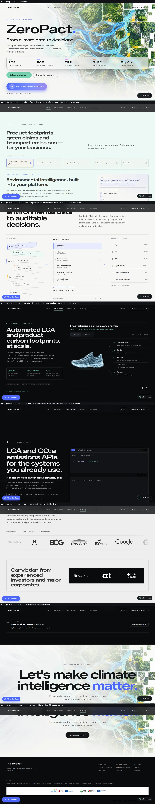
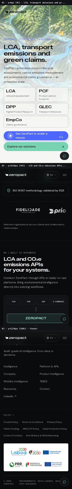

# UI Design System & Master Generation Blueprint: zeropact-co

> **ZeroPact · LCA, Product Carbon Footprint, DPP, GLEC & EmpCo** (https://zeropact.co) — LCA, Product Carbon Footprint, Digital Product Passport (DPP), GLEC and EmpCo intelligence and solutions for PIM and PXM companies servin...





---

## 1. Executive Visual Persona & Design Archetype

- **Brand Essence & Persona**: **ZeroPact · LCA, Product Carbon Footprint, DPP, GLEC & EmpCo** (`https://zeropact.co`). LCA, Product Carbon Footprint, Digital Product Passport (DPP), GLEC and EmpCo intelligence and solutions for PIM and PXM companies servin...
- **Capture Provenance**: Live browser capture (`tier1_fast`, HTTP `200`, captured `2026-11-24`).
- **Visual Archetype**: **Light-Gallery WebGL / Canvas Interactive Experience (`#ffffff` / `#4d67fc`)**.
- **Anti-AI-Slop Differentiators**:
  - **Live-Computed Chromatic Polarity**: Anchors the viewport in `#ffffff` (live computed `browser-default` `background-color` (`computed_styles.json`)) paired with `#0000ff` primary typography and `#4d67fc` accents.
  - **Grounded Typographic Hierarchy**: Pairs `Zalando Sans Expanded` for display copy (`ZeroPact.`) with `DM Sans` and `DM Mono`.
  - **Calibrated Spatial Grid & Motion**: Combines `1320px` container bounds (`gap: var(--spacing)`, padding `var(--spacing)`) with `cubic-bezier(0,0,.2,1)` easing and HTML5 `<canvas>` Interactive Viewport Surface.

---

## 2. Spatial Architecture & Modular Grid Mathematics

### Viewport Allocation & Container Geometry
- **Captured Journey Filmstrips**: Desktop `1280×6624px` (`assets/desktop-journey.webp`, `8` keyframes up to `y=10892px` / doc `11792px`), Mobile `390×2616px` (`assets/mobile-journey.webp`, `3` keyframes).
- **Master Container Bounds**: `1320px` (measured widest bounded `<section>` landmark width on `1440px` desktop).
- **Canvas Lateral Padding & Spacing**: `var(--spacing)` lateral canvas padding with `var(--spacing)` grid gap.
- **Border Radius Scale**: `3.35544e+07px`, `2px`, `.25rem`, `var(--radius-2xl)`.

### Responsive Breakpoint Architecture
- **Desktop Layout**: Multi-column CSS Grid / Flexbox layout at `1440px` (`max-width: 1320px`, `gap: var(--spacing)`).
- **Mobile Layout**: Single-column vertical stack at `390px` viewport width with `var(--spacing)` horizontal padding.
- **Extracted CSS Media Queries**: `@media (width>=40rem)`, `@media (width>=48rem)`, `@media (width>=64rem)`, `@media (width>=80rem)`.

---

## 3. Color System, Materiality & Atmospheric Lighting

### Semantic Palette & Source Grounding
| Semantic Role | Ground-Truth Value | Extracted Live / CSS Source |
|---|---|---|
| **Primary Canvas Substrate** | `#ffffff` | live computed `browser-default` `background-color` (`computed_styles.json`) |
| **Primary Typography Ink** | `#0000ff` | `#company .text-signal { color: blue }` (`#0000ff`) |
| **Elevated Surface / Card Substrate** | `#000000` | `80 { background-color: black }` (`#000000`) |
| **Interactive Accent / Highlight** | `#4d67fc` | `.tf-tower-comet-b { stroke: #4d67fc }` |
| **Secondary / Muted Copy** | `#800080` | `.text-violet-2 { color: purple }` (`#800080`) |
| **Structural Hairline Border** | `#ffda76` | `.mi-method-chain li:last-child { border-color: #ffda76 }` |

### Sanitized Root CSS Variables (`ui-ux.md` Ground Truth)
| Variable Name | Extracted Value | Semantic Role |
|---|---|---|
| `--radius` | `.375rem` | Elevation / Border Token |
| `--background` | `oklch(15% .007 271)` | Canvas / Surface Token |
| `--foreground` | `oklch(94.6% 0 0)` | Typography Ink Token |
| `--card` | `oklch(18.6% .009 264.3)` | Color / Atmospheric Token |
| `--card-foreground` | `oklch(94.6% 0 0)` | Typography Ink Token |
| `--popover` | `oklch(18.6% .009 264.3)` | Color / Atmospheric Token |
| `--popover-foreground` | `oklch(94.6% 0 0)` | Typography Ink Token |
| `--primary` | `oklch(79.7% .101 168.5)` | Brand / Palette Token |
| `--primary-foreground` | `oklch(15% .007 271)` | Typography Ink Token |
| `--secondary` | `oklch(21.3% .013 264.3)` | Brand / Palette Token |
| `--secondary-foreground` | `oklch(94.6% 0 0)` | Typography Ink Token |
| `--muted` | `oklch(21.3% .013 264.3)` | Color / Atmospheric Token |
| `--muted-foreground` | `oklch(68.9% 0 0)` | Typography Ink Token |
| `--accent` | `oklch(58.3% .222 270.3)` | Brand / Palette Token |
| `--accent-foreground` | `oklch(97.3% .003 106.4)` | Typography Ink Token |
| `--destructive` | `oklch(65.8% .231 35)` | Color / Atmospheric Token |

---

## 4. Typographic Scale & Editorial Hierarchy

### Font Family Stacks
- **Display Typography**: `Zalando Sans Expanded`.
- **Primary Body Stack**: `DM Sans`.
- **Technical / Metadata Stack**: `DM Mono`.

### Typographic Scale & Rules (Live Computed & Stylesheet Grounded)
- **Hero Display (`H1`)**: live computed `h1` (`font-size: 112px`, `line-height: 112px`, `font-weight: 600`); CSS variables `--text-4xl: 2.25rem`, `--text-4xl--line-height: calc(2.5 / 2.25)`, `--text-5xl: 3rem`.
- **Section Heading (`H2`)**: live computed `h2` (`font-size: 52px`, `line-height: 56.16px`, `font-weight: 600`); CSS variables `--text-2xl: 1.5rem`, `--text-2xl--line-height: calc(2 / 1.5)`, `--text-3xl: 1.875rem`; rule `h2` (`font-size: 1.25rem`, `letter-spacing: -.01em`).
- **Body Copy**: live computed `body` (`font-size: 16px`, `line-height: 24px`, `font-weight: 400`); CSS variables `--text-base: 1rem`, `--text-base--line-height: calc(1.5 / 1)`; rule `p` (`line-height: var(--leading-relaxed)`).
- **Metadata & Navigation Labels**: live computed `nav/a` (`font-size: 16px`, `line-height: 24px`, `font-weight: 400`); CSS variables `--font-mono: "DM Mono", ui-monospace, SFMono-Regular, monospace`, `--text-xs: .75rem`, `--text-xs--line-height: calc(1 / .75)`; rule `small` (`font-size: 10px`).

---

## 5. Choreographed Motion & Interaction Physics

### Primary Easing Curves
- **Extracted Timing Functions**: `cubic-bezier(0,0,.2,1)`, `cubic-bezier(.4,0,.2,1)`, `cubic-bezier(.4,0,.6,1)`.

### Per-Element Transition & Choreography Rules
- **Selector `layer theme`**: `transition: .15s` extracted from `zeropact-co` stylesheet.
- **Selector `.transition`**: `transition: var(--tw-ease,var(--default-transition-timing-function))` extracted from `zeropact-co` stylesheet.
- **Selector `box-shadow\]`**: `transition: var(--tw-ease,var(--default-transition-timing-function))` extracted from `zeropact-co` stylesheet.
- **Extracted Easing Curve (`cubic-bezier(0,0,.2,1)`)**: Governs interactive state transitions across `<header.inset-x-0>` and `<section.border-line>`.
- **Runtime Interaction Engine**: Integrates HTML5 `<canvas>` Interactive Viewport Surface with `prefers-reduced-motion: reduce` fallback guards.
### Measured Runtime Scroll & Interaction Telemetry (`behavioral_journey_v2`)
- **Scroll Driver Mode**: `native` (max document height `11792px`, deepest scrollY reached `10892px` across `8` desktop keyframes).
- **Detected Scroll / Motion Libraries**: `WebGL/Canvas`.
- **Nav / Drawer Probe (`Language`)**: Triggered visual change (pixel diff `14.491`, captured in `assets/state-nav.webp`); revealed links: English, Português, Español, Français, 中文.
- **Hover Physics (`primary_cta` · `Find your intelligence`)**: `backgroundColor`: `oklch(0.797 0.101 168.5)` -> `oklab(0.846529 -0.07674...` (`transition-duration: 0.3s`, `timing: cubic-bezier(0.4, 0, 0.2, 1)`).
- **Interactive Control Probe (`tab` · `Brands & manufacturers`)**: Triggered visual diff `16.875` (attr `false -> true`, captured in `assets/state-interactive.webp`).
- **Route Transition Architecture**: First internal navigation (`/solutions/product-intelligence`) measured as `direct` in `2089ms`.

---

## 6. Component Wireframe & Structural DOM Map

### Visual Layout Schematic — Desktop (`1440px`, Grounded in `dom.html` & Landmark Bounding Boxes)
```
┌────────────────────────────────────────────────────────────────────────┐
│ DESKTOP VIEWPORT (1440px) — ZeroPact · LCA, Product Carbon Footprint,  │
│ ====================================================================== │
│ [ <header.inset-x-0> (1440x73px)      | Explore · Intelligence ▾ · P ] │
│ ---------------------------------------------------------------------- │
│ | HERO STAGE: <section.climate-hero> (w=1440px)                      | │
│ | H1: ZeroPact.                                                      | │
│ | Substrate: #ffffff | Ink: #0000ff | Accent: #4d67fc                | │
│ ---------------------------------------------------------------------- │
│ | SHOWCASE GRID (<section.border-line>) max-w: 1320px                | │
│ | +------------------------------+  +------------------------------+ | │
│ | | ZeroPact .                   |  | Product footprints, green cl | | │
│ | +------------------------------+  +------------------------------+ | │
│ ---------------------------------------------------------------------- │
│ | DETAIL MODULE (<section.bg-paper>) — Environmental intelli         | │
│ ---------------------------------------------------------------------- │
│ [ FOOTER (<footer.border-line>) | https://zeropact.co                  │
└────────────────────────────────────────────────────────────────────────┘
```

### Visual Layout Schematic — Mobile Reflow (`390px`)
```
┌────────────────────────────────────────────────────────────────────────┐
│ MOBILE VIEWPORT REFLOW (390px) — Single-Column Stack (gap: var(--sp)   │
│ ====================================================================== │
│ [ HEADER BAR (<header.inset-x-0>      ) | Compact Menu (390px)         │
│ ---------------------------------------------------------------------- │
│ | HERO STAGE (<section.climate-hero>) — 390px Vertical Lead          | │
│ | H1: ZeroPact.                                                      | │
│ ---------------------------------------------------------------------- │
│ | SHOWCASE STACK (<section.border-line>) — 1-Col Stack               | │
│ | [ Item 1: ZeroPact .                                             ] | │
│ | [ Item 2: Product footprints, green claims and transport em...   ] | │
│ ---------------------------------------------------------------------- │
│ | DETAIL STACK (<section.bg-paper>) — 1-Col (Environmental inte)     | │
│ ---------------------------------------------------------------------- │
│ [ FOOTER (<footer.border-line>) | Stacked 390px Colophon               │
└────────────────────────────────────────────────────────────────────────┘
```

### Granular DOM Region Breakdown
1. **Brand Header & Navigation Bar (<header.inset-x-0> — `zeropact-co`)**:
   - Landmark `<header class="inset-x-0 top-0">` (`1440x73px`) hosting `ZeroPact · LCA, Product Carbon Footp` navigation (`Explore · Intelligence ▾ · Product · Mobility · Platform & APIs`), DOM attributes (`data-precedence="default"`, `data-precedence="default"`, `data-artifact-kind="dwl_content_hash"`, `data-artifact-id="ab2d1433faa58eadc83ca..."`), and stylesheet rule `backdrop { box-sizing:border-box;border:0 solid;margin:0;padding:0 }`.
2. **Hero Stage & Focal Lead (<section.climate-hero> — `ZeroPact.`)**:
   - Landmark `<section class="climate-hero bg-paper">` presenting display lead `ZeroPact.` and copy excerpt *"DEEPTECH / CLIMATE DATA INTELLIGENCE"* over `#ffffff` canvas and `#0000ff` ink.
3. **Primary Showcase & Content Grid (<section.border-line> — `ZeroPact .`)**:
   - Landmark `<section class="border-line py-24">` rendering section `ZeroPact .` with copy *"Deeptech / Climate data intelligence"*, asset references (`zeropact-logotype.png`, `climate-data-landscape-light-CJil...`, `climate-data-landscape-digital-B-...`, `wired_logo.png`), and grid rule `file-selector-button { box-sizing:border-box;border:0 solid;margin:0;padding:0 }`.
4. **Interactive Detail & Feature Matrix (<section.bg-paper> — `Product footprints, green claims a`)**:
   - Landmark `<section class="bg-paper py-24">` framing `Product footprints, green claims and transport em...` and `Environmental intelligence, built into your platf...` (*"From climate data to decisions."*) with `#000000` surface cards, `#4d67fc` accents, and `strong { font-weight:bolder }`.
5. **Colophon & Global Directory Footer (<footer.border-line> — `https://zeropact.co`)**:
   - Landmark `<footer class="border-line bg-ink">` anchoring `ZeroPact · LCA, Product Carbon F` footer links (`Explore · Intelligence ▾ · Product · Mobility · Platform & APIs`), copy *"Audit-grade AI intelligence that transforms complex environm"*, and `#ffda76` structural dividers.
### Full Vertical Scroll Sequence (Desktop `1440×900` Keyframes)
- **Step 01** (`y=0px`, `0%`): Active landmark `ZeroPact.` · sticky/fixed elements: `1`
- **Step 02** (`y=850px`, `8%`): Active landmark `Product footprints, green claims and transport em...` · sticky/fixed elements: `1`
- **Step 03** (`y=2550px`, `23%`): Active landmark `From fragmented environmental data to auditable d...` · sticky/fixed elements: `1`
- **Step 04** (`y=4250px`, `39%`): Active landmark `Automated LCA and product carbon footprints, at s...` · sticky/fixed elements: `2`
- **Step 05** (`y=6800px`, `62%`): Active landmark `LCA and CO₂e emissions APIs for the systems you a...` · sticky/fixed elements: `2`
- **Step 06** (`y=8500px`, `78%`): Active landmark `Built by people who've built big.` · sticky/fixed elements: `1`
- **Step 07** (`y=10200px`, `94%`): Active landmark `Interactive presentations` · sticky/fixed elements: `1`
- **Step 08** (`y=10892px`, `100%`): Active landmark `Let's make climate intelligence matter.` · sticky/fixed elements: `1`

### Multi-Page Internal Route Map
- **Detail Route (`/solutions/product-intelligence`)**: `https://zeropact.co/solutions/product-intelligence` — H1: `Automated LCA and product carbon footprints, at s...`, scrollHeight `6687px`, transition `direct` (`2089ms`)
- **Detail Route (`/solutions/mobility-intelligence`)**: `https://zeropact.co/solutions/mobility-intelligence` — H1: `Parcel and transport CO₂e emissions, measured.`, scrollHeight `7775px`, transition `direct` (`943ms`)
- **Detail Route (`/solutions/trace`)**: `https://zeropact.co/solutions/trace` — H1: `Detect, assess and govern environmental claims. A...`, scrollHeight `9598px`, transition `direct` (`738ms`)

---

## 7. Master Zero-Shot AI Generation Prompt

```markdown
# Master Zero-Shot Frontend Generation Prompt: zeropact-co (ZeroPact · LCA, Product Carbon Footprint, DPP, GLEC & EmpCo)

You are a principal frontend architect and design systems engineer. Build a complete, production-ready web application replicating the exact design system, DOM landmarks, typographic hierarchy, color tokens, and motion physics of `zeropact-co` (**ZeroPact · LCA, Product Carbon Footprint, DPP, GLEC & EmpCo** — `https://zeropact.co`).

### 1. Visual Archetype & Anti-AI-Slop Mandates
- **Archetype**: Light-Gallery WebGL / Canvas Interactive Experience (`#ffffff` / `#4d67fc`).
- **Identity & Domain Context**: LCA, Product Carbon Footprint, Digital Product Passport (DPP), GLEC and EmpCo intelligence and solutions for PIM and PXM companies servin...
- **Primary Substrate**: `#ffffff` (live computed `browser-default` `background-color` (`computed_styles.json`)), **Primary Ink**: `#0000ff`, **Accent / Highlight**: `#4d67fc`.
- **Site-Specific Differentiators**:
  - **Live-Computed Chromatic Polarity**: Anchors the viewport in `#ffffff` (live computed `browser-default` `background-color` (`computed_styles.json`)) paired with `#0000ff` primary typography and `#4d67fc` accents.
  - **Grounded Typographic Hierarchy**: Pairs `Zalando Sans Expanded` for display copy (`ZeroPact.`) with `DM Sans` and `DM Mono`.
  - **Calibrated Spatial Grid & Motion**: Combines `1320px` container bounds (`gap: var(--spacing)`, padding `var(--spacing)`) with `cubic-bezier(0,0,.2,1)` easing and HTML5 `<canvas>` Interactive Viewport Surface.

### 2. Ground-Truth CSS Variables (`:root` Token Contract)
Declare and consume these exact custom properties extracted from `zeropact-co` in your global stylesheet:

:root {
  /* ZeroPact · LCA, Product Carbon Footprint, DPP, GLEC & EmpCo (zeropact-co) — Live-Grounded CSS Variables */
  --radius: .375rem; /* Elevation / Border Token (zeropact-co) */
  --background: oklch(15% .007 271); /* Canvas / Surface Token (zeropact-co) */
  --foreground: oklch(94.6% 0 0); /* Typography Ink Token (zeropact-co) */
  --card: oklch(18.6% .009 264.3); /* Color / Atmospheric Token (zeropact-co) */
  --card-foreground: oklch(94.6% 0 0); /* Typography Ink Token (zeropact-co) */
  --popover: oklch(18.6% .009 264.3); /* Color / Atmospheric Token (zeropact-co) */
  --popover-foreground: oklch(94.6% 0 0); /* Typography Ink Token (zeropact-co) */
  --primary: oklch(79.7% .101 168.5); /* Brand / Palette Token (zeropact-co) */
  --primary-foreground: oklch(15% .007 271); /* Typography Ink Token (zeropact-co) */
  --secondary: oklch(21.3% .013 264.3); /* Brand / Palette Token (zeropact-co) */
  --secondary-foreground: oklch(94.6% 0 0); /* Typography Ink Token (zeropact-co) */
  --muted: oklch(21.3% .013 264.3); /* Color / Atmospheric Token (zeropact-co) */
  --muted-foreground: oklch(68.9% 0 0); /* Typography Ink Token (zeropact-co) */
  --accent: oklch(58.3% .222 270.3); /* Brand / Palette Token (zeropact-co) */
  --accent-foreground: oklch(97.3% .003 106.4); /* Typography Ink Token (zeropact-co) */
  --destructive: oklch(65.8% .231 35); /* Color / Atmospheric Token (zeropact-co) */
}

### 3. Semantic Color & Materiality Contract
Map every surface, ink, and border strictly to these source-grounded tokens:
- **Primary Canvas Substrate**: `#ffffff` — grounded in live computed `browser-default` `background-color` (`computed_styles.json`)
- **Primary Typography Ink**: `#0000ff` — grounded in `#company .text-signal { color: blue }` (`#0000ff`)
- **Elevated Surface / Card Substrate**: `#000000` — grounded in `80 { background-color: black }` (`#000000`)
- **Interactive Accent / Highlight**: `#4d67fc` — grounded in `.tf-tower-comet-b { stroke: #4d67fc }`
- **Secondary / Muted Copy**: `#800080` — grounded in `.text-violet-2 { color: purple }` (`#800080`)
- **Structural Hairline Border**: `#ffda76` — grounded in `.mi-method-chain li:last-child { border-color: #ffda76 }`

### 4. Spatial Grid, Container Bounds & Responsive Breakpoints
- **Desktop Viewport Reference**: `1280×6624px` (multi-frame vertical journey filmstrip (6624px), `1440px` standard desktop width).
- **Mobile Viewport Reference**: `390×2616px` (multi-frame vertical journey filmstrip (2616px), `390px` standard mobile width).
- **Container Max-Width**: `1320px` (measured widest bounded `<section>` landmark width on `1440px` desktop)
- **Padding & Gutters**: `var(--spacing)` lateral canvas padding with `var(--spacing)` grid gap
- **Desktop Grid**: Multi-column CSS Grid / Flexbox layout at `1440px` (`max-width: 1320px`, `gap: var(--spacing)`)
- **Mobile Adaptation**: Single-column vertical stack at `390px` viewport width with `var(--spacing)` horizontal padding
- **Media Queries**: `@media (width>=40rem)`, `@media (width>=48rem)`, `@media (width>=64rem)`, `@media (width>=80rem)`
- **Corner Radii**: `3.35544e+07px`, `2px`, `.25rem`, `var(--radius-2xl)`

### 5. Typography & Editorial Scale Contract
- **Display Font Stack**: `Zalando Sans Expanded`
- **Body Font Stack**: `DM Sans`
- **Monospace / Technical Font Stack**: `DM Mono`
- **H1 Display Rule**: live computed `h1` (`font-size: 112px`, `line-height: 112px`, `font-weight: 600`); CSS variables `--text-4xl: 2.25rem`, `--text-4xl--line-height: calc(2.5 / 2.25)`, `--text-5xl: 3rem`
- **H2 Section Rule**: live computed `h2` (`font-size: 52px`, `line-height: 56.16px`, `font-weight: 600`); CSS variables `--text-2xl: 1.5rem`, `--text-2xl--line-height: calc(2 / 1.5)`, `--text-3xl: 1.875rem`; rule `h2` (`font-size: 1.25rem`, `letter-spacing: -.01em`)
- **Body Copy Rule**: live computed `body` (`font-size: 16px`, `line-height: 24px`, `font-weight: 400`); CSS variables `--text-base: 1rem`, `--text-base--line-height: calc(1.5 / 1)`; rule `p` (`line-height: var(--leading-relaxed)`)
- **Metadata & Index Rule**: live computed `nav/a` (`font-size: 16px`, `line-height: 24px`, `font-weight: 400`); CSS variables `--font-mono: "DM Mono", ui-monospace, SFMono-Regular, monospace`, `--text-xs: .75rem`, `--text-xs--line-height: calc(1 / .75)`; rule `small` (`font-size: 10px`)

### 6. Component Hierarchy, Verbatim Copy & Real DOM Landmarks
Scaffold `zeropact-co` (`ZeroPact · LCA, Product Carbon Footprint, DPP, GLEC & EmpCo`) with these exact structural regions, extracted copy, and CSS rules from `dom.html`:
1. **Brand Header & Navigation Bar (<header.inset-x-0> — `zeropact-co`)**:
   - DOM & Selectors: Landmark `<header class="inset-x-0 top-0">` (`1440x73px`) hosting `ZeroPact · LCA, Product Carbon Footp` navigation (`Explore · Intelligence ▾ · Product · Mobility · Platform & APIs`), DOM attributes (`data-precedence="default"`, `data-precedence="default"`, `data-artifact-kind="dwl_content_hash"`, `data-artifact-id="ab2d1433faa58eadc83ca..."`), and stylesheet rule `backdrop { box-sizing:border-box;border:0 solid;margin:0;padding:0 }`.
   - Responsive Contract: Header `Brand Header & Navigation Bar (<header.inset-x-0> — `zeropact-co`)` (`zeropact-co`) adapts across `@media (width>=40rem)`, `@media (width>=48rem)`, `@media (width>=64rem)`, `@media (width>=80rem)` with `cubic-bezier(0,0,.2,1)`, `cubic-bezier(.4,0,.2,1)`, `cubic-bezier(.4,0,.6,1)` transitions and links `Explore · Intelligence ▾ · Product · Mobility · Platform & APIs`.
2. **Hero Stage & Focal Lead (<section.climate-hero> — `ZeroPact.`)**:
   - DOM & Selectors: Landmark `<section class="climate-hero bg-paper">` presenting display lead `ZeroPact.` and copy excerpt *"DEEPTECH / CLIMATE DATA INTELLIGENCE"* over `#ffffff` canvas and `#0000ff` ink.
   - Responsive Contract: Hero stage (`1280×6624px` desktop / `390×2616px` mobile) sets `#ffffff` background with `#0000ff` headline `ZeroPact.`.
3. **Primary Showcase & Content Grid (<section.border-line> — `ZeroPact .`)**:
   - DOM & Selectors: Landmark `<section class="border-line py-24">` rendering section `ZeroPact .` with copy *"Deeptech / Climate data intelligence"*, asset references (`zeropact-logotype.png`, `climate-data-landscape-light-CJil...`, `climate-data-landscape-digital-B-...`, `wired_logo.png`), and grid rule `file-selector-button { box-sizing:border-box;border:0 solid;margin:0;padding:0 }`.
   - Responsive Contract: Showcase grid `Primary Showcase & Content Grid (<section.border-line> — `ZeroPact .`)` applies Multi-column CSS Grid / Flexbox layout at `1440px` (`max-width: 1320px`, `gap: var(--spacing)`) on desktop and Single-column vertical stack at `390px` viewport width with `var(--spacing)` horizontal padding on mobile.
4. **Interactive Detail & Feature Matrix (<section.bg-paper> — `Product footprints, green claims a`)**:
   - DOM & Selectors: Landmark `<section class="bg-paper py-24">` framing `Product footprints, green claims and transport em...` and `Environmental intelligence, built into your platf...` (*"From climate data to decisions."*) with `#000000` surface cards, `#4d67fc` accents, and `strong { font-weight:bolder }`.
   - Responsive Contract: Detail module `Interactive Detail & Feature Matrix (<section.bg-paper> — `Product footprints, green claims a`)` uses `3.35544e+07px`, `2px`, `.25rem`, `var(--radius-2xl)` radii, `#4d67fc` highlights, and assets (zeropact-logotype.png, climate-data-landscape-light-CJil..., climate-data-landscape-digital-B-...).
5. **Colophon & Global Directory Footer (<footer.border-line> — `https://zeropact.co`)**:
   - DOM & Selectors: Landmark `<footer class="border-line bg-ink">` anchoring `ZeroPact · LCA, Product Carbon F` footer links (`Explore · Intelligence ▾ · Product · Mobility · Platform & APIs`), copy *"Audit-grade AI intelligence that transforms complex environm"*, and `#ffda76` structural dividers.
   - Responsive Contract: Footer `Colophon & Global Directory Footer (<footer.border-line> — `https://zeropact.co`)` aligns to `1320px` (measured widest bounded `<section>` landmark width on `1440px` desktop) with `var(--spacing)` lateral canvas padding with `var(--spacing)` grid gap and attributes (data-precedence="default", data-precedence="default", data-artifact-kind="dwl_content_hash").

#### Verbatim DOM Copy Excerpts (`dom.html`)
- Copy Excerpt 1: *"DEEPTECH / CLIMATE DATA INTELLIGENCE"*
- Copy Excerpt 2: *"Deeptech / Climate data intelligence"*
- Copy Excerpt 3: *"From climate data to decisions."*
- Copy Excerpt 4: *"Audit-grade AI intelligence that transforms complex environmental data into truste..."*

### 7. Motion, Extracted Stylesheet Rules & Interaction Choreography
- **Primary Easing Functions**: `cubic-bezier(0,0,.2,1)`, `cubic-bezier(.4,0,.2,1)`, `cubic-bezier(.4,0,.6,1)`
- **Extracted Stylesheet Rules (`zeropact-co`)**:
- `backdrop { box-sizing:border-box;border:0 solid;margin:0;padding:0 }`
- `file-selector-button { box-sizing:border-box;border:0 solid;margin:0;padding:0 }`
- `strong { font-weight:bolder }`
- `small { font-size:80% }`
- `sup { vertical-align:baseline;font-size:75%;line-height:0;position:relative }`
- **Per-Selector Transition Rules**:
- **Selector `layer theme`**: `transition: .15s` extracted from `zeropact-co` stylesheet.
- **Selector `.transition`**: `transition: var(--tw-ease,var(--default-transition-timing-function))` extracted from `zeropact-co` stylesheet.
- **Selector `box-shadow\]`**: `transition: var(--tw-ease,var(--default-transition-timing-function))` extracted from `zeropact-co` stylesheet.
- **Extracted Easing Curve (`cubic-bezier(0,0,.2,1)`)**: Governs interactive state transitions across `<header.inset-x-0>` and `<section.border-line>`.
- **Runtime Interaction Engine**: Integrates HTML5 `<canvas>` Interactive Viewport Surface with `prefers-reduced-motion: reduce` fallback guards.
### 7b. Full-Page Scroll Choreography, Interactive States & Multi-Page Routes
- **Scroll Mechanics**: Implement `native` vertical progression up to `11792px` across 8 distinct viewport chapters using WebGL/Canvas.
- **Vertical Chapter Sequence**: ZeroPact. (0%) -> Product footprints, green c... (8%) -> From fragmented environment... (23%) -> Automated LCA and product c... (39%) -> LCA and CO₂e emissions APIs... (62%) -> Built by people who've buil... (78%) -> Interactive presentations (94%) -> Let's make climate intellig... (100%).
- **Navigation Drawer / Menu State**: Replicate interactive menu toggle (`Language`) with Escape-to-close keyboard handling.
- **Hover Micro-Interaction (`primary_cta`)**: Animate `backgroundColor` with `0.3s cubic-bezier(0.4, 0, 0.2, 1)`.
- **Multi-Page Routes**: Scaffold internal routes `/solutions/product-intelligence` (detail, direct), `/solutions/mobility-intelligence` (detail, direct), `/solutions/trace` (detail, direct) sharing the global header/footer shell and design tokens.

### 8. Technical Deliverables
- Implement in Next.js (App Router) with TypeScript and Tailwind CSS consuming the `:root` custom properties defined above for `zeropact-co`.
- Reproduce both the `1440px` desktop architecture and `390px` mobile breakpoint transitions, preserving semantic HTML5 landmarks (`<header>`, `<nav>`, `<main>`, `<section>`, `<footer>`) and `prefers-reduced-motion` accessibility guards.
```
---

## 8. Full-Page Scroll Journey, Interactive States & Subpage Inventory

### Desktop Scroll Keyframes (`1440×900` WebP)
| Step | Scroll Y | Progress | Active Landmark / Section | Sticky/Fixed | Visual Asset |
| :---: | :---: | :---: | :--- | :---: | :--- |
| `#01` | `0px` | `0%` | ZeroPact. | `1` | [desktop-step-01.webp](assets/desktop-step-01.webp) |
| `#02` | `850px` | `8%` | Product footprints, green claims and transpor... | `1` | [desktop-step-02.webp](assets/desktop-step-02.webp) |
| `#03` | `2550px` | `23%` | From fragmented environmental data to auditab... | `1` | [desktop-step-03.webp](assets/desktop-step-03.webp) |
| `#04` | `4250px` | `39%` | Automated LCA and product carbon footprints,... | `2` | [desktop-step-04.webp](assets/desktop-step-04.webp) |
| `#05` | `6800px` | `62%` | LCA and CO₂e emissions APIs for the systems y... | `2` | [desktop-step-05.webp](assets/desktop-step-05.webp) |
| `#06` | `8500px` | `78%` | Built by people who've built big. | `1` | [desktop-step-06.webp](assets/desktop-step-06.webp) |
| `#07` | `10200px` | `94%` | Interactive presentations | `1` | [desktop-step-07.webp](assets/desktop-step-07.webp) |
| `#08` | `10892px` | `100%` | Let's make climate intelligence matter. | `1` | [desktop-step-08.webp](assets/desktop-step-08.webp) |

### Mobile Condensed Keyframes (`390×844` WebP)
| Step | Scroll Y | Progress | Active Landmark | Visual Asset |
| :---: | :---: | :---: | :--- | :--- |
| `#01` | `0px` | `0%` | LCA, transport emissions and green claims. | [mobile-step-01.webp](assets/mobile-step-01.webp) |
| `#02` | `2618px` | `50%` | LCA and CO₂e emissions APIs for your syst... | [mobile-step-02.webp](assets/mobile-step-02.webp) |
| `#03` | `5236px` | `100%` | Footer | [mobile-step-03.webp](assets/mobile-step-03.webp) |

### Interactive UI State Captures (`1440×900` WebP)
| State Type | Trigger / Observation | Visual Asset |
| :--- | :--- | :--- |
| `nav_menu` | Nav/Menu opened (`Language`, diff `14.491`) | [state-nav.webp](assets/state-nav.webp) |
| `interactive_control` | Control `tab` (`Brands & manufacturers`, diff `16.875`) | [state-interactive.webp](assets/state-interactive.webp) |

### Internal Subpage Filmstrips (`1080px` Wide WebP)
| # | Template | Route URL | H1 / Title | Scroll Height | Transition | Filmstrip Asset |
| :-: | :---: | :--- | :--- | :---: | :---: | :--- |
| `1` | `detail` | `https://zeropact.co/solutions/product-intelligence` | Automated LCA and product carbon foot... | `6687px` | `direct` (`2089ms`) | [subpage-01-solutions-product-intelligence.webp](assets/subpage-01-solutions-product-intelligence.webp) |
| `2` | `detail` | `https://zeropact.co/solutions/mobility-intelligence` | Parcel and transport CO₂e emissions,... | `7775px` | `direct` (`943ms`) | [subpage-02-solutions-mobility-intelligence.webp](assets/subpage-02-solutions-mobility-intelligence.webp) |
| `3` | `detail` | `https://zeropact.co/solutions/trace` | Detect, assess and govern environment... | `9598px` | `direct` (`738ms`) | [subpage-03-solutions-trace.webp](assets/subpage-03-solutions-trace.webp) |

