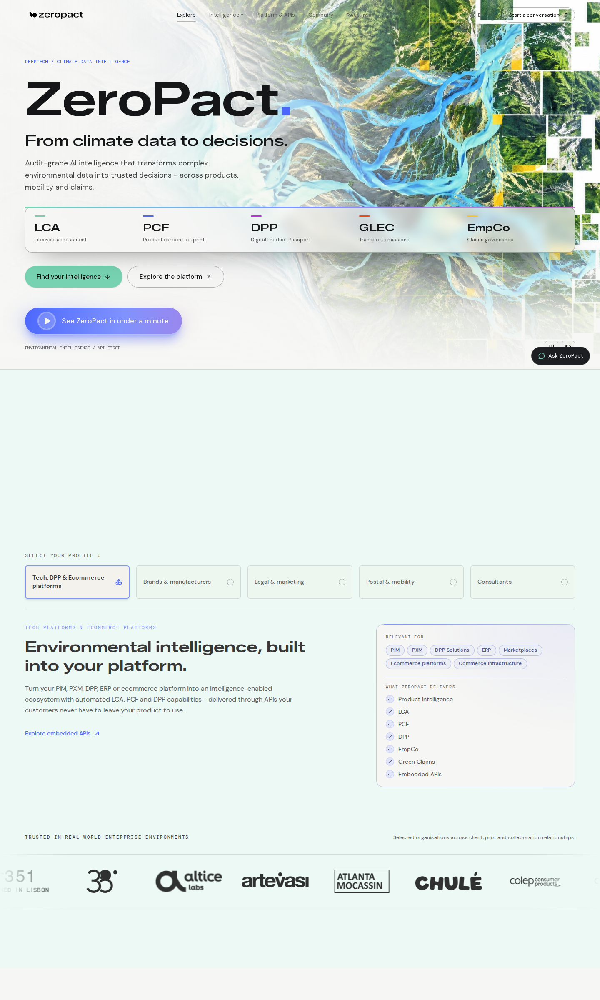
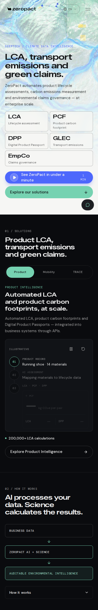

# UI Design System & Master Generation Blueprint: zeropact-co

> **Zeropact · Life Cycle Analysis (LCA) & Product Carbon Footprint** (https://zeropact.co) — Worlds Most Advanced Product Carbon Footprint AI-Powered Software



---

## 1. Executive Visual Persona & Design Archetype

- **Brand Essence & Persona**: **Zeropact · Life Cycle Analysis (LCA) & Product Carbon Footprint** (`https://zeropact.co`). Worlds Most Advanced Product Carbon Footprint AI-Powered Software
- **Visual Archetype**: **Light-Substrate Editorial & Modular Grid System (`#E5E7EB` canvas, `#0A0A0A` ink, `#7C88AC` accent)**.
- **Anti-AI-Slop Differentiators**:
  - **Source-Grounded Chromatic Polarity**: Anchors the viewport in `#E5E7EB` (`var(--border-color)` in `:root`) paired with `#0A0A0A` primary typography and `#7C88AC` accents.
  - **Extracted Typographic Hierarchy**: Pairs `Zalando Sans Expanded` for display copy (`life Cycle analysis (“LCA”)`) with `Inter` and `JetBrains Mono`.
  - **Calibrated Spatial Grid & Motion**: Combines `547px` container bounds (`gap: 53px`, padding `20px`) with `cubic-bezier(.58,.3,.005,1)` easing and Three.js / WebGL Canvas Pipeline, Swiper Touch Carousel Engine.

---

## 2. Spatial Architecture & Modular Grid Mathematics



### Viewport Allocation & Container Geometry
- **Captured Viewport Dimensions**: Desktop `1440×2400px` (`assets/desktop.png`, capped at 2400px multi-section capture), Mobile `390×2400px` (`assets/mobile.png`, capped at 2400px multi-section capture).
- **Master Container Bounds**: `547px` extracted from `zeropact-co` stylesheet.
- **Canvas Lateral Padding & Spacing**: `20px` lateral canvas padding with `53px` grid gap.
- **Border Radius Scale**: `50px`, `16px`, `10px`, `50%`.

### Responsive Breakpoint Architecture
- **Desktop Layout**: Multi-column CSS Grid / Flexbox layout at `1440px` (`max-width: 547px`, `gap: 53px`).
- **Mobile Layout**: Single-column vertical stack at `390px` viewport width with `20px` horizontal padding.
- **Extracted CSS Media Queries**: `@media (min-width:768px)`, `@media (max-width:1024px)`, `@media (max-width:767px)`, `@media (max-width:991px)`.

---

## 3. Color System, Materiality & Atmospheric Lighting

### Semantic Palette & Source Grounding
| Semantic Role | Ground-Truth Value | Extracted CSS Source / Selector |
|---|---|---|
| **Primary Canvas Substrate** | `#E5E7EB` | `var(--border-color)` in `:root` |
| **Primary Typography Ink** | `#FFFFFF` | `var(--e-n-carousel-arrow-normal-color)` in `:root` |
| **Elevated Surface / Card Substrate** | `#376CDF` | `var(--e-n-carousel-dots-normal-color)` in `:root` |
| **Interactive Accent / Highlight** | `#7C88AC` | `var(--e-global-color-secondary)` in `:root` |
| **Secondary / Muted Copy** | `#4A5565` | `var(--e-global-color-text)` in `:root` |
| **Structural Hairline Border** | `#0A0A0A` | `var(--e-search-placeholder-color)` in `:root` |

### Sanitized Root CSS Variables (`ui-ux.md` Ground Truth)
| Variable Name | Extracted Value | Semantic Role |
|---|---|---|
| `--flex-grow` | `var( --container-widget-flex-grow )` | Design System Custom Token |
| `--display` | `flex` | Design System Custom Token |
| `--flex-direction` | `row` | Design System Custom Token |
| `--container-widget-width` | `calc( ( 1 - var( --container-widget-flex-grow ) ) * 100% )` | Layout / Spatial Grid Token |
| `--container-widget-height` | `100%` | Layout / Spatial Grid Token |
| `--container-widget-flex-grow` | `1` | Layout / Spatial Grid Token |
| `--container-widget-align-self` | `stretch` | Layout / Spatial Grid Token |
| `--flex-wrap-mobile` | `wrap` | Layout / Spatial Grid Token |
| `--align-items` | `center` | Design System Custom Token |
| `--gap` | `53px 53px` | Layout / Spatial Grid Token |
| `--row-gap` | `53px` | Layout / Spatial Grid Token |
| `--column-gap` | `53px` | Layout / Spatial Grid Token |
| `--padding-top` | `80px` | Layout / Spatial Grid Token |
| `--padding-bottom` | `80px` | Layout / Spatial Grid Token |
| `--padding-left` | `20px` | Layout / Spatial Grid Token |
| `--padding-right` | `20px` | Layout / Spatial Grid Token |

---

## 4. Typographic Scale & Editorial Hierarchy

### Font Family Stacks
- **Display Typography**: `Zalando Sans Expanded`.
- **Primary Body Stack**: `Inter`.
- **Technical / Metadata Stack**: `JetBrains Mono`.

### Typographic Scale & Rules (Extracted from Stylesheet & Variables)
- **Hero Display (`H1`)**: CSS variables `--display: flex`, `--e-n-carousel-swiper-slides-to-display: 3`, `--page-title-display: block`; rule `h1` (`font-weight: var(--e-globa...`).
- **Section Heading (`H2`)**: CSS variables `--text-2xl: 1.5rem`, `--text-2xl--line-height: calc(2 / 1.5)`, `--text-3xl: 1.875rem`; rule `h2` (`font-weight: var(--e-globa...`).
- **Body Copy**: CSS variables `--text-base: 1rem`, `--text-base--line-height: 1.5`; rule `p` (`line-height: var(--leading-relaxed)`).
- **Metadata & Navigation Labels**: CSS variables `--e-n-carousel-arrow-prev-caption-spacing: 15px`, `--e-n-carousel-arrow-next-caption-spacing: 15px`, `--arrow-prev-caption-spacing: 15px`.

---

## 5. Choreographed Motion & Interaction Physics

### Primary Easing Curves
- **Extracted Timing Functions**: `cubic-bezier(.58,.3,.005,1)`, `cubic-bezier(.4,0,.2,1)`, `cubic-bezier(.4,0,.6,1)`.

### Per-Element Transition & Choreography Rules
- **Selector `element-60f27f6 .elementor-icon-l...`**: `transition: color 0.3s` extracted from `zeropact-co` stylesheet.
- **Selector `ement-60f27f6 .elementor-icon-lis...`**: `transition: fill 0.3s` extracted from `zeropact-co` stylesheet.
- **Selector `r-element-60f27f6 .elementor-icon...`**: `transition: color 0.3s` extracted from `zeropact-co` stylesheet.
- **Extracted Easing Curve (`cubic-bezier(.58,.3,.005,1)`)**: Governs interactive state transitions across `<header.elementor>` and `<div.site-page-root>`.
- **Runtime Interaction Engine**: Integrates Three.js / WebGL Canvas Pipeline, Swiper Touch Carousel Engine with `prefers-reduced-motion: reduce` fallback guards.

---

## 6. Component Wireframe & Structural DOM Map

### Visual Layout Schematic (Grounded in `dom.html` — `1440px` Desktop & `390px` Mobile Reflow)
```
┌────────────────────────────────────────────────────────────────────────┐
│ DESKTOP VIEWPORT (1440px) — Zeropact · Life Cycle Analysis (LCA) & Pro │
│ ====================================================================== │
│ [ <header.elementor>       | Home · Solutions · E-Commerce · Logist ]  │
│ ---------------------------------------------------------------------- │
│ | HERO STAGE: <div.site-page-root>                                 |   │
│ | H1: life Cycle analysis (“LCA”)                                  |   │
│ | Substrate: #E5E7EB    | Ink: #0A0A0A    | Accent: #7C88AC        |   │
│ ---------------------------------------------------------------------- │
│ | SHOWCASE GRID (<div.site-page-root>      ) max-w: 547px          |   │
│ | +------------------------------+  +------------------------------+ | │
│ | | World's most advanced Ai-pow |  | Life Cycle Analysis ("LCA")  | | │
│ | +------------------------------+  +------------------------------+ | │
│ ---------------------------------------------------------------------- │
│ | MOBILE VIEWPORT REFLOW (390px) — Single-Column Stack (gap: 53px  ) | │
│ | [<header.elementor>] -> [<div.site-page-roo] -> [<div.site-page-roo] │
│ ---------------------------------------------------------------------- │
│ [ FOOTER (<footer.elementor>    ) | https://zeropact.co                │
└────────────────────────────────────────────────────────────────────────┘
```

### Granular DOM Region Breakdown
1. **Brand Header & Navigation Bar (<header.elementor> — `zeropact-co`)**:
   - Landmark `<header class="elementor elementor-198">` hosting `Zeropact · Life Cycle Analysis (LCA)` navigation (`Home · Solutions · E-Commerce · Logistics · Enterprise`), DOM attributes (`data-precedence="default"`, `data-precedence="default"`, `data-precedence="default"`, `data-precedence="default"`), and stylesheet rule `ementor-widget-video .elementor-w... { aspect-ratio:var(--video-aspect-ratio) }`.
2. **Hero Stage & Focal Lead (<div.site-page-root> — `life Cycle analysis (“LCA”)`)**:
   - Landmark `<div class="site-page-root">` presenting display lead `life Cycle analysis (“LCA”)` and copy excerpt *"Solutions E-Commerce Logistics Enterprise Digital Product Passpor"* over `#E5E7EB` canvas and `#0A0A0A` ink.
3. **Primary Showcase & Content Grid (<div.site-page-root> — `World's most advanced Ai-powered e`)**:
   - Landmark `<div class="site-page-root">` rendering section `World's most advanced Ai-powered engine designed...` with copy *"Digital Product Passport"*, asset references (`styles-nW61obKD.css`, `2555c6801d335bcfd3cdccb22cdb3e1e.css`, `863d0923110b7e2df40bdfebd60fedff.css`, `55ee03d21b51256d575abda3ce68a9da.css`), and grid rule `r-widget-video .elementor-wrapper... { background-color:000;border:none;display:flex;height:100%;width:100% }`.
4. **Interactive Detail & Feature Matrix (<div.site-page-root> — `Life Cycle Analysis ("LCA")`)**:
   - Landmark `<div class="site-page-root">` framing `Life Cycle Analysis ("LCA")` and `AI-Powered Last-Mile CO2 emissions at Scale` (*"Scale from one to thousands of SKUs with automated, ISO 14067-com"*) with `#376CDF` surface cards, `#7C88AC` accents, and `e .elementor-custom-embed-image-o... { background-position:50%;background-size:cover;inset:0;position:absolute }`.
5. **Colophon & Global Directory Footer (<footer.elementor> — `https://zeropact.co`)**:
   - Landmark `<footer class="elementor elementor-172">` anchoring `Zeropact · Life Cycle Analysis (` footer links (`Home · Solutions · E-Commerce · Logistics · Enterprise`), copy *"Explore our Solutions"*, and `#0A0A0A` structural dividers.

---

## 7. Master Zero-Shot AI Generation Prompt

```markdown
# Master Zero-Shot Frontend Generation Prompt: zeropact-co (Zeropact · Life Cycle Analysis (LCA) & Product Carbon Footprint)

You are a principal frontend architect and design systems engineer. Build a complete, production-ready web application replicating the exact design system, DOM landmarks, typographic hierarchy, color tokens, and motion physics of `zeropact-co` (**Zeropact · Life Cycle Analysis (LCA) & Product Carbon Footprint** — `https://zeropact.co`).

### 1. Visual Archetype & Anti-AI-Slop Mandates
- **Archetype**: Light-Substrate Editorial & Modular Grid System (`#E5E7EB` canvas, `#0A0A0A` ink, `#7C88AC` accent).
- **Identity & Domain Context**: Worlds Most Advanced Product Carbon Footprint AI-Powered Software
- **Primary Substrate**: `#E5E7EB` (`var(--border-color)` in `:root`), **Primary Ink**: `#0A0A0A`, **Accent / Highlight**: `#7C88AC`.
- **Site-Specific Differentiators**:
  - **Source-Grounded Chromatic Polarity**: Anchors the viewport in `#E5E7EB` (`var(--border-color)` in `:root`) paired with `#0A0A0A` primary typography and `#7C88AC` accents.
  - **Extracted Typographic Hierarchy**: Pairs `Zalando Sans Expanded` for display copy (`life Cycle analysis (“LCA”)`) with `Inter` and `JetBrains Mono`.
  - **Calibrated Spatial Grid & Motion**: Combines `547px` container bounds (`gap: 53px`, padding `20px`) with `cubic-bezier(.58,.3,.005,1)` easing and Three.js / WebGL Canvas Pipeline, Swiper Touch Carousel Engine.

### 2. Ground-Truth CSS Variables (`:root` Token Contract)
Declare and consume these exact custom properties extracted from `zeropact-co` in your global stylesheet:

:root {
  /* Zeropact · Life Cycle Analysis (LCA) & Product Carbon Footprint (zeropact-co) — Ground-Truth Extracted CSS Variables */
  --flex-grow: var( --container-widget-flex-grow ); /* Design System Custom Token (zeropact-co) */
  --display: flex; /* Design System Custom Token (zeropact-co) */
  --flex-direction: row; /* Design System Custom Token (zeropact-co) */
  --container-widget-width: calc( ( 1 - var( --container-widget-flex-grow ) ) * 100% ); /* Layout / Spatial Grid Token (zeropact-co) */
  --container-widget-height: 100%; /* Layout / Spatial Grid Token (zeropact-co) */
  --container-widget-flex-grow: 1; /* Layout / Spatial Grid Token (zeropact-co) */
  --container-widget-align-self: stretch; /* Layout / Spatial Grid Token (zeropact-co) */
  --flex-wrap-mobile: wrap; /* Layout / Spatial Grid Token (zeropact-co) */
  --align-items: center; /* Design System Custom Token (zeropact-co) */
  --gap: 53px 53px; /* Layout / Spatial Grid Token (zeropact-co) */
  --row-gap: 53px; /* Layout / Spatial Grid Token (zeropact-co) */
  --column-gap: 53px; /* Layout / Spatial Grid Token (zeropact-co) */
  --padding-top: 80px; /* Layout / Spatial Grid Token (zeropact-co) */
  --padding-bottom: 80px; /* Layout / Spatial Grid Token (zeropact-co) */
  --padding-left: 20px; /* Layout / Spatial Grid Token (zeropact-co) */
  --padding-right: 20px; /* Layout / Spatial Grid Token (zeropact-co) */
}

### 3. Semantic Color & Materiality Contract
Map every surface, ink, and border strictly to these source-grounded tokens:
- **Primary Canvas Substrate**: `#E5E7EB` — grounded in `var(--border-color)` in `:root`
- **Primary Typography Ink**: `#FFFFFF` — grounded in `var(--e-n-carousel-arrow-normal-color)` in `:root`
- **Elevated Surface / Card Substrate**: `#376CDF` — grounded in `var(--e-n-carousel-dots-normal-color)` in `:root`
- **Interactive Accent / Highlight**: `#7C88AC` — grounded in `var(--e-global-color-secondary)` in `:root`
- **Secondary / Muted Copy**: `#4A5565` — grounded in `var(--e-global-color-text)` in `:root`
- **Structural Hairline Border**: `#0A0A0A` — grounded in `var(--e-search-placeholder-color)` in `:root`

### 4. Spatial Grid, Container Bounds & Responsive Breakpoints
- **Desktop Viewport Reference**: `1440×2400px` (capped at 2400px multi-section capture, `1440px` standard desktop width).
- **Mobile Viewport Reference**: `390×2400px` (capped at 2400px multi-section capture, `390px` standard mobile width).
- **Container Max-Width**: `547px` extracted from `zeropact-co` stylesheet
- **Padding & Gutters**: `20px` lateral canvas padding with `53px` grid gap
- **Desktop Grid**: Multi-column CSS Grid / Flexbox layout at `1440px` (`max-width: 547px`, `gap: 53px`)
- **Mobile Adaptation**: Single-column vertical stack at `390px` viewport width with `20px` horizontal padding
- **Media Queries**: `@media (min-width:768px)`, `@media (max-width:1024px)`, `@media (max-width:767px)`, `@media (max-width:991px)`
- **Corner Radii**: `50px`, `16px`, `10px`, `50%`

### 5. Typography & Editorial Scale Contract
- **Display Font Stack**: `Zalando Sans Expanded`
- **Body Font Stack**: `Inter`
- **Monospace / Technical Font Stack**: `JetBrains Mono`
- **H1 Display Rule**: CSS variables `--display: flex`, `--e-n-carousel-swiper-slides-to-display: 3`, `--page-title-display: block`; rule `h1` (`font-weight: var(--e-globa...`)
- **H2 Section Rule**: CSS variables `--text-2xl: 1.5rem`, `--text-2xl--line-height: calc(2 / 1.5)`, `--text-3xl: 1.875rem`; rule `h2` (`font-weight: var(--e-globa...`)
- **Body Copy Rule**: CSS variables `--text-base: 1rem`, `--text-base--line-height: 1.5`; rule `p` (`line-height: var(--leading-relaxed)`)
- **Metadata & Index Rule**: CSS variables `--e-n-carousel-arrow-prev-caption-spacing: 15px`, `--e-n-carousel-arrow-next-caption-spacing: 15px`, `--arrow-prev-caption-spacing: 15px`

### 6. Component Hierarchy, Verbatim Copy & Real DOM Landmarks
Scaffold `zeropact-co` (`Zeropact · Life Cycle Analysis (LCA) & Product Carbon Footprint`) with these exact structural regions, extracted copy, and CSS rules from `dom.html`:
1. **Brand Header & Navigation Bar (<header.elementor> — `zeropact-co`)**:
   - DOM & Selectors: Landmark `<header class="elementor elementor-198">` hosting `Zeropact · Life Cycle Analysis (LCA)` navigation (`Home · Solutions · E-Commerce · Logistics · Enterprise`), DOM attributes (`data-precedence="default"`, `data-precedence="default"`, `data-precedence="default"`, `data-precedence="default"`), and stylesheet rule `ementor-widget-video .elementor-w... { aspect-ratio:var(--video-aspect-ratio) }`.
   - Responsive Contract: Header `Brand Header & Navigation Bar (<header.elementor> — `zeropact-co`)` (`zeropact-co`) adapts across `@media (min-width:768px)`, `@media (max-width:1024px)`, `@media (max-width:767px)`, `@media (max-width:991px)` with `cubic-bezier(.58,.3,.005,1)`, `cubic-bezier(.4,0,.2,1)`, `cubic-bezier(.4,0,.6,1)` transitions and links `Home · Solutions · E-Commerce · Logistics · Enterprise`.
2. **Hero Stage & Focal Lead (<div.site-page-root> — `life Cycle analysis (“LCA”)`)**:
   - DOM & Selectors: Landmark `<div class="site-page-root">` presenting display lead `life Cycle analysis (“LCA”)` and copy excerpt *"Solutions E-Commerce Logistics Enterprise Digital Product Passpor"* over `#E5E7EB` canvas and `#0A0A0A` ink.
   - Responsive Contract: Hero stage (`1440×2400px` desktop / `390×2400px` mobile) sets `#E5E7EB` background with `#0A0A0A` headline `life Cycle analysis (“LCA”)`.
3. **Primary Showcase & Content Grid (<div.site-page-root> — `World's most advanced Ai-powered e`)**:
   - DOM & Selectors: Landmark `<div class="site-page-root">` rendering section `World's most advanced Ai-powered engine designed...` with copy *"Digital Product Passport"*, asset references (`styles-nW61obKD.css`, `2555c6801d335bcfd3cdccb22cdb3e1e.css`, `863d0923110b7e2df40bdfebd60fedff.css`, `55ee03d21b51256d575abda3ce68a9da.css`), and grid rule `r-widget-video .elementor-wrapper... { background-color:000;border:none;display:flex;height:100%;width:100% }`.
   - Responsive Contract: Showcase grid `Primary Showcase & Content Grid (<div.site-page-root> — `World's most advanced Ai-powered e`)` applies Multi-column CSS Grid / Flexbox layout at `1440px` (`max-width: 547px`, `gap: 53px`) on desktop and Single-column vertical stack at `390px` viewport width with `20px` horizontal padding on mobile.
4. **Interactive Detail & Feature Matrix (<div.site-page-root> — `Life Cycle Analysis ("LCA")`)**:
   - DOM & Selectors: Landmark `<div class="site-page-root">` framing `Life Cycle Analysis ("LCA")` and `AI-Powered Last-Mile CO2 emissions at Scale` (*"Scale from one to thousands of SKUs with automated, ISO 14067-com"*) with `#376CDF` surface cards, `#7C88AC` accents, and `e .elementor-custom-embed-image-o... { background-position:50%;background-size:cover;inset:0;position:absolute }`.
   - Responsive Contract: Detail module `Interactive Detail & Feature Matrix (<div.site-page-root> — `Life Cycle Analysis ("LCA")`)` uses `50px`, `16px`, `10px`, `50%` radii, `#7C88AC` highlights, and assets (styles-nW61obKD.css, 2555c6801d335bcfd3cdccb22cdb3e1e.css, 863d0923110b7e2df40bdfebd60fedff.css).
5. **Colophon & Global Directory Footer (<footer.elementor> — `https://zeropact.co`)**:
   - DOM & Selectors: Landmark `<footer class="elementor elementor-172">` anchoring `Zeropact · Life Cycle Analysis (` footer links (`Home · Solutions · E-Commerce · Logistics · Enterprise`), copy *"Explore our Solutions"*, and `#0A0A0A` structural dividers.
   - Responsive Contract: Footer `Colophon & Global Directory Footer (<footer.elementor> — `https://zeropact.co`)` aligns to `547px` extracted from `zeropact-co` stylesheet with `20px` lateral canvas padding with `53px` grid gap and attributes (data-precedence="default", data-precedence="default", data-precedence="default").

#### Verbatim DOM Copy Excerpts (`dom.html`)
- Copy Excerpt 1: *"Solutions E-Commerce Logistics Enterprise Digital Product Passport"*
- Copy Excerpt 2: *"Digital Product Passport"*
- Copy Excerpt 3: *"Scale from one to thousands of SKUs with automated, ISO 14067-compliant, and audit..."*
- Copy Excerpt 4: *"Explore our Solutions"*

### 7. Motion, Extracted Stylesheet Rules & Interaction Choreography
- **Primary Easing Functions**: `cubic-bezier(.58,.3,.005,1)`, `cubic-bezier(.4,0,.2,1)`, `cubic-bezier(.4,0,.6,1)`
- **Extracted Stylesheet Rules (`zeropact-co`)**:
- `ementor-widget-video .elementor-w... { aspect-ratio:var(--video-aspect-ratio) }`
- `r-widget-video .elementor-wrapper... { background-color:000;border:none;display:flex;height:100%;width:100% }`
- `e .elementor-custom-embed-image-o... { background-position:50%;background-size:cover;inset:0;position:absolute }`
- `o .elementor-custom-embed-image-o... { cursor:pointer;text-align:center }`
- `video .e-hosted-video .elementor-... { -o-object-fit:cover;object-fit:cover }`
- **Per-Selector Transition Rules**:
- **Selector `element-60f27f6 .elementor-icon-l...`**: `transition: color 0.3s` extracted from `zeropact-co` stylesheet.
- **Selector `ement-60f27f6 .elementor-icon-lis...`**: `transition: fill 0.3s` extracted from `zeropact-co` stylesheet.
- **Selector `r-element-60f27f6 .elementor-icon...`**: `transition: color 0.3s` extracted from `zeropact-co` stylesheet.
- **Extracted Easing Curve (`cubic-bezier(.58,.3,.005,1)`)**: Governs interactive state transitions across `<header.elementor>` and `<div.site-page-root>`.
- **Runtime Interaction Engine**: Integrates Three.js / WebGL Canvas Pipeline, Swiper Touch Carousel Engine with `prefers-reduced-motion: reduce` fallback guards.

### 8. Technical Deliverables
- Implement in Next.js (App Router) with TypeScript and Tailwind CSS consuming the `:root` custom properties defined above for `zeropact-co`.
- Reproduce both the `1440px` desktop architecture and `390px` mobile breakpoint transitions, preserving semantic HTML5 landmarks (`<header>`, `<nav>`, `<main>`, `<section>`, `<footer>`) and `prefers-reduced-motion` accessibility guards.
```
