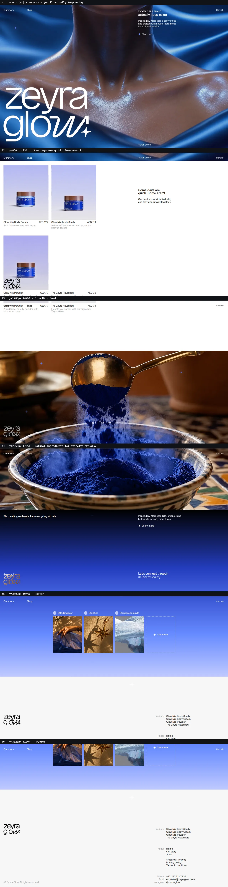
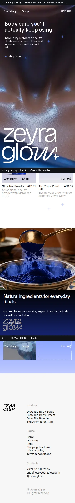

# UI Design System & Master Generation Blueprint: zeyraglow-com

> **Zeyra Glow · Natural Body Care Products in the UAE** (https://zeyraglow.com/) — Discover natural body care products by Zeyra Glow, made with comfortable, skin-friendly ingredients for simple everyday care. Shop online...





---

## 1. Executive Visual Persona & Design Archetype

- **Brand Essence & Persona**: **Zeyra Glow · Natural Body Care Products in the UAE** (`https://zeyraglow.com/`). Discover natural body care products by Zeyra Glow, made with comfortable, skin-friendly ingredients for simple everyday care. Shop online...
- **Capture Provenance**: Live browser capture (`tier1_fast`, HTTP `200`, captured `2026-11-24`).
- **Visual Archetype**: **Light-Substrate Editorial & Modular Grid System (`#ffffff` canvas, `#000000` ink, `#ff0000` accent)**.
- **Anti-AI-Slop Differentiators**:
  - **Live-Computed Chromatic Polarity**: Anchors the viewport in `#ffffff` (live computed `body` `background-color` (`computed_styles.json`)) paired with `#000000` primary typography and `#ff0000` accents.
  - **Grounded Typographic Hierarchy**: Pairs `TikTok Sans` for display copy (`Body care you'll actually keep using`) with `Outfit`.
  - **Calibrated Spatial Grid & Motion**: Combines `1680px` container bounds (`gap: .5rem`, padding `28px`) with `cubic-bezier(.795,-.035,0,1)` easing and Swiper Touch Carousel Engine, Lottie Vector Animation Player.

---

## 2. Spatial Architecture & Modular Grid Mathematics

### Viewport Allocation & Container Geometry
- **Captured Journey Filmstrips**: Desktop `1280×4968px` (`assets/desktop-journey.webp`, `6` keyframes up to `y=3620px` / doc `4520px`), Mobile `390×2616px` (`assets/mobile-journey.webp`, `3` keyframes).
- **Master Container Bounds**: `1680px` (non-`@media` desktop container stylesheet rule).
- **Canvas Lateral Padding & Spacing**: `28px` lateral canvas padding with `.5rem` grid gap.
- **Border Radius Scale**: `3px`, `4px`, `8px`, `var(--wc-form-border-radius)`.

### Responsive Breakpoint Architecture
- **Desktop Layout**: Multi-column CSS Grid / Flexbox layout at `1440px` (`max-width: 1680px`, `gap: .5rem`).
- **Mobile Layout**: Single-column vertical stack at `390px` viewport width with `28px` horizontal padding.
- **Extracted CSS Media Queries**: `@media (max-width:767px)`, `@media (max-width:991px)`, `@media (max-width:575px)`, `@media (min-width:768px)`.

---

## 3. Color System, Materiality & Atmospheric Lighting

### Semantic Palette & Source Grounding
| Semantic Role | Ground-Truth Value | Extracted Live / CSS Source |
|---|---|---|
| **Primary Canvas Substrate** | `#ffffff` | live computed `body` `background-color` (`computed_styles.json`) |
| **Primary Typography Ink** | `#000000` | live computed `body` `color` (`computed_styles.json`) |
| **Elevated Surface / Card Substrate** | `#f2f2f2` | `var(--zg-grey-bg)` in `:root` |
| **Interactive Accent / Highlight** | `#ff0000` | `.woocommerce a.remove { color: red }` (`#ff0000`) |
| **Secondary / Muted Copy** | `#7a7a7a` | `var(--e-global-color-text)` in `:root` |
| **Structural Hairline Border** | `#4d3939` | `var(--wc-form-border-color)` in `:root` (`rgba(32, 7, 7, 0.8)`) |
| **Variable Token (`--woocommerce`)** | `#720eec` | `var(--woocommerce)` in `:root` |
| **Variable Token (`--wc-green`)** | `#007518` | `var(--wc-green)` in `:root` |
| **Variable Token (`--wc-red`)** | `#aa0000` | `var(--wc-red)` in `:root` |
| **Variable Token (`--wc-orange`)** | `#ffba00` | `var(--wc-orange)` in `:root` |
| **Variable Token (`--wc-blue`)** | `#2ea2cc` | `var(--wc-blue)` in `:root` |
| **Variable Token (`--wc-primary-text`)** | `#fcfbfe` | `var(--wc-primary-text)` in `:root` |
| **Variable Token (`--wc-secondary`)** | `#e9e6ed` | `var(--wc-secondary)` in `:root` |
| **Variable Token (`--wc-secondary-text`)** | `#515151` | `var(--wc-secondary-text)` in `:root` |
| **Variable Token (`--wc-highlight`)** | `#958e09` | `var(--wc-highlight)` in `:root` |
| **Variable Token (`--wc-subtext`)** | `#767676` | `var(--wc-subtext)` in `:root` |

### Sanitized Root CSS Variables (`ui-ux.md` Ground Truth)
| Variable Name | Extracted Value | Semantic Role |
|---|---|---|
| `--woocommerce` | `#720eec` | Color / Atmospheric Token |
| `--wc-green` | `#007518` | Color / Atmospheric Token |
| `--wc-red` | `#a00` | Color / Atmospheric Token |
| `--wc-orange` | `#ffba00` | Color / Atmospheric Token |
| `--wc-blue` | `#2ea2cc` | Color / Atmospheric Token |
| `--wc-primary` | `#720eec` | Brand / Palette Token |
| `--wc-primary-text` | `#fcfbfe` | Typography Ink Token |
| `--wc-secondary` | `#e9e6ed` | Brand / Palette Token |
| `--wc-secondary-text` | `#515151` | Typography Ink Token |
| `--wc-highlight` | `#958e09` | Canvas / Surface Token |
| `--wc-highligh-text` | `white` | Typography Ink Token |
| `--wc-content-bg` | `#fff` | Canvas / Surface Token |
| `--wc-subtext` | `#767676` | Typography Ink Token |
| `--wc-form-border-color` | `rgba(32, 7, 7, 0.8)` | Brand / Palette Token |
| `--wc-form-border-radius` | `4px` | Elevation / Border Token |
| `--wc-form-border-width` | `1px` | Layout / Spatial Grid Token |

---

## 4. Typographic Scale & Editorial Hierarchy

### Font Family Stacks
- **Display Typography**: `TikTok Sans`.
- **Primary Body Stack**: `Outfit`.
- **Technical / Metadata Stack**: not declared in live computed styles (uses primary stack / `ui-monospace`).

### Typographic Scale & Rules (Live Computed & Stylesheet Grounded)
- **Hero Display (`H1`)**: live computed `h1` (`font-size: 20px`, `line-height: 22px`, `font-weight: 500`, `letter-spacing: 0.2px`); CSS variables `--page-title-display: block`, `--display: flex`; rule `h1` (`font-size: 28px`, `line-height: 1.1`, `letter-spacing: 0.01em`, `font-weight: 500`).
- **Section Heading (`H2`)**: live computed `h2` (`font-size: 20px`, `line-height: 19.2px`, `font-weight: 500`, `letter-spacing: 0.02px`); rule `h2` (`font-size: 28px`, `line-height: .96`, `letter-spacing: 0.001em`, `font-weight: 500`).
- **Body Copy**: live computed `body` (`font-size: 16px`, `line-height: 24px`, `font-weight: 400`); CSS variables `--e-global-typography-v4-zg-body-font-family: var(--za-font-fam)`, `--e-global-typography-v4-zg-body-font-size: var(--zg-b-desk-to-tab)`, `--e-global-typography-v4-zg-body-font-weight: 400`; rule `p` (`font-size: 15px`, `line-height: 1.6`, `font-weight: 300`).
- **Metadata & Navigation Labels**: live computed `nav/a` (`font-size: 16px`, `line-height: 24px`, `font-weight: 400`); rule `small` (`font-size: 15px`).

---

## 5. Choreographed Motion & Interaction Physics

### Primary Easing Curves
- **Extracted Timing Functions**: `cubic-bezier(.795,-.035,0,1)`, `cubic-bezier(.58,.3,.005,1)`, `cubic-bezier(0.22,1,0.36,1)`.

### Per-Element Transition & Choreography Rules
- **Selector `aceholder]:focus::-webkit-input-p...`**: `transition: opacity .5s .5s ease` extracted from `zeyraglow-com` stylesheet.
- **Selector `mages .woocommerce-product-galler...`**: `transition: all cubic-bezier(.795,-.035,0,1) .5s` extracted from `zeyraglow-com` stylesheet.
- **Selector `textarea`**: `transition: all .3s` extracted from `zeyraglow-com` stylesheet.
- **Extracted Easing Curve (`cubic-bezier(.795,-.035,0,1)`)**: Governs interactive state transitions across `<header.elementor>` and `<article.p-card>`.
- **Runtime Interaction Engine**: Integrates Swiper Touch Carousel Engine, Lottie Vector Animation Player, Barba.js Page Transition Router with `prefers-reduced-motion: reduce` fallback guards.
### Measured Runtime Scroll & Interaction Telemetry (`behavioral_journey_v2`)
- **Scroll Driver Mode**: `native` (max document height `4520px`, deepest scrollY reached `3620px` across `6` desktop keyframes).
- **Detected Scroll / Motion Libraries**: Native browser scroll / standard CSS transitions.
- **Route Transition Architecture**: First internal navigation (`/shop/`) measured as `MPA` in `2073ms`.

---

## 6. Component Wireframe & Structural DOM Map

### Visual Layout Schematic — Desktop (`1440px`, Grounded in `dom.html` & Landmark Bounding Boxes)
```
┌────────────────────────────────────────────────────────────────────────┐
│ DESKTOP VIEWPORT (1440px) — Zeyra Glow · Natural Body Care Products in │
│ ====================================================================== │
│ [ <header.elementor> (424x67px)       | Our story · Shop             ] │
│ ---------------------------------------------------------------------- │
│ | HERO STAGE: <section.products> (w=1440px)                          | │
│ | H1: Body care you'll actually keep using                           | │
│ | Substrate: #ffffff | Ink: #000000 | Accent: #ff0000                | │
│ ---------------------------------------------------------------------- │
│ | SHOWCASE GRID (<article.p-card>) max-w: 1680px                     | │
│ | +------------------------------+  +------------------------------+ | │
│ | | Glow Nila Body Cream         |  | Glow Nila Body Scrub         | | │
│ | +------------------------------+  +------------------------------+ | │
│ ---------------------------------------------------------------------- │
│ | DETAIL MODULE (<article.p-card:nth(2)>) — Glow Nila Powder         | │
│ ---------------------------------------------------------------------- │
│ [ FOOTER (<footer.cart-footer>) | https://zeyraglow.com/               │
└────────────────────────────────────────────────────────────────────────┘
```

### Visual Layout Schematic — Mobile Reflow (`390px`)
```
┌────────────────────────────────────────────────────────────────────────┐
│ MOBILE VIEWPORT REFLOW (390px) — Single-Column Stack (gap: .5rem)      │
│ ====================================================================== │
│ [ HEADER BAR (<header.elementor>      ) | Compact Menu (390px)         │
│ ---------------------------------------------------------------------- │
│ | HERO STAGE (<section.products>) — 390px Vertical Lead              | │
│ | H1: Body care you'll actually keep using                           | │
│ ---------------------------------------------------------------------- │
│ | SHOWCASE STACK (<article.p-card>) — 1-Col Stack                    | │
│ | [ Item 1: Glow Nila Body Cream                                   ] | │
│ | [ Item 2: Glow Nila Body Scrub                                   ] | │
│ ---------------------------------------------------------------------- │
│ | DETAIL STACK (<article.p-card:nth(2)>) — 1-Col (Glow Nila Powder)  | │
│ ---------------------------------------------------------------------- │
│ [ FOOTER (<footer.cart-footer>) | Stacked 390px Colophon               │
└────────────────────────────────────────────────────────────────────────┘
```

### Granular DOM Region Breakdown
1. **Brand Header & Navigation Bar (<header.elementor> — `zeyraglow-com`)**:
   - Landmark `<header class="elementor elementor-1083">` (`424x67px`) hosting `Zeyra Glow · Natural Body Care Produ` navigation (`Our story · Shop`), DOM attributes (`data-wp-strategy="defer"`, `data-wp-strategy="defer"`, `data-wp-strategy="defer"`, `data-wp-strategy="defer"`), and stylesheet rule `.woocommerce form .form-row { padding:3px;margin:0 0 6px }`.
2. **Hero Stage & Focal Lead (<section.products> — `Body care you'll actually keep usi`)**:
   - Landmark `<section class="products">` presenting display lead `Body care you'll actually keep using` and copy excerpt *"Taxes, shipping and promos are calculated at checkout."* over `#ffffff` canvas and `#000000` ink.
3. **Primary Showcase & Content Grid (<article.p-card> — `Glow Nila Body Cream`)**:
   - Landmark `<article class="p-card">` rendering section `Glow Nila Body Cream` with copy *"Soft daily moisture, with argan"*, asset references (`fonts.googleapis.com`, `embed`, `woocommerce-layout.css`, `woocommerce-smallscreen.css`), and grid rule `focus::-webkit-input-placeholder { -webkit-transition:opacity .5s .5s ease;transition:opacity .5s .5s ease;... }`.
4. **Interactive Detail & Feature Matrix (<article.p-card:nth(2)> — `Glow Nila Body Scrub`)**:
   - Landmark `<article class="p-card">` framing `Glow Nila Body Scrub` and `Glow Nila Powder` (*"A rinse-off body scrub with argan, for uneven-feeling"*) with `#f2f2f2` surface cards, `#ff0000` accents, and `.woocommerce form .form-row label { line-height:2 }`.
5. **Colophon & Global Directory Footer (<footer.cart-footer> — `https://zeyraglow.com/`)**:
   - Landmark `<footer class="cart-footer cart-footer--empty">` anchoring `Zeyra Glow · Natural Body Care P` footer links (`Our story · Shop`), copy *"A traditional beauty powder with Moroccan roots"*, and `#4d3939` structural dividers.
### Full Vertical Scroll Sequence (Desktop `1440×900` Keyframes)
- **Step 01** (`y=0px`, `0%`): Active landmark `Body care you'll actually keep using` · sticky/fixed elements: `10`
- **Step 02** (`y=850px`, `23%`): Active landmark `Some days are quick. Some aren't` · sticky/fixed elements: `10`
- **Step 03** (`y=1700px`, `47%`): Active landmark `Glow Nila Powder` · sticky/fixed elements: `10`
- **Step 04** (`y=2550px`, `70%`): Active landmark `Natural ingredients for everyday rituals.` · sticky/fixed elements: `9`
- **Step 05** (`y=3400px`, `94%`): Active landmark `Footer` · sticky/fixed elements: `8`
- **Step 06** (`y=3620px`, `100%`): Active landmark `Footer` · sticky/fixed elements: `8`

### Multi-Page Internal Route Map
- **Listing Route (`/shop/`)**: `https://zeyraglow.com/shop/` — H1: `Zeyra Glow · Shop Natural Body Care Products UAE`, scrollHeight `3470px`, transition `MPA` (`2073ms`)
- **Detail Route (`/product/glow-nila-body-scrub/`)**: `https://zeyraglow.com/product/glow-nila-body-scrub/` — H1: `Glow Nila Body Scrub`, scrollHeight `3264px`, transition `direct` (`3961ms`)
- **Detail Route (`/product/glow-nila-body-cream/`)**: `https://zeyraglow.com/product/glow-nila-body-cream/` — H1: `Glow Nila Body Cream`, scrollHeight `3214px`, transition `direct` (`7061ms`)

---

## 7. Master Zero-Shot AI Generation Prompt

```markdown
# Master Zero-Shot Frontend Generation Prompt: zeyraglow-com (Zeyra Glow · Natural Body Care Products in the UAE)

You are a principal frontend architect and design systems engineer. Build a complete, production-ready web application replicating the exact design system, DOM landmarks, typographic hierarchy, color tokens, and motion physics of `zeyraglow-com` (**Zeyra Glow · Natural Body Care Products in the UAE** — `https://zeyraglow.com/`).

### 1. Visual Archetype & Anti-AI-Slop Mandates
- **Archetype**: Light-Substrate Editorial & Modular Grid System (`#ffffff` canvas, `#000000` ink, `#ff0000` accent).
- **Identity & Domain Context**: Discover natural body care products by Zeyra Glow, made with comfortable, skin-friendly ingredients for simple everyday care. Shop online...
- **Primary Substrate**: `#ffffff` (live computed `body` `background-color` (`computed_styles.json`)), **Primary Ink**: `#000000`, **Accent / Highlight**: `#ff0000`.
- **Site-Specific Differentiators**:
  - **Live-Computed Chromatic Polarity**: Anchors the viewport in `#ffffff` (live computed `body` `background-color` (`computed_styles.json`)) paired with `#000000` primary typography and `#ff0000` accents.
  - **Grounded Typographic Hierarchy**: Pairs `TikTok Sans` for display copy (`Body care you'll actually keep using`) with `Outfit`.
  - **Calibrated Spatial Grid & Motion**: Combines `1680px` container bounds (`gap: .5rem`, padding `28px`) with `cubic-bezier(.795,-.035,0,1)` easing and Swiper Touch Carousel Engine, Lottie Vector Animation Player.

### 2. Ground-Truth CSS Variables (`:root` Token Contract)
Declare and consume these exact custom properties extracted from `zeyraglow-com` in your global stylesheet:

:root {
  /* Zeyra Glow · Natural Body Care Products in the UAE (zeyraglow-com) — Live-Grounded CSS Variables */
  --woocommerce: #720eec; /* Color / Atmospheric Token (zeyraglow-com) */
  --wc-green: #007518; /* Color / Atmospheric Token (zeyraglow-com) */
  --wc-red: #a00; /* Color / Atmospheric Token (zeyraglow-com) */
  --wc-orange: #ffba00; /* Color / Atmospheric Token (zeyraglow-com) */
  --wc-blue: #2ea2cc; /* Color / Atmospheric Token (zeyraglow-com) */
  --wc-primary: #720eec; /* Brand / Palette Token (zeyraglow-com) */
  --wc-primary-text: #fcfbfe; /* Typography Ink Token (zeyraglow-com) */
  --wc-secondary: #e9e6ed; /* Brand / Palette Token (zeyraglow-com) */
  --wc-secondary-text: #515151; /* Typography Ink Token (zeyraglow-com) */
  --wc-highlight: #958e09; /* Canvas / Surface Token (zeyraglow-com) */
  --wc-highligh-text: white; /* Typography Ink Token (zeyraglow-com) */
  --wc-content-bg: #fff; /* Canvas / Surface Token (zeyraglow-com) */
  --wc-subtext: #767676; /* Typography Ink Token (zeyraglow-com) */
  --wc-form-border-color: rgba(32, 7, 7, 0.8); /* Brand / Palette Token (zeyraglow-com) */
  --wc-form-border-radius: 4px; /* Elevation / Border Token (zeyraglow-com) */
  --wc-form-border-width: 1px; /* Layout / Spatial Grid Token (zeyraglow-com) */
}

### 3. Semantic Color & Materiality Contract
Map every surface, ink, and border strictly to these source-grounded tokens:
- **Primary Canvas Substrate**: `#ffffff` — grounded in live computed `body` `background-color` (`computed_styles.json`)
- **Primary Typography Ink**: `#000000` — grounded in live computed `body` `color` (`computed_styles.json`)
- **Elevated Surface / Card Substrate**: `#f2f2f2` — grounded in `var(--zg-grey-bg)` in `:root`
- **Interactive Accent / Highlight**: `#ff0000` — grounded in `.woocommerce a.remove { color: red }` (`#ff0000`)
- **Secondary / Muted Copy**: `#7a7a7a` — grounded in `var(--e-global-color-text)` in `:root`
- **Structural Hairline Border**: `#4d3939` — grounded in `var(--wc-form-border-color)` in `:root` (`rgba(32, 7, 7, 0.8)`)
- **Variable Token (`--woocommerce`)**: `#720eec` — grounded in `var(--woocommerce)` in `:root`
- **Variable Token (`--wc-green`)**: `#007518` — grounded in `var(--wc-green)` in `:root`
- **Variable Token (`--wc-red`)**: `#aa0000` — grounded in `var(--wc-red)` in `:root`
- **Variable Token (`--wc-orange`)**: `#ffba00` — grounded in `var(--wc-orange)` in `:root`
- **Variable Token (`--wc-blue`)**: `#2ea2cc` — grounded in `var(--wc-blue)` in `:root`
- **Variable Token (`--wc-primary-text`)**: `#fcfbfe` — grounded in `var(--wc-primary-text)` in `:root`
- **Variable Token (`--wc-secondary`)**: `#e9e6ed` — grounded in `var(--wc-secondary)` in `:root`
- **Variable Token (`--wc-secondary-text`)**: `#515151` — grounded in `var(--wc-secondary-text)` in `:root`
- **Variable Token (`--wc-highlight`)**: `#958e09` — grounded in `var(--wc-highlight)` in `:root`
- **Variable Token (`--wc-subtext`)**: `#767676` — grounded in `var(--wc-subtext)` in `:root`

### 4. Spatial Grid, Container Bounds & Responsive Breakpoints
- **Desktop Viewport Reference**: `1280×4968px` (multi-frame vertical journey filmstrip (4968px), `1440px` standard desktop width).
- **Mobile Viewport Reference**: `390×2616px` (multi-frame vertical journey filmstrip (2616px), `390px` standard mobile width).
- **Container Max-Width**: `1680px` (non-`@media` desktop container stylesheet rule)
- **Padding & Gutters**: `28px` lateral canvas padding with `.5rem` grid gap
- **Desktop Grid**: Multi-column CSS Grid / Flexbox layout at `1440px` (`max-width: 1680px`, `gap: .5rem`)
- **Mobile Adaptation**: Single-column vertical stack at `390px` viewport width with `28px` horizontal padding
- **Media Queries**: `@media (max-width:767px)`, `@media (max-width:991px)`, `@media (max-width:575px)`, `@media (min-width:768px)`
- **Corner Radii**: `3px`, `4px`, `8px`, `var(--wc-form-border-radius)`

### 5. Typography & Editorial Scale Contract
- **Display Font Stack**: `TikTok Sans`
- **Body Font Stack**: `Outfit`
- **Monospace / Technical Font Stack**: not declared in live computed styles (uses primary stack / `ui-monospace`)
- **H1 Display Rule**: live computed `h1` (`font-size: 20px`, `line-height: 22px`, `font-weight: 500`, `letter-spacing: 0.2px`); CSS variables `--page-title-display: block`, `--display: flex`; rule `h1` (`font-size: 28px`, `line-height: 1.1`, `letter-spacing: 0.01em`, `font-weight: 500`)
- **H2 Section Rule**: live computed `h2` (`font-size: 20px`, `line-height: 19.2px`, `font-weight: 500`, `letter-spacing: 0.02px`); rule `h2` (`font-size: 28px`, `line-height: .96`, `letter-spacing: 0.001em`, `font-weight: 500`)
- **Body Copy Rule**: live computed `body` (`font-size: 16px`, `line-height: 24px`, `font-weight: 400`); CSS variables `--e-global-typography-v4-zg-body-font-family: var(--za-font-fam)`, `--e-global-typography-v4-zg-body-font-size: var(--zg-b-desk-to-tab)`, `--e-global-typography-v4-zg-body-font-weight: 400`; rule `p` (`font-size: 15px`, `line-height: 1.6`, `font-weight: 300`)
- **Metadata & Index Rule**: live computed `nav/a` (`font-size: 16px`, `line-height: 24px`, `font-weight: 400`); rule `small` (`font-size: 15px`)

### 6. Component Hierarchy, Verbatim Copy & Real DOM Landmarks
Scaffold `zeyraglow-com` (`Zeyra Glow · Natural Body Care Products in the UAE`) with these exact structural regions, extracted copy, and CSS rules from `dom.html`:
1. **Brand Header & Navigation Bar (<header.elementor> — `zeyraglow-com`)**:
   - DOM & Selectors: Landmark `<header class="elementor elementor-1083">` (`424x67px`) hosting `Zeyra Glow · Natural Body Care Produ` navigation (`Our story · Shop`), DOM attributes (`data-wp-strategy="defer"`, `data-wp-strategy="defer"`, `data-wp-strategy="defer"`, `data-wp-strategy="defer"`), and stylesheet rule `.woocommerce form .form-row { padding:3px;margin:0 0 6px }`.
   - Responsive Contract: Header `Brand Header & Navigation Bar (<header.elementor> — `zeyraglow-com`)` (`zeyraglow-com`) adapts across `@media (max-width:767px)`, `@media (max-width:991px)`, `@media (max-width:575px)`, `@media (min-width:768px)` with `cubic-bezier(.795,-.035,0,1)`, `cubic-bezier(.58,.3,.005,1)`, `cubic-bezier(0.22,1,0.36,1)` transitions and links `Our story · Shop`.
2. **Hero Stage & Focal Lead (<section.products> — `Body care you'll actually keep usi`)**:
   - DOM & Selectors: Landmark `<section class="products">` presenting display lead `Body care you'll actually keep using` and copy excerpt *"Taxes, shipping and promos are calculated at checkout."* over `#ffffff` canvas and `#000000` ink.
   - Responsive Contract: Hero stage (`1280×4968px` desktop / `390×2616px` mobile) sets `#ffffff` background with `#000000` headline `Body care you'll actually keep using`.
3. **Primary Showcase & Content Grid (<article.p-card> — `Glow Nila Body Cream`)**:
   - DOM & Selectors: Landmark `<article class="p-card">` rendering section `Glow Nila Body Cream` with copy *"Soft daily moisture, with argan"*, asset references (`fonts.googleapis.com`, `embed`, `woocommerce-layout.css`, `woocommerce-smallscreen.css`), and grid rule `focus::-webkit-input-placeholder { -webkit-transition:opacity .5s .5s ease;transition:opacity .5s .5s ease;... }`.
   - Responsive Contract: Showcase grid `Primary Showcase & Content Grid (<article.p-card> — `Glow Nila Body Cream`)` applies Multi-column CSS Grid / Flexbox layout at `1440px` (`max-width: 1680px`, `gap: .5rem`) on desktop and Single-column vertical stack at `390px` viewport width with `28px` horizontal padding on mobile.
4. **Interactive Detail & Feature Matrix (<article.p-card:nth(2)> — `Glow Nila Body Scrub`)**:
   - DOM & Selectors: Landmark `<article class="p-card">` framing `Glow Nila Body Scrub` and `Glow Nila Powder` (*"A rinse-off body scrub with argan, for uneven-feeling"*) with `#f2f2f2` surface cards, `#ff0000` accents, and `.woocommerce form .form-row label { line-height:2 }`.
   - Responsive Contract: Detail module `Interactive Detail & Feature Matrix (<article.p-card:nth(2)> — `Glow Nila Body Scrub`)` uses `3px`, `4px`, `8px`, `var(--wc-form-border-radius)` radii, `#ff0000` highlights, and assets (fonts.googleapis.com, embed, woocommerce-layout.css).
5. **Colophon & Global Directory Footer (<footer.cart-footer> — `https://zeyraglow.com/`)**:
   - DOM & Selectors: Landmark `<footer class="cart-footer cart-footer--empty">` anchoring `Zeyra Glow · Natural Body Care P` footer links (`Our story · Shop`), copy *"A traditional beauty powder with Moroccan roots"*, and `#4d3939` structural dividers.
   - Responsive Contract: Footer `Colophon & Global Directory Footer (<footer.cart-footer> — `https://zeyraglow.com/`)` aligns to `1680px` (non-`@media` desktop container stylesheet rule) with `28px` lateral canvas padding with `.5rem` grid gap and attributes (data-wp-strategy="defer", data-wp-strategy="defer", data-wp-strategy="defer").

#### Verbatim DOM Copy Excerpts (`dom.html`)
- Copy Excerpt 1: *"Taxes, shipping and promos are calculated at checkout."*
- Copy Excerpt 2: *"Soft daily moisture, with argan"*
- Copy Excerpt 3: *"A rinse-off body scrub with argan, for uneven-feeling"*
- Copy Excerpt 4: *"A traditional beauty powder with Moroccan roots"*

### 7. Motion, Extracted Stylesheet Rules & Interaction Choreography
- **Primary Easing Functions**: `cubic-bezier(.795,-.035,0,1)`, `cubic-bezier(.58,.3,.005,1)`, `cubic-bezier(0.22,1,0.36,1)`
- **Extracted Stylesheet Rules (`zeyraglow-com`)**:
- `.woocommerce form .form-row { padding:3px;margin:0 0 6px }`
- `focus::-webkit-input-placeholder { -webkit-transition:opacity .5s .5s ease;transition:opacity .5s .5s ease;... }`
- `.woocommerce form .form-row label { line-height:2 }`
- `woocommerce form .form-row label.... { visibility:hidden }`
- `.woocommerce-input-wrapper .descr... { background:1e85be;color:fff;border-radius:3px;padding:1em;margin:.5em 0... }`
- **Per-Selector Transition Rules**:
- **Selector `aceholder]:focus::-webkit-input-p...`**: `transition: opacity .5s .5s ease` extracted from `zeyraglow-com` stylesheet.
- **Selector `mages .woocommerce-product-galler...`**: `transition: all cubic-bezier(.795,-.035,0,1) .5s` extracted from `zeyraglow-com` stylesheet.
- **Selector `textarea`**: `transition: all .3s` extracted from `zeyraglow-com` stylesheet.
- **Extracted Easing Curve (`cubic-bezier(.795,-.035,0,1)`)**: Governs interactive state transitions across `<header.elementor>` and `<article.p-card>`.
- **Runtime Interaction Engine**: Integrates Swiper Touch Carousel Engine, Lottie Vector Animation Player, Barba.js Page Transition Router with `prefers-reduced-motion: reduce` fallback guards.
### 7b. Full-Page Scroll Choreography, Interactive States & Multi-Page Routes
- **Scroll Mechanics**: Implement `native` vertical progression up to `4520px` across 6 distinct viewport chapters.
- **Vertical Chapter Sequence**: Body care you'll actually k... (0%) -> Some days are quick. Some a... (23%) -> Glow Nila Powder (47%) -> Natural ingredients for eve... (70%) -> Footer (94%) -> Footer (100%).
- **Multi-Page Routes**: Scaffold internal routes `/shop/` (listing, MPA), `/product/glow-nila-body-scrub/` (detail, direct), `/product/glow-nila-body-cream/` (detail, direct) sharing the global header/footer shell and design tokens.

### 8. Technical Deliverables
- Implement in Next.js (App Router) with TypeScript and Tailwind CSS consuming the `:root` custom properties defined above for `zeyraglow-com`.
- Reproduce both the `1440px` desktop architecture and `390px` mobile breakpoint transitions, preserving semantic HTML5 landmarks (`<header>`, `<nav>`, `<main>`, `<section>`, `<footer>`) and `prefers-reduced-motion` accessibility guards.
```
---

## 8. Full-Page Scroll Journey, Interactive States & Subpage Inventory

### Desktop Scroll Keyframes (`1440×900` WebP)
| Step | Scroll Y | Progress | Active Landmark / Section | Sticky/Fixed | Visual Asset |
| :---: | :---: | :---: | :--- | :---: | :--- |
| `#01` | `0px` | `0%` | Body care you'll actually keep using | `10` | [desktop-step-01.webp](assets/desktop-step-01.webp) |
| `#02` | `850px` | `23%` | Some days are quick. Some aren't | `10` | [desktop-step-02.webp](assets/desktop-step-02.webp) |
| `#03` | `1700px` | `47%` | Glow Nila Powder | `10` | [desktop-step-03.webp](assets/desktop-step-03.webp) |
| `#04` | `2550px` | `70%` | Natural ingredients for everyday rituals. | `9` | [desktop-step-04.webp](assets/desktop-step-04.webp) |
| `#05` | `3400px` | `94%` | Footer | `8` | [desktop-step-05.webp](assets/desktop-step-05.webp) |
| `#06` | `3620px` | `100%` | Footer | `8` | [desktop-step-06.webp](assets/desktop-step-06.webp) |

### Mobile Condensed Keyframes (`390×844` WebP)
| Step | Scroll Y | Progress | Active Landmark | Visual Asset |
| :---: | :---: | :---: | :--- | :--- |
| `#01` | `0px` | `0%` | Body care you'll actually keep using | [mobile-step-01.webp](assets/mobile-step-01.webp) |
| `#02` | `1511px` | `50%` | Glow Nila Powder | [mobile-step-02.webp](assets/mobile-step-02.webp) |
| `#03` | `3022px` | `100%` | Footer | [mobile-step-03.webp](assets/mobile-step-03.webp) |

### Internal Subpage Filmstrips (`1080px` Wide WebP)
| # | Template | Route URL | H1 / Title | Scroll Height | Transition | Filmstrip Asset |
| :-: | :---: | :--- | :--- | :---: | :---: | :--- |
| `1` | `listing` | `https://zeyraglow.com/shop/` | Zeyra Glow · Shop Natural Body Care P... | `3470px` | `MPA` (`2073ms`) | [subpage-01-shop.webp](assets/subpage-01-shop.webp) |
| `2` | `detail` | `https://zeyraglow.com/product/glow-nila-body-scrub/` | Glow Nila Body Scrub | `3264px` | `direct` (`3961ms`) | [subpage-02-product-glow-nila-body-scrub.webp](assets/subpage-02-product-glow-nila-body-scrub.webp) |
| `3` | `detail` | `https://zeyraglow.com/product/glow-nila-body-cream/` | Glow Nila Body Cream | `3214px` | `direct` (`7061ms`) | [subpage-03-product-glow-nila-body-cream.webp](assets/subpage-03-product-glow-nila-body-cream.webp) |

