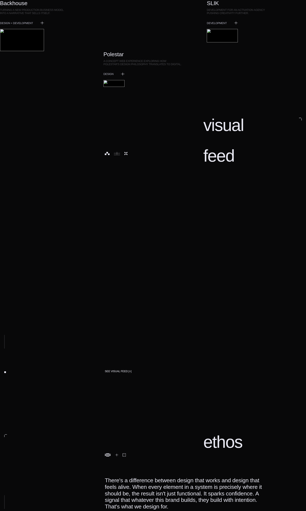
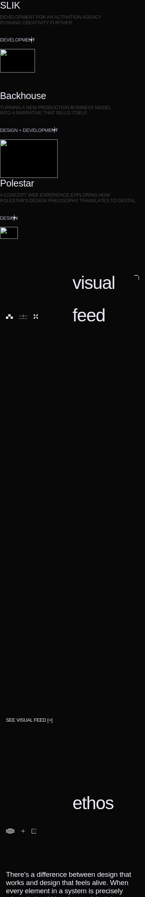

# UI Design System & Master Generation Blueprint: zujistudio-com

> **zuji studio - index** (https://zujistudio.com/) — Independent design studio creating brand systems and digital experiences rooted in precision. Based in Washington, working worldwide.



---

## 1. Executive Visual Persona & Design Archetype

- **Brand Essence & Persona**: **zuji studio - index** (`https://zujistudio.com/`). Independent design studio creating brand systems and digital experiences rooted in precision. Based in Washington, working worldwide.
- **Visual Archetype**: **Dark-Substrate WebGL / Canvas Interactive Experience (`#080809` / `#b1b1bf`)**.
- **Anti-AI-Slop Differentiators**:
  - **Source-Grounded Chromatic Polarity**: Anchors the viewport in `#080809` (`var(--color-800)` in `:root`) paired with `#e8e8f2` primary typography and `#b1b1bf` accents.
  - **Extracted Typographic Hierarchy**: Pairs `Roobertmonotrial` for display copy (`zuji studio`) with `Roobert Mono` and `Roobertmonotrial`.
  - **Calibrated Spatial Grid & Motion**: Combines `940px` container bounds (`gap: 16px`, padding `9px`) with `cubic-bezier(.25,.1,0,1.001)` easing and Lenis Smooth Scroll (`data-lenis`), GSAP Timeline & ScrollTrigger.

---

## 2. Spatial Architecture & Modular Grid Mathematics



### Viewport Allocation & Container Geometry
- **Captured Viewport Dimensions**: Desktop `1440×2400px` (`assets/desktop.png`, capped at 2400px multi-section capture), Mobile `390×2400px` (`assets/mobile.png`, capped at 2400px multi-section capture).
- **Master Container Bounds**: `940px` extracted from `zujistudio-com` stylesheet.
- **Canvas Lateral Padding & Spacing**: `9px` lateral canvas padding with `16px` grid gap.
- **Border Radius Scale**: `3px`, `100%`, `50%`, `.4rem`.

### Responsive Breakpoint Architecture
- **Desktop Layout**: Multi-column CSS Grid / Flexbox layout at `1440px` (`max-width: 940px`, `gap: 16px`).
- **Mobile Layout**: Single-column vertical stack at `390px` viewport width with `9px` horizontal padding.
- **Extracted CSS Media Queries**: `@media screen and (max-width: 991px)`, `@media screen and (max-width: 767px)`, `@media screen and (max-width: 479px)`, `@media (min-width: 768px)`.

---

## 3. Color System, Materiality & Atmospheric Lighting

### Semantic Palette & Source Grounding
| Semantic Role | Ground-Truth Value | Extracted CSS Source / Selector |
|---|---|---|
| **Primary Canvas Substrate** | `#080809` | `var(--color-800)` in `:root` |
| **Primary Typography Ink** | `#e8e8f2` | `var(--color-100)` in `:root` |
| **Elevated Surface / Card Substrate** | `#2c2c2f` | `var(--color-700)` in `:root` |
| **Interactive Accent / Highlight** | `#b1b1bf` | `var(--color-500)` in `:root` |
| **Secondary / Muted Copy** | `#c5c5d8` | `var(--color-200)` in `:root` |
| **Structural Hairline Border** | `#454549` | `var(--color-600)` in `:root` |

### Sanitized Root CSS Variables (`ui-ux.md` Ground Truth)
| Variable Name | Extracted Value | Semantic Role |
|---|---|---|
| `--color-800` | `#080809` | Brand / Palette Token |
| `--color-100` | `#e8e8f2` | Brand / Palette Token |
| `--real-h1` | `5rem` | Typography / Scale Token |
| `--h1-spacing` | `-.03em` | Typography / Scale Token |
| `--h1` | `4rem` | Typography / Scale Token |
| `--h2` | `2.5rem` | Typography / Scale Token |
| `--letter-spacing` | `-.012em` | Typography / Scale Token |
| `--h3` | `1.666rem` | Typography / Scale Token |
| `--mono` | `.8rem` | Typography / Scale Token |
| `--mono-spacing` | `-.02em` | Typography / Scale Token |
| `--grid-gap` | `1.25rem` | Layout / Spatial Grid Token |
| `--main-paragraph` | `.9rem` | Typography / Scale Token |
| `--hunnid` | `100%` | Dimension / Scale Token |
| `--global-padding` | `1.25rem` | Layout / Spatial Grid Token |
| `--space-small` | `2rem` | Layout / Spatial Grid Token |
| `--border-radius` | `.4rem` | Elevation / Border Token |

---

## 4. Typographic Scale & Editorial Hierarchy

### Font Family Stacks
- **Display Typography**: `Roobertmonotrial`.
- **Primary Body Stack**: `Roobert Mono`.
- **Technical / Metadata Stack**: `Roobertmonotrial`.

### Typographic Scale & Rules (Extracted from Stylesheet & Variables)
- **Hero Display (`H1`)**: CSS variables `--real-h1: 5rem`, `--h1-spacing: -.03em`, `--h1: 4rem`; rule `h1` (`font-size: 2em`).
- **Section Heading (`H2`)**: CSS variables `--h2: 2.5rem`; rule `h2` (`font-size: 32px`, `line-height: 36px`).
- **Body Copy**: CSS variables `--main-paragraph: .9rem`; rule `body` (`font-size: 14px`, `line-height: 20px`).
- **Metadata & Navigation Labels**: CSS variables `--letter-spacing: -.012em`, `--mono: .8rem`, `--mono-spacing: -.02em`; rule `small` (`font-size: 80%`).

---

## 5. Choreographed Motion & Interaction Physics

### Primary Easing Curves
- **Extracted Timing Functions**: `cubic-bezier(.25,.1,0,1.001)`, `cubic-bezier(.25,.1,0,.995)`, `cubic-bezier(.645,.045,.355,1)`.

### Per-Element Transition & Choreography Rules
- **Selector `.w-webflow-badge > img`**: `transition: unset` extracted from `zujistudio-com` stylesheet.
- **Selector `.w-slider-dot`**: `transition: background-color .1s, color .1s` extracted from `zujistudio-com` stylesheet.
- **Selector `.w-lightbox-control`**: `transition: all .3s` extracted from `zujistudio-com` stylesheet.
- **Extracted Easing Curve (`cubic-bezier(.25,.1,0,1.001)`)**: Governs interactive state transitions across `<header.w-mod-js>` and `<div.transition>`.
- **Runtime Interaction Engine**: Integrates Lenis Smooth Scroll (`data-lenis`), GSAP Timeline & ScrollTrigger, Three.js / WebGL Canvas Pipeline, Barba.js Page Transition Router with `prefers-reduced-motion: reduce` fallback guards.

---

## 6. Component Wireframe & Structural DOM Map

### Visual Layout Schematic (Grounded in `dom.html` — `1440px` Desktop & `390px` Mobile Reflow)
```
┌────────────────────────────────────────────────────────────────────────┐
│ DESKTOP VIEWPORT (1440px) — zuji studio - index                        │
│ ====================================================================== │
│ [ <header.w-mod-js>        | studio, · visual feed · contact · see  ]  │
│ ---------------------------------------------------------------------- │
│ | HERO STAGE: <div.transition>                                     |   │
│ | H1: zuji studio                                                  |   │
│ | Substrate: #080809    | Ink: #e8e8f2    | Accent: #b1b1bf        |   │
│ ---------------------------------------------------------------------- │
│ | SHOWCASE GRID (<div.transition>          ) max-w: 940px          |   │
│ | +------------------------------+  +------------------------------+ | │
│ | | select works                 |  | Apollo Atomics               | | │
│ | +------------------------------+  +------------------------------+ | │
│ ---------------------------------------------------------------------- │
│ | MOBILE VIEWPORT REFLOW (390px) — Single-Column Stack (gap: 16px  ) | │
│ | [<header.w-mod-js>] -> [<div.transition>] -> [<div.transition>] |    │
│ ---------------------------------------------------------------------- │
│ [ FOOTER (<footer.lenis-smooth> ) | https://zujistudio.com/            │
└────────────────────────────────────────────────────────────────────────┘
```

### Granular DOM Region Breakdown
1. **Brand Header & Navigation Bar (<header.w-mod-js> — `zujistudio-com`)**:
   - Landmark `<header class="w-mod-js">` hosting `zuji studio - index` navigation (`studio, · visual feed · contact · see visual feed [+]`), DOM attributes (`data-wf-domain="www.zujistudio.com"`, `data-wf-page="6a37365f2cb2a2b0994025f6"`, `data-wf-site="6a37365f2cb2a2b099402610"`, `data-barba="wrapper"`), and stylesheet rule `html { -webkit-text-size-adjust: 100%; -ms-text-size-adjust: 100%; font-family:... }`.
2. **Hero Stage & Focal Lead (<div.transition> — `zuji studio`)**:
   - Landmark `<div class="transition">` presenting display lead `zuji studio` and copy excerpt *"purposeful experiences"* over `#080809` canvas and `#e8e8f2` ink.
3. **Primary Showcase & Content Grid (<div.transition> — `select works`)**:
   - Landmark `<div class="transition">` rendering section `select works` with copy *"independent studio."*, asset references (`cdn.prod.website-files.com`, `zujistudio.webflow.shared.21d1844...`, `6a40cf63d130ed9881baa0d1_Frame%20...`, `6a40cf636da9030b77fa9c00_Frame%20...`), and grid rule `body { margin: 0; }`.
4. **Interactive Detail & Feature Matrix (<div.transition> — `Apollo Atomics`)**:
   - Landmark `<div class="transition">` framing `Apollo Atomics` and `S-2K` (*"based in washington, usa."*) with `#2c2c2f` surface cards, `#b1b1bf` accents, and `summary { display: block; }`.
5. **Colophon & Global Directory Footer (<footer.lenis-smooth> — `https://zujistudio.com/`)**:
   - Landmark `<footer class="lenis-smooth">` anchoring `zuji studio - index` footer links (`studio, · visual feed · contact · see visual feed [+]`), copy *"designs brand systems and digital experiences"*, and `#454549` structural dividers.

---

## 7. Master Zero-Shot AI Generation Prompt

```markdown
# Master Zero-Shot Frontend Generation Prompt: zujistudio-com (zuji studio - index)

You are a principal frontend architect and design systems engineer. Build a complete, production-ready web application replicating the exact design system, DOM landmarks, typographic hierarchy, color tokens, and motion physics of `zujistudio-com` (**zuji studio - index** — `https://zujistudio.com/`).

### 1. Visual Archetype & Anti-AI-Slop Mandates
- **Archetype**: Dark-Substrate WebGL / Canvas Interactive Experience (`#080809` / `#b1b1bf`).
- **Identity & Domain Context**: Independent design studio creating brand systems and digital experiences rooted in precision. Based in Washington, working worldwide.
- **Primary Substrate**: `#080809` (`var(--color-800)` in `:root`), **Primary Ink**: `#e8e8f2`, **Accent / Highlight**: `#b1b1bf`.
- **Site-Specific Differentiators**:
  - **Source-Grounded Chromatic Polarity**: Anchors the viewport in `#080809` (`var(--color-800)` in `:root`) paired with `#e8e8f2` primary typography and `#b1b1bf` accents.
  - **Extracted Typographic Hierarchy**: Pairs `Roobertmonotrial` for display copy (`zuji studio`) with `Roobert Mono` and `Roobertmonotrial`.
  - **Calibrated Spatial Grid & Motion**: Combines `940px` container bounds (`gap: 16px`, padding `9px`) with `cubic-bezier(.25,.1,0,1.001)` easing and Lenis Smooth Scroll (`data-lenis`), GSAP Timeline & ScrollTrigger.

### 2. Ground-Truth CSS Variables (`:root` Token Contract)
Declare and consume these exact custom properties extracted from `zujistudio-com` in your global stylesheet:

:root {
  /* zuji studio - index (zujistudio-com) — Ground-Truth Extracted CSS Variables */
  --color-800: #080809; /* Brand / Palette Token (zujistudio-com) */
  --color-100: #e8e8f2; /* Brand / Palette Token (zujistudio-com) */
  --real-h1: 5rem; /* Typography / Scale Token (zujistudio-com) */
  --h1-spacing: -.03em; /* Typography / Scale Token (zujistudio-com) */
  --h1: 4rem; /* Typography / Scale Token (zujistudio-com) */
  --h2: 2.5rem; /* Typography / Scale Token (zujistudio-com) */
  --letter-spacing: -.012em; /* Typography / Scale Token (zujistudio-com) */
  --h3: 1.666rem; /* Typography / Scale Token (zujistudio-com) */
  --mono: .8rem; /* Typography / Scale Token (zujistudio-com) */
  --mono-spacing: -.02em; /* Typography / Scale Token (zujistudio-com) */
  --grid-gap: 1.25rem; /* Layout / Spatial Grid Token (zujistudio-com) */
  --main-paragraph: .9rem; /* Typography / Scale Token (zujistudio-com) */
  --hunnid: 100%; /* Dimension / Scale Token (zujistudio-com) */
  --global-padding: 1.25rem; /* Layout / Spatial Grid Token (zujistudio-com) */
  --space-small: 2rem; /* Layout / Spatial Grid Token (zujistudio-com) */
  --border-radius: .4rem; /* Elevation / Border Token (zujistudio-com) */
}

### 3. Semantic Color & Materiality Contract
Map every surface, ink, and border strictly to these source-grounded tokens:
- **Primary Canvas Substrate**: `#080809` — grounded in `var(--color-800)` in `:root`
- **Primary Typography Ink**: `#e8e8f2` — grounded in `var(--color-100)` in `:root`
- **Elevated Surface / Card Substrate**: `#2c2c2f` — grounded in `var(--color-700)` in `:root`
- **Interactive Accent / Highlight**: `#b1b1bf` — grounded in `var(--color-500)` in `:root`
- **Secondary / Muted Copy**: `#c5c5d8` — grounded in `var(--color-200)` in `:root`
- **Structural Hairline Border**: `#454549` — grounded in `var(--color-600)` in `:root`

### 4. Spatial Grid, Container Bounds & Responsive Breakpoints
- **Desktop Viewport Reference**: `1440×2400px` (capped at 2400px multi-section capture, `1440px` standard desktop width).
- **Mobile Viewport Reference**: `390×2400px` (capped at 2400px multi-section capture, `390px` standard mobile width).
- **Container Max-Width**: `940px` extracted from `zujistudio-com` stylesheet
- **Padding & Gutters**: `9px` lateral canvas padding with `16px` grid gap
- **Desktop Grid**: Multi-column CSS Grid / Flexbox layout at `1440px` (`max-width: 940px`, `gap: 16px`)
- **Mobile Adaptation**: Single-column vertical stack at `390px` viewport width with `9px` horizontal padding
- **Media Queries**: `@media screen and (max-width: 991px)`, `@media screen and (max-width: 767px)`, `@media screen and (max-width: 479px)`, `@media (min-width: 768px)`
- **Corner Radii**: `3px`, `100%`, `50%`, `.4rem`

### 5. Typography & Editorial Scale Contract
- **Display Font Stack**: `Roobertmonotrial`
- **Body Font Stack**: `Roobert Mono`
- **Monospace / Technical Font Stack**: `Roobertmonotrial`
- **H1 Display Rule**: CSS variables `--real-h1: 5rem`, `--h1-spacing: -.03em`, `--h1: 4rem`; rule `h1` (`font-size: 2em`)
- **H2 Section Rule**: CSS variables `--h2: 2.5rem`; rule `h2` (`font-size: 32px`, `line-height: 36px`)
- **Body Copy Rule**: CSS variables `--main-paragraph: .9rem`; rule `body` (`font-size: 14px`, `line-height: 20px`)
- **Metadata & Index Rule**: CSS variables `--letter-spacing: -.012em`, `--mono: .8rem`, `--mono-spacing: -.02em`; rule `small` (`font-size: 80%`)

### 6. Component Hierarchy, Verbatim Copy & Real DOM Landmarks
Scaffold `zujistudio-com` (`zuji studio - index`) with these exact structural regions, extracted copy, and CSS rules from `dom.html`:
1. **Brand Header & Navigation Bar (<header.w-mod-js> — `zujistudio-com`)**:
   - DOM & Selectors: Landmark `<header class="w-mod-js">` hosting `zuji studio - index` navigation (`studio, · visual feed · contact · see visual feed [+]`), DOM attributes (`data-wf-domain="www.zujistudio.com"`, `data-wf-page="6a37365f2cb2a2b0994025f6"`, `data-wf-site="6a37365f2cb2a2b099402610"`, `data-barba="wrapper"`), and stylesheet rule `html { -webkit-text-size-adjust: 100%; -ms-text-size-adjust: 100%; font-family:... }`.
   - Responsive Contract: Header `Brand Header & Navigation Bar (<header.w-mod-js> — `zujistudio-com`)` (`zujistudio-com`) adapts across `@media screen and (max-width: 991px)`, `@media screen and (max-width: 767px)`, `@media screen and (max-width: 479px)`, `@media (min-width: 768px)` with `cubic-bezier(.25,.1,0,1.001)`, `cubic-bezier(.25,.1,0,.995)`, `cubic-bezier(.645,.045,.355,1)` transitions and links `studio, · visual feed · contact · see visual feed [+]`.
2. **Hero Stage & Focal Lead (<div.transition> — `zuji studio`)**:
   - DOM & Selectors: Landmark `<div class="transition">` presenting display lead `zuji studio` and copy excerpt *"purposeful experiences"* over `#080809` canvas and `#e8e8f2` ink.
   - Responsive Contract: Hero stage (`1440×2400px` desktop / `390×2400px` mobile) sets `#080809` background with `#e8e8f2` headline `zuji studio`.
3. **Primary Showcase & Content Grid (<div.transition> — `select works`)**:
   - DOM & Selectors: Landmark `<div class="transition">` rendering section `select works` with copy *"independent studio."*, asset references (`cdn.prod.website-files.com`, `zujistudio.webflow.shared.21d1844...`, `6a40cf63d130ed9881baa0d1_Frame%20...`, `6a40cf636da9030b77fa9c00_Frame%20...`), and grid rule `body { margin: 0; }`.
   - Responsive Contract: Showcase grid `Primary Showcase & Content Grid (<div.transition> — `select works`)` applies Multi-column CSS Grid / Flexbox layout at `1440px` (`max-width: 940px`, `gap: 16px`) on desktop and Single-column vertical stack at `390px` viewport width with `9px` horizontal padding on mobile.
4. **Interactive Detail & Feature Matrix (<div.transition> — `Apollo Atomics`)**:
   - DOM & Selectors: Landmark `<div class="transition">` framing `Apollo Atomics` and `S-2K` (*"based in washington, usa."*) with `#2c2c2f` surface cards, `#b1b1bf` accents, and `summary { display: block; }`.
   - Responsive Contract: Detail module `Interactive Detail & Feature Matrix (<div.transition> — `Apollo Atomics`)` uses `3px`, `100%`, `50%`, `.4rem` radii, `#b1b1bf` highlights, and assets (cdn.prod.website-files.com, zujistudio.webflow.shared.21d1844..., 6a40cf63d130ed9881baa0d1_Frame%20...).
5. **Colophon & Global Directory Footer (<footer.lenis-smooth> — `https://zujistudio.com/`)**:
   - DOM & Selectors: Landmark `<footer class="lenis-smooth">` anchoring `zuji studio - index` footer links (`studio, · visual feed · contact · see visual feed [+]`), copy *"designs brand systems and digital experiences"*, and `#454549` structural dividers.
   - Responsive Contract: Footer `Colophon & Global Directory Footer (<footer.lenis-smooth> — `https://zujistudio.com/`)` aligns to `940px` extracted from `zujistudio-com` stylesheet with `9px` lateral canvas padding with `16px` grid gap and attributes (data-wf-domain="www.zujistudio.com", data-wf-page="6a37365f2cb2a2b0994025f6", data-wf-site="6a37365f2cb2a2b099402610").

#### Verbatim DOM Copy Excerpts (`dom.html`)
- Copy Excerpt 1: *"purposeful experiences"*
- Copy Excerpt 2: *"independent studio."*
- Copy Excerpt 3: *"based in washington, usa."*
- Copy Excerpt 4: *"designs brand systems and digital experiences"*

### 7. Motion, Extracted Stylesheet Rules & Interaction Choreography
- **Primary Easing Functions**: `cubic-bezier(.25,.1,0,1.001)`, `cubic-bezier(.25,.1,0,.995)`, `cubic-bezier(.645,.045,.355,1)`
- **Extracted Stylesheet Rules (`zujistudio-com`)**:
- `html { -webkit-text-size-adjust: 100%; -ms-text-size-adjust: 100%; font-family:... }`
- `body { margin: 0; }`
- `summary { display: block; }`
- `video { vertical-align: baseline; display: inline-block; }`
- `template { display: none; }`
- **Per-Selector Transition Rules**:
- **Selector `.w-webflow-badge > img`**: `transition: unset` extracted from `zujistudio-com` stylesheet.
- **Selector `.w-slider-dot`**: `transition: background-color .1s, color .1s` extracted from `zujistudio-com` stylesheet.
- **Selector `.w-lightbox-control`**: `transition: all .3s` extracted from `zujistudio-com` stylesheet.
- **Extracted Easing Curve (`cubic-bezier(.25,.1,0,1.001)`)**: Governs interactive state transitions across `<header.w-mod-js>` and `<div.transition>`.
- **Runtime Interaction Engine**: Integrates Lenis Smooth Scroll (`data-lenis`), GSAP Timeline & ScrollTrigger, Three.js / WebGL Canvas Pipeline, Barba.js Page Transition Router with `prefers-reduced-motion: reduce` fallback guards.

### 8. Technical Deliverables
- Implement in Next.js (App Router) with TypeScript and Tailwind CSS consuming the `:root` custom properties defined above for `zujistudio-com`.
- Reproduce both the `1440px` desktop architecture and `390px` mobile breakpoint transitions, preserving semantic HTML5 landmarks (`<header>`, `<nav>`, `<main>`, `<section>`, `<footer>`) and `prefers-reduced-motion` accessibility guards.
```
